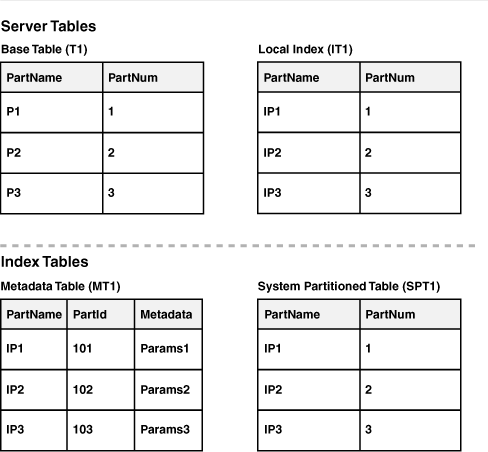
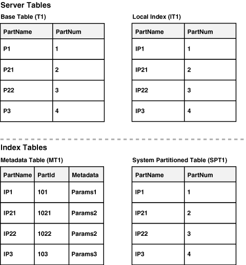

Consider domain indexes and the `ODCIIndex` interface: how to use of domain indexes, their partitioning, applicable restrictions, and migration procedures.

If you use user-managed domain indexes, the information specific to their implementation is in [User-Managed Local Domain Indexes](user-managed-local-domain-indexes.md)

### 8.1 Overview of Indextypes and Domain Indexes

A **domain index** is an index designed for a specialized domain, such as spatial or image processing. Users can build a domain index of a given type after the designer creates the **indextype**. The behavior of domain indexes is specific to an industry, a business function, or some other special purpose; you must specify it during cartridge development.

The system-managed approach to domain indexes, new in the Oracle Database 11g Release 1, requires less programmatic overhead and delivers better performance than the earlier user-managed domain indexes. It addresses the limitations of the user-managed approach, and has the following benefits:

- Because the kernel performs many more maintenance tasks on behalf of the user, there is no need for programmatic support for table and partition maintenance operations. These operations are implemented by taking actions in the server, thus requiring a very minimal set of user-defined interface routines to be coded by the user. The cartridge code can then be relatively unaware of partition issues.

- The number of objects that must be managed to support local partitioned domain indexes is identical to identical to those for non-partitioned domain indexes. For local partitioned indexes, the domain index storage tables are equipartitioned with respect to the base tables (using system-partitioned tables); therefore, the number of domain index storage tables does not increase with an increase in the number of partitions.

- A single set of query and DML statements can now access and manipulate the system-partitioned storage tables, facilitating cursor sharing and enhancing performance.

Oracle recommends that you develop new applications with system-managed domain indexes instead of user-managed domain indexes.

Indextypes encapsulate search and retrieval methods for complex domains such as text, spatial, and image processing. An indextype is similar to the indexes that are supplied with the Oracle Database. The difference is that you provide the application software that implements the indextype.

An indextype has two major components:

- The methods that implement the behavior of the indextype, such as creating and scanning the index

- The operators that the indextype supports, such as `Contains()` or `Overlaps()`

To create an indextype, you must perform the following steps:

- Define the supported operators and create the functions that implement them

- Create the methods that implement the `ODCIIndex` interface, and define the type that encapsulates them, called the **implementation type**

- Create the indextype, specifying the implementation type and listing the operators with their bindings

In this context:

- Interface means a logical set of documented method specifications (not a separate schema object)

- `ODCIIndex` interface means a set of index definition, maintenance, and scan routine specifications

**See Also:**

[Defining Operators](defining-operators.md)

### 8.2 ODCIIndex Interface

The `ODCIIndex` interface specifies all the routines you must supply to implement an indextype. The routines must be implemented as type methods.

The `ODCIIndex` interface comprises the following method classes:

- Index definition methods

- Index maintenance methods

- Index scan methods

- Index metadata method

**See Also:**

[Extensible Indexing Interface](extensible-indexing-interface.md) for method signatures and parameter descriptions

#### 8.2.1 Index Definition Methods

The application calls index definition methods when a user issues a `CREATE`, `ALTER`, `DROP`, or `TRUNCATE` statement on an index of indextype.

##### 8.2.1.1 ODCIIndexCreate()

When a user issues a `CREATE INDEX` statement that references the indextype, Oracle calls your [ODCIIndexCreate()](extensible-indexing-interface.md) method, passing it any parameters specified as part of the `CREATE` `INDEX`... `PARAMETERS` (...) statement, plus the description of the index.

Typically, this method creates the tables or files in which you plan to store index data. Unless the base table is empty, the method should also build the index.

##### 8.2.1.2 ODCIIndexAlter()

When a user issues an `ALTER INDEX` statement referencing your indextype, Oracle calls your [ODCIIndexAlter()](extensible-indexing-interface.md) method, passing it the description of the domain index to be altered along with any specified parameters. This method is also called to handle an `ALTER INDEX` with the `REBUILD` or `RENAME` options. What your method must do depends on the nature of your domain index, so the details are left to you as the designer of the indextype.

##### 8.2.1.3 ODCIIndexDrop()

When a user destroys an index of your indextype by issuing a `DROP` `INDEX` statement, Oracle calls your [ODCIIndexDrop()](extensible-indexing-interface.md) method.

#### 8.2.2 Index Maintenance Methods

Your index maintenance methods are called when users issue `INSERT`, `UPDATE`, and `DELETE` statements on tables with columns or object type attributes indexed by your indextype.

##### 8.2.2.1 ODCIIndexInsert()

When a user inserts a record, Oracle calls your [ODCIIndexInsert()](extensible-indexing-interface.md) method, passing it the new values in the indexed columns and the corresponding row identifier.

##### 8.2.2.2 ODCIIndexDelete()

When a user deletes a record, Oracle calls your [ODCIIndexDelete()](extensible-indexing-interface.md) method, passing it the old values in the indexed columns and the corresponding row identifier.

##### 8.2.2.3 ODCIIndexUpdate()

When a user updates a record, Oracle calls your [ODCIIndexUpdate()](extensible-indexing-interface.md) method, passing it the old and new values in the indexed columns and the corresponding row identifier.

#### 8.2.3 Index Scan Methods

Your index scan methods specify the index-based implementation for evaluating predicates containing the operators supported by your indextype. Index scans involve methods for initialization, fetching rows or row identifiers, and cleaning up after all rows are returned.

There are two modes of evaluating the operator predicate and returning the resulting set of rows:

- Precompute All: Compute the entire result set in [ODCIIndexStart()](extensible-indexing-interface.md). Iterate over the results returning a batch of rows from each call to [ODCIIndexFetch()](extensible-indexing-interface.md). This mode is applicable to operators that must look at the entire result set to compute ranking, relevance, and so on for each candidate row. It is also possible to return one row at a time if your application requires that.

- Incremental Computation: Compute a batch of result rows in each call to [ODCIIndexFetch()](extensible-indexing-interface.md). This mode is applicable to operators that can determine the candidate rows one at a time without having to look at the entire result set. It is also possible to return one row at a time if your application requires that.

##### 8.2.3.1 ODCIIndexStart()

Oracle calls your `ODCIIndexStart()` method at the beginning of an index scan, passing it information on the index and the operator. Typically, this method:

- Initializes data structures used in the scan

- Parses and executes SQL statements that query the tables storing the index data

- Saves any state information required by the fetch and cleanup methods, and returns the state or a handle to it

- Sometimes generates a set of result rows to be returned at the first invocation of `ODCIIndexFetch()`

The information on the index and the operator is not passed to the fetch and cleanup methods. Thus, `ODCIIndexStart()` must save **state** data that must be shared among the index scan routines and return it through an output `sctx` parameter. To share large amounts of state data, allocate cursor-duration memory and return a handle to the memory in the `sctx` parameter.

As member methods, `ODCIIndexFetch()` and `ODCIIndexClose()` are passed the built-in `SELF` parameter, through which they can access the state data.

**See Also:**

- [ODCIIndexClose()](extensible-indexing-interface.md)

- [ODCIIndexFetch()](extensible-indexing-interface.md)

- [ODCIIndexStart()](extensible-indexing-interface.md)

- [Oracle Call Interface Programmer's Guide](../lnoci/oci-cartridge-functions.md) for information on memory services and maintaining context

##### 8.2.3.2 ODCIIndexFetch()

Oracle calls your `ODCIIndexFetch()` method to return the row identifiers of the next batch of rows that satisfies the operator predicate, passing it the state data returned by `ODCIIndexStart()` or the previous `ODCIIndexFetch()` call. The operator predicate is specified in terms of the operator expression (name and arguments) and a lower and upper bound on the operator return values. Thus, `ODCIIndexFetch()` must return the row identifiers of the rows for which the operator return value falls within the specified bounds. To indicate the end of index scan, return a `NULL`.

**See Also:**

- [ODCIIndexFetch()](extensible-indexing-interface.md)

- [ODCIIndexStart()](extensible-indexing-interface.md)

##### 8.2.3.3 ODCIIndexClose()

Oracle calls your [ODCIIndexClose()](extensible-indexing-interface.md) method when the cursor is closed or reused, passing it the current state. [ODCIIndexClose()](extensible-indexing-interface.md) should perform whatever cleanup or closure operations your indextype requires.

#### 8.2.4 Index Metadata Method

The [ODCIIndexGetMetadata()](extensible-indexing-interface.md) method is optional. If you implement it, the Export utility calls it to write implementation-specific metadata into the Export dump file. This metadata might be policy information, version information, individual user settings, and so on, which are not stored in the system catalogs. The metadata is written to the dump files as anonymous PL/SQL blocks that are executed at import time immediately before the creation of the associated index.

#### 8.2.5 Transaction Semantics During Index Method Execution

The index interface methods (with the exception of the index definition methods, `ODCIIndexCreate()`, `ODCIIndexAlter()`, and `ODCIIndexDrop()`) are invoked under the same transaction that triggered these actions. Thus, the changes made by these routines are atomic and are committed or aborted based on the parent transaction. To achieve this, there are certain restrictions on the nature of the actions that you can perform in the different indextype routines:

- Index definition routines have no restrictions.

- Index maintenance routines can only execute Data Manipulation Language statements. These DML statements cannot update the base table on which the domain index is created.

- Index scan routines can only execute SQL query statements.

For example, if an `INSERT` statement caused the `ODCIIndexInsert()` routine to be invoked, `ODCIIndexInsert()` runs under the same transaction as `INSERT`. The `ODCIIndexInsert()` routine can execute any number of DML statements (for example, insert into index-organized tables). If the original transaction aborts, all the changes made by the indextype routines are rolled back.

However, if the indextype routines cause changes external to the database (like writing to external files), transaction semantics are not assured.

**See Also:**

- [ODCIIndexAlter()](extensible-indexing-interface.md)

- [ODCIIndexCreate()](extensible-indexing-interface.md)

- [ODCIIndexDrop()](extensible-indexing-interface.md)

- [ODCIIndexInsert()](extensible-indexing-interface.md)

#### 8.2.6 Transaction Semantics for Index Definition Routines

The index definition routines do not have any restrictions on the nature of actions within them. Consider `ODCIIndexCreate()` to understand this difference. A typical set of actions to be performed in `ODCIIndexCreate()` could be:

1.  Create an index-organized table.

2.  Insert data into the index-organized table.

3.  Create a secondary index on a column of the index-organized table.

To allow `ODCIIndexCreate()` to execute an arbitrary sequence of DDL and DML statements, each statement is considered to be an independent operation. Consequently, the changes made by `ODCIIndexCreate()` are not guaranteed to be atomic. The same is true for other index-definition routines.

**See Also:**

[ODCIIndexCreate()](extensible-indexing-interface.md)

#### 8.2.7 Consistency Semantics during Index Method Execution

The index maintenance (and scan routines) execute with the same snapshot as the top level SQL statement performing the DML (or query) operation. This keeps the index data processed by the index method consistent with the data in the base tables.

#### 8.2.8 Privileges During Index Method Execution

Indextype routines always execute as the owner of the index. To support this, the index access driver dynamically changes user mode to index owner before invoking the indextype routines.

For certain operations, indextype routines store information in tables owned by the indextype designer. The indextype implementation must perform those actions in a separate routine, which is executed using the definer's privileges.

**See Also:**

[Oracle Database SQL Language Reference](../sqlrf/CREATE-TYPE.md) for details on `CREATE TYPE`

### 8.3 Creating, Dropping, and Commenting Indextypes

Consider the SQL statements that manipulate indextypes.

**See Also:**

[ Oracle Database SQL Language Reference](../sqlrf/Introduction-to-Oracle-SQL.md) for complete descriptions of these SQL statements

#### 8.3.1 Creating Indextypes

When you have implemented the `ODCIIndex` interface and defined the implementation type, you can create a new indextype by specifying the list of operators supported by the indextype and referring to the type that implements the index interface. Using the information retrieval example, the DDL statement for defining the new indextype `TextIndexType`, which supports the `Contains` operator and whose implementation is provided by the type `TextIndexMethods`, as demonstrated by Example 8-1.

In addition to the `ODCIIndex` interface routines, the implementation type must implement the [ODCIGetInterfaces()](extensible-indexing-interface.md) routine. This routine returns the version of the interface implemented by the implementation type. Oracle invokes the [ODCIGetInterfaces()](extensible-indexing-interface.md) routine when executing `CREATE INDEXTYPE`.

Example 8-1 Creating an Indextype

    CREATE INDEXTYPE TextIndexType
    FOR Contains (VARCHAR2, VARCHAR2)
    USING TextIndexMethods
    WITH SYSTEM MANAGED STORAGE TABLES;

#### 8.3.2 Dropping Indextypes

To remove the definition of an indextype, use the `DROP` statement, as in Example 8-2:

The default `DROP` behavior is `DROP RESTRICT` semantics, that is, if one or more domain indexes exist that uses the indextype then the `DROP` operation is disallowed. Users can override the default behavior with the `FORCE` option, which drops the indextype and marks any dependent domain indexes invalid.

**See Also:**

"Object Dependencies\_ Drop Semantics\_ and Validation" for details on object dependencies and drop semantics

Example 8-2 Dropping an IndexType

    DROP INDEXTYPE TextIndexType;

#### 8.3.3 Commenting Indextypes

Use the `COMMENT` statement to supply information about an indextype or operator, as shown in Example 8-3.

To place a comment on an indextype, the indextype must be in your own schema, or you must have the `COMMENT ANY INDEXTYPE` privilege.

Example 8-3 Commenting an INDEXTYPE

    COMMENT ON INDEXTYPE
    TextIndexType IS 'implemented by the type TextIndexMethods to support the Contains operator';

##### 8.3.3.1 INDEXTYPE Comments

Comments on indextypes can be viewed in these data dictionary views:

- `ALL_INDEXTYPE_COMMENTS` displays comments for the user-defined indextypes accessible to the current user.

- `DBA_INDEXTYPE_COMMENTS` displays comments for all user-defined indextypes in the database.

- `USER_INDEXTYPE_COMMENTS` displays comments for the user-defined indextypes owned by the current user.

Table 8-1 Views \*\_INDEXTYPE_COMMENTS

| Column           | Data Type        | Required   | Description                            |
|:-----------------|:-----------------|:-----------|:---------------------------------------|
| `OWNER`          | `VARCHAR2(30)`   | `NOT NULL` | Owner of the user-defined indextype    |
| `INDEXTYPE_NAME` | `VARCHAR2(30)`   | `NOT NULL` | Name of the user-defined indextype     |
| `COMMENT`        | `VARCHAR2(4000)` | ` `        | Comment for the user-defined indextype |

### 8.4 Domain Indexes

Consider domain index operations and how metadata associated with the domain index may be obtained.

#### 8.4.1 Domain Index Operations

Consider how to create, alter, truncate, and drop domain indexes.

##### 8.4.1.1 Creating a Domain Index

A domain index can be created on a column of a table, just like a B-tree index. However, an indextype must be explicitly specified. Example 8-4 shows how to specify an indextype on the `MyEmployees` table that was declared in [Example 7-1](using-extensible-indexing.md).

The `INDEXTYPE` clause specifies the indextype to be used. The `PARAMETERS` clause identifies any parameters for the domain index, specified as a string. This string is passed uninterpreted to the [ODCIIndexCreate()](extensible-indexing-interface.md) routine for creating the domain index. In the preceding example, the parameters string identifies the language of the text document (thus identifying the lexical analyzer to use) and the list of stop words which are to be ignored while creating the text index.

Example 8-4 Creating a Domain Index

    CREATE INDEX ResumeTextIndex ON MyEmployees(resume)
    INDEXTYPE IS TextIndexType
    PARAMETERS (':Language English :Ignore the a an');

##### 8.4.1.2 Changing a Domain Index

The parameter string is passed uninterpreted to [ODCIIndexAlter()](extensible-indexing-interface.md) routine, which takes appropriate actions to alter the domain index. This example specifies an additional stop word to ignore in the text index.

Example 8-5 Changing a Domain Index

    ALTER INDEX ResumeTextIndex PARAMETERS (':Ignore on');

##### 8.4.1.3 Renaming a Domain Index

The `ALTER` statement can be used to rename a domain index, as shown in Example 8-6.

A statement of this form causes Oracle to invoke the [ODCIIndexAlter()](extensible-indexing-interface.md) method, which takes appropriate actions to rename the domain index.

Example 8-6 Renaming a Domain Index

    ALTER INDEX ResumeTextIndex RENAME TO ResumeTIdx;

##### 8.4.1.4 Rebuilding a Domain Index

The `ALTER` statement can be used to rebuild a domain index.

The same [ODCIIndexAlter()](extensible-indexing-interface.md) routine is called as before, but with additional information about the `ALTER` option.

When the end user executes an `ALTER INDEX `domain_index` UPDATE BLOCK REFERENCES` for a domain index on an index-organized table (IOT), [ODCIIndexAlter()](extensible-indexing-interface.md) is called with the `AlterIndexUpdBlockRefs` bit set. This gives you the opportunity to update guesses as to the block locations of rows that are stored in the domain index in logical rowids.

Example 8-7 Rebuilding a Domain Index

    ALTER INDEX ResumeTextIndex REBUILD PARAMETERS (':Ignore off');

##### 8.4.1.5 Truncating a Domain Index

There is no explicit statement for truncating a domain index. However, when the corresponding base table is truncated, the underlying storage table for the domain indexes are also truncated. Additionally, [ODCIIndexAlter()](extensible-indexing-interface.md) is invoked by the command in Example 8-8, and it truncates `ResumeTextIndex` because its `alter_option` is set to `AlterIndexRebuild`:

Example 8-8 Truncating a Domain Index

    TRUNCATE TABLE MyEmployees;

##### 8.4.1.6 Dropping a Domain Index

To drop an instance of a domain index, use the `DROP` `INDEX` statement, shown in Example 8-9:

This results in Oracle calling the [ODCIIndexDrop()](extensible-indexing-interface.md) method, passing it information about the index.

Example 8-9 Dropping a Domain Index

    DROP INDEX ResumeTextIndex;

#### 8.4.2 Domain Indexes on Index-Organized Tables

Consider some issues that arise when an indextype creates domain indexes on index-organized tables. You can use the `IndexOnIOT` bit of `IndexInfoFlags` in the `ODCIIndexInfo` structure to determine if the base table is an IOT.

##### 8.4.2.1 About Rowid Storage in a UROWID Column

When the base table of a domain index is an index-organized table, and you want to store rowids for the base table in a table of your own, you should store the rowids in a `UROWID` (universal rowid) column if you are testing rowids for equality.

If the rowids are stored in a `VARCHAR` column instead, comparisons for textual equality of a rowid from the base table and a rowid from your own table fail in some cases where the rowids pick out the same row. This is because index-organized tables use logical instead of physical rowids, and, unlike physical rowids, logical rowids for the same row can have different textual representations. Two logical rowids are equivalent when they have the same primary key, regardless of the guess data block addresses stored with them.

A `UROWID` column can contain both physical and logical rowids. Storing rowids for an IOT in a `UROWID` column ensures that the equality operator succeeds on two logical rowids that have the same primary key information but different guess DBAs.

If you create an index storage table with a rowid column by performing a `CREATE TABLE AS SELECT` from the IOT base table, then a `UROWID` column of the correct size is created for you in your index table. If you create a table with a rowid column, then you must explicitly declare your rowid column to be of type `UROWID(x)`, where `x` is the size of the `UROWID` column. The size chosen should be large enough to hold any rowid from the base table; thus, it should be a function of the primary key from the base table. Use the query demonstrated by Example 8-10 to determine a suitable size for the `UROWID` column.

Doing an `ALTER INDEX REBUILD` on index storage tables raises the same issues as doing a `CREATE TABLE` if you drop your storage tables and re-create them. If, on the other hand, you reuse your storage tables, no additional work should be necessary if your base table is an IOT.

##### 8.4.2.2 Determining the Size of a UROWID Column

Example 8-10 Getting the Size of a UROWID Column

    SELECT (SUM(column_length + 3) + 7)
    FROM user_ind_columns ic, user_indexes i
    WHERE ic.index_name = i.index_name
    AND i.index_type = 'IOT - TOP'
    AND ic.table_ name = base_table;

##### 8.4.2.3 DML on Index Storage Tables

If you maintain a `UROWID` column in the index storage table, then you must change the type of the rowid bind variable in DML `INSERT`, `UPDATE`, and `DELETE` statements so that it works for all kinds of rowids. Converting the rowid argument passed in to a text string and then binding it as a text string works well for both physical and universal rowids. This strategy may help you to code your indextype to work with both regular tables and IOTs.

##### 8.4.2.4 Start, Fetch, and Close Operations on Index Storage Tables

If you use an index scan-context structure to pass context between `Start`, `Fetch`, and `Close`, you must alter this structure. In particular, if you store the rowid define variable for the query in a buffer in this structure, then you must allocate the maximum size for a `UROWID` in this buffer (3800 bytes for universal rowids in byte format, 5072 for universal rowids in character format) unless you know the size of the primary key of the base table in advance or wish to determine it at run time. You must also store a bit in the context to indicate if the base table is an IOT, since `ODCIIndexInfo` is not available in `Fetch`.

As with DML operations, setting up the define variable as a text string works well for both physical and universal rowids. When physical rowids are fetched from the index table, you can be sure that their length is 18 characters. Universal rowids, however, may be up to 5072 characters long, so a string length function must be used to determine the actual length of a fetched universal rowid.

##### 8.4.2.5 Indexes on Non-Unique Columns

All values of a primary key column must be unique, so a domain index defined upon a non-unique column of a table cannot use this column as the primary key of an underlying IOT used to store the index. To work around this, you can add a column in the IOT, holding the index data, to hold a unique sequence number. When a column value is inserted in the table, generate a unique sequence number to go with it; you can then use the indexed column with the sequence number as the primary key of the IOT. (Note that the sequence-number column cannot be a `UROWID` because `UROWID` columns cannot be part of a primary key for an IOT.) This approach also preserves the fast access to primary key column values that is a major benefit of IOTs.

#### 8.4.3 Domain Index Metadata

For B-tree indexes, users can query the `USER_INDEXES` view to get index information. To provide similar support for domain indexes, you can provide domain-specific metadata in the following manner:

- Define one or more tables that contain this meta information. The key column of this table must be a unique identifier for the index. This unique key could be the index name (`schema.index`). The remainder of the columns can contain your metadata.

- Create views that join the system-defined metadata tables with the index meta tables to provide a comprehensive set of information for each instance of a domain index. It is your responsibility as the indextype designer to provide the view definitions.

#### 8.4.4 Moving Domain Indexes Using Export/Import

Like B-tree and bitmap indexes, domain indexes are exported and subsequently imported when their base tables are exported. However, domain indexes can have implementation-specific metadata associated with them that is not stored in the system catalogs. For example, a text domain index can have associated policy information, a list of irrelevant words, and so on. The export/import mechanism moves this metadata from the source platform to the target platform.

To move the domain index metadata, the indextype must implement the `ODCIIndexGetMetadata()` interface method. When a domain index is being exported, this method is invoked and passes the domain index information. It can return any number of anonymous PL/SQL blocks that are written into the dump file and executed on import. If present, these anonymous PL/SQL blocks are executed immediately before the creation of the associated domain index.

By default, secondary objects of the domain are not imported or exported. However, if the interfaces `ODCIIndexUtilGetTableNames()` and `ODCIIndexUtilCleanup()` are present, the system invokes them to determine if the secondary objects associated with the domain indexes are part of the export/import operation.

**See Also:**

- [ODCIIndexGetMetadata()](extensible-indexing-interface.md)

- [ODCIIndexUtilCleanup()](extensible-indexing-interface.md)

- [ODCIIndexUtilGetTableNames()](extensible-indexing-interface.md)

- [Oracle Database Utilities](../sutil/oracle-data-pump-overview.md) for information about using Export/Import

#### 8.4.5 Moving Domain Indexes Using Transportable Tablespaces

The transportable tablespaces feature lets you move tablespaces from one Oracle database into another. You can use transportable tablespaces to move domain index data as an alternative to exporting and importing it.

Moving data using transportable tablespaces can be much faster than performing either an export and import, or unload and load of the data because transporting a tablespace only requires copying datafiles and integrating tablespace structural information. Also, you do not have to rebuild the index afterward as you do when loading or importing. You can check for the presence of the `TransTblspc` flag in `ODCIIndexInfo` to determine whether the [ODCIIndexCreate()](extensible-indexing-interface.md) call is the result of an imported domain index.

To use transportable tablespace for the secondary tables of a domain index, you must provide two additional ODCI interfaces, [ODCIIndexUtilGetTableNames()](extensible-indexing-interface.md) and [ODCIIndexUtilCleanup()](extensible-indexing-interface.md), in the implementation type.

**See Also:**

[Oracle Database Administrator’s Guide](../admin/transporting-data.md) for information about using transportable tablespaces

#### 8.4.6 Domain Index Views

The following views provide information about secondary objects associated with domain indexes accessible to the user; they are only relevant for domain indexes.

- `ALL_SECONDARY_OBJECTS` provide information about secondary objects associated with domain indexes accessible to the user.

- `DBA_SECONDARY_OBJECTS` provides information about all secondary objects that are associated with domain indexes in the database.

- `USER_SECONDARY_OBJECTS` provides information about secondary objects associated with domain indexes owned by the current user.

Table 8-2 Views \*\_SECONDARY_OBJECTS

| Column                   | Data Type      | Required   | Description                                                                       |
|:-------------------------|:---------------|:-----------|:----------------------------------------------------------------------------------|
| `INDEX_OWNER`            | `VARCHAR2(30)` | `NOT NULL` | Name of the domain index owner                                                    |
| `INDEX_NAME`             | `VARCHAR2(30)` | `NOT NULL` | Name of the domain index                                                          |
| `SECONDARY_INDEX_OWNER`  | `VARCHAR2(30)` | `NOT NULL` | Owner of the secondary object created by the domain index                         |
| `SECONDARY_INDEX_NAME`   | `VARCHAR2(30)` | `NOT NULL` | Name of the secondary object created by the domain index                          |
| `SECONDARY_OBJDATA_TYPE` | `VARCHAR2(20)` | `NOT NULL` | Specifies if a secondary object is created by either indextype or statistics type |

Example 8-11 demonstrates how the `USER_SECONDARY_OBJECTS` view may be used to obtain information on the `ResumeTextIndex` that was created in Example 8-4.

Example 8-11 Using \*\_SECONDARY_OBJECTS Views

    SELECT SECONDARY_OBJECT_OWNER, SECONDARY_OBJECT_NAME
      FROM USER_SECONDARY_OBJECTS
      WHERE INDEX_OWNER = USER and INDEX_NAME = 'ResumeTextIndex'

### 8.5 Object Dependencies, Drop Semantics, and Validation

Consider issues that affect objects used in domain indexes.

#### 8.5.1 Object Dependencies

The dependencies among various objects are as follows:

- Functions, Packages, and Object Types: referenced by operators and indextypes

- Operators: referenced by indextypes, DML, and query SQL Statements

- Indextypes: referenced by domain indexes

- Domain Indexes: referenced (used implicitly) by DML and query SQL statements

Thus, the order in which these objects must be created, or their definitions exported for future import, is:

1.  Functions, packages, and object types

2.  Operators

3.  Indextypes

#### 8.5.2 Object Drop Semantics

The drop behavior for an object is as follows:

- `RESTRICT` semantics: if there are any dependent objects the drop operation is disallowed.

- `FORCE` semantics: the object is dropped even in the presence of dependent objects; any dependent objects are recursively marked invalid.

Table 8-3 shows the default and explicit drop options supported for operators and indextypes. The other schema objects are included for completeness and context.

Table 8-3 Default and Explicit Drop Options for Operators and Index Types

| Schema Object | Default Drop Behavior | Explicit Options Supported |
|:--------------|:----------------------|:---------------------------|
| Function      | `FORCE`               | None                       |
| Package       | `FORCE`               | None                       |
| Object Types  | `RESTRICT`            | `FORCE`                    |
| Operator      | `RESTRICT`            | `FORCE`                    |
| Indextype     | `RESTRICT`            | `FORCE`                    |

#### 8.5.3 Object Validation

Invalid objects are automatically validated, if possible, the next time they are referenced.

### 8.6 Indextype, Domain Index, and Operator Privileges

- To create an operator and its bindings, you must have `EXECUTE` privilege on the function, operator, package, or the type referenced in addition to `CREATE` `OPERATOR` or `CREATE` `ANY` `OPERATOR` privilege.

- To create an indextype, you must have `EXECUTE` privilege on the type that implements the indextype in addition to `CREATE` `INDEXTYPE` or `CREATE` `ANY` `INDEXTYPE` privilege. Also, you must have `EXECUTE` privileges on the operators that the indextype supports.

- To alter an indextype in your own schema, you must have `CREATE INDEXTYPE` system privilege.

- To alter an indextype or operator in another user's schema, you must have the `ALTER ANY INDEXTYPE` or `ALTER ANY OPERATOR` system privilege.

- To create a domain index, you must have `EXECUTE` privilege on the indextype in addition to `CREATE` `INDEX` or `CREATE` `ANY` `INDEX` privileges.

- To alter a domain index, you must have `EXECUTE` privilege on the indextype.

- To use the operators in queries or DML statements, you must have `EXECUTE` privilege on the operator and the associated function, package, and indextype.

- To change the implementation type, you must have `EXECUTE` privilege on the new implementation type.

### 8.7 Partitioned Domain Indexes

A domain index can be built to have discrete index partitions that correspond to the partitions of a range-, list-, hash-, or interval-partitioned table. Such an index is called a local domain index, as opposed to a global domain index, which has no index partitions. Local domain index refers to a partitioned index as a whole, not to the partitions that compose a local domain index.

**Note:**

You cannot convert a global domain index into a local domain index by using the `ALTER TABLE MODIFY PARTITION BY` statement.

You also cannot use `ALTER TABLE MODIFY PARTITION BY` statement to modify the partitioning scheme of a table with any domain index defined on it.

#### 8.7.1 Using Local Domain Index Methods

A local domain index is equipartitioned with the underlying table. That is, all keys in a local domain index refer to rows stored in its corresponding table partition, none refer to rows in other partitions. You can provide for local domain indexes in the indextype by calling the `CREATE INDEXTYPE` statement, as demonstrated in Example 8-12.

This statement specifies that the implementation type `TextIndexMethods` is capable of creating and maintaining local domain indexes.

Example 8-12 Using Local Domain Index Methods Within an Indextype

    CREATE INDEXTYPE TextIndexType
      FOR Contains (VARCHAR2, VARCHAR2)
      USING TextIndexMethods
      WITH LOCAL PARTITION
      WITH SYSTEM MANAGED STORAGE TABLES;

#### 8.7.2 About Partitioned Indexes

The `CREATE INDEX` statement creates and partitions the index, as demonstrated by Example 8-13.

The `LOCAL [PARTITION]` clause indicates that the index is a local index on a partitioned table. You can specify partition names or allow Oracle to generate them.

The `PARALLEL` clause specifies that the index partitions are to be created in parallel. The [ODCIIndexAlter()](extensible-indexing-interface.md) routines, which correspond to index partition create, rebuild, or populate, are called in parallel.

In the `PARAMETERS` clause, specify the parameter string that is passed uninterpreted to the appropriate ODCI indextype routine. The maximum length of the parameter string is `1000` characters.

When you specify this clause at the top level of the syntax, the parameters become the default parameters for the index partitions. If you specify this clause as part of the `LOCAL [PARTITION]` clause, you override any default parameters with parameters for the individual partition. The `LOCAL [PARTITION]` clause can specify multiple partitions.

Example 8-13 Creating and Partitioning an Index

    CREATE INDEX [schema.]index
      ON [schema.]table [t.alias] (indexed_column)
      INDEXTYPE IS indextype
      [LOCAL [PARTITION [partition [PARAMETERS ('string')]]] [...] ]
      [PARALLEL parallel_degree]
      [PARAMETERS ('string')];

#### 8.7.3 Creating a Local Domain Index

When the domain index is created, Oracle invokes the appropriate ODCI routine. If the routine does not return successfully, the domain index is marked `FAILED`. The only operations supported on an failed domain index are `DROP INDEX` and (for non-local indexes) `REBUILD INDEX`. Example 8-14 creates a local domain index `ResumeIndex`, shown in Example 8-14.

Example 8-14 Creating a Local Domain Index

    CREATE INDEX ResumeIndex ON MyEmployees(Resume)
      INDEXTYPE IS TextIndexType LOCAL;

#### 8.7.4 Dropping a Local Domain Index

A specified index partition cannot be dropped explicitly. To drop a local index partition, you must drop the entire local domain index:

Example 8-15 Dropping a Local Index Partition

    DROP INDEX ResumeIndex;

#### 8.7.5 Altering a Local Domain Index

The `ALTER INDEXTYPE` statement lets you change properties and the implementation type of an indextype without having to drop and re-create the indextype, then rebuild all dependent indexes.

Use the `ALTER INDEX` statement to perform the following operations on a local domain index:

- Rename the top level index.

- Modify the default parameter string for all the index partitions.

- Modify the parameter string associated with a specific partition.

- Rename an index partition.

- Rebuild an index partition.

**See Also:**

[https://www.oracle.com/pls/topic/lookup?ctx=en/database/oracle/oracle-database/19/addci&id=SQLRF-GUID-BFA7E29C-7905-4811-9119-B20FD8EA18F2](../sqlrf/ALTER-INDEXTYPE.md) for complete syntax of SQL statements.

#### 8.7.6 Summary of Index States

Like a domain index, a partition of a local domain index can be in one or more of several states, listed in Table 8-4.

Table 8-4 Summary of Index States

| State         | Description                                                                                                                                                                                                                                                            |
|:--------------|:-----------------------------------------------------------------------------------------------------------------------------------------------------------------------------------------------------------------------------------------------------------------------|
| `IN_PROGRESS` | The index or the index partition is in this state before and during the execution of the `ODCIIndex` DDL interface routines. The state is generally transitional and temporary. However, if the routine ends prematurely, the index could remain marked `IN_PROGRESS`. |
| `FAILED`      | If the `ODCIIndex` interface routine doing DDL operations on the index returns an error, the index or index partition is marked `FAILED`.                                                                                                                              |
| `UNUSABLE`    | Same as for regular indexes: An index on a partitioned table is marked `UNUSABLE` as a result of certain partition maintenance operations. Note that, for partitioned indexes, `UNUSABLE` is associated only with an index partition, not with the index as a whole.   |
| `VALID`       | An index is marked `VALID` if an object that the index directly or indirectly depends upon is exists and is valid. This property is associated only with an index, never with an index partition.                                                                      |
| `INVALID`     | An index is marked `INVALID` if an object that the index directly or indirectly depends upon is dropped or invalidated. This property is associated only with an index, never with an index partition.                                                                 |

#### 8.7.7 DML Operations with Local Domain Indexes

DML operations cannot be performed on the underlying table if an index partition of a local domain index is in any of these states: `IN_PROGRESS`, `FAILED`, or `UNUSABLE`. However, if the index is marked `UNUSABLE`, and `SKIP_UNUSABLE_INDEXES = true`, then index maintenance is not performed.

#### 8.7.8 Table Operations that Affect Indexes

The following tables list operations that may be performed on the underlying table of an inde,x and describe the effect, if any, on the index. Table 8-5 lists TABLE operations, while Table 8-6 lists `ALTER` `TABLE` operations.

Table 8-5 Summary of Table Operations

| Table Operation    | Description                                                               |
|:-------------------|:--------------------------------------------------------------------------|
| `DROP` `table`     | Drops the table. Drops all the indexes and their corresponding partitions |
| `TRUNCATE` `table` | Truncates the table. Truncates all the indexes and the index partitions   |

Table 8-6 Summary of ALTER TABLE Operations with Partition Maintenance

| ALTER TABLE Operation                           | Description                                                                                                                                                                                 |
|:------------------------------------------------|:--------------------------------------------------------------------------------------------------------------------------------------------------------------------------------------------|
| Modify Partition Unusable local indexes         | Marks the local index partition associated with the table partition as `UNUSABLE`                                                                                                           |
| Modify Partition Rebuild Unusable local indexes | Rebuilds the local index partitions that are marked `UNUSABLE` and are associated with this table partition                                                                                 |
| Add Partition                                   | Adds a new table partition. Also adds a new local index partition.                                                                                                                          |
| Coalesce Partition                              | Applicable to only hash partitioned tables. Drops a base table partition. Also drops the associated local index partition.                                                                  |
| Drop Partition                                  | Drops a base table partition. Also drops the associated local index partition                                                                                                               |
| Truncate Partition                              | Truncate the table partition. Also truncates the associated local index partition                                                                                                           |
| Move Partition                                  | Moves the base table partition to another tablespace. Corresponding local index partitions are marked `UNUSABLE`.                                                                           |
| Split Partition                                 | Splits a table partition into two partitions. Corresponding local index partition is also split. If the resulting partitions are non-empty, the index partitions are marked `UNUSABLE`.     |
| Merge Partition                                 | Merges two table partitions into one partition. Corresponding local index partitions should also merge. If the resulting partition contains data, the index partition is marked `UNUSABLE`. |
| Exchange Partition Excluding Indexes            | Exchanges a table partition with a non-partitioned table. Local index partitions and global indexes are marked `UNUSABLE`.                                                                  |
| Exchange Partition Including Indexes            | Exchanges a table partition with a non-partitioned table. Local index partition is exchanged with global index on the non-partitioned table. Index partitions remain `USABLE`.              |

#### 8.7.9 ODCIIndex Interfaces for Partitioning Domain Indexes

To support local domain indexes, you must implement the standard `ODCIIndex` methods, plus two additional methods that are specific to local domain indexes:

- [ODCIIndexExchangePartition()](extensible-indexing-interface.md)

- [ODCIIndexUpdPartMetadata()](extensible-indexing-interface.md)

#### 8.7.10 Using SQL\*Loader for Domain Indexes

SQL\*Loader conventional path loads and direct path loads are supported for tables on which domain indexes are defined, with this limitation: The table must be heap-organized.

To do a direct path load on a domain index defined on an `IOT` or on a `LOB` column, perform these tasks:

1.  Drop the domain index
2.  Do the direct path load in SQL\*Loader.
3.  Re-create the domain indexes.

### 8.8 Using System Partitioning

System Partitioning enables you to create a single table consisting of multiple physical partitions. System partitioning does not use partitioning keys. Instead, it creates the number of partitions specified. Therefore, the resulting partitions have no bounds (range), values (list), or a partitioning method.

Because there are no partitioning keys, you must explicitly map the distributed table rows to the destination partition. When inserting a row, for example, you must use the partition extended syntax to specify the partition to which a row must be mapped.

**See Also:**

Supporting SQL syntax in the [Oracle Database SQL Language Reference](../sqlrf/CREATE-TABLE.md)

#### 8.8.1 Advantages of System Partitioned Tables

The main advantages of system-partitioned tables is that it can be used to create and maintain tables that are equipartitioned with respect to another table. For example, this means that a dependent table could be created as a system-partitioned table, with the same number of partitions as the base table. It follows that such a system-partitioned table can be used to store index data for a domain index, with the following implications:

- Pruning follows the base table pruning rules: when a partition is accessed in the base table, the corresponding partition can be accessed in the system-partitioned table.

- DDLs of the base table can be duplicated on the system-partitioned table. Therefore, if a partition is dropped on the base table, the corresponding partition on the system-partitioned table is dropped automatically.

#### 8.8.2 Implementing System Partitioning

Consider how to implement system partitioning.

##### 8.8.2.1 Creating a System-Partitioned Table

Example 8-16 describes how to create a system-partitioned table with four partitions. Each partition can have different physical attributes.

Example 8-16 Creating System-Partitioned Tables

    CREATE TABLE SystemPartitionedTable (c1 integer, c2 integer)
    PARTITION BY SYSTEM
    (
      PARTITION p1 TABLESPACE tbs_1,
      PARTITION p2 TABLESPACE tbs_2,
      PARTITION p3 TABLESPACE tbs_3,
      PARTITION p4 TABLESPACE tbs_4
    );

##### 8.8.2.2 Inserting Data into a System-Partitioned Table

Example 8-17 demonstrates how to insert data into a system-partitioned table. Both `INSERT` and `MERGE` statements (not shown here) must use the partition extended syntax to identify the partition to which the row should be added. The tuple `(4,5)` could have been inserted into any of the four partitions created in Example 8-16. `DATAOBJ_TO_PARTITION` can also be used, as demonstrated by Example 8-18.

Starting with Oracle Database 12c, Oracle recommends using `DATAOBJ_TO_MAT_PARTITION`, as demonstrated in Example 8-19, instead of the `DATAOBJ_TO_PARTITION` function. The `DATAOBJ_TO_MAT_PARTITION` function supports local domain indexes on interval partitioned tables.

Note that the first line of code shows how to insert data into a named partition, while the second line of code shows that data can also be inserted into a partition based on the partition's order. The support for bind variables, illustrated on the third code line, is important because it allows cursor sharing between `INSERT` statements.

The `DATAOBJ_TO_PARTITION` function shown in Example 8-18 determines the absolute partition number, given the physical partition identifier. However, if the base table is interval partitioned, then there might be holes in the partition numbers corresponding to unmaterialized partitions. Because the system partitioned table only has materialized partitions, `DATAOBJ_TO_PARTITION` numbers can cause a mis-match between the partitions of the base table and the partitions of the underlying system partitioned index storage tables.

The new function, `DATAOBJ_TO_MAT_PARTITION`, shown in Example 8-19, returns the materialized partition number (as opposed to the absolute partition number) and helps keep the two tables in sync. Indextypes planning to support local domain indexes on interval partitioned tables should migrate to the use of this function.

Example 8-17 Inserting Data into System-Partitioned Tables

    INSERT INTO SystemPartitionedTable PARTITION (p1) VALUES (4,5);

Example 8-18 Inserting Data into System-Partitioned Tables; DATAOBJ_TO_PARTITION

    INSERT INTO SystemPartitionedTable PARTITION
      (DATAOBJ_TO_PARTITION (base_table, :physical_partid))
      VALUES (...);

Example 8-19 Inserting Data into System-Partitioned Tables; DATAOBJ_TO_MAT_PARTITION

    INSERT INTO SystemPartitionedTable PARTITION
      (DATAOBJ_TO_MAT_PARTITION (base_table, :physical_partid))
      VALUES (...);

##### 8.8.2.3 Deleting and Updating Data in a System-Partitioned Table

While delete and update operations do not require the partition extended syntax, Oracle recommends that you use it if at all possible. Because there is no partition pruning, the entire table is scanned to execute the operation if the partition-extended syntax is omitted. This highlights the fact that there is no implicit mapping between the rows and the partitions.

#### 8.8.3 Supporting Operations with System-Partitioned Tables

The following operations continue to be supported by system partitioning:

- Partition maintenance operations and other DDLs, with the exception of:

  - `ALTER INDEX SPLIT PARTITION`

  - `ALTER TABLE SPLIT PARTITION`

  - `CREATE TABLE` (as `SELECT`)

- Creation of local indexes, with the exception of unique local indexes because they require a partitioning key

- Creation of local bitmapped indexes

- Creation of global indexes

- All DML operations

- `INSERT AS SELECT` operations with partition extended syntax, as shown in the following code example:

  Inserting Data into a Particular Partition of a Table

      INSERT INTO TableName
        PARTITION (
          PartitionName|
          DATAOBJ_TO_MAT_PARTITION(base_table, :physical_partid))
        AS SubQuery

The following operations are no longer supported by system partitioning because system partitioning does not use a partitioning method, and therefore does not distribute rows to partitions.

- `CREATE TABLE AS SELECT` An alternative approach is to first create the table, and then insert rows into each partition.

- `INSERT INTO ``TableName`` AS`` SubQuery`

#### 8.8.4 Running Partition Maintenance Operations

As an example, consider an `ALTER TABLE SPLIT PARTITION` routine issued for the base table of a domain index.

1.  The system invokes the [ODCIIndexUpdPartMetadata()](extensible-indexing-interface.md) method using the information about the partition being added or dropped; remember that a 1:2 split involves dropping of one partition and adding two new partitions.
2.  The system invokes the [ODCIStatsUpdPartStatistics()](extensible-optimizer-interface.md) on the affected partitions.
3.  The system drops the partition that has been split from all system-partition index and statistics storage tables.
4.  The system adds two new partitions to the system-partitioned tables.
5.  If the partition that is being split is empty, then one call to [ODCIIndexAlter()](extensible-indexing-interface.md) rebuilds the split partition, and a second call to [ODCIIndexAlter()](extensible-indexing-interface.md) rebuilds the newly added partition.

#### 8.8.5 Altering Table Exchange Partitions with Indexes

The `ALTER TABLE EXCHANGE PARTITION` command is allowed for tables with domain indexes only under the following circumstances:

- a domain index is defined on both the non-partitioned table, and the partitioned table

- both the non-partitioned table and the partitioned table have the same associated indextype

**Note:**

The `ALTER TABLE EXCHANGE PARTITION CASCADE `command is not allowed if there is a local domain index on the reference partitioned table.

The `ALTER TABLE EXCHANGE PARTITION` routine invokes the following user-implemented methods:

1.  [ODCIIndexExchangePartition()](extensible-indexing-interface.md) for the affected partition and index
2.  [ODCIStatsExchangePartition()](extensible-optimizer-interface.md) for the affected partition and index if statistics are collected for them

### 8.9 Using System-Managed Domain Indexes

Consider how system-managed domain indexes work, how to collect and store statistics for them, and restrictions on their use.

Let us examine how system-managed domain indexes work.

Figure 8-1 illustrates the initial setup of a base table `T1`. `T1` has the following elements:

- three partitions

- a local domain index on one of its columns, `IT1`

- a table of corresponding metadata objects, `MT1`, which is the optional metadata table created by the indextype to store information specific to each partition of the local domain index

- a system-partitioned table, `SPT1`, created by the indextype to store index data

The structures shown in these tables (table `T1`, index `IT1` and the system partitioned table `SPT1`) have the same number of partitions, in a one-to-one relationship. The metadata table `MT1` has as many rows as the number of partitions in these tables.

Figure 8-1 Three-Partition Table with a Local Domain Index, and Associated Structures

[Description of "Figure 8-1 Three-Partition Table with a Local Domain Index, and Associated Structures"](img_text/addci047.md)

Figure 8-2 illustrates what happens to T1 and its related structures after splitting one of its partitions with the operation in Example 8-20:

- the partition `P2` in the base table `T1` splits into `P21` and `P22`

- in the local domain index, partition `IP2` is dropped and two new partitions, `IP21` and `IP22`, are created

- the indextype invokes the [ODCIIndexUpdPartMetadata()](extensible-indexing-interface.md) method that makes the necessary updates to the metadata table `MT1`

- in the system partitioned table `SPT1`, the partition that corresponds to partition `IP2` is dropped and two new partitions are created

- index partitions are marked `UNUSABLE` as a result of the split operation; they must be rebuilt to make them `USABLE`

Figure 8-2 A Three-Partition Table after ALTER TABLE SPLIT PARTITION

[Description of "Figure 8-2 A Three-Partition Table after ALTER TABLE SPLIT PARTITION "](img_text/addci048.md)

Example 8-20 Splitting an Existing Table Partition

    ALTER TABLE T1 SPLIT PARTITION P2 INTO P21, P22

### 8.10 Designing System-Managed Domain Indexes

When a top-level DDL that affects a non-partitioned domain index is called, the system invokes user-implemented `ODCIIndex``XXX``()` and `ODCIStats``XXX``()` methods. Table 8-7 shows these methods.

When a top-level DDL that affects a local system managed domain index is called, the system invokes user-implemented `ODCIIndex``XXX``()` and `ODCIStats``XXX``()` methods. Table 8-8 shows these methods. In summary, the following rules apply:

- For `ODCIIndex``XXX` `()` DMLs and queries, both the index partition object identifier (`ODCIIndexInfo.IndexPartitionIden`) and a base table partition physical identifier (`ODIIndexInfo.IndexCols(1).TablePartitionIden`) are required. For `ODCIIndex``XXX` `()` DDL routines, both the index partition object identifier and the index partition name are supplied.

- The `CREATE INDEX` routine uses two calls to [ODCIIndexCreate()](extensible-indexing-interface.md) (one at the beginning and one at the end), and as many calls to [ODCIIndexAlter()](extensible-indexing-interface.md) with `alter_option=``AlterIndexRebuild` as there are partitions.

- The `TRUNCATE TABLE` routine uses as many calls to [ODCIIndexAlter()](extensible-indexing-interface.md) with `alter_option=``AlterIndexRebuild` as there are partitions.

- All partition maintenance operations invoke [ODCIIndexUpdPartMetadata()](extensible-indexing-interface.md) so that the indextype correctly updates its partition metadata table. The list of index partitions is specified by the index partition name and the index partition object identifier, and is supplied with information regarding addition or dropping of the partition. No DDLs are allowed in these calls.With each partition maintenance operation, the system implicitly transforms the system-partitioned storage tables that were created using domain indexes. The names of the newly generated partitions correspond to the index partition names.

- If the system-partitioned tables are used to store partition-level statistics, then the tables and indexes created by [ODCIStatsCollect()](extensible-optimizer-interface.md) and dropped by [ODCIStatsDelete()](extensible-optimizer-interface.md) are tracked by the system to ensure that they remain equipartitioned.

- If the application implements user-defined partition-level statistics, the system invokes [ODCIStatsUpdPartStatistics()](extensible-optimizer-interface.md) with every partition maintenance operation. This ensure that the statistics type updates its partition-level statistics, and (optionally) its aggregate global statistics. No DDLs are allowed in these calls. If [ODCIStatsUpdPartStatistics()](extensible-optimizer-interface.md) is not implemented, the system does not raise an exception but proceeds to the next programmatic step.

#### 8.10.1 Methods for Non-Partitioned Domain Indexes

Table 8-7 ODCIXXX() Methods for Non-Partitioned Domain Indexes

| DDL                                       | ODCIXXX() Method Used in System-Managed Approach                                                                                                                    |
|:------------------------------------------|:--------------------------------------------------------------------------------------------------------------------------------------------------------------------|
| `CREATE INDEXTYPE`                        | Specify the system-managed approach                                                                                                                                 |
| `CREATE INDEX`                            | [ODCIIndexCreate()](extensible-indexing-interface.md)                                                                                                               |
| `TRUNCATE TABLE`                          | [ODCIIndexAlter()](extensible-indexing-interface.md), with the` alter_option=``AlterIndexRebuild`                                                                |
| `ALTER INDEX`                             | [ODCIIndexAlter()](extensible-indexing-interface.md)                                                                                                                |
| `GATHER_INDEX_STATS()` in `DBMS_STATS` | [ODCIStatsCollect()](extensible-optimizer-interface.md)                                                                                                             |
| `DELETE_INDEX_STATS()` in `DBMS_STATS` | [ODCIStatsDelete()](extensible-optimizer-interface.md)                                                                                                              |
| `DROP INDEX` (Force)                   | [ODCIIndexDrop()](extensible-indexing-interface.md) and [ODCIStatsDelete()](extensible-optimizer-interface.md)                                                      |
| `INSERT`                                  | [ODCIIndexInsert()](extensible-indexing-interface.md)                                                                                                               |
| `DELETE`                                  | [ODCIIndexDelete()](extensible-indexing-interface.md)                                                                                                               |
| `UPDATE`                                  | [ODCIIndexUpdate()](extensible-indexing-interface.md)                                                                                                               |
| `QUERY`                                   | [ODCIIndexStart()](extensible-indexing-interface.md), [ODCIIndexFetch()](extensible-indexing-interface.md) and [ODCIIndexClose()](extensible-indexing-interface.md) |

#### 8.10.2 Methods for Local System-Managed Domain Indexes

Table 8-8 ODCIXXX() Methods for Local System-Managed Domain Indexes

| DDL                                       | ODCIXXX() Method Used in System-Managed Approach                                                                                                                                                                                                                                                                                                                                 |
|:------------------------------------------|:---------------------------------------------------------------------------------------------------------------------------------------------------------------------------------------------------------------------------------------------------------------------------------------------------------------------------------------------------------------------------------|
| `CREATE INDEXTYPE`                        | Specify the system-managed approach                                                                                                                                                                                                                                                                                                                                              |
| `CREATE INDEX`                            | One call to [ODCIIndexCreate()](extensible-indexing-interface.md), one [ODCIIndexAlter()](extensible-indexing-interface.md) call for each partition, with ` alter_option=``AlterIndexRebuild`, and then a final call to [ODCIIndexCreate()](extensible-indexing-interface.md)                                                                                                    |
| `TRUNCATE TABLE`                          | One call for each partition: [ODCIIndexAlter()](extensible-indexing-interface.md), with ` alter_option=``AlterIndexRebuild`                                                                                                                                                                                                                                                      |
| `ALTER INDEX`                             | [ODCIIndexAlter()](extensible-indexing-interface.md)                                                                                                                                                                                                                                                                                                                             |
| `GATHER_INDEX_STATS()` in `DBMS_STATS` | One call to [ODCIStatsCollect()](extensible-optimizer-interface.md)                                                                                                                                                                                                                                                                                                              |
| `DELETE_INDEX_STATS()` in `DBMS_STATS` | One call to [ODCIStatsDelete()](extensible-optimizer-interface.md)                                                                                                                                                                                                                                                                                                               |
| `DROP INDEX` (Force)                   | [ODCIIndexDrop()](extensible-indexing-interface.md), and if user-defined statistics have been collected then [ODCIStatsDelete()](extensible-optimizer-interface.md)                                                                                                                                                                                                              |
| `ALTER TABLE ADD PARTITION`               | [ODCIIndexUpdPartMetadata()](extensible-indexing-interface.md), [ODCIIndexAlter()](extensible-indexing-interface.md) with ` alter_option=``AlterIndexRebuild`                                                                                                                                                                                                                    |
| `ALTER TABLE COALESCE PARTITION `         | [ODCIIndexUpdPartMetadata()](extensible-indexing-interface.md); [ODCIStatsUpdPartStatistics()](extensible-optimizer-interface.md) if statistics are collected                                                                                                                                                                                                                 |
| `ALTER TABLE  DROP PARTITION`             | [ODCIIndexUpdPartMetadata()](extensible-indexing-interface.md); [ODCIStatsUpdPartStatistics()](extensible-optimizer-interface.md) if statistics are collected                                                                                                                                                                                                                    |
| `ALTER TABLE  TRUNCATE PARTITION`         | [ODCIIndexUpdPartMetadata()](extensible-indexing-interface.md); [ODCIIndexAlter()](extensible-indexing-interface.md) with `alter_option=``AlterIndexRebuild`; [ODCIStatsUpdPartStatistics()](extensible-optimizer-interface.md) if a statistics type is associated with the indextype and if user-defined statistics have been collected                                         |
| `ALTER TABLE  SPLIT PARTITION`            | [ODCIIndexUpdPartMetadata()](extensible-indexing-interface.md); [ODCIIndexAlter()](extensible-indexing-interface.md) with `alter_option=``AlterIndexRebuild` only if the result partitions are empty; [ODCIStatsUpdPartStatistics()](extensible-optimizer-interface.md) if a statistics type is associated with the indextype and if user-defined statistics have been collected |
| `ALTER TABLE  MERGE PARTITION`            | [ODCIIndexUpdPartMetadata()](extensible-indexing-interface.md); [ODCIIndexAlter()](extensible-indexing-interface.md) with `alter_option=``AlterIndexRebuild` only if the result partitions are empty; [ODCIStatsUpdPartStatistics()](extensible-optimizer-interface.md) if a statistics type is associated with the indextype and if user-defined statistics have been collected |
| `ALTER TABLE  EXCHANGE PARTITION`         | [ODCIIndexExchangePartition()](extensible-indexing-interface.md); if a statistics type is associated with the indextype, and if user-defined statistics have been collected, also [ODCIStatsExchangePartition()](extensible-optimizer-interface.md)                                                                                                                              |
| `ALTER TABLE  MOVE PARTITION`             | [ODCIIndexUpdPartMetadata()](extensible-indexing-interface.md) if a partitioned table has a valid system-managed local domain index that has been updated as part of a partition `MOVE` and rename operation. If a partition is moved without updating the system-managed indexes, the index partition is marked `UNUSABLE`.                                                     |
| `GATHER_TABLE_STATS()` in `DBMS_STATS` | One call to [ODCIStatsCollect()](extensible-optimizer-interface.md)                                                                                                                                                                                                                                                                                                              |
| `DELETE_TABLE_STATS()` in `DBMS_STATS` | One call to [ODCIStatsDelete()](extensible-optimizer-interface.md), if a statistics type is associated with the indextype, and if user-defined statistics have been collected                                                                                                                                                                                                    |
| `ALTER INDEX PARTITION`                   | [ODCIIndexAlter()](extensible-indexing-interface.md)                                                                                                                                                                                                                                                                                                                             |
| `INSERT`                                  | [ODCIIndexInsert()](extensible-indexing-interface.md)                                                                                                                                                                                                                                                                                                                            |
| `DELETE`                                  | [ODCIIndexDelete()](extensible-indexing-interface.md)                                                                                                                                                                                                                                                                                                                            |
| `UPDATE`                                  | [ODCIIndexUpdate()](extensible-indexing-interface.md)                                                                                                                                                                                                                                                                                                                            |
| `QUERY`                                   | [ODCIIndexStart()](extensible-indexing-interface.md), [ODCIIndexFetch()](extensible-indexing-interface.md) and [ODCIIndexClose()](extensible-indexing-interface.md)                                                                                                                                                                                                              |

### 8.11 Creating Local Domain Indexes

The `CREATE INDEX` routine implements the following steps:

1.  To create system-partitioned storage tables, the system calls `ODCIIndexCreate()` with index information. The number of partitions is supplied in the `ODCIIndexInfo.IndexPartitionTotal` attribute. Note that all the partitioned storage tables should be system-partitioned.
    The object-level `CREATE` routine passes in only the object-level parameter string. To construct the storage attributes for all partitions, the indextype needs partition-level parameter strings. To obtain these, the cartridge must programmatically query the `XX_IND_PARTITIONS` or `XXX_IND_SUBPARTITIONS` views on the dictionary tables.

    Oracle recommends that the indextype assign names to the storage tables and its partitions using the index partition name. Note that you must also obtain index partition names programmatically, from the `XXX_IND_PARTITIONS` or `XXX_IND_SUBPARTITIONS` views.
2.  For each partition, the system calls the `ODCIIndexAlter()` method with `alter_option=AlterIndexRebuild`.
    You can verify if this `ODCIIndexAlter()` call has been made as part of a `CREATE INDEX` call by checking whether the `ODICEnv.IntermediateCall` bit was set.

    Programatically select the index column values for each partition from the base table partition, transform them, and store the transformed data in the corresponding system-partitioned table.

    During DML or query operations, if the indextype must refer to the metadata table, it should be programmed to insert the index partition object identifier into the corresponding row of the metadata table.

    To store values in non-partitioned tables, you can program the cartridge either at the level of the initial `ODCIIndexCreate()` call, or at the level of the `ODCIIndexAlter()` calls made for each partition.
3.  The system makes a final call to the `ODCIIndexCreate()` method so that the indextype can create any necessary indexes on the storage tables.
    The `CREATE` routine may use temporary storage tables for intermediate data. As an option, you can programmatically instruct your application to use external files; it is then the application's responsibility to manage these files.

    After this `ODCIIndexCreate()` call completes, all partitioned tables created and not dropped by this call are managed by the system.

Note that creation of global indexes of any type on a system-partitioned index storage table is flagged as an error.

**See Also:**

- [ODCIIndexAlter()](extensible-indexing-interface.md)

- [ODCIIndexCreate()](extensible-indexing-interface.md)

### 8.12 Maintaining Local Domain Indexes with INSERT, DELETE, and UPDATE

DML operations should be implemented in the following manner:

1.  One of [ODCIIndexInsert()](extensible-indexing-interface.md), [ODCIIndexDelete()](extensible-indexing-interface.md), or [ODCIIndexUpdate()](extensible-indexing-interface.md) is invoked. Both the index partition object identifier (for accessing the metadata table) and the base table partition physical identifier (for performing DMLs in the corresponding partition) are supplied as part of the `ODICIndexInfo` structure.
2.  To implement DMLs on a system-partitioned table, the cartridge code must include the syntax in the following code example. The `DATAOBJ_TO_MAT_PARTITION()` function is provided by the system.
    Calling DML Operations on System-Partitioned Tables

        INSERT INTO SP PARTITION
           (DATAOBJ_TO_MAT_PARTITION(base_table, :physical_partid)) VALUES(...)

### 8.13 Querying Local Domain Indexes

Follow these steps to query local domain indexes:

1.  When the optimizer receives a query that has a user-defined operator, if it determines to use a domain index scan for evaluation, [ODCIIndexStart()](extensible-indexing-interface.md), [ODCIIndexFetch()](extensible-indexing-interface.md), or [ODCIIndexClose()](extensible-indexing-interface.md) is invoked.
2.  The index partition object identifier and the base table partition physical identifier are passed in as part of `ODCIIndexInfo` structure.
3.  The index partition object identifier can be used to look up the metadata table, if necessary.
4.  And the base table physical partition identifier can be used to query the corresponding partition of the system partitioned table.
5.  The cartridge code must use the syntax as shown in the following code example and the provided function `DATAOBJ_TO_MAT_PARTITION()`, for querying the system partitioned table.
    Querying a System-Partitioned Table

        SELECT FROM SP PARTITION
           (DATAOBJ_TO_MAT_PARTITION(base_table, :physical_partid)) WHERE <..>;

### 8.14 System Managed Domain Index - Supported Schemes

The system-managed domain indexing approach supports the following:

- Non-partitioned system-managed domain indexes.

- Local indexes on range-partitioned, list-partitioned, hash-partitioned, interval-partitioned, and composite-partitioned tables.

- Local indexes on reference partitioned tables when the root table of the reference partitioned table is range-partitioned, list-partitioned, hash-partitioned, interval partitioned, range-composite partitioned, list-composite partitioned, or hash-composite partitioned.

### 8.15 Restrictions of System-Managed Domain Indexing

- A system-managed domain index can index only a single column.

- Local domain indexes cannot be created for `REF`-partitioned tables or `IOT`s.

- Local domain indexes on reference partitioned tables are not supported when the root table of the reference partitioned table is interval-composite partitioned, or interval-subpartitioned.

- Local domain indexes are not supported on interval-composite, interval-subpartitioned, auto list-partitioned, auto list-composite, or auto list subpartitioned tables.

- A bitmap or unique domain index cannot be specified.

### 8.16 Migrating Non-Partitioned Indexes

The following steps show how to migrate non-partitioned user-managed domain indexes into system-managed domain indexes.

1.  Modify metadata: issue an `ALTER INDEXTYPE` command to register the property of the indextype with the system. This disassociates the statistics type.
2.  The index is marked as `INVALID`. You must implicitly issue an `ALTER INDEX ... COMPILE` command to validate the index again. This calls the [ODCIIndexAlter()](extensible-indexing-interface.md) method with `alter_option=AlterIndexMigrate`.
3.  Issue an `ASSOCIATE STATISTICS` command to associate a system-managed statistics type with the system-managed indextype.

### 8.17 Migrating Local Partitioned Indexes

The following steps show how to migrate local partitioned user-managed domain indexes into system-managed equi-partitioned domain indexes.

1.  Modify metadata: issue an `ALTER INDEXTYPE` command to register the new index routines and the property of the indextype so it can be managed by the system. All indexes of this indextype are marked `INVALID`, and cannot be used until after the completion of the next step. This disassociates the statistics type and erases the old statistics.
2.  Modify index data: invoke the `ALTER INDEX ... COMPILE` command for the new indextype of each index. This calls the [ODCIIndexAlter()](extensible-indexing-interface.md) method with `alter_option=AlterIndexMigrate`. You must implement this method to transform groups on non-partitioned tables into system-partitioned tables. For each set of `n` tables that represent a partitioned table, the cartridge code should perform the following actions. Note that the migration does not require re-generation of index data, but involves only exchange operations.
    - Create a system-partitioned table.

    - For each of the `n` non-partitioned tables, call the `ALTER TABLE EXCHANGE PARTITION [INCLUDING INDEXES] `routine to exchange a non-partitioned table for a partition of the system-partitioned table.

    - Drop all `n` non-partitioned tables.
3.  Issue an `ASSOCIATE STATISTICS` command to associate a system-managed statistics type with the system-managed indextype.
