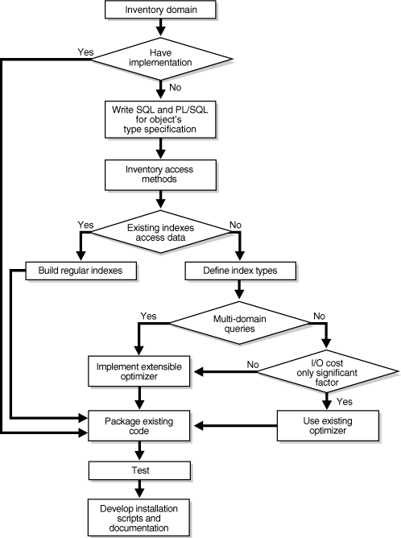

Consider the recommended process for developing data cartridges, including relationships and dependencies among the steps of the process.

### 2.1 Data Cartridge Development Process

To understand the Data Cartridge development process, consider the project as a whole.

#### Understanding the Purpose

The first step in developing a data cartridge is to establish the domain-specific value you intend to provide by clearly defining the new capabilities of the cartridge. Specify the objects the cartridge exposes to users.

#### Understand the Users

If the intended users of the cartridge are software developers, the extensibility of the cartridge is of crucial importance. If they are end-users, the cartridge must be highly attuned to its intended domain. The design of the cartridge should reflect a business model that has a clear understanding of all users. Regardless of the size of the cartridge, the development team must have a thorough understand the object-relational database management system and apply it to the problems of the cartridge's domain.

#### Plan the Project

Use a well-defined software development process, clearly identify expectations and deliverables, and set reasonable milestones for Data Cartridge development. Scheduling appropriate time for the project and having a realistic picture of available resources skills makes the project more likely to succeed.

#### Implement the Project

A detailed outline of this phase of Data Cartridge development is described in Implement the Project

#### Test and Installation

The final steps are to test the application and create the necessary installation scripts.

#### 2.1.1 Implement the Project

- When choosing and designing objects, ensure that their names and semantics are familiar and clearly understood by developers and end-users.

- When defining a collection of objects, consider the interface between the SQL side of object methods and the programming language used in your application development. Keep this interface as simple as possible by limiting the number of methods that call library routines, avoiding numerous calls into low-level library entry points, and writing large blocks of code that worked with pre-fetched data.

- After the interface is defined, proceed along parallel paths, as illustrated in Figure 2-1. You can proceed on the paths in any order that suits the available resources.

  The left-most of these parallel paths packages existing 3GL code that performs relevant operations in a run-time library such as a DLL, possibly with new entry points on top of old code. The library routines are called by the SQL component of the object's method code. Where possible, this code should be tested in a standalone fashion using a 3GL test program.

  The middle path defines and writes the object's type specification and the PL/SQL components of the object's method code. Some methods can be written entirely in PL/SQL, while others call into the external library. If your application requires an external library, provide the library definition and the detailed bindings to library entry routines.

  The direction you take at the choice point depends on the complexity of the access methods you must deploy to manipulate your data. If the query methods you need are relatively simple, you can build regular indexes. If your data is complex, you must define complex index types to make use of Oracle's extensible indexing technology. If your project uses multi-domain queries, you should make use of Oracle's extensible optimizer technology.

  If your situation does not involve executing queries on multiple domains, and I/O is the only significant factor affecting performance, then the standard optimizing techniques are probably sufficient. However, if there are other factors such as CPU cost affecting performance, you may still use the extensible optimizer.

  Figure 2-1 Cartridge Development Process

  
  [Description of "Figure 2-1 Cartridge Development Process"](img_text/addci040.md)

### 2.2 Installing and Using Data Cartridges

Installation of a data cartridge is the process of assembling its components so that the server can locate them and understand the user-defined type definitions. To correctly place these components, you must:

1.  Define tables and user-defined types in the server. This is usually accomplished by running SQL scripts.
2.  Place the dynamic link libraries in the location expected by the linkage specification.
3.  Copy online documentation, help files, and error message files to a managed location.
4.  Register the user-defined types with the server by running SQL scripts that load each new types defined for the cartridge. This step must be performed from a privileged account.
5.  Grant the necessary access privileges to the users of the cartridge.

### 2.3 Requirements and Guidelines for Data Cartridge Components

The following requirements and guidelines apply to some database objects associated with data cartridges.

#### 2.3.1 Cartridge Schemas

The database components that form each cartridge must be installed in a schema that has the same name as the cartridge. If a cartridge uses multiple schemes, the first `10` characters of each schema name must be identical to the cartridge name. Note that the length of schema names in Oracle is limited to `30` bytes, or `30` characters in a single-byte language.

The database components of a data cartridge that must be placed in the cartridge schema include names for types, tables, views, directories, libraries and packages. Because the schema name and username are always the same in Oracle, the choice of a schema name determines the username.

#### 2.3.2 Cartridge Globals

Some database-level cartridge components are in scope, and are therefore visible to all users instead of being within the scope of a single user or schema. Examples of such globals are roles, synonyms, and sequences. All global names should start with the cartridge name, and be of the form:

    C$CARTRIDGEGLOBAL

#### 2.3.3 Cartridge Error Message Names or Error Codes

Currently, error code `ORA-20000` is reserved for all errors generated by applications that use Oracle products. The error message text is customizable. You should write the cartridge-specific error messages in the form:

    ORA-20000: C$CARTRIDGE-NNNN:%s

where

- `C$``CARTRIDGE` is the name of the cartridge where the error originated

- `NNNN` is the number of the error message, unique to that cartridge

- `%s` is the description of the cartridge-specific error

**Note:**

[Oracle Database Error Messages](../errmg/ORA-19999.md) for information on writing and managing error messages

#### 2.3.4 Cartridge Installation Directory

Oracle recommends that you create a cartridge installation directory, specific to a vendor or client organization. This installation directory should includes the operating system-level components of the cartridge, such as shared libraries, configuration files, directories, and similar components. This directory name should be identical to the prefix chosen by the organization, and created under the root directory for the platform.

#### 2.3.5 Cartridge Files

Oracle recommends that you place error message files associated with each cartridge into cartridge-specific subdirectories. It is also convenient to keep configuration files in a cartridge-specific subdirectory.

#### 2.3.6 Shared Library Names for External Procedures

Shared libraries (`.so` or `.dll` files) can be placed either into the cartridge installation directory (all library names must be unique), or into a separate directory. If you are using a separate directory, the file names should start with the cartridge name, excluding the initial `C$`. If there are many such libraries, each name should start with the first seven letters of the cartridge name, again excluding the `C$`.

### 2.4 Data Cartridge Deployment

At the deployment level, you face several common issues. The optimal approach to these problems depends on the needs of your application. The following list includes tasks that should form the basis of your checklist, and some proposed solutions.

- You need a way to install and uninstall your cartridge components. This includes libraries, database objects, flat files, programs, configuration tools, administration tools, and other objects.

- You should allow for installation of multiple versions of a cartridge to provide backward compatibility and availability. Incorporate Oracle's migration facilities into your strategy.

- You must track which data cartridges are installed to support other cartridges that depend on them.

- You must track different versions of installed components.

- You must provide an upgrade path for migrating to newer versions of cartridges. Again, Oracle's migration facilities can be helpful.

- To limit access to cartridge components to specific users and roles, combine Oracle's security mechanisms with procedures that operate under invoker's and definer's rights depending on the need.

- You must keep track of which users have access to a cartridge for administration purposes. Consider making use of a table with appropriate triggers.

- Knowing where cartridges are installed is often a security and administration concern. There is currently no easy way of knowing which cartridges are installed in a particular database or what users have access to the cartridge or any of its components. If this information is important in your situation, keep track of it by any convenient method.

#### 2.4.1 Data Cartridge Naming Conventions

Consider how the components of a data cartridge should be named; this discussion is intended for independent software vendors (ISVs) and others who are creating cartridges to be used by others.

Note that most examples that illustrate Data Cartridges do not follow the naming conventions, primarily because they are intended to be as simple and as generic as possible. As your familiarity with the technology increases and you consider building data cartridges to be for use by others, you should understand and follow these naming conventions.

The naming conventions assume a single-byte character set.

**See Also:**

- "Cartridge Internationalization" for information on using other character sets

- "[Globalization Support](using-cartridge-services.md)" for information on support for multiple languages and locales

##### 2.4.1.1 Need for Naming Conventions in Data Cartridges

In a production environment, an Oracle database might have multiple data cartridges installed. These data cartridges could be from different development groups or vendors, thus developed in isolation. Each data cartridge consists of various schema objects inside the database, and other components visible at the operating system level, such as external procedures in shared libraries. If multiple data cartridges tried to use the same names for schema objects or operating system-level entities, the result would be incorrect and inconsistent behavior.

Furthermore, because exception conditions during the run-time operation of data cartridges can cause the Oracle server to return errors, it is important to prevent conflicts between error or message codes of different data cartridges. These conflicts can arise if, for example, two cartridges use the same error code for different error conditions. Having unique error and message codes ensures that the origin of the exception condition can be readily identified.

##### 2.4.1.2 Unique Name Format

To prevent multiple data cartridge components from having the same name, Oracle recommends the following convention to ensure unique naming of data cartridges. This convention depends on each organization developing data cartridges choosing a unique name. Oracle recommends that cartridge developers follow a unique name format that starts with a `C$`.

Data cartridges and their components should have names of the following format:

    C$pppptttm.ccccc

Table 2-1 describes the parts of this naming convention format.

Oracle recommends that all characters in the name except for the dollar sign, `$`, as the second character be alphanumeric: letters, numbers, underscores, and hyphens.

For example, Acme Cartridge Company chooses and registers a prefix of `ACME`. It provides an audio data cartridge and a video data cartridge, and chooses `AUD` and `VID` as the type codes, respectively. It has no other information to include in the cartridge name, and so it chooses an arbitrary number 1 for the miscellaneous information indicator. As a result, the two cartridge names are:

- `C$ACMEAUD1`

- `C$ACMEVID1`

For each cartridge, a separate schema must be created, and Acme uses the cartridge name as the schema name. Thus, all database components of the audio cartridge must be created under the schema` C$ACMEAUD1`, and all database components of the video cartridge must be created under the schema `C$ACMEVID1`. Examples of some components might include:

- `C$ACMEVID1.mf_rewind`

- `C$ACMEVID1.vid_ops_package`

- `C$ACMEVID1.vid_stream_lib`

Each organization is responsible for specific naming requirements after the `C$pppp` portion of the object name. For example, Acme Cartridge Company must ensure that all of its cartridges have unique names and that all components within a cartridge have unique names.

##### 2.4.1.3 Data Cartridge Naming Conventions

The following table describes the parts of this naming convention format

Table 2-1 Data Cartridge Naming Conventions

| Part         | Explanation                                                                                           | Example                        |
|:-------------|:------------------------------------------------------------------------------------------------------|:-------------------------------|
| `C$`         | Recommended by Oracle for all data cartridges.                                                        |                                |
| `pppp`       | Prefix selected by the data cartridge creator. (Must be exactly four characters.)                     | `ACME`                         |
| `ttt`        | Type of cartridge, using an abbreviation meaningful to the creator. Three characters.                 | `AUD` (for audio)              |
| `m`          | Miscellaneous information indicator, to allow a designation meaningful to the creator. One character. | `1` (perhaps a version number) |
| `. `(period) | Period required if specifying an object in full schema.object form.                                   |                                |
| `ccccc`      | Component name. Variable length.                                                                      | `mf_set_volume`                |

#### 2.4.2 Cartridge Registration

A naming scheme requires a registration process to handle the administration of names of components that form a data cartridge.

#### 2.4.3 Cartridge Directory Structure and Standards

You need some directory standards that specify where to put your binaries, support files, messages files, administration files, and libraries.

You must also define a database user who installs your cartridges. One possible solution is to use `EXDSYS`, for External Data Cartridge System user.

**Note:**

The `EXDSYS` user must have special privileges necessary for running cartridges. This user may be installed as part of cartridge installation, but a better solution is to make the user part of the database installation by including this process in the standard database creation script.

#### 2.4.4 Cartridge Upgrades

Administrators need a safe way to upgrade a cartridge and its related metadata to a newer version of the cartridge. You also require a process for upgrading data and removing obsolete data. This may entail installation support and database support for moving to newer database cartridge types

Administrators also require a means to update tables using cartridge types when a cartridge changes.

#### 2.4.5 Import and Export of Cartridge Objects

To import and export objects, you must understand how Oracle's import and export facilities handle Oracle objects. In particular, you must know how types are handled and whether the type methods are imported and exported, and also whether user-defined methods are supported.

#### 2.4.6 Cartridge Versioning

There are two types of cartridge versioning problems that must be addressed: internal and external.

##### External Versioning

External versioning is the easier of the two versioning problems. You must be able to track a cartridge version number and act accordingly upon installation or configuration based on versioning information.

##### Internal Versioning

Internal versioning is the harder problem. Ideally, you would like a mechanism to support multiple versions of a cartridge in the database. This would provide backward compatibility and also make for high availability.

#### 2.4.7 Cartridge Internationalization

You might want to internationalize your cartridges, so they can support multiple languages and access Globalization Support facilities for messages and parsing.

Oracle recommends that data cartridge component names use the ASCII character set.

If you must name the data cartridge components in a character set other than ASCII, Oracle assigns you a unique four-character prefix. However, this increases the number of bytes required to hold the prefix. The names of all Oracle schema objects must fit into 30 bytes. In ASCII, this equals 30 characters. If you have, for example, a six-byte character set and request a four-character prefix string, Oracle might truncate your request to a smaller number of characters.

**See Also:**

[Oracle Database Globalization Support Guide](../nlspg/oracle-globalization-development-kit.md)

#### 2.4.8 Cartridge Administration

When planning and developing a data cartridge, you should consider the issues involved in administering its use.

##### Administrating Data Cartridge Access

- How do administrators know who has access to a cartridge?

  Administrators must administer access rights to internal and external components such as programs and data files to specific users and roles.

<!-- -->

- How do administrators restrict access to certain tables, types, views, and other cartridge components to individual users and roles?

  For security reasons, administrators must be allowed to restrict access to types on an individual basis.

  Each Cartridge design should have it's own security considerations. In building complex data cartridges, you need a way to identify the various components of your cartridge and instances of the cartridge, so administrators can grant and revoke security roles on identifiable components.

##### Invoker’s Rights

Invoker's rights is a special privilege that allows the system to access database objects to which it would not normally have access. The special user `SYS` has such rights. Unless you grant privileges to public, the user you create to install and run your cartridge needs this privilege.

##### Data Cartridge Configuration

Data cartridges need a front end to handle deployment issues, such as installation, and configuration tools. While each data cartridge may have differing security needs, a basic front end that allows a user to install, configure, and administer data cartridge components is necessary.

This front end may just be some form of knowledge base or on-line documentation. In any case, it should be online, easy to navigate, and contain templates exhibiting standards and starting points.

#### 2.4.9 Data Cartridge Development Approach

General Data cartridge development approach.

In developing a data cartridge, take a systematic approach. Start with small, easy tasks and build incrementally toward a comprehensive solution.

##### 2.4.9.1 Creating a Data Cartridge Plan

General overview of a plan for creating Data Cartridges.

1.  Experiment with the examples in: [Power Demand Cartridge Example](example-for-power-demand-cartridge.md) , [PSBTREE: Extensible Indexing Example](example-for-PSBTREE-extensible-indexing.md), and [Pipelined Table Functions: Interface Approach Example](example-for-pipelined-table-functions-interface-approach.md).
2.  Create the prototype of your own data cartridge, starting with a single user-defined type and a few data elements and methods. You can add user-defined types, data elements, and methods, specific indextypes, and user-defined operators as you expand the cartridge's capabilities.
3.  Begin by implementing your methods entirely in SQL, and add callouts to 3GL code later if you need them.
4.  Test and debug your cartridge.

##### 2.4.9.2 Developing Data Cartridges

A general development process for developing data cartridges

When you have a working prototype you may want to follow a development process that includes the following steps.

1.  Identify your areas of domain expertise.
2.  Identify those areas of expertise that are relevant to persistent data.
3.  Consider the feasibility of packaging one or more of these areas as a new data cartridge or as an extension to an existing cartridge.
4.  Use an object-oriented methodology to help decide what object types to include in data cartridges.
5.  Build and test the cartridges, one at a time.
