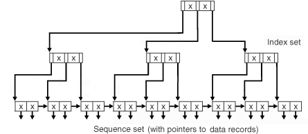
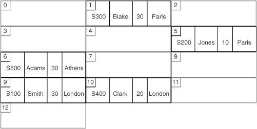
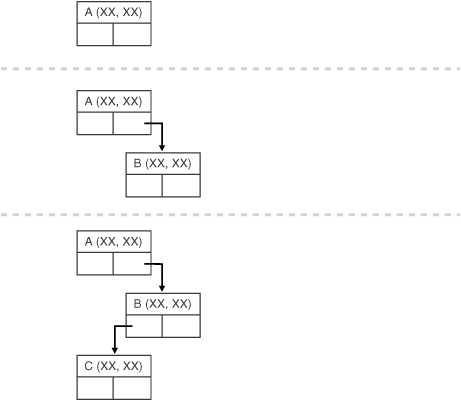
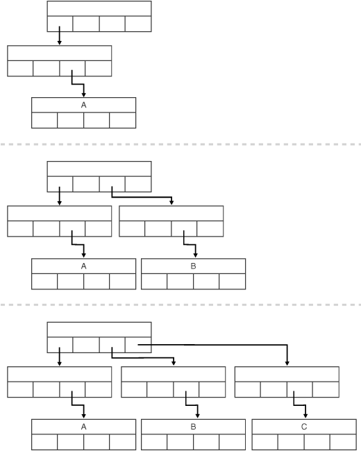

Extensible indexing allows you to implement modes of indexing in addition to those that are built into Oracle. Consider when you should create **domain indexes**, which are indexes created using the extensible indexing framework.

### 7.1 Overview of Extensible Indexing

Consider some terms and methods for building indexes; this material may be familiar to developers who worked on database applications previously.

#### 7.1.1 Purpose of Indexes

With large amounts of data such as that in databases, indexes make locating and retrieving the data faster and more efficient. Whether they refer to records in a database or text in a technical manual, entries in an index indicate three things about the items they refer to:

- What the item is ("employee information on Mary Lee" or "the definition of extensible indexing")

- Where the item is ("record number 1000" or "page 100")

- How the item is stored ("in a consecutive series of records" or "as text on a page")

Most sets of data can be indexed in several different ways. To provide the most useful and efficient access to data, it is often critical to choose the right style of indexing. This is because no indexing method is optimal for every application.

Database applications normally retrieve data with queries, which often use indexes in selecting subsets of the available data. Queries can differ radically in the operators used to express them, and thus in the methods of indexing that provide the best access.

- To learn which sales people work in the San Francisco office, you need an operator that checks for equality. Hash structures handle equality operators very efficiently.

- To learn which sales people earn more than x but less than y, you need an operator that checks ranges. B-tree structures are better at handling range-oriented queries.

#### 7.1.2 Purpose of Extensible Indexing

Databases are constantly incorporating new types of information that are more complex and more specific to certain tasks, such as medical or multimedia applications. As a result, queries are becoming more complex, and the amount of data they must scan continues to grow. Oracle provides the extensible indexing framework so you can tailor your indexing methods to your data and your applications, thus improving performance and ease of use.

With extensible indexing, your application

- Defines the structure of the index

- Stores the index data, either inside the Oracle database (for example, in the form of index-organized tables) or outside the Oracle database

- Manages, retrieves, and uses the index data to evaluate user queries

Thus, your application controls the structure and semantic content of the index. The database system cooperates with your application to build, maintain, and employ the domain index. As a result, you can create indexes to perform tasks that are specific to the domain in which you work, and your users compose normal-looking queries using operators you define.

#### 7.1.3 When to Use Extensible Indexing

Oracle's built-in indexing facilities are appropriate to a large number of situations. However, as data becomes more complex and applications are tailored to specific domains, situations arise that require other approaches. For example, extensible indexing can help you solve problems like these:

- Implementing new search operators using specialized index structures

  You can define operators to perform specialized searches using your index structures.

- Indexing unstructured data

  The built-in facilities cannot index a column that contains `LOB` values.

- Indexing attributes of column objects

  The built-in facilities cannot index column objects or the elements of a collection type.

- Indexing values derived from domain-specific operations

  Oracle object types can be compared with map functions or order functions. If the object uses a map function, then you can define a function-based index for use in evaluating relational predicates. However, this only works for predicates with parameters of finite range; it must be possible to precompute function values for all rows. In addition, you cannot use order functions to construct an index.

#### 7.1.4 Index Structures

Consider some frequently-used index structures that illustrate the choices available to designers of domain indexes.

##### 7.1.4.1 B-tree

No index structure can satisfy all needs, but the self-balancing B-tree index comes closest to optimizing the performance of searches on large sets of data. Each B-tree node holds multiple keys and pointers. The maximum number of keys in a node supported by a specific B-tree is the order of that tree. Each node has a potential of order+1 pointers to the level below it. For example, the order=2 B-tree illustrated in Figure 7-1 has tree pointers: to child nodes whose value is less than the first key, to the child nodes whose value is greater than the first key and less than the second key, and to the child nodes whose value is greater than the second key. Thus, the B-tree algorithm minimizes the number of reads and writes necessary to locate a record by passing through fewer nodes than in a binary tree algorithm, which has only one key and at most two children for each decision node. Here we describe the **Knuth** variation in which the index consists of two parts: a sequence set that provides fast sequential access to the data, and an index set that provides direct access to the sequence set.

Although the nodes of a B-tree generally do not contain the same number of data values, and they usually contain a certain amount of unused space, the B-tree algorithm ensures that the tree remains balanced and that the leaf nodes are at the same level.

Figure 7-1 B-tree Index Structure

[Description of "Figure 7-1 B-tree Index Structure"](img_text/addci034.md)

##### 7.1.4.2 Hash

Hashing gives fast direct access to a specific stored record based on a given field value. Each record is placed at a location whose address is computed as some function of some field of that record. The same function is used to insert and retrieve.

The problem with hashing is that the physical ordering of records has little if any relation to their logical ordering. Also, there can be large unused areas on the disk.

Figure 7-2 Hash Index Structure

[Description of "Figure 7-2 Hash Index Structure"](img_text/addci035.md)

##### 7.1.4.3 k-d tree

Data that has two dimensions, such as latitude and longitude, can be stored and retrieved efficiently using a variation on the k-d tree known as the 2-d tree.

In this structure, each node is a data type with fields for information, the two co-ordinates, and a left-link and right-link, which can point to two children.

Figure 7-3 2-d Index Structure

[Description of "Figure 7-3 2-d Index Structure"](img_text/addci036.md)

This structure is good at range queries. That is, if the user specifies a point (xx, xx) and a distance, the query returns the set of all points within the specified distance of the original point.

2-d trees are easy to implement. However, because a 2-d tree containing k nodes can have a height of k, insertion and querying can be complex.

##### 7.1.4.4 Point Quadtree

The point quadtree, in Figure 7-4, is also used to represent point data in a two dimensional spaces, but these structures divide regions into four parts where 2-d trees divide regions into two. The fields of the record type for this node comprise an attribute for information, two co-ordinates, and four compass points (such as NW, SW, NE, SE) that can point to four children.

Figure 7-4 Point Quadtree Index Structure

[Description of "Figure 7-4 Point Quadtree Index Structure"](img_text/addci038.md)

Like 2-d trees, point quadtrees are easy to implement. However, a point quadtree containing k nodes can have a height of k, so insertion and querying can be complex. Each comparison requires comparisons on at least two co-ordinates. In practice, though, the lengths from root to leaf tend to be shorter in point quadtrees.

### 7.2 Extensible Indexing Framework

The extensible indexing framework is a SQL-based interface that lets you define domain-specific operators and indexing schemes, and integrate these into the Oracle server.

The extensible indexing framework consists of the following components:

- **Indextypes**: An indextype schema object specifies the routines that manage definition, maintenance, and scan operations for application-specific indexes. An indextype tells the Oracle server how to establish a user-defined index on a column of a table or attribute of an object.

- **Domain Indexes**: An application-specific index created using an indextype is called a domain index because it indexes data in application-specific domains. A domain index is an instance of an index that is created, managed, and accessed by the routines specified by an indextype.

- **Operators**: Queries and data manipulation statements can use application-specific operators, such as the `Overlaps` operator in the spatial domain. User-defined operators are bound to functions. They can also be evaluated using indexes. For instance, the equality operator can be evaluated using a hash index. An indextype provides an index-based implementation for the operators it defines.

- **Index-Organized Tables**: With index-organized tables, your application can define, build, maintain, and access indexes for complex objects using a table metaphor. To the application, an index is modeled as a table, where each row is an index entry. Index-organized tables handle duplicate index entries, which can be important with complex types of data.

The extensible indexing framework lets you perform the following actions:

- Encapsulate application-specific index management routines as an indextype schema object.

- Define a domain index on table columns.

- Process application-specific operators efficiently.

With the extensible indexing framework, you can build a domain index that operates much like any other Oracle index. Users write standard queries using operators you define. To create, drop, truncate, modify, and search a domain index, the Oracle server invokes the application code you specify as part of the indextype.

**See Also:**

- [Defining Operators](defining-operators.md) for detailed information on user-defined operators

- [Oracle Database Administrator's Guide](../admin/managing-tables.md) for detailed information on index-organized tables

### 7.3 Using the Text Indextype

Consider an extensible indexing framework with a skeletal example that both defines a new text indexing scheme using the `Text` indextype, and uses the `Text` indextype to index and operate on textual data.

#### 7.3.1 Defining the Indextype

The order in which you create the components of an indextype depends on whether or not you are creating an index-based functional implementation.

##### 7.3.1.1 Non-Index-Based Functional Implementations

To define the `Text` indextype, the indextype designer must follow these steps:

1.  Define and code the functional implementation for the supported operator
    The `Text` indextype supports an operator called `Contains`, which accepts a text value and a key, and returns a number indicating whether the text contains the key. The functional implementation of this operator is a regular function defined as:

        CREATE FUNCTION TextContains(Text IN VARCHAR2, Key IN VARCHAR2)
        RETURN NUMBER AS
        BEGIN
        .......
        END TextContains;
2.  Create the new operator and bind it to the functional implementation
        CREATE OPERATOR Contains
         BINDING (VARCHAR2, VARCHAR2) RETURN NUMBER USING TextContains;
3.  Define a type that implements the index interface `ODCIIndex`
    This involves implementing routines for index definition, index maintenance, and index scan operations. Oracle calls:

    - The index definition routines [ODCIIndexCreate()](extensible-indexing-interface.md), [ODCIIndexAlter()](extensible-indexing-interface.md), and [ODCIIndexDrop()](extensible-indexing-interface.md) to perform the appropriate operations when the index is created, altered, or dropped, or the base table is truncated

    - The index maintenance routines [ODCIIndexInsert()](extensible-indexing-interface.md), [ODCIIndexDelete()](extensible-indexing-interface.md), and [ODCIIndexUpdate()](extensible-indexing-interface.md) to maintain the text index when table rows are inserted, deleted, or updated

    - The index scan routines [ODCIIndexStart()](extensible-indexing-interface.md), [ODCIIndexFetch()](extensible-indexing-interface.md), and [ODCIIndexClose()](extensible-indexing-interface.md) to scan the text index and retrieve rows of the base table that satisfy the operator predicate

    <!-- -->

        CREATE TYPE TextIndexMethods
        (
        STATIC FUNCTION ODCIIndexCreate(...)
        ...
        );
        CREATE TYPE BODY TextIndexMethods
        (
        ...
        );
4.  Create the `Text` indextype schema object
    The indextype definition specifies the operators supported by the new indextype and the type that implements the index interface.

        CREATE INDEXTYPE TextIndexType
        FOR Contains(VARCHAR2, VARCHAR2)
        USING TextIndexMethods
        WITH SYSTEM MANAGED STORAGE TABLES;

##### 7.3.1.2 Index-Based Functional Implementations

If you are creating an index-based functional implementation, you perform the same operations as for non-index-based functional implementations, but in a different order. This order is required because definition of an index-based functional implementation requires the implementation type as a parameter.

1.  Define the implementation type
2.  Define and code the functional implementation
3.  Create the operator
4.  Create the indextype

#### 7.3.2 Using the Indextype

When the `Text` indextype has been successfully defined, users can define text indexes on text columns and use the `Contains` operator to query text data.

Suppose the `MyEmployees` table is defined by the statement in Example 7-1.

To build a text domain index on the `resume` column, a user issues the statement in Example 7-2.

To query the text data in the `resume` column, users issue statements like the one in Example 7-3. The query execution uses the text index on `resume` to evaluate the `Contains` predicate.

##### 7.3.2.1 Declaring a New Table

Example 7-1 Declaring a New Table

    CREATE TABLE MyEmployees
      (employee_id NUMBER(6),
       first_name VARCHAR2(20),
       last_name VARCHAR2(25),
       salary NUMBER(8,2),
       resume VARCHAR2(2000),
       location VARCHAR2(200),
       department_id NUMBER(4));

##### 7.3.2.2 Building a Text Domain Index for the Table

Example 7-2 Building a Text Domain Index

    CREATE INDEX ResumeIndex ON MyEmployees(resume) INDEXTYPE IS TextIndexType;

##### 7.3.2.3 Querying a Table Using a Contains() Operator

Example 7-3 Using the Contains() Operator

    SELECT * FROM MyEmployees WHERE Contains(resume, 'Oracle') =1;
