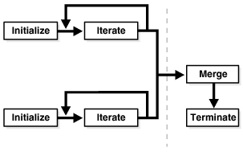

User-defined aggregate functions may be used both singly and in parallel; consider large aggregation contexts and materialized views.

**See Also:**

[User-Defined Aggregate Functions Interface](user-defined-aggregate-functions-interface.md) for a detailed description of the `ODCIAggregate` interface.

### 12.1 Overview of User-Defined Aggregate Functions

Oracle provides several pre-defined aggregate functions such as `MAX`, `MIN`, and `SUM` for performing operations on a set of rows. These pre-defined aggregate functions can be used only with scalar data, not with complex data types such as multimedia data stored using object types, opaque types, and LOBs. You can, however, define custom implementations of these functions for complex data types. You can also define entirely new aggregate functions to use with complex data. User-defined aggregate functions can be used in SQL DML statements just like Oracle's built-in aggregates. When functions are registered with the server, Oracle simply invokes the user-defined aggregation routines supplied by you instead of the native routines. User-defined aggregates can also be used with scalar data, such as complex statistical data necessary for scientific applications.

User-defined aggregates are a feature of the Extensibility Framework, and you can implement them using `ODCIAggregate` interface routines.

You can create a user-defined aggregate function by implementing a set of routines collectively known as the `ODCIAggregate` routines. You can implement these routines as methods within an object type, so the implementation can be in any language that Oracle supports, PL/SQL, C, C++ or Java. When the object type is defined and the routines are implemented in the type body, use the `CREATE FUNCTION` statement to create the aggregate function.

Each user-defined aggregate function uses up to four `ODCIAggregate` routines, or steps, to define internal operations that any aggregate function performs, namely: initialization, iteration, merging, and termination.

- Initialization is accomplished by the [ODCIAggregateInitialize()](user-defined-aggregate-functions-interface.md) routine, which is invoked by Oracle to initialize the computation of the user-defined aggregate. The initialized aggregation context is passed back to Oracle as an object type instance.

- Iteration is performed through the [ODCIAggregateIterate()](user-defined-aggregate-functions-interface.md) routine, which is repeatedly invoked by Oracle. On each invocation, a new value or a set of new values and the current aggregation context are passed in. The routine processes the new values and returns the updated aggregation context. This routine is invoked for every non-`NULL` value in the underlying group. `NULL` values are ignored during aggregation and are not passed to the routine.

- Merging is performed by [ODCIAggregateMerge()](user-defined-aggregate-functions-interface.md), a routine invoked by Oracle to combine two aggregation contexts. This routine takes the two contexts as inputs, combines them, and returns a single aggregation context.

- Termination takes place when the [ODCIAggregateTerminate()](user-defined-aggregate-functions-interface.md) routine is invoked by Oracle as the final step of aggregation. The routine takes the aggregation context as input and returns the resulting aggregate value.

The process is illustrated in the Using User-Defined Aggregate Functions section.

#### 12.1.1 Using User-Defined Aggregate Functions

Consider the aggregate function `AVG()` in the following statement:

    SELECT AVG(T.Sales)
    FROM AnnualSales T
    GROUP BY T.State;

To perform this computation, the aggregate function `AVG()` goes through these steps:

1.  Initializes the computation by initializing the aggregation context, or the rows over which aggregation is performed:
        runningSum = 0; runningCount = 0;
2.  Iteratively processes each successive input value and updates the context:
        runningSum += inputval; runningCount++;
3.  \[Optional\] Merge by combining the two aggregation contexts and return a single context. This operation combines the results of aggregation over subsets to obtain the aggregate over the entire set. This extra step can be required during either serial or parallel evaluation of an aggregate. If needed, it is performed before step 4:
        runningSum = runningSum1 + runningSum2;
        runningCount = runningCount1 + runningCount2

    Evaluating User-Defined Aggregates in Parallel describes this step in greater detail.
4.  Terminates by computing the result; uses the context to return the resultant aggregate value:
        return (runningSum/runningCount);

If `AVG()` were a user-defined function, the object type that embodies it would implement a method for a corresponding `ODCIAggregate` routine for each of these steps. The variables `runningSum` and `runningCount`, which determine the state of the aggregation in the example, would be attributes of that object type.

### 12.2 Creating a User-Defined Aggregate

The process of creating a user-defined aggregate function has two steps, illustrated in Example 12-1 and Example 12-2. Both examples use the `SpatialUnion()` aggregate function defined by Oracle Spatial. The function computes the bounding geometry over a set of input geometries.

Example 12-1 Implementing the ODCIAggregate Interface

The `ODCIAggregate` routines are implemented as methods within an object type `SpatialUnionRoutines`. The actual implementation could be in any Oracle-supported language for type methods, such as PL/SQL, C, C++ or Java.

    CREATE TYPE SpatialUnionRoutines(
       STATIC FUNCTION ODCIAggregateInitialize( ... ) ...,
       MEMBER FUNCTION ODCIAggregateIterate(...) ... ,
       MEMBER FUNCTION ODCIAggregateMerge(...) ...,
       MEMBER FUNCTION ODCIAggregateTerminate(...)
    );

    CREATE TYPE BODY SpatialUnionRoutines IS
    ...
    END;

Example 12-2 Defining a User-Defined Aggregate Function

This function definition creates the `SpatialUnion()` aggregate function by specifying its signature and the object type that implements the `ODCIAggregate` interface:

    CREATE FUNCTION SpatialUnion(x Geometry) RETURN Geometry
    AGGREGATE USING SpatialUnionRoutines;

### 12.3 Using a User-Defined Aggregate

User-defined aggregates can be used just like built-in aggregate functions in SQL DML and query statements. They can appear in the `SELECT` list, `ORDER BY` clause, or as part of the predicate in the `HAVING` clause. The following Example 12-3, Example 12-4 and Example 12-5 illustrate some options.

**See Also:**

[Oracle Database Data Warehousing Guide](../dwhsg/sql-aggregation-data-warehouses.md) for information about `GROUP BY` extensions such as `ROLLUP`, `CUBE` and grouping sets

#### 12.3.1 Using the SELECT Statement with User-Defined Aggregate Functions

Example 12-3 Using the SELECT Statement with User-Defined Aggregate Functions

The following query can be used to compute state boundaries by aggregating the geometries of all counties belonging to the same state:

    SELECT SpatialUnion(geometry)
    FROM counties
    GROUP BY state

#### 12.3.2 Using the HAVING Clause with User-Defined Aggregate Functions

Example 12-4 Using the HAVING Clause with User-Defined Aggregate Functions

User-defined aggregates can be used in the `HAVING` clause to eliminate groups from the output based on the results of the aggregate function. Here, `MyUDAG()` is a user-defined aggregate:

    SELECT groupcol, MyUDAG(col)
    FROM tab
    GROUP BY groupcol
    HAVING MyUDAG(col) > 100
    ORDER BY MyUDAG(col);

#### 12.3.3 Using Query Options with User-Defined Aggregate Functions

Example 12-5 Using other Query Options with User-Defined Aggregate Functions

User-defined aggregates can take `DISTINCT` or `ALL` (default) options on the input parameter. `DISTINCT` causes duplicate values to be ignored while computing an aggregate. The `SELECT` statement that contains a user-defined aggregate can also include `GROUP BY` extensions such as `ROLLUP`, `CUBE` and grouping sets:

    SELECT ..., MyUDAG(col)
    FROM tab
    GROUP BY ROLLUP(gcol1, gcol2);

The [ODCIAggregateMerge()](user-defined-aggregate-functions-interface.md) interface is invoked to compute super aggregate values in such roll-up operations.

### 12.4 Evaluating User-Defined Aggregates in Parallel

Like built-in aggregate functions, user-defined aggregates can be evaluated in parallel.

The aggregation contexts generated by aggregating subsets of the rows within the parallel slaves are sent back to the next parallel step, either the query coordinator or the next slave set. It then merges the aggregation contexts, and then invokes the Terminate routine to obtain the aggregate value. This behaviour is illustrated in Figure 12-1.

Figure 12-1 Sequence of Calls for Parallel Evaluation of User-Defined Aggregates

[Description of "Figure 12-1 Sequence of Calls for Parallel Evaluation of User-Defined Aggregates"](img_text/addci043.md)

You should note that the aggregate function must be declared to be parallel-enabled, as shown in Example 12-6:

Example 12-6 Parallel-Enabling a User-Defined Aggregate Function

    CREATE FUNCTION MyUDAG(...) RETURN ...
    PARALLEL_ENABLE AGGREGATE USING MyAggrRoutines;

### 12.5 Handling Large Aggregation Contexts

When the implementation type methods are implemented in an external language, such as C++ or Java, the aggregation context must be passed back and forth between the Oracle server process and the external function's language environment each time an implementation type method is called. This can have an adverse effect on performance as the size of the aggregation context increases.

To enhance performance, you can store the aggregation context in external memory, allocated in the external function's execution environment. You can then pass the reference or key between the Oracle server and the external function. The key itself should be stored in the implementation type instance, the `self`. This approach keeps the implementation type instance small so that it can be transferred quickly. Another advantage of this strategy is that the memory used to hold the aggregation context is allocated in the function's execution environment, such as `extproc`, and not in the Oracle server.

Usually you should use `ODCIAggregateInitialize()` to allocate the memory to hold the aggregation context and store the reference to it in the implementation type instance. In subsequent calls, the external memory and the aggregation context that it contains can be accessed using the reference. The external memory should usually be freed in `ODCIAggregateTerminate()`. `ODCIAggregateMerge()` should free the external memory used to store the merged context (the second argument of `ODCIAggregateMerge()` after the merge is finished.

**See Also:**

- [ODCIAggregateInitialize()](user-defined-aggregate-functions-interface.md)

- [ODCIAggregateTerminate()](user-defined-aggregate-functions-interface.md)

- [ODCIAggregateMerge()](user-defined-aggregate-functions-interface.md)

#### 12.5.1 External Context and Parallel Aggregation

With parallel execution of queries with user-defined aggregates, the entire aggregation context, which comprises all partial aggregates computed by slave processes, must sometimes be transmitted to another slave or to the master process. You can implement the optional routine `ODCIAggregateWrapContext()` to collect all the partial aggregates. If a user-defined aggregate is being evaluated in parallel, and `ODCIAggregateWrapContext()` is defined, Oracle invokes the routine to copy all external context references into the implementation type instance and then frees the external memory. To support `ODCIAggregateWrapContext()`, the implementation type must contain attributes to hold the aggregation context and another attribute to hold the key that identifies the external memory.

When the aggregation context is stored externally, the key attribute of the implementation type should contain the reference identifying the external memory, and the remaining attributes of the implementation type should be `NULL`. After a `ODCIAggregateWrapContext()` call runs successfully, the key attribute should be `NULL`, and the other attributes should hold the actual aggregation context.

Each of the implementation type's member methods should begin by checking whether the context is inline (contained in the implementation type instance) or in external memory. If the context is inline, as it would be if it was sent from another parallel slave, it should be copied to external memory so that it can be passed by reference.

Implementation of the `ODCIAggregateWrapContext()` routine is optional. It is necessary only when external memory holds the aggregation context, and the user-defined aggregate is evaluated in parallel. If the user-defined aggregate is never evaluated in parallel, `ODCIAggregateWrapContext()` is not needed. If the `ODCIAggregateWrapContext()` method is not defined, Oracle assumes that the aggregation context is not stored externally and does not try to call the method.

**Note:**

[ODCIAggregateWrapContext()](user-defined-aggregate-functions-interface.md)

##### 12.5.1.1 Using External Memory to Store Aggregate Context

This example shows how an aggregation context type that contains references to external memory can also store the entire context, when needed.

The `4` byte `key` parameter is used to look up the external context. When `NULL`, it implies that the entire context value is held by the rest of the attributes in the object. The other attributes, such as `GeometrySet`, correspond to the actual aggregation context. If the `key` value is not `NULL`, these attributes must have a `NULL` value. However, when the context object is self-contained, as after a call to [ODCIAggregateWrapContext()](user-defined-aggregate-functions-interface.md), these attributes hold the current context values.

    CREATE TYPE MyAggrRoutines AS OBJECT
    (
    key RAW(4),
    ctxval GeometrySet,
    ctxval2 ...
    );

#### 12.5.2 User-Defined Aggregates and Analytic Functions

Analytic functions enable you to compute various cumulative, moving, and centered aggregates over a set of rows called a window. For each row in a table, analytic functions return a value computed on the other rows contained in the given row's window. These functions provide access to several rows of a table without a self-join. User-defined aggregates can be used as analytic functions.

##### 12.5.2.1 Using User-Defined Aggregates and Analytic Functions

    SELECT Account_number, Trans_date, Trans_amount,
       MyAVG (Trans_amount) OVER(
          PARTITION BY Account_number ORDER BY Trans_date
          RANGE INTERVAL '7' DAY PRECEDING) AS mavg_7day
    FROM Ledger;

#### 12.5.3 Reuse of Aggregation Context for Analytic Functions

When a user-defined aggregate is used as an analytic function, the aggregate is calculated for each row's corresponding window. Generally, each successive window contains largely the same set of rows, such that the new aggregation context, the new window, differs by only a few rows from the old aggregation context, the previous window. To reuse the aggregation context, any new rows that were not in the old context must be iterated over to add them, and any rows from the old context that do not belong in the new context must be removed. If the aggregation context cannot be reused, all the rows it contains must be reiterated to rebuild it.

You can implement an optional routine, `ODCIAggregateDelete()`, to allow Oracle to reuse the aggregation context more efficiently. `ODCIAggregateDelete()` removes from the aggregation context rows from the previous context that are not in the new (current) window. Oracle calls this routine for each row that must be removed. For each row that must be added, Oracle calls `ODCIAggregateIterate()`.

If the new aggregation context is a superset of the old one, then it contains all the rows from the old context and no rows must be deleted. Oracle then reuses the old context even if `ODCIAggregateDelete()` is not implemented.

**See Also:**

- [Oracle Database Data Warehousing Guide](../dwhsg/index.md) for information about analytic functions

- [ODCIAggregateDelete()](user-defined-aggregate-functions-interface.md)

- [ODCIAggregateIterate()](user-defined-aggregate-functions-interface.md)

#### 12.5.4 External Context and User-Defined Analytic Functions

When user-defined aggregates are used as analytic functions, the aggregation context can be reused from one window to the next. In these cases, the flag argument of the `ODCIAggregateTerminate()` function has its `ODCI_AGGREGATE_REUSE_CTX` bit set to indicate that the external memory holding the aggregation context should not be freed. Also, the `ODCIAggregateInitialize()` method is passed the implementation type instance of the previous window, so instead of having to allocate memory again, you can access and re-initialize the external memory previously allocated. To support external context for user-defined analytic functions, you should follow these steps:

1.  `ODCIAggregateInitialize()` - If the implementation type instance passed is not `NULL`, use the previously allocated external memory instead of allocating new external memory, and reinitialize the aggregation context.

2.  `ODCIAggregateTerminate()` - Free external memory only if the bit `ODCI_AGGREGATE_REUSE_CTX` of the flag argument is not set.

3.  `ODCIAggregateMerge()` - Free external memory associated with the merged aggregation context.

4.  `ODCIAggregateTerminate()` - Copy the aggregation context from the external memory into the implementation type instance, and free the external memory.

5.  All member methods - First determine if the context is stored externally or inline. If the context is inline, allocate external memory and copy the context there.

**See Also:**

- [ODCIAggregateInitialize()](user-defined-aggregate-functions-interface.md)

- [ODCIAggregateMerge()](user-defined-aggregate-functions-interface.md)

- [ODCIAggregateTerminate()](user-defined-aggregate-functions-interface.md)

### 12.6 Using Materialized Views with User-Defined Aggregates

A materialized view definition can contain user-defined aggregates and built-in aggregate operators, as demonstrated in Example 12-7.

To enable the materialized view for query rewrite, the user-defined aggregates in the materialized view must be declared as `DETERMINISTIC`, as demonstrated in Example 12-8.

When a user-defined aggregate is dropped or re-created, all of its dependent materialized views are marked invalid.

Example 12-7 Creating Materialized Views

    CREATE MATERIALIZED VIEW MyMV AS
    SELECT gcols, MyUDAG(c1) FROM tab GROUP BY (gcols);

Example 12-8 Enabling Materialized Views for Query Rewrite

    CREATE FUNCTION MyUDAG(x NUMBER) RETURN NUMBER
    DETERMINISTIC
    AGGREGATE USING MyImplType;

    CREATE MATERIALIZED VIEW MyMV
    ENABLE QUERY REWRITE AS
    SELECT gcols, MyUDAG(c1) FROM tab GROUP BY (gcols);

**See Also:**

[Oracle Database Data Warehousing Guide](../dwhsg/index.md) for information about materialized views

### 12.7 Creating and Using a User-Defined Aggregate Function

Example 12-9 illustrates how to create and use a simple user-defined aggregate function, `SecondMax()`.

Example 12-9 Creating and Using a User-Defined Aggregate Function

`SecondMax()` returns the second-largest value in a set of numbers.

1.  Implement the type `SecondMaxImpl` to contain the `ODCIAggregate` routines:

        create type SecondMaxImpl as object
        (
          max NUMBER, -- highest value seen so far
          secmax NUMBER, -- second highest value seen so far
          static function ODCIAggregateInitialize(sctx IN OUT SecondMaxImpl)
            return number,
          member function ODCIAggregateIterate(self IN OUT SecondMaxImpl,
            value IN number) return number,
          member function ODCIAggregateTerminate(self IN SecondMaxImpl,
            returnValue OUT number, flags IN number) return number,
          member function ODCIAggregateMerge(self IN OUT SecondMaxImpl,
            ctx2 IN SecondMaxImpl) return number
        );
        /

2.  Implement the type body for `SecondMaxImpl`:

        create or replace type body SecondMaxImpl is
        static function ODCIAggregateInitialize(sctx IN OUT SecondMaxImpl)
        return number is
        begin
          sctx := SecondMaxImpl(0, 0);
          return ODCIConst.Success;
        end;

        member function ODCIAggregateIterate(self IN OUT SecondMaxImpl, value IN number) return number is
        begin
          if value > self.max then
            self.secmax := self.max;
            self.max := value;
          elsif value > self.secmax then
            self.secmax := value;
          end if;
          return ODCIConst.Success;
        end;

        member function ODCIAggregateTerminate(self IN SecondMaxImpl,
            returnValue OUT number, flags IN number) return number is
        begin
          returnValue := self.secmax;
          return ODCIConst.Success;
        end;

        member function ODCIAggregateMerge(self IN OUT SecondMaxImpl, ctx2 IN SecondMaxImpl) return number is
        begin
          if ctx2.max > self.max then
            if ctx2.secmax > self.secmax then
              self.secmax := ctx2.secmax;
            else
              self.secmax := self.max;
            end if;
            self.max := ctx2.max;
          elsif ctx2.max > self.secmax then
            self.secmax := ctx2.max;
          end if;
          return ODCIConst.Success;
        end;
        end;
        /

3.  Create the user-defined aggregate:

        CREATE FUNCTION SecondMax (input NUMBER) RETURN NUMBER
        PARALLEL_ENABLE AGGREGATE USING SecondMaxImpl;

4.  Use `SecondMax()`:

        SELECT SecondMax(salary), department_id
           FROM MyEmployees
           GROUP BY department_id
           HAVING SecondMax(salary) > 9000;
