Syntax diagrams and corresponding Backus-Naur Form (BNF) syntax descriptions are presented for the basic SQL/JSON path expression syntax.

The basic syntax of SQL/JSON path expression is explained in [Basic SQL/JSON Path Expression Syntax](json-path-expressions.md). This topic recapitulates that information in the form of syntax diagrams and BNF descriptions.

Figure B-1 json_basic_path_expression

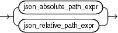
[Description of "Figure B-1 json_basic_path_expression"](img_text/json_basic_path_expr.md)

Figure B-2 json_absolute_path_expression

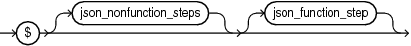
[Description of "Figure B-2 json_absolute_path_expression"](img_text/json_absolute_path_expr.md)

Figure B-3 json_nonfunction_steps

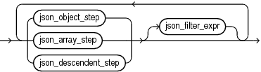
[Description of "Figure B-3 json_nonfunction_steps"](img_text/json_nonfunction_steps.md)

Figure B-4 json_object_step

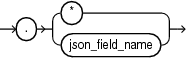
[Description of "Figure B-4 json_object_step"](img_text/json_object_step.md)

Figure B-5 json_field_name

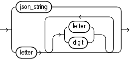
[Description of "Figure B-5 json_field_name"](img_text/json_field_name.md)

Figure B-6 json_array_step

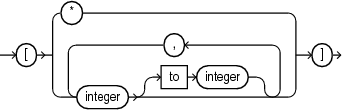
[Description of "Figure B-6 json_array_step"](img_text/json_array_step.md)

**Note:**

- Array indexing is zero-based, so `integer` is a non-negative integer (0, 1, 2, 3,...).

- The first `integer` of a range (`integer` `to` `integer`) must be less than the second.

- The array elements must be specified by indexes in ascending order, without repetitions.

A compile-time error is raised if any of these syntax rules is violated.

Figure B-7 json_function_step

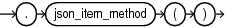
[Description of "Figure B-7 json_function_step"](img_text/json_function_step.md)

Figure B-8 json_item_method

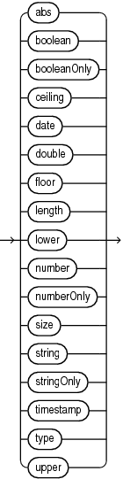
[Description of "Figure B-8 json_item_method"](img_text/json_item_method.md)

Figure B-9 json_filter_expr

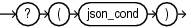
[Description of "Figure B-9 json_filter_expr"](img_text/json_filter_expr.md)

Figure B-10 json_cond

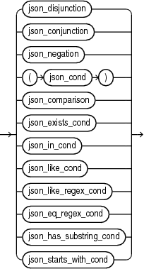
[Description of "Figure B-10 json_cond"](img_text/json_cond.md)

Figure B-11 json_conjunction

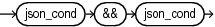
[Description of "Figure B-11 json_conjunction"](img_text/json_conjunction.md)

Figure B-12 json_comparison

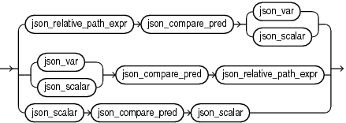
[Description of "Figure B-12 json_comparison"](img_text/json_comparison.md)

Figure B-13 json_relative_path-expr

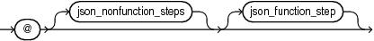
[Description of "Figure B-13 json_relative_path-expr"](img_text/json_relative_path_expr.md)

Figure B-14 json_compare_pred

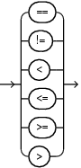
[Description of "Figure B-14 json_compare_pred"](img_text/json_compare_pred.md)

Figure B-15 json_var

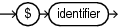
[Description of "Figure B-15 json_var"](img_text/json_var.md)

Figure B-16 json_scalar

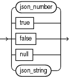
[Description of "Figure B-16 json_scalar"](img_text/json_scalar.md)

**Note:**

`json_number` is a JSON number: a decimal numeral, possibly signed and possibly including a decimal exponent.

**See Also:**

[Oracle Database SQL Language Reference](../sqlrf/How-to-Read-Syntax-Diagrams.md) for information about Oracle syntax diagrams
