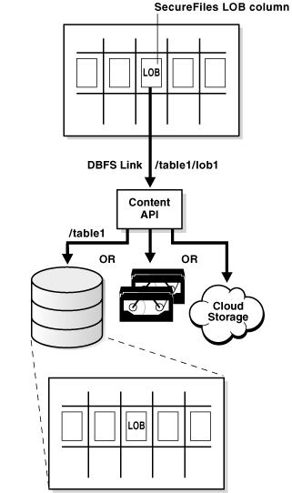

## 22  DBFS Hierarchical Store

The DBFS Hierarchical Store and related store wallet management work together to store less frequently used data.

Topics:

- About the Hierarchical Store Package\_ DBMS_DBFS_HS

- Ways to Use DBFS Hierarchial Store

- Setting up the Store

- Using the Hierarchical Store

- Database File System Links

- The DBMS_DBFS_HS Package

- Views for DBFS Hierarchical Store

<!-- -->

- About the Hierarchical Store Package, DBMS_DBFS_HS
  The Oracle DBFS Hierarchical Store package (`DBMS_DBFS_HS`) is a store provider for `DBMS_DBFS_CONTENT` that supports hierarchical storage for DBFS content.
- Ways to Use DBFS Hierarchial Store
  The `DBMS_DBFS_HS` package must be used in conjunction with the `DBMS_DBFS_CONTENT` package to manage Hierarchical Storage Management for SecureFiles LOBs using DBFS Links.
- Setting up the Store
  You manage a Hierarchical Store wallet and set up, register, and mount a hierarchical Store.
- Using the Hierarchical Store
  The Hierarchical Store can be used as an independent file system or as an archive solution for SecureFiles LOBs.
- Database File System Links
  Database File System Links allow for storing SecureFiles LOBs in a different location than usual.
- The DBMS_DBFS_HS Package
  The `DBMS_DBFS_HS` package is a service provider that enables use of tape or Amazon S3 Web service as storage for data.
- Views for DBFS Hierarchical Store
  The BFS Hierarchical Stores have several types of views.

**Parent topic:** [Database File System (DBFS)](database-file-system.md)

### 22.1 About the Hierarchical Store Package, DBMS_DBFS_HS

The Oracle DBFS Hierarchical Store package (`DBMS_DBFS_HS`) is a store provider for `DBMS_DBFS_CONTENT` that supports hierarchical storage for DBFS content.

The package stores content in two external storage devices: tape and the Amazon S3 web service, and associated metadata (or properties) in the database. The DBFS HS may cache frequently accessed content in database tables to improve performance.

**Parent topic:** DBFS Hierarchical Store

### 22.2 Ways to Use DBFS Hierarchial Store

The `DBMS_DBFS_HS` package must be used in conjunction with the `DBMS_DBFS_CONTENT` package to manage Hierarchical Storage Management for SecureFiles LOBs using DBFS Links.

Using this package, data that is less frequently used can be migrated to a cheaper external device such as tape, achieving significant reduction in storage costs.

The `DBMS_DBFS_HS` package can also be plugged into the `DBMS_DBFS_CONTENT` package, as a store provider, to implement a tape file system, if the associated external storage device is tape, or a cloud file system, if the associated external storage device is the Amazon S3 storage service.

The `DBMS_DBFS_HS` package provides you the ability to use tape as a storage tier when implementing Information Lifecycle Management (ILM) for database tables or content. The package also supports other forms of storage targets including Web Services like Amazon S3. This service enables users to store data in the database on tape and other forms of storage. The data on tape or Amazon S3 is part of the Oracle Database and all standard APIs can access it, but only through the database.

`DBMS_DBFS_HS` has additional interfaces needed to manage the external storage device and the cache associated with each store.

To use the package `DBMS_DBFS_HS`, you must be granted the `DBFS_ROLE` role.

**See Also:**

[Oracle Database PL/SQL Packages and Types Reference](../arpls/DBMS_DBFS_HS.md), for details of the `DBMS_DBFS_HS` Package

**Parent topic:** DBFS Hierarchical Store

### 22.3 Setting up the Store

You manage a Hierarchical Store wallet and set up, register, and mount a hierarchical Store.

Topics:

- Managing a HS Store Wallet

- Creating\_ Registering\_ and Mounting the Store

<!-- -->

- Managing a HS Store Wallet
  Use the command-line utility `mkstore` to create and manage wallets.
- Creating, Registering, and Mounting the Store
  Setting up a hierarchical file system store requires creating, registering, and mounting the store.

**Parent topic:** DBFS Hierarchical Store

#### 22.3.1 Managing a HS Store Wallet

Use the command-line utility `mkstore` to create and manage wallets.

Use the following commands to create wallets:

- Create a wallet

      mkstore -wrl wallet_location -create

- Add a `KEY` alias

  Specify the `access_key` and `secret_key` aliases by enclosing them within single quotes.

      mkstore -wrl wallet_location -createCredential alias 'access_key' 'secret_key'

  For example:

      mkstore -wrl /home/user1/mywallet -createCredential mykey 'abc' 'xyz'

- Delete a KEY alias

      mkstore -wrl wallet_location -deleteCredential alias

  For example:

      mkstore -wrl /home/user1/mywallet -deleteCredential mykey

**See Also:**

- [Oracle Database Advanced Security Guide](../dbimi/using-oracle-wallet-manager.md) for more about creation and management of wallets

**Parent topic:** Setting up the Store

#### 22.3.2 Creating, Registering, and Mounting the Store

Setting up a hierarchical file system store requires creating, registering, and mounting the store.

##### Creating, registering, and mounting the store.

1.  Call `createStore`.
        DBMS_DBFS_HS.createStore( store_name, store_type, tbl_name, tbs_name, cache_size, lob_cache_quota, optimal_tarball_size, schema_name);
2.  Set mandatory and optional properties using the following interface:
        DBMS_DBFS_HS.setStoreProperty(StoreName, PropertyName, PropertyValue);

    For `store_type` = `STORETYPE_TAPE`, mandatory properties are:

        PROPNAME_DEVICELIBRARY, PROPNAME_MEDIAPOOL, PROPNAME_CACHESIZE.

        PROPNAME_CACHESIZE is already set by createStore.

    You can change the value of `PROPNAME_CACHESIZE` using `reconfigCache`.

    Optional properties are:

        PROPNAME_OPTTARBALLSIZE, PROPNAME_READCHUNKSIZE, PROPNAME_WRITECHUNKSIZE, PROPNAME_STREAMABLE.

    For `store_type` = `STORETYPE_AMAZONS3` mandatory properties are:

        PROPNAME_DEVICELIBRARY, PROPNAME_CACHESIZE, PROPNAME_S3HOST,PROPNAME_BUCKET, PROPNAME_LICENSEID, PROPNAME_WALLET.

    `PROPNAME_CACHESIZE` is set by `createStore`. You can change the value of `PROPNAME_CACHESIZE` using `reconfigCache`.

    Optional properties are:

        PROPNAME_OPTTARBALLSIZE, PROPNAME_READCHUNKSIZE, PROPNAME_WRITECHUNKSIZE, PROPNAME_STREAMABLE, PROPNAME_HTTPPROXY.
3.  Register the store with DBFS Content API using:
        DBMS_DBFS_CONTENT.registerStore(store_name, provider_name, provider_package);

    Note: `provider_package` is the `dbms_dbfs_hs` package.
4.  Mount the stores for access using:
        DBMS_DBFS_CONTENT.mountStore(store_name, store_mount, singleton,principal,
          owner, acl, asof, read_only);

**Parent topic:** Setting up the Store

### 22.4 Using the Hierarchical Store

The Hierarchical Store can be used as an independent file system or as an archive solution for SecureFiles LOBs.

Topics:

- Using Hierarchical Store as a File System

- Using Hierarchical Store as an Archive Solution For SecureFiles LOBs

- Dropping a Hierarchical Store

- Compression to Use with the Hierarchical Store

- Program Example Using Tape

- Program Example Using Amazon S3

<!-- -->

- Using Hierarchical Store as a File System
  Use the `DBMS_DBFS_CONTENT` package to create, update, read, and delete file system entries in the store.
- Using Hierarchical Store as an Archive Solution For SecureFiles LOBs
  Use the `DBMS_LOB` package to archive SecureFiles LOBs in a tape or S3 store.
- Dropping a Hierarchical Store
  You can drop a hierarchical store.
- Compression to Use with the Hierarchical Store
  The DBFS hierarchical store can store its files in compressed forms.
- Program Example Using Tape
  This example program configures and uses a tape store.
- Program Example Using Amazon S3
  This example program configures and uses an Amazon S3 store.

**Parent topic:** DBFS Hierarchical Store

#### 22.4.1 Using Hierarchical Store as a File System

Use the `DBMS_DBFS_CONTENT` package to create, update, read, and delete file system entries in the store.

**See Also:**

[DBFS Content API](DBFS-content-API.md)

**Parent topic:** Using the Hierarchical Store

#### 22.4.2 Using Hierarchical Store as an Archive Solution For SecureFiles LOBs

Use the `DBMS_LOB` package to archive SecureFiles LOBs in a tape or S3 store.

The `DBMS_LOB` package archives SecureFiles LOBs in a tape or S3 store, as described in "[PL/SQL Packages for LOBs and DBFS](using-oracle-LOBs-storage.md)".

To free space in the cache or to force cache resident contents to be written to external storage device, call:

    DBMS_DBFS_HS.storePush(store_name);

**Parent topic:** Using the Hierarchical Store

#### 22.4.3 Dropping a Hierarchical Store

You can drop a hierarchical store.

To drop a hierarchical store, call:

    DBMS_DBFS_HS.dropStore(store_name, opt_flags);

**Parent topic:** Using the Hierarchical Store

#### 22.4.4 Compression to Use with the Hierarchical Store

The DBFS hierarchical store can store its files in compressed forms.

The DBFS hierarchical store has the ability to store its files in compressed form using the `SETPROPERTY` method and the property `PROPNAME_COMPRESSLVL` to specify the compression level.

Valid values are:

- `PROPVAL_COMPLVL_NONE`: No compression

- `PROPVAL_COMPLVL_LOW`: `LOW` compression

- `PROPVAL_COMPLVL_MEDIUM`: `MEDIUM` compression

- `PROPVAL_COMPLVL_HIGH`: `HIGH` compression

Generally, the compression level `LOW` performs best and still provides a good compression ratio. Compression levels `MEDIUM` and `HIGH` provide significantly better compression ratios, but compression times can be correspondingly longer. Oracle recommends using `NONE` or `LOW` when write performance is critical, such as when files in the DBFS HS store are updated frequently. If space is critical and the best possible compression ratio is desired, use `MEDIUM` or `HIGH`.

Files are compressed as they are paged out of the cache into the staging area (before they are subsequently pushed into the back end tape or S3 storage). Therefore, compression also benefits by storing smaller files in the staging area and effectively increasing the total available capacity of the staging area.

**Parent topic:** Using the Hierarchical Store

#### 22.4.5 Program Example Using Tape

This example program configures and uses a tape store.

In the example, you must substitute valid values in some places, as indicated by \<...\>, for the program to run successfully.

**See Also:**

[Oracle Database PL/SQL Packages and Types Reference](../arpls/DBMS_DBFS_HS.md) `DBMS_DBFS_HS` documentation for complete details about the methods and their parameters

    Rem Example to configure and use a Tape store.
    Rem
    Rem hsuser should be a valid database user who has been granted
    Rem the role dbfs_role.

    connect hsuser/hsuser

    Rem The following block sets up a STORETYPE_TAPE store with
    Rem DBMS_DBFS_HS acting as the store provider.

    declare
    storename varchar2(32) ;
    tblname varchar2(30) ;
    tbsname varchar2(30) ;
    lob_cache_quota number := 0.8 ;
    cachesz number ;
    ots number ;
    begin
    cachesz := 50 * 1048576 ;
    ots := 1048576 ;
    storename := 'tapestore10' ;
    tblname := 'tapetbl10' ;
    tbsname := '<TBS_3>' ; -- Substitute a valid tablespace name

    -- Create the store.
    -- Here tbsname is the tablespace used for the store,
    -- tblname is the table holding all the store entities,
    -- cachesz is the space used by the store to cache content
    --   in the tablespace,
    -- lob_cache_quota is the fraction of cachesz allocated
    --   to level-1 cache and
    -- ots is minimum amount of content that is accumulated
    --   in level-2 cache before being stored on tape
    dbms_dbfs_hs.createStore(
      storename,
      dbms_dbfs_hs.STORETYPE_TAPE,
      tblname, tbsname, cachesz,
      lob_cache_quota, ots) ;

    dbms_dbfs_hs.setstoreproperty(
      storename,
      dbms_dbfs_hs.PROPNAME_SBTLIBRARY,
      '<ORACLE_HOME/work/libobkuniq.so>') ;
      -- Substitute your ORACLE_HOME path

    dbms_dbfs_hs.setstoreproperty(
      storename,
      dbms_dbfs_hs.PROPNAME_MEDIAPOOL,
      '<0>') ;  -- Substitute valid value

    dbms_dbfs_hs.setstoreproperty(
      storename,
      dbms_dbfs_hs.PROPNAME_COMPRESSLEVEL,
      'NONE') ;

    -- Please refer to DBMS_DBFS_CONTENT documentation
    -- for details about this method
    dbms_dbfs_content.registerstore(
      storename,
      'tapeprvder10',
      'dbms_dbfs_hs') ;

    -- Please refer to DBMS_DBFS_CONTENT documentation
    -- for details about this method
    dbms_dbfs_content.mountstore(storename, 'tapemnt10') ;
    end ;
    /

    Rem The following code block does file operations
    Rem using DBMS_DBFS_CONTENT on the store configured
    Rem in the previous code block

    connect hsuser/hsuser

    declare
      path varchar2(256) ;
      path_pre varchar2(256) ;
      mount_point varchar2(32) ;
      store_name varchar2(32) ;
      prop1 dbms_dbfs_content_properties_t ;
      prop2 dbms_dbfs_content_properties_t ;
      mycontent blob := empty_blob() ;
      buffer varchar2(1050) ;
      rawbuf raw(1050) ;
      outcontent blob := empty_blob() ;
      itemtype integer ;
      pflag integer ;
      filecnt integer ;
      iter integer ;
      offset integer ;
      rawlen integer ;
    begin

      mount_point := '/tapemnt10' ;
      store_name := 'tapestore10' ;
      path_pre := mount_point ||'/file' ;

    -- We create 10 empty files in the following loop
      filecnt := 0 ;
      loop
        exit when filecnt = 10 ;
        path := path_pre || to_char(filecnt) ;
        mycontent := empty_blob() ;
        prop1 := null ;

        -- Please refer to DBMS_DBFS_CONTENT documentation
        -- for details about this method
        dbms_dbfs_content.createFile(
          path, prop1, mycontent) ; -- Create the file

        commit ;
        filecnt := filecnt + 1 ;
      end loop ;

      -- We populate the newly created files with content
      -- in the following loop
      pflag := dbms_dbfs_content.prop_data +
               dbms_dbfs_content.prop_std  +
               dbms_dbfs_content.prop_opt  ;

      buffer := 'Oracle provides an integrated management '  ||
                'solution for managing Oracle database with '||
                'a unique top-down application management '  ||
                'approach. With new self-managing '          ||
                'capabilities, Oracle eliminates time-'      ||
                'consuming, error-prone administrative '     ||
                'tasks, so database administrators can '     ||
                'focus on strategic business objectives '    ||
                'instead of performance and availability '   ||
                'fire drills. Oracle Management Packs for '  ||
                'Database provide signifiCant cost and time-'||
                'saving capabilities for managing Oracle '   ||
                'Databases. Independent studies demonstrate '||
                'that Oracle Database is 40 percent easier ' ||
                'to manage over DB2 and 38 percent over '    ||
                'SQL Server.';

      rawbuf := utl_raw.cast_to_raw(buffer) ;
      rawlen := utl_raw.length(rawbuf) ;
      offset := 1 ;
      filecnt := 0 ;
      loop
        exit when filecnt = 10 ;
        path := path_pre || to_char(filecnt) ;
        prop1 := null;

        -- Append buffer to file
        -- Please refer to DBMS_DBFS_CONTENT documentation
        -- for details about this method
        dbms_dbfs_content.putpath(
          path, prop1, rawlen,
          offset, rawbuf) ;

        commit ;
        filecnt := filecnt + 1 ;
      end loop ;

      -- Clear out level 1 cache
      dbms_dbfs_hs.flushCache(store_name) ;
      commit ;

      -- Do write operation on even-numbered files.
      -- Do read operation on odd-numbered files.
      filecnt := 0 ;
      loop
        exit when filecnt = 10;
        path := path_pre || to_char(filecnt) ;
        if mod(filecnt, 2) = 0 then
          -- Get writable file
          -- Please refer to DBMS_DBFS_CONTENT documentation
          -- for details about this method
          dbms_dbfs_content.getPath(
            path, prop2, outcontent, itemtype,
            pflag, null, true) ;

          buffer := 'Agile businesses want to be able to '    ||
                    'quickly adopt new technologies, whether '||
                    'operating systems, servers, or '         ||
                    'software, to help them stay ahead of '   ||
                    'the competition. However, change often ' ||
                    'introduces a period of instability into '||
                    'mission-critical IT systems. Oracle '    ||
                    'Real Application Testing-with Oracle '   ||
                    'Database 11g Enterprise Edition-allows ' ||
                    'businesses to quickly adopt new '        ||
                    'technologies while eliminating the '     ||
                    'risks associated with change. Oracle '   ||
                    'Real Application Testing combines a '    ||
                    'workload capture and replay feature '    ||
                    'with an SQL performance analyzer to '    ||
                    'help you test changes against real-life '||
                    'workloads, and then helps you fine-tune '||
                    'the changes before putting them into'    ||
                    'production. Oracle Real Application '    ||
                    'Testing supports older versions of '     ||
                    'Oracle Database, so customers running '  ||
                    'Oracle Database 9i and Oracle Database ' ||
                    '10g can use it to accelerate their '     ||
                    'database upgrades. ';

          rawbuf := utl_raw.cast_to_raw(buffer) ;
          rawlen := utl_raw.length(rawbuf) ;

          -- Modify file content
          -- Please refer to DBMS_DBFS_CONTENT documentation
          -- for details about this method
          dbms_lob.write(outcontent, rawlen, 10, rawbuf);
          commit ;
        else
          -- Read the file
          -- Please refer to DBMS_DBFS_CONTENT documentation
          -- for details about this method
          dbms_dbfs_content.getPath(
            path, prop2, outcontent, itemtype, pflag) ;
        end if ;
        filecnt := filecnt + 1 ;
      end loop ;

      -- Delete the first 2 files
      filecnt := 0;

      loop
        exit when filecnt = 2 ;
        path := path_pre || to_char(filecnt) ;
        -- Delete file
        -- Please refer to DBMS_DBFS_CONTENT documentation
        -- for details about this method
        dbms_dbfs_content.deleteFile(path) ;
        commit ;
        filecnt := filecnt + 1 ;
      end loop ;

      -- Move content staged in database to the tape store
      dbms_dbfs_hs.storePush(store_name) ;
      commit ;

    end ;
    /

**Parent topic:** Using the Hierarchical Store

#### 22.4.6 Program Example Using Amazon S3

This example program configures and uses an Amazon S3 store.

Valid values must be substituted in some places, indicated by \<...\>, for the program to run successfully.

**See Also:**

[Oracle Database PL/SQL Packages and Types Reference](../arpls/DBMS_DBFS_HS.md) `DBMS_DBFS_HS` documentation for complete details about the methods and their parameters

    Rem Example to configure and use an Amazon S3 store.
    Rem
    Rem hsuser should be a valid database user who has been granted
    Rem the role dbfs_role.

    connect hsuser/hsuser

    Rem The following block sets up a STORETYPE_AMAZONS3 store with
    Rem DBMS_DBFS_HS acting as the store provider.

    declare
    storename varchar2(32) ;
    tblname varchar2(30) ;
    tbsname varchar2(30) ;
    lob_cache_quota number := 0.8 ;
    cachesz number ;
    ots number ;
    begin
    cachesz := 50 * 1048576 ;
    ots := 1048576 ;
    storename := 's3store10' ;
    tblname := 's3tbl10' ;
    tbsname := '<TBS_3>' ; -- Substitute a valid tablespace name

    -- Create the store.
    -- Here tbsname is the tablespace used for the store,
    -- tblname is the table holding all the store entities,
    -- cachesz is the space used by the store to cache content
    --   in the tablespace,
    -- lob_cache_quota is the fraction of cachesz allocated
    --   to level-1 cache and
    -- ots is minimum amount of content that is accumulated
    --   in level-2 cache before being stored in AmazonS3
    dbms_dbfs_hs.createStore(
      storename,
      dbms_dbfs_hs.STORETYPE_AMAZONS3,
      tblname, tbsname, cachesz,
      lob_cache_quota, ots) ;

    dbms_dbfs_hs.setstoreproperty(storename,
      dbms_dbfs_hs.PROPNAME_SBTLIBRARY,
      '<ORACLE_HOME/work/libosbws11.so>');
      -- Substitute your ORACLE_HOME path

    dbms_dbfs_hs.setstoreproperty(
      storename,
      dbms_dbfs_hs.PROPNAME_S3HOST,
      's3.amazonaws.com') ;

    dbms_dbfs_hs.setstoreproperty(
      storename,
      dbms_dbfs_hs.PROPNAME_BUCKET,
      'oras3bucket10') ;

    dbms_dbfs_hs.setstoreproperty(
      storename,
      dbms_dbfs_hs.PROPNAME_WALLET,
      'LOCATION=file:<ORACLE_HOME>/work/wlt CREDENTIAL_ALIAS=a_key') ;
      -- Substitute your ORACLE_HOME path

    dbms_dbfs_hs.setstoreproperty(
      storename,
      dbms_dbfs_hs.PROPNAME_LICENSEID,
      '<xxxxxxxxxxxxxxxx>') ; -- Substitute a valid SBT license id

    dbms_dbfs_hs.setstoreproperty(
      storename,
      dbms_dbfs_hs.PROPNAME_HTTPPROXY,
      '<http://www-proxy.mycompany.com:80/>') ;
      -- Substitute valid value. If a proxy is not used,
      -- then this property need not be set.

    dbms_dbfs_hs.setstoreproperty(
      storename,
      dbms_dbfs_hs.PROPNAME_COMPRESSLEVEL,
      'NONE') ;

    dbms_dbfs_hs.createbucket(storename) ;

    -- Please refer to DBMS_DBFS_CONTENT documentation
    -- for details about this method
    dbms_dbfs_content.registerstore(
      storename,
      's3prvder10',
      'dbms_dbfs_hs') ;

    -- Please refer to DBMS_DBFS_CONTENT documentation
    -- for details about this method
    dbms_dbfs_content.mountstore(
      storename,
      's3mnt10') ;
    end ;
    /

    Rem The following code block does file operations
    Rem using DBMS_DBFS_CONTENT on the store configured
    Rem in the previous code block

    connect hsuser/hsuser

    declare
    path varchar2(256) ;
    path_pre varchar2(256) ;
    mount_point varchar2(32) ;
    store_name varchar2(32) ;
    prop1 dbms_dbfs_content_properties_t ;
    prop2 dbms_dbfs_content_properties_t ;
    mycontent blob := empty_blob() ;
    buffer varchar2(1050) ;
    rawbuf raw(1050) ;
    outcontent blob := empty_blob() ;
    itemtype integer ;
    pflag integer ;
    filecnt integer ;
    iter integer ;
    offset integer ;
    rawlen integer ;
    begin

      mount_point := '/s3mnt10' ;
      store_name := 's3store10' ;
      path_pre := mount_point ||'/file' ;

      -- We create 10 empty files in the following loop
      filecnt := 0 ;
      loop
        exit when filecnt = 10 ;
        path := path_pre || to_char(filecnt) ;
        mycontent := empty_blob() ;
        prop1 := null ;

        -- Please refer to DBMS_DBFS_CONTENT documentation
        -- for details about this method
        dbms_dbfs_content.createFile(
          path, prop1, mycontent) ; -- Create the file

        commit ;
        filecnt := filecnt + 1 ;
      end loop ;

      -- We populate the newly created files with content
      -- in the following loop
      pflag := dbms_dbfs_content.prop_data +
               dbms_dbfs_content.prop_std  +
               dbms_dbfs_content.prop_opt  ;

      buffer := 'Oracle provides an integrated management '  ||
                'solution for managing Oracle database with '||
                'a unique top-down application management '  ||
                'approach. With new self-managing '          ||
                'capabilities, Oracle eliminates time-'      ||
                'consuming, error-prone administrative '     ||
                'tasks, so database administrators can '     ||
                'focus on strategic business objectives '    ||
                'instead of performance and availability '   ||
                'fire drills. Oracle Management Packs for '  ||
                'Database provide signifiCant cost and time-'||
                'saving capabilities for managing Oracle '   ||
                'Databases. Independent studies demonstrate '||
                'that Oracle Database is 40 percent easier ' ||
                'to manage over DB2 and 38 percent over '    ||
                'SQL Server.';

      rawbuf := utl_raw.cast_to_raw(buffer) ;
      rawlen := utl_raw.length(rawbuf) ;
      offset := 1 ;
      filecnt := 0 ;
      loop
        exit when filecnt = 10 ;
        path := path_pre || to_char(filecnt) ;
        prop1 := null;

        -- Append buffer to file
        -- Please refer to DBMS_DBFS_CONTENT documentation
        -- for details about this method
        dbms_dbfs_content.putpath(
          path, prop1, rawlen,
          offset, rawbuf) ;

        commit ;
        filecnt := filecnt + 1 ;
      end loop ;

      -- Clear out level 1 cache
      dbms_dbfs_hs.flushCache(store_name) ;
      commit ;

      -- Do write operation on even-numbered files.
      -- Do read operation on odd-numbered files.
      filecnt := 0 ;
      loop
        exit when filecnt = 10;
        path := path_pre || to_char(filecnt) ;
        if mod(filecnt, 2) = 0 then
          -- Get writable file
          -- Please refer to DBMS_DBFS_CONTENT documentation
          -- for details about this method
          dbms_dbfs_content.getPath(
            path, prop2, outcontent, itemtype,
            pflag, null, true) ;

          buffer := 'Agile businesses want to be able to '    ||
                    'quickly adopt new technologies, whether '||
                    'operating systems, servers, or '         ||
                    'software, to help them stay ahead of '   ||
                    'the competition. However, change often ' ||
                    'introduces a period of instability into '||
                    'mission-critical IT systems. Oracle '    ||
                    'Real Application Testing-with Oracle '   ||
                    'Database 11g Enterprise Edition-allows ' ||
                    'businesses to quickly adopt new '        ||
                    'technologies while eliminating the '     ||
                    'risks associated with change. Oracle '   ||
                    'Real Application Testing combines a '    ||
                    'workload capture and replay feature '    ||
                    'with an SQL performance analyzer to '    ||
                    'help you test changes against real-life '||
                    'workloads, and then helps you fine-tune '||
                    'the changes before putting them into'    ||
                    'production. Oracle Real Application '    ||
                    'Testing supports older versions of '     ||
                    'Oracle Database, so customers running '  ||
                    'Oracle Database 9i and Oracle Database ' ||
                    '10g can use it to accelerate their '     ||
                    'database upgrades. ';

          rawbuf := utl_raw.cast_to_raw(buffer) ;
          rawlen := utl_raw.length(rawbuf) ;

          -- Modify file content
          -- Please refer to DBMS_DBFS_CONTENT documentation
          -- for details about this method
          dbms_lob.write(outcontent, rawlen, 10, rawbuf);
          commit ;
        else
          -- Read the file
          -- Please refer to DBMS_DBFS_CONTENT documentation
          -- for details about this method
          dbms_dbfs_content.getPath(
            path, prop2, outcontent, itemtype, pflag) ;
        end if ;
        filecnt := filecnt + 1 ;
      end loop ;

      -- Delete the first 2 files
      filecnt := 0;

      loop
        exit when filecnt = 2 ;
        path := path_pre || to_char(filecnt) ;
        -- Delete file
        -- Please refer to DBMS_DBFS_CONTENT documentation
        -- for details about this method
        dbms_dbfs_content.deleteFile(path) ;
        commit ;
        filecnt := filecnt + 1 ;
      end loop ;

      -- Move content staged in database to Amazon S3 store
      dbms_dbfs_hs.storePush(store_name) ;
      commit ;

    end ;
    /

**Parent topic:** Using the Hierarchical Store

### 22.5 Database File System Links

Database File System Links allow for storing SecureFiles LOBs in a different location than usual.

Topics:

- About Database File System Links

- Ways to Create Database File System Links

- Database File System Links Copy

- Copying a Linked LOB Between Tables

- Online Redefinition and DBFS Links

- Transparent Read

<!-- -->

- About Database File System Links
  DBFS Links allows storing SecureFiles LOBs transparently in a location separate from the segment where the LOB is normally stored. Instead, you store a link to the LOB in the segment.
- Ways to Create Database File System Links
  Database File System Links require the creation of a Database File System through the use of the DBFS Content package, `DBMS_DBFS_CONTENT`.
- Database File System Links Copy
  The API `DBMS_LOB.COPY_DBFS_LINK(DSTLOB,` `SRCLOB`, `FLAGS``)` provides the ability to copy a linked SecureFiles LOB.
- Copying a Linked LOB Between Tables
  You can copy DBFS links from source tables to destination tables.
- Online Redefinition and DBFS Links
  Online redefinition copies any DBFS Links that are stored in any SecureFiles LOBs in the table being redefined.
- Transparent Read
  DBFS Links can read from a linked SecureFiles LOB even if the data is not cached in the database.

**Parent topic:** DBFS Hierarchical Store

#### 22.5.1 About Database File System Links

DBFS Links allows storing SecureFiles LOBs transparently in a location separate from the segment where the LOB is normally stored. Instead, you store a link to the LOB in the segment.

The link in the segment must reference a path that uses DBFS to locate the LOB when accessed. This means that the LOB could be stored on another file system, on a tape system, in the cloud, or any other location that can be accessed using DBFS.

When a user or application tries to access a SecureFiles LOB that has been stored outside the segment using a DBFS Link, the behavior can vary depending on the attempted operation and the characteristics of the DBFS store that holds the LOB:

- Read:

  If the LOB is not already cached in a local area in the database, then it can be read directly from the DBFS content store that holds it, if the content store allows streaming access based on the setting of the `PROPNAME_STREAMABLE` parameter. If the content store does not allow streaming access, then the entire LOB will first be read into a local area in the database, where it will be stored for a period of time for future access.

- Write:

  If the LOB is not already cached in a local area in the database, then it will first be read into the database, modified as needed, and then written back to the DBFS content store defined in the DBFS Link for the LOB in question.

- Delete:

  When a SecureFiles LOB that is stored through a DBFS Link is deleted, the DBFS Link is deleted from the table, but the LOB itself is NOT deleted from the DBFS content store. Or it is more complex, based on the characteristics/settings, of the DBFS content store in question.

DBFS Links enable the use of SecureFiles LOBs to implement Hierarchical Storage Management (HSM) in conjunction with the DBFS Hierarchical Store (DBFS HS). HSM is a process by which the database moves rarely used or unused data from faster, more expensive, and smaller storage to slower, cheaper, and higher capacity storage.

Figure 22-1 Database File System Link

[Description of "Figure 22-1 Database File System Link"](img_text/adlob202.md)

**Parent topic:** Database File System Links

#### 22.5.2 Ways to Create Database File System Links

Database File System Links require the creation of a Database File System through the use of the DBFS Content package, `DBMS_DBFS_CONTENT`.

Oracle provides several methods for creating a DBFS Link:

- Move SecureFiles LOB data into a specified DBFS pathname and store the reference to the new location in the LOB.

  Call `DBMS_LOB.MOVE_TO_DBFS_LINK()`with LOB and DBFS path name arguments, and the system creates the specified DBFS HSM Store if it does not exist, copies data from the SecureFiles LOB into the specified DBFS HSM Store, removes data from the SecureFiles LOB, and stores the file path name for subsequent access through this LOB.

- Copy or create a reference to an existing file.

  Call `DBMS_LOB.COPY_DBFS_LINK()` to copy a link from an existing DBFS Link. If there is any data in the destination SecureFiles LOB, the system removes this data and stores a copy of the reference to the link in the destination SecureFiles LOB.

- Call `DBMS_LOB.SET_DBFS_LINK()`, which assumes that the data for the link is stored in the specified DBFS path name.

  The system removes data in the specified SecureFiles LOB and stores the link to the DBFS path name.

Creating a DBFS Link impacts which operations may be performed and how. Any `DBMS_LOB` operations that modify the contents of a LOB will throw an exception if the underlying LOB has been moved into a DBFS Link. The application must explicitly replace the DBFS Link with a LOB by calling `DBMS_LOB.COPY_FROM_LINK()` before making these calls.

When it is completed, the application can move the updated LOB back to DBFS using `DBMS_LOB.MOVE_TO_DBFS_LINK()`, if needed. Other `DBMS_LOB` operations that existed before Oracle Database 11g Release 2 work transparently if the DBFS Link is in a file system that supports streaming. Note that these operations fail if streaming is either not supported or disabled.

If the DBFS Link file is modified through DBFS interfaces directly, the change is reflected in subsequent reads of the SecureFiles LOB. If the file is deleted through DBFS interfaces, then an exception occurs on subsequent reads.

For the database, it is also possible that a DBA may not want to store all of the data stored in a SecureFiles LOB HSM during export and import. Oracle has the ability to export and import only the Database File System Links. The links are fully qualified identifiers that provide access to the stored data, when entered into a SecureFiles LOB or registered on a SecureFiles LOB in a different database. This ability to export and import a link is similar to the common file system functionality of symbolic links.

The newly imported link is only available as long as the source, the stored data, is available, or until the first retrieval occurs on the imported system. The application is responsible for stored data retention. If the application system removes data from the store that still has a reference to it, the database throws an exception when the referencing SecureFiles LOB(s) attempt to access the data. Oracle also supports continuing to keep the data in the database after migration out to a DBFS store as a cached copy. It is up to the application to purge these copies in compliance with its retention policies.

**Parent topic:** Database File System Links

#### 22.5.3 Database File System Links Copy

The API `DBMS_LOB.COPY_DBFS_LINK(DSTLOB,` `SRCLOB`, `FLAGS``)` provides the ability to copy a linked SecureFiles LOB.

sBy default, the LOB is not obtained from the DBFS HSM Store during this operation; this is a copy-by-reference operation that exports the DBFS path name (at source side) and imports it (at destination side). The `flags` argument can dictate that the destination has a local copy in the database and references the LOB data in the DBFS HSM Store.

**Parent topic:** Database File System Links

#### 22.5.4 Copying a Linked LOB Between Tables

You can copy DBFS links from source tables to destination tables.

Use the following code to copy any DBFS Links that are stored in any SecureFiles LOBs in the source table to the destination table.

`CREATE TABLE ... AS SELECT (CTAS)` and `INSERT TABLE ... AS SELECT (ITAS)`

**Parent topic:** Database File System Links

#### 22.5.5 Online Redefinition and DBFS Links

Online redefinition copies any DBFS Links that are stored in any SecureFiles LOBs in the table being redefined.

Online redefinition copies any DBFS Links that are stored in any SecureFiles LOBs in the table being redefined.

**Parent topic:** Database File System Links

#### 22.5.6 Transparent Read

DBFS Links can read from a linked SecureFiles LOB even if the data is not cached in the database.

You can read data from the content store where the data is currently stored and stream that data back to the user application as if it were being read from the SecureFiles LOB segment. This allows seamless access to the DBFS Linked data without the prerequisite first call to `DBMS_LOB.COPY_FROM_DBFS_LINK()`.

Whether or not transparent read is available for a particular SecureFiles LOB is determined by the `DBFS_CONTENT` store where the data resides. This feature is always enabled for `DBFS_SFS` stores, and by default for `DBFS_HS` stores. To disable transparent read for `DBFS_HS` store, set the `PROPNAME_STREAMABLE` parameter to `FALSE`.

**See Also:**

[Oracle Database PL/SQL Packages and Types Reference](../arpls/DBMS_DBFS_HS.md)

**Parent topic:** Database File System Links

### 22.6 The DBMS_DBFS_HS Package

The `DBMS_DBFS_HS` package is a service provider that enables use of tape or Amazon S3 Web service as storage for data.

Topics:

- Constants for DBMS_DBFS_HS Package

- Methods for DBMS_DBFS_HS Package

<!-- -->

- Constants for DBMS_DBFS_HS Package
  The `DBMS_DBFS_HS` PL/SQL package constants are very detailed.
- Methods for DBMS_DBFS_HS Package
  There are many methods in the `DBMS_DBFS_HS`package.

**Parent topic:** DBFS Hierarchical Store

#### 22.6.1 Constants for DBMS_DBFS_HS Package

The `DBMS_DBFS_HS` PL/SQL package constants are very detailed.

**See Also:**

See [Oracle Database PL/SQL Packages and Types Reference](../arpls/DBMS_DBFS_HS.md) for details of constants used by `DBMS_DBFS_HS` PL/SQL package

**Parent topic:** The DBMS_DBFS_HS Package

#### 22.6.2 Methods for DBMS_DBFS_HS Package

There are many methods in the `DBMS_DBFS_HS`package.

Table 22-1 summarizes the `DBMS_DBFS_HS` PL/SQL package methods.

**See Also:**

[Oracle Database PL/SQL Packages and Types Reference](../arpls/DBMS_DBFS_HS.md)

Table 22-1 Methods of the DBMS_DBFS_HS PL/SQL Packages

| Method                     | Description                                                                                                                                                                                         |
|:---------------------------|:----------------------------------------------------------------------------------------------------------------------------------------------------------------------------------------------------|
| `CLEANUPUNUSEDBACKUPFILES` | Removes files that are created on the external storage device if they have no current content. [Oracle Database PL/SQL Packages and Types Reference](../arpls/DBMS_DBFS_HS.md)                   |
| `CREATEBUCKET`             | Creates an AWS bucket, for use with the `STORETYPE_AMAZON3` store. [Oracle Database PL/SQL Packages and Types Reference](../arpls/DBMS_DBFS_HS.md)                                               |
| `CREATESTORE`              | Creates a DBFS HS store. [Oracle Database PL/SQL Packages and Types Reference](../arpls/DBMS_DBFS_HS.md)                                                                                         |
| `DEREGSTORECOMMAND`        | Removes a command (message) that was associated with a store. [Oracle Database PL/SQL Packages and Types Reference](../arpls/DBMS_DBFS_HS.md)                                                    |
| `DROPSTORE`                | Deletes a previously created DBFS HS store. [Oracle Database PL/SQL Packages and Types Reference](../arpls/DBMS_DBFS_HS.md)                                                                      |
| `FLUSHCACHE`               | Flushes out level 1 cache to level 2 cache, increasing space in level 1. [Oracle Database PL/SQL Packages and Types Reference](../arpls/DBMS_DBFS_HS.md)                                         |
| `GETSTOREPROPERTY`         | Retrieves the values of a property of a store in the database. [Oracle Database PL/SQL Packages and Types Reference](../arpls/DBMS_DBFS_HS.md)                                                   |
| `RECONFIGCACHE`            | Reconfigures the parameters of the database cache used by the store. [Oracle Database PL/SQL Packages and Types Reference](../arpls/DBMS_DBFS_HS.md)                                             |
| `REGISTERSTORECOMMAND`     | Registers commands (messages) for a store so they are sent to the Media Manager of an external storage device. [Oracle Database PL/SQL Packages and Types Reference](../arpls/DBMS_DBFS_HS.md) . |
| `SENDCOMMAND`              | Sends a command (message) to the Media Manager of an external storage device. [Oracle Database PL/SQL Packages and Types Reference](../arpls/DBMS_DBFS_HS.md)                                    |
| `SETSTOREPROPERTY`         | Associates name/value properties with a registered Hierarchical Store. [Oracle Database PL/SQL Packages and Types Reference](../arpls/DBMS_DBFS_HS.md)                                           |
| `STOREPUSH`                | Pushes locally cached data to an archive store. [Oracle Database PL/SQL Packages and Types Reference](../arpls/DBMS_DBFS_HS.md)                                                                  |

**Parent topic:** The DBMS_DBFS_HS Package

### 22.7 Views for DBFS Hierarchical Store

The BFS Hierarchical Stores have several types of views.

There are several types of view for DBFS Hierarchical Stores.

**See Also:**

[Oracle Database Reference](../refrn/USER_DBFS_HS_FILES.md) for the columns and data types of these views

Topics:

- DBA Views

- User Views

<!-- -->

- DBA Views
  There are several views available for DBFS Hierarchical Store.
- User Views
  There are several views available for the DBFS Hierarchical Store.

**Parent topic:** DBFS Hierarchical Store

#### 22.7.1 DBA Views

There are several views available for DBFS Hierarchical Store.

These views for DBFS Hierarchical Store are available:

- `DBA_DBFS_HS`

  This view shows all Database File System (DBFS) hierarchical stores

- `DBA_DBFS_HS_PROPERTIES`

  This view shows modifiable properties of all Database File System (DBFS) hierarchical stores.

- `DBA_DBFS_HS_FIXED_PROPERTIES`

  This view shows non-modifiable properties of all Database File System (DBFS) hierarchical stores.

- `DBA_DBFS_HS_COMMANDS`

  This view shows all the registered store commands for all Database File System (DBFS) hierarchical stores.

**Parent topic:** Views for DBFS Hierarchical Store

#### 22.7.2 User Views

There are several views available for the DBFS Hierarchical Store.

- `USER_DBFS_HS`

  This view shows all Database File System (DBFS) hierarchical stores owned by the current user.

- `USER_DBFS_HS_PROPERTIES`

  This view shows modifiable properties of all Database File System (DBFS) hierarchical stores owned by current user.

- `USER_DBFS_HS_FIXED_PROPERTIES`

  This view shows non-modifiable properties of all Database File System (DBFS) hierarchical stores owned by current user.

- `USER_DBFS_HS_COMMANDS`

  This view shows all the registered store commands for all Database File system (DBFS) hierarchical stores owned by current user.

- `USER_DBFS_HS_FILES`

  This view shows files in the Database File System (DBFS) hierarchical store owned by the current user and their location on the backend device.

**Parent topic:** Views for DBFS Hierarchical Store
