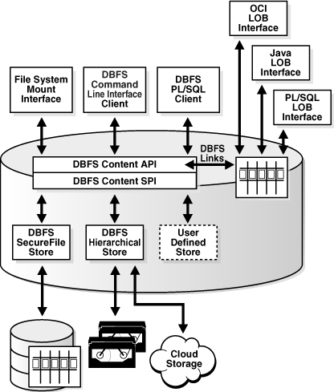

## 24  Creating Your Own DBFS Store

You can create your own DBFS Store using DBFS Content SPI (`DBMS_DBFS_CONTENT_SPI)`.

Topics:

- Overview of DBFS Store Creation and Use

- DBFS Content Store Provider Interface (DBFS Content SPI)

- Creating a Custom Provider

<!-- -->

- Overview of DBFS Store Creation and Use
  In order to customize a DBFS store, you must implement the DBFS Content SPI (`DBMS_DBFS_CONTENT_SPI)`. It is the basis for existing stores such as the DBFS SecureFiles Store and the DFFS Hierarchical Store, as well as any user-defined DBFS stores that you create.
- DBFS Content Store Provider Interface (DBFS Content SPI)
  The DBFS Content SPI (Store Provider Interface) is a specification only and has no package body.
- Creating a Custom Provider
  You can use this example store provider for DBFS, TaBleFileSystem Store Provider ("tbfs"), as a skeleton for custom providers or as a learning tool, to become familiar with the DBFS and its SPI.

**Parent topic:** [Database File System (DBFS)](database-file-system.md)

### 24.1 Overview of DBFS Store Creation and Use

In order to customize a DBFS store, you must implement the DBFS Content SPI (`DBMS_DBFS_CONTENT_SPI)`. It is the basis for existing stores such as the DBFS SecureFiles Store and the DFFS Hierarchical Store, as well as any user-defined DBFS stores that you create.

Client-side applications, such the PL/SQL interface, invoke functions and procedures in the DBFS Content API. The DBFS Content API then invokes corresponding subprograms in the DBFS Content SPI to create stores and perform other related functions.

Once you create your DBFS store, you run it much the same way that you would a SecureFiles Store.

**See Also:**

- [DBFS Content API](DBFS-content-API.md)

- [DBFS SecureFiles Store](DBFS-securefiles-store.md)

Figure 24-1 Database File System (DBFS)

[Description of "Figure 24-1 Database File System (DBFS)"](img_text/adlob201.md)

**Parent topic:** Creating Your Own DBFS Store

### 24.2 DBFS Content Store Provider Interface (DBFS Content SPI)

The DBFS Content SPI (Store Provider Interface) is a specification only and has no package body.

You must implement the package body in order to respond to calls from the DBFS Content API. In other words, DBFS Content SPI is a collection of required program specifications which you must implement using the method signatures and semantics indicated.

You may add additional functions and procedures to the DBFS Content SPI package body as needed. Your implementation may implement other methods and expose other interfaces, but the DBFS Content API will not use these interfaces.

The DBFS Content SPI references various elements such as constants, types, and exceptions defined by the DBFS Content API (package `DBMS_DBFS_CONTENT`).

Note that all path name references must be store-qualified, that is, the notion of mount points and full absolute path names has been normalized and converted to store-qualified path names by the DBFS Content API before it invokes any of the Provider SPI methods.

Because the DBFS Content API and Provider SPI is a one-to-many pluggable architecture, the DBFS Content API uses dynamic SQL to invoke methods in the Provider SPI; this may lead to run time errors if your Provider SPI implementation does not follow the Provider SPI specification in this document.

There are no explicit initial or final methods to indicate when the DBFS Content API plugs and unplugs a particular Provider SPI. Provider SPIs must be able to auto-initialize themselves at any SPI entry wpoint.

**See Also:**

- [Oracle Database PL/SQL Packages and Types Reference](../arpls/DBMS_DBFS_CONTENT_SPI.md) for syntax of the `DBMS_DBFS_CONTENT_SPI` package

- See the file `$ORACLE_HOME/rdbms/admin/dbmscapi.sql` for more information

**Parent topic:** Creating Your Own DBFS Store

### 24.3 Creating a Custom Provider

You can use this example store provider for DBFS, TaBleFileSystem Store Provider ("tbfs"), as a skeleton for custom providers or as a learning tool, to become familiar with the DBFS and its SPI.

This example store provider for DBFS, exposes a relational table containing a `BLOB` column as a flat, non-hierarchical filesystem, that is, a collection of named files.

To use this example, it is assumed that you have installed the Oracle Database 12c and are familiar with DBFS concepts, and have installed and used `dbfs_client` and `FUSE` to mount and access filesystems backed by the standard SFS store provider.

The TaBleFileSystem Store Provider ("tbfs") does not aim to be feature-rich or even complete, it does however provide a sufficient demonstration of what it takes for users of DBFS to write their own custom providers that expose their table(s) through `dbfs_client` to traditional filesystem programs.

Topics:

- Mechanics

- TBFS.SQL

- TBL.SQL

- spec.sql

- body.sql

- capi.sql

<!-- -->

- Mechanics
  These are the mechanics of the example store provider for DBFS, TaBleFileSystem Store Provider ("tbfs").
- TBFS.SQL
  The TBFS.SQL script is the top level driver script.
- TBL.SQL
  The TBL.SQL script creates a test user, a tablespace, the table that backs the filesystem and so on.
- spec.sql
  The `spec.sql` script provide the SPI specification of the tbfs.
- body.sql
  The `body.sql` script provides the SPI implementation of the tbfs.
- capi.sql
  The `capi.sql` script registers and mounts the DBFS.

**Parent topic:** Creating Your Own DBFS Store

#### 24.3.1 Mechanics

These are the mechanics of the example store provider for DBFS, TaBleFileSystem Store Provider ("tbfs").

Topics:

- Installation and Setup

- TBFS Use

- TBFS Internals

<!-- -->

- Installation and Setup
  You will need certain files for installation and setup of the DBFS TaBleFileSystem Store Provider ("tbfs").
- TBFS Use
  Once the example store provider for DBFS, TaBleFileSystem Store Provider ("tbfs") is installed, files can be added or removed in several different ways and other changes can be made to the TBFS.
- TBFS Internals
  The TBFS is simple because its primary purpose is to serve as a teaching and learning example.

**Parent topic:** Creating a Custom Provider

##### 24.3.1.1 Installation and Setup

You will need certain files for installation and setup of the DBFS TaBleFileSystem Store Provider ("tbfs").

The TBFS consists of the following SQL files:

`tbfs.sql`        top-level driver script

`tbl.sql`         script to create a test user, tablespace, the table backing the filesystem, and so on.

`spec.sql`        the SPI specification of the tbfs

`body.sql`        the SPI implementation of the tbfs

`capi.sql`        DBFS register/mount script

To install the TBFS, just run `tbfs.sql` as `SYSDBA`, in the directory that contains all of the above files. `tbfs.sql` will load the other SQL files in the proper sequence.

Ignoring any name conflicts, all of the SQL files should load without any compilation errors. All SQL files should also load without any run time errors, depending on the value of the "plsql_warnings" init.ora parameter, you may see various innocuous warnings.

If there are any name conflicts (tablespace name TBFS, datafile name"tbfs.f", user name TBFS, package name TBFS), the appropriate references in the various SQL files must be changed consistently.

**Parent topic:** Mechanics

##### 24.3.1.2 TBFS Use

Once the example store provider for DBFS, TaBleFileSystem Store Provider ("tbfs") is installed, files can be added or removed in several different ways and other changes can be made to the TBFS.

A `dbfs_client` connected as user TBFS will see a simple, non-hierarchical, filesystem backed by an RDBMS table (TBFS.TBFST).

Files can be added or removed from this filesystem through SQL (that is, through DML on the underlying table), through Unix utilities (mediated by `dbfs_client`), or through PL/SQL (using the DBFS APIs).

Changes to the filesystem made through any of the access methods will be visible, in a transactionally consistent manner (that is, at commit/rollback boundaries) to all of the other access methods.

**Parent topic:** Mechanics

##### 24.3.1.3 TBFS Internals

The TBFS is simple because its primary purpose is to serve as a teaching and learning example.

However, the implementation shows the path towards a robust, production-quality custom SPI that can plug into the DBFS, and expose existing relational data as Unix filesystems.

The TBFS makes various simplifications in order to remain concise (however, these should not be taken as inviolable limitations of DBFS or the SPI):

- The TBFS SPI package handles only a single table with a hard-coded name (TBFS.TBFST). It is possible to use dynamic SQL and additional configuration information to have a single SPI package support multiple tables, each as a separate filesystem (or even to unify data in multiple tables into a single filesystem).

- The TBFS does not support filesystem hierarchies; it imposes a flat namespace: a collection of files, identified by a simple item name, under a virtual "/" root directory. Implementing directory hierarchies is significantly more complex because it requires the store provider to manage parent/child relationships in a consistent manner.

  Moreover, existing relational data (the kind of data that TBFS is attempting to expose as a filesystem) does not typically have inter-row relationships that form a natural directory/file hierarchy.

- Because the TBFS supports only a flat namespace, most methods in the SPI are unimplemented, and the method bodies raise a `dbms_dbfs_content.unsupported_operation` exception. This exception is also a good starting point for you to write your own custom SPI. You can start with a simple SPI skeleton cloned from the `DBMS_DBFS_CONTENT_SPI` package, default all method bodies to ones that raise this exception, and subsequently fill in more realistic implementations incrementally.

- The table underlying the TBFS is close to being the simplest possible structure (a key/name column and a LOB column). This means that various properties used or expected by DBFS and `dbfs_client` must be generated dynamically (the TBFS implementation shows how this is done for the `std:guid` property).

  Other properties (such as Unix-style timestamps) are not implemented at all. This still allows a surprisingly functional filesystem to be implemented, but when you write your own custom SPIs, you can easily incorporate support for additional DBFS properties by expanding the structure of their underlying table(s) to include additional columns as needed, or by using existing columns in their existing tables to provide the values for these DBFS properties.

- The TBFS does not implement a rename/move method; adding support for this (a suitable `UPDATE` statement in the `renamePath` method) is left as an exercise for the user.

- The TBFS example uses the string "tbfs" in multiple places (tablespace, datafile, user, package, and even filesystem name). All these uses of "tbfs" belong in different namespaces—identifying which namespace corresponds to a specific occurrence of the string. "tbfs" in these examples is also a good learning exercise to make sure that the DBFS concepts are clear in your mind.

**Parent topic:** Mechanics

#### 24.3.2 TBFS.SQL

The TBFS.SQL script is the top level driver script.

The TBFS.SQL script:

    set echo on;

    @tbl
    @spec
    @body
    @capi

    quit;

**Parent topic:** Creating a Custom Provider

#### 24.3.3 TBL.SQL

The TBL.SQL script creates a test user, a tablespace, the table that backs the filesystem and so on.

The TBL.SQL script :

    connect / as sysdba

    create tablespace tbfs datafile 'tbfs.f' size 100m
        reuse autoextend on
        extent management local
        segment space management auto;

    create user tbfs identified by tbfs;
    alter user tbfs default tablespace tbfs;
    grant connect, resource, dbfs_role to tbfs;

    connect tbfs/tbfs;

    drop table tbfst;
    purge recyclebin;

    create table tbfst(
        key     varchar2(256)
                primary key
                check           (instr(key, '/') = 0),
        data    blob)
            tablespace tbfs
        lob(data)
            store as securefile
                (tablespace tbfs);

    grant select on tbfst to dbfs_role;
    grant insert on tbfst to dbfs_role;
    grant delete on tbfst to dbfs_role;
    grant update on tbfst to dbfs_role;

**Parent topic:** Creating a Custom Provider

#### 24.3.4 spec.sql

The `spec.sql` script provide the SPI specification of the tbfs.

The `spec.sql` script:

    connect / as sysdba;

    create or replace package tbfs
        authid current_user
    as

        /*
         * Lookup store features (see dbms_dbfs_content.feature_XXX). Lookup
         * store id.
         *
         * A store ID identifies a provider-specific store, across
         * registrations and mounts, but independent of changes to the store
         * contents.
         *
         * I.e. changes to the store table(s) should be reflected in the
         * store ID, but re-initialization of the same store table(s) should
         * preserve the store ID.
         *
         * Providers should also return a "version" (either specific to a
         * provider package, or to an individual store) based on a standard
         *  naming convention (for <major>, <minor>, and <patch>
         * components).
         *
         */

        function    getFeatures(
            store_name          in      varchar2)
                return  integer;

        function    getStoreId(
            store_name          in      varchar2)
                return  number;

        function    getVersion(
            store_name          in      varchar2)
                return  varchar2;

        /*
         * Lookup pathnames by (store_name, std_guid) or (store_mount,
         * std_guid) tuples.
         *
         * If the underlying "std_guid" is found in the underlying store,
         * this function returns the store-qualified pathname.
         *
         * If the "std_guid" is unknown, a "null" value is returned. Clients
         * are expected to handle this as appropriate.
         *
         */

        function    getPathByStoreId(
            store_name          in      varchar2,
            guid                in      integer)
                return  varchar2;

        /*
         * DBFS SPI: space usage.
         *
         * Clients can query filesystem space usage statistics via the
         * "spaceUsage()" method. Providers are expected to support this
         * method for their stores (and to make a best effort determination
         * of space usage---esp. if the store consists of multiple
         * tables/indexes/lobs, etc.).
         *
         * "blksize" is the natural tablespace blocksize that holds the
         * store---if multiple tablespaces with different blocksizes are
         * used, any valid blocksize is acceptable.
         *
         * "tbytes" is the total size of the store in bytes, and "fbytes" is
         * the free/unused size of the store in bytes. These values are
         * computed over all segments that comprise the store.
         *
         * "nfile", "ndir", "nlink", and "nref" count the number of
         * currently available files, directories, links, and references in
         * the store.
         *
         * Since database objects are dynamically growable, it is not easy
         * to estimate the division between "free" space and "used" space.
         *
         */

        procedure   spaceUsage(
            store_name  in              varchar2,
            blksize     out             integer,
            tbytes      out             integer,
            fbytes      out             integer,
            nfile       out             integer,
            ndir        out             integer,
            nlink       out             integer,
            nref        out             integer);

        /*
         * DBFS SPI: notes on pathnames.
         *
         * All pathnames used in the SPI are store-qualified, i.e. a 2-tuple
         * of the form (store_name, pathname) (where the pathname is rooted
         * within the store namespace).
         *
         *
         * Stores/providers that support contentID-based access (see
         * "feature_content_id") also support a form of addressing that is
         * not based on pathnames. Items are identified by an explicit store
         * name, a "null" pathname, and possibly a contentID specified as a
         * parameter or via the "opt_content_id" property.
         *
         * Not all operations are supported with contentID-based access, and
         * applications should depend only on the simplest create/delete
         * functionality being available.
         *
         */

        /*
         * DBFS SPI: creation operations
         *
         * The SPI must allow the DBFS API to create directory, file, link,
         * and reference elements (subject to store feature support).
         *
         *
         * All of the creation methods require a valid pathname (see the
         * special exemption for contentID-based access below), and can
         * optionally specify properties to be associated with the pathname
         * as it is created. It is also possible for clients to fetch-back
         * item properties after the creation completes (so that
         * automatically generated properties (e.g. "std_creation_time") are
         * immediately available to clients (the exact set of properties
         * fetched back is controlled by the various "prop_xxx" bitmasks in
         * "prop_flags").
         *
         *
         * Links and references require an additional pathname to associate
         * with the primary pathname.
         *
         * File pathnames can optionally specify a BLOB value to use to
         * initially populate the underlying file content (the provided BLOB
         * may be any valid lob: temporary or permanent). On creation, the
         * underlying lob is returned to the client (if "prop_data" is
         * specified in "prop_flags").
         *
         * Non-directory pathnames require that their parent directory be
         * created first. Directory pathnames themselves can be recursively
         * created (i.e. the pathname hierarchy leading up to a directory
         * can be created in one call).
         *
         *
         * Attempts to create paths that already exist is an error; the one
         * exception is pathnames that are "soft-deleted" (see below for
         * delete operations)---in these cases, the soft-deleted item is
         * implicitly purged, and the new item creation is attempted.
         *
         *
         * Stores/providers that support contentID-based access accept an
         * explicit store name and a "null" path to create a new element.
         * The contentID generated for this element is available via the
         * "opt_content_id" property (contentID-based creation automatically
         * implies "prop_opt" in "prop_flags").
         *
         * The newly created element may also have an internally generated
         * pathname (if "feature_lazy_path" is not supported) and this path
         * is available via the "std_canonical_path" property.
         *
         * Only file elements are candidates for contentID-based access.
         *
         */

        procedure   createFile(
            store_name  in              varchar2,
            path        in              varchar2,
            properties  in out nocopy   dbms_dbfs_content_properties_t,
            content     in out nocopy   blob,
            prop_flags  in              integer,
            ctx         in              dbms_dbfs_content_context_t);

        procedure   createLink(
            store_name  in              varchar2,
            srcPath     in              varchar2,
            dstPath     in              varchar2,
            properties  in out nocopy   dbms_dbfs_content_properties_t,
            prop_flags  in              integer,
            ctx         in              dbms_dbfs_content_context_t);

        procedure   createReference(
            store_name  in              varchar2,
            srcPath     in              varchar2,
            dstPath     in              varchar2,
            properties  in out nocopy   dbms_dbfs_content_properties_t,
            prop_flags  in              integer,
            ctx         in              dbms_dbfs_content_context_t);

        procedure   createDirectory(
            store_name  in              varchar2,
            path        in              varchar2,
            properties  in out nocopy   dbms_dbfs_content_properties_t,
            prop_flags  in              integer,
            recurse     in              integer,
            ctx         in              dbms_dbfs_content_context_t);

        /*
         * DBFS SPI: deletion operations
         *
         * The SPI must allow the DBFS API to delete directory, file, link,
         * and reference elements (subject to store feature support).
         *
         *
         * By default, the deletions are "permanent" (get rid of the
         * successfully deleted items on transaction commit), but stores may
         * also support "soft-delete" features. If requested by the client,
         * soft-deleted items are retained by the store (but not typically
         * visible in normal listings or searches).
         *
         * Soft-deleted items can be "restore"d, or explicitly purged.
         *
         *
         * Directory pathnames can be recursively deleted (i.e. the pathname
         * hierarchy below a directory can be deleted in one call).
         * Non-recursive deletions can be performed only on empty
         * directories. Recursive soft-deletions apply the soft-delete to
         * all of the items being deleted.
         *
         *
         * Individual pathnames (or all soft-deleted pathnames under a
         * directory) can be restored or purged via the restore and purge
         * methods.
         *
         *
         * Providers that support filtering can use the provider "filter" to
         * identify subsets of items to delete---this makes most sense for
         * bulk operations (deleteDirectory, restoreAll, purgeAll), but all
         * of the deletion-related operations accept a "filter" argument.
         *
         *
         * Stores/providers that support contentID-based access can also
         * allow file items to be deleted by specifying their contentID.
         *
         */

        procedure   deleteFile(
            store_name  in              varchar2,
            path        in              varchar2,
            filter      in              varchar2,
            soft_delete in              integer,
            ctx         in              dbms_dbfs_content_context_t);

        procedure   deleteContent(
            store_name  in              varchar2,
            contentID   in              raw,
            filter      in              varchar2,
            soft_delete in              integer,
            ctx         in              dbms_dbfs_content_context_t);

        procedure   deleteDirectory(
            store_name  in              varchar2,
            path        in              varchar2,
            filter      in              varchar2,
            soft_delete in              integer,
            recurse     in              integer,
            ctx         in              dbms_dbfs_content_context_t);

        procedure   restorePath(
            store_name  in              varchar2,
            path        in              varchar2,
            filter      in              varchar2,
            ctx         in              dbms_dbfs_content_context_t);

        procedure   purgePath(
            store_name  in              varchar2,
            path        in              varchar2,
            filter      in              varchar2,
            ctx         in              dbms_dbfs_content_context_t);

        procedure   restoreAll(
            store_name  in              varchar2,
            path        in              varchar2,
            filter      in              varchar2,
            ctx         in              dbms_dbfs_content_context_t);

        procedure   purgeAll(
            store_name  in              varchar2,
            path        in              varchar2,
            filter      in              varchar2,
            ctx         in              dbms_dbfs_content_context_t);

        /*
         * DBFS SPI: path get/put operations.
         *
         * Existing path items can be accessed (for query or for update) and
         * modified via simple get/put methods.
         *
         * All pathnames allow their metadata (i.e. properties) to be
         * read/modified. On completion of the call, the client can request
         * (via "prop_flags") specific properties to be fetched as well.
         *
         * File pathnames allow their data (i.e. content) to be
         * read/modified. On completion of the call, the client can request
         * (via the "prop_data" bitmaks in "prop_flags") a new BLOB locator
         * that can be used to continue data access.
         *
         * Files can also be read/written without using BLOB locators, by
         * explicitly specifying logical offsets/buffer-amounts and a
         * suitably sized buffer.
         *
         *
         * Update accesses must specify the "forUpdate" flag. Access to link
         * pathnames can be implicitly and internally deferenced by stores
         * (subject to feature support) if the "deref" flag is
         * specified---however, this is dangerous since symbolic links are
         * not always resolvable.
         *
         *
         * The read methods (i.e. "getPath" where "forUpdate" is "false"
         * also accepts a valid "asof" timestamp parameter that can be used
         * by stores to implement "as of" style flashback queries. Mutating
         * versions of the "getPath" and the "putPath" methods do not
         * support as-of modes of operation.
         *
         *
         * "getPathNowait" implies a "forUpdate", and, if implemented (see
         * "feature_nowait"), allows providers to return an exception
         * (ORA-54) rather than wait for row locks.
         *
         */

        procedure   getPath(
            store_name  in              varchar2,
            path        in              varchar2,
            properties  in out nocopy   dbms_dbfs_content_properties_t,
            content     out    nocopy   blob,
            item_type   out             integer,
            prop_flags  in              integer,
            forUpdate   in              integer,
            deref       in              integer,
            ctx         in              dbms_dbfs_content_context_t);

        procedure   getPathNowait(
            store_name  in              varchar2,
            path        in              varchar2,
            properties  in out nocopy   dbms_dbfs_content_properties_t,
            content     out    nocopy   blob,
            item_type   out             integer,
            prop_flags  in              integer,
            deref       in              integer,
            ctx         in              dbms_dbfs_content_context_t);

        procedure   getPath(
            store_name  in              varchar2,
            path        in              varchar2,
            properties  in out nocopy   dbms_dbfs_content_properties_t,
            amount      in out          number,
            offset      in              number,
            buffer      out    nocopy   raw,
            prop_flags  in              integer,
            ctx         in              dbms_dbfs_content_context_t);

        procedure   getPath(
            store_name  in              varchar2,
            path        in              varchar2,
            properties  in out nocopy   dbms_dbfs_content_properties_t,
            amount      in out          number,
            offset      in              number,
            buffers     out    nocopy   dbms_dbfs_content_raw_t,
            prop_flags  in              integer,
            ctx         in              dbms_dbfs_content_context_t);

        procedure   putPath(
            store_name  in              varchar2,
            path        in              varchar2,
            properties  in out nocopy   dbms_dbfs_content_properties_t,
            content     in out nocopy   blob,
            item_type   out             integer,
            prop_flags  in              integer,
            ctx         in              dbms_dbfs_content_context_t);

        procedure   putPath(
            store_name  in              varchar2,
            path        in              varchar2,
            properties  in out nocopy   dbms_dbfs_content_properties_t,
            amount      in              number,
            offset      in              number,
            buffer      in              raw,
            prop_flags  in              integer,
            ctx         in              dbms_dbfs_content_context_t);

        procedure   putPath(
            store_name  in              varchar2,
            path        in              varchar2,
            properties  in out nocopy   dbms_dbfs_content_properties_t,
            written     out             number,
            offset      in              number,
            buffers     in              dbms_dbfs_content_raw_t,
            prop_flags  in              integer,
            ctx         in              dbms_dbfs_content_context_t);

        /*
         * DBFS SPI: rename/move operations.
         *
         * Pathnames can be renamed or moved, possibly across directory
         * hierarchies and mount-points, but within the same store.
         *
         *
         * Non-directory pathnames previously accessible via "oldPath" are
         * renamed as a single item subsequently accessible via "newPath";
         * assuming that "newPath" does not already exist.
         *
         * If "newPath" exists and is not a directory, the rename implicitly
         * deletes the existing item before renaming "oldPath". If "newPath"
         * exists and is a directory, "oldPath" is moved into the target
         * directory.
         *
         *
         * Directory pathnames previously accessible via "oldPath" are
         * renamed by moving the directory and all of its children to
         * "newPath" (if it does not already exist) or as children of
         * "newPath" (if it exists and is a directory).
         *
         *
         * Stores/providers that support contentID-based access and lazy
         * pathname binding also support the "setPath" method that
         * associates an existing "contentID" with a new "path".
         *
         */

        procedure   renamePath(
            store_name  in              varchar2,
            oldPath     in              varchar2,
            newPath     in              varchar2,
            properties  in out nocopy   dbms_dbfs_content_properties_t,
            ctx         in              dbms_dbfs_content_context_t);

        procedure   setPath(
            store_name  in              varchar2,
            contentID   in              raw,
            path        in              varchar2,
            properties  in out nocopy   dbms_dbfs_content_properties_t,
            ctx         in              dbms_dbfs_content_context_t);

        /*
         * DBFS SPI: directory navigation and search.
         *
         * The DBFS API can list or search the contents of directory
         * pathnames, optionally recursing into sub-directories, optionally
         * seeing soft-deleted items, optionally using flashback "as of" a
         * provided timestamp, and optionally filtering items in/out within
         * the store based on list/search predicates.
         *
         */

        function    list(
            store_name  in              varchar2,
            path        in              varchar2,
            filter      in              varchar2,
            recurse     in              integer,
            ctx         in              dbms_dbfs_content_context_t)
                return  dbms_dbfs_content_list_items_t
                    pipelined;

        function    search(
            store_name  in              varchar2,
            path        in              varchar2,
            filter      in              varchar2,
            recurse     in              integer,
            ctx         in              dbms_dbfs_content_context_t)
                return  dbms_dbfs_content_list_items_t
                    pipelined;

        /*
         * DBFS SPI: locking operations.
         *
         * Clients of the DBFS API can apply user-level locks to any valid
         * pathname (subject to store feature support), associate the lock
         * with user-data, and subsequently unlock these pathnames.
         *
         * The status of locked items is available via various optional
         * properties (see "opt_lock*" above).
         *
         *
         * It is the responsibility of the store (assuming it supports
         * user-defined lock checking) to ensure that lock/unlock operations
         * are performed in a consistent manner.
         *
         */

        procedure   lockPath(
            store_name  in              varchar2,
            path        in              varchar2,
            lock_type   in              integer,
            lock_data   in              varchar2,
            ctx         in              dbms_dbfs_content_context_t);

        procedure   unlockPath(
            store_name  in              varchar2,
            path        in              varchar2,
            ctx         in              dbms_dbfs_content_context_t);

        /*
         * DBFS SPI: access checks.
         *
         * Check if a given pathname (store_name, path, pathtype) can be
         * manipulated by "operation (see the various
         * "dbms_dbfs_content.op_xxx" opcodes) by "principal".
         *
         * This is a convenience function for the DBFS API; a store that
         * supports access control still internally performs these checks to
         * guarantee security.
         *
         */

        function    checkAccess(
            store_name  in              varchar2,
            path        in              varchar2,
            pathtype    in              integer,
            operation   in              varchar2,
            principal   in              varchar2)
                return  integer;
    end;
    /
    show errors;

    create or replace public synonym tbfs
        for sys.tbfs;

    grant execute on tbfs
        to dbfs_role;

**Parent topic:** Creating a Custom Provider

#### 24.3.5 body.sql

The `body.sql` script provides the SPI implementation of the tbfs.

The `body.sql` script:

    connect / as sysdba;

    create or replace package body tbfs
    as

        /*
         * Lookup store features (see dbms_dbfs_content.feature_XXX). Lookup
         * store id.
         *
         * A store ID identifies a provider-specific store, across
         * registrations and mounts, but independent of changes to the store
         * contents.
         *
         * I.e. changes to the store table(s) should be reflected in the
         * store ID, but re-initialization of the same store table(s) should
         * preserve the store ID.
         *
         * Providers should also return a "version" (either specific to a
         * provider package, or to an individual store) based on a standard
         *  naming convention (for <major>, <minor>, and <patch>
         * components).
         *
         */

        function    getFeatures(
            store_name          in      varchar2)
                return  integer
        is
        begin
            return dbms_dbfs_content.feature_locator;
        end;

        function    getStoreId(
            store_name          in      varchar2)
                return  number
        is
        begin
            return 1;
        end;

        function    getVersion(
            store_name          in      varchar2)
                return  varchar2
        is
        begin
            return '1.0.0';
        end;

        /*
         * Lookup pathnames by (store_name, std_guid) or (store_mount,
         * std_guid) tuples.
         *
         * If the underlying "std_guid" is found in the underlying store,
         * this function returns the store-qualified pathname.
         *
         * If the "std_guid" is unknown, a "null" value is returned. Clients
         * are expected to handle this as appropriate.
         *
         */

        function    getPathByStoreId(
            store_name          in      varchar2,
            guid                in      integer)
                return  varchar2
        is
        begin
            raise dbms_dbfs_content.unsupported_operation;
        end;

        /*
         * DBFS SPI: space usage.
         *
         * Clients can query filesystem space usage statistics via the
         * "spaceUsage()" method. Providers are expected to support this
         * method for their stores (and to make a best effort determination
         * of space usage---esp. if the store consists of multiple
         * tables/indexes/lobs, etc.).
         *
         * "blksize" is the natural tablespace blocksize that holds the
         * store---if multiple tablespaces with different blocksizes are
         * used, any valid blocksize is acceptable.
         *
         * "tbytes" is the total size of the store in bytes, and "fbytes" is
         * the free/unused size of the store in bytes. These values are
         * computed over all segments that comprise the store.
         *
         * "nfile", "ndir", "nlink", and "nref" count the number of
         * currently available files, directories, links, and references in
         * the store.
         *
         * Since database objects are dynamically growable, it is not easy
         * to estimate the division between "free" space and "used" space.
         *
         */

        procedure   spaceUsage(
            store_name  in              varchar2,
            blksize     out             integer,
            tbytes      out             integer,
            fbytes      out             integer,
            nfile       out             integer,
            ndir        out             integer,
            nlink       out             integer,
            nref        out             integer)
        is
            nblks       number;
        begin
            select count(*) into nfile
                from tbfs.tbfst;
            ndir  := 0;
            nlink := 0;
            nref  := 0;

            select sum(bytes) into tbytes
                from user_segments;
            select sum(blocks) into nblks
                from user_segments;
            blksize := tbytes/nblks;
            fbytes  := 0;                                    /* change as needed */
        end;

        /*
         * DBFS SPI: notes on pathnames.
         *
         * All pathnames used in the SPI are store-qualified, i.e. a 2-tuple
         * of the form (store_name, pathname) (where the pathname is rooted
         * within the store namespace).
         *
         *
         * Stores/providers that support contentID-based access (see
         * "feature_content_id") also support a form of addressing that is
         * not based on pathnames. Items are identified by an explicit store
         * name, a "null" pathname, and possibly a contentID specified as a
         * parameter or via the "opt_content_id" property.
         *
         * Not all operations are supported with contentID-based access, and
         * applications should depend only on the simplest create/delete
         * functionality being available.
         *
         */

        /*
         * DBFS SPI: creation operations
         *
         * The SPI must allow the DBFS API to create directory, file, link,
         * and reference elements (subject to store feature support).
         *
         *
         * All of the creation methods require a valid pathname (see the
         * special exemption for contentID-based access below), and can
         * optionally specify properties to be associated with the pathname
         * as it is created. It is also possible for clients to fetch-back
         * item properties after the creation completes (so that
         * automatically generated properties (e.g. "std_creation_time") are
         * immediately available to clients (the exact set of properties
         * fetched back is controlled by the various "prop_xxx" bitmasks in
         * "prop_flags").
         *
         *
         * Links and references require an additional pathname to associate
         * with the primary pathname.
         *
         * File pathnames can optionally specify a BLOB value to use to
         * initially populate the underlying file content (the provided BLOB
         * may be any valid lob: temporary or permanent). On creation, the
         * underlying lob is returned to the client (if "prop_data" is
         * specified in "prop_flags").
         *
         * Non-directory pathnames require that their parent directory be
         * created first. Directory pathnames themselves can be recursively
         * created (i.e. the pathname hierarchy leading up to a directory
         * can be created in one call).
         *
         *
         * Attempts to create paths that already exist is an error; the one
         * exception is pathnames that are "soft-deleted" (see below for
         * delete operations)---in these cases, the soft-deleted item is
         * implicitly purged, and the new item creation is attempted.
         *
         *
         * Stores/providers that support contentID-based access accept an
         * explicit store name and a "null" path to create a new element.
         * The contentID generated for this element is available via the
         * "opt_content_id" property (contentID-based creation automatically
         * implies "prop_opt" in "prop_flags").
         *
         * The newly created element may also have an internally generated
         * pathname (if "feature_lazy_path" is not supported) and this path
         * is available via the "std_canonical_path" property.
         *
         * Only file elements are candidates for contentID-based access.
         *
         */

        procedure   createFile(
            store_name  in              varchar2,
            path        in              varchar2,
            properties  in out nocopy   dbms_dbfs_content_properties_t,
            content     in out nocopy   blob,
            prop_flags  in              integer,
            ctx         in              dbms_dbfs_content_context_t)
        is
            guid        number;
        begin
            if (path = '/') then
                raise dbms_dbfs_content.invalid_path;
            end if;

            if content is null then
                content := empty_blob();
            end if;

            begin
                insert into tbfs.tbfst values (substr(path,2), content)
                    returning data into content;
            exception
                when dup_val_on_index then
                    raise dbms_dbfs_content.path_exists;
            end;

            select ora_hash(path) into guid from dual;

            properties := dbms_dbfs_content_properties_t(
                dbms_dbfs_content_property_t(
                    'std:length',
                    to_char(dbms_lob.getlength(content)),
                    dbms_types.TYPECODE_NUMBER),
                dbms_dbfs_content_property_t(
                    'std:guid',
                    to_char(guid),
                    dbms_types.TYPECODE_NUMBER));
        end;

        procedure   createLink(
            store_name  in              varchar2,
            srcPath     in              varchar2,
            dstPath     in              varchar2,
            properties  in out nocopy   dbms_dbfs_content_properties_t,
            prop_flags  in              integer,
            ctx         in              dbms_dbfs_content_context_t)
        is
        begin
            raise dbms_dbfs_content.unsupported_operation;
        end;

        procedure   createReference(
            store_name  in              varchar2,
            srcPath     in              varchar2,
            dstPath     in              varchar2,
            properties  in out nocopy   dbms_dbfs_content_properties_t,
            prop_flags  in              integer,
            ctx         in              dbms_dbfs_content_context_t)
        is
        begin
            raise dbms_dbfs_content.unsupported_operation;
        end;

        procedure   createDirectory(
            store_name  in              varchar2,
            path        in              varchar2,
            properties  in out nocopy   dbms_dbfs_content_properties_t,
            prop_flags  in              integer,
            recurse     in              integer,
            ctx         in              dbms_dbfs_content_context_t)
        is
        begin
            raise dbms_dbfs_content.unsupported_operation;
        end;

        /*
         * DBFS SPI: deletion operations
         *
         * The SPI must allow the DBFS API to delete directory, file, link,
         * and reference elements (subject to store feature support).
         *
         *
         * By default, the deletions are "permanent" (get rid of the
         * successfully deleted items on transaction commit), but stores may
         * also support "soft-delete" features. If requested by the client,
         * soft-deleted items are retained by the store (but not typically
         * visible in normal listings or searches).
         *
         * Soft-deleted items can be "restore"d, or explicitly purged.
         *
         *
         * Directory pathnames can be recursively deleted (i.e. the pathname
         * hierarchy below a directory can be deleted in one call).
         * Non-recursive deletions can be performed only on empty
         * directories. Recursive soft-deletions apply the soft-delete to
         * all of the items being deleted.
         *
         *
         * Individual pathnames (or all soft-deleted pathnames under a
         * directory) can be restored or purged via the restore and purge
         * methods.
         *
         *
         * Providers that support filtering can use the provider "filter" to
         * identify subsets of items to delete---this makes most sense for
         * bulk operations (deleteDirectory, restoreAll, purgeAll), but all
         * of the deletion-related operations accept a "filter" argument.
         *
         *
         * Stores/providers that support contentID-based access can also
         * allow file items to be deleted by specifying their contentID.
         *
         */

        procedure   deleteFile(
            store_name  in              varchar2,
            path        in              varchar2,
            filter      in              varchar2,
            soft_delete in              integer,
            ctx         in              dbms_dbfs_content_context_t)
        is
        begin
            if (path = '/') then
                raise dbms_dbfs_content.invalid_path;
            end if;

            if ((soft_delete <> 0)      or
                (filter is not null))   then
                raise dbms_dbfs_content.unsupported_operation;
            end if;

            delete from tbfs.tbfst t
                where ('/' || t.key) = path;

            if sql%rowcount <> 1 then
                raise dbms_dbfs_content.invalid_path;
            end if;
        end;

        procedure   deleteContent(
            store_name  in              varchar2,
            contentID   in              raw,
            filter      in              varchar2,
            soft_delete in              integer,
            ctx         in              dbms_dbfs_content_context_t)
        is
        begin
            raise dbms_dbfs_content.unsupported_operation;
        end;

        procedure   deleteDirectory(
            store_name  in              varchar2,
            path        in              varchar2,
            filter      in              varchar2,
            soft_delete in              integer,
            recurse     in              integer,
            ctx         in              dbms_dbfs_content_context_t)
        is
        begin
            raise dbms_dbfs_content.unsupported_operation;
        end;

        procedure   restorePath(
            store_name  in              varchar2,
            path        in              varchar2,
            filter      in              varchar2,
            ctx         in              dbms_dbfs_content_context_t)
        is
        begin
            raise dbms_dbfs_content.unsupported_operation;
        end;

        procedure   purgePath(
            store_name  in              varchar2,
            path        in              varchar2,
            filter      in              varchar2,
            ctx         in              dbms_dbfs_content_context_t)
        is
        begin
            raise dbms_dbfs_content.unsupported_operation;
        end;

        procedure   restoreAll(
            store_name  in              varchar2,
            path        in              varchar2,
            filter      in              varchar2,
            ctx         in              dbms_dbfs_content_context_t)
        is
        begin
            raise dbms_dbfs_content.unsupported_operation;
        end;

        procedure   purgeAll(
            store_name  in              varchar2,
            path        in              varchar2,
            filter      in              varchar2,
            ctx         in              dbms_dbfs_content_context_t)
        is
        begin
            raise dbms_dbfs_content.unsupported_operation;
        end;

        /*
         * DBFS SPI: path get/put operations.
         *
         * Existing path items can be accessed (for query or for update) and
         * modified via simple get/put methods.
         *
         * All pathnames allow their metadata (i.e. properties) to be
         * read/modified. On completion of the call, the client can request
         * (via "prop_flags") specific properties to be fetched as well.
         *
         * File pathnames allow their data (i.e. content) to be
         * read/modified. On completion of the call, the client can request
         * (via the "prop_data" bitmaks in "prop_flags") a new BLOB locator
         * that can be used to continue data access.
         *
         * Files can also be read/written without using BLOB locators, by
         * explicitly specifying logical offsets/buffer-amounts and a
         * suitably sized buffer.
         *
         *
         * Update accesses must specify the "forUpdate" flag. Access to link
         * pathnames can be implicitly and internally deferenced by stores
         * (subject to feature support) if the "deref" flag is
         * specified---however, this is dangerous since symbolic links are
         * not always resolvable.
         *
         *
         * The read methods (i.e. "getPath" where "forUpdate" is "false"
         * also accepts a valid "asof" timestamp parameter that can be used
         * by stores to implement "as of" style flashback queries. Mutating
         * versions of the "getPath" and the "putPath" methods do not
         * support as-of modes of operation.
         *
         *
         * "getPathNowait" implies a "forUpdate", and, if implemented (see
         * "feature_nowait"), allows providers to return an exception
         * (ORA-54) rather than wait for row locks.
         *
         */

        procedure   getPath(
            store_name  in              varchar2,
            path        in              varchar2,
            properties  in out nocopy   dbms_dbfs_content_properties_t,
            content     out    nocopy   blob,
            item_type   out             integer,
            prop_flags  in              integer,
            forUpdate   in              integer,
            deref       in              integer,
            ctx         in              dbms_dbfs_content_context_t)
        is
            guid        number;
        begin
            if (deref <> 0) then
                raise dbms_dbfs_content.unsupported_operation;
            end if;

            select ora_hash(path) into guid from dual;

            if (path = '/') then
                if (forUpdate <> 0) then
                    raise dbms_dbfs_content.unsupported_operation;
                end if;

                content    := null;
                item_type  := dbms_dbfs_content.type_directory;
                properties := dbms_dbfs_content_properties_t(
                dbms_dbfs_content_property_t(
                    'std:guid',
                    to_char(guid),
                    dbms_types.TYPECODE_NUMBER));

                return;
            end if;

            begin
                if (forUpdate <> 0) then
                    select t.data into content from tbfs.tbfst t
                        where ('/' || t.key) = path
                        for update;
                else
                    select t.data into content from tbfs.tbfst t
                        where ('/' || t.key) = path;
                end if;
            exception
                when no_data_found then
                    raise dbms_dbfs_content.invalid_path;
            end;

            item_type  := dbms_dbfs_content.type_file;
            properties := dbms_dbfs_content_properties_t(
                dbms_dbfs_content_property_t(
                    'std:length',
                    to_char(dbms_lob.getlength(content)),
                    dbms_types.TYPECODE_NUMBER),
                dbms_dbfs_content_property_t(
                    'std:guid',
                    to_char(guid),
                    dbms_types.TYPECODE_NUMBER));
        end;

        procedure   getPathNowait(
            store_name  in              varchar2,
            path        in              varchar2,
            properties  in out nocopy   dbms_dbfs_content_properties_t,
            content     out    nocopy   blob,
            item_type   out             integer,
            prop_flags  in              integer,
            deref       in              integer,
            ctx         in              dbms_dbfs_content_context_t)
        is
        begin
            raise dbms_dbfs_content.unsupported_operation;
        end;

        procedure   getPath(
            store_name  in              varchar2,
            path        in              varchar2,
            properties  in out nocopy   dbms_dbfs_content_properties_t,
            amount      in out          number,
            offset      in              number,
            buffer      out    nocopy   raw,
            prop_flags  in              integer,
            ctx         in              dbms_dbfs_content_context_t)
        is
            content     blob;
            guid        number;
        begin
            if (path = '/') then
                raise dbms_dbfs_content.unsupported_operation;
            end if;

            begin
                select t.data into content from tbfs.tbfst t
                    where ('/' || t.key) = path;
            exception
                when no_data_found then
                    raise dbms_dbfs_content.invalid_path;
            end;

            select ora_hash(path) into guid from dual;
            dbms_lob.read(content, amount, offset, buffer);

            properties := dbms_dbfs_content_properties_t(
                dbms_dbfs_content_property_t(
                    'std:length',
                    to_char(dbms_lob.getlength(content)),
                    dbms_types.TYPECODE_NUMBER),
                dbms_dbfs_content_property_t(
                    'std:guid',
                    to_char(guid),
                    dbms_types.TYPECODE_NUMBER));
        end;

        procedure   getPath(
            store_name  in              varchar2,
            path        in              varchar2,
            properties  in out nocopy   dbms_dbfs_content_properties_t,
            amount      in out          number,
            offset      in              number,
            buffers     out    nocopy   dbms_dbfs_content_raw_t,
            prop_flags  in              integer,
            ctx         in              dbms_dbfs_content_context_t)
        is
        begin
            raise dbms_dbfs_content.unsupported_operation;
        end;

        procedure   putPath(
            store_name  in              varchar2,
            path        in              varchar2,
            properties  in out nocopy   dbms_dbfs_content_properties_t,
            content     in out nocopy   blob,
            item_type   out             integer,
            prop_flags  in              integer,
            ctx         in              dbms_dbfs_content_context_t)
        is
            guid        number;
        begin
            if (path = '/') then
                raise dbms_dbfs_content.unsupported_operation;
            end if;

            if content is null then
                content := empty_blob();
            end if;

            update tbfs.tbfst t
                set t.data = content
                where ('/' || t.key) = path
                returning t.data into content;

            if sql%rowcount <> 1 then
                raise dbms_dbfs_content.invalid_path;
            end if;

            select ora_hash(path) into guid from dual;

            item_type  := dbms_dbfs_content.type_file;
            properties := dbms_dbfs_content_properties_t(
                dbms_dbfs_content_property_t(
                    'std:length',
                    to_char(dbms_lob.getlength(content)),
                    dbms_types.TYPECODE_NUMBER),
                dbms_dbfs_content_property_t(
                    'std:guid',
                    to_char(guid),
                    dbms_types.TYPECODE_NUMBER));
        end;

        procedure   putPath(
            store_name  in              varchar2,
            path        in              varchar2,
            properties  in out nocopy   dbms_dbfs_content_properties_t,
            amount      in              number,
            offset      in              number,
            buffer      in              raw,
            prop_flags  in              integer,
            ctx         in              dbms_dbfs_content_context_t)
        is
            content     blob;
            guid        number;
        begin
            if (path = '/') then
                raise dbms_dbfs_content.unsupported_operation;
            end if;

            begin
                select t.data into content from tbfs.tbfst t
                    where ('/' || t.key) = path
                    for update;
            exception
                when no_data_found then
                    raise dbms_dbfs_content.invalid_path;
            end;

            select ora_hash(path) into guid from dual;
            dbms_lob.write(content, amount, offset, buffer);

            properties := dbms_dbfs_content_properties_t(
                dbms_dbfs_content_property_t(
                    'std:length',
                    to_char(dbms_lob.getlength(content)),
                    dbms_types.TYPECODE_NUMBER),
                dbms_dbfs_content_property_t(
                    'std:guid',
                    to_char(guid),
                    dbms_types.TYPECODE_NUMBER));
        end;

        procedure   putPath(
            store_name  in              varchar2,
            path        in              varchar2,
            properties  in out nocopy   dbms_dbfs_content_properties_t,
            written     out             number,
            offset      in              number,
            buffers     in              dbms_dbfs_content_raw_t,
            prop_flags  in              integer,
            ctx         in              dbms_dbfs_content_context_t)
        is
        begin
            raise dbms_dbfs_content.unsupported_operation;
        end;

        /*
         * DBFS SPI: rename/move operations.
         *
         * Pathnames can be renamed or moved, possibly across directory
         * hierarchies and mount-points, but within the same store.
         *
         *
         * Non-directory pathnames previously accessible via "oldPath" are
         * renamed as a single item subsequently accessible via "newPath";
         * assuming that "newPath" does not already exist.
         *
         * If "newPath" exists and is not a directory, the rename implicitly
         * deletes the existing item before renaming "oldPath". If "newPath"
         * exists and is a directory, "oldPath" is moved into the target
         * directory.
         *
         *
         * Directory pathnames previously accessible via "oldPath" are
         * renamed by moving the directory and all of its children to
         * "newPath" (if it does not already exist) or as children of
         * "newPath" (if it exists and is a directory).
         *
         *
         * Stores/providers that support contentID-based access and lazy
         * pathname binding also support the "setPath" method that
         * associates an existing "contentID" with a new "path".
         *
         */

        procedure   renamePath(
            store_name  in              varchar2,
            oldPath     in              varchar2,
            newPath     in              varchar2,
            properties  in out nocopy   dbms_dbfs_content_properties_t,
            ctx         in              dbms_dbfs_content_context_t)
        is
        begin
            raise dbms_dbfs_content.unsupported_operation;
        end;

        procedure   setPath(
            store_name  in              varchar2,
            contentID   in              raw,
            path        in              varchar2,
            properties  in out nocopy   dbms_dbfs_content_properties_t,
            ctx         in              dbms_dbfs_content_context_t)
        is
        begin
            raise dbms_dbfs_content.unsupported_operation;
        end;

        /*
         * DBFS SPI: directory navigation and search.
         *
         * The DBFS API can list or search the contents of directory
         * pathnames, optionally recursing into sub-directories, optionally
         * seeing soft-deleted items, optionally using flashback "as of" a
         * provided timestamp, and optionally filtering items in/out within
         * the store based on list/search predicates.
         *
         */

        function    list(
            store_name  in              varchar2,
            path        in              varchar2,
            filter      in              varchar2,
            recurse     in              integer,
            ctx         in              dbms_dbfs_content_context_t)
                return  dbms_dbfs_content_list_items_t
                    pipelined
        is
        begin
            for rws in (select * from tbfs.tbfst)
            loop
                pipe row(dbms_dbfs_content_list_item_t(
                    '/' || rws.key, rws.key, dbms_dbfs_content.type_file));
            end loop;
        end;

        function    search(
            store_name  in              varchar2,
            path        in              varchar2,
            filter      in              varchar2,
            recurse     in              integer,
            ctx         in              dbms_dbfs_content_context_t)
                return  dbms_dbfs_content_list_items_t
                    pipelined
        is
        begin
            raise dbms_dbfs_content.unsupported_operation;
        end;

        /*
         * DBFS SPI: locking operations.
         *
         * Clients of the DBFS API can apply user-level locks to any valid
         * pathname (subject to store feature support), associate the lock
         * with user-data, and subsequently unlock these pathnames.
         *
         * The status of locked items is available via various optional
         * properties (see "opt_lock*" above).
         *
         *
         * It is the responsibility of the store (assuming it supports
         * user-defined lock checking) to ensure that lock/unlock operations
         * are performed in a consistent manner.
         *
         */

        procedure   lockPath(
            store_name  in              varchar2,
            path        in              varchar2,
            lock_type   in              integer,
            lock_data   in              varchar2,
            ctx         in              dbms_dbfs_content_context_t)
        is
        begin
            raise dbms_dbfs_content.unsupported_operation;
        end;

        procedure   unlockPath(
            store_name  in              varchar2,
            path        in              varchar2,
            ctx         in              dbms_dbfs_content_context_t)
        is
        begin
            raise dbms_dbfs_content.unsupported_operation;
        end;

        /*
         * DBFS SPI: access checks.
         *
         * Check if a given pathname (store_name, path, pathtype) can be
         * manipulated by "operation (see the various
         * "dbms_dbfs_content.op_xxx" opcodes) by "principal".
         *
         * This is a convenience function for the DBFS API; a store that
         * supports access control still internally performs these checks to
         * guarantee security.
         *
         */

        function    checkAccess(
            store_name  in              varchar2,
            path        in              varchar2,
            pathtype    in              integer,
            operation   in              varchar2,
            principal   in              varchar2)
                return  integer
        is
        begin
            return 1;
        end;
    end;
    /
    show errors;

**Parent topic:** Creating a Custom Provider

#### 24.3.6 capi.sql

The `capi.sql` script registers and mounts the DBFS.

The `capi.sql` script:

    connect tbfs/tbfs;

    exec dbms_dbfs_content.registerStore('MY_TBFS', 'table', 'TBFS');
    exec dbms_dbfs_content.mountStore('MY_TBFS', singleton => true);
    commit;

**Parent topic:** Creating a Custom Provider
