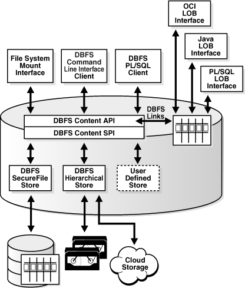

## 20  Introducing the Database File System

Topics:

- Why a Database File System?

- What Is Database File System (DBFS)?

- What Is a Content Store?

<!-- -->

- Why a Database File System?
  Conceptually, a database file system is a file system interface placed on top of files and directories that are stored in database tables.
- What Is Database File System (DBFS)?
  Database File System (DBFS) creates a standard file system interface on top of files and directories that are stored in database tables.
- What Is a Content Store?
  A content store is a collection of documents.

**Parent topic:** [Database File System (DBFS)](database-file-system.md)

### 20.1 Why a Database File System?

Conceptually, a database file system is a file system interface placed on top of files and directories that are stored in database tables.

Applications commonly use the standard SQL data types, `BLOB`s and `CLOB`s, to store and retrieve files in the Oracle Database, files such as medical images, invoice images, documents, videos, and other files. Oracle Database provides much better security, availability, robustness, transactional capability, and scalability than traditional file systems. Files stored in the database along with relational data are automatically backed up, synchronized to the disaster recovery site using Data Guard, and recovered together.

Database File System (DBFS) is a feature of Oracle Database that makes it easier for users to access and manage files stored in the database. With this interface, access to files in the database is no longer limited to programs specifically written to use `BLOB` and `CLOB` programmatic interfaces. Files in the database can now be transparently accessed using any operating system (OS) program that acts on files. For example, ETL (extraction, transformation, and loading) tools can transparently store staging files in the database and file-based applications can benefit from database features such as Maximum Availability Architecture (MAA) without any changes to the applications.

**Parent topic:** Introducing the Database File System

### 20.2 What Is Database File System (DBFS)?

Database File System (DBFS) creates a standard file system interface on top of files and directories that are stored in database tables.

Database File System (DBFS) creates a standard file system interface using a server and clients.

- About DBFS

- DBFS Server

- DBFS Client

<!-- -->

- About DBFS
  DBFS is similar to NFS in that it provides a shared network file system that looks like a local file system and has both a server component and a client component.
- DBFS Server
  In DBFS, the file server is the Oracle database.
- DBFS Client
  For client systems, the Database File System offers several access methods.

**Parent topic:** Introducing the Database File System

#### 20.2.1 About DBFS

DBFS is similar to NFS in that it provides a shared network file system that looks like a local file system and has both a server component and a client component.

At the core of DBFS is the DBFS Content API, a PL/SQL interface in the Oracle Database. It connects to the DBFS Content SPI, a programmatic interface which allows for the support of different types of storage.

At the programming level, the client calls the DBFS Content API to perform a specific function, such as delete a file. The DBFS Content API delete file function then calls the DBFS Content SPI to perform that function.

In a user-defined DBFS, the user must implement a delete function based on the specifications in the DBFS Content SPI, along with other functions in the specification.

Figure 20-1 Database File System (DBFS)

[Description of "Figure 20-1 Database File System (DBFS)"](img_text/adlob201.md)

**Parent topic:** What Is Database File System (DBFS)?

#### 20.2.2 DBFS Server

In DBFS, the file server is the Oracle database.

Files are stored as SecureFiles LOBs in database tables. An implementation of a file system in the database is called a DBFS content store, for example, the DBFS SecureFiles Store. A DBFS content store allows each database user to create one or more file systems that can be mounted by clients. Each file system has its own dedicated tables that hold the file system content.

The DBFS Content SPI supports different types of stores, as follows:

- DBFS SecureFiles Store: A DBFS content store that uses a table with a SecureFiles LOB column to store the file system data. It implements POSIX-like filesystem capabilities.

- DBFS Hierarchical Store: A DBFS content store that allows files to be written to any tape storage units supported by Oracle Recovery Manager (RMAN) or to a cloud storage system.

- User-defined Store: A content store defined by the user. This allows users to program their own filesystems inside Oracle Database without writing any OS code.

**See Also:**

- [Creating Your Own DBFS Store](creating-your-own-DBFS-store.md)

- [DBFS Content API](DBFS-content-API.md)

- [DBFS Hierarchical Store](DBFS-hierarchical-store.md)

**Parent topic:** What Is Database File System (DBFS)?

#### 20.2.3 DBFS Client

For client systems, the Database File System offers several access methods.

The Database File System offers several access methods.

- PL/SQL Client Interface

  Database applications can access files in the DBFS store directly, through the PL/SQL interface. The PL/SQL interface allows database transactions and read consistency to span relational and file data.

- DBFS Client Command-Line Interface

  A client command-line interface named `dbfs_client` runs on each file system client computer. `dbfs_client` allows users to copy files in and out of the database from any host on the network. It implements simple file system commands such as list and copy in a manner that is similar to shell utilities `ls` and `rcp`. The command interface creates a direct connection to the database without requiring an OS mount of DBFS.

- File System Mount Interface

  On Linux and Solaris, the `dbfs_client` also includes a mount interface that uses the Filesystem in User Space (`FUSE`) kernel module to implement a file-system [mount point](glossary.md) with transparent access to the files stored in the database. This does not require any changes to the Linux or Solaris kernels. It receives standard file system calls from the `FUSE` kernel module and translates them into OCI calls to the PL/SQL procedures in the DBFS content store.

- DBFS Links

  DBFS Links, Database File System Links, are references from SecureFiles LOB locators to files stored outside the database.

  DBFS Links can be used to migrate SecureFiles from existing tables to other storage.

**See Also:**

- [Using DBFS](using-DBFS.md)

- [DBFS Mounting Interface (Linux and Solaris Only)](using-DBFS.md)

- [Database File System Links](DBFS-hierarchical-store.md) for information about using DBFS Links

- [PL/SQL Packages for LOBs and DBFS](using-oracle-LOBs-storage.md) for lists of useful `DBMS_LOB` constants and methods

**Parent topic:** What Is Database File System (DBFS)?

### 20.3 What Is a Content Store?

A content store is a collection of documents.

Each content store is identified by a unique absolute path name, represented as a slash (`/`) followed by one or more component names that are each separated by a slash. Some stores may implement only a flat namespace, others might implement directories or folders implicitly, while still others may implement a comprehensive file system-like collection of entities. These may include hierarchical directories, files, symbolic links, hard links, references, and so on. They often include a rich set of metadata associated with documents, and a rich set of behaviors with respect to security, access control, locking, versioning, content addressing, retention control, and so on.

Because stores are typically designed and evolve independently of each other, applications that use a specific store are either written and packaged by the developers of the store or else require the user to employ a store-specific API. Designers who create a store-specific API must have a detailed knowledge of the schema of the database tables that are used to implement the store.

**Parent topic:** Introducing the Database File System
