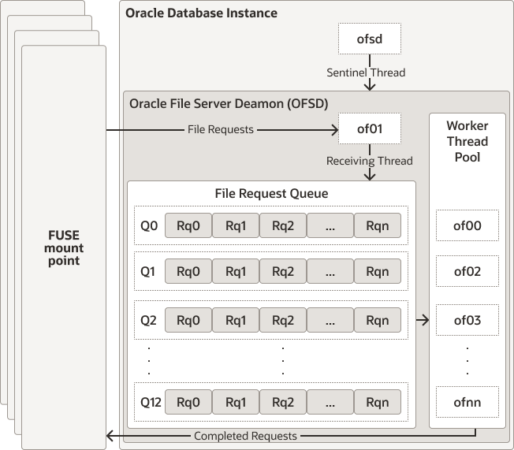

## 19 Using OFS

The OFS implementation includes creating and accessing the file system and managing it.

Topics:

- About OFS
  Oracle File Server (OFS) addresses the need to store PDB specific scripts, logs, trace files and other files produced by running an application in the database.
- About Oracle File Server Process
  OFS manages the database file system using a non-fatal and dedicated background process called Oracle File Server Deamon (OFSD).
- Limitations of using OFS
- OFS Configuration Parameters
  The following table specifies the parameter that can be tuned to provide file system access for database objects using OFS.
- Managing DBFS Locally Using FUSE
  Understand how you can manage DBFS using Filesystem in User Space (FUSE).
- OFS Client Interface
  The OFS interface includes views and procedures that support OFS operations.

**Parent topic:** [Oracle File System (OFS) Server](oracle-file-system.md)

### 19.1 About OFS

Oracle File Server (OFS) addresses the need to store PDB specific scripts, logs, trace files and other files produced by running an application in the database.

Additionally, you can use OFS for the following tasks:

- As a staging area where you can host the source data before it is loaded into database tables.
- To store import or export files from Oracle Data Pump process.

Ensure that you do not place core database files such as data, redo, archive log files, and database trace file on OFS as this can produce a dependency cycle and cause the system to hang. Similarly, the `diagnostic_dest` initialization parameter that sets the location of the automatic diagnostic repository should not point to a directory inside OFS.

OFS provides methods and procedures to allow you to create a Database file system using storage that is part of the PDB. You can mount the created file system, unmount it like any other Unix file system using PL/SQL procedures, and destroy the file system when it is no longer in use. When the PDB is destroyed, the file system is also destroyed, which frees up the underlying storage space.

**Parent topic:** Using OFS

### 19.2 About Oracle File Server Process

OFS manages the database file system using a non-fatal and dedicated background process called Oracle File Server Deamon (OFSD).

For more information about background process, see [Background Processes](../refrn/background-processes.md) in the Database Reference guide.

When an instance starts, the OFSD process gets spawned on operating system platforms, such as Linux, where OFS is supported. OFSD is multi-threaded and non-fatal. It serves both file system management requests and file requests from each mounted file system.

The centralized server background process model of OFS allows multiple file systems to be mounted and accessed using a limited set of server threads. It allows better resource sharing and a linear scalability with new file server threads created on demand. Both memory and CPU used by these threads are controlled through system wide parameters set in the RDBMS instance.

OFSD process starts two types of threads: receiver thread and worker thread. The receiver thread receives requests from the mounted file system. The name of this thread name is similar to `of01`. The requests received by this thread are placed in a submit queue which is served by different worker threads. The submit queue is hash partitioned to efficiently distribute the incoming requests across all the worker threads. By default, OFSD starts 3 worker threads. You can update the value of the `OFS_THREADS` parameter to increase the number of worker thread.

OFSD supports these 2 types of file systems: DBFS and OFS.

Use the `DBMS_FS` PL/SQL procedures to create, mount, and work with the file systems managed by the OFSD process.

OFSD uses a pool of worker threads to serve requests from multiple file systems that are mounted on the instance. Use `V$OFSMOUNT` to query the mounted file systems. The response that is returned is specific to each PDB. It lists only the file systems that are mounted in the specified PDB.

**Parent topic:** Using OFS

### 19.3 Limitations of using OFS

Use of OFS is subjected to the following limitations:

- DBFS mounted with ASM storage shows wrong mount size.

- OFS mounted with local storage shows wrong mount size.

**Parent topic:** Using OFS

### 19.4 OFS Configuration Parameters

The following table specifies the parameter that can be tuned to provide file system access for database objects using OFS.

Table 19-1 OFS Configuration Parameters

| Parameter Name | Description                                                                                                                                                                                                                                                                                                                                                                                                                                                                                                                                                                                                    |
|:---------------|:---------------------------------------------------------------------------------------------------------------------------------------------------------------------------------------------------------------------------------------------------------------------------------------------------------------------------------------------------------------------------------------------------------------------------------------------------------------------------------------------------------------------------------------------------------------------------------------------------------------|
| `OFS_THREADS`  | Set the number of OFS worker threads to handle OFS requests. Enter an integer value in the range of 3–128. The default value is 4. Set the value for this parameter based on the total number of mounted file systems and the rate at which file operations are performed in each file system. Set this value after careful consideration as you can only increase this value dynamically and you cannot decrease it. If you set a high value for `OFS_THREADS`, then the specified number of threads are created. If there is no workload, these threads remain in an idle state and wait for new work. |

**Note:**

The `diagnostic_dest` initialization parameter sets the location of the automatic diagnostic repository. When you use `dbfs_client` or Oracle File Server (OFS) as the file system server, ensure that this parameter does not point to a directory inside `dbfs_client` or OFS as this can produce a dependency cycle and cause the system to hang.

**Parent topic:** Using OFS

### 19.5 Managing DBFS Locally Using FUSE

Understand how you can manage DBFS using Filesystem in User Space (FUSE).

The FUSE interface in the Linux kernel makes the file systems available to the operating system processes. After mounting the file system, you can export it, and then NFS mount it on other nodes where client applications can access this file system.

- Configuring FUSE
  OFSD exposes the database file system through FUSE. Before using OFSD to mount the database file systems, you must install and configure the FUSE module.
- Accessing OFS in Cloud
  To access files from an OFS mounted on any Cloud environment, you must perform additional steps to configure the environment.

**Parent topic:** Using OFS

#### 19.5.1 Configuring FUSE

OFSD exposes the database file system through FUSE. Before using OFSD to mount the database file systems, you must install and configure the FUSE module.

If you are running your database instance in a Compute node, configure the FUSE module in that node. The file system gets mounted and is visible through a mounted path on the compute node. In a RAC configuration, configure FUSE in each node, so that the OFS file systems can be mounted independently in each node.

To configure the FUSE module in Cloud or on-premises environment, where the database instance is running:

1.  Set read and execute permissions for an Oracle user to use the FUSE executable file, `fusermount`.
        sudo chmod o+rx /usr/bin/fusermount

    Use the `fusermount` file to mount and unmount the FUSE user mode file systems.
2.  Set the `setuid` bit on the `fusermount` file to permit an Oracle user to mount file systems.
        sudo chmod u+s /usr/bin/fusermount
3.  Permit other users to access the mounted file system.
        sudo sh -c ''echo user_allow_other >> /etc/fuse.conf''
4.  Optional. By default, the maximum number of file systems that you can mount using FUSE is 1000. If you are running a large number of PDBs and need to configure a separate file system for each PDB, then run the following command to increase the number of file systems that can be mounted using FUSE. The following command increases the number of file systems that can be mounted using FUSE to 4000.
        sudo sh -c ''echo mount_max=4000 >> /etc/fuse.conf''
5.  Allow all users to read the `fuse.conf` file, so that the Oracle process can read this file at run time.
        sudo chmod a+r /etc/fuse.conf

**Parent topic:** Managing DBFS Locally Using FUSE

#### 19.5.2 Accessing OFS in Cloud

To access files from an OFS mounted on any Cloud environment, you must perform additional steps to configure the environment.

To access files in an OFS mount in the Cloud environment, you may need to perform additional configuration. It may not be possible to export the OFS mount point from database node to client node due to security reasons. This may hinder client applications from accessing OFS files through operating system commands and utilities and the OFS mount path may not be available to access using system calls. In such situations, Oracle recommends that you use the `utl_file` package to access files in the OFS mount. For information about UTL file package, see [Summary of UTL_FILE Subprograms](../arpls/UTL_FILE.md) in PL/SQL Packages and Types Reference.

You can also use the `impdp` and `expdp` command-line clients to access files in the OFS mount. See [Oracle Data Pump Import](../sutil/datapump-import-utility.md) and [Oracle Data Pump Export](../sutil/oracle-data-pump-export-utility.md) in the Utilities guide.

To configure the environment so that client applications in Cloud can access files in an OFS:

1.  Create a directory object using the OFS mount path.
    The following sample code displays how you can create a directory object called `pdb1_ofsdir` when `/u03/dbfs/``<pdbid>``/data` is the OFS mount directory on the db node.

        CREATE DIRECTORY pdb1_ofsdir AS '/u03/dbfs/<pdbid>/data/';
2.  Grant access to the user to access the directory object.
    For more information on creating a directory object and setting access permissions on it, see [CREATE DIRECTORY](../sqlrf/CREATE-DIRECTORY.md) in PL/SQL Packages and Types Reference.

Do not access the OFS files by directly querying or modifying the DBFS tables. Do not use `dbfs_client` when the DBFS file system is mounted through OFS or else it could lead to metadata and data inconsistency. To access the OFS files, use the `UTL_FILE` package in addition to the procedures listed in the `DBMS_FS` package.

**Parent topic:** Managing DBFS Locally Using FUSE

### 19.6 OFS Client Interface

The OFS interface includes views and procedures that support OFS operations.

Topics:

- DBMS_FS Package
  Use the `DBMS_FS` package to manage the file systems. Use the procedures in this package to create, mount, unmount and destroy a file system in the Oracle Database.
- Views for OFS
  The views that support OFS operations start with `V$OFS`.

**Parent topic:** Using OFS

#### 19.6.1 DBMS_FS Package

Use the `DBMS_FS` package to manage the file systems. Use the procedures in this package to create, mount, unmount and destroy a file system in the Oracle Database.

PDBs can submit these jobs using the PL/SQL procedure and they are executed serially by the OFSD process.

**See Also:**

[Oracle Database PL/SQL Packages and Types Reference](../arpls/DBMS_FS.md) for more information about Oracle OFS procedures.

The following example illustrates the use of `DBMS_FS` package.

    BEGIN
     DBMS_FS.MAKE_ORACLE_FS (
      fstype           => 'dbfs',
      fsname           => 'dbfs_fs1',
      mount_options    => 'TABLESPACE=dbfs_fs1_tbspc');
    END;
    /
    BEGIN
     DBMS_FS.MOUNT_ORACLE_FS (
      fstype           => 'dbfs',
      fsname           => 'dbfs_fs1',
      mount_point      => '/oracle/dbfs/testfs',
      mount_options    => 'default_permissions, allow_other');
    END;
    /
    /************** Now you can access the file system. All the FS operations go here ***************/

    BEGIN
     DBMS_FS.UNMOUNT_ORACLE_FS (
      fsname           => 'dbfs_fs1',
      mount_point      => '/oracle/dbfs/testfs',
      mount_options    => 'force');
    END;
    /
    BEGIN
     DBMS_FS.DESTROY_ORACLE_FS (
      fstype           => 'dbfs',
      fsname           => 'dbfs_fs1');
    END;
    /

**Parent topic:** OFS Client Interface

#### 19.6.2 Views for OFS

The views that support OFS operations start with `V$OFS`.

Table 19-2 Fixed Views for OFS

| View          | Description                                                                                                                                                                                                                                 |
|:--------------|:--------------------------------------------------------------------------------------------------------------------------------------------------------------------------------------------------------------------------------------------|
| `V$OFSMOUNT`  | Query this view to retrieve details about the file systems that are mounted by Oracle File System. For information about the columns and data types of this view, see [V\$OFSMOUNT](../refrn/V-OFSMOUNT.md) in Oracle Database Reference.   |
| `V$OFS_STATS` | Query this view to list the number of times each file operation has been called for a mount point. For information about the columns and data types of this view, see [V\$OFS_STATS](../refrn/V-OFS_STATS.md) in Oracle Database Reference. |

**Parent topic:** OFS Client Interface
