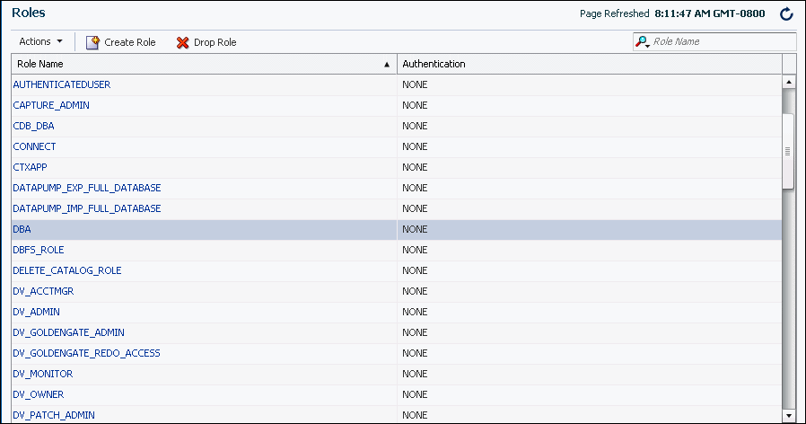
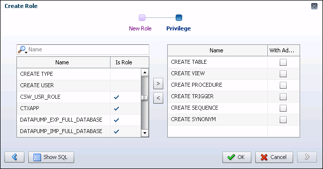
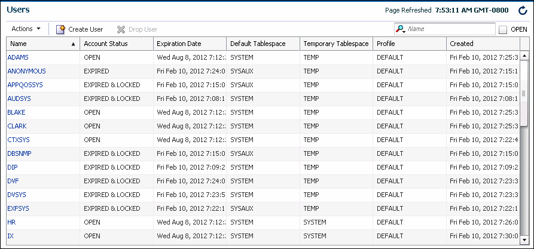
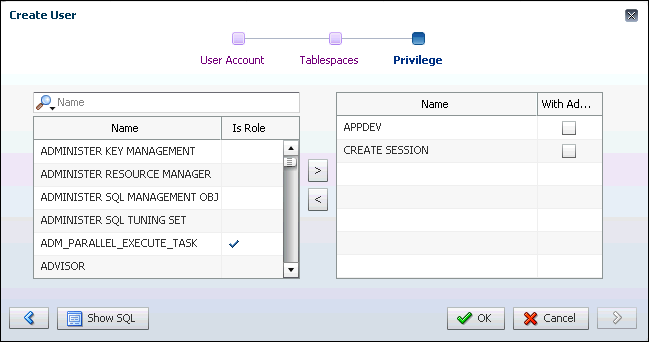
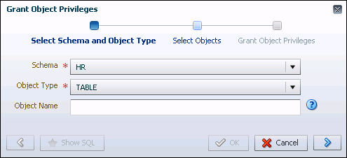
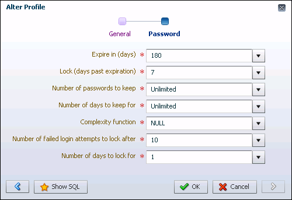

This chapter describes how to create and manage user accounts using Oracle Enterprise Manager Database Express (EM Express). It contains the following sections:

- About User Accounts

- About User Privileges and Roles

- About Administrative Accounts and Privileges

- Administering Roles

- Administering Database User Accounts

- Setting the Database Password Policy

- Administering User Accounts and Security: Oracle by Example Series

### 7.1 About User Accounts

For users to access your database, you must create user accounts and grant appropriate database access privileges to those accounts. A user account is identified by a user name and defines the attributes of the user, including the following:

- Authentication method

- Password for database authentication

- Default tablespaces for permanent and temporary data storage

- Tablespace quotas

- Account status (locked or unlocked)

- Password status (expired or not)

When you create a user account, you must not only assign a user name, a password, and default tablespaces for the account, but you must also do the following:

- Grant the appropriate system privileges, object privileges, and roles to the account.

- If the user will be creating database objects, then give the user account a space usage quota on each tablespace in which the objects will be created.

Oracle recommends that you grant each user just enough privileges to perform his job, and no more. For example, a database application developer needs privileges to create and modify tables, indexes, views, and stored procedures, but does not need (and should not be granted) privileges to drop (delete) tablespaces or recover the database. You can create user accounts for database administration, and grant only a subset of administrative privileges to those accounts.

In addition, you may want to create user accounts that are used by applications only. That is, nobody logs in with these accounts; instead, applications use these accounts to connect to the database, and users log in to the applications. This type of user account avoids giving application users the ability to log in to the database directly, where they could unintentionally cause damage. See "About User Privileges and Roles" for more information.

When you create a user account, you are also implicitly creating a schema for that user. A schema is a logical container for the database objects (such as tables, views, triggers, and so on) that the user creates. The schema name is the same as the user name, and can be used to unambiguously refer to objects owned by the user. For example, `hr.employees` refers to the table named `employees` in the `hr` schema. (The `employees` table is owned by `hr`.) The terms database object and schema object are used interchangeably.

When you delete a user, you must either simultaneously delete all schema objects of that user, or you must have previously deleted the schema objects in separate operations.

#### Predefined User Accounts

In addition to the user accounts that you create, the database includes several user accounts that are automatically created upon installation.

All databases include the administrative accounts `SYS`, `SYSTEM`, and `DBSNMP`. Administrative accounts are highly privileged accounts, and are needed only by individuals authorized to perform administrative tasks such as starting and stopping the database, managing database memory and storage, creating and managing database users, and so on. You log in to Oracle Enterprise Manager Database Express (EM Express) with `SYS` or `SYSTEM`. You assign the passwords for these accounts when you create the database with Oracle Database Configuration Assistant (DBCA). You must not delete or rename these accounts.

All databases also include internal accounts, which are automatically created so that individual Oracle Database features or components such as Oracle Application Express can have their own schemas. To protect these accounts from unauthorized access, they are initially locked and their passwords are expired. (A locked account is an account for which login is disabled.) You must not delete internal accounts, and you must not use them to log in to the database.

Your database may also include sample schemas, if you chose the option to create the sample schemas in your database when the database was installed. The sample schemas are a set of interlinked schemas that enable Oracle documentation and Oracle instructional materials to illustrate common database tasks. These schemas also provide a way for you to experiment without endangering production data.

Each sample schema has a user account associated with it. For example, the `hr` user account owns the `hr` schema, which contains a set of simple tables for a human resources application. The sample schema accounts are also initially locked and have an expired password. As the database administrator, you are responsible for unlocking these accounts and assigning passwords to these accounts.

**See Also:**

- "Locking and Unlocking User Accounts"

- "About Administrative Accounts and Privileges"

- "SYS and SYSTEM Users" for information about the recommended alternative to using the `SYSTEM` account for day-to-day administrative tasks

- "Administering Database User Accounts"

- [Oracle Database Sample Schemas](../comsc/introduction-to-sample-schemas.md) for more information about the sample schemas

- [Oracle Database Concepts](../cncpt/topics-for-database-administrators-and-developers.md) for an overview of database security

#### 7.1.1 About Commonality in a CDB

In a multitenant container database (CDB), the basic principle of commonality is that a common phenomenon is the same in every existing and future container. In a CDB, "common" means "common to all containers." In contrast, a local phenomenon is restricted to exactly one existing container.

A corollary to the principle of commonality is that only a common user can alter the existence of common phenomena. More precisely, only a common user connected to the root can create, destroy, or modify CDB-wide attributes of a common user or role.

**See Also:**

- [Oracle Multitenant Administrator's Guide](../multi/introduction-to-the-multitenant-architecture.md) for an introduction to CDBs and PDBs

- [Oracle Multitenant Administrator's Guide](../multi/managing-a-multitenant-environment.md) for information about managing CDBs and PDBs

##### 7.1.1.1 Common Users in a CDB

A common user is a database user that has the same identity in the root and in every existing and future pluggable database (PDB). Every common user can connect to and perform operations within the root, and within any PDB in which the common user has privileges.

Every common user is either Oracle-supplied or user-created. Examples of Oracle-supplied common users are `SYS` and `SYSTEM`.

Common users have the following characteristics:

- A common user can log in to any container (including `CDB$ROOT`) in which it has the `CREATE SESSION` privilege.

  A common user need not have the same privileges in every container. For example, the `c##dba` user may have the privilege to create a session in the root and in one PDB, but not to create a session in a different PDB. Because a common user with the appropriate privileges can switch between containers, a common user in the root can administer PDBs.

- The name of every user-created common user must begin with the characters `c##` or `C##`. (Oracle-supplied common user names do not have this restriction.)

  No local user name may begin with the characters `c##` or `C##`.

- The names of common users must contain only ASCII or EBCDIC characters.

- Every common user is uniquely named across all containers.

  A common user resides in the root, but must be able to connect to every PDB with the same identity.

- The schemas for a common user can differ in each container.

  For example, if `c##dba` is a common user that has privileges on multiple containers, then the `c##dba` schema in each of these containers may contain different objects.

**See Also:**

- [Oracle Multitenant Administrator's Guide](../multi/overview-of-the-multitenant-architecture.md) for more information about common users in a multitenant container database (CDB)

- [Oracle Database Security Guide](../dbseg/managing-security-for-oracle-database-users.md) to learn about common and local account

##### 7.1.1.2 Local Users in a CDB

A local user is a user that is not common and that can operate only within a single pluggable database (PDB). Local users have the following characteristics:

- A local user is specific to a particular PDB and owns a schema in this PDB.

- A local user cannot be created in the root.

- A local user on one PDB cannot log in to another PDB or to the root.

- The name of a local user cannot begin with the characters `c##` or `C##`.

- The name of a local user must only be unique within its PDB.

- The user name and the PDB in which that user schema is contained determine a unique local user. For example, a local user and schema named `rep` can exist on a PDB named `hrpdb`. A completely independent local user and schema named `rep` can exist on a PDB named `salespdb`.

- Whether local users can access objects in a common schema depends on their user privileges.

  For example, the `c##dba` common user may create a table in the `c##dba` schema on the `hrpdb` PDB. Unless c##dba grants the necessary privileges to the local `hr` user on this table, `hr` cannot access it.

**See Also:**

- [Oracle Multitenant Administrator's Guide](../multi/overview-of-the-multitenant-architecture.md) for more information about local users

- [Oracle Multitenant Administrator's Guide](../multi/overview-of-the-multitenant-architecture.md) for a scenario involving local users in two PDBs

- [Oracle Database Security Guide](../dbseg/managing-security-for-oracle-database-users.md) to learn about local accounts

### 7.2 About User Privileges and Roles

User privileges provide a basic level of database security. They are designed to control user access to data and to limit the kinds of SQL statements that users can execute. When creating a user, you grant privileges to enable the user to connect to the database, to run queries and make updates, to create schema objects, and more.

The main types of user privileges are as follows:

- System privileges—A system privilege gives a user the ability to perform a particular action, or to perform an action on any schema objects of a particular type. For example, the system privilege `CREATE TABLE` permits a user to create tables in the schema associated with that user, and the system privilege `CREATE USER` permits a user to create database users.

- Object privileges—An objectprivilege gives a user the ability to perform a particular action on a specific schema object. Different object privileges are available for different types of schema objects. The privilege to select rows from the `EMPLOYEES` table or to delete rows from the `DEPARTMENTS` table are examples of object privileges.

Managing privileges is made easier by using roles, which are named groups of related privileges. You create roles, grant system and object privileges to the roles, and then grant roles to users. You can also grant roles to other roles. Unlike schema objects, roles are not contained in any schema.

Table 7-1 lists three widely used roles that are predefined in Oracle Database. You can grant these roles when you create a user or at any time thereafter.

Table 7-1 Oracle Database Predefined Roles

| Role Name  | Description                                                                                                                                                                                                                                                                                                                                                                                                                                                                                                                                                                                 |
|:-----------|:--------------------------------------------------------------------------------------------------------------------------------------------------------------------------------------------------------------------------------------------------------------------------------------------------------------------------------------------------------------------------------------------------------------------------------------------------------------------------------------------------------------------------------------------------------------------------------------------|
| `CONNECT`  | Enables a user to connect to the database. Grant this role to any user or application that needs database access.                                                                                                                                                                                                                                                                                                                                                                                                                                                                           |
| `RESOURCE` | Enables a user to create, modify, and delete certain types of schema objects in the schema associated with that user. Grant this role only to developers and to other users that must create schema objects. This role grants a subset of the create object system privileges. For example, it grants the `CREATE TABLE` system privilege, but does not grant the `CREATE VIEW` system privilege. It grants only the following privileges: `CREATE CLUSTER`, `CREATE INDEXTYPE`, `CREATE OPERATOR`, `CREATE PROCEDURE`, `CREATE SEQUENCE`, `CREATE TABLE`, `CREATE TRIGGER`, `CREATE TYPE`. |
| `DBA`      | Enables a user to perform most administrative functions, including creating users and granting privileges; creating and granting roles; creating, modifying, and deleting schema objects in any schema; and more. It grants all system privileges, but does not include the privileges to start or shut down the database instance. It is by default granted to users `SYS` and `SYSTEM`.                                                                                                                                                                                                   |

**Note:**

Oracle recommends that you design your own roles for database security rather than relying on these roles. These roles may not be created automatically by future releases of Oracle Database.

**See Also:**

- "Administering Roles"

- "Administering Database User Accounts"

- [Managing Schema Objects](managing-schema-objects.md)

- [Oracle Database SQL Language Reference](../sqlrf/GRANT.md) for tables of system privileges, object privileges, and predefined roles

- [Oracle Database Concepts](../cncpt/topics-for-database-administrators-and-developers.md) for an overview of database security

#### 7.2.1 About Common and Local Roles in a CDB

Every Oracle-supplied role is common. In Oracle-supplied scripts, every privilege or role granted to Oracle-supplied users and roles is granted commonly, with one exception: system privileges are granted locally to the common role `PUBLIC`. User-created roles are either local or common.

**See Also:**

[Oracle Multitenant Administrator's Guide](../multi/overview-of-the-multitenant-architecture.md) for more information about grants to `PUBLIC` in a multitenant container database (CDB)

##### 7.2.1.1 Common Roles in a CDB

A common role is a database role that exists in the root and in every existing and future pluggable database (PDB). Common roles are useful for cross-container operations, ensuring that a common user has a role in every container.

Every common role is either user-created or Oracle-supplied. All Oracle-supplied roles are common, such as `DBA` and `PUBLIC`. User-created common roles must have names starting with `C##` or `c##`, and must contain only ASCII or EBCDIC characters. For example, a multitenant container database (CDB) administrator might create common user `c##dba`, and then grant the DBA role commonly to this user, so that `c##dba` has the DBA role in any existing and future PDB.

A user can only perform common operations on a common role, for example, granting privileges commonly to the role, when the following criteria are met:

- The user is a common user whose current container is root.

- The user has the `SET CONTAINER` privilege granted commonly, which means that the privilege applies in all containers.

- The user has privilege controlling the ability to perform the specified operation, and this privilege has been granted commonly.

For example, to create a common role, a common user must have the `CREATE ROLE` and the `SET CONTAINER` privileges granted commonly. Common roles created using Oracle Enterprise Manager Database Express (EM Express) must be created in the root.

**See Also:**

- [Oracle Multitenant Administrator's Guide](../multi/overview-of-the-multitenant-architecture.md) for more details about roles and privileges granted commonly in a CDB

- [Oracle Multitenant Administrator's Guide](../dbseg/configuring-privilege-and-role-authorization.md) to learn how to manage common roles

##### 7.2.1.2 Local Roles in a PDB

A local role exists only in a single pluggable database (PDB), just as a role in a non-CDB exists only in the non-CDB. A local role can only contain roles and privileges that apply within the container in which the role exists.

PDBs in the same multitenant container database (CDB) may contain local roles with the same name. For example, the user-created role `pdbadmin` may exist in both the `hrpdb` and `salespdb` PDBs. These roles are completely independent of each other, just as they would be in separate non-CDBs.

A local role created using Oracle Enterprise Manager Database Express (EM Express) must be created in the PDB where it will be used.

**See Also:**

[Oracle Multitenant Administrator's Guide](../dbseg/configuring-privilege-and-role-authorization.md) to learn how to manage local roles

#### 7.2.2 About Privilege and Role Grants in a CDB

Just as in a non-CDB, users in a multitenant container database (CDB) can grant roles and privileges. A key difference in a CDB is the distinction between roles and privileges that are locally granted and commonly granted. A privilege or role granted locally is exercisable only in the container in which it was granted. A privilege or role granted commonly is exercisable in every existing and future container.

Users and roles may be common or local. However, a privilege is in itself neither common nor local. If a user grants a privilege locally using the `CONTAINER=CURRENT` clause, then the grantee has a privilege exercisable only in the current container. If a user grants a privilege commonly using the `CONTAINER=ALL` clause, then the grantee has a privilege exercisable in any existing and future container.

**Note:**

When you use Oracle Enterprise Manager Database Express (EM Express) to grant privilege or roles in a CDB, the container in which the privilege is granted determines whether it is a commonly granted or locally granted privilege or role.

For example, when you use EM Express to grant a privilege in the root, the privilege is a commonly granted privilege that the grantee can exercise in any existing and future container. When you use EM Express to grant a privilege in a pluggable database (PDB), the privilege is a locally granted privilege that the grantee can exercise only in that PDB.

In a CDB, every act of granting, whether local or common, occurs within a specific container. The basic principles of granting are as follows:

- Both common and local phenomena may grant and be granted locally.

- Only common phenomena may grant or be granted commonly.

Local users, roles, and privileges are by definition restricted to a particular container. Thus, local users may not grant roles and privileges commonly, and local roles and privileges may not be granted commonly.

**See Also:**

[Oracle Multitenant Administrator's Guide](../multi/overview-of-the-multitenant-architecture.md) for more details about these granting principles

##### 7.2.2.1 Privileges and Roles Granted Commonly in a CDB

Privileges and common roles may be granted commonly. According to the principles of granting in a pluggable database (PDB), users or roles may be granted roles and privileges commonly only if the grantees and grantors are both common; and if a role is being granted commonly, then the role itself must be common.

**See Also:**

- [Oracle Multitenant Administrator's Guide](../multi/overview-of-the-multitenant-architecture.md) for more information about privileges and roles granted commonly in a multitenant container database (CDB), and for a table that shows what phenomena can be granted commonly

- [Oracle Multitenant Administrator's Guide](../multi/overview-of-the-multitenant-architecture.md) for a detailed scenario of granting roles and privileges commonly and locally in a CDB

##### 7.2.2.2 Privileges and Roles Granted Locally in a CDB

Roles and privileges may be granted locally to users and roles regardless of whether the grantees, grantors, or roles being granted are local or common.

**See Also:**

- [Oracle Multitenant Administrator's Guide](../multi/overview-of-the-multitenant-architecture.md) for more information about privileges and roles granted locally in a multitenant container database (CDB), and for a table that shows what phenomena can be granted locally

- [Oracle Multitenant Administrator's Guide](../multi/overview-of-the-multitenant-architecture.md) for a detailed scenario of granting roles and privileges commonly and locally in a CDB

### 7.3 About Administrative Accounts and Privileges

Administrative accounts and privileges enable you to perform administrative functions such as managing users, managing database memory, and starting up and shutting down the database.

This section contains the following topics:

- SYS and SYSTEM Users

- SYSDBA and SYSOPER System Privileges

**See Also:**

- "About User Accounts"

- "About User Privileges and Roles"

- "Administering Database User Accounts"

#### 7.3.1 SYS and SYSTEM Users

The `SYS` and `SYSTEM` administrative user accounts are automatically created when you install Oracle Database. They are both created with the password that you supplied upon installation, and they are both automatically granted the `DBA` role.

- `SYS`

  This account can perform all administrative functions. All base (underlying) tables and views for the database data dictionary are stored in the `SYS` schema. These base tables and views are critical for the operation of Oracle Database. To maintain the integrity of the data dictionary, tables in the `SYS` schema are manipulated only by the database. They should never be modified by any user or database administrator. You must not create any tables in the `SYS` schema.

  The `SYS` user is granted the `SYSDBA` privilege, which enables a user to perform high-level administrative tasks such as backup and recovery.

- `SYSTEM`

  This account can perform all administrative functions except the following:

  - Backup and recovery

  - Database upgrade

  While you can use this account to perform day-to-day administrative tasks, Oracle strongly recommends creating named user accounts for administering the Oracle database to enable monitoring of database activity.

**Note:**

`SYSBACKUP` is another automatically created account that is used to perform backup and recovery. See "[Configuring Users to Perform Backup and Recovery](performing-backup-and-recovery.md)" for more information.

#### 7.3.2 SYSDBA and SYSOPER System Privileges

`SYSDBA` and `SYSOPER` are administrative privileges required to perform high-level administrative operations such as creating, starting up, shutting down, backing up, or recovering the database. The `SYSDBA` system privilege is for fully empowered database administrators and the `SYSOPER` system privilege allows a user to perform basic operational tasks, but without the ability to look at user data.

The `SYSDBA` and `SYSOPER` system privileges allow access to a database instance even when the database is not open. Control of these privileges is therefore completely outside of the database itself. This control enables an administrator who is granted one of these privileges to connect to the database instance to start the database.

You can also think of the `SYSDBA` and `SYSOPER` privileges as types of connections that enable you to perform certain database operations for which privileges cannot be granted in any other way. For example, if you have the `SYSDBA` privilege, then you can connect to the database using `AS SYSDBA`.

The `SYS` user is automatically granted the `SYSDBA` privilege upon installation. When you log in as user `SYS`, you must connect to the database as `SYSDBA` or `SYSOPER`. Connecting as a `SYSDBA` user invokes the `SYSDBA` privilege; connecting as `SYSOPER` invokes the `SYSOPER` privilege. EM Express allows you to log in as user `SYS` and connect as `SYSDBA` or `SYSOPER`.

When you connect with the `SYSDBA` or `SYSOPER` privilege, you connect with a default schema, not with the schema that is generally associated with your user name. For `SYSDBA` this schema is `SYS`; for `SYSOPER` the schema is `PUBLIC`.

**Note:**

When you connect as user `SYS`, you have unlimited privileges on data dictionary tables. Be certain that you do not modify any data dictionary tables.

**See Also:**

[Oracle Database Administrator’s Guide](../admin/getting-started-with-database-administration.md) for the operations authorized with the `SYSDBA` and `SYSOPER` privileges

### 7.4 Administering Roles

Roles are named groups of related system and object privileges. You create roles and then assign them to users and to other roles.

This section contains the following topics:

- Viewing Roles

- Example: Creating a Role

- Example: Modifying a Role

- Deleting a Role

**See Also:**

"About User Privileges and Roles"

#### 7.4.1 Viewing Roles

You view roles on the Roles page of Oracle Enterprise Manager Database Express (EM Express).

##### To view roles:

1.  Log into EM Express with a user account that has privileges to manage roles. An example of such a user account is `SYSTEM`.

2.  From the Security menu, select Roles.

    The Roles page appears.

    
    [Description of the illustration exp_roles_page.gif](img_text/exp_roles_page.md)

3.  To view the details of a particular role, select the name of the role you want to view, and then from the Actions list, select View Details.

    You can also use the Search area of the page to search for a particular role. In the Search field, enter the first few letters of the role. As you type, the list of roles in the table are restricted to the roles whose names include the letters you entered.

    The View Role page appears. In this page, you can see all the privileges and roles granted to the selected role.

**See Also:**

"SYS and SYSTEM Users" for information about the recommended alternative to using the `SYSTEM` account for day-to-day administrative tasks

#### 7.4.2 Example: Creating a Role

You can use Oracle Enterprise Manager Database Express (EM Express) to create a role called `APPDEV` for application developers in a pluggable database (PDB). Because application developers must be able to create, modify, and delete the schema objects that their applications use, you want the `APPDEV` role to include the system privileges shown in Table 7-2.

Table 7-2 System Privileges Granted to the APPDEV Role

| Privilege            | Description                                                            |
|:---------------------|:-----------------------------------------------------------------------|
| `CREATE` `TABLE`     | Enables a user to create, modify, and delete tables in his schema.     |
| `CREATE` `VIEW`      | Enables a user to create, modify, and delete views in his schema.      |
| `CREATE` `PROCEDURE` | Enables a user to create, modify, and delete procedures in his schema. |
| `CREATE` `TRIGGER`   | Enables a user to create, modify, and delete triggers in his schema.   |
| `CREATE` `SEQUENCE`  | Enables a user to create, modify, and delete sequences in his schema.  |
| `CREATE` `SYNONYM`   | Enables a user to create, modify, and delete synonyms in his schema.   |

**Note:**

If you create an `APPDEV` role for application developers at your company, you should follow the principle of least privilege, in which you grant to your application developers only the privileges needed to perform their job function, and no more. Therefore, the set of privileges that you grant to the `APPDEV` role for your company may be different than the system privileges that are granted to the `APPDEV` role in Table 7-2.

##### To create the APPDEV role:

1.  In EM Express, go to the Roles page, as described in "Viewing Roles".

2.  Click Create Role.

    The Create Role wizard appears, with the New Role page showing.

3.  In the Role Name field, enter `APPDEV`.

4.  Click the right arrow.

    The Privilege page appears.

    
    [Description of the illustration exp_create_role_privs.gif](img_text/exp_create_role_privs.md)
    The available system privileges and roles table on the left shows the available system privileges that can be assigned to the role. Roles are identified by a check mark in the Is Role column. The selected system privileges and roles table on the right shows the system privileges and roles that are currently selected for the role. Select one or more system privileges or roles in either table, and then click the appropriate arrow button to move those privileges to the other table.

    Move the `CREATE TABLE`, `CREATE VIEW`, `CREATE PROCEDURE`, `CREATE TRIGGER`, `CREATE SEQUENCE`, and `CREATE SYNONYM` system privileges to the selected system privileges and roles table for the `APPDEV` role that is being created.

    In the selected system privileges and roles table, enable the WITH ADMIN option for a system privilege or role if you want users who will be granted the `APPDEV` role you are defining to be able to grant the system privilege or role in the selected system privileges and roles table to other users.

5.  Click OK.

    The `APPDEV` role now appears in the table of database roles on the Roles page.

**Video:**

[Oracle Database 12c: Creating a Role Using Oracle Enterprise Manager Database Express](https://docs.oracle.com/pls/topic/lookup?ctx=en/database/oracle/oracle-database/19/admqs&id=vid_emx_createrole)

#### 7.4.3 Example: Modifying a Role

You can modify a role using Oracle Enterprise Manager Database Express (EM Express). For example, suppose your applications make use of Oracle Streams Advanced Queuing, and you determine that developers must be granted the roles `AQ_ADMINISTRATOR_ROLE` and `AQ_USER_ROLE` to develop and test their applications. You can edit the `APPDEV` role to grant it these two Advanced Queuing roles.

##### To modify the APPDEV role:

1.  In EM Express, go to the Roles page, as described in "Viewing Roles".

2.  Select the `APPDEV` role, and from the Actions menu, choose Alter Privileges.

    The Alter Privileges page appears.

3.  Move the `AQ_ADMINISTRATOR_ROLE` and `AQ_USER_ROLE` roles from the available system privileges and roles table on the left to the selected system privileges and roles table on the right to grant these two roles to the `APPDEV` role.

4.  Click OK.

    A confirmation statement appears.

#### 7.4.4 Deleting a Role

You can delete a role using Oracle Enterprise Manager Database Express (EM Express). Use caution when deleting a role, because EM Express deletes a role even if that role is currently granted to one or more users. Dropping (deleting) a role automatically removes the privileges associated with that role from all users that had been granted the role.

##### To delete a role:

1.  In EM Express, go to the Roles page, as described in "Viewing Roles".

2.  Select the role you want to delete, and then click Drop Role.

    A confirmation page appears.

3.  Click OK.

    A confirmation message indicates that the role has been deleted successfully.

### 7.5 Administering Database User Accounts

This section provides instructions for using Oracle Enterprise Manager Database Express (EM Express) to create and manage user accounts for the people and applications that use your database. It contains the following topics:

- Viewing User Accounts

- Example: Creating a User Account

- Creating a New User Account by Duplicating an Existing User Account

- Example: Granting Privileges and Roles to a User Account

- Example: Assigning a Tablespace Quota to a User Account

- Example: Modifying a User Account

- Locking and Unlocking User Accounts

- Expiring a User Password

- Example: Deleting a User Account

**See Also:**

"About User Accounts"

#### 7.5.1 Viewing User Accounts

You view user accounts on the Users page of Oracle Enterprise Manager Database Express (EM Express).

##### To view users:

1.  Log into EM Express with a user account that has privileges to manage users, for example, `SYSTEM`.

2.  From the Security menu, select Users.

    The Users page appears. In a multitenant container database (CDB), this page is named the Common Users page.

    
    [Description of the illustration exp_users_page.gif](img_text/exp_users_page.md)

3.  To view the details of a particular user, do one of the following:

    - Click the user name.

    - Select the user by clicking anywhere in the row except on the user name, and from the Actions menu, select View Details.

    The View User page appears, and displays all user attributes.

**See Also:**

"SYS and SYSTEM Users" for information about the recommended alternative to using the `SYSTEM` account for day-to-day administrative tasks

#### 7.5.2 Example: Creating a User Account

You can use Oracle Enterprise Manager Database Express (EM Express) to create a user account in a pluggable database (PDB) for a database application developer named Nick. Because Nick is a developer, you want to grant him the database privileges and roles that he requires to build and test his applications. You also want to give Nick a 16 MB quota on his default tablespace so that he can create schema objects in that tablespace.

##### To create the user Nick:

1.  In EM Express, go to the Users page, as described in "Viewing User Accounts".

2.  On the Users page, click Create User.

    The Create User wizard appears, showing the User Account page.

3.  Enter the following values:

    - In the Name field, enter `NICK`.

    - Accept the default value `Password` in the Authentication list.

      For information about other more advanced methods to authenticate users, see [Oracle Database Security Guide](../dbseg/configuring-authentication.md).

    - In the Password and Confirm Password fields, enter a secure password for user Nick.

      See [Oracle Database Security Guide](../dbseg/keeping-your-oracle-database-secure.md) for more information about secure passwords.

    - In the Profile list, accept the value `DEFAULT`.

      This setting assigns the default password policy to user Nick.

      See "Setting the Database Password Policy".

    - Enable the Password Expired option. When this option is enabled at user creation time, then the user must create a new password the first time he logs into his account.

    - Do not select Account Locked.

      You can lock the user account later to prevent users from logging in with it. To temporarily deny access to a user account, locking the user account is preferable to deleting it, because deleting it also deletes all schema objects owned by the user.

4.  Click the right arrow button.

    The Tablespaces page appears.

5.  Enter the following values:

    - For the Default Tablespace field, select the USERS tablespace.

      All schema objects that Nick creates will then be created in the `USERS` tablespace unless he specifies otherwise. If you leave the Default Tablespace field blank, then Nick is assigned the default tablespace for the database, which is `USERS` in a newly installed database. For more information about the `USERS` tablespace, see "[About Tablespaces](managing-database-storage-structures.md)".

    - For the Temporary Tablespace field, select the TEMP tablespace.

      If you leave the Temporary Tablespace field blank, then Nick is assigned the default temporary tablespace for the database, which is `TEMP` in a newly installed database. For more information about the `TEMP` tablespace, see "[About Tablespaces](managing-database-storage-structures.md)".

6.  Click the right arrow button.

    The Privilege page appears.

7.  Grant roles, system privileges, and object privileges to the user, as described in "Example: Granting Privileges and Roles to a User Account".

8.  Assign a 16 MB quota on the `USERS` tablespace, as described in "Example: Assigning a Tablespace Quota to a User Account".

**Video:**

[Oracle Database 12c: Creating a User using Oracle Enterprise Manager Database Express](https://docs.oracle.com/pls/topic/lookup?ctx=en/database/oracle/oracle-database/19/admqs&id=vid_emx_createuser)

#### 7.5.3 Creating a New User Account by Duplicating an Existing User Account

To create a user account that is similar in attributes to an existing user account, you can duplicate the existing user account. You can use Oracle Enterprise Manager Database Express (EM Express) to create a new user account by duplicating an existing user account.

To create a new user account by duplicating an existing user account:

1.  In EM Express, go to the Users page, as described in "Viewing User Accounts".
2.  Select a user to duplicate.
3.  Click Create Like.
4.  The Create User wizard appears, showing the User Account page.
    To finish creating the new user, follow steps 3 through 8 in "Example: Creating a User Account".

#### 7.5.4 Example: Granting Privileges and Roles to a User Account

You can use Oracle Enterprise Manager Database Express (EM Express) to grant privileges and roles to a user account.

For example, suppose you are creating or modifying a user account named `NICK` for an application developer named Nick. Because Nick is a database application developer, you will grant `NICK` the `APPDEV` role, which enables him to create database objects in his own schema (you created the `APPDEV` role in "Example: Creating a Role"). You also want him to be able to connect to the database, so you will grant him the `CREATE SESSION` system privilege. In addition, because he is developing a human resources application, you want him to be able to view the tables in the `hr` sample schema that is provided with Oracle Database, so you will grant him the `READ` object privilege for all the tables in the `hr` sample schema. The sample schemas that are provided by Oracle Database include fictitious data that is intended to be used for example and demonstration purposes, so granting `NICK` access to the `hr` sample schema provided by Oracle Database does not grant him access to any sensitive data. The following table summarizes the privileges and roles that will be granted to `NICK`.

| Grant Type       | Privilege or Role Name                                                       |
|:-----------------|:-----------------------------------------------------------------------------|
| Role             | `APPDEV`                                                                     |
| System privilege | `CREATE SESSION`                                                             |
| Object privilege | `READ` on all tables in the `hr` sample schema provided with Oracle Database |

The following example assumes that you are in the process of creating the user account for Nick. The example also assumes that you have not yet granted any privileges or roles to Nick.

##### To grant privileges and roles to the user Nick:

1.  On the Privilege page in EM Express, find and select the `APPDEV` role and the `CREATE SESSION` system privilege in the available system privileges and roles table on the left, and use the right arrow button to move them to the selected system privileges and roles table on the right.

    
    [Description of the illustration exp_create_user_role_privs.gif](img_text/exp_create_user_role_privs.md)

2.  Click OK.

    A confirmation message appears, and user NICK is created.

3.  Go to the View User page for user NICK, as described in "Viewing User Accounts".

4.  Click the Object Privileges subtab.

    The Object Privileges subpage appears.

5.  Click the Grant button.

    The Grant Object Privileges wizard appears, with the Select Schema and Object Type page displayed.

    
    [Description of the illustration exp_grant_obj_priv_sch.gif](img_text/exp_grant_obj_priv_sch.md)

6.  In the Schema list, select `HR`, and in the Object Type list, select Tables.

    In this example, user `NICK` is being granted the `READ` object privilege for all the tables in the `hr` sample schema provided by Oracle Database, which contains fictitious data intended for example and demonstration purposes. He is not being granted access to any sensitive data.

7.  Click the right arrow button.

    The Select Objects page appears.

8.  Move all the tables from the available objects table on the left to the selected objects table on the right to make those tables available to user NICK.

9.  Click the right arrow button.

    The Grant Object Privileges page appears.

10. Select the `READ` privilege in the Privilege list to grant `NICK` the `READ` privilege for all of the tables in the `hr` sample schema provided by Oracle Database.

11. Click OK to save the new object privilege grants.

    A confirmation message appears.

**See Also:**

"About User Privileges and Roles"

#### 7.5.5 Example: Assigning a Tablespace Quota to a User Account

Suppose you are creating or modifying a user account named Nick. You can assign Nick a space usage quota of 16 MB on his default tablespace using Oracle Enterprise Manager Database Express (EM Express).

You must assign Nick a tablespace quota on his default tablespace before he can create objects in that tablespace. (This is also true for any other tablespace in which Nick wants to create objects.) After a quota is assigned to Nick for a particular tablespace, the total space used by all of his objects in that tablespace cannot exceed the quota. You can also assign a quota of `UNLIMITED`.

The following example assumes that you are in the process of creating the user account for Nick or editing the account. The example also assumes that Nick has not yet been assigned a quota on any tablespaces.

##### To assign a tablespace quota to user Nick:

1.  In EM Express, go to the View User page for user Nick, as described in "Viewing User Accounts".

2.  Select the Quotas subpage.

    The Quotas subpage appears, showing that user Nick does not have a quota assigned on any tablespace.

3.  Select the `USERS` tablespace, and then click Edit.

    The Alter Quota page appears.

4.  In the Quota field, enter 16M to assign a quota of 16 MB on the USERS tablespace for user Nick.

    When you enter a value in the Quota field, EM Express rounds the value up to a multiple of the number of database blocks when it changes the quota for the selected tablespace. For example, if the database uses database blocks that are 8K in size and you enter a value of 10K in the Quota field, EM Express will round 10K up to 16K (2 blocks) when it changes the quota for the tablespace.

5.  Click OK to save the new quota assignment.

    A confirmation message appears.

#### 7.5.6 Example: Modifying a User Account

You can use Oracle Enterprise Manager Database Express (EM Express) to remove the quota limitations for the user Nick on his default tablespace, `USERS`. To do so, you must modify his user account.

##### To modify the user Nick:

1.  In EM Express, go to the Users page, as described in "Viewing User Accounts".

2.  Select the user account `NICK`, and from the Actions menu, select View Details.

    The View User page appears, with the Privileges & Roles subpage displayed.

3.  Click the Quotas subtab.

    The Quotas subpage appears.

4.  Select tablespace `USERS` and then click Edit.

    The Alter Quota page appears.

5.  In the Quota field, enter Unlimited.

6.  Click OK.

    A confirmation message appears.

#### 7.5.7 Locking and Unlocking User Accounts

To temporarily deny access to the database for a particular user account, you can lock the user account. If the user then attempts to connect, then the database displays an error message and does not allow the connection. You can unlock the user account when you want to permit database access again for that user. You can use Oracle Enterprise Manager Database Express (EM Express) to lock and unlock user accounts.

##### To lock or unlock a user account:

1.  In EM Express, go to the Users page, as described in the “Viewing User Accounts" topic.

2.  Click the desired user account.

3.  From the Actions menu, select Alter Account.

    The Alter Account page appears.

4.  Do one of the following:

    - To lock the account, enable the Account Locked option, and then click OK.

    - To unlock the account, disable the Account Locked option, and then click OK.

#### 7.5.8 Expiring a User Password

You can expire a user password using Oracle Enterprise Manager Database Express (EM Express). When you expire a user password, the user is prompted to change his or her password the next time that user logs in. Reasons to expire a password include the following:

- A user password becomes compromised.

- You have a security policy in place that requires users to change their passwords on a regular basis.

  **Note:**

  You can automate the automatic expiring of user passwords after a certain interval. See "Setting the Database Password Policy".

- A user has forgotten his or her password.

  In this third case, you modify the user account, assign a new temporary password, and expire the password. The user then logs in with the temporary password and is prompted to choose a new password.

##### To expire a user password:

1.  In EM Express, go to the Users page, as described in "Viewing User Accounts".

2.  Click the desired user account.

3.  From the Actions menu, select Alter Account.

    The Alter Account page appears.

4.  Enable Password Expired, and then click OK.

#### 7.5.9 Example: Deleting a User Account

You can delete a user account using Oracle Enterprise Manager Database Express (EM Express). Suppose user Nick has moved to another department. Because it is no longer necessary for him to have access to the database, you want to delete his user account.

You must use caution when deciding to deleting a user account, because this action also deletes all schema objects owned by the user. To prevent a user from logging in to the database while keeping the schema objects intact, lock the user account instead. See "Locking and Unlocking User Accounts".

##### To delete user Nick:

1.  In EM Express, go to the Users page, as described in "Viewing User Accounts".

2.  Select the user account Nick, and then click Drop User. If you select the Cascade option, all the objects in Nick's schema will be deleted before user Nick's account is deleted.

    A confirmation page appears.

3.  Click OK to confirm the deletion of the user account.

### 7.6 Setting the Database Password Policy

This section provides background information and instructions for setting the password policy for all user accounts in the database. It contains the following topics:

- About Password Policies

- Modifying the Default Password Policy

**See Also:**

"Administering Database User Accounts"

#### 7.6.1 About Password Policies

When you create a user account, a default password policy is assigned to that user account. The default password policy for a newly installed database includes these directives:

- The password for the user account expires automatically in 180 days.

- The user account is locked 7 days after password expiration.

- The user account is locked for 1 day after 10 failed login attempts.

The default password policy is assigned to user accounts through a database object called a profile. Each user account is assigned a profile, and the profile has several attributes that describe a password policy. The database comes with a default profile (named `DEFAULT`), and unless you specify otherwise when you create a user account, the default profile is assigned to the user account.

For better database security, you may want to impose a more strict password policy. For example, you may want passwords to expire every 70 days, and you may want to lock user accounts after three failed login attempts. (A failed login attempt for a user account occurs when a user enters an incorrect password for the account.) You may also want to require that passwords be complex enough to provide reasonable protection against intruders who try to break into the system by guessing passwords. For example, you might specify that passwords must contain at least one number and one punctuation mark.

You change the password policy for every user account in the database by modifying the password-related attributes of the `DEFAULT` profile.

**Note:**

It is possible to have different password policies for different user accounts. You accomplish this by creating multiple profiles, setting password-related attributes differently for each profile, and assigning different profiles to different user accounts. This scenario is not addressed in this section.

**See Also:**

- [Oracle Database Security Guide](../dbseg/configuring-authentication.md) for an example of creating a password profile

- [Oracle Database SQL Language Reference](../sqlrf/CREATE-PROFILE.md) for more information about the SQL `CREATE PROFILE` statement

#### 7.6.2 Modifying the Default Password Policy

You modify the default password policy for every database user account by modifying the password-related attributes of the profile named `DEFAULT`. You can use Oracle Enteprise Manager Database Express (EM Express) to modify the default password policy.

##### To modify the default password policy:

1.  Log into EM Express with a user account that has privileges to manage the default password policy. An example of such a user account is `SYSTEM`.

2.  In the Security menu, select Profiles.

    The Profiles page appears.

    **Note:**

    When you are using EM Express to manage a multitenant container database (CDB) and its pluggable databases (PDBs), the Profiles option is available only at the PDB level, because profiles are at the PDB level in a CDB.

3.  Select the profile named `DEFAULT`, and from the Actions menu, select Alter Profile.

    The Alter Profile wizard appears, with the General page showing.

4.  Click the right arrow button.

    The Password page appears.

    
    [Description of the illustration exp_alter_profile_pwd.gif](img_text/exp_alter_profile_pwd.md)

5.  Change field values as required. Click the down arrow next to each field to view a list of choices. Select a value from the list, or enter a value.

6.  Click OK to save your changes.

    A confirmation message appears.

**See Also:**

- "SYS and SYSTEM Users" for information about the recommended alternative to using the `SYSTEM` account for day-to-day administrative tasks

- "About Password Policies"

### 7.7 Administering User Accounts and Security: Oracle by Example Series

Oracle By Example (OBE) has a series on the Oracle Database 2 Day DBA guide. This OBE series steps you through the tasks in this chapter and includes annotated screenshots.

The series consists of the following tutorials:

1.  Administer Roles

2.  Administer Database User Accounts

The above tutorials can be accessed in two ways:

- To see a clickable list of the above tutorials, go to [Administer User Accounts and Security Series](https://docs.oracle.com/pls/topic/lookup?ctx=en/database/oracle/oracle-database/19/admqs&id=twodaydba_obe_security).

- For seamless navigation through the tutorial series, access the following link:

  [Administer User Accounts and Security](https://docs.oracle.com/pls/topic/lookup?ctx=en/database/oracle/oracle-database/19/admqs&id=twodaydba_lp_security)

  You can navigate across the tutorials by clicking the \> button at the bottom of the pane.
