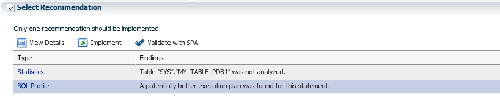
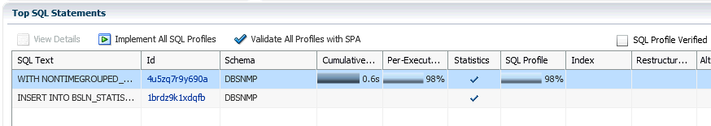

SQL Performance Analyzer Quick Check (SPA Quick Check) and SQL Performance Analyzer can assess the effects of database changes on SQL performance.

The following sections describe SPA Quick Check and SQL Performance Analyzer:

- About SPA Quick Check

- About Configuring SPA Quick Check

- About Validating the Impact of an Initialization Parameter Change

- About Validating the Impact of Implementing a SQL Profile

- About SQL Performance Analyzer

- Specifying Default Settings for SQL Performance Analyzer

- Analyzing the Impact of Database Changes on SQL Performance: Oracle by Example Series

### 11.1 About SPA Quick Check

SQL Performance Analyzer Quick Check (SPA Quick Check) validates the impact of a database change to SQL performance before you make the change.

SPA Quick Check is available on certain EM Express database management pages where changes to the database could affect performance.

Use SPA Quick Check to validate what the impact to SQL performance will be for:

- Changing the value of a session-modifiable initialization parameter

- Implementing SQL profiles

You must configure SPA Quick Check before using it.

**See Also:**

- "About Configuring SPA Quick Check"

- "About Validating the Impact of an Initialization Parameter Change"

- "About Validating the Impact of Implementing a SQL Profile"

- "About Validating the Impact of Implementing Multiple SQL Profiles"

### 11.2 About Configuring SPA Quick Check

This section provides an overview of SPA Quick Check configuration.

Before you can use SPA Quick Check to validate the impact of database changes, you must specify default settings for SPA Quick Check.

As one of the SPA Quick Check default settings, you specify a default SQL tuning set for SPA Quick Check to use. This SQL tuning set should include the SQL statements whose performance you want to analyze.

**See Also:**

- "About SQL Tuning Sets"

- "Specifying Default Values for SPA Quick Check"

- "Validating the Impact of an Initialization Parameter Change"

- "Validating the Impact of Implementing a SQL Profile"

- "Validating the Impact of Implementing Multiple SQL Profiles"

#### 11.2.1 About SQL Tuning Sets

A SQL tuning set (STS) is a database object that includes one or more SQL statements along with their execution statistics and execution context.

You can use APIs to create a SQL tuning set, load SQL statements into the SQL tuning set, and transport the SQL tuning set to another system (such as a test system that is very similar to your production system).

Before you use SQL Performance Analyzer or SQL Performance Analyzer Quick Check (SPA Quick Check) in EM Express, you must specify default settings for them. These tools require a SQL tuning set that includes the SQL statement or statements whose performance you want to analyze.

**See Also:**

- [Oracle Database SQL Tuning Guide](../tgsql/managing-sql-tuning-sets.md) for information about creating a SQL tuning set

- [Oracle Database SQL Tuning Guide](../tgsql/managing-sql-tuning-sets.md) for information about loading a SQL tuning set

- [Oracle Database SQL Tuning Guide](../tgsql/managing-sql-tuning-sets.md) for information about transporting a SQL tuning set

- "About SPA Quick Check"

- "About SQL Performance Analyzer"

#### 11.2.2 Specifying Default Values for SPA Quick Check

You must specify default settings for SPA Quick Check before using it.

To specify default settings for SPA Quick Check:

1.  On any page in EM Express, from the Performance menu, select SQL Performance Analyzer.
    The SQL Performance Analyzer page appears.
2.  On the Quick Check Tasks tab, click Quick Check Default Setup.
    The SPA Quick Check Default Values setup dialog box appears.
3.  In the SPA Quick Check Default Values Setup dialog box, you specify:
    - A SQL tuning set

    - Default values for SPA Quick Check to use when executing the statements in the SQL tuning set

    - Default values for SPA Quck Check to use when it compares the performance of the statements in the SQL tuning set with the database's current settings and after the planned change to your database

    In the SPA Quick Check Default Values Setup dialog box, specify values for these fields:

    - SQL Tuning Set: Specify a SQL tuning set that includes the SQL statements whose performance you are interested in analyzing.

    - Disable Multiple Executions: Indicates whether the statements in the SQL tuning set should be run multiple times when SPA Quick Check executes the SQL tuning set. When Yes is selected, each SQL in the SQL tuning set is executed only once. When No is selected, SQL statements in the SQL tuning set are executed multiple times and runtime statistics are then averaged.

    - Rows to Fetch: Indicates the number of result rows to be fetched for each SQL during a SQL Performance Analyzer test execution. Permissible values are `ALL_ROWS`, `AVERAGE`, `AUTO`, or an integer.

      | Value      | Description                                                                                                                                                                                                                                                                                                                            |
      |:-----------|:---------------------------------------------------------------------------------------------------------------------------------------------------------------------------------------------------------------------------------------------------------------------------------------------------------------------------------------|
      | `ALL_ROWS` | All result rows will be fetched. This is the default value.                                                                                                                                                                                                                                                                            |
      | `AVERAGE`  | The number of result rows will be calculated as the ratio of total rows processed and total executions for each SQL in the SQL tuning set.                                                                                                                                                                                             |
      | `AUTO`     | The number of result rows will be determined using the value of the `optimizer_mode` parameter of the optimizer environment captured in the SQL tuning set. If value of `optimizer_mode` was `ALL_ROWS`, then all result rows will be fetched. If its value was `FIRST_ROWS_n`, then n result rows will be fetched by SPA Quick Check. |
      | Integer    | The number of result rows will be equal to this specified value, or less if there were fewer rows to fetch.                                                                                                                                                                                                                            |

    - Per-SQL Time Limit (seconds): Indicates the per-statement timeout (in seconds) for each statement when SPA Quick Check executes the statements in a SQL tuning set. The maximum value is 2^32-1. Unlimited if set to empty.

    - Total Time Limit (seconds): Indicates the global timeout (in seconds) when SPA Quick executes all the statements in a SQL tuning set. Maximum value is 2^32-1. Unlimited if set to empty.

    - Comparison Metric: Choose the metric you want SPA Quick Check to use when it compares the performance of the statements in the SQL tuning set with the database's current settings and after the planned change to your database.

    - Workload Impact Threshold (%): Indicates the threshold of a SQL statement change impact on a workload. Statements having workload change impact below the absolute value of this threshold will be considered as unchanged (that is, the performance of those statements will be considered neither improved nor regressed).

    - SQL Impact Threshold (%): Threshold of a change impact on a SQL statement. Statements having SQL change impact below the absolute value of this threshold will be considered as unchanged (that is, the performance of those statements will be considered neither improved nor regressed).

**Note:**

- "About SPA Quick Check"

- "About SQL Tuning Sets"

### 11.3 About Validating the Impact of an Initialization Parameter Change

Before you change the value of a session-modifiable database initialization parameter, you can validate the impact of that change on your database workload by using SPA Quick Check.

Session-modifiable parameters are initialization parameters whose values can be changed using the `ALTER SESSION` statement.

**See Also:**

- "Validating the Impact of an Initialization Parameter Change"

- "About SPA Quick Check"

#### 11.3.1 Validating the Impact of an Initialization Parameter Change

You can use SPA Quick Check to validate the impact of a change to a session-modifiable database initialization parameter.

1.  On any page in EM Express, from the Configuration menu, select Initialization Parameters.
    The Initialization Parameters page appears.
2.  Select a session-modifiable initialization parameter for which you would like to validate the impact of setting a new value. Session-modifiable parameters on the Initialization Parameters page have a check mark in the Session column. You can use the Name filter to reduce the number of initialization parameters displayed.
    Note that most of the parameters in the Optimizer category are session-modifiable.
3.  Click Validate with SPA.
    The Validate with SPA dialog box appears, with the initialization parameter you selected in the Name field.
4.  In the Validate with SPA dialog box, specify values for the following options and click OK:
    | Option           | Description                                                                                                                                                                                   |
    |:-----------------|:----------------------------------------------------------------------------------------------------------------------------------------------------------------------------------------------|
    | Parameter Value  | Enter the new initialization parameter value whose impact you would like to validate on the database workload.                                                                                |
    | Task Name        | Accept the default task name, or enter a different name.                                                                                                                                      |
    | Description      | This field shows the initialization parameter name, the current value, and the new value whose impact you want to validate. Accept the default description, or enter a different description. |
    | Total Time Limit | Accept the default value, or specify a different maximum length of time (in seconds) that SPA Quick Check can take to validate the impact of the new value.                                   |

    The Quick Check Tasks tab of the SQL Performance Analyzer page appears, and the Status column for the new task shows SPA Quick Check's progress processing the task. A check mark appears in the Status column when the task execution is complete.
5.  To view a comparison report, click the name of the report in the Comparison Report Name column.
    The SQL Performance Analyzer Report page for the task appears. The SQL Trials section lists the SQL trials that SPA Quick Check performed for the task, and the SQL Trials Comparisons section lists one or more comparisons performed for those trials. The Top SQL Statements section shows a comparison of the top SQL statements for the two trials.

    The Status column shows whether performance improved, regressed, or was unchanged for each of the statements.

    Use the Category filter to show all the top SQL statements, or to show only the SQL statements in one of the available categories.

    Any SQL statement for which a new execution plan is recommended includes a check mark in the New Plan column.
6.  In the Top SQL Statements section at the bottom of the page, click the SQL ID for a SQL statement to see more detailed information about the statement execution in the two trials.
    The Summary section, and the Statistics, Plans, and Findings tabs in the Execution Details section provide more information about the SQL statement execution for the two trials.

**See Also:**

- "About Validating the Impact of an Initialization Parameter Change"

- "About SPA Quick Check"

### 11.4 About Validating the Impact of Implementing a SQL Profile

Before you implement a SQL profile that SQL Tuning Advisor has recommended for a SQL statement, you can use SPA Quick Check to validate the impact of implementing the SQL profile for that statement.

After you tune a SQL statement using SQL Tuning Advisor, the Tuning Result page for that SQL statement lists tuning recommendations in the Select Recommendation section at the bottom of the page. If one of the tuning recommendations is to create a SQL profile for the statement, the Type column displays a value of SQL Profile for that recommendation, and the Validate with SPA button appears in the Select Recommendations section.

**See Also:**

- "Validating the Impact of Implementing a SQL Profile"

- "About Validating the Impact of Implementing Multiple SQL Profiles"

- "Validating the Impact of Implementing Multiple SQL Profiles"

- "About SPA Quick Check"

#### 11.4.1 Validating the Impact of Implementing a SQL Profile

You can use SPA Quick Check to validate the impact of implementing a SQL profile that SQL Tuning Advisor has recommended.

1.  In the Select Recommendation section on Tuning Result page for the SQL statement, select the SQL Profile recommendation and click Validate with SPA.

    
    [Description of the illustration validate_prof.gif](img_text/validate_prof.md)
    The Validate with SPA dialog box appears.
2.  In the Validate with SPA dialog box, specify values for the following options and click OK:
    | Option           | Description                                                                                                                                                                                   |
    |:-----------------|:----------------------------------------------------------------------------------------------------------------------------------------------------------------------------------------------|
    | Task Name        | Accept the default task name, or enter a different name.                                                                                                                                      |
    | Description      | This field shows the initialization parameter name, the current value, and the new value whose impact you want to validate. Accept the default description, or enter a different description. |
    | Total Time Limit | Accept the default value, or specify a different maximum length of time (in seconds) that SPA Quick Check can take to validate the impact of the new value.                                   |

    The Quick Check Tasks tab of the SQL Performance Analyzer page appears, and the Status column for the new task shows SPA Quick Check's progress processing the task. A check mark appears in the Status column when the task execution is complete.
3.  After the task execution is complete, click the task name.
    The SQL Performance Analyzer Task page for the task appears. The SQL Trials section lists the SQL trials that SPA Quick Check performed for the task, and the SQL Trials Comparisons section lists one or more comparisons performed for those trials.
4.  To view a comparison report, click the name of the report in the Comparison Report Name column.
    The SQL Performance Analyzer Report page for the task appears. The SQL Trials section lists the SQL trials that SPA Quick Check performed for the task, and the SQL Trials Comparisons section lists one or more comparisons performed for those trials. The Top SQL Statements section shows a comparison of the top SQL statements for the two trials.

    The Status column shows whether performance improved, regressed, or was unchanged for each of the statements.

    Use the Category filter to show all the top SQL statements, or to show only the SQL statements in one of the available categories.

    Any SQL statement for which a new execution plan is recommended includes a check mark in the New Plan column.
5.  In the Top SQL Statements section at the bottom of the page, click the SQL ID for a SQL statement to see more detailed information about the statement execution in the two trials.
    The Summary section, and the Statistics, Plans, and Findings tabs in the Execution Details section provide more information about the SQL statement execution for the two trials.

**See Also:**

- "About Validating the Impact of Implementing a SQL Profile"

- "About Validating the Impact of Implementing Multiple SQL Profiles"

#### 11.4.2 About Validating the Impact of Implementing Multiple SQL Profiles

Before you implement multiple SQL profiles that have been recommended by SQL Tuning Advisor, you can use SPA Quick Check to validate the impact of implementing those SQL profiles on your workload.

Multiple SQL profile recommendations can appear on these EM Express pages:

- If Automatic SQL Tuning Advisor is enabled, the Automatic tab on the SQL Tuning Advisor page can include multiple SQL profile recommendations for statements listed in the Top SQL Statements section at the bottom of the tab.

- On the Tuning Task Result page for a SQL tuning task. A SQL tuning task can include multiple SQL statements for which SQL Tuning Advisor recommends implementing SQL profiles. The Manual tab on the SQL Tuning Advisor page lists SQL tuning tasks, and you can select a task and click View Result to see all the recommendations for that task.

If SQL Performance Analyzer has recommended implementing multiple SQL profiles on an EM Express page, the Top SQL Statements section of the page includes the Validate All Profiles with SPA button.

**See Also:**

- "Validating the Impact of Implementing Multiple SQL Profiles"

- "About Validating the Impact of Implementing a SQL Profile"

- "Validating the Impact of Implementing a SQL Profile"

#### 11.4.3 Validating the Impact of Implementing Multiple SQL Profiles

You can use SPA Quick Check to validate the impact of implementing multiple SQL profiles that SQL Tuning Advisor has recommended.

1.  In the Top SQL Statements of an EM Express page that lists one or more SQL statements for which SQL Tuning Advisor has recommended implementing SQL profiles, click the Validate All Profiles with SPA button. The Validate All Profiles with SPA button is not available if SQL Tuning Advisor has not recommended implementing multiple SQL profiles.

    
    [Description of the illustration validate_all_profs.gif](img_text/validate_all_profs.md)
    The Validate with SPA dialog box appears.
2.  In the Validate with SPA dialog box, specify values for the following options and click OK:
    | Option           | Description                                                                                                                                                                                   |
    |:-----------------|:----------------------------------------------------------------------------------------------------------------------------------------------------------------------------------------------|
    | Task Name        | Accept the default task name, or enter a different name.                                                                                                                                      |
    | Description      | This field shows the initialization parameter name, the current value, and the new value whose impact you want to validate. Accept the default description, or enter a different description. |
    | Total Time Limit | Accept the default value, or specify a different maximum length of time (in seconds) that SPA Quick Check can take to validate the impact of the new value.                                   |

    The Quick Check Tasks tab of the SQL Performance Analyzer page appears, and the Status column for the new task shows SPA Quick Check's progress processing the task. A check mark appears in the Status column when the task execution is complete.
3.  After the task execution is complete, click the task name.
    The SQL Performance Analyzer Task page for the task appears. The SQL Trials section lists the SQL trials that SPA Quick Check performed for the task, and the SQL Trials Comparisons section lists one or more comparisons performed for those trials.
4.  To view a comparison report, click the name of the report in the Comparison Report Name column.
    The SQL Performance Analyzer Report page for the task appears. The SQL Trials section lists the SQL trials that SPA Quick Check performed for the task, and the SQL Trials Comparisons section lists one or more comparisons performed for those trials. The Top SQL Statements section shows a comparison of the top SQL statements for the two trials.

    The Status column shows whether performance improved, regressed, or was unchanged for each of the statements.

    Use the Category filter to show all the top SQL statements, or to show only the SQL statements in one of the available categories.

    Any SQL statement for which a new execution plan is recommended includes a check mark in the New Plan column.
5.  In the Top SQL Statements section, click the SQL ID for a SQL statement to see more detailed information about the statement execution in the two trials.
    The Summary section, and the Statistics, Plans, and Findings tabs in the Execution Details section provide more information about the SQL statement execution for the two trials.

**See Also:**

- "About Validating the Impact of Implementing Multiple SQL Profiles"

- "About Validating the Impact of Implementing a SQL Profile"

- "Validating the Impact of Implementing a SQL Profile"

### 11.5 About SQL Performance Analyzer

SQL Performance Analyzer automates the process of assessing the overall effect of a database change on a SQL workload by identifying performance divergence for each SQL statement.

A report that shows the net impact on the workload performance due to the change is provided. For regressed SQL statements, SQL Performance Analyzer also provides appropriate execution plan details along with tuning recommendations. As a result, you can remedy any negative outcome before the end users are affected. Furthermore, you can validate (with significant time and cost savings) that the system change to the production environment will result in net improvement.

Before you can use SQL Performance Analyzer, you must have a SQL tuning set that includes the SQL statements whose performance you want to analyze, and you must specify SQL Performance Analyzer default settings.

A SQL Performance Analyzer task is a container that encapsulates all of the data about a complete SQL Performance Analyzer analysis. A SQL Performance Analyzer analysis comprises at least two SQL trials and a comparison. A SQL trial encapsulates the execution performance of a SQL tuning set under specific environmental conditions. When you create a SQL Performance Analyzer task, you select a SQL tuning set as its input source, and when you run SQL trials, the SQL tuning set is used as the source for SQL statements.

After you create a SQL Performance Analyzer task, you create a pre-change SQL trial. Then you make the database change whose SQL performance impact you want to assess. After making the database change, you create a post-change SQL trial. Finally, you compare the two trials.

A SQL Performance Analyzer analysis shows the impact of the environmental differences between the two trials.

**See Also:**

- "About SQL Tuning Sets"

- "Specifying Default Settings for SQL Performance Analyzer"

- "Creating a SQL Performance Analyzer Task"

- "Creating a Pre-Change SQL Trial"

- "Creating a Post-Change SQL Trial"

- "Comparing Two SQL Trials"

- "About SPA Quick Check"

### 11.6 Specifying Default Settings for SQL Performance Analyzer

Before you use SQL Performance Analyzer, you have the option of changing the default settings for the tool.

1.  On any EM Express page, choose SQL Performance Analyzer from the Performance menu.
    The SQL Performance Analyzer page appears.
2.  On the Manual Tasks tab, click SPA Default Setup.
    The SPA Default Values Setup dialog box appears.
3.  In the SPA Default Values Setup dialog box, you specify default values for SQL Performance Analyzer to use when executing the statements in the SQL tuning set, and default values for SQL Performance Analyzer to use when it compares the performance of the statements in the SQL tuning set with the database's current settings and after the change that you make to your database. Specify values for these fields, and then click OK to save these default settings for SQL Performance Analyzer:
    - Disable Multiple Executions: Indicates whether the statements in the SQL tuning set should be run multiple times when SQL Performance Analyzer executes the SQL tuning set. When Yes is selected, each SQL in the SQL tuning set is executed only once. When No is selected, SQL statements in the SQL tuning set are executed multiple times and runtime statistics are then averaged.

    - Per-SQL Time Limit (seconds): Indicates the per-statement timeout (in seconds) for each statement when SQL Performance Analyzer executes the statements in a SQL tuning set. The maximum value is 2^32-1. Unlimited if set to empty.

    - Rows to Fetch: Indicates the number of result rows to be fetched for each SQL during a SQL Performance Analyzer test execution. Permissible values are `ALL_ROWS`, `AVERAGE`, `AUTO`, or an integer.

      | Value    | Description                                                                                                                                                                                                                                                                                                                            |
      |:---------|:---------------------------------------------------------------------------------------------------------------------------------------------------------------------------------------------------------------------------------------------------------------------------------------------------------------------------------------|
      | ALL_ROWS | All result rows will be fetched. This is the default value.                                                                                                                                                                                                                                                                            |
      | AVERAGE  | The number of result rows will be calculated as the ratio of total rows processed and total executions for each SQL in the SQL tuning set.                                                                                                                                                                                             |
      | AUTO     | The number of result rows will be determined using the value of the `optimizer_mode` parameter of the optimizer environment captured in the SQL tuning set. If value of `optimizer_mode` was `ALL_ROWS`, then all result rows will be fetched. If its value was `FIRST_ROWS_n`, then n result rows will be fetched by SPA Quick Check. |
      | Integer  | The number of result rows will be equal to this specified value, or less if there were fewer rows to fetch.                                                                                                                                                                                                                            |

    - Execute Full DML: Specify Yes to execute DML statement fully, including acquiring row locks and modifying rows. Specify No (default) to execute only the query part of the DML without modifying data. When Yes is specified, SQL Performance Analyzer issues a rollback following DML execution to prevent persistent changes from being made by the DML.

    - Apply Captured Optimizer Env: Specify Yes for this field if you want the per-SQL optimizer environment captured in the SQL tuning set to be used for SQL Performance Analyzer trials. Otherwise, specify No.

    - Comparison Metric: Choose the metric you want SQL Performance Analyzer to use when it compares the performance of the statements in the SQL tuning set with the database's current settings and after the planned change to your database.

    - Workload Impact Threshold (%): Indicates the threshold of a SQL statement change impact on a workload. Statements having workload change impact below the absolute value of this threshold will be considered as unchanged (that is, the performance of those statements will be considered neither improved nor regressed).

    - SQL Impact Threshold (%): Threshold of a change impact on a SQL statement. Statements having SQL change impact below the absolute value of this threshold will be considered as unchanged (that is, the performance of those statements will be considered neither improved nor regressed).

**See Also:**

- "Creating a SQL Performance Analyzer Task"

- "About SQL Performance Analyzer"

#### 11.6.1 Creating a SQL Performance Analyzer Task

You create a SQL Performance Analyzer task using a SQL tuning set as its input source.

1.  On any EM Express page, choose SQL Performance Analyzer from the Performance menu.
    The SQL Performance Analyzer page appears.
2.  On the Manual Tasks tab, click Create.
    The Create SQL Performance Analyzer Task dialog box appears.
3.  In the Create SQL Performance Analyzer Task dialog box, enter values for these fields and then click OK:
    - Task Name: Accept the default task name, or enter the name you want to use for the task.

    - Description: Optionally, enter a description for the task.

    - SQL Tuning Set: Choose the SQL tuning set you want to use to create the task.

    The new SQL Performance Analyzer task appears in the list of SQL Performance Analyzer tasks on the Manual Tasks tab.

After creating a SQL Performance Analyzer task, you can create a SQL trial. Typically, you create a pre-change SQL trial, make a database change, and then create a post-change SQL trial.

**See Also:**

- "Creating a Pre-Change SQL Trial"

- "Creating a Post-Change SQL Trial"

- "About SQL Performance Analyzer"

- "Specifying Default Settings for SQL Performance Analyzer"

#### 11.6.2 Creating a Pre-Change SQL Trial

After you create a SQL Performance Analyzer task, you can use SQL Performance Analyzer to create a pre-change SQL trial.

Follow these steps to create a pre-change SQL trial using SQL Performance Analyzer:

1.  On any EM Express page, choose SQL Performance Analyzer from the Performance menu.
    The SQL Performance Analyzer page appears.
2.  On the Manual Tasks tab, click the name of the SQL Performance Analyzer task that includes the SQL statements for which you want to analyze the impact of a database change.
    The SQL Performance Analyzer Task page for that task appears.
3.  In the SQL Trials section, click Create to create a pre-change SQL trial.
4.  On the Trial Information tab of the Create SQL Trial dialog box:
    - Trial Name: Accept the default trial name, or enter the name you want to use for the trial.

    - Description: Optionally, enter a description for the trial.

    - Execution Type: Choose the type of execution you want to use for the trial:

      - Test Execute: This method test executes SQL statements through SQL Performance Analyzer on the database running SQL Performance Analyzer.

      - Explain Plan: This method generates execution plans only for SQL statements through SQL Performance Analyzer on the database running SQL Performance Analyzer. Unlike the `EXPLAIN PLAN` statement, SQL trials using the explain plan method take bind values into account and generate the actual execution plan.

      - Convert SQL Tuning Set: This method converts the execution statistics and plans stored in a SQL tuning set to a trial. You can then compare this trial with other trials. A tuning set does not contain all the data that is collected from a test execute trial, so if you create a comparison of a convert SQL tuning set trial with a test execute trial, there will be fewer comparison metrics available.

    Click the right arrow button to go to the Schedule tab if you want to schedule a time for the trial to run. Or, click OK to run the trial immediately.

    When the trial is executing, its status is displayed in the Status column in the SQL Trials section of the SQL Performance Analyzer Task page for the task.

    When the trial is complete, a check mark icon appears in the Status column for the trial in the SQL Trials section of the SQL Performance Analyzer Task page for the task.

After the pre-change SQL trial is complete, make the database change whose impact on SQL performance you want to assess, and then create a post-change SQL trial.

**See Also:**

- "Creating a SQL Performance Analyzer Task"

- "Creating a Post-Change SQL Trial"

#### 11.6.3 Creating a Post-Change SQL Trial

After you create a pre-change SQL trial and make a database change, you can create a post-change SQL trial.

After making the database change whose SQL performance impact you want to assess, follow these steps to create a post-change SQL trial using SQL Performance Analyzer:

1.  On any EM Express page, choose SQL Performance Analyzer from the Performance menu.
    The SQL Performance Analyzer page appears.
2.  On the Manual Tasks tab, click the name of the SQL Performance Analyzer task that includes the SQL statements for which you want to analyze the impact of a database change.
    The SQL Performance Analyzer Task page for that task appears.
3.  In the SQL Trials section, click Create to create a post-change SQL trial.
4.  On the Trial Information tab of the Create SQL Trial dialog box:
    - Trial Name: Accept the default trial name, or enter the name you want to use for the trial.

    - Description: Optionally, enter a description for the trial.

    - Execution Type: Choose the type of execution you want to use for the trial:

      - Test Execute: This method test executes SQL statements through SQL Performance Analyzer. This can be done on the database running SPA Performance Analyzer or on a remote database.

      - Explain Plan: This method generates execution plans only for SQL statements through SQL Performance Analyzer. This can be done on the database running SPA Performance or on a remote database. Unlike the `EXPLAIN PLAN` statement, SQL trials using the explain plan method take bind values into account and generate the actual execution plan.

      - Convert SQL Tuning Set: This method converts the execution statistics and plans stored in a SQL tuning set to a trial. You can then compare this trial with other trials. A tuning set does not contain all the data that is collected from a test execute trial, so if you create a comparison of a convert SQL tuning set trial with a test execute trial, there will be fewer comparison metrics available.

    Click the right arrow button to go to the Schedule tab if you want to schedule a time for the trial to run. Or, click OK to run the trial immediately.

    When the trial is executing, its status is displayed in the Status column in the SQL Trials section of the SQL Performance Analyzer Task page for the task.

    When the trial is complete, a check mark icon appears in the Status column for the trial in the SQL Trials section of the SQL Performance Analyzer Task page for the task.

After the post-change SQL trial is complete, you can compare the pre-change SQL trial and the post-change SQL trial to assess the SQL performance impact of the database change.

**See Also:**

- "Creating a Pre-Change SQL Trial"

- "Comparing Two SQL Trials"

#### 11.6.4 Comparing Two SQL Trials

After a pre-change SQL trial and a post-change SQL trial have been created, you can use SQL Performance Analyzer to compare the two SQL trials to assess the impact of the database change on SQL performance.

Follow these steps to compare two SQL trials:

1.  On any EM Express page, choose SQL Performance Analyzer from the Performance menu.
    The SQL Performance Analyzer page appears.
2.  On the Manual Tasks tab, click the name of the SQL Performance Analyzer task that includes the SQL statements for which you want to analyze the impact of a database change.
    The SQL Performance Analyzer Task page for that task appears.
3.  To compare two SQL trials, click Create in the SQL Trial Comparisons section of the SQL Performance Analyzer Task page for the task.
4.  On the Compare Information tab of the Create SQL Comparison Report dialog box:
    - Comparison Report Name: Accept the default comparison report name, or enter the name you want to use for the report.

    - Description: Optionally, enter a description for the comparison.

    - Trial 1 Name: Select the first trial to use in the comparison. Although you can select any trial, typically you will choose a pre-change SQL trial as the first trial.

    - Trial 2 Name: Select the second trial to use in the comparison. Although you can select any trial, typically you will choose a post-change SQL trial as the second trial.

    - Comparison Metric: Select the metric to use for the comparison.

    Click the right arrow button to go to the Schedule tab if you want to schedule a time for the comparison to run. Or, click OK to run the comparison immediately.

    When the comparison is being performed, its status is displayed in the Status column in the SQL Trial Comparisons section of the SQL Performance Analyzer Task page for the task.
5.  To view the new comparison report, click the name of the report in the Comparison Report Name column in the SQL Trial Comparisons section.

The SQL Performance Analyzer Report page for the task shows the comparison report for the two trials.

The Top SQL Statements section shows a comparison of the top SQL statements for the two trials.

The Status column shows whether performance improved, regressed, or was unchanged for each of the statements.

Use the Category filter to show all the top SQL statements, or to show only the SQL statements in one of the available categories.

**See Also:**

- "Creating a Pre-Change SQL Trial"

- "Creating a Post-Change SQL Trial"

### 11.7 Analyzing the Impact of Database Changes on SQL Performance: Oracle by Example Series

Oracle By Example (OBE) has a series on the Oracle Database 2 Day DBA guide. This OBE series steps you through the tasks in this section, and includes annotated screenshots.

The series consists of the following tutorials:

1.  Analyze the Impact of Database Changes on SQL Performance

2.  Create and Compare SQLTrials Using SQL Performance Analyzer

The above tutorials can be accessed in two ways:

- To see a clickable list of the above tutorials, go to [Analyze the Overall Impact of Database Changes on SQL Performance Series](https://docs.oracle.com/pls/topic/lookup?ctx=en/database/oracle/oracle-database/19/admqs&id=twodaydba_obe_spa).

- For seamless navigation through the tutorial series, access the following link:

  [Analyze the Overall Impact of Database Changes on SQL Performance](https://docs.oracle.com/pls/topic/lookup?ctx=en/database/oracle/oracle-database/19/admqs&id=twodaydba_lp_spa)

  You can navigate across the tutorials by clicking the \> button at the bottom of the pane.
