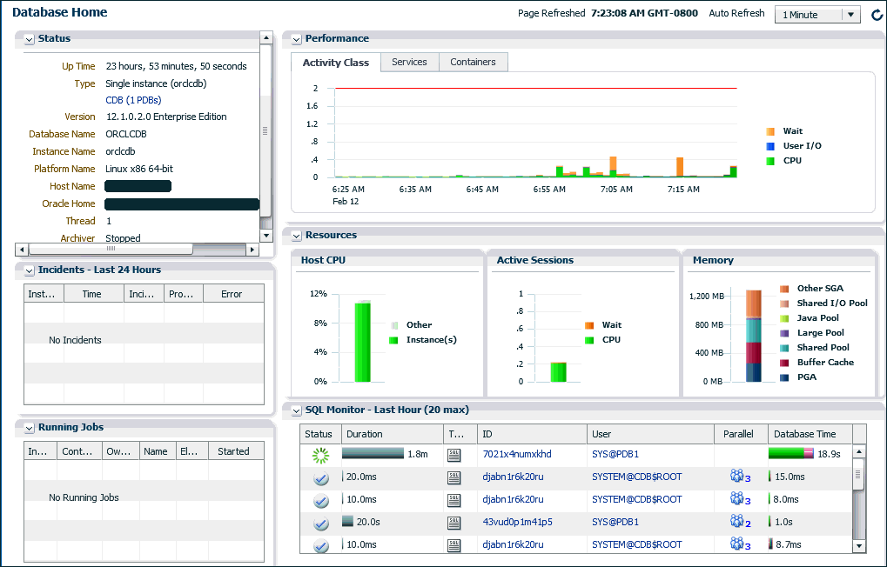

This chapter provides a brief roadmap for administering your database. It introduces you to Oracle Enterprise Manager Database Express (EM Express), the Web-based interface for managing an Oracle database.

This chapter contains the following sections:

- Managing Your Database: An Overview

- Configuring the Operating System Environment Variables

- Introduction to Oracle Enterprise Manager Database Express

- Starting EM Express

- Configuring the HTTPS Port for EM Express

- About EM Express and Database Cloud Service Deployments

- Accessing the Database Home Page

- Granting Access to EM Express for Nonadministrative Users

- Administering the Database with SQL-Based Management Tools

- Getting Started with Database Administration: Oracle by Example Series

### 3.1 Managing Your Database: An Overview

This section provides an overview of the tasks involved in managing an Oracle database instance. Each chapter in this guide describes a different task in detail.

#### To manage your Oracle database:

1.  Start the database instance.
    After the installation, your instance is started and your database is open. In the future, there will be times, perhaps for doing database maintenance or because of a power or media failure, that you shut down your database instance and later restart it.

    See "[Shutting Down and Starting Up the Oracle Instance](managing-the-oracle-instance.md)".
2.  Optionally, configure the network environment to enable clients to connect to your database.
    See "[Configuring the Network Environment](configuring-the-network-environment.md)".
3.  Review your database storage structures: tablespaces and data files, online redo log files, and control files. Create or modify storage structures as needed.
    See "[Managing Database Storage Structures](managing-database-storage-structures.md)".
4.  Review memory allocation and adjust as needed.
    See "[Managing Memory](managing-the-oracle-instance.md)".
5.  Review, unlock, and reset passwords for predefined database users as needed. Create new users, and assign privileges and roles to them.
    See "[Administering User Accounts and Security](administering-user-accounts-and-security.md)".
6.  Create the necessary schema objects, including tables, views, and indexes. Populate the tables with data.
    See "[Managing Schema Objects](managing-schema-objects.md)".
7.  Create or review the backup strategy for the database and back up the database.
    See "[Performing Backup and Recovery](performing-backup-and-recovery.md)".
8.  Enable archiving of online redo log files, if not already done.
    See "[Configuring Recovery Settings](performing-backup-and-recovery.md)".
9.  Monitor database performance, diagnose performance problems, and tune the database as necessary.
    See "[Monitoring and Tuning the Database](monitoring-and-tuning-the-database.md)".
10. Keep Oracle Database software up-to-date with the latest releases.
    See "[Managing Oracle Database Software](managing-oracle-database-software.md)".

### 3.2 Configuring the Operating System Environment Variables

Before using certain tools that access the Oracle database, such as SQL\*Plus, you must configure environment variables for your operating system. These environment variables are used by Oracle Database to determine the database instance to which the tool should connect.

#### To configure operating system environment variables for your database instance on Linux and UNIX systems:

1.  Open an operating system command window.

2.  Ensure that the environment variables `ORACLE_HOME` and `ORACLE_SID` are set properly. The commands to use to set these environment variables depend on the shell you use to interface with the operating system. For example:

    - (bash or ksh) `export ORACLE_SID=orcl`

    - (csh or tcsh) `setenv ORACLE_SID orcl`

    You can set these with the scripts `coraenv` (for the C shell) and `oraenv` (for other shells). These scripts are typically located in the `/usr/local/bin` directory.

3.  Ensure that the `$ORACLE_HOME/bin` directory is in your `PATH` environment variable.

4.  You can also edit the profile file for your default shell in the home directory of the software owner, for example `/home/oracle`, so that these environment variables are set every time you log in as that user.

#### To configure operating system environment variables for your database instance on Windows systems:

1.  Open an operating system command window.
2.  Use `regedit` to make sure the `ORACLE_HOME` and `ORACLE_SID` parameters are set to the correct values in the `HKEY_LOCAL_MACHINE\SOFTWARE\ORACLE\KEY_HOME_NAME` registry subkey.
3.  Ensure that the `%ORACLE_HOME%\bin` directory is in your `PATH` environment variable. At a command prompt, use a command similar to the following:
        set PATH=%ORACLE_HOME%\bin;%PATH%

**See Also:**

- [Oracle Database Administrator's Reference for Linux and UNIX-Based Operating Systems](../unxar/administering-oracle-database.md) for more information about setting environment variables

- [Oracle Database Administrator’s Reference for Microsoft Windows](../ntqrf/configuration-parameters-and-registry.md) for details on modifying the registry entries

### 3.3 Introduction to Oracle Enterprise Manager Database Express

EM Express is a web-based database management tool that is built inside the Oracle Database. It supports key performance management and basic database administration functions. From an architectural perspective, EM Express has no mid-tier or middleware components, ensuring that its overhead on the database server is negligible.

Using EM Express, you can perform administrative tasks such as managing user security and managing database memory and storage. You can also view performance and information about your database.

EM Express is available only when the database is open. This means that EM Express cannot be used to start up the database. Other operations that require that the database change state, such as enable or disable ARCHIVELOG mode, are also not available in EM Express.

**Note:**

In accordance with industry standards, Oracle is deprecating Flash-based Oracle Enterprise Manager Express (Oracle EM Express). Starting with Oracle Database 19c, Oracle EM Express, the default management option for Oracle Database, is based on Java JET technology. In this initial release, there are some options available in Flash-based Oracle EM Express that are not available in the JET version. If necessary, use the following command to revert to Flash Oracle EM Express:

    SQL> @?/rdbms/admin/execemx emx

To return to JET Oracle EM Express, use the following command:

    SQL> @?/rdbms/admin/execemx omx

**Note:**

Enterprise Manager Database Control is no longer available in Oracle Database 12c. You can use Enterprise Manager Cloud Control 12c or EM Express 12c to manage your Oracle Database 12c databases.

Enterprise Manager Cloud Control supports Oracle Database 12c targets, including multitenant container databases (CDBs), pluggable databases (PDBs), non-CDBs, Oracle Real Application Clusters (Oracle RAC) databases, and Oracle Automatic Storage Management (Oracle ASM) databases.

See [Oracle Multitenant Administrator's Guide](../multi/introduction-to-the-multitenant-architecture.md) for an introduction to CDBs and PDBs, [Oracle Multitenant Administrator's Guide](../multi/managing-a-multitenant-environment.md) for information about managing CDBs and PDBs, [Oracle Real Application Clusters Administration and Deployment Guide](../racad/introduction-to-oracle-rac.md) for more information about Oracle RAC databases, and [Oracle Automatic Storage Management Administrator's Guide](../ostmg/asm-intro.md) for more information about Oracle ASM databases.

You can use the Enterprise Manager Database Express features described below against non-CDBs, CDBs, PDBs, or Oracle RAC database instances.

Configuration:

- Initialization parameters (init.ora) management

- Memory management

- Database Feature Usage

- Database Properties

Storage:

- Tablespace management

- Undo managementFoot 1

- Redo managementFoot 1

- Archive log managementFoot 1

- Control files managementFoot 1

Performance:

- Performance Hub, which includes these features:

  - Real-time performance monitoring and tuning

  - Historical performance and tuning

  - SQL monitoring (real-time and historical)

  - Database operations monitoring

  - ADDM, including Real-Time ADDM

  - Active Session History (ASH) Analytics

- Automatic and manual SQL Tuning Advisor

#### Database Home Page

The main page for database administration is the Database Home page. This is the page that loads when you log in to EM Express. See "Accessing the Database Home Page".

#### Navigation

Menus at the top of the Database Home page organize database management tasks into distinct categories. Choosing a menu option takes you to the EM Express page for that database management task. For example, to view the Users page, from the Security menu, select Users.

[Description of the illustration exp_menus.gif](img_text/exp_menus.md)

**See Also:**

[Oracle Database Administrator’s Guide](../admin/distributed-database-concepts.md) for more information about Oracle Enterprise Manager Cloud Control

### 3.4 Starting EM Express

You can use Oracle Enterprise Manager Database Express (EM Express) to manage non-CDBs, multitenant container databases (CDBs), and pluggable databases (PDBs). EM Express uses an HTTPS port to connect to and manage non-CDBs, CDBs, and PDBs.

**Note:**

You can use EM Express to manage a CDB, and all the PDBs in the CDB except for the seed PDB.

You must know the HTTPS port for a non-CDB, CDB, or PDB to manage the database using EM Express.

Usually the HTTPS port for a non-CDB, or for a CDB and its PDBs, is provided by DBCA when it configures your non-CDB or CDB.

When you specify the EM Express URL in your web browser, enter your database hostname instead of 'localhost.'

In other words, enter the EM Express URL in this format to start EM Express:

    https://database-hostname:portnumber/em/

For example:

    https://mydbhost.example.com:5500/em/

When EM Express prompts you for your username and password, log in as a user with `DBA` privilege (such as `SYS` or `SYSTEM`).

"[SYS and SYSTEM Users](administering-user-accounts-and-security.md)" provides information about the recommended alternative to using the `SYSTEM` account for day-to-day administrative tasks.

**Note:**

The first time you enter the URL for EM Express in your web browser, your browser may display warning messages.

EM Express is a servlet built on top of Oracle XML DB. The Oracle XML DB default wallet has a self-signed certificate, and some existing browsers consider self-signed certificates as untrusted because they are not signed by a trusted CA (certificate authority). However, the self-signed certificate is still secure, as it ensures that the traffic is encrypted between the Oracle XML DB server and the client (browser).

Therefore, enter a security exception for the EM Express URL in your web browser.

**See Also:**

- "Starting EM Express for a Non-CDB"

- "Starting EM Express for a CDB"

- "Starting EM Express for a PDB"

#### 3.4.1 Starting EM Express for a Non-CDB

To start Oracle Enterprise Manager Database Express (EM Express) for a non-CDB, use the EM Express URL provided by Database Configuration Assistant (DBCA) when DBCA configured your non-CDB. The assignment of the URL is described in "[Installing Oracle Database Software](installing-oracle-database-creating-database.md)." The URL includes the HTTPS port number for the non-CDB.

If you do not know the HTTPS port number for the non-CDB, issue the following SQL statement in your non-CDB, which returns the port that is configured for EM Express:

    select dbms_xdb_config.gethttpsport() from dual;

If a value other than 0 is returned by the `gethttpsport` procedure, the returned value is the port that you should use to connect to the non-CDB using EM Express.

If a value of 0 is returned by the procedure, it means that an HTTPS port is not configured for the non-CDB. In this case, you must manually configure an HTTPS port for this non-CDB, as described in "Configuring the HTTPS Port for EM Express."

**See Also:**

- "Starting EM Express"

- [Oracle Database PL/SQL Packages and Types Reference](../arpls/DBMS_XDB_CONFIG.md) for more information on the `gethttpsport` procedure

#### 3.4.2 Starting EM Express for a CDB

To start Oracle Enterprise Manager Database Express (EM Express) for a multitenant container database (CDB), use the EM Express URL provided by Database Configuration Assistant (DBCA) when DBCA configured your CDB. The assignment of the URL is described in "[Installing Oracle Database Software](installing-oracle-database-creating-database.md)." The URL includes the HTTPS port number for the CDB.

If you do not know the HTTPS port number for the CDB, go to the root and issue the following SQL statement, which returns the port that is configured for EM Express:

    alter session set container=CDB$ROOT;
    select dbms_xdb_config.gethttpsport() from dual;

If a value other than 0 is returned by the `gethttpsport` procedure, the returned value is the port that you should use to connect to the CDB using EM Express.

If a value of 0 is returned by this statement, it means that an HTTPS port is not configured for the CDB. In this case, you must manually configure an HTTPS port for this CDB, as described in "Configuring the HTTPS Port for EM Express."

When connected to the root, EM Express displays data and enables actions that apply to the entire CDB.

**See Also:**

- "Starting EM Express"

- "[Managing PDBs with EM Express](managing-pdbs-with-em-express.md)" for more information about using EM Express to manage pluggable databases (PDBs) in a CDB

- [Oracle Multitenant Administrator's Guide](../multi/administering-a-cdb-with-sql-plus.md) for information about switching to a container using the `ALTER SESSION` statement

- [Oracle Database PL/SQL Packages and Types Reference](../arpls/DBMS_XDB_CONFIG.md) for more information on the `gethttpsport` procedure

#### 3.4.3 Starting EM Express for a PDB

To start EM Express for a PDB, ensure that the PDB is open in read/write mode and then try one of the following methods described in this topic (in the order shown):

1.  Connect to the CDB\$ROOT container for the CDB that includes the PDB, and issue the following SQL statement to configure the global port for the CDB:

        exec dbms_xdb_config.setglobalportenabled(TRUE);

2.  Then, in a web browser, enter the EM Express URL provided by Database Configuration Assistant (DBCA) when it configured the CDB that includes the PDB.

    By default, the HTTPS port that DBCA configures for a CDB can also be used for the PDBs in that CDB.

3.  When the EM Express login screen appears, specify your administrator credentials and enter the name of the PDB that you want to connect to in the Container Name field.

The advantage of using a global port is that you do not need to configure a port for each PDB. (In a large site, there can be thousands of PDBs.) With a global port, you configure one port and then set EM Express to point to it. A second advantage is that you do not need to look up the port number for this PDB; this configuration automatically routes requests to the PDB.

If EM Express does not connect to the PDB, try the next method:

1.  Connect to the PDB that you want to manage (PDB1 in this example) and use the `gethttpsport` procedure to determine whether an HTTPS port is configured for EM Express:

        alter session set container=PDB1;
        select dbms_xdb_config.gethttpsport() from dual;

    If a value other than 0 is returned by the `gethttpsport` procedure, the returned value is the port that you should use to connect to the PDB using EM Express.

2.  If 0 is returned by the `gethttpsport` procedure, then you must manually configure an HTTPS port for this PDB, as described in "Configuring the HTTPS Port for EM Express."

    After you manually configure an HTTPS port for a PDB, you can specify that port in an EM Express URL to connect to that PDB. When you use an HTTPS port that was manually configured for a PDB in an EM Express URL, the Container Name field does not appear on the EM Express login screen because that port can be used only to access that PDB.

When connected to a PDB, EM Express displays data and enables actions that apply to the PDB only.

**See Also:**

- "Starting EM Express"

- "[Managing PDBs with EM Express](managing-pdbs-with-em-express.md)" for more information about using EM Express to manage the PDBs in a multitenant container database (CDB)

- [Oracle Database PL/SQL Packages and Types Reference](../arpls/DBMS_XDB_CONFIG.md) for more information about the `dbms_xdb_config.setglobalportenabled` procedure

- [Oracle Database PL/SQL Packages and Types Reference](../arpls/DBMS_XDB_CONFIG.md) for information about the `dbms_xdb_config.isglobalportenabled` function

- [Oracle Multitenant Administrator's Guide](../multi/administering-a-cdb-with-sql-plus.md) for information about switching to a container using the `ALTER SESSION` statement

- [Oracle Database PL/SQL Packages and Types Reference](../arpls/DBMS_XDB_CONFIG.md) for more information on the `dbms_xdb_config.gethttpsport` procedure

### 3.5 Configuring the HTTPS Port for EM Express

The steps in this section need to be performed only if Database Configuration Assistant (DBCA) did not provide you with the Oracle Enterprise Manager Database Express (EM Express) URL when configuring your database or pluggable database (PDB), or if you need to change the EM Express port later on. Otherwise, you can start EM Express by following the instructions in "Starting EM Express."

Before you can access EM Express from a Web browser, the HTTPS port for EM Express must be configured. After the HTTPS port for EM Express is configured, you use it to access EM Express.

#### To manually configure the HTTPS port for EM Express:

1.  Configure and start the Oracle Net Listener (the listener). You can use lsnrctl to start, stop, and view the status of the listener.
2.  If the listener is running on a nonstandard port (for example, not 1521), then the `init.ora` file for the database you want to manage using EM Express must contain a `local_listener` entry so that the HTTPS port can register with the correct listener. The` local_listener` entry references a TNSNAMES entry that points to the correct listener. For example:
        local_listener=inst1

    where `inst1` is a TNSNAMES entry defined in `tnsnames.ora` that points to the listener. For example:

        inst1= (DESCRIPTION=(ADDRESS=(PROTOCOL=tcp)(HOST=host_name)(PORT=1234))
        (CONNECT_DATA=(SERVICE_NAME=service_name)(SERVER=DEDICATED)))

    In this example, 1234 is the nonstandard port on which the listener has been configured to listen.
3.  Enable the TCP dispatcher by adding the following entry to the `init.ora` file for the database you want to manage using EM Express:
        dispatchers="(PROTOCOL=TCP)(SERVICE=<sid>XDB)"

    For example, if the database SID is ORCL, then the entry would be:

        dispatchers="(PROTOCOL=TCP)(SERVICE=ORCLXDB)"
4.  Restart the database so that the changes made in the `init.ora` file take effect.
5.  Use the PL/SQL procedure `DBMS_XDB_CONFIG.SETHTTPSPORT` to set the HTTPS port for EM Express for the database to a port that is not in use. This will update the HTTPS `port `in the `xdbconfig.xml` file in the Oracle XML DB Repository. You must connect as `SYS / AS SYSDBA` to run the procedure.
    For example, to set the HTTPS port for EM Express for a non-CDB:

        SQL> exec DBMS_XDB_CONFIG.SETHTTPSPORT(5500);

    To set the HTTPS port for EM Express for a multitenant container database (CDB), go to the root in the CDB and then use the PL/SQL procedure `DBMS_XDB_CONFIG.SETHTTPSPORT` in the CDB to set the HTTPS port for EM Express for the CDB to a port that is not in use. This will update the HTTPS `port `in the `xdbconfig.xml` file in the Oracle XML DB Repository. You must connect as `SYS / AS SYSDBA` to run the procedure. For example:

        SQL> alter session set container=CDB$ROOT;
        SQL> exec DBMS_XDB_CONFIG.SETHTTPSPORT(5501);

    To set the HTTPS port for EM Express for a PDB, ensure that the PDB is open in read/write mode, and then use the PL/SQL procedure `DBMS_XDB_CONFIG.SETHTTPSPORT` in the PDB to set the HTTPS port for EM Express for the PDB to a port that is not in use. This will update the HTTPS `port `in the `xdbconfig.xml` file in the Oracle XML DB Repository. You must connect as `SYS / AS SYSDBA` to run the procedure. For example:

        SQL> alter session set container=PDB1;
        SQL> exec DBMS_XDB_CONFIG.SETHTTPSPORT(5502);

    Use the following command to confirm that the port has registered with the listener:

        $ lsnrctl status | grep -i 5502
        (DESCRIPTION=(ADDRESS=(PROTOCOL=tcps)(HOST=hostname.example.com)(PORT=5502)
        )(Security=(my_wallet_directory=/$ORACLE_BASE/admin/sid/xdb_wallet))
        (Presentation=HTTP)(Session=RAW))
6.  To access EM Express for a non-CDB, CDB, or PDB, enter a URL in the following format in a Web browser, specifying the EM Express port number for the non-CDB, CDB, or PDB you want to manage:
        https://database-hostname:portnumber/em/

    For example:

        https://mydbhost.example.com:5500/em/

    When prompted for your username and password, log in as a user with DBA privilege (such as `SYS` or `SYSTEM`).

    **Note:**

    The TLS version of EM Express is determined by the `SSL_VERSION` parameter set in the `sqlnet.ora` file of the database.

    See [Oracle Database Net Services Reference](https://docs.oracle.com/pls/topic/lookup?ctx=en/database/oracle/oracle-database/19/admqs&id=NETRF-GUID-A2A81CEE-162D-4602-8315-990C8CC9E9E2) for more information about the `SSL_VERSION` parameter.

    **See Also:**

    - [Oracle Database Net Services Administrator's Guide](../netag/configuring-and-administering-oracle-net-listener.md) for more information about configuring and using the listener

    - [Oracle Database Net Services Reference](../netrf/index.md) for more information about listener parameters

    - [Oracle Database Net Services Administrator's Guide](../netag/configuring-and-administering-oracle-net-listener.md) for more information about the `local_listener` entry

    - [Oracle XML DB Developer’s Guide](../adxdb/repository-access-using-protocols.md) for more information about accessing the Oracle XML DB Repository

    - [Oracle XML DB Developer’s Guide](../adxdb/administration-of-XML-DB.md) for more information about administering Oracle XML DB

    - [Oracle Database PL/SQL Packages and Types Reference](../arpls/DBMS_XDB_CONFIG.md) for more information about the `sethttpsport` procedure

    - [Oracle Multitenant Administrator's Guide](../multi/administering-pdbs-with-sql-plus.md) for information about using the `ALTER PLUGGABLE DATABASE` statement to modify the mode of a PDB

    - [Oracle Multitenant Administrator's Guide](../multi/administering-a-cdb-with-sql-plus.md) for information about switching to a container using the `ALTER SESSION` statement

    - "[Managing PDBs with EM Express](managing-pdbs-with-em-express.md)" for more information about using EM Express to manage the PDBs in a CDB

    - "[SYS and SYSTEM Users](administering-user-accounts-and-security.md)" for information about the recommended alternative to using the `SYSTEM` account for day-to-day administrative tasks

### 3.6 About EM Express and Database Cloud Service Deployments

In addition to using EM Express to monitor and manage Oracle Database on-premise databases, you can also use EM Express to manage Oracle Database Cloud Service (DBCS) database deployments.

For information about using EM Express to manage DBCS database deployments, see [Oracle Cloud Administering Oracle Database Cloud Service](https://docs.oracle.com/pls/topic/lookup?ctx=en/database/oracle/oracle-database/19/admqs&id=CSDBI-GUID-EAB971AC-3BF3-4370-B8DF-B72F777A5575).

### 3.7 Accessing the Database Home Page

The Database Home page is the main database management page in Oracle Enterprise Manager Database Express (EM Express).

#### To access the Database Home page:

1.  Ensure that the HTTPS port for EM Express is configured.
    See "Configuring the HTTPS Port for EM Express".
2.  In your Web browser, enter the EM Express URL for the database or pluggable database (PDB) you want to manage:
        https://database-hostname:portnumber/em

    For example, if you installed the database on a host computer named `mydbhost.example.com`, and port number `5500` is configured as the HTTPS port number for EM Express for the database, then enter the following URL:

        https://mydbhost.example.com:5500/em

    If the database instance is running, then the Login page appears when you access EM Express.

    If the database instance is not running, start it. See [Oracle Database Administrator’s Guide](../admin/starting-up-and-shutting-down.md) for information about starting the instance.

    If port number 5501 is configured as the HTTPS port number for EM Express for the PDB you want to manage, then enter the following URL:

        https://mydbhost.example.com:5501/em

    If the PDB is open in read/write mode, then the Login page appears when you access EM Express.

    If the PDB is not open in read/write mode, open it in read/write mode. See [Oracle Multitenant Administrator's Guide](../multi/administering-pdbs-with-sql-plus.md) for information about using the `ALTER PLUGGABLE DATABASE` statement to open a PDB in read/write mode.
3.  Log in to the database or PDB with a user account that is authorized to access EM Express. The `EM_EXPRESS_BASIC` and `EM_EXPRESS_ALL` roles are created for EM Express, and a user who has been granted at least one of these roles can log in to EM Express.
    This user initially could be `SYS` or `SYSTEM`, with the password that you specified during database installation.

    Although you can use the `SYSTEM` account to perform day-to-day administrative tasks, Oracle strongly recommends creating a named user account for administering the Oracle database to enable monitoring of database activity. To back up, recover, or upgrade the database, you must log in as a user with the SYSDBA privilege.

    EM Express displays the Database Home page.

    
    [Description of the illustration exp_db_home_page2.gif](img_text/exp_db_home_page2.md)
    **Note:**

    The Database Home page above is for a CDB. The Containers tab in the Performance section does not appear on the Database Home page for a non-CDB or PDB.
4.  To return to the Database Home page after you have navigated to another EM Express page, you can:
    - Click the database icon at the top left of any EM Express page:

      
      [Description of the illustration exp_db_home_page_icon2.gif](img_text/exp_db_home_page_icon2.md)

    - Click the Back button for your web browser until the Database Home page appears.

The various sections of the Database Home page provide information about the environment and status of the database. The Status section shows basic information about the database. When the database instance is a multitenant container database (CDB), the line after the Type field in the Status section is a link that identifies the instance as a CDB and lists the number of PDBs in the CDB. Click the CDB (n PDBs) link to view the Containers page for the CDB, which shows status, performance, and resource information for the CDB containers (PDBs). The Incidents - Last 24 Hours section lists critical error alerts in the database during the last 24 hours. The SQL Monitor section warns you of long-running SQL statements that may impact the performance of your database. Then, you can use the menu options to get more detail about the problem areas, and, in some cases, to obtain recommendations for resolving the problems. These topics are discussed in [Monitoring and Tuning the Database](monitoring-and-tuning-the-database.md).

**See Also:**

- "Configuring the HTTPS Port for EM Express"

- "[Managing PDBs with EM Express](managing-pdbs-with-em-express.md)"

### 3.8 Granting Access to EM Express for Nonadministrative Users

As a database administrator, you can log in to Oracle Enterprise Manager Database Express (EM Express) with the `SYS` or `SYSTEM` user account to perform administrative and other tasks. Nonadministrative users may also want to log in to EM Express. For example, application developers may want to take advantage of the EM Express interface to create or modify tables, indexes, views, and so on. You must grant access to EM Express to these users before they can log in.

For nonadministrative users to have access to EM Express, they must be granted the `EM_EXPRESS_BASIC` or the `EM_EXPRESS_ALL` role.

The `EM_EXPRESS_BASIC` role enables users to connect to EM Express and to view the pages in read-only mode. The `EM_EXPRESS_BASIC` role includes the `SELECT_CATALOG_ROLE` role.

The `EM_EXPRESS_ALL` role enables users to connect to EM Express and use all the functionality provided by EM Express (read/write access to all EM Express features). The `EM_EXPRESS_ALL` role includes the `EM_EXPRESS_BASIC` role.

For an example of granting privileges and roles to a user account, see "[Example: Granting Privileges and Roles to a User Account](administering-user-accounts-and-security.md)".

**See Also:**

"[SYS and SYSTEM Users](administering-user-accounts-and-security.md)" for information about the recommended alternative to using the `SYSTEM` account for day-to-day administrative tasks

### 3.9 Administering the Database with SQL-Based Management Tools

In addition to using the graphical user interface (GUI) pages presented in Oracle Enterprise Manager Database Express (EM Express), you can use other Oracle tools such as SQL Developer and SQL\*Plus to administer your database. These tools enable you to perform database management operations, and to query, insert, update, or delete data directly in the database.

The following sections provide details:

- About SQL

- About SQL\*Plus

- Starting SQL\*Plus and Connecting to the Database

- About SQL Developer

**See Also:**

- [Oracle Database 2 Day Developer's Guide](../tdddg/connecting-exploring-database.md)

- [Oracle Database SQL Language Reference](../sqlrf/Introduction-to-Oracle-SQL.md)

#### 3.9.1 About SQL

To perform many of its operations, Oracle Enterprise Manager Database Express (EM Express) submits structured query language (SQL) statements to the database. SQL (pronounced like sequel) is an industry-standard English-like computer programming language for querying and updating databases.

The following is an example of a SQL query that lists information about countries in a countries table, which is owned by user `hr`:

    SELECT COUNTRY_ID, COUNTRY_NAME FROM HR.COUNTRIES;

SQL is a powerful language that can also be used to perform a variety of database administration tasks. The following SQL statement creates the database user `nick` and assigns him a password of your choosing, represented by password:

    CREATE USER nick IDENTIFIED BY password;

When performing some administrative tasks in EM Express, you can click Show SQL to see the SQL statements that EM Express generates and submits.

#### 3.9.2 About SQL\*Plus

SQL\*Plus is a command-line program that you use to submit SQL and PL/SQL statements to an Oracle database. You can submit statements interactively or as SQL\*Plus scripts. SQL\*Plus is installed with the database and is located in your `ORACLE_HOME``/bin` directory.

You can start SQL\*Plus from the command line, or on Microsoft Windows, from the Start menu.

When SQL\*Plus loads, it issues the SQL prompt, which looks like this:

    SQL>

At the SQL prompt, you can enter statements that perform administrative tasks such as shutting down the database or creating a new user, or you can query, insert, update, and delete data.

You can enter a single SQL statement on multiple lines. You must end each statement with a semicolon (;). For most statements, you can rerun a statement by entering a slash (/) on a line by itself.

**See Also:**

- [SQL\*Plus User's Guide and Reference](../sqpug/SQL-Plus-quick-start.md)

- [Oracle Database Concepts](../cncpt/concepts-for-database-administrators.md)

#### 3.9.3 Starting SQL\*Plus and Connecting to the Database

The section describes how to start SQL\*Plus and connect to the database from both the command line and the Windows Start menu.

For a new installation, you connect to the database using either the `SYS` or `SYSTEM` database accounts. When you enter `SYS` or a slash (`/`) as the user name and provide the `AS` `SYSDBA` clause, your access is authenticated using operating system authentication. Operating system authentication uses your Windows, UNIX, or Linux host user account to authenticate you to Oracle Database. You must have logged in to the host computer with a user account that is a member of a special host user group. On UNIX and Linux, this user group is typically `dba`. This type of authentication enables you to connect to an Oracle database that is not yet started, so that you can start it up. See [Oracle Database Administrator’s Guide](../admin/getting-started-with-database-administration.md) for more information.

The following procedures show how to log in to the database as user `SYS` using the `SYSDBA` privilege.

##### To start SQL\*Plus and connect to the database from the command line:

1.  Open a command window.

2.  Configure the operating system environment variables, as described in "Configuring the Operating System Environment Variables."

3.  Start SQL\*Plus using a command in the following format:

        sqlplus {username | /} [as sysdba]

    An example of this command is:

        $ sqlplus / AS SYSDBA
        Enter password: password

    For `username`, you can use the `SYS` or `SYSTEM` administrative users. At the prompt, enter the password that you set up during installation. If you use the `SYS` user, you must include `AS SYSDBA` after the username.

    SQL\*Plus connects you to the default database instance (Microsoft Windows) or the database instance specified by environment variables (Linux and UNIX).

##### To start SQL\*Plus and connect to the database from the Windows Start menu:

1.  Configure the operating system environment variables, as described in "Configuring the Operating System Environment Variables."

2.  Click Start, select Programs (or All Programs), then Oracle - HOME_NAME, then Application Development, and then SQL\*Plus.

3.  When prompted, enter the user name and password for the account to use to connect to the database.

    For the user name, you can use the `SYS` or `SYSTEM` administrative accounts, and you can use the password that you set up during installation.

    If you use `SYS` or `/` as the user name, follow them with a space and then the clause `AS` `SYSDBA`, as shown in the following examples:

        Enter user-name: SYS AS SYSDBA
        Enter password: password

        or

        Enter user-name: / AS SYSDBA

**See Also:**

- "[SYS and SYSTEM Users](administering-user-accounts-and-security.md)" for information about the recommended alternative to using the `SYSTEM` account for day-to-day administrative tasks

- "[Connecting to an Oracle Database from a Client Computer](configuring-the-network-environment.md)"

- "[About Administrative Accounts and Privileges](administering-user-accounts-and-security.md)"

- [Oracle Database Administrator’s Guide](../admin/index.md)

- [SQL\*Plus User's Guide and Reference](../sqpug/starting-SQL-Plus.md)

#### 3.9.4 About SQL Developer

SQL Developer provides another GUI for accessing your Oracle database. SQL Developer supports development in both the SQL and PL/SQL languages. It is available in the default installation of Oracle Database.

With SQL Developer, you can browse database objects, run SQL statements and SQL scripts, and edit and debug PL/SQL statements. You can also run any number of provided reports, and also create and save your own.

You can also download the latest release of SQL Developer from the Oracle Technology Network (OTN) Web site.

**See Also:**

- "[About SQL Developer](managing-schema-objects.md)" for information about installing and using SQL Developer

- [Oracle Database 2 Day Developer's Guide](../tdddg/connecting-exploring-database.md) for instructions for starting SQL Developer

- [Oracle Database Concepts](../cncpt/concepts-for-database-developers.md)

### 3.10 Getting Started with Database Administration: Oracle by Example Series

Oracle by Example (OBE) has a series on the Oracle Database 2 Day DBA guide. This OBE series steps you through the tasks in this chapter and includes annotated screenshots.

The series consists of the following tutorials:

1.  Start the Oracle Enterprise Manager Express

2.  Configure the HTTPS Port for EM Express

3.  Access the Database Homepage in EM Database Express

The above tutorials can be accessed in two ways:

- To see a clickable list of the above tutorials, go to [Get Started with Database Administration Series](https://docs.oracle.com/pls/topic/lookup?ctx=en/database/oracle/oracle-database/19/admqs&id=twodaydba_obe_getstart).

- For seamless navigation through the tutorial series, access the following link:

  [Get Started with Database Administration](https://docs.oracle.com/pls/topic/lookup?ctx=en/database/oracle/oracle-database/19/admqs&id=twodaydba_lp_getstart)

  You can navigate across the tutorials by clicking the \> button at the bottom of the pane.

------------------------------------------------------------------------

Footnote Legend

Footnote 1:

In a CDB, this feature is available for the CDB only, not for individual PDBs.
