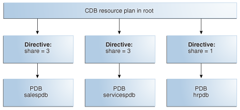
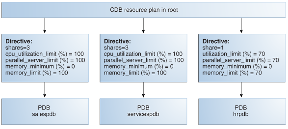
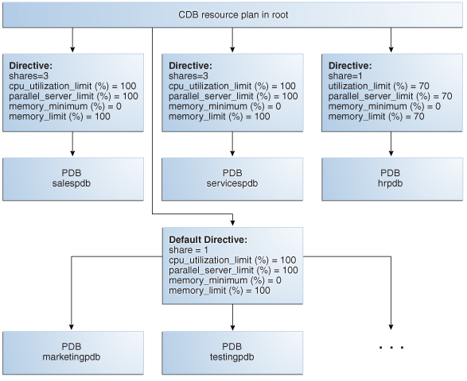
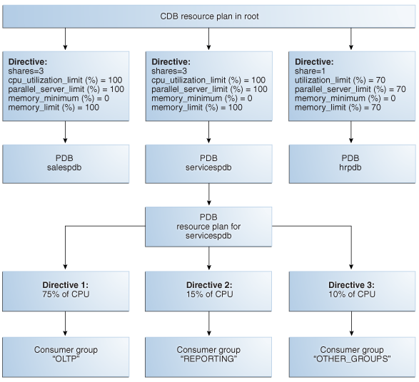

You can use the Oracle Database Resource Manager (Resource Manager) features in EM Express to manage database resources efficiently.

This chapter assumes that you are familiar with resource plan concepts and terminology. It focuses on how to manage resource plans using EM Express.

You can use EM Express to create and manage resource plans for non-multitenant container databases (non-CDBs), CDBs, and pluggable databases (PDBs).

This chapter contains the following sections:

- About Resource Management

- Managing Plans

- Managing Multiple Database Instances on a Single Server

- Managing Database Resources: Oracle by Example Series

**See Also:**

If you are not familiar with resource plan concepts and terminology, read the following information in addition to reading this chapter:

- [Oracle Database Administrator’s Guide](../admin/managing-resources-with-oracle-database-resource-manager.md) for information on using Resource Manager for non-CDBs

- [Oracle Multitenant Administrator's Guide](../multi/using-oracle-resource-manager-for-pdbs-with-sql-plus.md) for information on using Resource Manager for CDBs and PDBs

### 12.1 About Resource Management

The Resource Manager features in EM Express enable you to manage multiple workloads within a database that are contending for system and database resources.

From the Resource Management page in EM Express for a non-CDB, CDB, or PDB, you can navigate to the Resource Manager features.

**See Also:**

- "About Resource Manager Solutions for a Non-CDB"

- "About Resource Manager Solutions for a CDB"

- "About Consumer Groups"

- "About Plans"

- "About Directives"

- "About Non-CDB Plans"

- "About Managing CDB and PDB Workloads"

- "Accessing the Resource Management Page"

- [Oracle Database Administrator’s Guide](../admin/managing-resources-with-oracle-database-resource-manager.md) for information on using Resource Manager for non-CDBs

- [Oracle Multitenant Administrator's Guide](../multi/using-oracle-resource-manager-for-pdbs-with-sql-plus.md) for information on using Resource Manager for CDBs and PDBs

#### 12.1.1 About Resource Manager Solutions for a Non-CDB

In a non-CDB, when database resource allocation decisions are left to the operating system, you may encounter problems with workload management.

These problems can include:

- Excessive overhead:

  Excessive overhead results from operating system context switching between Oracle Database server processes when the number of server processes is high.

- Inefficient scheduling

  The operating system deschedules database servers while they hold latches, which is inefficient.

- Inappropriate allocation of resources

  The operating system distributes resources equally among all active processes and cannot prioritize one task over another.

- Inability to manage database-specific resources, such as parallel execution servers and active sessions

  Using Resource Manager helps to overcome these problems by allowing the database more control over how hardware resources are allocated. In an environment with multiple concurrent user sessions that run jobs with differing priorities, all sessions should not be treated equally. The Resource Manager enables you to classify sessions into groups based on session attributes, and to then allocate resources to those groups in a way that optimizes hardware utilization for your application environment.

With the Resource Manager features in EM Express, you can:

- Create resource consumer groups (consumer groups) that collect user sessions together into resource consumer groups (consumer groups) based on their processing needs.

- Set CPU directives that distribute available CPU by allocating shares of CPU to different consumer groups. For example, in a data warehouse, a higher number of shares can be given to ROLAP (relational online analytical processing) applications than to batch jobs.

- Set parallel server directives that limit the degree of parallelism of any operation performed by members of a consumer group.

- Set parallel server directives that manage the order of parallel statements in the parallel statement queue. Parallel statements from a critical application can be enqueued ahead of parallel statements from a low priority group of users.

- Set parallel server directives that limit the number of parallel execution servers that a group of users can use. This ensures that all the available parallel execution servers are not allocated to only one group of users.

- Set runaway query directives that detect when a session or call consumes more than a specified amount of CPU, physical I/O, logical I/O, or elapsed time, and then automatically either terminate the session or call, or switch to a consumer group with a lower resource allocation or a limit on the percentage of CPU that the group can use. A logical I/O, also known as a buffer I/O, refers to reads and writes of buffers in the buffer cache. When a requested buffer is not found in memory, the database performs a physical I/O to copy the buffer from either disk or the flash cache into memory, and then a logical I/O to read the cached buffer.

**See Also:**

- "About Plans"

- "About Non-CDB Plans"

- "About Resource Manager Solutions for a CDB"

#### 12.1.2 About Resource Manager Solutions for a CDB

Resource Manager can provide more efficient use of resources for a CDB.

When resource allocation decisions for a CDB are left to the operating system, you may encounter the following problems with workload management:

- Inappropriate allocation of resources among PDBs

  The operating system distributes resources equally among all active processes and cannot prioritize one task over another. Therefore, one or more PDBs might use an inordinate amount of the system resources, leaving the other PDBs starved for resources.

- Inappropriate allocation of resources within a single PDB

  One or more sessions connected to a single PDB might use an inordinate amount of the system resources, leaving other sessions connected to the same PDB starved for resources.

- Inconsistent performance of PDBs

  A single PDB might perform inconsistently when other PDBs are competing for more system resources or less system resources at various times.

- Lack of resource usage data for PDBs

  Resource usage data is critical for monitoring and tuning PDBs. It might be possible to use operating system monitoring tools to gather the resource usage data for a non-CDB if it is the only database running on the system. However, in a CDB, operating system monitoring tools are no longer as useful because there are multiple PDBs running on the system.

Resource Manager helps to overcome these problems by allowing the CDB more control over how hardware resources are allocated among the PDBs and within PDBs.

In a CDB with multiple PDBs, some PDBs typically are more important than others. The Resource Manager enables you to prioritize and limit the resource usage of specific PDBs.

With the Resource Manager, you can:

- Specify that different PDBs should receive different shares of the system resources so that more resources are allocated to the more important PDBs

- Limit the CPU usage of a particular PDB

- Limit the number of parallel execution servers that a particular PDB can use

- Limit the memory usage of a particular PDB

- Specify the minimum amount of memory required by a particular PDB

- Limit the resource usage of different sessions connected to a single PDB

- Limit the I/O generated by specific PDBs

- Monitor the resource usage of PDBs

**See Also:**

- "About Plans"

- "About Managing CDB and PDB Workloads"

- "About Resource Manager Solutions for a Non-CDB"

#### 12.1.3 About Consumer Groups

A resource consumer group (consumer group) is a collection of user sessions that are grouped together based on their processing needs. When a session is created, it is automatically mapped to a consumer group based on mapping rules that you set up.

Because the Resource Manager allocates resources (such as CPU) to consumer groups, when a session becomes a member of a consumer group, its resource allocation is determined by the allocation for the consumer group.

There are special consumer groups that are always present in the data dictionary. They cannot be modified or deleted. They are:

- `SYS_GROUP`

  This is the initial consumer group for all sessions created by user accounts `SYS` or `SYSTEM`. This initial consumer group can be overridden by session-to–consumer group mapping rules.

- `OTHER_GROUPS`

  This consumer group contains all sessions that have not been assigned to a consumer group. Every resource plan (plan) must contain a directive to `OTHER_GROUPS`.

There can be no more than 28 consumer groups in any active non-CDB plan, and there can be no more than eight consumer groups in any active PDB plan.

**See Also:**

- [Oracle Database Administrator’s Guide](../admin/managing-resources-with-oracle-database-resource-manager.md) for more information about consumer groups.

- "About Resource Management"

- "About Plans"

- "About Directives"

#### 12.1.4 About Plans

A resource plan (plan) is a container for plan directives (directives) that specify how to allocate resources.

In addition to the plans that are predefined for each Oracle database, you can create any number of plans.

You can create plans for non-CDBs, CDBs, and PDBs. However, in a particular non-CDB, CDB, or PDB, only one plan is active at a time. When a plan is active, each of its directives controls resource allocation.

In a non-CDB plan or PDB plan, the directives specify how to allocate resources to consumer groups in the non-CDB or PDB.

In a CDB plan, the directives specify how to allocate resources to the PDBs in the CDB.

**See Also:**

- "About Directives"

- "About Non-CDB Plans"

- "About Managing CDB and PDB Workloads"

- "Creating Plans"

#### 12.1.5 About Directives

Resource plan directives (directives) specify how to allocate resources.

Directives in a non-CDB plan or PDB plan associate a consumer group with the plan and specify how resources are to be allocated to that consumer group. Resources are allocated to consumer groups according to the set of directives that belong to the plan. There is a parent-child relationship between a plan and its directives. Each directive references one consumer group, and no two directives for the plan can reference the same consumer group.

A directive in a non-CDB plan or PDB plan has several ways in which it can limit resource allocation for a consumer group. For example, it can control how much CPU the consumer group gets as a percentage of total CPU.

Resources are allocated to consumer groups according to the set of directives in a non-CDB plan or PDB plan. There is a parent-child relationship between a plan and its directives. Each directive references one consumer group, and no two directives for the same plan can reference the same consumer group.

Directives in a CDB plan specify how to allocate resources to the PDBs in the CDB. In a CDB plan, you can define directives explicitly for none, some, or all of the PDBs in a CDB. Each CDB plan also has a default directive for PDBs. When a CDB plan is the active plan, the default directive is used for any PDB that does not have directives explicitly defined for it.

The following table summarizes how the directives for different types of plans allocate resources:

| Plan Type    | Directives Allocate Resources To |
|:-------------|:---------------------------------|
| Non-CDB plan | Consumer groups                  |
| CDB plan     | PDBs                             |
| PDB plan     | Consumer groups                  |

**See Also:**

- "About Non-CDB Plans"

- "About Managing CDB and PDB Workloads"

#### 12.1.6 About Non-CDB Plans

A non-CDB plan includes directives that specify how to allocate resources to consumer groups in the non-CDB.

A non-CDB plan must include a directive that allocates resources to the consumer group named `OTHER_GROUPS`. `OTHER_GROUPS` applies to all sessions that do not have a mapping to any of the other consumer groups in the plan.

You can use the Quick Setup feature in EM Express to create a new non-CDB plan if your system has 8 or fewer services, users, and programs.

If your system has 9 or more services, users, and programs, you create an empty plan and then add directives to the plan.

**See Also:**

- "About Plans"

- "About Directives"

- "Creating Plans"

- "About Managing CDB and PDB Workloads"

#### 12.1.7 About Managing CDB and PDB Workloads

In a CDB, you can use the Resource Manager features in EM Express to manage multiple workloads within multiple PDBs competing for system and CDB resources.

In a CDB, you can manage resources on two basic levels:

- CDB level: You can manage the workloads for multiple PDBs that are contending for system and CDB resources. You can specify how resources are allocated to PDBs, and you can limit the resource utilization of specific PDBs.

- PDB level: You can manage the workloads within each PDB.

Resource Manager allocates the resources in two steps:

1.  It allocates a portion of the system’s resources to each PDB.

2.  In a specific PDB, it allocates a portion of the system resources allocated in Step 1 to each session connected to the PDB.

**Note:**

All activity in the root is automatically managed by Resource Manager.

**See Also:**

- "About CDB Plans"

- "About PDB Plans"

##### 12.1.7.1 About CDB Plans

In a CDB, PDBs might have different levels of priority. You can create CDB plans to distribute resources to different PDBs in a CDB based on these priorities.

The set of directives in a CDB plan specify how to allocate resources to the PDBs in the CDB.

There is a parent-child relationship between a CDB plan and its directives.

Each directive references a single PDB.

The directives control allocation of the following resources to the PDBs:

- CPU

- Parallel execution servers

- Memory

A directive can control the allocation of resources to PDBs based on the share value that you specify for each PDB. A higher share value results in more resources. For example, you can specify that one PDB is allocated double the resources allocated to a second PDB by setting the share value for the first PDB twice as high as the share value for the second PDB.

You can also specify utilization limits for PDBs The utilization limit limits resource allocation to the PDB. For example, it can control how much CPU a PDB gets as a percentage of the total CPU available to the CDB.

You can use both shares and utilization limits together for precise control over the resources allocated to each PDB in a CDB.

**Note:**

Oracle recommends that you do not use the `parallel_server_limit` directive in a CDB resource plan.

**See Also:**

- "About Managing CDB and PDB Workloads"

- "About Plans"

- "About Directives"

- "Creating Plans"

- "About PDB Plans"

###### 12.1.7.1.1 About Shares for Allocating Resources to PDBs

To allocate resources among PDBs, you assign a share value to each PDB in a CDB plan. A higher share value results in more guaranteed resources for a PDB.

For example, if your CDB has three PDBs, a CDB plan could specify share values for each of those three PDBs, as shown in Figure 12-1:

Figure 12-1 Shares in a CDB Plan

[Description of "Figure 12-1 Shares in a CDB Plan"](img_text/admqs_vm_008.md)

In this example, the total number of shares allocated is seven (3 plus 3 plus 1). The salespdb and the servicespdb PDB are each guaranteed 3/7th of the resources, while the hrpdb PDB is guaranteed 1/7th of the resources. However, any PDB can use more than the guaranteed amount of a resource if there is no resource contention.

If workloads of the PDBs consume all of the system resources, then:

- The salespdb and servicespdb PDBs can consume the same amount of CPU resources. The salespdb and servicespdb PDBs are each guaranteed three times more CPU resource than the hrpdb PDB.

- Queued parallel queries from the salespdb and servicespdb PDBs are selected equally. Queued parallel queries from the salespdb and servicespdb PDBs are selected three times as often as queued parallel queries from the hrpdb PDB.

- The salespdb and servicespdb PDBs can consume the same amount of memory resources. The salespdb and servicespdb PDBs are each guaranteed three times more memory resource than the hrpdb PDB.

**See Also:**

- "About Plans"

- "About CDB Plans"

###### 12.1.7.1.2 About Utilization Limits for PDBs

A utilization limit restrains the system resource usage of a specific PDB. You can specify utilization limits for CPU, parallel execution servers, and memory.

Table 12-1 describes utilization limits for PDBs and the action taken when a PDB reaches a utilization limit.

Table 12-1 Utilization Limits for PDBs

| Resource                   | Resource Utilization Limit                                                                                                                                                                                                                                                                                                                                                                                     | Resource Manager Action                                                                                                                                                                                                                                                                                                                                                                                                                 |
|:---------------------------|:---------------------------------------------------------------------------------------------------------------------------------------------------------------------------------------------------------------------------------------------------------------------------------------------------------------------------------------------------------------------------------------------------------------|:----------------------------------------------------------------------------------------------------------------------------------------------------------------------------------------------------------------------------------------------------------------------------------------------------------------------------------------------------------------------------------------------------------------------------------------|
| CPU                        | The sessions connected to a PDB reach the CPU utilization limit for the PDB. This utilization limit for CPU is set by the `cpu_utilization_limit (%)` directive. The `cpu_utilization_limit (%)` directive specifies the percentage of the system resources that a PDB can use. The value ranges from 0 to 100.                                                                                                | Resource Manager throttles the PDB sessions so that the CPU utilization for the PDB does not exceed the utilization limit.                                                                                                                                                                                                                                                                                                              |
| Parallel execution servers | A PDB uses more than the value of the `PARALLEL_SERVERS_TARGET` initialization parameter multiplied by the value of the `parallel_server_limit (%)` directive. For example, if the `PARALLEL_SERVERS_TARGET` initialization parameter is set to 200 and the `parallel_server_limit (%)` directive for a PDB is set to 10%, then utilization limit for the PDB is 20 parallel execution servers (200 X .10). | Resource Manager queues parallel queries if the number of parallel execution servers used by the PDB would exceed the limit specified by the `PARALLEL_SERVERS_TARGET` initialization parameter value multiplied by the value of the parallel_server_limit parameter.                                                                                                                                                                   |
| Memory                     | The sessions connected to a PDB reach the memory limit for the PDB. This utilization limit for memory is set by the `memory_limit (%)` directive. The `memory_limit (%)` directive specifies the percentage of the buffer cache, shared pool, and program global area (PGA) that the PDB can use that a PDB can use. The value ranges from 0 to 100.                                                        | When the usage for a PDB exceeds the limit for the shared pool, Resource Manager frees the least recently used objects for that PDB before the cached objects of other PDBs, even if those have been in the cache longer. When the usage for a PDB exceeds the limit for the PGA, Resource Manager can interrupt queries or PL/SQL functions or kill sessions associated with any PDB, including PDBs that did not exceed the limit. |

A CDB plan could specify shares and utilization limits for three PDBs, as shown in Figure 12-2.

Figure 12-2 Shares and Utilization Limits in a CDB Plan

[Description of "Figure 12-2 Shares and Utilization Limits in a CDB Plan"](img_text/admqs_vm_009.md)

Figure 12-2 shows that there are no utilization limits on the salespdb and servicespdb PDBs because the `cpu_utilization_limit (%)` and `parallel_server_limit (%)` directives are both set to 100 for them. However, the hrpdb PDB is limited to 70% of the applicable system resources because the `cpu_utilization_limit (%)` and `parallel_server_limit (%)` directives are both set to 70.

**Note:**

Oracle recommends that you do not use the `parallel_server_limit` directive in a CDB resource plan.

**See Also:**

- "About Plans"

- "About CDB Plans"

###### 12.1.7.1.3 About the Default Directive for PDBs

When a CDB plan does not explicitly define a directive for a PDB, the default directive for the CDB plan is used to allocate resources to that PDB.

Table 12-2 shows the attributes of the initial default directive for PDBs.

Table 12-2 Initial Default Directive Attributes for PDBs

| Directive Attribute       | Value |
|:--------------------------|:------|
| shares                    | 1     |
| cpu_utilization_limit (%) | 100   |
| parallel_server_limit (%) | 100   |
| memory_minimum (%)        | 0     |
| memory_limit (%)          | 100   |

When a PDB is added to a CDB and no directive is defined for it, the PDB uses the default directive for PDBs.

You can define a directive for any new PDB.

When a PDB is unplugged from a CDB, the directive for the PDB is retained. If the same PDB is plugged back into the CDB, then it uses the directive defined for it if the directive was not deleted manually.

Figure 12-3 shows an example where the salespdb, servicespdb, and hrpdb PDBs each have a directive defined for them. However, the marketingpdb and testingpdb PDBs do not have a directive defined for them, so the default PDB directive is used for them.

Figure 12-3 Default Directive for a CDB Plan

[Description of "Figure 12-3 Default Directive for a CDB Plan"](img_text/admqs_vm_010b.md)

Figure 12-3 shows that the default PDB directive specifies that the share is 1, the cpu_utilization_limit is 100%, the parallel_server_limit is 100%, and the memory_limit is 100%.

Figure 12-3 also shows the PDBs marketingpdb and testingpdb using the default PDB directive, which means that marketingpdb and testingpdb each get 1 share and three utilization limits of 100%.

You can also change the default PDB directive attribute values, as described in Changing the Default PDB Directive for a CDB Plan. Any PDB added to the CDB after the default PDB directive is changed will use the new attribute values from the default PDB directive unless you define a PDB directive for the PDB.

**Note:**

Oracle recommends that you do not use the `parallel_server_limit` directive in a CDB resource plan.

**See Also:**

- "About Plans"

- "About CDB Plans"

- "Changing the Default PDB Directive for a CDB Plan"

##### 12.1.7.2 About PDB Plans

A CDB plan determines the amount of resources allocated to each PDB. A PDB plan determines how the resources allocated to a specific PDB are allocated to consumer groups within that PDB.

A PDB plan is similar to a plan for a non-CDB. In the same way that a plan for a non-CDB allocates resources among the consumer groups in the non-CDB, a PDB plan allocates resources among the consumer groups in a PDB.

A PDB plan must include a directive that allocates resources to the consumer group named `OTHER_GROUPS`. `OTHER_GROUPS` applies to all sessions that do not have a mapping to any of the other consumer groups in the plan.

When you create one or more PDB plans, the CDB plan for the PDB's CDB should meet certain requirements. Table 12-3 describes the requirements for the CDB plan and the results when the requirements are not met.

When you create one or more PDB plans and there is no CDB plan, the CDB uses the `DEFAULT_CDB_PLAN` that is supplied with Oracle Database.

Table 12-3 CDB Plan Requirements for PDB Plans

| Resource                   | CDB Plan Requirements                                                                                                                                                                                                                                                                                                                                                                                                                                                 | Results When Requirements Are Not Met                                                                                                                                                                 |
|:---------------------------|:----------------------------------------------------------------------------------------------------------------------------------------------------------------------------------------------------------------------------------------------------------------------------------------------------------------------------------------------------------------------------------------------------------------------------------------------------------------------|:------------------------------------------------------------------------------------------------------------------------------------------------------------------------------------------------------|
| CPU                        | One of the following requirements must be met: • A share value must be specified for the PDB using the shares parameter. • A utilization limit for CPU below 100 must be specified for the PDB using the `cpu_utilization_limit (%)` parameter. These values can be set in a directive for the specific PDB or in a default directive.                                                                                                                       | The CPU allocation policy of the PDB plan is not enforced. The CPU limit specified by the `cpu_utilization_limit (%)` parameter in the PDB plan is not enforced.                                   |
| Parallel execution servers | One of the following requirements must be met: • A share value must be specified for the PDB using the shares parameter. • A utilization limit for CPU below 100 must be specified for the PDB using the `cpu_utilization_limit (%)` parameter. • A parallel server limit below 100 must be specified for the PDB using the `parallel_server_limit (%)` parameter. These values can be set in a directive for the specific PDB or in a default directive. | The parallel execution server allocation policy of the PDB plan is not enforced. The parallel server limit specified by the `parallel_server_limit (%)` parameter in the PDB plan is not enforced. |
| Memory                     | One of the following requirements must be met: • A share value must be specified for the PDB using the shares parameter. • A utilization limit for memory below 100 must be specified for the PDB using the `memory_limit (%)` parameter. These values can be set in a directive for the specific PDB or in a default directive.                                                                                                                             | The memory allocation policy of the PDB plan is not enforced. The memory limit specified by the `memory_limit (%)` parameter in the PDB plan is not enforced.                                      |

Figure 12-4 shows an example of a CDB plan and a PDB plan.

Figure 12-4 A CDB Plan and a PDB Plan

[Description of "Figure 12-4 A CDB Plan and a PDB Plan"](img_text/admqs_vm_011.md)

**Note:**

Oracle recommends that you do not use the `parallel_server_limit` directive in a CDB resource plan.

You can use the Quick Setup feature in EM Express to create a new PDB plan if your system has fewer than 8 services, fewer than 8 users, or fewer than 8 programs.

If your system has 8 or more services, 8 or more users, or 8 or more programs, you create an empty plan and then add directives to the plan.

**See Also:**

- "About Managing CDB and PDB Workloads"

- "About Plans"

- "About Directives"

- "About CDB Plans"

- "Creating Plans"

#### 12.1.8 Accessing the Resource Management Page

From the Resource Management page in EM Express, you can navigate to the resource management features that are available in EM Express.

To access the Resource Management page in EM Express:

1.  Log into EM Express for the database that you want to manage.
2.  On any page in EM Express, choose Resource Management from the Configuration menu.
    The Resource Management page appears.

The content of the Resource Management page is specific to the type of database (non-CDB, CDB, or PDB) and whether a plan is active for the database or not. See the following tables for more information:

- Table 12-4 shows the contents of the Resource Management page for a non-CDB when no plan is active.

- Table 12-5 shows the contents of the Resource Management page for a non-CDB when a plan is active.

- Table 12-6 shows the contents of the Resource Management page for the root of a CDB when no plan is active.

- Table 12-7 shows the contents of the Resource Management page for the root of a CDB when a plan is active.

- Table 12-8 shows the contents of the Resource Management page for a PDB when no plan is active.

- Table 12-9 shows the contents of the Resource Management page for a PDB when a plan is active.

**Note:**

The data on Resource Manager dashboard charts on the Resource Management page comes from Automatic Workload Repository (AWR). If no AWR data has been collected when you access the Resource Management page, the charts do not display any data, and the informational message “No AWR Data Available” is displayed.

By default, AWR data is collected on a 1 hour interval, so it becomes available one hour after the database is started for the first time.

Table 12-4 shows the content of the Resource Management page for a non-CDB when no plan is active:

Table 12-4 Resource Management Page for a Non-CDB When No Plan is Active

| Item                                      | Description                                                                                                                                                                                                                                                                                                                                                         |
|:------------------------------------------|:--------------------------------------------------------------------------------------------------------------------------------------------------------------------------------------------------------------------------------------------------------------------------------------------------------------------------------------------------------------------|
| General section                           | Provides general information about the database.                                                                                                                                                                                                                                                                                                                    |
| Host CPU chart                            | This chart shows the amount of CPU used on this host by the database instance and by other host processes. For an Oracle RAC database, the chart shows the cumulative CPU used by all database instances. Use this chart for guidance on setting a limit for instance caging. For an Oracle RAC database, instance caging can also be enabled for all instances. |
| CPU Activity by Services chart            | This chart shows the amount of CPU used on this host by the database instance and by other host processes. For an Oracle RAC database, the chart shows the cumulative CPU used by all database instances. Use this chart for guidance on setting a limit for instance caging. For an Oracle RAC database, instance caging can also be enabled for all instances. |
| SQL Execution Statistics chart            | This chart shows the amount of CPU used on this host by the database instance and by other host processes. For an Oracle RAC database, the chart shows the cumulative CPU used by all database instances. Use this chart for guidance on setting a limit for instance caging. For an Oracle RAC database, instance caging can also be enabled for all instances. |
| Parallel and Serial Active Sessions chart | This chart shows the amount of CPU used on this host by the database instance and by other host processes. For an Oracle RAC database, the chart shows the cumulative CPU used by all database instances. Use this chart for guidance on setting a limit for instance caging. For an Oracle RAC database, instance caging can also be enabled for all instances. |
| Parallel Operations Downgraded chart      | This chart shows the amount of CPU used on this host by the database instance and by other host processes. For an Oracle RAC database, the chart shows the cumulative CPU used by all database instances. Use this chart for guidance on setting a limit for instance caging. For an Oracle RAC database, instance caging can also be enabled for all instances. |

Table 12-5 shows the content of the Resource Management page for a non-CDB when a plan is active:

Table 12-5 Resource Management page for a Non-CDB When a Plan is Active

| Item                       | Description                                                                                                                                                                                                                                                                                                                                                                                                                                                                                                                                                                             |
|:---------------------------|:----------------------------------------------------------------------------------------------------------------------------------------------------------------------------------------------------------------------------------------------------------------------------------------------------------------------------------------------------------------------------------------------------------------------------------------------------------------------------------------------------------------------------------------------------------------------------------------|
| General section            | Provides general information about the database and the resource plan.                                                                                                                                                                                                                                                                                                                                                                                                                                                                                                                  |
| Host CPU chart             | This chart shows the amount of CPU used on this host by the database instance and by other host processes. For an Oracle RAC database, the chart shows the cumulative CPU used by all database instances. Use this chart for guidance on setting a limit for instance caging. For an Oracle RAC database, instance caging can also be enabled for all instances.                                                                                                                                                                                                                     |
| CPU Utilization chart      | This chart shows the amount of CPU used by the top consumer groups in the currently active resource manager plan. Use this chart to determine if CPU resource limits for the consumer groups are effective.                                                                                                                                                                                                                                                                                                                                                                          |
| Waiting Sessions chart     | This chart shows the number of waiting sessions for the top consumer groups in the currently active resource manager plan. Use this chart to determine if the resource limits set for the consumer groups are adequate or if they are causing sessions to be in the waiting state.                                                                                                                                                                                                                                                                                                   |
| SQL Executions region      | This region shows the following two charts: • Runaway Query Violations: • This chart shows the number of violations caused by runaway queries per consumer group in the currently active resource manager plan. • This can provide guidance while setting directives for runaway queries. • SQL Execution Statistics: • This chart shows the maximum values of certain SQL execution statistics for which runaway query directives can be set in a resource manager plan. • You can use these values to obtain guidance while setting directives for runaway queries. |
| Parallel Executions region | These two charts show the number of parallel servers and parallel SQL statements that were queued by Database Resource Manager for the top consumer groups. You can use these charts to determine if the parallel server directives in a resource manager plan are effective.                                                                                                                                                                                                                                                                                                        |

Table 12-6 shows the content of the Resource Management page for the root of a CDB when no plan is active:

Table 12-6 Resource Management Page for the Root of a CDB When No Plan is Active

| Item                                 | Description                                                                                                                                                                                                                                                                                                                                                         |
|:-------------------------------------|:--------------------------------------------------------------------------------------------------------------------------------------------------------------------------------------------------------------------------------------------------------------------------------------------------------------------------------------------------------------------|
| General section                      | Provides general information about the database.                                                                                                                                                                                                                                                                                                                    |
| Host CPU chart                       | This chart shows the amount of CPU used on this host by the database instance and by other host processes. For an Oracle RAC database, the chart shows the cumulative CPU used by all database instances. Use this chart for guidance on setting a limit for instance caging. For an Oracle RAC database, instance caging can also be enabled for all instances. |
| CPU Utilization by PDBs chart        | This chart shows the amount of CPU used by the top PDBs. Use this chart to determine the appropriate CPU resource limits for the PDBs in a resource manager plan.                                                                                                                                                                                                |
| Memory chart                         | Use this chart to determine the top PDBs that consume the most memory. Use this chart to determine the memory limits for the PDBs.                                                                                                                                                                                                                               |
| Active Parallel Servers chart        | Use this chart with the Parallel Operations Downgraded chart to set parallel server directives for the PDBs in a resource manager plan.                                                                                                                                                                                                                             |
| Parallel Operations Downgraded chart | This chart shows the number of parallel operations downgraded or serialized. Use this chart with the Active Parallel Servers chart to set parallel server directives for the PDBs in a resource manager plan.                                                                                                                                                       |

Table 12-7 shows the content of the Resource Management page for the root of a CDB when a plan is active:

Table 12-7 Resource Management Page for the Root of a CDB When a Plan is Active

| Item                       | Description                                                                                                                                                                                                                                                                                                                                                                                                                                                                                                                                                                                    |
|:---------------------------|:-----------------------------------------------------------------------------------------------------------------------------------------------------------------------------------------------------------------------------------------------------------------------------------------------------------------------------------------------------------------------------------------------------------------------------------------------------------------------------------------------------------------------------------------------------------------------------------------------|
| General section            | Provides general information about the database and the resource plan.                                                                                                                                                                                                                                                                                                                                                                                                                                                                                                                         |
| Host CPU chart             | This chart shows the amount of CPU used on this host by the database instance and by other host processes. For an Oracle RAC database, the chart shows the cumulative CPU used by all database instances. Use this chart for guidance on setting a limit for instance caging. For an Oracle RAC database, instance caging can also be enabled for all instances.                                                                                                                                                                                                                            |
| CPU Utilization chart      | This chart shows the amount of CPU used by the top PDBs in the currently active resource manager plan. Use this chart to determine if CPU resource limits for the PDBs are effective.                                                                                                                                                                                                                                                                                                                                                                                                       |
| Memory Used chart          | Use this chart to determine the top PDBs that consume the most memory in the currently active resource manager plan.                                                                                                                                                                                                                                                                                                                                                                                                                                                                           |
| SQL Executions region      | This region shows the following two charts: • Runaway Query Violations: • This chart shows the number of violations caused by runaway queries per PDB in the currently active resource manager plan. • This can provide guidance while setting directives for runaway queries inside a PDB. • SQL Execution Statistics: • This chart shows the maximum values of certain SQL execution statistics for which runaway query directives can be set in a resource manager plan. • Use these values to obtain guidance while setting directives for runaway queries inside a PDB. |
| Parallel Executions region | These two charts show the number of parallel servers and parallel SQL statements that were queued by Database Resource Manager for the top PDBs. Use these charts to determine if the parallel server directives in a resource manager plan are effective.                                                                                                                                                                                                                                                                                                                                  |

Table 12-8 shows the Resource Management page for a PDB when no plan is active:

Table 12-8 Resource Management Page for a PDB When No Plan is Active

| Item                                      | Description                                                                                                                                                                                                                                          |
|:------------------------------------------|:-----------------------------------------------------------------------------------------------------------------------------------------------------------------------------------------------------------------------------------------------------|
| General section                           | Provides general information about the database.                                                                                                                                                                                                     |
| CPU Activity by Services chart            | This chart shows CPU utilization for the top database services running on this instance. If a consumer group is created by mapping it to a database service, this chart gives guidance on how to set CPU resource limits for that consumer group. |
| SQL Execution Statistics chart            | This chart shows the maximum values of certain SQL execution statistics for which runaway query directives can be set in a resource manager plan. These values can be used to obtain guidance while setting directives for runaway queries.       |
| Memory chart                              | Use this chart to determine the top consumer groups that consume the most memory in the currently active plan.                                                                                                                                       |
| Parallel and Serial Active Sessions chart | Use this chart with the Parallel Operations Downgraded chart to set parallel server directives in a resource manager plan.                                                                                                                           |
| Parallel Operations Downgraded chart      | This chart shows the number of parallel operations downgraded or serialized. Use this chart with the Active Parallel Servers chart to set parallel server directives in a resource manager plan.                                                     |

Table 12-9 shows the Resource Management page for a PDB when a plan is active:

Table 12-9 Resource Management Page for a PDB When a Plan is Active

| Item                           | Description                                                                                                                                                                                                                                                                           |
|:-------------------------------|:--------------------------------------------------------------------------------------------------------------------------------------------------------------------------------------------------------------------------------------------------------------------------------------|
| General section                | Provides general information about the database and the resource plan.                                                                                                                                                                                                                |
| CPU Utilization chart          | This chart shows the amount of CPU used by the top consumer groups in the currently active resource manager plan. Use this chart to determine if CPU resource limits for the consumer groups are effective.                                                                        |
| Waiting Sessions chart         | This chart shows the number of waiting sessions for the top consumer groups in the currently active resource manager plan. Use this chart to determine if the resource limits set for the consumer groups are adequate or if they are causing sessions to be in the waiting state. |
| SQL Executions chart           | This chart shows the maximum values of certain SQL execution statistics for which runaway query directives can be set in a resource manager plan. These values can be used to obtain guidance while setting directives for runaway queries.                                        |
| Runaway Query Violations chart | This chart shows the number of violations caused by runaway queries per consumer group in the currently active resource manager plan. This can provide guidance while setting directives for runaway queries.                                                                      |
| Parallel Executions region     | These two charts show the number of parallel servers and parallel SQL statements that were queued by Database Resource Manager for the top consumer groups. Use these charts to determine if the parallel server directives in a resource manager plan are effective.              |

**See Also:**

- "Setting a Plan as the Currently Active Plan"

- "Setting Instance Caging"

- "Viewing All the Plans"

- "Managing Plans"

### 12.2 Managing Plans

This section provides information about managing resource plans (plans) using EM Express.

It includes the following topics:

- "Creating Plans"

- "Viewing Plans"

- "Modifying a Plan"

#### 12.2.1 Creating Plans

You can create resource plans (plans) using the EM Express. Plans are created on the Resource Management: All Plans page.

You can use Quick Setup to create a new PDB plan if your system has fewer than 8 services, fewer than 8 users, or fewer than 8 programs.

If your system has 8 or more services, 8 or more users, or 8 or more programs, you create an empty plan and then add directives to the plan.

**Note:**

- "Creating a New Plan using Quick Setup"

- "Creating a New Plan"

- "Managing Plans"

##### 12.2.1.1 Creating a New Plan using Quick Setup

You can use the Quick Setup feature in EM Express to create a new resource plan for a non-CDB or PDB if your system has fewer than 8 services, fewer than 8 users, or fewer than 8 programs.

If your system has 8 or more services, 8 or more users, or 8 or more programs, you can create a new resource plan for a non-CDB or PDB using the Create feature on the Resource Management: All Plans page and then add directives to the plan. See "Creating a New Plan" for more information.

To create a new resource plan using Quick Setup:

1.  Go to the Resource Management: All Plans page.
    See "Viewing All the Plans" for more information.
2.  Click Quick Setup.
    The Quick Setup wizard appears, with the Resource Plan tab active.
3.  On the Resource Plan tab, choose values for the fields on the tab:
    | Field           | Description                                                                                                                                                                                                                                                                                                                                                                                                                                                                                                                                                                                                                                                                                                  |
    |:----------------|:-------------------------------------------------------------------------------------------------------------------------------------------------------------------------------------------------------------------------------------------------------------------------------------------------------------------------------------------------------------------------------------------------------------------------------------------------------------------------------------------------------------------------------------------------------------------------------------------------------------------------------------------------------------------------------------------------------------|
    | Plan Name       | Enter the name you want to use for the new plan.                                                                                                                                                                                                                                                                                                                                                                                                                                                                                                                                                                                                                                                             |
    | Comment         | Optionally, enter a comment for the new plan.                                                                                                                                                                                                                                                                                                                                                                                                                                                                                                                                                                                                                                                                |
    | Attribute       | Choose the attribute you want to use to create the consumer groups for the plan. The choices are: • Service • User • Program Quick Setup can create a maximum of 7 consumer groups, and by default it does a 1–to-1 service/user/program to consumer group mapping. You can optionally group multiple services/users/programs into one consumer group. If there are more than 7 services, users, or programs, then Quick Setup is disabled for that attribute. For example, if there are fewer than 7 services, then the Service attribute is available for selection, but if there are more than 7 users and programs, then the User and Program attributes are not available for selection. |
    | CPU             | Choose this option if you want to specify CPU directives for the plan.                                                                                                                                                                                                                                                                                                                                                                                                                                                                                                                                                                                                                                       |
    | Parallel Server | Choose this option if you want to specify parallel server directives for the plan.                                                                                                                                                                                                                                                                                                                                                                                                                                                                                                                                                                                                                           |
    | Runaway Query   | Choose this option if you want to specify runaway query directives for the plan.                                                                                                                                                                                                                                                                                                                                                                                                                                                                                                                                                                                                                             |
4.  Click the right arrow button.
    The Consumer Group Mapping tab of the Quick Setup wizard appears.
5.  Select the services into the corresponding consumer group.
    By default, the consumer group names that Quick Setup assigns on the Consumer Group Mapping tab use the naming scheme CG\_service, CG\_user, or CG\_program. You can specify a different name for a consumer group. Also, you can optionally group multiple services/users/programs into one consumer group.
6.  Click the right arrow button.
    The Resource Allocation tab of the Quick Setup wizard appears. On this tab you set the resource directives for the plan.

    The content of this tab depends on which of the directives (CPU, Parallel Server, and Runaway Query) you selected on the first tab (Resource Plan tab) of the Quick Setup wizard.

    The Shares column appears if you selected CPU directives. In the Shares column for each consumer group, enter the appropriate number of shares for that consumer group.

    The Parallel Server Limit (%) column appears if you selected parallel server directives. In the Parallel Server Limit (%) column for each consumer group, specify a value that limits the number of parallel execution servers that can be used by the consumer group.

    The runaway query metrics list and the Action column appear if you selected runaway query directives. By default, the Elapsed Time Limit (s) metric is selected in the runaway query metrics list, but you can select any of the metrics in the list. For each consumer group, set a maximum value for the selected metric and in the Action column, specify the action that is to be taken (either Cancel SQL or Kill Session) if any single call exceeds the limit set for the metric.
7.  Click OK.
    A confirmation message tells you that the plan was successfully created. When you click OK in the confirmation message, the new plan appears in the list of plans on the Resource Management: All Plans page.

**See Also:**

"Creating a New Plan"

##### 12.2.1.2 Creating a New Plan

You can use EM Express to create a new resource plan (plan).

You can use the Quick Setup feature in EM Express to create a new plan for a non-CDB or a PDB if your system has 8 or fewer services, users, and programs. See "Creating a New Plan using Quick Setup" for more information.

If your system has 9 or more services, users, and programs or if you are creating a plan for a CDB, follow these steps to create the new plan:

1.  Go to the Resource Management: All Plans page.
    See "Viewing All the Plans" for more information.
2.  Click Create.
    The Create Resource Plan dialog box appears.
3.  In the Create Resource Plan dialog box for a non-CDB and PDB, enter a plan name and optionally a comment about the plan, and then click OK.
    In the Create Resource Plan dialog box for a CDB, enter a plan name and optionally a comment about the plan. In the Default PDB Directive section, you can optionally change the values in these fields:

    - Shares: The value in this field is the number of shares that will be allocated to any PDB for which the shares directive attribute is not explicitly assigned. See "About Shares for Allocating Resources to PDBs" for more information about the shares directive attribute.

    - CPU Utilization Limit (%): The value in this field is the maximum percentage of CPU usage allowed for any PDB for which the `cpu_utilization_limit (%)` directive attribute is not explicitly assigned. See "About Utilization Limits for PDBs" for more information about the `cpu_utilization_limit (%)` directive attribute.

    - Parallel Server Limit (%): The value in this field is the maximum percentage of parallel servers allowed for any PDB for which the `parallel_server_limit (%)` directive attribute is not explicitly assigned. See "About Utilization Limits for PDBs" for more information about the `parallel_server_limit (%)` directive attribute.

    - Memory Minimum (%): The value in this field is the minimum percentage of memory allowed for any PDB for which the memory_minimum (%) directive attribute is not explicitly assigned. See "About the Default Directive for PDBs" for more information about the `memory_minimum (%)` directive attribute.

    - Memory Limit (%): The value in this field is the maximum percentage of memory allowed for any PDB for which the `memory_limit (%)` directive attribute is not explicitly assigned. See "About Utilization Limits for PDBs" for more information about the `memory_limit (%)` directive attribute.

    Click OK when you have specified the desired value for each field in the Create Resource Plan dialog box for the CDB.
4.  In the confirmation message that tells you that the plan was successfully created, click OK.
    The new plan appears in the list of plans on the Resource Management: All Plans page.
5.  On the Resource Management: All Plans page, click the name of the new plan.
    The Resource Plan page for the new plan appears.

    For a non-CDB and PDB, the new plan includes only the `OTHER_GROUPS` consumer group. You probably will need to modify the plan to make it useful for managing resources for your system, for example, by adding other consumer groups to the plan..

    For a CDB, the new plan includes the containers (PDBs) for which the plan allocates resources.
6.  For a non-CDB and PDB, use the Actions menu on the page to modify the plan, by performing actions such as:
    - Creating a new consumer group

    - Adding an existing consumer group

    - Setting mapping rules

    - Setting mapping rule priorities

    - Setting directives

    For a CDB, you can optionally select one of the PDBs and then click Set Resource Directives to change the directive attributes defined for that PDB.

**See Also:**

- "Creating a New Plan using Quick Setup"

- "Modifying a Plan"

- "About the Default Directive for PDBs"

#### 12.2.2 Viewing Plans

You can use EM Express to view all the resource plans (plans) for a database, or to view a single plan for a database.

**See Also:**

- "Viewing All the Plans"

- "Viewing a Plan"

- "Managing Plans"

##### 12.2.2.1 Viewing All the Plans

You can use EM Express to view all the resource plans (plans) for a database.

To view all the resource plans for a database:

1.  Go to the Resource Management page in EM Express.
    See "Accessing the Resource Management Page" for more information.
2.  On the Resource Management page, click Show All Plans.
    The Resource Management: All Plans page appears. It lists all the plans that are created for the database.

**See Also:**

- "Viewing a Plan"

- "Managing Plans"

##### 12.2.2.2 Viewing a Plan

You can use EM Express to view a resource plan (plan).

To view or modify a plan for a database:

1.  Go to the Resource Management page in EM Express.
    See "Accessing the Resource Management Page" for more information.
2.  On the Resource Management page, click Show All Plans.
    The Resource Management: All Plans page appears. It lists all the plans that are created for the database.
3.  In the Name column, click the name of the plan that you are interesting in viewing or modifying.
    The Resource Plan page for the plan appears.

    For a non-CDB plan and a PDB plan, the Resource Plan page displays the top consumer groups for the plan.

    For a CDB plan, the Resource Plan page displays the top containers (PDBs) for the plan.

**See Also:**

- "Viewing All the Plans"

- "Managing Plans"

#### 12.2.3 Modifying a Plan

You can use EM Express to modify a resource plan (plan).

The following topics provide more information about different ways that you can modify a plan:

- "Adding a New Consumer Group to a Plan"

- "Adding an Existing Consumer Group to a Plan"

- "Removing a Consumer Group from a Plan"

- "Setting a Comment for a Consumer Group in a Plan"

- "Setting Mapping Rules for a Consumer Group"

- "Setting Mapping Rule Priorities for Consumer Groups"

- "Setting CPU Directives for a Consumer Group in a Plan"

- "Setting Parallel Server Directives for a Consumer Group in a Plan"

- "Setting Runaway Query Directives for a Consumer Group in a Plan"

- "Setting Session Directives for a Consumer Group in a Plan"

- "Setting a Plan as the Currently Active Plan"

- "Changing the Default PDB Directive for a CDB Plan"

- "Changing Directives for a PDB in a CDB Plan"

- "Setting a Comment for a PDB Directive in a CDB Plan"

- "Deleting a Plan"

**See Also:**

- "Creating Plans"

- "Viewing Plans"

##### 12.2.3.1 Adding a New Consumer Group to a Plan

You can use EM Express to add a new consumer group to a non-CDB plan or PDB plan.

To add a new consumer group to a non-CDB plan or PDB plan:

1.  Go to the Resource Plan page for the plan.
    See "Viewing a Plan" for more information about accessing the Resource Plan page for a plan.
2.  Choose Create from the Actions menu.
    The Create Consumer Group dialog box appears.
3.  In the Create Consumer Group dialog box, enter a new consumer group name and optionally a comment about the consumer group. Click OK.
    The new consumer group name appears in the Top Consumer Groups section of the Resource Plan page.
4.  Repeat these steps to add each new consumer group to a non-CDB plan or PDB plan.

**See Also:**

- "Adding an Existing Consumer Group to a Plan"

- "Removing a Consumer Group from a Plan"

##### 12.2.3.2 Adding an Existing Consumer Group to a Plan

You can use EM Express to add an existing consumer group to a non-CDB plan or PDB plan.

To add a new consumer group to a resource plan:

1.  Go to the Resource Plan page for the non-CDB plan or PDB plan.
    See "Viewing a Plan" for more information about accessing the Resource Plan page for a plan.
2.  Choose Add from the Actions menu.
    The Add Consumer Group dialog box appears.
3.  In the Add Consumer Group dialog box, select an existing consumer group. Click OK.
    The consumer group name appears in the Top Consumer Groups section of the Resource Plan page.
4.  Repeat these steps for each existing consumer group you add to a non-CDB plan or PDB plan.

**See Also:**

- "Adding a New Consumer Group to a Plan"

- "Removing a Consumer Group from a Plan"

##### 12.2.3.3 Removing a Consumer Group from a Plan

You can use EM Express to remove a consumer group from a non-CDB plan or a PDB plan.

To remove a consumer group from a non-CDB plan or a PDB plan:

1.  Go to the Resource Plan page for the plan.
    See "Viewing a Plan" for more information about accessing the Resource Plan page for a plan.
2.  In the Top Consumer Groups section, select the consumer group that you want to remove from the plan. Then choose Remove from the Actions menu.
    The Remove Consumer Group dialog box appears.
3.  The Remove Consumer Group dialog box asks you to confirm that you want to remove the selected consumer group from the current plan. It also tells you how many other plans are using the consumer group, and asks you whether you want to remove the consumer group from all the plans that use it.
    Click OK to remove the consumer group from the current plan only.

    To remove the consumer group from all the plans that use it, enable the Delete this consumer group completely. It is currently used in n other plan(s) option, and then click OK.

    If the consumer group is mandatory in this plan, it cannot be removed. If the consumer group is not mandatory in this plan but is mandatory in other plans, it cannot be deleted, but can only be removed from this plan.

    After you click OK, the selected consumer group no longer appears in the Top Consumer Groups section for the non-CDB plan or PDB plan.

    If you also chose to remove the consumer group from all the plans that were using it, it is removed from all of those plans and deleted.
4.  Repeat these steps for each consumer group you remove from a non-CDB plan or a PDB plan.

**See Also:**

- "Adding a New Consumer Group to a Plan"

- "Adding an Existing Consumer Group to a Plan"

##### 12.2.3.4 Setting a Comment for a Consumer Group in a Plan

You can use EM Express to set a comment for a consumer group in a non-CDB plan or PDB plan.

To set a comment for a consumer group in a non-CDB plan or PDB plan:

1.  Go to the Resource Plan page for the plan that includes the consumer group that you want to set a comment for.
    See "Viewing a Plan" for information on accessing the Resource Plan page for a plan.
2.  In the Top Consumer Groups section of the Resource Plan page for the plan, select the consumer group that you would like to set a comment for. Then, from the Actions menu, choose Set Comment.
    The Set Comment dialog box appears.
3.  In the Comment field, enter the comment that you want to set for the consumer group. Then click OK.
    The Confirmation dialog box appears, with a message confirming that you successfully set the comment for the selected consumer group. When you click OK in the Confirmation dialog box, the Resource Plan page is updated and the Comment column for the consumer group now displays the comment that you set.

**See Also:**

- "Managing Plans"

- "About Consumer Groups"

##### 12.2.3.5 Setting Mapping Rules for a Consumer Group

You can use EM Express to set mapping rules for a consumer group.

The mapping rules are based on session attributes such as the user name, the service that the session used to connect to the database, or the name of the client program.

To set mapping rules for a consumer group:

1.  Go to the Resource Plan page for a plan that includes the consumer group that you want to set mapping rules for.
    See "Viewing a Plan" for information on accessing the Resource Plan page for a plan.
2.  In the Top Consumer Groups section of the Resource Plan page for the plan, select the consumer group that you would like to set mapping rules for. Then, from the Actions menu, choose Set Mapping Rules.
    The Set Mapping Rules dialog box appears. It displays any existing mapping rules for the consumer group.
3.  You use the Set Mapping Rules dialog box to add a mapping rule, remove a mapping rule, or modify a mapping rule.
    - To add a mapping rule:

      1.  In the Set Mapping Rules dialog box, click the green plus sign (+) icon.

          The Select Mapping Rule dialog box appears.

      2.  In the Attribute field, choose the attribute you want to use for this mapping rule.

      3.  Use the left and right arrow buttons to move the values that you want to use in the mapping rule from the Available Value list to the Selected Value list.

          When certain attributes are chosen in the previous step, you also have the option of entering one or more values that you want to use in the mapping rule in the Additional Values column. If you enter multiple values in the Additional Values column, use a comma to separate the values. Note that any values that you enter in the Additional Values field are not moved to the Selected Value list.

          When you have selected all the values you want to use for the mapping rule, click OK.

      4.  The Set Mapping Rules dialog box appears, and it displays the new mapping rule that you created. The mapping rule includes the values that you entered in the Available Value list, as well as any values you specified in the Additional Values field in the Select Mapping Rule dialog box.

      5.  Click OK in the Set Mapping Rules dialog box to save the mapping rule that you added to the consumer group.

    - To remove a mapping rule:

      1.  In the Set Mapping Rules dialog box, select the mapping rule that you want to remove.

      2.  Click the red X icon.

          The mapping rule is immediately deleted from the Set Mapping Rules dialog box.

      3.  Click OK in the Set Mapping Rules dialog box to confirm the deletion of the mapping rule from the consumer group.

    - To modify a mapping rule:

      1.  In the Set Mapping Rules dialog box, select the mapping rule that you want to modify.

      2.  Click the yellow pencil icon.

          The Select Mapping Rule dialog box appears.

      3.  Use the left and right arrow buttons to move the values that you want to use in the mapping rule from the Available Value list to the Selected Value list.

          For mapping rules for certain attributes, you also have the option of entering one or more values that you want to use in the mapping rule in the Additional Values column. If you enter multiple values in the Additional Values column, use a comma to separate the values. Note that any values that you enter in the Additional Values field are not moved to the Selected Value list.

          When you have selected all the values you want to use for the mapping rule, click OK.

      4.  The Set Mapping Rules dialog box appears, and it displays the mapping rule that you modified. The mapping rule includes the values that you entered in the Available Value list, as well as any values you specified in the Additional Values field in the Select Mapping Rule dialog box.

      5.  Click OK in the Set Mapping Rules dialog box to save the mapping rule that you modified for the consumer group.

**See Also:**

- [Oracle Database Administrator’s Guide](../admin/managing-resources-with-oracle-database-resource-manager.md) for more information about mapping rules.

- "Managing Plans"

##### 12.2.3.6 Setting Mapping Rule Priorities for Consumer Groups

You can use EM Express to set mapping rule priorities for consumer groups.

To resolve conflicting mapping rules, you can establish a priority ordering of the session attributes from most important to least important.

To set mapping rule priorities for consumer groups:

1.  Go to the Resource Plan page for a non-CDB plan or PDB plan.
    See "Viewing a Plan" for information on accessing the Resource Plan page for a plan.
2.  In the Top Consumer Groups section of the Resource Plan page, from the Actions menu, choose Set Mapping Rule Priorities.
    The Set Mapping Rule Priorities dialog box appears. It lists the attributes for the consumer group mapping rules.

    The attributes are listed in order from most important (priority 1) to least important. The first attribute listed is prioritized as the most important, and the last attribute listed is prioritized as the least important.
3.  In the Set Mapping Rules priority dialog box, select an attribute and move it up in the list to increase its priority, or move it down in the list to decrease its priority.
4.  After all the attributes are listed in the priority order that you want, click OK.
    A confirmation dialog box advises you that the mapping rule priorities have been successfully set.
5.  The next time you view the mapping rule priorities for consumer groups, the Set Mapping Rule Priorities dialog box lists the attributes for the mapping rules in the priority order that you specified.

**See Also:**

- [Oracle Database Administrator’s Guide](../admin/managing-resources-with-oracle-database-resource-manager.md)

- "Managing Plans"

##### 12.2.3.7 Setting CPU Directives for a Consumer Group in a Plan

You can use EM Express to set CPU directives for a consumer group in a non-CDB plan or PDB plan.

To set CPU directives for a consumer group in a non-CDB plan or PDB plan:

1.  Go to the Resource Plan page for the non-CDB plan or PDB plan that includes the consumer group that you want to set CPU directives for.
    See "Viewing a Plan" for information on accessing the Resource Plan page for a plan.
2.  In the Top Consumer Groups section of the Resource Plan page for the plan, select the consumer group that you would like to set CPU directives for. Then, from the Actions menu, choose Set CPU Directives.
    The Set CPU Directives dialog box appears.
3.  In the Set CPU Directives dialog box, enter values for these fields:
    - Shares: The number of shares you enter corresponds to the ratio of CPU that you want to give to this consumer group.

    - Limit (%): The value in this field imposes an absolute upper limit on CPU utilization for this consumer group. This absolute limit overrides any redistribution of CPU within a plan. If not set, there is no limit on the amount of CPU that the consumer group can use.
4.  Click OK.
    A confirmation box tells you that you have successfully set CPU directives for the consumer group.

**See Also:**

"Managing Plans"

##### 12.2.3.8 Setting Parallel Server Directives for a Consumer Group in a Plan

You can use EM Express to set parallel server directives for a consumer group in a non-CDB plan or PDB plan.

To set parallel server directives for a consumer group in a non-CDB plan or PDB plan:

1.  Go to the Resource Plan page for the non-CDB plan or PDB plan that includes the consumer group that you want to set parallel server directives for.
    See "Viewing a Plan" for information on accessing the Resource Plan page for a plan.
2.  In the Top Consumer Groups section of the Resource Plan page for the plan, select the consumer group that you would like to set CPU directives for. Then, from the Actions menu, choose Set Parallel Server Directives.
    The Set Parallel Server Directives dialog box appears.
3.  In the Set Parallel Server Directives dialog box, enter values for these fields:
    - Parallel Server Limit (%): The value you enter limits the number of parallel execution servers that can be used by sessions in this consumer group.

    - Max Degree of Parallelism: The value you enter limits the maximum degree of parallelism for any operation by sessions within this consumer group.

    - Parallel Statement Queue Timeout (s): The value you enter specifies the maximum number of seconds that a parallel statement can wait in the parallel statement queue before it is timed out for sessions in this consumer group.

    - Bypass Queue: When you enable this option, parallel statements from sessions in this consumer group will bypass the parallel queue and be executed immediately.
4.  Click OK.
    A confirmation box tells you that you have successfully set parallel server directives for the consumer group.

**See Also:**

"Managing Plans"

##### 12.2.3.9 Setting Runaway Query Directives for a Consumer Group in a Plan

You can use EM Express to set runaway query directives for a consumer group in a non-CDB plan or PDB plan.

To set parallel server directives for a consumer group in a non-CDB plan or PDB plan:

1.  Go to the Resource Plan page for the non-CDB plan or PDB plan that includes the consumer group that you want to set runaway query directives for.
    See "Viewing a Plan" for information on going to the Resource Plan page for a plan.
2.  In the Top Consumer Groups section of the Resource Plan page for the plan, select the consumer group that you would like to set runaway query directives for. Then, from the Actions menu, choose Set Runaway Query Directives.
    The Set Runaway Query Directives dialog box appears.
3.  In the Set Runaway Query Directives dialog box, enter values for these fields:
    - Elapsed Time Limit (s): The value you enter specifies the maximum amount of elapsed time that a session or call from this consumer group can take before Resource Manager takes an action.

    - CPU Time Limit (s): The value you enter specifies the maximum amount of CPU time that a session or call from this consumer group can take before Resource Manager takes an action.

    - I/O Limit (MB): The value you enter specifies the maximum amount of I/O that a session or call from this consumer group can consume before Resource Manager takes an action.

    - Logical I/O Limit: A logical I/O, also known as a buffer I/O, refers to reads and writes of buffers in the buffer cache. The value you enter specifies the maximum number of logical I/O that a session or call from this consumer group can make before Resource Manager takes an action..

    - I/O Request Limit: The value you enter specifies the maximum number of I/O requests that a session or call from this consumer group can make before Resource Manager takes an action.

    - Action: The value you select determines the action that will be taken if any single session or call from this consumer group exceeds one of the limits set in this dialog box.
4.  Click OK.
    A confirmation box tells you that you have successfully set runaway query directives for the consumer group.

**See Also:**

"Managing Plans"

##### 12.2.3.10 Setting Session Directives for a Consumer Group in a Plan

You can use EM Express to set session directives for a consumer group in a non-CDB plan or PDB plan.

To set session directives for a consumer group in a non-CDB plan or PDB plan:

1.  Go to the Resource Plan page for the non-CDB plan or PDB plan that includes the consumer group that you want to set session directives for.
    See "Viewing a Plan" for information on going to the Resource Plan page for a plan.
2.  In the Top Consumer Groups section of the Resource Plan page for the plan, select the consumer group that you would like to set session directives for. Then, from the Actions menu, choose Set Session Directives.
    The Set Session Directives dialog box appears.
3.  In the Set Session Directives dialog box, enter values for these fields:
    - PGA Limit (MB): The value you enter specifies the maximum amount of PGA that a session from this consumer group can consume before the session is terminated. The default is NULL, which implies unlimited.

    - Max Idle Time (s): The value you enter specifies the maximum session idle time for a session from this consumer group before the session is terminated. The default is NULL, which implies unlimited.

    - Max Idle Time for Blocking Sessions (s): The value you enter specifies the maximum session idle time of a blocking session from this consumer group before the session is terminated. The default is NULL, which implies unlimited.
4.  Click OK.
    A confirmation box tells you that you have successfully set session directives for the consumer group.

**See Also:**

"Managing Plans"

##### 12.2.3.11 Setting a Plan as the Currently Active Plan

You can use EM Express to set a resource plan as the currently active plan.

To set a resource plan as the currently active plan:

1.  Go to the Resource Management page in EM Express.
    See "Accessing the Resource Management Page" for more information.
2.  On the Resource Management page, click Set Active Plan.
    The Change Currently Active Resource Plan dialog box appears.
3.  In the Plan Name field, do one of the following:
    - Select an existing plan in the Plan Name list that you want to set as the active plan, and then click OK.

      The Confirmation dialog box appears, with a message confirming that you successfully changed the currently active plan. When you click OK in the Confirmation dialog box, the Resource Management page is updated and the name of the currently active plan appears in the General section.

    - Select - No Plan - in the Plan Name list if you do not want a currently active plan to be set. Then click OK.

      The Confirmation dialog box appears, with a message that confirms that you successfully changed the currently active plan. When you click OK in the Confirmation dialog box, the Resource Management page is updated and No Plan appears as the name of the currently active plan in the General section.

**See Also:**

- "Creating a New Plan using Quick Setup"

- "Creating a New Plan"

- "Managing Plans"

##### 12.2.3.12 Changing the Default PDB Directive for a CDB Plan

You can use EM Express to change the default PDB directive for a CDB plan.

To change the default PDB directive for a CDB plan:

1.  Go to the Resource Plan page for the plan.
    See "Viewing a Plan" for more information about accessing the Resource Plan page for a plan.
2.  Click Edit Default Directive.
    The Edit Default Directive dialog box appears.
3.  Change one or more of the attribute values for the default directive.
    Click OK to save your changes or Cancel to discard your changes.

**See Also:**

- "About the Default Directive for PDBs"

- "About Directives"

##### 12.2.3.13 Changing Directives for a PDB in a CDB Plan

You can use EM Express to change the directives for a PDB in a CDB plan.

To change the directives for a PDB in a CDB plan:

1.  Go the Resource Plan page for the CDB plan.
    See "Viewing a Plan"for more information about accessing the Resource Plan page for a plan.
2.  In the Top Containers section, select the row that includes the name of the plan whose directives you want to change. Then click Set Resource Directives.
    The Set Resource Directive for PDB dialog box appears.
3.  In the Set Resource Directive for PDB dialog box, you can change the values in these fields:
    - Shares: The value in this field is the number of shares that will be allocated to the PDB. See "About Shares for Allocating Resources to PDBs" for more information about the shares directive attribute.

    - CPU Utilization Limit (%): The value in this field is the maximum percentage of CPU usage allowed for the PDB. See "About Utilization Limits for PDBs" for more information about the `cpu_utilization_limit (%)` directive attribute.

    - Parallel Server Limit (%): The value in this field is the maximum percentage of parallel servers allowed for the PDB. See "About Utilization Limits for PDBs" for more information about the `parallel_server_limit (%)` directive attribute.

    - Memory Minimum (%): The value in this field is the minimum percentage of memory allowed for the PDB. See "About the Default Directive for PDBs" for more information about the `memory_minimum (%)` directive attribute.

    - Memory Limit (%): The value in this field is the maximum percentage of memory allowed for the PDB. See "About Utilization Limits for PDBs" for more information about the `memory_limit (%)` directive attribute.
4.  Click OK to accept your changes or Cancel to dismiss the Set Resource Directive for PDB dialog box without making any changes.

**See Also:**

- "About the Default Directive for PDBs"

- "About CDB Plans"

##### 12.2.3.14 Setting a Comment for a PDB Directive in a CDB Plan

You can use EM Express to set a comment for a PDB directive in a CDB plan.

To set a comment for a PDB directive in a CDB plan:

1.  Go to the Resource Plan page for the CDB plan that includes the PDB directive that you want to set a comment for.
    See "Viewing a Plan" for information on accessing the Resource Plan page for a plan.
2.  In the Top Containers section of the Resource Plan page for the plan, select the container (PDB) that you would like to set a comment for and click Set Comment.
    The Set Comment dialog box appears.
3.  In the Comment field, enter the comment that you want to set for the PDB. Then click OK.
    The Confirmation dialog box appears, with a message that confirms that you successfully set the comment for the selected PDB. When you click OK in the Confirmation dialog box, the Resource Plan page is updated and the Comment column for the PDB now displays the comment that you set.

**See Also:**

- "About CDB Plans"

- "Changing the Default PDB Directive for a CDB Plan"

- "Changing Directives for a PDB in a CDB Plan"

##### 12.2.3.15 Deleting a Plan

You can use EM Express to delete a plan.

You can use EM Express to delete a plan by following these steps:

1.  Go to the Resource Management: All Plans page.
    See "Viewing All the Plans " for information on accessing the Resource Management: All Plans page.
2.  In the list of plans, select the plan that you want to delete, and then click Delete.
    The Delete Resource Plan dialog box appears.
3.  The Delete Resource Plan dialog box asks you to confirm that you want to delete the plan.
    For some plans, the Delete Resource Plan dialog box may include the Cascade option.

    You can optionally enable the Cascade option. When Cascade is enabled, then when you delete the plan, all the descendants of this plan, including plan directives and all non-mandatory consumer groups, are also deleted.

    Click OK.

    A confirmation message appears, telling you that the plan was successfully deleted.
4.  Click OK in the confirmation message.
    The plan no longer appears in the list of plans on the Resource Management: All Plans page.

**See Also:**

"Managing Plans"

### 12.3 Managing Multiple Database Instances on a Single Server

Oracle Database provides a method for managing CPU allocations on a multi-CPU server running multiple Oracle Database instances.

This method is called instance caging. Instance caging and the Resource Manager features in EM Express work together to support desired levels of service across multiple instances.

**See Also:**

- "About Resource Management"

- "About Instance Caging"

- "Setting Instance Caging"

#### 12.3.1 About Instance Caging

You can use instance caging to use hardware resources more efficiently when multiple Oracle database instances are running on a single multi-CPU server.

A typical reason to set instance caging would be server consolidation—using available hardware resources more efficiently. When running multiple instances on a single server, the instances compete for CPU. One resource-intensive database instance could significantly degrade the performance of the other instances. For example, on a 16-CPU system with four database instances, the operating system might be running one database instance on the majority of the CPUs during a period of heavy load for that instance. This could degrade performance in the other three instances.

A simple way to limit CPU consumption for each database instance is to use instance caging. Instance caging is a method that uses an initialization parameter to limit the number of CPUs that an instance can use simultaneously.

In the previous example, if you use instance caging to limit the number of CPUs to four for each of the four instances, there is less likelihood that one instance can interfere with the others. When constrained to four CPUs, an instance might become CPU-bound. This is when the Resource Manager begins to do its work to allocate CPU among the various database sessions according to the resource plan that you set for the instance. Thus, instance caging and the Resource Manager together provide a simple, effective way to manage multiple instances on a single server.

**See Also:**

- [Oracle Database Administrator’s Guide](../admin/managing-resources-with-oracle-database-resource-manager.md) for more information about instance caging.

- "Managing Multiple Database Instances on a Single Server"

- "Setting Instance Caging"

#### 12.3.2 Setting Instance Caging

You can use EM Express to set instance caging for the database instances on a single multi-CPU server.

To enable instance caging, do the following for each non-CDB instance on the server:

1.  Go the Resource Management page and click Set Instance Caging.
    The Set Instance Caging dialog box appears.

    See "Accessing the Resource Management Page" for more information.
2.  In the Set Instance Caging dialog box, click Enable Instance Caging.
    The Enable Instance Caging dialog box then displays the CPU Count field and the Plan Name field.
3.  In the CPU Count field, enter the maximum number of CPUs that this database instance will be able to use on the server.
4.  In the Plan Name field, select the name of the plan that you want to make the active plan.

**See Also:**

- "About Instance Caging"

- "Setting CPU Directives for a Consumer Group in a Plan"

- "Setting a Plan as the Currently Active Plan"

### 12.4 Managing Database Resources: Oracle by Example Series

Oracle By Example (OBE) has a series on the Oracle Database 2 Day DBA guide. This OBE series steps you through the tasks in this section, and includes annotated screenshots.

The series consists of the following tutorials:

1.  Access the Resource Management Page

2.  Create and View Resource Plans

3.  Modify a Resource Plan

The above tutorials can be accessed in two ways:

- To see a clickable list of the above tutorials, go to [Manage Database Resources Series](https://docs.oracle.com/pls/topic/lookup?ctx=en/database/oracle/oracle-database/19/admqs&id=twodaydba_obe_resmgr).

- For seamless navigation through the tutorial series, access the following link:

  [Manage Database Resources](https://docs.oracle.com/pls/topic/lookup?ctx=en/database/oracle/oracle-database/19/admqs&id=twodaydba_lp_resmgr)

  You can navigate across the tutorials by clicking the \> button at the bottom of the pane.
