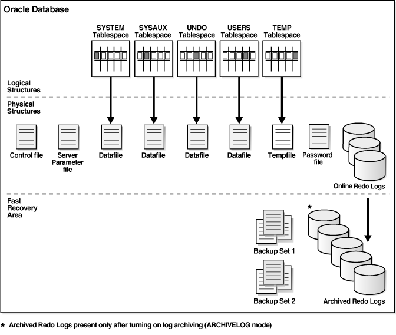
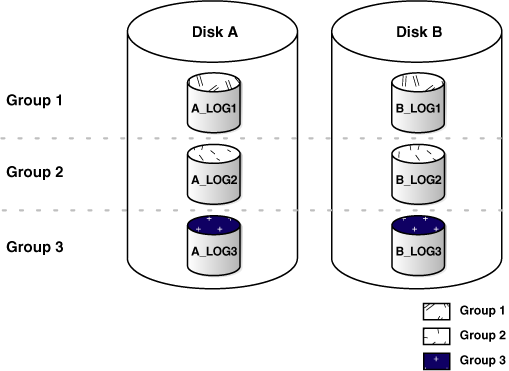
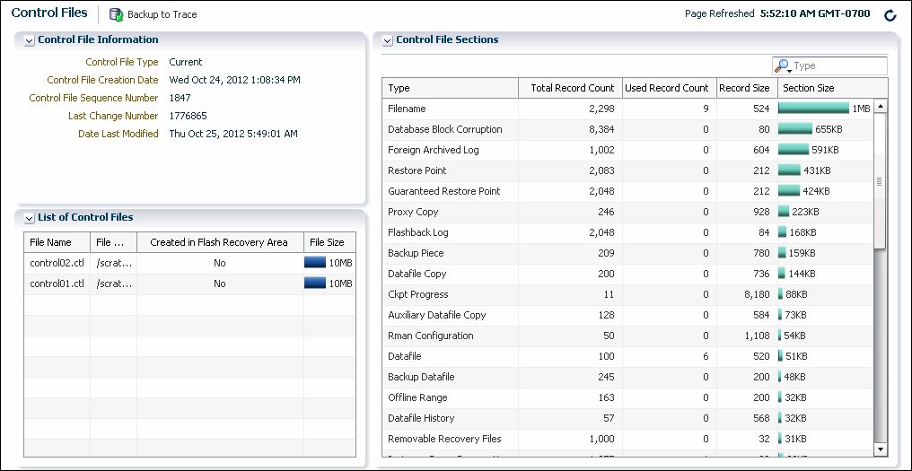
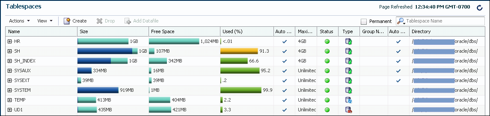
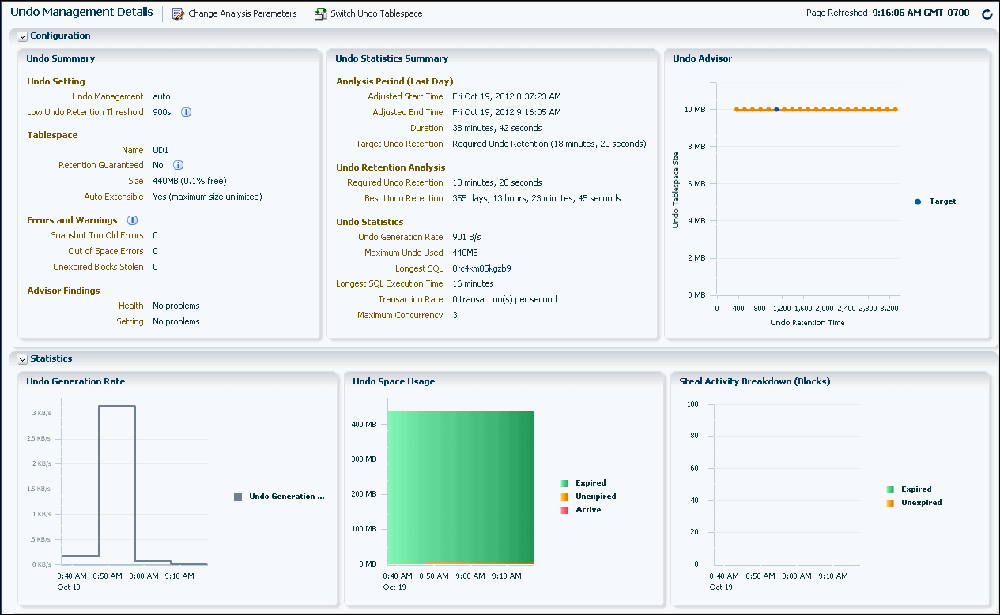
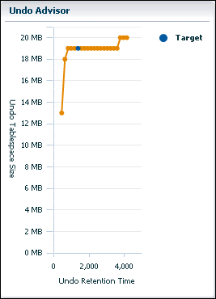
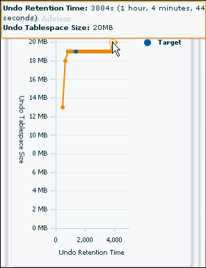

This chapter discusses using Oracle Enterprise Manager Database Express (EM Express) to view and manage the storage structures of your database. This chapter contains the following sections:

- About Database Storage Structures

- Viewing Database Storage Structure Information

- Performing Common Database Storage Tasks

- Managing the Online Redo Log

- Managing Undo Data

- Managing Database Storage Structures: Oracle by Example Series

### 6.1 About Database Storage Structures

An Oracle database is made up of physical and logical structures. Physical structures can be seen and operated on from the operating system, such as the physical files that store data on a disk.

Logical structures are created and recognized by Oracle Database and are not known to the operating system. The primary logical structure in a database, a tablespace, contains physical files. The applications developer or user may be aware of the logical structure, but is not usually aware of this physical structure. The database administrator (DBA) must understand the relationship between the physical and logical structures of a database.

Figure 6-1 shows the relationships between logical and physical structures. This figure also shows recovery-related structures that are optionally kept in the fast recovery area. See "[Fast Recovery Area](performing-backup-and-recovery.md)" for more information.

Figure 6-1 Oracle Database Storage Structures

[Description of "Figure 6-1 Oracle Database Storage Structures"](img_text/admqs003.md)

Oracle Database can automate much of the management of its structure. Oracle Enterprise Manager Database Express (EM Express) provides a Web-based graphical user interface (GUI) to enable easier management and monitoring of your database.

From a physical perspective, a multitenant container database (CDB) has basically the same structure as a non-CDB, except that each pluggable database (PDB) has its own set of tablespaces (including its own `SYSTEM` and `SYSAUX` tablespaces) and data files.

A CDB contains the following files:

- One control file

- One online redo log

- One or more sets of temp files

- One set of undo data files

- A set of system data files for every container

- Zero or more sets of user-created data files

This section provides background information about the various database storage structures. It contains the following topics:

- About Control Files

- About Online Redo Log Files

- About Archived Redo Log Files

- About Rollback Segments

- About Data Files

- About Tablespaces

- About Other Storage Structures

**See Also:**

- "Viewing Database Storage Structure Information"

- [Oracle Database Concepts](../cncpt/oracle-database-storage-structures.md) for more information about database storage structures

- [Oracle Multitenant Administrator's Guide](../multi/introduction-to-the-multitenant-architecture.md) for an introduction to CDBs and PDBs

- [Oracle Multitenant Administrator's Guide](../multi/overview-of-the-multitenant-architecture.md) for more information about database files in a CDB

#### 6.1.1 About Control Files

A control file tracks the physical components of the database. It is the root file that the database uses to find all the other files used by the database. Because of the importance of the control file, Oracle recommends that the control file be multiplexed, or have multiple identical copies. For databases created with Oracle Database Configuration Assistant (DBCA), two copies of the control file are automatically created and kept synchronized with each other.

If any control file fails, then your database becomes unavailable. If you have a control file copy, however, you can shut down your database and re-create the failed control file from the copy, then restart your database. Another option is to delete the failed control file from the `CONTROL_FILES` initialization parameter and restart your database using the remaining control files.

**See Also:**

- [Oracle Database Concepts](../cncpt/physical-storage-structures.md) for an overview of control files

- [Oracle Database Administrator’s Guide](../admin/managing-control-files.md) for detailed information about control files

- "Viewing Control File Information"

#### 6.1.2 About Online Redo Log Files

Every Oracle database has a set of two or more online redo log files. The set of online redo log files is collectively known as the redo log for the database. A redo log is made up of redo entries, which are also called redo records.

The online redo log stores a copy of the changes made to data. If a failure requires a data file to be restored from backup, then the recent data changes that are missing from the restored data file can be obtained from the online redo log files, so work is never lost. The online redo log files are used to recover a database after hardware, software, or media failure. To protect against a failure involving the online redo log file itself, Oracle Database can multiplex the online redo log file so that two or more identical copies of the online redo log file can be maintained on different disks.

The online redo log for a database consists of groups of online redo log files. A group consists of an online redo log file and its multiplexed copies. Each identical copy is considered to be a member of that group. Each group is defined by a number, such as Group 1.

Figure 6-2 shows the configuration of a database that has three online redo log groups and two members in each group. For each group, the members are stored on separate disks for maximum availability. For example, the members of Group 1 are the redo log files `A_LOG1` and `B_LOG1`.

Figure 6-2 Online Redo Log Groups and Their Members

[Description of "Figure 6-2 Online Redo Log Groups and Their Members"](img_text/admqs001.md)

The database log writer process (LGWR) writes redo records from the memory buffer to a redo log group until the log files in that group reach their storage size limit, or until you request a log switch operation. The LGWR process then writes to the next log group. The LGWR process performs this action in a circular fashion so that the oldest group is overwritten by the most recent redo records.

**See Also:**

- [Oracle Database Concepts](../cncpt/physical-storage-structures.md) for an overview of online redo logs

- [Oracle Database Administrator’s Guide](../admin/managing-the-redo-log.md) for detailed information about redo logs

- "Viewing Online Redo Log File Information"

- "Switching a Log File"

- "Managing the Online Redo Log"

#### 6.1.3 About Archived Redo Log Files

When you enable archiving of the online redo logs, Oracle Database copies the online redo log files to another location before they are overwritten. These copied files are referred to as archived redo log files. You can archive to multiple locations.

These archived redo log files extend the amount of redo data that can be saved and are used for recovery. Archived redo log files are required to recover a backup of the database from the time of the backup to the current time. Archiving can be either enabled or disabled for the database, but Oracle strongly recommends that you enable archiving. Oracle also recommends that you configure the database to write archived redo log files to the fast recovery area.

**See Also:**

- [Oracle Database Concepts](../cncpt/physical-storage-structures.md) for an overview of archived redo log files

- [Oracle Database Administrator’s Guide](../admin/managing-archived-redo-log-files.md) for detailed information about archived redo log files

- "Viewing Archived Redo Log File Information"

- "[Configuring Recovery Settings](performing-backup-and-recovery.md)" for information about enabling redo log archiving

- "[Fast Recovery Area](performing-backup-and-recovery.md)" for background information about the fast recovery area

#### 6.1.4 About Rollback Segments

Rollback segments were database structures used to track undo information for the database in earlier releases of Oracle Database. Now, the preferred way of managing undo information is with the undo tablespace. For more information, see "Managing Undo Data".

**Note:**

Oracle Database uses a `SYSTEM` rollback segment for performing system transactions. It is created automatically when the database is created, and is always brought online at instance startup. It is located in the `SYSTEM` tablespace. You are not required to perform any operations to manage the `SYSTEM` rollback segment.

#### 6.1.5 About Data Files

Data files are the operating system files that store the data within the database. The data is written to these files in an Oracle proprietary format that cannot be read by other programs. Tempfiles are a special class of data files that are associated only with temporary tablespaces.

Data files can be broken down into the following components:

- Segment

  A segment contains a specific type of database object. For example, a table is stored in a table segment, and an index is stored in an index segment. A data file can contain many segments.

- Extent

  An extent is a contiguous set of data blocks within a segment. Oracle Database allocates space for segments in units of one extent. When the existing extents of a segment are full, the database allocates another extent for that segment.

- Data block

  A data block, also called a database block, is the smallest unit of I/O to database storage. An extent consists of several contiguous data blocks. The database uses a default block size at database creation.

  After the database has been created, it is not possible to change the default block size without re-creating the database. It is possible, however, to create a tablespace with a block size different than the default block size.

Segments, extents, and data blocks are all logical structures. Only Oracle Database can determine how many data blocks are in a file. The operating system recognizes only files and operating system blocks, not the number of data blocks in an Oracle Database file. Each data block maps to one or more operating system blocks.

**See Also:**

- [Oracle Database Administrator’s Guide](../admin/managing-data-files-and-temp-files.md) for detailed information about data files

- [Oracle Database Concepts](../cncpt/introduction-to-oracle-database.md) for more information about segments, extents, and blocks

#### 6.1.6 About Tablespaces

A database is divided into logical storage units called tablespaces, which group related logical structures (such as tables, views, and other database objects). For example, all application objects can be grouped into a single tablespace to simplify maintenance operations.

A tablespace consists of one or more physical data files. Database objects assigned to a tablespace are stored in the physical data files of that tablespace.

When you create an Oracle database, some tablespaces already exist, such as `SYSTEM` and `SYSAUX`.

Tablespaces provide a means to physically locate data on storage. When you define the data files that comprise a tablespace, you specify a storage location for these files. For example, you might specify a data file location for a certain tablespace as a designated host directory (implying a certain disk volume) or designated Oracle Automatic Storage Management disk group. Any schema objects assigned to that tablespace then get located in the specified storage location. Tablespaces also provide a unit of backup and recovery. The backup and recovery features of Oracle Database enable you to back up or recover at the tablespace level.

Table 6-1 describes some tablespaces included in the database.

Table 6-1 Tablespaces and Descriptions

| Tablespace | Description                                                                                                                                                                                                                                                                                                                                                                                                                                                                                                                                                 |
|:-----------|:------------------------------------------------------------------------------------------------------------------------------------------------------------------------------------------------------------------------------------------------------------------------------------------------------------------------------------------------------------------------------------------------------------------------------------------------------------------------------------------------------------------------------------------------------------|
| `EXAMPLE`  | This tablespace contains the sample schemas that are included with Oracle Database. The sample schemas provide a common platform for examples. Oracle documentation and educational materials contain examples based on the sample schemas.                                                                                                                                                                                                                                                                                                                 |
| `SYSTEM`   | This tablespace is automatically created at database creation. Oracle Database uses it to manage the database. It contains the data dictionary, which is the central set of tables and views used as a read-only reference for a particular database. It also contains various tables and views that contain administrative information about the database. These are all contained in the `SYS` schema, and can be accessed only by the `SYS` user or other administrative users with the required privilege.                                              |
| `SYSAUX`   | This is an auxiliary tablespace to the `SYSTEM` tablespace. The `SYSAUX` tablespace contains data for some components and products, reducing the load on the `SYSTEM` tablespace. Every database using Oracle Database 10g release 1 (10.1) or later must have a `SYSAUX` tablespace. Components that use `SYSAUX` as their default tablespace during installation include Automatic Workload Repository and Oracle Text. For more information, see [Oracle Database Administrator’s Guide](../admin/creating-and-configuring-an-oracle-database.md). |
| `TEMP`     | This tablespace stores temporary data generated when processing SQL statements. For example, this tablespace would be used for query sorting. Every database should have a temporary tablespace that is assigned to users as their temporary tablespace. In the preconfigured database, the `TEMP` tablespace is specified as the default temporary tablespace. If no temporary tablespace is specified when a user account is created, then Oracle Database assigns this tablespace to the user.                                                           |
| `UNDOTBS1` | This is the undo tablespace used by the database to store undo information. See "Managing Undo Data" to understand how an Oracle database uses the undo tablespace. Every database must have an undo tablespace.                                                                                                                                                                                                                                                                                                                                            |
| `USERS`    | This tablespace is used to store permanent user objects and data. Similar to the `TEMP` tablespace, every database should have a tablespace for permanent user data that is assigned to users. Otherwise, user objects will be created in the `SYSTEM` tablespace, which is not good practice. In the preconfigured database, `USERS` is designated as the default tablespace for all new users.                                                                                                                                                            |

You can create new tablespaces to support your user and application data requirements. During tablespace creation, you set the following parameters:

- Locally Managed Tablespaces

- Tablespace Types

- Tablespace Status

- Autoextend Tablespace

- Encrypted Tablespaces

**See Also:**

- "Viewing Tablespace and Data File Information"

- "Creating a Tablespace"

- "Modifying a Tablespace"

- [Oracle Database Concepts](../cncpt/logical-storage-structures.md) for an overview of tablespaces

##### 6.1.6.1 Locally Managed Tablespaces

Space management within a tablespace involves keeping track of available (free) and used space, so that space is allocated efficiently during data insertion and deletion. Locally managed tablespaces keep the space allocation information within the tablespace, not in the data dictionary, thus offering better performance. By default, Oracle Database sets all newly created tablespaces to be locally managed with automatic segment management, a feature that further improves performance.

##### 6.1.6.2 Tablespace Types

There are three types of tablespaces. For example:

- Permanent

  You use permanent tablespaces to store your user and application data. Oracle Database uses permanent tablespaces to store permanent data, such as system data. Each user is assigned a default permanent tablespace.

- Undo

  A database running in automatic undo management mode transparently creates and manages undo data in the undo tablespace. Oracle Database uses undo data to roll back transactions, to provide read consistency, to help with database recovery, and to enable features such as Oracle Flashback Query. A database instance can have only one active undo tablespace.

- Temporary

  Temporary tablespaces are used for storing temporary data, as would be created when SQL statements perform sort operations. An Oracle database gets a temporary tablespace when the database is created. You would create another temporary tablespace if you were creating a temporary tablespace group. Under typical circumstances, you do not have to create additional temporary tablespaces. If you have an extremely large database, then you might configure additional temporary tablespaces.

  The physical files that comprise a temporary tablespace are called tempfiles, as opposed to data files.

  The `TEMP` tablespace is typically used as the default temporary tablespace for users who are not explicitly assigned a temporary tablespace.

**See Also:**

- [Oracle Database Administrator's Guide](../admin/managing-tablespaces.md) to learn more about temporary tablespaces

- [Oracle Database Concepts](../cncpt/logical-storage-structures.md) for more information about undo tablespaces

##### 6.1.6.3 Tablespace Status

You can set tablespace status. For example:

- Read Write

  Users can read and write to the tablespace after it is created. This is the default.

- Read Only

  If the tablespace is created Read Only, then the tablespace cannot be written to until its status is changed to Read Write. It is unlikely that you would create a Read Only tablespace, but you might change it to that status after you have written data to it that you do not want modified.

- Offline

  If the tablespace has a status of Offline, then no users can access it. You might change the status of a tablespace to Offline before performing maintenance or recovery on the data files associated with that tablespace.

##### 6.1.6.4 Autoextend Tablespace

You can set a tablespace to automatically extend itself by a specified amount when it reaches its size limit. If you do not enable autoextend, then you are alerted when the tablespace reaches its critical or warning threshold size. The critical and warning threshold parameters have default values that you can change at any time. These parameters also cause alerts to be generated for autoextending tablespaces that are approaching their specified size limit. You can respond to size alerts by manually increasing the tablespace size. You do so by increasing the size of one or more of the tablespace data files or by adding another data file to the tablespace.

**Note:**

Although it is common to refer to tablespaces as autoextending, automatic extension is a data file property, not a tablespace property. That is, when you create the data files that comprise a tablespace, you indicate whether these data files automatically extend. A tablespace that has autoextending data files is considered to be an autoextending tablespace. You can specify a maximum size for an autoextending data file.

##### 6.1.6.5 Encrypted Tablespaces

Encrypted tablespaces primarily protect your data from unauthorized access by means other than through the database. For example, when encrypted tablespaces are written to backup media for travel from one Oracle database to another or for travel to an off-site facility for storage, they remain encrypted. Also, encrypted tablespaces protect data from users who try to circumvent the security features of the database and access database files directly through the operating system file system.

You can encrypt any permanent tablespace to protect sensitive data. When you encrypt a tablespace, all tablespace blocks are encrypted. All segment types are supported for encryption, including tables, clusters, indexes, LOBs, table and index partitions, and so on. Tablespace encryption is completely transparent to your applications, so no application modification is necessary.

**See Also:**

[Oracle Database Security Guide](../dbseg/manually-encrypting-data.md) for more information about tablespace encryption

#### 6.1.7 About Other Storage Structures

Other storage structures that can exist in an Oracle database include the initialization parameter file, the password file, and backup files.

##### Initialization Parameter File

Initialization parameters are used by the Oracle instance at startup to determine the run-time properties and resources for the database. Some parameters can be set or modified while the database is running. Other initialization parameters require the database to be restarted for the changes to take effect. See "[Viewing and Modifying Initialization Parameters](managing-the-oracle-instance.md)."

##### Password File

A database can use a password file to authenticate administrative users with `SYSDBA`, `SYSOPER`, and `SYSBACKUP` privileges. A password file is required for remote connections to the database with any of these privileges. These privileges enable a DBA to start and shut down the database, back up and recover the database, and perform other high-level administrative tasks. This password file is outside of the database itself, thereby enabling the authentication of a DBA when the database is not yet started. (A DBA must authenticate before starting the database.)

When you invoke DBCA as part of the Oracle Database installation process, DBCA creates a password file with one entry: the `SYS` user. Granting `SYSDBA`, `SYSOPER`, or `SYSBACKUP` to a user adds that user to the password file automatically.

**Note:**

Oracle Database can also use operating system authentication to authenticate users with the `SYSDBA`, `SYSOPER`, and `SYSBACKUP` privileges. Operating system authentication takes precedence over password file authentication. See "[Starting SQL\*Plus and Connecting to the Database](getting-started-with-database-administration.md)."

##### Backup Files

Backup files are not technically database files, but are copies of the database in some form that can be used to recover the database if a failure causes loss of data.

**See Also:**

- "[Managing the Oracle Instance](managing-the-oracle-instance.md)" for more information about initialization parameters and the initialization parameter file

- "[SYSDBA and SYSOPER System Privileges](administering-user-accounts-and-security.md)"

- "[Performing Backup and Recovery](performing-backup-and-recovery.md)" for more information about backup files

- [Oracle Database Concepts](../cncpt/oracle-database-instance.md) for more information about password files and operating system authentication

- [Oracle Database Concepts](../cncpt/concepts-for-database-administrators.md) for an overview of backup and recovery

### 6.2 Viewing Database Storage Structure Information

To assist you in managing the storage structures within your database, this section provides instructions for viewing information about the various database storage structures using Oracle Enterprise Manager Database Express (EM Express).

This section contains the following topics:

- Viewing Control File Information

- Viewing Online Redo Log File Information

- Viewing Archived Redo Log File Information

- Viewing Tablespace and Data File Information

- About Database Storage Structures

#### 6.2.1 Viewing Control File Information

You can use Oracle Enterprise Manager Database Express (EM Express) to view location and status information about control files.

**Note:**

In a multitenant container database (CDB), EM Express provides control file information only in the root, not in the pluggable databases (PDBs).

##### To view control file information:

1.  In EM Express, from the Storage menu, select Control Files.
    The Control Files page appears.

    
    [Description of the illustration exp_control_files_page.gif](img_text/exp_control_files_page.md)
    This page shows whether your database has a multiplexed control file. The List of Control Files and Control Files sections give you more detailed information about your control files.
2.  To back up the current control file to a trace file, click Backup to Trace.
    See [Oracle Database Backup and Recovery User’s Guide](../bradv/user-managed-database-backups.md) for more information about backing up the control file to a trace file.

**See Also:**

"About Control Files"

#### 6.2.2 Viewing Online Redo Log File Information

You can use Oracle Enterprise Manager Database Express (EM Express) to view status and multiplexing information about online redo log files.

**Note:**

In a multitenant container database (CDB), EM Express provides online redo log file information only in the root, not in the pluggable databases (PDBs).

##### To view online redo log file information:

1.  In EM Express, from the Storage menu, select Redo Log Groups.
    The Redo Log Groups page appears. This page shows the attributes of the online redo log groups for your database.

    When an online redo log group contains only one member, it is not multiplexed. Note the Status attribute for the online redo log groups. The online redo log group with status Current is the one currently being written to disk by the log writer.
2.  (Optional) Expand a redo log group number to view information about online redo log group members.

**See Also:**

- "About Online Redo Log Files"

- "Managing the Online Redo Log"

#### 6.2.3 Viewing Archived Redo Log File Information

You can use Oracle Enterprise Manager Database Express (EM Express) to view status information about archived redo log files.

**Note:**

In a multitenant container database (CDB), EM Express provides archived redo log file information only in the root, not in the pluggable databases (PDBs).

**Note:**

Archived redo log files do not exist until you set the database in `ARCHIVELOG` mode.

##### To view archived redo log file information:

1.  In EM Express, from the Storage menu, select Archive Logs.
    The Archive Logs page appears.
2.  View information on the Archive Logs page about the redo logs that have been archived.

**See Also:**

- "About Archived Redo Log Files"

- "[Configuring Your Database for Basic Backup and Recovery](performing-backup-and-recovery.md)"

#### 6.2.4 Viewing Tablespace and Data File Information

You can use Oracle Enterprise Manager Database Express (EM Express) to view configuration, size, and status information about tablespaces and data files.

**Note:**

In a multitenant container database (CDB), EM Express provides tablespace and data file information only in the pluggable databases (PDBs), not in the root.

##### To view tablespace information:

1.  In EM Express, from the Storage menu, select Tablespaces.
    The Tablespaces page appears.
2.  To view information about the data files for a particular tablespace, expand that tablespace. Information about the data files appears underneath the tablespace.

**See Also:**

- "About Tablespaces"

- "Modifying a Tablespace"

### 6.3 Performing Common Database Storage Tasks

As data is added to your database, the tablespace requirements for your database change. As a database administrator (DBA), you can use Oracle Enterprise Manager Database Express (EM Express) to perform the following tasks to effectively manage the tablespaces and database storage:

- Creating a Tablespace

- Modifying a Tablespace

- Dropping a Tablespace

#### 6.3.1 Creating a Tablespace

You can create additional tablespaces to store user data, so that not all data is stored in the `USERS` tablespace. The following are some reasons to create additional tablespaces:

- For certain users, groups of users, or applications, it may be convenient to keep all application data in a separate tablespace or set of tablespaces for backup and recovery or maintenance reasons. For example, suppose you must recover all application data from backup due to a hardware or software failure, and you want to perform an offline recovery. If the application data is kept in a separate tablespace, then you can take just that tablespace offline and recover it, without affecting the operation of other database applications.

- Some applications, such as those with large partitioned tables, may benefit from distributing data across multiple tablespaces. This approach allows the optimal use of the available storage because frequently accessed data can be placed on high performance disks, and infrequently retrieved data can be placed on less expensive storage.

##### To create a tablespace:

1.  In Oracle Enterprise Manager Database Express (EM Express), from the Storage menu, select Tablespaces.
    The Tablespaces page appears.

    
    [Description of the illustration exp_tablespaces_page.gif](img_text/exp_tablespaces_page.md)
2.  To create a new tablespace, click the Create button.
    The Create Tablespace wizard appears, showing the General page.
3.  In the Name field, enter a name for the tablespace.
4.  In the Bigfile section, select Smallfile.
    **Note:**

    If you select Use bigfile tablespace, then the tablespace can have only one data file. Bigfile tablespaces are used with very large databases that use Oracle Automatic Storage Management or other logical volume managers that support striping, RAID, and dynamically extensible logical volumes.

    EM Express does not support Oracle Automatic Storage Management database instances.
5.  In the Status section, select Online.
6.  To go to the next page in the wizard, click the right arrow button.
    The Add Datafiles page appears.
7.  For the Datafiles field, enter the name for the datafile. If the datafile name includes a number in the suffix (such as `df_1`), you can click the + button or press the Enter key to create multiple data files with the options you select on the Add Datafiles page.
8.  For the File Size field, enter appropriate values for your data file location and initial size.
9.  Select Auto Extend.
10. For the Increment field, select the additional space to be added to the file each time it extends.
11. For the Maximum File Size field, enter the maximum size for this data file.
12. After adding the data files for the new tablespace, click the right arrow button to go to the next page in the wizard.
    The Space page appears.

    **Note:**

    On the Add Datafiles page and subsequent pages in the wizard, you can click the right arrow button to go to the next page, or you can click OK to create the tablespace without continuing through the wizard. The default values on on the remaining wizard pages will be used to create the tablespace.
13. For Block Size, select the block size to use for the tablespace.
14. For Extent Allocation, select Automatic.
15. Click the right arrow button to go to the next page in the wizard.
    The Logging page appears.
16. In the Logging section, select Logging.
17. Click the right arrow button to go to the final page in the wizard.
    The Segments page appears.
18. In the Segment Space Management section, select Automatic.
19. In the Compression section, select None.
20. Click OK to add the tablespace.

**See Also:**

"About Tablespaces"

#### 6.3.2 Modifying a Tablespace

You can use Oracle Enterprise Manager Database Express (EM Express) to modify a tablespace. For example, you can extend it by increasing data file sizes or adding another data file, set it to automatically extend, change its space usage alert thresholds, or change its status to Offline.

This section contains the following topics:

- Setting a Tablespace to Automatically Extend

- Setting the Datafile for a Smallfile Tablespace to Automatically Extend

- Taking a Tablespace Offline

**See Also:**

"About Tablespaces"

##### 6.3.2.1 Setting a Tablespace to Automatically Extend

You can use Oracle Enteprise Manager Database Express (EM Express) to set a tablespace to automatically extend when it reaches its size limit. The following instructions assume that the tablespace was previously not an autoextending tablespace.

**Note:**

Only bigfile tablespaces can be automatically extended. However, individual datafiles for a smallfile tablespace can be automatically extended. See "Setting the Datafile for a Smallfile Tablespace to Automatically Extend" for instructions for setting up individual data files for a smallfile tablespace to automatically extend.

##### To set a tablespace to automatically extend:

1.  In EM Express, from the Storage menu, select Tablespaces.

    The Tablespaces page appears.

2.  Select the bigfile tablespace for which you want to enable autoextend, and then click Edit Auto Extend.

    The Auto Extend Setting of Bigfile Tablespace page appears.

3.  Complete the following steps:

    1.  Select Auto Extend.

    2.  Set a suitable increment, such as 10 MB.

        This is the amount of disk space that is added to the data file when it needs more storage space.

    3.  For Maximum File Size, enter a value in KB, MB, GB, or TB, depending on available storage.

4.  Click OK.

    A confirmation message appears.

##### 6.3.2.2 Setting the Datafile for a Smallfile Tablespace to Automatically Extend

You can use Oracle Enterprise Manager Database Express (EM Express) to set a datafile for a smallfile tablespace to automatically extend when it reaches its size limit. The following instructions assume that the datafile was previously not an autoextending datafile.

##### To set a datafile to automatically extend:

1.  In EM Express, from the Storage menu, select Tablespaces.

    The Tablespaces page appears.

2.  For a smallfile tablespace, select a datafile for which you want to enable autoextend, and then from the Actions menu, select Edit Auto Extend.

    The Auto Extend Setting of Datafile page appears.

3.  Complete the following steps:

    1.  Select Auto Extend.

    2.  Set a suitable increment, such as 10 MB.

        This is the amount of disk space that is added to the data file when it needs more storage space.

    3.  For Maximum File Size, enter a value in KB, MB, GB, or TB, depending on available storage.

4.  Click OK.

    A confirmation message appears.

5.  You can perform these steps for all the datafiles in a smallfile tablespace to set all of the datafiles to automatically extend.

##### 6.3.2.3 Taking a Tablespace Offline

You can use Oracle Enterprise Manager Database Express (EM Express) to take a tablespace offline. You may want to take a tablespace offline for any of the following reasons:

- To make a portion of the database unavailable while still allowing access to the remainder of the database

- To make an application and its group of tables temporarily unavailable while updating or maintaining the application

- To perform an offline tablespace backup (even though a tablespace can be backed up while online and in use)

- To recover a tablespace after a hardware or software failure

- To rename or relocate tablespace data files

##### To take a tablespace offline:

1.  In EM Express, from the Storage menu, select Tablespaces.
    The Tablespaces page appears.
2.  Select the tablespace that you want to take offline. From the Actions menu, select Set Status, then Take Offline.
    The Bring Tablespace Offline page appears.
3.  For Offline Options, select Normal.
4.  Click OK.
    A confirmation message appears.

**Note:**

To bring the tablespace back online, select the tablespace on the Tablespaces page. Then from the Actions menu, select Set Status, then Place Online.

**See Also:**

[Oracle Database Administrator's Guide](../admin/managing-tablespaces.md) for more information about taking tablespaces offline and for information about renaming or relocating data files.

#### 6.3.3 Dropping a Tablespace

You can use Oracle Enterprise Manager Database Express (EM Express) to drop (delete) a tablespace. After a tablespace has been dropped, the objects and data in it are no longer available. To recover them can be a time-consuming process. Oracle recommends performing a backup before and after dropping a tablespace.

##### To drop a tablespace:

1.  In EM Express, from the Storage menu, select Tablespaces.
    The Tablespaces page appears.
2.  Select the tablespace to drop, and then click Drop.
    The Drop Tablespace page appears.

    EM Express asks for confirmation to delete the tablespace and gives you the option to also delete the associated data files from the disk.
3.  Choose from the following options and then click OK:
    - Drop Contents

    - Drop Datafiles

    - Drop Constraints
4.  A confirmation is displayed and the deleted tablespace no longer appears on the Tablespaces page.

**See Also:**

"About Tablespaces"

### 6.4 Managing the Online Redo Log

The online redo log files are a critical component in database recovery. Every transaction in the database updates the redo logs, regardless of whether archiving is enabled. During crash, instance, or media recovery, the database properly applies redo log files in ascending order by using the log sequence number of the necessary archived and redo log files.

If properly configured, the online redo logs require little maintenance. This section describes the more common redo log management tasks. It contains the following topics:

**Note:**

In a multitenant container database (CDB), Oracle Enterprise Manager Database Express (EM Express) provides online redo log file information only in the root, not in the pluggable databases (PDBs).

- Multiplexing the Online Redo Log

- Switching a Log File

**See Also:**

- "About Online Redo Log Files"

- "Viewing Online Redo Log File Information"

#### 6.4.1 Multiplexing the Online Redo Log

Oracle recommends that you multiplex the online redo log. Multiplexing provides better protection for data if an instance or media failure occurs. You can multiplex the online redo log using Oracle Enterprise Manager Database Express (EM Express).

To multiplex your online redo log, you must add members to each online redo log group. It is not required that online redo log groups be symmetrical, but Oracle recommends that your groups all have the same number of members. A database must have a minimum of two online redo log groups.

**Note:**

When you multiplex the online redo log, the database must increase the amount of I/O that it performs. Depending on your configuration, this action may affect overall database performance.

##### To multiplex the online redo log:

1.  In EM Express, from the Storage menu, select Redo Log Groups.
    The Redo Log Groups page appears.
2.  Select a group and click Add Member.
    The Add Member page appears.
3.  In the File Directory field, enter the directory where you want the data file to be stored on disk.
    You can create this file in the same directory as the other member of the redo log file group, but it is recommended that you store members on separate disk drives. That way, if there is a drive failure, then you still have access to one member.
4.  In the File Name field, enter a file name for the new redo log member.
    For example, if your existing member file name is `REDO01.log`, then you might name this member `REDO01a.log`.
5.  Click OK.
    A confirmation message appears.
6.  Repeat Step 2 through Step 5 for every existing log group.

#### 6.4.2 Switching a Log File

When a log switch occurs, the log writer (LGWR) process stops writing to the current online redo log group and starts writing to the next available redo log group. After a log switch, the current online redo log group becomes inactive, and the next available online redo log group becomes the current online redo log group. You can switch a log file using Oracle Enterprise Manager Database Express (EM Express).

You can force a log switch to make the current redo group inactive and available for redo log maintenance operations. Forcing a log switch is useful in configurations with large redo log files that take a long time to fill. For example, you might want to:

- Drop the current redo group, but are not able to do so until the group is inactive

- Archive the current online redo log group members immediately, even though they are not yet completely filled

##### To switch a log file:

1.  In EM Express, from the Storage menu, select Redo Log Groups.
    The Redo Log Groups page appears.
2.  From the Actions list, select Switch Logfile, and then click OK.
    A confirmation message appears.
3.  A confirmation message appears. Click Yes.
    The status of the group that had been Current changes to Active, and the status of the next group in the list changes from Active to Current.

### 6.5 Managing Undo Data

Beginning with Oracle Database 11g, for a default installation, Oracle Database automatically manages the undo data. There is typically no need for database administrator (DBA) intervention. However, if your installation uses Oracle Flashback operations, then you may have to perform some undo management tasks to ensure the success of these operations.

This section provides background information and instructions for managing undo data. It contains the following topics:

- About Undo Data

- About Managing Undo Data

- Viewing Undo Information

- Computing the Minimum Undo Tablespace Size Using the Undo Advisor

- Changing the Undo Tablespace to a Fixed Size

- Changing the Datafiles for an Undo Tablespace to a Fixed Size

- Changing Undo Management Analysis Parameters

- Switching Undo Tablespaces

#### 6.5.1 About Undo Data

When a transaction modifies data, Oracle Database copies the original data before modifying it. The original copy of the modified data is called undo data. Saving this information is necessary for the following reasons:

- To undo any uncommitted changes made to the database if a rollback is necessary. A rollback can be needed because a user wants to undo the changes of a misguided or unintentional transaction, or it can be part of a recovery operation.

- To provide read consistency, which means that each user can get a consistent view of data, even while other changes may be occurring against the data. With read consistency, a user session does not see uncommitted changes made in other user sessions (sometimes referred to as dirty reads). For example, if a user issues a query at 10:00 a.m. and the query lasts for 15 minutes, then the query results reflect the entire state of the data at 10:00 a.m., regardless of update or insert operations performed by other users after the query started.

- To enable certain Oracle Flashback features, such as Oracle Flashback Query and Oracle Flashback Table, which enable you to view or recover data to a previous point in time.

##### Undo Tablespace

With automatic undo management, undo data is stored in an undo tablespace. Undo tablespaces have additional properties beyond those of permanent tablespaces. There can be multiple undo tablespaces, but only one can be active for an Oracle instance.

When you create the database using Database Configuration Assistant (DBCA), it creates an autoextending undo tablespace named `UNDOTBS1`, with a maximum extension size of 32,767 MB.

##### Undo Retention

Oracle Database automatically ensures that undo data that is in use by an active transaction is never overwritten until that transaction has been committed. After the transaction has been committed, the space occupied by that undo data can be reused, or overwritten. In this case, that undo data could be overwritten if space in the undo tablespace becomes scarce.

Even after a transaction has been committed, it is useful to retain (not overwrite) its undo data, to ensure the success of Oracle Flashback features and for read consistency for long-running queries. To this end, the database maintains and automatically tunes an undo retention period. Committed undo data whose age is less than the undo retention period is retained for use by queries or Oracle Flashback operations.

**See Also:**

- [Oracle Database Concepts](../cncpt/data-concurrency-and-consistency.md) for more information about read consistency

- [Oracle Database Development Guide](../adfns/flashback.md) for more information about Oracle Flashback features

#### 6.5.2 About Managing Undo Data

Although by default Oracle Database manages undo data and the undo tablespace automatically, if your installation uses Oracle Flashback features, then you may have to perform some undo management tasks to ensure the success of these operations.

Oracle Flashback operations resulting in `snapshot` `too` `old` errors indicate that you must intervene to ensure that sufficient undo data is retained to support these operations.

The following methods better support Oracle Flashback operations:

- Set the minimum undo retention period for the autoextending tablespace to be as long as the longest expected Oracle Flashback operation.

  You achieve this goal by setting the `UNDO_RETENTION` initialization parameter. See [Oracle Database Administrator’s Guide](../admin/managing-undo.md) for details.

- Change the undo tablespace to a fixed size.

  For an autoextending undo tablespace, Oracle Database always automatically tunes the undo retention period to be slightly longer than the longest-running active query. However, this autotuned retention period may be insufficient to accommodate Oracle Flashback operations. If the undo tablespace has autoextending disabled, or has a fixed size, then Oracle Database uses a different method for tuning the undo retention period to better accommodate Oracle Flashback operations.

  To change the undo tablespace to a fixed size, you must choose a tablespace size that is sufficiently large. If you choose an undo tablespace size that is too small, then the following errors could occur:

  - DML could fail because there is not enough space to accommodate undo data for new transactions.

  - Long-running queries could fail with a `snapshot` `too` `old` error, which means that there was insufficient undo data for read consistency.

  Oracle Enterprise Manager Database Express (EM Express) includes an Undo Advisor to help you determine the minimum size for the fixed size of the undo tablespace. See "Computing the Minimum Undo Tablespace Size Using the Undo Advisor".

**See Also:**

- "About Undo Data"

- "Computing the Minimum Undo Tablespace Size Using the Undo Advisor"

- "Changing the Undo Tablespace to a Fixed Size"

#### 6.5.3 Viewing Undo Information

You can use the Undo Management Details page in Oracle Enterprise Manager Database Express (EM Express) to view information about your undo configuration. For example, you can view the following undo configuration information:

- Name and current size of the undo tablespace

- Auto extensible tablespace setting (Yes or No)

- Current undo retention period

**Note:**

In a multitenant container database (CDB), the EM Express undo management features are available only in the root, not in the pluggable databases (PDBs).

##### To view undo information:

1.  In EM Express, from the Storage menu, select Undo Management.
    The Undo Management Details page appears.
2.  View the undo management information on the Undo Management Details page.

[Description of the illustration exp_undo_mgmt_details_new.gif](img_text/exp_undo_mgmt_details_new.md)

**See Also:**

"About Undo Data"

#### 6.5.4 Computing the Minimum Undo Tablespace Size Using the Undo Advisor

If you must change the undo tablespace to a fixed size, then use the Undo Advisor in Oracle Enterprise Manager Database Express (EM Express) to help determine the minimum required size. You can also use the Undo Advisor to set the minimum undo retention period.

To configure the undo tablespace to have a fixed size, Oracle suggests that you first allow enough time after database creation to run a full workload, thus allowing the undo tablespace to grow to its minimum required size to handle the workload. Then, you can use the Undo Advisor to determine the best size to configure the undo tablespace to allow for future long-running queries and Oracle Flashback operations.

##### To compute the minimum undo tablespace size using the Undo Advisor:

1.  In EM Express, go to the Undo Management Details page.
    See "Viewing Undo Information".
2.  In the Configuration section, view the Undo Advisor graph.
    
    [Description of the illustration exp_undo_advisor.gif](img_text/exp_undo_advisor.md)
    The Undo Advisor displays an orange line. There are several tick-marks, or points, that you can click on the orange line. The blue point on the orange line marks the target undo retention time that is currently set for the database.
3.  To determine the recommended minimum size of the undo tablespace for a particular undo retention time, select the point on the orange line closest to the desired undo retention time.
    In the following figure, for example, the point on the orange line for the undo retention time of 3884 seconds has been clicked:

    
    [Description of the illustration exp_undo_advsr_ex.gif](img_text/exp_undo_advsr_ex.md)
    The Undo Advisor shows its recommendation that the undo tablespace size should be at least 20 MB for this undo retention time of 3884 seconds.

    **Note:**

    Using the Undo Advisor to gets its recommendation for the required minimum tablespace size for a particular undo retention time does not change the size of the undo tablespace. You must follow the instructions in "Changing the Undo Tablespace to a Fixed Size" to change the size of the undo tablespace.

**See Also:**

- "About Undo Data"

- "About Managing Undo Data"

#### 6.5.5 Changing the Undo Tablespace to a Fixed Size

ou change the undo tablespace to a fixed size to prevent the tablespace from growing too large or to better support Oracle Flashback operations. You can use Oracle Enterprise Manager Database Express (EM Express) to change the undo tablespace to a fixed size.

**Note:**

Only bigfile tablespaces can be changed to a fixed size. However, individual datafiles for a smallfile tablespace can be changed to a fixed size. See "Changing the Datafiles for an Undo Tablespace to a Fixed Size" for instructions for changing individual data files for a smallfile tablespace to a fixed size.

##### To change the undo tablespace to a fixed size:

1.  In EM Express, go to the Undo Management Details page, as described in "Viewing Undo Information".
2.  After determining the minimum required undo tablespace size, click the link after the Name field in the Tablespace section.
    The Tablespace page appears, with the undo tablespace displayed.
3.  Select the undo tablespace. Then from the Actions menu, select Resize.
    The Resize Tablespace page appears.
4.  In the File Size field, enter the computed minimum size for the undo tablespace.
    See "Computing the Minimum Undo Tablespace Size Using the Undo Advisor".
5.  Click OK.
    A confirmation message appears.

**See Also:**

- "About Undo Data"

- "About Managing Undo Data"

#### 6.5.6 Changing the Datafiles for an Undo Tablespace to a Fixed Size

You change the datafiles for an undo tablespace to a fixed size to prevent the tablespace from growing too large or to better support Oracle Flashback operations. You can use Oracle Enterprise Manager Database Express (EM Express) to change the datafiles for an undo tablespace to a fixed size.

##### To change the datafiles for an undo tablespace to a fixed size:

1.  In EM Express, go to the Undo Management Details page, as described in "Viewing Undo Information".
2.  After determining the minimum required undo tablespace size, click the link after the Name field in the Tablespace section.
    The Tablespace page appears, with the undo tablespace displayed.
3.  Select and expand the undo tablespace. Select one of the datafiles for the undo tablespace. Then from the Actions menu, select Resize.
    The Resize Datafile page appears.
4.  In the Size field, enter the computed minimum size for the undo tablespace.
    See "Computing the Minimum Undo Tablespace Size Using the Undo Advisor".
5.  Click OK.
    A confirmation message appears.
6.  You can perform these steps for all the datafiles for the undo tablespace to change them all to a fixed size.

#### 6.5.7 Changing Undo Management Analysis Parameters

You can change the current analysis period and the desired undo retention period using Oracle Enterprise Manager Database Express (EM Express).

##### To change the analysis period and the undo retention period:

1.  In EM Express, go to the Undo Management Details page, as described in "Viewing Undo Information".
2.  Click Change Analysis Parameters.
    The Change Analysis Parameters page appears.
3.  To change the analysis period, in the Analysis Period field, select the desired analysis period.
4.  To change the undo retention period, select either:
    - Use Required Undo Retention

    - Specify Undo Retention in Seconds

      Enter the number of seconds to use for the retention period in the text box.

#### 6.5.8 Switching Undo Tablespaces

You can switch from one undo tablespace to another using Oracle Enterprise Manager Database Express (EM Express).

##### To switch the undo tablespace:

1.  In EM Express, go to the Undo Management Details page, as described in "Viewing Undo Information".
2.  Click Switch Undo Tablespace.
    The Switch Undo Tablespace page appears.
3.  In the Switch to Undo Tablespace field, select the name of the undo tablespace you want to switch to. This field includes the names of available undo tablespaces for the database.
    For example, if the current undo tablespace is named UD1 and you want to switch to the undo tablespace named UD2, select UD2 in the Switch to Undo Tablespace field.
4.  Click OK.
    A confirmation message appears.

**See Also:**

- "About Undo Data"

- "About Managing Undo Data"

- [Oracle Database Administrator’s Guide](../admin/managing-undo.md) for more information about switching undo tablespaces

### 6.6 Managing Database Storage Structures: Oracle by Example Series

Oracle By Example (OBE) has a series on the Oracle Database 2 Day DBA guide. This OBE series steps you through the tasks in this chapter and includes annotated screenshots.

The series consists of the following tutorials:

1.  View Database Storage Structure Information

2.  Manage the Online Redo Log

3.  Manage Undo Data

4.  Manage Tablespaces Using EM Express

The above tutorials can be accessed in two ways:

- To see a clickable list of the above tutorials, go to [Manage Database Storage Structures Series](https://docs.oracle.com/pls/topic/lookup?ctx=en/database/oracle/oracle-database/19/admqs&id=twodaydba_obe_storage).

- For seamless navigation through the tutorial series, access the following link:

  [Manage Database Storage Structures](https://docs.oracle.com/pls/topic/lookup?ctx=en/database/oracle/oracle-database/19/admqs&id=twodaydba_lp_storage)

  You can navigate across the tutorials by clicking the \> button at the bottom of the pane.
