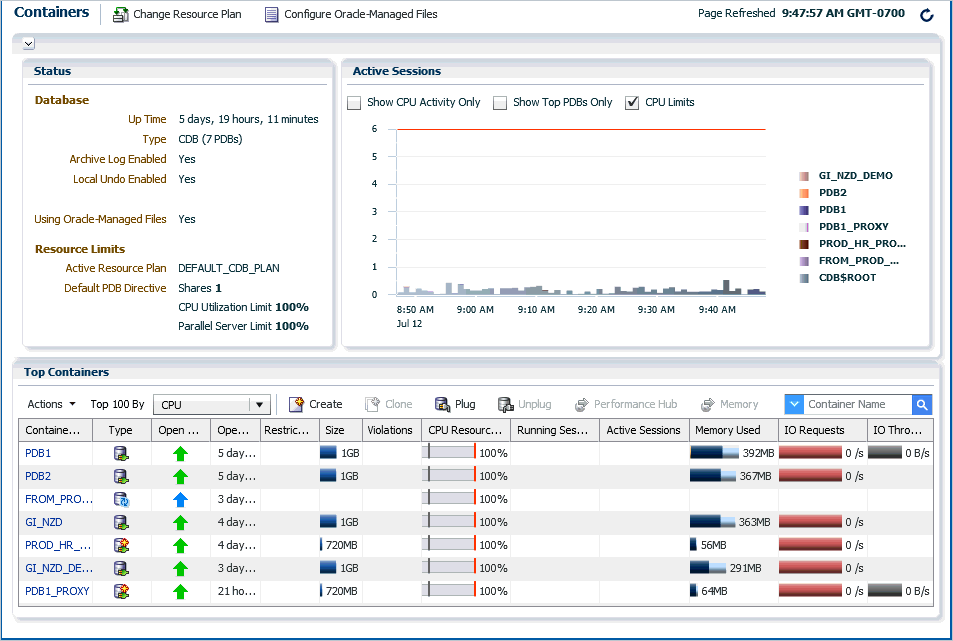

This chapter describes managing pluggable databases (PDBs) in a multitenant container database (CDB) using Oracle Enterprise Manager Database Express (EM Express).

This chapter covers the following topics:

- Getting Started With Managing PDBs Using EM Express

- Overview of CDBs and PDBs

- About PDBs That Can be Managed in EM Express

- Accessing the Containers Page for a CDB

- Accessing the Containers Page for an Application Root

- Setting Storage Limits for a PDB Using EM Express

- Configuring Oracle Managed Files for a CDB Using EM Express

- Provisioning a PDB Using EM Express

- Removing PDBs Using EM Express

- Opening PDBs Using EM Express

- Closing PDBs Using EM Express

- Managing PDBs with EM Express: Oracle by Example Series

**See Also:**

- "[Starting EM Express for a CDB](getting-started-with-database-administration.md)" for information about starting EM Express to manage a CDB

- "[Starting EM Express for a PDB](getting-started-with-database-administration.md)" for information about starting EM Express to manage a PDB

### 13.1 Getting Started With Managing PDBs Using EM Express

This section helps you get started with this chapter by providing an overview of the features EM Express provides for creating and managing the PDBs in a CDB.

Click the links in Table 13-1 to go to the sections that provide more information.

Table 13-1 Getting Started with Managing PDBs in a CDB with EM Express

| Feature                                                             | More Information                                                                                                                                                                                                                                                                                                                                                                       |
|:--------------------------------------------------------------------|:---------------------------------------------------------------------------------------------------------------------------------------------------------------------------------------------------------------------------------------------------------------------------------------------------------------------------------------------------------------------------------------|
| Overview of CDBs and PDBs                                           | See "Overview of CDBs and PDBs" for a conceptual overview of CDBs and PDBs. For detailed conceptual information about CDBs and PDBs, see [Oracle Multitenant Administrator's Guide](../multi/multitenant-architecture.md). See [Oracle Multitenant Administrator's Guide](../multi/overview-of-managing-a-multitenant-environment.md) for information about managing CDBs and PDBs. |
| Accessing the Containers page for a CDB in EM Express               | See "Accessing the Containers Page for a CDB."                                                                                                                                                                                                                                                                                                                                         |
| Accessing the Containers page for an Application Root in EM Express | See "Accessing the Containers Page for an Application Root"                                                                                                                                                                                                                                                                                                                            |
| Setting storage limits for a PDB                                    | See "Setting Storage Limits for a PDB Using EM Express"                                                                                                                                                                                                                                                                                                                                |
| Configuring Oracle Managed Files for a CDB                          | See "Configuring Oracle Managed Files for a CDB Using EM Express" For detailed information about Oracle Managed Files, see [Oracle Database Administrator’s Guide](../admin/using-oracle-managed-files.md)                                                                                                                                                                          |
| Creating a new PDB from the seed                                    | See "Creating a New PDB from the Seed Using EM Express."                                                                                                                                                                                                                                                                                                                               |
| Creating a PDB by cloning a PDB in the same CDB                     | See "Creating a PDB by Cloning a PDB in the Same CDB Using EM Express."                                                                                                                                                                                                                                                                                                                |
| Plugging in an unplugged PDB                                        | See "Plugging in an Unplugged PDB Using EM Express."                                                                                                                                                                                                                                                                                                                                   |
| Creating a PDB by cloning a PDB from a remote CDB                   | See "Creating a PDB by Cloning a PDB from a Remote CDB Using EM Express."                                                                                                                                                                                                                                                                                                              |
| Relocating a remote PDB                                             | See "Relocating a Remote PDB"                                                                                                                                                                                                                                                                                                                                                          |
| Refreshing a PDB on demand                                          | See "Refreshing a PDB on Demand"                                                                                                                                                                                                                                                                                                                                                       |
| Unplugging a PDB                                                    | See "Unplugging a PDB Using EM Express."                                                                                                                                                                                                                                                                                                                                               |
| Dropping a PDB                                                      | See "Dropping a PDB Using EM Express"                                                                                                                                                                                                                                                                                                                                                  |
| Opening a PDB                                                       | See "Opening a PDB Using EM Express"                                                                                                                                                                                                                                                                                                                                                   |
| Opening all the PDBs in a CDB                                       | See "Opening All the PDBs in a CDB Using EM Express"                                                                                                                                                                                                                                                                                                                                   |
| Closing a PDB                                                       | See "Closing a PDB Using EM Express"                                                                                                                                                                                                                                                                                                                                                   |
| Closing all the PDBs in a CDB                                       | See "Closing All the PDBs in a CDB Using EM Express"                                                                                                                                                                                                                                                                                                                                   |

### 13.2 Overview of CDBs and PDBs

An Oracle Database can contain a portable collection of schemas, schema objects, and nonschema objects that appear to an Oracle Net client as a separate database. This self-contained collection is called a PDB. A CDB can include zero or more PDBs.

A CDB can also include zero or more application containers. Each application container includes an application root and the application PDBs plugged into the application root.

EM Express enables database administrators to manage a CDB and its PDBs.

**See Also:**

- [Oracle Multitenant Administrator's Guide](../multi/introduction-to-the-multitenant-architecture.md) for an introduction to CDBs and PDBs

- [Oracle Multitenant Administrator's Guide](../multi/overview-of-managing-a-multitenant-environment.md) for information about managing CDBs and PDBs

### 13.3 About PDBs That Can be Managed in EM Express

You can manage different types of PDBs using EM Express. For example:

- PDB: A PDB is the standard PDB in a CDB. This is a PDB that is not one of the other types of PDBs in this list.

- Refreshable PDB: A refreshable clone PDB (refreshable PDB) is a read-only clone of a source PDB that can periodically synchronize with the source PDB.

- Proxy PDB: A PDB that references a different PDB. A local proxy PDB is in the same CDB as its referenced PDB, whereas a remote proxy PDB is in a different CDB.

  EM Express enables you to view the name and status of proxy PDBs, but EM Express does not support performance management of proxy PDBs.

- Application root: This is the application root in an application container.

- Application PDB: A PDB in the application container.

**Tip:**

The PDBs in a CDB are listed in the Top Containers section on the Containers page for the CDB. For any PDB in the Top Containers section, move your mouse over the icon in the Type column, and a tool tip appears that identifies the PDB type (for example, PDB or Refreshable PDB).

**See Also:**

- "Overview of CDBs and PDBs"

- "Accessing the Containers Page for a CDB"

- Accessing the Containers Page for an Application Root

### 13.4 Accessing the Containers Page for a CDB

Many of the features that EM Express provides for managing PDBs in a CDB are available on the Containers page of the CDB in EM Express.

[Description of the illustration containers_page_12201.gif](img_text/containers_page_12201.md)

EM Express provides the Containers page for CDBs and for an application root in an application container. The Containers page is not provided for non-CDBs.

To access the Containers page for an application root, see Accessing the Containers Page for an Application Root

To access the Containers page for a CDB:

1.  In EM Express, navigate to the Database Home page for the CDB.
    For more information, see "[Accessing the Database Home Page](getting-started-with-database-administration.md)."
2.  In the Status section of the Database Home page, click the CDB (n PDBs) link (where n is the number of PDBs in the CDB) to go to the Containers page for the CDB.

The features that EM Express provides for managing PDBs on the Containers page are described in this chapter.

### 13.5 Accessing the Containers Page for an Application Root

Many EM Express features for managing an application root and application PDBs in a CDB are available on the Containers page of the application root in EM Express.

The steps below assume that you have configured the global port for the CDB that includes the application root you want to manage using EM Express. See [Starting EM Express for a PDB](getting-started-with-database-administration.md) for information about configuring the global port for a CDB.

To access the Containers page for an application root:

1.  In a web browser, enter the EM Express URL for the CDB that includes the application root.
2.  On the EM Express login screen, specify your administrator credentials and enter the name of the application root that you want to connect to in the Container Name field.
    EM Express displays the Database Home page for the application root.
3.  In the Status section of the Database Home page, click the Application Root (n PDBs) link.
    The Containers page for the application root appears.

The Top Containers section lists the application root and application PDBs that can be managed using EM Express.

The EM Express features for managing the application root and application PDBs on the Containers page are described in this chapter.

**See Also:**

Accessing the Containers Page for a CDB

### 13.6 Setting Storage Limits for a PDB Using EM Express

This section provides information on setting storage limits for a PDB.

**Note:**

Before you set storage limits for a PDB:

- The CDB must contain at least one PDB.

- The PDB must be open in read write mode.

#### To set storage limits for a PDB:

1.  In EM Express, navigate to the Containers page for the CDB that contains the PDB whose storage limits you want to set.

    For more information, see "Accessing the Containers Page for a CDB."

2.  In the Containers section, click the name of the PDB whose storage limits you want to set, and then choose Set Storage Limits from the Actions menu.

3.  In the Set Storage Limits dialog box, supply values for these fields:

    - Max Size Unlimited: Enable this option to enable unlimited storage for all the tablespaces for this PDB, or disable this value and then specify the maximum size for all the tablespaces in the Max Size field.

    - Max Shared Temp Size Unlimited: Enable this option to enable unlimited storage for the temporary tablespace shared by the sessions connected to the PDB, or disable this value and then specify the maximum size for the temporary tablespace for this PDB in the Max Shared Temp Size field.

    - Click OK.

      The Confirmation box advises you that the storage limits for the PDB were set successfully.

**See Also:**

"Opening a PDB Using EM Express"

### 13.7 Configuring Oracle Managed Files for a CDB Using EM Express

This section provides information on configuring Oracle Managed Files for a CDB.

Using Oracle Managed Files simplifies the administration of an Oracle Database. Oracle Managed Files eliminate the need for the DBA to directly manage the operating system files that comprise an Oracle Database. With Oracle Managed Files, you specify file system directories in which the database automatically creates, names, and manages files at the database object level.

Through initialization parameters, you specify the file system directory to be used for a particular type of file. The database then ensures that a unique file, an Oracle managed file, is created and deleted when no longer needed.

This feature does not affect the creation or naming of administrative files such as trace files, audit files, alert logs, and core files.

You can use EM Express to configure Oracle Managed Files for a CDB.

**Note:**

Before you configure Oracle Managed Files for a CDB:

- A CDB must exist.

- EM Express must be configured to manage the CDB.

#### To configure Oracle Managed Files for a CDB:

1.  In EM Express, navigate to the Containers page for the CDB for which you want to configure Oracle Managed Files.

    For more information, see "Accessing the Containers Page for a CDB."

2.  Near the top of the Containers page, click the Configure Oracle-Managed Files button.

3.  The Configure Oracle-Managed Files wizard enables you to set a value (a directory location) for the `DB_CREATE_FILE_DEST` initialization parameter. The directory you specify will be the destination of Oracle Managed Files.

    Specify values for these fields in the Configure Oracle-Managed Files wizard:

    - Scope: Specify Memory to make the change in memory, take effect immediately, and persist until the database is shut down. Choose SPFile to make the change in the server parameter file, so that the change will take place after the database is restarted. Choose both Memory and SPFile to change the value now and to have it remain in effect after the database is restarted.

    - Deferred: If specified, the deferred option allows to modify the value of the parameter only for future sessions that connect to the database. With deferred, current sessions retain the old value. If deferred is not specified, the value is changed immediately.

    - Value: Specify the directory to use for the `DB_CREATE_FILE_DEST` initialization parameter. This directory will be the destination of Oracle Managed Files.

    - Comment: Optionally, enter a comment regarding the changes you made.

4.  Click OK.

    The Confirmation box advises you that the default directory for Oracle Managed Files has been set to the specified location. In the Status section of the Containers page, the Using Oracle-Managed Files field shows a value of `Yes`.

    **See Also:**

    - [Oracle Database Administrator’s Guide](../admin/using-oracle-managed-files.md) for more information on setting the `DB_CREATE_FILE_DEST` initialization parameter and on Oracle Managed Files

    - [Oracle Database Reference](../refrn/DB_CREATE_FILE_DEST.md) for more information about the `DB_CREATE_FILE_DEST` initialization parameter

### 13.8 Provisioning a PDB Using EM Express

You can provision PDBs by creating a new PDB within a CDB, by cloning an existing PDB, and by plugging an unplugged PDB into a CDB.

This section provides information about provisioning a PDB using EM Express. It includes the following topics:

- Creating a New PDB from the Seed Using EM Express

- Creating a PDB by Cloning a PDB in the Same CDB Using EM Express

- Plugging in an Unplugged PDB Using EM Express

- About Remote PDB Cloning, Relocating PDBs, and Refreshing PDBs

#### 13.8.1 Creating a New PDB from the Seed Using EM Express

This section provides information about creating a new PDB from the seed (PDB\$SEED) using EM Express.

**Note:**

Before you create a new PDB from the seed:

- The CDB within which you want to create a PDB must exist, and EM Express must be configured to access the CDB.

- The CDB within which you want to create a PDB must be in read/write mode.

- The target host user must be the owner of the Oracle home that the CDB (within which you want to create the PDB) belongs to.

##### To create a new PDB from the seed:

1.  In EM Express, navigate to the Containers page for the CDB in which you want to create the PDB.

    For more information, see "Accessing the Containers Page for a CDB."

2.  In the Containers section of the Containers page, choose Create from the Actions menu. The Create PDB From Seed wizard appears.

3.  On the General page of the Create PDB From Seed wizard, supply values for these fields:

    - PDB Name: Enter the name you want to use for the PDB you are creating.

    - Username: Enter the name of the administrative user who will manage the PDB you are creating.

      The username and password that you specify on this page are used to create the administrator as a local user in the PDB and grants the `PDB_DBA` role locally to the administrator. Enable the Grant DBA Role option to grant the DBA role to the administrative user you are creating.

      **See Also:**

      [Oracle Database Security Guide](../dbseg/configuring-privilege-and-role-authorization.md) for more information about the `PDB_DBA` role and other predefined roles in an Oracle Database installation

    - Password: Enter the password for the administrative user.

    - Confirm Password: Enter the password for the administrative user again.

    - Grant DBA Role: Enable this option to grant the DBA role to the administrative user you are creating.

    Click the right arrow button to go to the Storage page.

4.  On the Storage page, select the type of location where you want to store the datafiles for the PDB:

    - If the target CDB (in which you are creating the PDB) is enabled with Oracle Managed Files and you want to use the same, then select Use Oracle Managed Files (OMF).

    - If the target CDB does not use OMF, then specify a datafile location or accept the default specified in the Datafile Location field.

5.  Also on the Storage page, choose whether or not to enable unlimited storage for the datafiles.

    If you do not enable unlimited storage, then you must specify values for these fields:

    - Max Size: The amount of storage that can be used by all tablespaces that belong to the PDB.

    - Max Shared Temp Size: The amount of storage in the default temporary tablespace shared by all PDBs that can be used by sessions connected to the PDB.

    If no values are specified for these fields, then their values will be set to unlimited when the PDB is created.

6.  If the CDB has a current active resource plan, the Resource Limits page appears.

    Supply values for these fields, or keep the default values for the PDB you are creating:

    - Shares: Assign a new share value for this PDB, or keep the current value.

    - CPU Utilization Limit (%): Assign a new CPU utilization percentage value for this PDB, or keep the current value.

    - Parallel Server Limit (%): Assign a new parallel server utilization percentage value for this PDB, or keep the current value.

    - Memory Minimum (%): Assign a new minimum percentage of memory allowed for this PDB, or keep the current value

    - Memory Limit (%): Assign a new maximum percentage of memory allowed for this PDB, or keep the current value.

7.  Click OK.

    The PDB is created and opened in read/write mode. EM Express adds the PDB to the list of containers that appears in the Containers section on the Containers page.

After configuring an HTTPS port for EM Express for this PDB, the PDB can be managed using EM Express. Administrative users who have been granted the `EM_EXPRESS_ALL` role in a PDB can use EM Express to manage the PDB.

**See Also:**

"[Configuring the HTTPS Port for EM Express](getting-started-with-database-administration.md)" for information on configuring an HTTPS port for EM Express for a PDB

#### 13.8.2 Creating a PDB by Cloning a PDB in the Same CDB Using EM Express

This section provides information about creating a new PDB by cloning an existing PDB in the same CDB using EM Express.

**Note:**

Before you create a new PDB by cloning an existing PDB in the same CDB:

- The source PDB (the PDB that you want to clone) must exist, and EM Express must be configured to access the PDB.

- The source PDB must be open.

- The CDB (the CDB into which you want to plug in the cloned PDB) must exist, and EM Express must be configured to access the CDB.

- The target host user must be the owner of the Oracle home that the CDB belongs to.

##### To create a new PDB by cloning an existing PDB in the same CDB:

1.  In EM Express, navigate to the Containers page for the CDB in which you want to create the PDB.

    For more information, see "Accessing the Containers Page for a CDB."

2.  In the Containers section of the Containers page, click the PDB that you want to clone, and then choose Clone from the Actions menu. The Clone wizard appears.

3.  On the General page of the Clone wizard, supply values for these fields:

    - PDB Name: Enter the name you want to use for the PDB that will be created by the clone operation.

    - Service Option: Each PDB in a database must have a unique service name. By default, a cloning operation uses the service name of the source PDB for the service name of the destination (new) PDB, which causes a violation that appears in the list of violations in the `PDB_PLUG_IN_VIOLATIONS` view for the new PDB. To avoid this violation, enable the Service Option option.

    - Source PDB Service: Specify the service name of the source PDB.

    - Destination PDB Service: Specify the service name of the new PDB that will be created by the clone operation.

    A message at the bottom of the General page tells you the type of clone that will be performed. If the source PDB is in read/write mode, a hot clone will be performed.

    Click the right arrow button to go to the Storage page.

4.  On the Storage page, select the location where you want to store the datafiles for the PDB, or accept the default value.

5.  Click OK.

    The PDB is created and opened in read/write mode. EM Express adds the PDB to the list of containers that appears in the Top Containers section on the Containers page. You may need to refresh the Containers page to see the new PDB in the list of containers.

After configuring an HTTPS port for EM Express for this PDB, the PDB can be managed using EM Express. Administrative users who have been granted the `EM_EXPRESS_ALL` role in a PDB can use EM Express to manage the PDB.

**See Also:**

- "Opening a PDB Using EM Express"

- "[Configuring the HTTPS Port for EM Express](getting-started-with-database-administration.md)" for information on configuring an HTTPS port for EM Express for a PDB

- [Oracle Database Reference](../refrn/PDB_PLUG_IN_VIOLATIONS.md) for information about the` PDB_PLUG_IN_VIOLATIONS` view

#### 13.8.3 Plugging in an Unplugged PDB Using EM Express

This section provides information about creating a new PDB by plugging in an unplugged PDB using EM Express.

**Note:**

Before you plug an unplugged PDB into a CDB:

- The target CDB (the CDB that you want to plug the unplugged PDB into) must exist, and EM Express must be configured to access the CDB.

- The target CDB must be in read/write mode.

- The XML file that describes the unplugged PDB and the other files associated with the unplugged PDB, such as the data files, must exist and must be readable.

- The target host user must be the owner of the Oracle home that the CDB (into which you want to plug the unplugged PDB) belongs to.

- The platforms of the source CDB host (the host on which the CDB that previously contained the unplugged PDB is installed) and the target CDB host (the host on which the target CDB is installed) must have the same endianness, and must have the same set of database options installed.

- The CDB that contained the unplugged PDB and the target CDB must have compatible character sets and national character sets. To be compatible, the character sets and national character sets must meet all the requirements specified in [Oracle Database Globalization Support Guide](../nlspg/choosing-character-set.md).

##### To plug an unplugged PDB into a CDB:

1.  In EM Express, navigate to the Containers page for the CDB that you want to plug the unplugged PDB into.

    For more information, see "Accessing the Containers Page for a CDB."

2.  In the Containers section of the Containers page, choose Plug from the Actions menu. The Plug wizard appears.

3.  On the General page of the Plug wizard, supply values for these fields:

    - Metadata File: Enter the full path to the metadata XML file that was created when the PDB was unplugged.

    - Reuse PDB name from Metadata File: Select this option, or disable it and specify an new name to use for the unplugged PDB when it is plugged into the CDB.

    - Reuse source datafile location from Metadata File: Select this option, or disable it and specify a new source datafile location to use for the unplugged PDB when it is plugged into the CDB.

    Click the right arrow button to go to the Storage page.

4.  On the Storage page, select the type of location where you want to store the datafiles for the PDB:

    - If the target CDB (into which you are plugging the unplugged PDB) is enabled with Oracle Managed Files and you want to use the same, then select Use Oracle Managed Files (OMF).

    - If the target CDB does not use OMF, then specify a datafile location or accept the default specified in the Datafile Location field.

5.  Also on the Storage page, choose whether or not to enable unlimited storage for the datafiles.

    If you do not enable unlimited storage, then you must specify values for these fields:

    - Max Size: The amount of storage that can be used by all tablespaces that belong to the PDB.

    - Max Shared Temp Size: The amount of storage in the default temporary tablespace shared by all PDBs that can be used by sessions connected to the PDB.

    If no values are specified for these fields, then their values will be set to unlimited when the PDB is plugged in.

6.  If the CDB has a current active resource plan, the Resource Limits page appears.

    Supply values for these fields, or keep the default values for the PDB you are plugging in:

    - Shares: Assign a new share value for this PDB, or keep the current value.

    - CPU Utilization Limit (%): Assign a new CPU utilization percentage value for this PDB, or keep the current value.

    - Parallel Server Limit (%): Assign a new parallel server utilization percentage value for this PDB, or keep the current value.

    - Memory Minimum (%): Assign a new minimum percentage of memory allowed for this PDB, or keep the current value.

    - Memory Limit (%): Assign a new maximum percentage of memory allowed for this PDB, or keep the current value.

7.  Click OK.

    The unplugged PDB is plugged into the CDB and is opened in read/write mode. EM Express adds the PDB to the list of containers that appears in the Containers section on the Containers page.

After configuring an HTTPS port for EM Express for this PDB, the PDB can be managed using EM Express. Administrative users who have been granted the `EM_EXPRESS_ALL` role in a PDB can use EM Express to manage the PDB.

**See Also:**

- "[Configuring the HTTPS Port for EM Express](getting-started-with-database-administration.md)" for information on configuring an HTTPS port for EM Express for a PDB

- "Unplugging a PDB Using EM Express" for information on unplugging a PDB from a CDB

#### 13.8.4 About Remote PDB Cloning, Relocating PDBs, and Refreshing PDBs

EM Express allows you to perform remote operations involving PDBs.

You can perform the following remote PDB operations using EM Express:

- Hot cloning of a remote PDB

  You can perform a hot clone of a remote PDB to another CDB.

- Relocating a remote PDB

  You can relocate a remote PDB from one CDB to another with minimal down time.

- Refreshing a refreshable PDB on demand

  A refreshable PDB clone (refreshable PDB) is a read-only clone of a source PDB that can periodically synchronize with the source PDB.

  You can refresh a refreshable PDB from a source PDB on demand.

**Note:**

- "Creating a PDB by Cloning a PDB from a Remote CDB Using EM Express"

- "Relocating a Remote PDB"

- "Refreshing a PDB on Demand"

##### Prerequisites for Performing These Operations

The prerequisites for performing these operations are:

- The destination CDB must be in ARCHIVELOG mode. If it is, the Status section on the Containers page will have a value of Yes for the Archive Log Enabled field.

- The destination CDB must have local undo enabled. If it does, the Status section on the Containers page will have a value of Yes for the Local Undo Enabled field.

- The destination CDB must have a public database link to the source CDB, and the user performing these operations must have sufficient privileges to use the database link.

**See Also:**

- [Oracle Multitenant Administrator's Guide](../multi/introduction-to-the-multitenant-architecture.md) for introductory information about cloning a remote PDB

- [Oracle Multitenant Administrator's Guide](../multi/introduction-to-the-multitenant-architecture.md) for introductory information about relocating a remote PDB

- [Oracle Multitenant Administrator's Guide](../multi/introduction-to-the-multitenant-architecture.md) for introductory information about refreshable PDBs

##### 13.8.4.1 Creating a PDB by Cloning a PDB from a Remote CDB Using EM Express

You can create a new PDB by cloning an existing PDB from a remote CDB using EM Express.

**Note:**

Before you create a new PDB by cloning an existing PDB from a remote CDB:

- The source PDB (the PDB that you want to clone) must exist, and EM Express must be configured to access the PDB.

- The source PDB must be open.

- The target CDB (the CDB into which you want to plug in the cloned PDB) must exist, and EM Express must be configured to access the CDB.

- The target CDB must be in read/write mode.

- The target host user must be the owner of the Oracle home that the CDB belongs to.

- To perform a hot clone, the prerequisites in "About Remote PDB Cloning, Relocating PDBs, and Refreshing PDBs" must be met and the PDB to be cloned must be open in read/write mode. If the PDB is not open in read/write mode, a cold clone is performed.

##### To create a new PDB by cloning an existing PDB from a remote CDB:

1.  In EM Express, navigate to the Containers page for the CDB in which you want to create the PDB.

    For more information, see "Accessing the Containers Page for a CDB."

2.  In the Containers section of the Containers page, choose Remote Clone from the Actions menu. The Clone a Remote PDB wizard appears.

3.  On the General page of the Clone wizard, supply values for these fields:

    - PDB Name: Enter the name you want to use for the PDB that will be created by the clone operation.

    - Source PDB Name: Enter the name of the PDB that you want to clone in the remote CDB.

    - Source DB Link: Enter the name of the database link for the remote CDB that contains the PDB to be cloned.

    - Degree of Parallelism: Specify a value for the number of parallel execution servers to use to copy the new PDB's data files to a new location. You must specify a value of 2 or greater or the CDB does not parallelize the creation of the PDB. Depending on the current database load and the number of available parallel execution servers, the CDB may not grant the degree of parallelism that you request for the PDB creation.

    - Refresh Option: Enable this option to select a refresh mode to create a refreshable clone PDB (refreshable PDB) from the source PDB. When you enable this option, you can choose a refresh mode of Manual or Automatic.

    - Manual: The refresh operation has to be manually performed on the refreshable PDB created.

    - Automatic: The refresh operation happens automatically at the interval you specify in the Auto Refresh Frequency field.

      A refreshable PDB can be in either read only mode or closed. The refreshable PDB created using either manual refresh mode or automatic refresh mode must be closed in order for refresh to be performed. When automatic refresh is enabled, if the refreshable PDB is not closed when automatic refresh is attempted, the refresh is deferred until the next scheduled refresh.

    - Auto Refresh Frequency (mins): Select the interval (in minutes) for automatic refreshes of the refreshable PDB.

    - Service Option: Each PDB in a database should have a unique service name. By default, a cloning operation uses the service name of the source PDB for the service name of the destination (new) PDB, which causes a violation that appears in the list of violations in the PDB_PLUG_IN_VIOLATIONS view for the new PDB. To avoid this violation, enable the Service Option option.

    - Source PDB Service: Specify the service name of the source PDB.

    - Destination PDB Service: Specify the service name of the new PDB that will be created by the clone operation.

    Click the right arrow button to go to the Storage page.

4.  On the Storage page, select the type of location where you want to store the datafiles for the PDB:

    - If the target CDB (in which you are creating the PDB) is enabled with Oracle Managed Files and you want to use the same, then select Use Oracle Managed Files (OMF).

    - If the target CDB does not use OMF, then specify a datafile location or accept the default specified in the Datafile Location field.

5.  Also on the Storage page, choose whether or not to enable unlimited storage for the datafiles.

    If you do not enable unlimited storage, then you must specify values for these fields:

    - Max Size: The amount of storage that can be used by all tablespaces that belong to the PDB.

    - Max Shared Temp Size: The amount of storage in the default temporary tablespace shared by all PDBs that can be used by sessions connected to the PDB.

    If no values are specified for these fields, then their values will be set to unlimited when the PDB is created.

6.  If the target CDB to which you are cloning the remote PDB has a current active resource plan, the Resource Limits page appears.

    Supply values for these fields, or keep the default values for the PDB you are creating:

    - Shares: Assign a new share value for this PDB, or keep the current value.

    - CPU Utilization Limit (%): Assign a new CPU utilization percentage value for this PDB, or keep the current value.

    - Parallel Server Limit (%): Assign a new parallel server utilization percentage value for this PDB, or keep the current value.

7.  Click OK.

    The new PDB is created and opened in read/write mode, unless the new PDB is a refreshable PDB. A new refreshable PDB is created in closed mode on the destination. EM Express adds the PDB to the list of containers that appears in the Top Containers section on the Containers page. You may need to refresh the Containers page to see the new PDB in the list of containers.

**See Also:**

- [Oracle Multitenant Administrator's Guide](../multi/index.md) for additional information about creating a refreshable PDB.

- "Opening a PDB Using EM Express"

##### 13.8.4.2 Relocating a Remote PDB

You can relocate a PDB from a remote CDB to another CDB with minimal down time using EM Express.

The remote PDB that is relocated remains open in read/write mode during the relocation. The files associated with the PDB are moved to the new CDB as part of the relocation.

**Note:**

Before you relocate a PDB from a remote CDB:

- The source PDB (the PDB that you want to relocate) must exist, and EM Express must be configured to access the PDB.

- The source PDB must be open.

- The target CDB (the CDB into which you want to relocate the source PDB) must exist, and EM Express must be configured to access the CDB.

- The target CDB must be in read/write mode.

- The target host user must be the owner of the Oracle home that the CDB belongs to.

- To perform a PDB relocation, the prerequisites in "About Remote PDB Cloning, Relocating PDBs, and Refreshing PDBs" must be met and the PDB to be relocated must be open in read/write mode.

##### To create a new PDB by relocating a remote PDB:

1.  In EM Express, navigate to the Containers page for the CDB to which you want to relocate the remote PDB.
    For more information, see "Accessing the Containers Page for a CDB."
2.  In the Containers section of the Containers page, choose Relocate from the Actions menu. The Relocate PDB wizard appears.
3.  On the General page of the Relocate PDB wizard, supply values for these fields:
    - PDB Name: Enter the name you want to use for the PDB that will be relocated to this CDB.

    - Source PDB Name: Enter the name of the remote PDB that you want to relocate to this CDB.

    - Source DB Link: Enter the name of the database link for the remote CDB that contains the PDB to be relocated.

    - PDB Relocate Mode: Specify a value of Normal mode or Maximum Availability mode for the relocate operation.

    - Normal: With this mode, the source PDB will be closed and dropped in the source CDB after the relocation. The PDB will only exist in the new CDB.

    - Maximum Availability: With this mode, the source PDB remains open and can continue to serve requests until the PDB relocation is complete. After the PDB relocation is complete and the new PDB in the destination CDB is opened to serve requests, any requests directed to the source PDB are forwarded to the new relocated PDB in the destination CDB. After successful relocation in maximum availability mode, the source PDB becomes a tombstone PDB in mounted mode in the source CDB. After all the clients are migrated to use the new relocated PDB, you should delete this tombstone PDB entry in the source CDB.

    - Degree of Parallelism: Specify a value for the number of parallel execution servers to use to copy the new PDB's data files to a new location. You must specify a value of 2 or greater or the CDB does not parallelize the creation of the PDB. Depending on the current database load and the number of available parallel execution servers, the CDB may not grant the degree of parallelism that you request for the PDB creation.
4.  On the Storage page, select the type of location where you want to store the datafiles for the PDB:
    - If the target CDB (in which you are relocating the PDB) is enabled with Oracle Managed Files and you want to use the same, then select Use Oracle Managed Files (OMF).

    - If the target CDB does not use OMF, then specify a datafile location or accept the default specified in the Datafile Location field.
5.  Also on the Storage page, choose whether or not to enable unlimited storage for the datafiles.
    If you do not enable unlimited storage, then you must specify values for these fields:

    - Max Size: The amount of storage that can be used by all tablespaces that belong to the PDB.

    - Max Shared Temp Size: The amount of storage in the default temporary tablespace shared by all PDBs that can be used by sessions connected to the PDB.

    If no values are specified for these fields, then their values will be set to unlimited when the PDB is created.
6.  If the target CDB to which you are relocating the remote PDB has a current active resource plan, the Resource Limits page appears.
    Supply values for these fields, or keep the default values for the PDB you are creating:

    - Shares: Assign a new share value for this PDB, or keep the current value.

    - CPU Utilization Limit (%): Assign a new CPU utilization percentage value for this PDB, or keep the current value.

    - Parallel Server Limit (%): Assign a new parallel server utilization percentage value for this PDB, or keep the current value.
7.  Click OK.
    The relocated PDB is created and opened in read/write mode. EM Express adds the PDB to the list of containers that appears in the Top Containers section on the Containers page. You may need to refresh the Containers page to see the new PDB in the list of containers.

##### 13.8.4.3 Refreshing a PDB on Demand

You can refresh a refreshable PDB on demand using EM Express.

A refreshable PDB clone (refreshable PDB) is a read-only clone of a source PDB that can periodically synchronize with the source PDB.

##### To refresh a refreshable PDB:

**Note:**

Before you refresh a refreshable PDB:

- The source PDB (the PDB that you want to synchronize to the refreshable PDB) must exist, and EM Express must be configured to access the PDB.

- The source PDB must be open in read/write mode.

- The target CDB (the CDB in which the refreshable PDB is located) must exist, and EM Express must be configured to access the CDB.

- The target CDB must be open in read/write mode.

- The refreshable PDB must be open in mounted mode.

- The target host user must be the owner of the Oracle home that the CDB belongs to.

- To refresh a refreshable PDB, the prerequisites in "About Remote PDB Cloning, Relocating PDBs, and Refreshing PDBs" must be met and the refreshable PDB must be open in mounted mode.

1.  In EM Express, navigate to the Containers page for the CDB where the refreshable PDB is located.
    For more information, see "Accessing the Containers Page for a CDB."
2.  In the Top Containers section, move your cursor over the Type column for the PDB you want to refresh and confirm that Refreshable PDB appears as the PDB type in the tool tip. The only type of PDB that can be refreshed is a refreshable PDB.
3.  In the Containers section of the Containers page, select the refreshable PDB that you want to refresh and choose Refresh from the Actions menu.
4.  The Refresh PDB dialog box appears to confirm that you want to refresh the refreshable PDB. Click OK.
5.  When the refresh operation ends, a message box confirms that the PDB was refreshed successfully.
    **See Also:**

    "Creating a PDB by Cloning a PDB from a Remote CDB Using EM Express" for information about creating a refreshable PDB as part of a remote clone operation

### 13.9 Removing PDBs Using EM Express

This section provides information about unplugging PDBs and deleting PDBs using EM Express. It includes the following topics:

- Unplugging a PDB Using EM Express

- Dropping a PDB Using EM Express

#### 13.9.1 Unplugging a PDB Using EM Express

This section provides information about unplugging a PDB using EM Express.

**Note:**

Before you unplug a PDB from its CDB:

- The PDB that you want to unplug must have been opened at least once.

- The target host user must be the owner of the Oracle home that the CDB (that contains the PDB you want to unplug) belongs to.

##### To unplug a PDB from its CDB:

1.  In EM Express, navigate to the Containers page for the CDB in which you want to unplug a PDB.

    For more information, see "Accessing the Containers Page for a CDB."

2.  In the Containers section of the Containers page, click the PDB that you want to unplug, and then choose Unplug from the Actions menu. The Unplug wizard appears and advises you that as part of the unplug operation, the PDB is being closed with the Immediate option.

3.  Click OK.

    The PDB is closed and unplugged. The Confirmation box appears and shows you the path to the metadata XML file created by the unplug operation. EM Express removes the PDB from the list of containers that appears in the Containers section on the Containers page.

**Note:**

If you decide later to plug the unplugged PDB into this CDB or a different CDB, you must know the location of the metadata XML file for the PDB.

**See Also:**

- "Plugging in an Unplugged PDB Using EM Express" for information on plugging an unplugged PDB into a CDB

- "Dropping a PDB Using EM Express"

- "Opening a PDB Using EM Express"

#### 13.9.2 Dropping a PDB Using EM Express

This section provides information about dropping (permanently deleting) a PDB from a CDB using EM Express.

**Note:**

Before you drop a PDB from its CDB:

- The PDB that you want to drop must have been opened at least once.

- The target host user must be the owner of the Oracle home that the CDB (that contains the PDB you want to drop) belongs to.

##### To drop a PDB from its CDB:

1.  In EM Express, navigate to the Containers page for the CDB that contains the PDB that you want to drop.

    For more information, see "Accessing the Containers Page for a CDB."

2.  In the Containers section of the Containers page, click the PDB that you want to drop, and then choose Drop from the Actions menu. The Drop wizard appears and advises you that the drop operation drops the resource plan directive associated with the PDB in the current active resource plan, and that the PDB is being closed with the Immediate option. By default, the datafiles for the PDB are also dropped.

3.  Click OK.

    The PDB is dropped. The Confirmation box appears and advises you that the PDB was dropped successfully. EM Express removes the PDB from the list of containers that appears in the Containers section on the Containers page.

**See Also:**

- "Unplugging a PDB Using EM Express" for information on unplugging a PDB from its CDB

- "Opening a PDB Using EM Express"

### 13.10 Opening PDBs Using EM Express

This section provides information about opening one or all of the PDBs in a CDB using EM Express. It includes the following topics:

- Opening a PDB Using EM Express

- Opening All the PDBs in a CDB Using EM Express

#### 13.10.1 Opening a PDB Using EM Express

This section provides information about opening a PDB in a CDB using EM Express.

**Note:**

Before you open a PDB:

- The PDB that you want to open must exist in the CDB.

- You must have the `SYSDBA`, `SYSOPER`, `SYSBACKUP`, or `SYSDG` administrative privilege, and the privilege must be either commonly granted or locally granted in the PDB. You must exercise the privilege using `AS SYSDBA`, `AS SYSOPER`, `AS SYSBACKUP`, or `AS SYSDG`, respectively, at connect time.

##### To open a PDB:

1.  In EM Express, navigate to the Containers page for the CDB that contains the PDB that you want to open.

    For more information, see "Accessing the Containers Page for a CDB."

2.  In the Containers section of the Containers page, click the PDB that you want to open, and then choose Open from the Actions menu. The Open PDB wizard appears and asks you to specify the open mode for the PDB (Read Write, Read Only, or Migrate), and whether you want the PDB opened in restricted mode.

    A PDB open in unrestricted mode allows access to all users, but a PDB open in restricted mode can be accessed only by a PDB administrator.

    Choose the open mode for the PDB and whether it should be opened in restricted mode or not.

    **Note:**

    If you choose to open a the PDB that is already open, it will be closed with immediate mode, and then reopened in the open mode and restricted mode that you specified in the Open PDB wizard.

    If a PDB is closed immediately, users currently connected to the PDB are disconnected, and active transactions are implicitly rolled back.

3.  Click OK.

    The PDB is opened. The Confirmation box appears and advises you that the PDB was opened successfully. In the Containers section on the Containers page, the up arrow icon appears in the Open Mode column for the PDB.

**See Also:**

- [Oracle Multitenant Administrator's Guide](../multi/administering-pdbs-with-sql-plus.md) for an introduction to the open modes of PDBs

- [Oracle Database Administrator’s Guide](../admin/starting-up-and-shutting-down.md) for more information about shutting down using immediate mode

- "Opening All the PDBs in a CDB Using EM Express"

- "Closing a PDB Using EM Express"

- "Closing All the PDBs in a CDB Using EM Express"

#### 13.10.2 Opening All the PDBs in a CDB Using EM Express

This section provides information about opening all the PDBs in a CDB using EM Express.

**Note:**

Before you open all the PDBs in a CDB:

- Make sure that you want to open all the PDBs in the CDB.

- You must have the `SYSDBA`, `SYSOPER`, `SYSBACKUP`, or `SYSDG` administrative privilege, and the privilege must be either commonly granted or locally granted in the PDBs. You must exercise the privilege using `AS SYSDBA`, `AS SYSOPER`, `AS SYSBACKUP`, or `AS SYSDG`, respectively, at connect time.

##### To open all the PDBs in a CDB:

1.  In EM Express, navigate to the Containers page for the CDB that contains the PDBs that you want to open.

    For more information, see "Accessing the Containers Page for a CDB."

2.  In the Containers section of the Containers page, choose Open All from the Actions menu. The Open All PDBs wizard appears and asks you to specify the open mode to use for all the PDBs (Read Write, Read Only, or Migrate), and whether you want the PDBs opened in restricted mode.

    A PDB open in unrestricted mode allows access to all users, but a PDB open in restricted mode can be accessed only by a PDB administrator.

    Choose the open mode for the PDBs and whether they should be opened in restricted mode or not.

    **Caution:**

    When you choose to open all the PDBs in a CDB, if any PDBs in the CDB are already open, they will be closed immediately, and then reopened in the open mode and restricted mode that you specified in the Open All PDBs wizard.

    If a PDB is closed immediately, users currently connected to the PDB are disconnected, and active transactions are implicitly rolled back.

3.  Click OK.

    All the PDBs in the CDB are opened. The Confirmation box appears and advises you that all the PDBs were opened successfully. In the Containers section on the Containers page, the up arrow icon appears in the Open Mode column for all the PDBs, and if they were opened in restricted mode, a check mark appears in the Restricted column for each PDB.

**See Also:**

- [Oracle Multitenant Administrator's Guide](../multi/administering-pdbs-with-sql-plus.md) for an introduction to the open modes of PDBs

- [Oracle Database Administrator’s Guide](../admin/starting-up-and-shutting-down.md) for more information about shutting down using immediate mode

- "Opening a PDB Using EM Express"

- "Closing a PDB Using EM Express"

- "Closing All the PDBs in a CDB Using EM Express"

### 13.11 Closing PDBs Using EM Express

This section provides information about closing one or all of the PDBs in a CDB using EM Express. It includes the following topics:

- Closing a PDB Using EM Express

- Closing All the PDBs in a CDB Using EM Express

#### 13.11.1 Closing a PDB Using EM Express

This section provides information about closing a PDB in a CDB using EM Express.

**Note:**

Before you close a PDB in a CDB:

- The PDB that you want to close must exist in the CDB and must be open.

- You must have the `SYSDBA`, `SYSOPER`, `SYSBACKUP`, or `SYSDG` administrative privilege, and the privilege must be either commonly granted or locally granted in the PDB. You must exercise the privilege using `AS SYSDBA`, `AS SYSOPER`, `AS SYSBACKUP`, or `AS SYSDG`, respectively, at connect time.

##### To close a PDB in a CDB:

1.  In EM Express, navigate to the Containers page for the CDB that contains the PDB that you want to close.

    For more information, see "Accessing the Containers Page for a CDB."

2.  In the Containers section of the Containers page, click the PDB that you want to close, and choose Close from the Actions menu. The Close PDB wizard appears and advises you that the PDB will be closed with the Immediate option.

3.  Click OK.

    The PDB is closed. The Confirmation box appears and advises you that the PDB was closed successfully. In the Containers section on the Containers page, the down arrow icon appears in the Open Mode column for the PDB.

**See Also:**

- "Opening a PDB Using EM Express"

- "Opening All the PDBs in a CDB Using EM Express"

- "Closing All the PDBs in a CDB Using EM Express"

#### 13.11.2 Closing All the PDBs in a CDB Using EM Express

This section provides information about closing all the PDBs in a CDB using EM Express.

**Note:**

Before you close all the PDBs in a CDB:

- At least one of the PDBs in the CDB must be open.

- You must have the `SYSDBA`, `SYSOPER`, `SYSBACKUP`, or `SYSDG` administrative privilege, and the privilege must be either commonly granted or locally granted in the PDBs that are open. You must exercise the privilege using `AS SYSDBA`, `AS SYSOPER`, `AS SYSBACKUP`, or `AS SYSDG`, respectively, at connect time.

##### To close all the PDBs in a CDB:

1.  In EM Express, navigate to the Containers page for the CDB that contains the PDB that you want to close.

    For more information, see "Accessing the Containers Page for a CDB."

2.  In the Containers section of the Containers page, choose Close All from the Actions menu. The Close All PDBs wizard appears and advises you that the PDBs will be closed with the Immediate option.

3.  Click OK.

    All the PDBs are closed. The Confirmation box appears and advises you that the PDBs were closed successfully. In the Containers section on the Containers page, the down arrow icon appears in the Open Mode column for the PDBs.

**See Also:**

- "Opening a PDB Using EM Express"

- "Opening All the PDBs in a CDB Using EM Express"

- "Closing a PDB Using EM Express"

### 13.12 Managing PDBs with EM Express: Oracle by Example Series

Oracle By Example (OBE) has a series on the `Oracle Database 2 Day DBA` guide. This OBE series steps you through the tasks in this section, and includes annotated screenshots.

The series consists of the following tutorials:

1.  Access and Configure Container Page for a CDB Using EM Express

2.  Provision a PDB using EM Express

3.  Remove PDBs using EM Express

4.  Open PDBs Using EM Express

5.  Close PDBs Using EM Express

The above tutorials can be accessed in two ways:

- To see a clickable list of the above tutorials, go to [Manage PDBs using EM Express Series](https://docs.oracle.com/pls/topic/lookup?ctx=en/database/oracle/oracle-database/19/admqs&id=twodaydba_obe_manpdbs).

- For seamless navigation through the tutorial series, access the following link:

  [Manage PDBs using EM Express](https://docs.oracle.com/pls/topic/lookup?ctx=en/database/oracle/oracle-database/19/admqs&id=twodaydba_lp_manpdbs)

  You can navigate across the tutorials by clicking the \> button at the bottom of the pane.
