This chapter discusses the creation and management of schema objects using SQL Developer. It contains the following sections:

- About Schema Objects

- About Schema Object Management Privileges

- About SQL Developer

- Managing Tables

- Managing Indexes

- Managing Views

- Managing Program Code Stored in the Database

- Working with Other Schema Objects

- Managing Schema Objects: Oracle by Example Series

### 8.1 About Schema Objects

A schema is a collection of database objects. A schema is owned by a database user and shares the same name as the user. Schema objects are logical structures created by users. Some objects, such as tables or indexes, hold data. Other objects, such as views or synonyms, consist of a definition only.

**Note:**

There is no relationship between a tablespace and a schema. Objects in the same schema can use storage in different tablespaces, and a tablespace can contain data from different schemas.

#### Naming Schema Objects

Every object in the database belongs to one schema and has a unique name within that schema. Multiple database objects can share the same name, if they are in different schemas. You can use the schema name to unambiguously refer to objects. For example, `hr.employees` refers to the table named `employees` in the `hr` schema. (The `employees` table is owned by `hr`.) The terms database object and schema object are used interchangeably.

When you create a database object, you must ensure that you create it in the intended schema. One method is to log in to the database as the user who owns the schema and then create the object. Generally, you place all the objects that belong to a single application in the same schema.

A schema object name must abide by certain rules. In addition to being unique within a schema, a schema object name cannot be longer than 30 bytes and must begin with a letter. If you attempt to create an object with a name that violates any of these rules, then the database raises an error.

#### The DDL Tab

You can create and manipulate schema objects with SQL or with SQL Developer.

When creating schema objects using SQL Developer, you can click the DDL tab to display the SQL statement that is the equivalent of the schema object properties that you specified with the graphical user interface. SQL Developer submits this SQL statement to create the schema object. This option shows the statement even if it is incomplete, so you must enter all specifications for the schema object to see the complete SQL statement that SQL Developer submits.

**See Also:**

[Oracle Database Concepts](../cncpt/tables-and-table-clusters.md) for more detailed information about schema objects

### 8.2 About Schema Object Management Privileges

As a database administrator (DBA), you can create, modify, and delete schema objects in your own schema and in any other schema. For purposes of this discussion, a database administrator is defined as any user who is granted the `DBA` role. This includes the `SYS` and `SYSTEM` users by default. Oracle recommends granting the `DBA` role only to those users who require administrative type access.

You can enable other users to manage schema objects without necessarily granting them DBA privileges. For example, a common scenario is to enable an application developer to create, modify, and delete schema objects in his or her own schema. To do so, you grant the `RESOURCE` role to the application developer.

**See Also:**

- "[Example: Granting Privileges and Roles to a User Account](administering-user-accounts-and-security.md)"

- "[Administering the Database with SQL-Based Management Tools](getting-started-with-database-administration.md)"

### 8.3 About SQL Developer

Oracle SQL Developer is a graphical version of SQL\*Plus that gives database administrators a convenient way to perform basic tasks involving schema objects. For example, you can browse, create, edit, and delete (drop) database schema objects. You can also run SQL statements and scripts, import and export table data, find invalid schema objects, and view reports.

You can connect to any target Oracle database schema using standard Oracle database authentication. Once connected, you can perform operations on schema objects.

The following topics provide basic information needed to begin using SQL Developer effectively:

- Installing and Starting SQL Developer

- Understanding the SQL Developer User Interface

- Creating a Database Connection Using SQL Developer

**See Also:**

You can also use SQL Developer to perform other database tests, such as unit testing, migrations, and data modeling.

See [Oracle SQL Developer User's Guide](https://docs.oracle.com/pls/topic/lookup?ctx=en/database/oracle/oracle-database/19/admqs&id=RPTUG10000) for more information on other SQL Developer features.

#### 8.3.1 Installing and Starting SQL Developer

To install and start SQL Developer, you download a ZIP file and unzip it into a desired parent directory or folder, and then type a command or double-click a file name.

**See Also:**

[Oracle SQL Developer User's Guide](https://docs.oracle.com/pls/topic/lookup?ctx=en/database/oracle/oracle-database/19/admqs&id=RPTUG10100) for detailed instructions on installing and starting SQL Developer.

#### 8.3.2 Understanding the SQL Developer User Interface

When you start SQL Developer, the SQL Developer window appears.

The SQL Developer window generally uses the left side for navigation to find and select objects, and the right side to display information about selected objects.

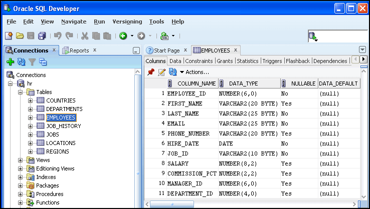
[Description of the illustration sqld_main_page.gif](img_text/sqld_main_page.md)

The menus along the top of the page contain standard entries, plus entries for features specific to SQL Developer.

The left side of the SQL Developer window has tabs and panes for the Connections and Reports navigators, icons for performing actions, and a hierarchical tree display for the currently selected navigator.

In the figure, the HR database connection appears in the Connections navigator, and the schema objects for the HR schema appear in the metadata tree.

The metadata tree in the Connections navigator displays all the objects (categorized by object type) accessible to the defined connections. To select an object, expand the appropriate tree node or nodes, then click the object.

The right side of the SQL Developer window has tabs and panes for objects that you select or open. For example, the object pane in the figure displays information about a table named EMPLOYEES. (If you hold the mouse pointer over the tab label -- EMPLOYEES in this figure -- a tooltip displays the object's owner and the database connection.)

**See Also:**

[Oracle SQL Developer User's Guide](https://docs.oracle.com/pls/topic/lookup?ctx=en/database/oracle/oracle-database/19/admqs&id=RPTUG10200) for more information about the SQL Developer user interface.

#### 8.3.3 Creating a Database Connection Using SQL Developer

A database connection is a SQL Developer object that specifies the necessary information for connecting to a specific database as a specific user of that database. You must have at least one database connection (existing, created, or imported) to use SQL Developer.

##### To create a database connection:

1.  In the Connections navigator in SQL Developer, right-click the Connections node and select New Connection.
    The New / Select Database Connection dialog box appears, with the Oracle tab displayed.
2.  Enter the following information:
    - In the Connection Name field, enter the name to use for this database connection.

    - In the Username field, enter the name of the user for whom this database connection is being created.

    - In the Password field, enter the password for the user.

    - In the Connection Type field, select the database connection type.

      The connection types are:

      - Basic

      - TNS

      - LDAP

      - Advanced

      - Local/Bequeath

      When you choose a connection type, the fields below will change to be appropriate for the selected connection type. This example describes the fields for the Basic connection type.

    - In the Role field, select `Default` or `SYSDBA`, based on the role assigned to the user.

    - In the Hostname field, enter the name of the host where the database is located.

    - In the Port field, enter the port for the database.

    - In the SID field, enter the SID for the database (when the database connection is for a non-CDB user or for a multitenant container database (CDB) user):

      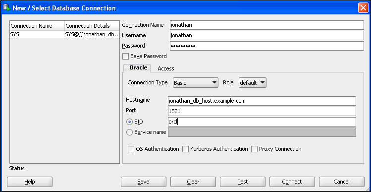
      [Description of the illustration sqld_create_connection4.gif](img_text/sqld_create_connection4.md)
      When a database connection to a non-CDB or CDB is created for an administrative user such as `SYS`, `SYSDBA` is typically specified in the Role field for the connection.

    - In the Service name field, enter the service name for the pluggable database (PDB), including the domain name (when the database connection is for a PDB user):

      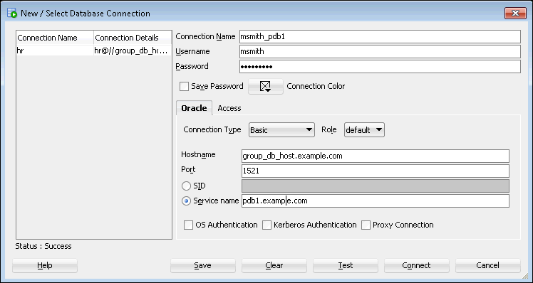
      [Description of the illustration sqld_create_pdb_conn_new.gif](img_text/sqld_create_pdb_conn_new.md)
      When a database connection to a PDB is created for an administrative user such as `SYS`, `SYSDBA` is typically specified in the Role field for the connection.
3.  Optionally, click Test to test that the data you provided will allow the specified user to connect to the database.
4.  When you are finished, click Connect to connect using the database connection, or click Save to save the database creation.

**See Also:**

- [Oracle SQL Developer User's Guide](https://docs.oracle.com/pls/topic/lookup?ctx=en/database/oracle/oracle-database/19/admqs&id=RPTUG10400) for more information about creating, editing, exporting, and importing database connections.

- [Oracle Multitenant Administrator's Guide](../multi/introduction-to-the-multitenant-architecture.md) for an overview of the multitenant architecture introduced in Oracle Database 12c, which enables an Oracle database to function as a multitenant container database (CDB) that includes zero, one, or many customer created pluggable databases (PDBs). A non-CDB is a traditional Oracle database that cannot contain PDBs. All Oracle databases before Oracle Database 12c were non-CDBs.

- [Oracle Multitenant Administrator's Guide](../multi/creating-and-configuring-a-cdb.md) for complete information about creating and configuring a CDB.

### 8.4 Managing Tables

This section introduces database tables and describes how to perform various table operations using SQL Developer.

This section includes these topics:

- About Tables

- Viewing Tables

- Viewing Table Data

- Example: Creating a Table

- Modifying Table Attributes

- Example: Loading Data into a Table

- Deleting a Table

#### 8.4.1  About Tables

The table is the basic unit of data storage in an Oracle database. It holds all user-accessible data. Each table is made up of columns and rows. In the `employees` table, for example, there are columns called `last_name` and `employee_id`. Each row in the table represents a different employee, and contains a value for `last_name` and `employee_id`.

When you create a table, you specify the table type, and define its columns and constraints. Constraints are rules that help preserve data integrity.

This section contains the following topics:

- About Table Types

- About Table Column Attributes

- About Table-Level Constraints

- Other Table Creation Considerations

##### 8.4.1.1 About Table Types

The most common type of table in an Oracle database is a relational table, which is structured with simple columns similar to the `employees` table. Two other table types are supported: object tables and `XMLType` tables. Any of the three table types can be defined as permanent or temporary. Temporary tables hold session-private data that exists only for the duration of a transaction or session. They are useful in applications where a results set must be held temporarily in memory, perhaps because the results set is constructed by running multiple operations.

You can build relational tables in either heap or index-organized structures. In heap structures, the rows are not stored in any particular order. In index-organized tables, the row order is determined by the values in one or more selected columns. For some applications, index-organized tables provide enhanced performance and more efficient use of disk space.

This section describes permanent, heap-organized tables. For information about other table types and when to use them, see [Oracle Database Administrator’s Guide](../admin/managing-tables.md) and [Oracle Database Concepts](../cncpt/tables-and-table-clusters.md). For the syntax required to create tables with SQL, see [Oracle Database SQL Language Reference](../sqlrf/CREATE-TABLE.md).

##### 8.4.1.2 About Table Column Attributes

You define table columns to hold your data. When you create a column, you specify the following attributes:

- Data Type

- NOT NULL Column Constraint

- Default Value

- Encryption

###### 8.4.1.2.1 Data Type

The data type attribute defines the kind of data to be stored in the column. When you create a table, you must specify a data type for each of its columns.

Data types define the domain of values that each column can contain. For example, `DATE` columns cannot accept the value `February 29` (except for a leap year) or the values `2` or `SHOE`. Each value subsequently inserted in a column assumes the column data type. For example, if you insert `17-JAN-2004` into a date column, then Oracle Database treats that character string as a date value after verifying that it converts to a valid date.

Table 8-1 lists some common Oracle Database built-in data types.

Table 8-1 Common Data Types

| Data Type                        | Description                                                                                                                                                                                                                                                                                                                                                                                                                                                                                                                                                                                                                                                                                                                                                                                                                                                                                                                                              |
|:---------------------------------|:---------------------------------------------------------------------------------------------------------------------------------------------------------------------------------------------------------------------------------------------------------------------------------------------------------------------------------------------------------------------------------------------------------------------------------------------------------------------------------------------------------------------------------------------------------------------------------------------------------------------------------------------------------------------------------------------------------------------------------------------------------------------------------------------------------------------------------------------------------------------------------------------------------------------------------------------------------|
| `VARCHAR2(``size`` [BYTE|CHAR]`) | Variable-length character string having a maximum length of `size` bytes or characters. A column to hold postal codes for different countries, for example, might be restricted to 12 bytes by defining it as `VARCHAR2(12)`. You can use the `CHAR` qualifier, for example `VARCHAR2(10 CHAR)`, to indicate the maximum length in characters, without regard for the number of bytes required. This is especially useful for languages that use characters with double-byte and triple-byte lengths. The `BYTE` and `CHAR` qualifiers override the setting of the `NLS_LENGTH_SEMANTICS` parameter, which has a default of bytes. The maximum size is 4000 bytes or characters. The minimum is 1 byte or 1 character. You must specify `size` for `VARCHAR2`. See [Oracle Database Globalization Support Guide](../nlspg/choosing-character-set.md) for more information.                                                                         |
| `NUMBER (``p,s``)`               | Number having precision `p` and scale `s`. Precision sets the maximum number of digits in the number, and scale defines how many of the digits are to the right of the decimal point. For example, a field to hold monetary values might be defined as `NUMBER(12,2)`, providing 10 digits for the primary unit of currency (dollars, pounds, marks, and so on) and two digits for the secondary unit (cents, pennies, pfennigs, and so on). The precision `p` can range from 1 to 38. The scale `s` can range from -84 to 127.                                                                                                                                                                                                                                                                                                                                                                                                                          |
| `DATE`                           | A composite value that includes both a date and time component. For each `DATE` value, the database stores the following information: century, year, month, day, hour, minute, and second. When entering a date into a table column of type `DATE`, you must use the format specified by the `NLS_DATE_FORMAT` initialization parameter. The `NLS_TERRITORY` initialization parameter determines the default value of the `NLS_DATE_FORMAT` parameter. For example, in the United States, the `NLS_DATE_FORMAT` parameter defaults to '`DD-MON-RR`'. You must therefore enter a date in the format '`11-JAN-06`'. Because this format does not include a time component, the time defaults to 12:00:00 a.m. (midnight). You can also use the `TO_DATE` function, which converts a character string to a date, to include a time component or to enter a date in another format. The valid date range is from January 1, 4712 BC to December 31, 9999 AD. |
| `CLOB`                           | A character large object (CLOB) containing single-byte or multibyte characters. Both fixed-width and variable-width character sets are supported, both using the database character set. The maximum size is (4 gigabytes - 1) \* (database block size). For example, for a block size of 32K, the maximum CLOB size is 128 terabytes.                                                                                                                                                                                                                                                                                                                                                                                                                                                                                                                                                                                                                   |

###### 8.4.1.2.2 NOT NULL Column Constraint

Constraints determine valid values for the column. In SQL Developer, the only constraint you can define at the column level in the Create Table dialog box page is the `NOT NULL` constraint, which requires that a value be included in the column whenever a row is inserted or updated. Unlike other constraints described in "About Table-Level Constraints", which can be defined as part of the column definition or part of the table definition, the `NOT NULL` constraint must be defined as part of the column definition.

Use a `NOT NULL` constraint when data must be supplied for a column for the integrity of the database. For example, if all employees must belong to a specific department, then the column that contains the department identifier must be defined with a `NOT NULL` constraint. However, do not define a column as `NOT NULL` if the data can be unknown or may not exist when rows are added or changed. An example of a column for which you must not use a `NOT` `NULL` constraint is the second, optional line in a mailing address.

The database automatically adds a `NOT NULL` constraint to the column or columns included in the primary key of a table.

###### 8.4.1.2.3 Default Value

This value is automatically stored in the column whenever a new row is inserted without a value being provided for the column. You can specify a default value as a literal or as an expression. However, there are limitations on how you construct the expression. See [Oracle Database SQL Language Reference](../sqlrf/CREATE-TABLE.md) for details.

###### 8.4.1.2.4 Encryption

You can enable automatic encryption for column data. See the discussion of Transparent Data Encryption in Oracle Database 2 Day + Security Guide for more information.

##### 8.4.1.3 About Table-Level Constraints

In an Oracle database, you can apply rules to preserve the integrity of your data. For example, in a table that contains employee data, the employee name column cannot accept `NULL` as a value. Similarly, in this table, you cannot have two employees with the same ID.

Oracle Database enables you to apply data integrity rules called constraints, both at the table level and at the column level. Any SQL statement that attempts to insert or update a row that violates a constraint results in an error, and the statement is rolled back. Likewise, any attempt to apply a new constraint to a populated table also results in an error if any existing rows violate the new constraint.

The types of constraints that you can apply at the table level are as follows:

- Primary Key—Requires that a column (or combination of columns) be the unique identifier of the row. A primary key column does not allow `NULL` values.

- Unique Key—Requires that no two rows can have duplicate values in a specified column or combination of columns. The set of columns is considered to be a unique key.

- Check—Requires that a column (or combination of columns) satisfy a condition for every row in the table. A check constraint must be a Boolean expression. It is evaluated each time that a row is inserted or updated. An example of a check constraint is: `SALARY > 0`.

- Foreign Key—Requires that for a particular column (or combination of columns), all column values in the child table exist in the parent table. The table that includes the foreign key is called the dependent or child table. The table that is referenced by the foreign key is called the parent table. An example of a foreign key constraint is where the department column of the employees table must contain a department ID that exists in the parent department table.

Constraints can be created and usually modified with different statuses. The options include enabled or disabled, which determine if the constraint is checked when rows are added or modified, and deferred or immediate, which cause constraint validation to occur at the end of a transaction or at the end of a statement, respectively.

**See Also:**

- [Oracle Database Concepts](../cncpt/data-integrity.md) for more information about constraints

##### 8.4.1.4 Other Table Creation Considerations

This section describes some additional considerations for creating tables. It contains the following topics:

- User-Defined Types and Large Objects (LOBs)

- Partitioned Tables and Indexes

- Physical Storage Attributes

- Compressed Tables

###### 8.4.1.4.1 User-Defined Types and Large Objects (LOBs)

Your new table can include one or more columns defined with user-defined types. User-defined types enable a single column in a single row to contain multiple values. The multiple values can be represented as arrays, nested tables, or objects, where an object type represents a real-world entity such as a purchase order. (Retrieving a purchase order–type column value could return a record that contains purchase order number, customer number, amount, and so on.) User-defined types are created with the `CREATE TYPE` statement and are described in detail in [Oracle Database SQL Language Reference](../sqlrf/CREATE-TYPE.md).

Large object (LOB) columns are used to contain unstructured data (such as text or streaming video), and can hold terabytes of information.

To create a LOB column using SQL Developer, click the Advanced checkbox when creating a table. Then click LOB Parameters to see the options available when creating a LOB column. For details about creating LOB columns, see [Oracle Database SQL Language Reference](../sqlrf/CREATE-TABLE.md).

###### 8.4.1.4.2 Partitioned Tables and Indexes

You can partition tables and indexes. Partitioning helps to support very large tables and indexes by enabling you to divide the tables and indexes into smaller and more manageable pieces called partitions. SQL queries and DML statements do not have to be modified to access partitioned tables and indexes. Partitioning is transparent to the application.

After partitions are defined, certain operations become more efficient. For example, for some queries, the database can generate query results by accessing only a subset of partitions, rather than the entire table. This technique (called partition pruning) can provide order-of-magnitude gains in improved performance. In addition, data management operations can take place at the partition level, rather than on the entire table. This results in reduced times for operations such as data loads; index creation and rebuilding; and backup and recovery.

Each partition can be stored in its own tablespace, independent of other partitions. Because different tablespaces can be on different disks, this provides a table structure that can be better tuned for availability and performance. Storing partitions in different tablespaces on separate disks can also optimize available storage usage, because frequently accessed data can be placed on high-performance disks, and infrequently retrieved data can be placed on less expensive storage.

Partitioning is useful for many types of applications that manage large volumes of data. Online transaction processing (OLTP) systems often benefit from improvements in manageability and availability, while data warehousing systems benefit from increased performance and manageability.

To specify partitioning options using SQL Developer, click the Advanced checkbox when creating a table. Then click Partitioning to see the partitioning options available. For details about partitioning, see [Oracle Database SQL Language Reference](../sqlrf/CREATE-TABLE.md).

###### 8.4.1.4.3 Physical Storage Attributes

You can specify several storage attributes for a table. For example, you can specify the initial size of the table on disk. For more information about setting storage attributes for a table, see [Oracle Database Administrator’s Guide](../admin/managing-space-for-schema-objects.md) and [Oracle Database SQL Language Reference](../sqlrf/CREATE-TABLE.md).

To specify storage attributes for a table using SQL Developer, click the Advanced checkbox when creating a table, then click Table Properties, and then click Storage Options.

###### 8.4.1.4.4 Compressed Tables

Table Compression is suitable for both OLTP applications and data warehousing applications. Compressed tables require less disk storage and result in improved query performance due to reduced I/O and buffer cache requirements. Compression is transparent to applications and incurs minimal overhead during bulk loading or regular DML operations such as INSERT, UPDATE or DELETE.

To configure table compression using SQL Developer, click the Advanced checkbox when creating a table. Then click Table Properties and enable the Compression option.

**See Also:**

- [Oracle Database Administrator’s Guide](../admin/managing-tables.md) for design and management considerations for different table types

- [Oracle Database Concepts](../cncpt/partitions-views-and-other-schema-objects.md) and [Oracle Database VLDB and Partitioning Guide](../vldbg/partition-concepts.md) for more information about partitioned tables and indexes

- [Oracle Database SecureFiles and Large Objects Developer's Guide](../adlob/using-oracle-LOBs-storage.md) for more information about SecureFiles LOBs and BasicFiles LOBs

- "Example: Creating a Table"

#### 8.4.2 Viewing Tables

You can use SQL Developer to list all the tables in a specified schema, and to view the definitions of individual tables.

##### To view tables:

1.  In the Connections navigator in SQL Developer, navigate to the Tables node for the schema that includes the table you want to display.
    If the view is in your own schema, navigate to the Tables node in your schema.

    If the table you want to display is in another user's schema, navigate to the Other Users node, expand it, find the name of the schema the table is in, and navigate to the Tables node.

    Examples of schema names include `SYS` and `HR`.

    **Note:**

    You must have the necessary privileges to view other schemas and the objects in those schemas.
2.  Open the Tables node.
    The list of tables in the schema appears.
3.  Click the name of the table that you want to display.
    A tab with the table name appears in the object pane, with the Columns subtab displayed. You can view the table definition on this tab.

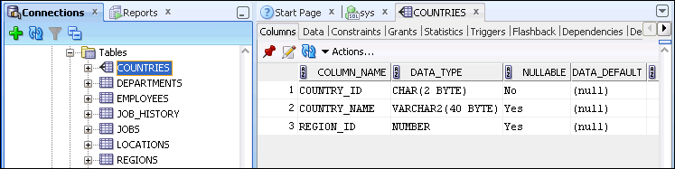
[Description of the illustration sqld_view_table.gif](img_text/sqld_view_table.md)

**See Also:**

"About Tables"

#### 8.4.3 Viewing Table Data

Besides viewing table names and table definitions in SQL Developer, you can view the data stored in the table, and the SQL statement used to display the data. You can also change the SQL statement to alter the results set.

##### To view table data:

1.  In SQL Developer, search for a table as described in "Viewing Tables". For example, search for the tables in the HR schema.
2.  Select the table that contains the data.
    For example, select `countries`.

    A tab with the table name appears in the object pane, with the Columns subtab displayed.
3.  In the object pane, click the Data subtab.
    The data for the table appears on the Data subtab.

    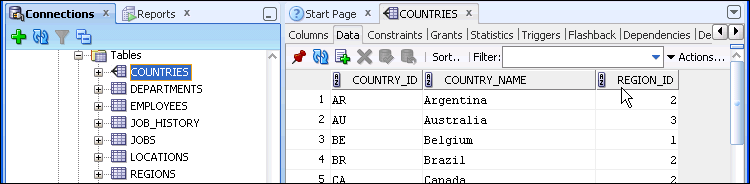
    [Description of the illustration sqld_view_table_data.gif](img_text/sqld_view_table_data.md)
4.  (Optional) Click a column name to sort the data by that column.
5.  (Optional) Click the SQL subtab to view the SQL statement that defines the table.

You can also write and submit your own SQL `SELECT` statement to see the contents of a table. You can run SQL statements by starting a SQL Worksheet session in SQL Developer. To do so, from the Tools menu, select SQL Worksheet.

A detailed description of the `SELECT` statement is in [Oracle Database SQL Language Reference](../sqlrf/SELECT.md).

**See Also:**

"About Tables"

#### 8.4.4 Example: Creating a Table

You can use SQL Developer to create a table.

In the following example, you create a table called `purchase_orders` in the `HR` schema. The table has the following columns:

| Column Name      | Data Type  | Size | Not Null | Primary Key |
|:-----------------|:-----------|:-----|:---------|:------------|
| `PO_NUMBER`      | `NUMBER`   |      | Yes      | Yes         |
| `PO_DESCRIPTION` | `VARCHAR2` | 200  | No       |             |
| `PO_DATE`        | `DATE`     |      | Yes      |             |
| `PO_VENDOR`      | `NUMBER`   |      | Yes      |             |

##### To create the PURCHASE_ORDERS table in the HR schema:

1.  In SQL Developer, navigate to the Tables node in the schema where you want to create the new table, as described in "Viewing Tables".
2.  Right-click the Tables node and select New Table.
    The Create Table dialog box appears, with the Table tab displayed.

    You can create simple tables quickly using only the default options on the Table tab. If you want to create more advanced tables, select the Advanced checkbox, which provides many more options for table creation. Unselect the Advanced checkbox to return to the default options on the Table tab.
3.  In the Schema field, select `HR`.
4.  In the Name field, enter `PURCHASE_ORDERS`.
5.  In the Columns section, enter column information for each of the columns in the `PURCHASE_ORDERS` table as specified in the table in the introduction to this topic. For example, for the first column in the `PURCHASE_ORDERS` table, enter the name `PO_NUMBER` and the data type `NUMBER`, select the Not Null check box, and click in the PK column to indicate that `PO_NUMBER` is the primary key for the table. Then click the green plus sign icon to add information for the next column. Continue in this manner until you have added the information for all of the columns to `PURCHASE_ORDERS`.
    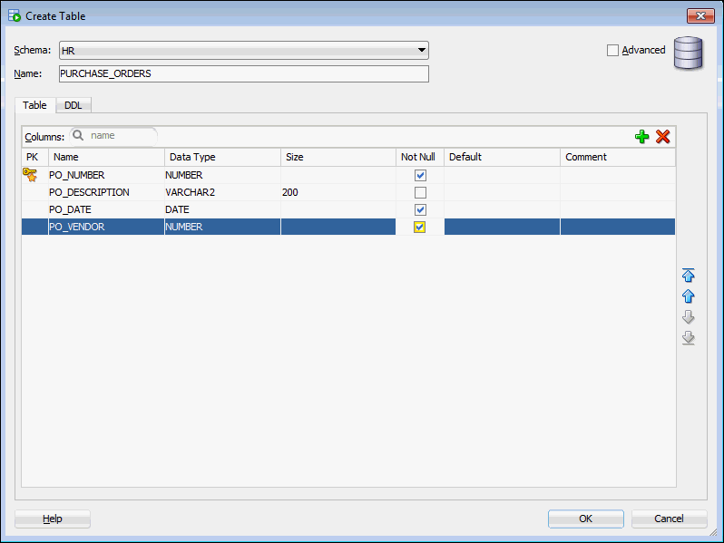
    [Description of the illustration sqld_create_table_new.gif](img_text/sqld_create_table_new.md)
6.  Click OK.
    The `PURCHASE_ORDERS` table appears under the Tables node in the Connections navigator.

**See Also:**

"About Tables"

#### 8.4.5 Modifying Table Attributes

You can use SQL Developer to add and delete table columns and to manage table constraints. This section contains the following topics:

- Example: Adding Table Columns

- Example: Deleting a Table Column

- Example: Adding a New Table Constraint

- Example: Modifying an Existing Table Constraint

- Example: Deleting a Table Constraint

**See Also:**

"About Tables"

##### 8.4.5.1 Example: Adding Table Columns

In this example, you use SQL Developer to add columns to a table. Specifically, you will add two new columns named `po_date_received` and `po_requestor_name` to the `purchase_orders` table that you created previously in "Example: Creating a Table".

##### To add columns to the PURCHASE_ORDERS table:

1.  In SQL Developer, navigate to the Tables node in the HR schema, following the instructions in "Viewing Tables".
2.  Expand the Tables node.
    The list of tables in the schema appears.
3.  Right-click the `PURCHASE_ORDERS` table and select Edit.
    The Edit Table dialog box appears.
4.  At the top right of the Columns section, click the green plus sign icon.
    A new blank column appears at the bottom of the list of columns.
5.  In the Columns section, enter the following information about the new `po_date_received` column:
    | Field Name | Value              |
    |:-----------|:-------------------|
    | `Name`     | `PO_DATE_RECEIVED` |
    | `Type`     | `DATE`             |
6.  At the top right of the Columns section, click the green plus sign icon again.
    A new blank column appears at the bottom of the list of columns.
7.  In the Column Properties section, enter the following information about the new `po_requestor_name` column:
    | Field Name | Value               |
    |:-----------|:--------------------|
    | `Name`     | `PO_REQUESTOR_NAME` |
    | `Type`     | `VARCHAR2`          |
    | `Size`     | `40`                |

    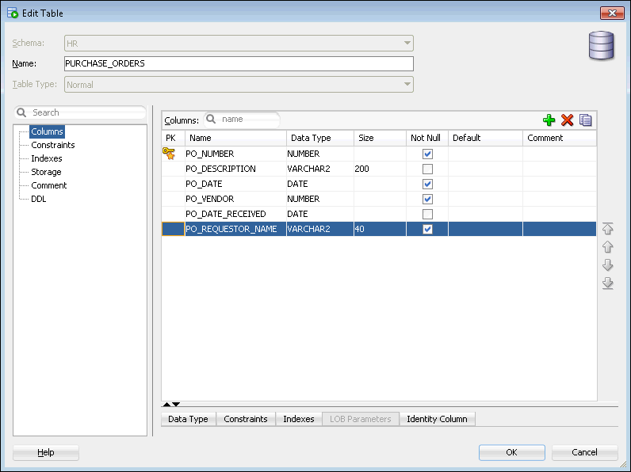
    [Description of the illustration sqld_add_table_columns_new.gif](img_text/sqld_add_table_columns_new.md)
8.  Click OK.
    The `PURCHASE_ORDERS` table appears under the Tables node in the Connections navigator.
9.  To view the new columns, click `PURCHASE_ORDERS` in the Connections navigator. Then, on the `PURCHASE_ORDERS` tab in the objects pane, click the Columns subtab to view the new columns.

**See Also:**

"About Tables"

##### 8.4.5.2 Example: Deleting a Table Column

In this example, you use SQL Developer to delete a table column. Specifically, you will delete the `po_requestor_name` column that you added to the `purchase_orders` table in "Example: Adding Table Columns".

##### To delete the PO_REQUESTOR_NAME column:

1.  In SQL Developer, navigate to the `PURCHASE_ORDERS` table in the HR schema, following the instructions in "Viewing Tables".
2.  Right-click the `PURCHASE_ORDERS` table and select Edit.
    The Edit Table dialog box appears.
3.  In the Columns section, click the `PO_REQUESTOR_NAME` column, and then click the red X icon.
    The `PO_REQUESTOR_NAME` column is removed from the list of columns.
4.  Click OK.
5.  On the `PURCHASE_ORDERS` table tab in the object pane, click the Columns subtab to view the list of columns in the table.

**See Also:**

"About Tables"

##### 8.4.5.3 Example: Adding a New Table Constraint

In this example, you use SQL Developer to add a table constraint to a table. Specifically, you will add a table constraint to the `purchase_orders` table that you created in "Example: Creating a Table". To enforce the rule that the `po_date_received` value must be either the same day as, or later than, the value of `po_date`, you will add a check constraint.

**Note:**

You can also add constraints during table creation, as shown in "Example: Creating a Table". In that example, you added a primary key constraint.

##### To add a table constraint to the PURCHASE_ORDERS table:

1.  Navigate to the `PURCHASE_ORDERS` table in the HR schema, following the instructions in "Viewing Tables".
2.  Right-click the `PURCHASE_ORDERS` table and select Edit.
    The Edit Table dialog box appears.
3.  Under the Search box, click Constraints.
4.  To the right of the Constraints section, click the green plus sign icon and choose New Check Constraint.
    In the Constraints section, a new row appears at the bottom of the list of constraints.
5.  In the Name field for the new constraint, enter `PO_CHECK_RCVD_DATE`.
6.  Leave the check mark in the Enabled column and leave Not Deferrable.
7.  In the Check Condition section, enter the following condition for this constraint:
    `PO_DATE_RECEIVED >= PO_DATE`

    This expression indicates that `PO_DATE_RECEIVED` must be greater than or equal to `PO_DATE`. For date columns, this is equivalent to stating that `PO_DATE_RECEIVED` must be on the same day as, or later than, `PO_DATE`.

    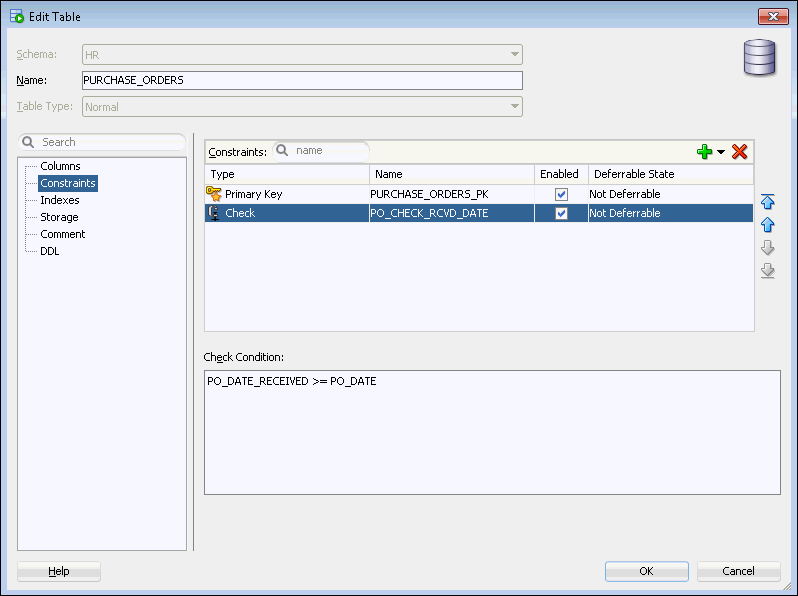
    [Description of the illustration sqld_add_check_constraint.gif](img_text/sqld_add_check_constraint.md)
8.  Click OK.
9.  On the PURCHASE_ORDERS tab in the object pane, click the Constraints subtab to view the current constraints in the table.

**See Also:**

- "About Tables"

- "About Table-Level Constraints"

##### 8.4.5.4 Example: Modifying an Existing Table Constraint

There are a few ways in which you can modify a table constraint. You can change the status of an existing table constraint, for example, from an enabled state to a disabled state. In this example, you use SQL Developer to disable the check constraint that you created for the `purchase_orders` table in "Example: Adding a New Table Constraint".

##### To disable a constraint for the PURCHASE_ORDERS table:

1.  In SQL Developer, navigate to the `PURCHASE_ORDERS` table in the HR schema, following the instructions in "Viewing Tables".
2.  Right-click the `PURCHASE_ORDERS` table and select Constraint, and then Disable Single.
    The Disable Single dialog box appears.
3.  In the Constraint field, select `PO_CHECK_RCVD_DATE`.
4.  Click Apply.
    A confirmation message appears advising that the constraint has been disabled.
5.  On the PURCHASE_ORDERS tab in the object pane, click the Constraints subtab to view the PO_CHECK_RCVD_DATE constraint. The Status column for this constraint shows a value of DISABLED.

**See Also:**

- "About Tables"

- "About Table-Level Constraints"

##### 8.4.5.5 Example: Deleting a Table Constraint

You can delete constraints from a table with SQL Developer. Deleting a table constraint may cause the deletion of other constraints. For example, if you delete the primary key constraint from a table (the parent table) that is referenced in a foreign key constraint in another table (the child table), then the foreign key constraint in the child table is also deleted through a cascading delete mechanism.

In this example, you delete the check constraint that you created for the `purchase_orders` table in "Example: Adding a New Table Constraint".

##### To delete a constraint from the PURCHASE_ORDERS table:

1.  In SQL Developer, navigate to the `PURCHASE_ORDERS` table in the HR schema, following the instructions in "Viewing Tables".
2.  Right-click the `PURCHASE_ORDERS` table and select Constraint, and then Drop.
    The Drop dialog box appears.
3.  In the Constraint field, select `PO_CHECK_RCVD_DATE`.
4.  Click Apply.
    A confirmation message appears advising that the constraint has been dropped.
5.  On the PURCHASE_ORDERS tab in the object pane, click the Constraints subtab. The PO_CHECK_RCVD_DATE constraint no longer appears in this table.

**See Also:**

- [Oracle Database Concepts](../cncpt/data-integrity.md) for more information about the cascading delete mechanism

- "About Tables"

- "About Table-Level Constraints"

#### 8.4.6 Example: Loading Data into a Table

You can use SQL Developer to load data into a table. You can load data from an .xls file or a .csv file into the table.

In this example, you load data into the `PURCHASE_ORDERS` table that you created in "Example: Creating a Table". For simplicity, this example loads only three rows.

To prepare for this example, you must create a text file named `load.csv` on the file system of the database host computer or on the file system of your local computer. The contents of the file should be as follows:

    1,Office Equipment,25-MAY-2012,1201,13-JUN-2012
    2,Computer System,18-JUN-2012,1201,27-JUN-2012
    3,Travel Expense,26-JUN-2012,1340,11-JUL-2012

**Note:**

This example assumes that the columns in the `PURCHASE_ORDERS` table are the following: `PO_NUMBER`, `PO_DESCRIPTION`, `PO_DATE`, `PO_VENDOR`, and `PO_DATE_RECEIVED`. If your `PURCHASE_ORDERS` table does not have all these columns (or has additional columns), then modify the data in the text file accordingly.

##### To load data into the PURCHASE_ORDERS table:

1.  In SQL Developer, navigate to the `PURCHASE_ORDERS` table in the HR schema, following the instructions in "Viewing Tables".
2.  Right-click the `PURCHASE_ORDERS` table and select Import Data.
    The Open dialog box appears.
3.  Navigate to and select the `load.csv` file that includes the data you want to import into the table, and then click Open.
    The Data Import Wizard appears, with the Data Preview page displayed.
4.  Make sure that Header is deselected, Format is set to `csv`, Line Terminator is set to `environment default`, and that Left Enclosure and Right Enclosure are set to `none`. Then click Next.
    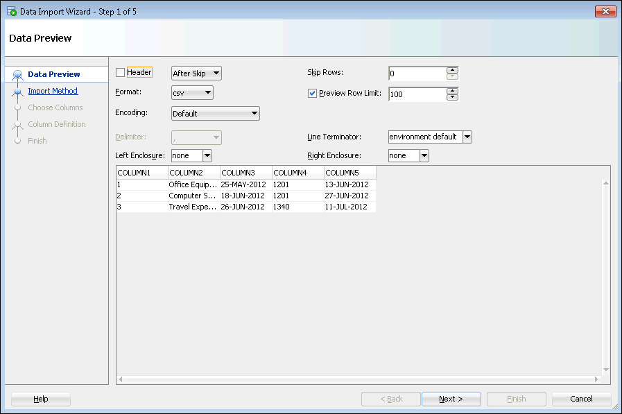
    [Description of the illustration sqld_import_wiz_1of5_new.gif](img_text/sqld_import_wiz_1of5_new.md)
    The Import Method page appears.
5.  On this page, select:
    - `Insert` in the Import Method field.

    - `PURCHASE_ORDERS` in the Table Name field.

    - A value in the Import Row Limit field that is greater than the number of rows in your `.csv` file.
6.  Click Next.
    The Choose Columns page appears.
7.  Move the columns that you want to import into the Selected Columns list, and arrange them in the order you want.
8.  Click Next.
    The Column Definition page appears.
9.  Map the source data from the `.csv` file to the existing table. For each source data column on the left, select the column on the right to import this data into.
    For example, in the Source Data Columns table on the left, select the first column, and then in the Target Table Columns table on the right, select in the Name field the name of the column in the database table that will store that data. Map the data for each of the columns in the Source Data Columns table to the appropriate column in the Target Table Columns table.

    The figure shows the data in the last column in the Source Table Columns table being mapped to the last column (`PO_DATE_RECEIVED`) in the Target Table Columns table. At this point, the previous four columns in the Source Table Columns table have already been mapped to the appropriate columns in the Target Table Columns table.
    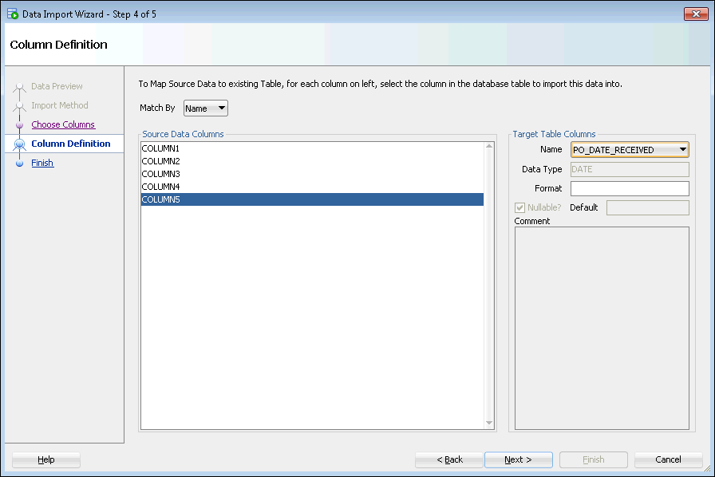
    [Description of the illustration sqld_data_import_new.gif](img_text/sqld_data_import_new.md)
10. Click Next.
    The Finish page appears.
11. Click Finish.
    The data is imported into the table.

**See Also:**

"About Tables"

#### 8.4.7 Deleting a Table

If you no longer need a table, then you can delete it using SQL Developer. When you delete a table, the database deletes the data and dependent objects of the table (such as indexes), and removes the table from the data dictionary.

When you delete a table from a locally managed tablespace that is not the `SYSTEM` tablespace, the database does not immediately reclaim the space associated with the table. Instead, it places the table and any dependent objects in the recycle bin. You can then restore the table, its data, and its dependent objects from the recycle bin if necessary. You can view the contents of the recycle bin by clicking Recycle Bin on the Tables page. Note that users can see only tables that they own in the recycle bin. See [Oracle Database Administrator’s Guide](../admin/managing-tables.md) for more information about the recycle bin, including how to view, purge, and recover tables for which you are not the owner.

##### To delete a table:

1.  In SQL Developer, navigate to the `PURCHASE_ORDERS` table in the HR schema, following the instructions in "Viewing Tables".
2.  Right-click the `PURCHASE_ORDERS` table and select Table and then Drop.
    The Drop dialog box appears.
3.  Select Cascade Constraints and Purge.
4.  Click Apply.
    A confirmation message appears.

**See Also:**

"About Tables"

### 8.5 Managing Indexes

The topics in this section describe how to create and manage indexes using SQL Developer. For example:

- About Indexes

- Viewing Indexes

- Example: Creating an Index

- Example: Deleting an Index

#### 8.5.1 About Indexes

Indexes are optional schema objects that are associated with tables. You create indexes on tables to improve query performance. Just as the index in a guide helps you to quickly locate specific information, an Oracle Database index provides quick access to table data.

You can create as many indexes on a table as you need. You create each index on one or more columns of a table. For example, in a purchase orders table, if you create an index on the vendor number column, then you can sequentially access the rows of the table in vendor number order, without having to actually sort the rows. Additionally, you can directly access all purchase orders issued to a particular vendor without having to scan the entire table.

After an index is created, it is automatically maintained and used by the database. Changes to the data or structure of a table, such as adding new rows, updating rows, or deleting rows, are automatically incorporated into all relevant indexes. This is transparent to the user.

Some indexes are created implicitly through constraints that are placed on a table. For example, the database automatically creates an index on the columns of a primary key constraint or unique key constraint.

The following topics provide more background information about indexes:

- Indexes and Performance

- Index Attributes

**See Also:**

- "Viewing Indexes"

- "Example: Creating an Index"

- [Oracle Database Concepts](../cncpt/indexes-and-index-organized-tables.md)

##### 8.5.1.1 Indexes and Performance

Indexes generally improve the performance of queries and DML statements that operate on a single, existing row or a small number of existing rows. However, too many indexes can increase the processing overhead for statements that add, modify, or delete rows.

Before you add additional indexes, examine the performance of your database for queries and DML. You can then compare performance after the new indexes are added.

**See Also:**

[Oracle Database Testing Guide](../ratug/introduction-to-sql-performance-analyzer.md) for information about using the SQL Performance Analyzer to analyze the SQL performance impact of any type of schema or system changes

##### 8.5.1.2 Index Attributes

Indexes can be created in several ways, using various combinations of index attributes. The primary index attributes are the following:

##### Standard (B-tree) and Bitmap

A standard, B-tree index contains an entry for each value in the index key along with a disk address of the row where the value is stored. A B-tree index is the default and most common type of index in an Oracle database.

A bitmap index uses strings of bits to encapsulate values and potential row addresses. It is more compact than a B-tree index and can perform some types of retrieval more efficiently. For general use, however, a bitmap index requires more overhead during row operations on the table and should be used primarily for data warehouse environments, as described in [Oracle Database Data Warehousing Guide](../dwhsg/data-warehouse-optimizations-techniques.md).

##### Ascending and Descending

The default search through an index is from lowest to highest value, where character data is sorted by ASCII values, numeric data from smallest to largest number, and date from the earliest to the latest value. This default search method is performed in indexes created as ascending indexes. You can cause index searches to reverse the search order by creating the related index with the descending option.

##### Column and Functional

Typically, an index entry is based on the value or values found in the column or columns of a table. This is a column index. Alternatively, you can create a function-based index in which the indexed value is derived from the table data. For example, to find character data that can be in various combinations of upper and lowercase letters, you can use a function-based index based on the `UPPER()` function to look for the values as if they were all in uppercase characters.

##### Single-Column and Concatenated

You can create an index on just one column, which is called a single-column index, or on multiple columns, which is called a concatenated index. Concatenated indexes are useful when all the index columns are likely to be included in the `WHERE` clause of frequently executed SQL statements.

##### Nonpartitioned and Partitioned

As with tables, you can partition an index. In most situations, it is useful to partition an index when the associated table is partitioned, and to partition the index using the same partitioning scheme as the table. (For example, if the table is range-partitioned by sales date, then you create an index on sales date and partition the index using the same ranges as the table partitions.) This is known as a local partitioned index. However, you do not have to partition an index using the same partitioning scheme as its table. You can also create a nonpartitioned, or global, index on a partitioned table.

**See Also:**

- [Oracle Database Concepts](../cncpt/indexes-and-index-organized-tables.md) for design and management considerations of different index types

- [Oracle Database SQL Language Reference](../sqlrf/CREATE-INDEX.md) for the syntax to create indexes

- [Oracle Database VLDB and Partitioning Guide](../vldbg/partition-concepts.md) for more information about partitioned tables and indexes

#### 8.5.2 Viewing Indexes

You use SQL Developer to view the indexes in your database.

##### To view indexes:

1.  In the Connections navigator in SQL Developer, navigate to the Indexes node for the schema that includes the index you want to view.
    If the index is in your own schema, navigate to the Indexes node in your schema.

    If the index you want to view is in another user's schema, navigate to the Other Users node, expand it, find the name of the schema the index is in, and navigate to the Indexes node.

    Examples of schema names include `SYS` and `HR`.

    **Note:**

    You must have the necessary privileges to view other schemas and the objects in those schemas.
2.  Open the Indexes node.
    The names of the indexes in the selected schema appear below the Indexes node.
3.  Click the name of the index you want to view.
    A tab with the index name appears in the object pane, with the Columns subtab displayed. You can view the index definition on this tab.

**See Also:**

"About Indexes"

#### 8.5.3 Example: Creating an Index

When you create an index using SQL Developer, you specify one or more table columns to be indexed and the type of index to create.

In this example, you create an index on the `PROD_DESC` column in the `SH.PRODUCTS` table. (The `SH` schema is part of the sample schemas.)

##### To create a description index on the SH.PRODUCTS table:

1.  In SQL Developer, view the tables in the `SH` schema, by following the instructions in "Viewing Tables".
2.  Right-click the `PRODUCTS` table, and select Index, and then Create Index.
    The Create Index dialog box appears, with the Definition tab displayed.
3.  At the top of the dialog box, confirm that `SH` appears in the Schema field and that `PROD_DESC_IDX` appears in the Name field.
4.  On the Definition tab:
    - In the Table Schema field, enter `SH`.

    - In the Table field, select `PRODUCTS`.

    - In the Index Type field, select `Non-Unique`.

    - Click the green check mark item in the Expressions section, and in the row that displays, enter `PROD_DESC` in the Expressions column, and `<Not Specified>` in the Order column.

      If your index were to consist of multiple columns (a concatenated index), then you would add a second column in the Expressions section to add it to the list of columns in the Index list. Then you would use the up arrow and down arrow icons to arrange the index columns in the order you want.

      If the index includes multiple columns, choose either ASC (ascending) or DESC (descending) in the Order field. The value you choose determines the sort order to be used for the index.

    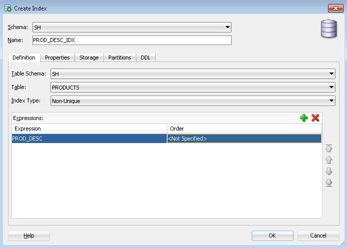
    [Description of the illustration sqld_create_index_new.gif](img_text/sqld_create_index_new.md)
5.  Click OK to create the index.

**See Also:**

"About Indexes"

#### 8.5.4 Example: Deleting an Index

If you no longer need an index, then you can delete it using SQL Developer.

In this example, you delete the `PROD_DESC_IDX` index that you created previously on the SH.PRODUCTS table in "Example: Creating an Index".

**Note:**

You cannot delete an index that is currently used to enforce a constraint. You must disable or delete the constraint and then, if the index is not deleted as a result of that action, delete the index.

##### To delete the description index on the SH.PRODUCTS table:

1.  In SQL Developer, view the tables in the `SH` schema, by following the instructions in "Viewing Tables".
2.  Right-click the `PRODUCTS` table, and select Index, and then Drop.
    The Drop dialog box appears, with the Prompts tab displayed.
3.  In the Drop Index field, select `PROD_DESC_IDX`.
4.  Click Apply.
    A confirmation message appears.

**See Also:**

"About Indexes"

### 8.6 Managing Views

This section describes how to create and manage views using SQL Developer. For example:

- About Views

- Displaying Views

- Example: Creating a View

- Example: Deleting a View

#### 8.6.1 About Views

Views are customized presentations of data in one or more tables or other views. You can think of them as stored queries. Views do not actually contain data, but instead derive their data from the tables upon which they are based. These tables are referred to as the base tables of the view.

Similar to tables, views can be queried, updated, inserted into, and deleted from, with some restrictions. All operations performed on a view actually affect the base tables of the view. Views can provide an additional level of security by restricting access to a predetermined set of rows and columns of a table. They can also hide data complexity and store complex queries.

Many important views are in the `SYS` schema. There are two types: static data dictionary views and dynamic performance views. Complete descriptions of the views in the `SYS` schema are in [Oracle Database Reference](../refrn/about-static-data-dictionary-views.md).

##### Static Data Dictionary Views

The data dictionary views are called static views because they change infrequently, only when a change is made to the data dictionary. Examples of data dictionary changes include creating a new table or granting a privilege to a user.

Many data dictionary tables have three corresponding views:

- A `DBA_` view displays all relevant information in the entire database. `DBA_` views are intended only for administrators.

  An example of a `DBA_` view is `DBA_TABLESPACES`, which contains one row for each tablespace in the database.

- An `ALL_` view displays all the information accessible to the current user, including information from the schema of the current user, and information from objects in other schemas, if the current user has access to those objects through privileges or roles.

  An example of an `ALL_` view is `ALL_TABLES`, which contains one row for every table for which the user has object privileges.

- A `USER_` view displays all the information from the schema of the current user. No special privileges are required to query these views.

  An example of a `USER_` view is `USER_TABLES`, which contains one row for every table owned by the user.

The columns in the `DBA_`, `ALL_`, and `USER_` views are usually nearly identical. The `USER_` view usually does not have an `OWNER` column.

##### Dynamic Performance Views

Dynamic performance views monitor ongoing database activity. They are available only to administrators. The names of dynamic performance views start with the characters `V$`. For this reason, these views are often referred to as `V$` views.

An example of a `V$` view is `V$SGA`, which returns the current sizes of various System Global Area (SGA) memory components.

**See Also:**

- "Displaying Views"

- "Example: Creating a View"

- "Example: Deleting a View"

- [Oracle Database Concepts](../cncpt/partitions-views-and-other-schema-objects.md)

#### 8.6.2 Displaying Views

You can use SQL Developer to list the views in a specified schema. You can also display the view definitions.

##### To display views:

1.  In the Connections navigator in SQL Developer, navigate to the Views node for the schema that includes the view you want to display.
    If the view is in your own schema, navigate to the Views node in your schema.

    If the view you want to display is in another user's schema, navigate to the Other Users node, expand it, find the name of the schema the view is in, and navigate to the Views node.

    Examples of schema names include `SYS` and `HR`.

    **Note:**

    You must have the necessary privileges to view other schemas and the objects in those schemas.
2.  Open the Views node.
    The list of views in the schema appears.
3.  Click the name of the view that you want to display.
    A tab with the view name appears in the object pane, with the Columns subtab displayed. You can view the view definition on this tab.

**See Also:**

"About Views"

#### 8.6.3 Example: Creating a View

In this example, you use SQL Developer to create a view named `king_view`, which uses the `HR.EMPLOYEES` table as its base table. (The `HR` schema is part of the sample schemas.) This view filters the table data so that only employees who report directly to the manager King, whose employee ID is 100, are returned in queries. In an application scenario, this view adds an additional level of security to the `HR.EMPLOYEES` table while providing a suitable presentation of relevant information for manager King.

##### To create the KING_VIEW view on the HR.EMPLOYEES table:

1.  In the Connections navigator in SQL Developer, navigate to the Views node in the HR schema, by following the instructions in "Displaying Views".

2.  Right-click the Views node and select New View.

    The Create View dialog box appears, with the SQL Query tab displayed.

3.  Enter the following information:

    - In the Schema field, select `HR`.

    - In the Name field, enter `KING_VIEW`.

    - In the SQL Query field, enter the following SQL statement that will be used to create `KING_VIEW`:

          SELECT * FROM hr.employees
          WHERE manager_id = 100

    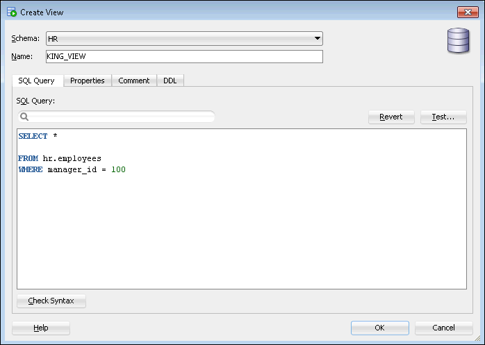
    [Description of the illustration sqld_create_view_new.gif](img_text/sqld_create_view_new.md)

4.  Click OK.

    The `KING_VIEW` is created and appears in the list of views for the HR schema.

##### To test the new KING_VIEW view:

1.  In the Connections navigator in SQL Developer, navigate to the Views node in the HR schema and find the `KING_VIEW`, by following the instructions in "Displaying Views".
2.  Click the `KING_VIEW`.
    A tab with the view name appears in the object pane, with the Columns subtab displayed.
3.  Click the Data subtab in the object pane.
    The data selected by the view appears.
4.  (Optional) You can also test the view by submitting the following SQL statement in SQL\*Plus or SQL Developer:
        SELECT * FROM hr.king_view

**See Also:**

"About Views"

#### 8.6.4 Example: Deleting a View

If you no longer need a view, then you can delete it using SQL Developer.

In this example, you delete the `HR.KING_VIEW` view that you created previously in "Example: Creating a View".

##### To delete the HR.KING_VIEW view:

1.  In the Connections navigator in SQL Developer, navigate to the Views node in the HR schema and find the `KING_VIEW`, by following the instructions in "Displaying Views".
2.  Right-click the `KING_VIEW`, and then select Drop.
    The Drop dialog box appears.
3.  Click Apply.
    A confirmation message appears.

**See Also:**

"About Views"

### 8.7 Managing Program Code Stored in the Database

This section describes your responsibilities as a database administrator (DBA) for program code that is stored in the database. It contains the following topics:

- About Program Code Stored in the Database

- Validating (Compiling) Invalid Schema Objects

#### 8.7.1 About Program Code Stored in the Database

Oracle Database offers the ability to store program code in the database. Developers write program code in PL/SQL or Java, and store the code in schema objects. You, as the DBA, can use SQL Developer to manage program code objects such as:

- PL/SQL packages, procedures, functions, and triggers

- Java source code (Java sources) and compiled Java classes

The actions that you can perform include creating, compiling, creating synonyms for, granting privileges on, and showing dependencies for these code objects. You can also edit and debug PL/SQL code objects using SQL Developer. You access administration pages for these objects by clicking links in the Programs section of the Schema subpage.

Note that creating and managing program code objects is primarily the responsibility of application developers. However, as a DBA you might have to assist in managing these objects. Your most frequent task for program code objects might be to revalidate (compile) them, because they can become invalidated if the schema objects on which they depend change or are deleted.

**Note:**

Other types of schema objects besides program code objects can become invalid. For example, if you delete a table, then any views that reference that table become invalid.

**See Also:**

- [Oracle Database Concepts](../cncpt/server-side-programming.md) for an overview of using PL/SQL and Java for server-side programming

- [Oracle Database 2 Day + Java Developer's Guide](../tdpjd/using-java-with-oracle-database.md) for more information about Java sources and Java classes

- [Oracle Database PL/SQL Language Reference](../lnpls/overview.md) to learn about PL/SQL code

- [Oracle Database Administrator’s Guide](../admin/managing-schema-objects.md) for more information about object invalidation

#### 8.7.2 Validating (Compiling) Invalid Schema Objects

As a database administrator (DBA), you may be asked to revalidate schema objects that have become invalid. Schema objects (such as triggers, procedures, or views) might be invalidated when changes are made to objects on which they depend. For example, if a PL/SQL procedure contains a query on a table and you modify table columns that are referenced in the query, then the PL/SQL procedure becomes invalid. You revalidate schema objects by compiling them.

**Note:**

It is not always possible to revalidate a schema object that stores program code by compiling it. You may have to take remedial actions first. For example, if a view becomes invalid because a table that it references is deleted, then compiling the view produces an error message that indicates that the table does not exist. You cannot validate the view until you re-create the table.

You can use SQL Developer to run a report that finds invalid schema objects.

##### To find invalid schema objects:

1.  If the Reports navigator does not appear in SQL Developer, choose the Reports option from the View menu to display the Reports navigator.
    The Reports navigator appears.
2.  In the Reports navigator, expand the All Reports node, then expand the Data Dictionary Reports node, then expand the All Objects node, and then click Invalid Objects.
    The Select Connection dialog box appears.
3.  In the Select Connection dialog box, select the connection to use, or create a new connection.
    If you want the invalid objects report to include information about only the invalid objects in your own schema, use a connection for your own schema.

    If you want the invalid objects report to include information about invalid objects throughout the database, use a connection for a privileged user, such as `SYS`. In this example, the connection chosen is for the SYS user.
4.  Click OK.
    The Enter Bind Values dialog box appears.
5.  Click Apply.
    The Invalid Objects tab appears in the object pane. This tab lists the invalid objects in your schema or in the database (depending on the connection you specified in the Select Connection dialog box).
6.  When you right-click the row for a particular invalid object on the Invalid Objects tab, the Compile option appears. Select that option to recompile the invalid object.
    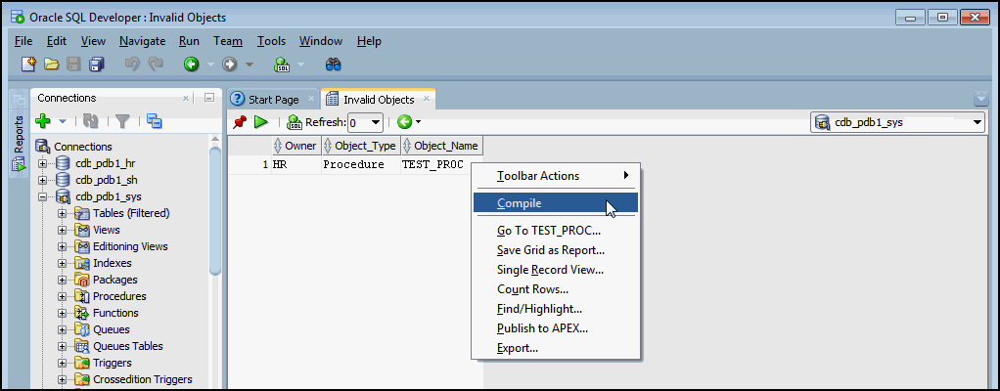
    [Description of the illustration sqld_invalid_objs_new.gif](img_text/sqld_invalid_objs_new.md)
    Remember that it is not always possible to make an object valid by recompiling it. See the Note at the beginning of this section.

**See Also:**

- [Oracle Database Concepts](../cncpt/tables-and-table-clusters.md) for more information about schema object dependencies

- [Oracle Database Administrator’s Guide](../admin/managing-schema-objects.md) for information about managing object dependencies

### 8.8 Working with Other Schema Objects

In addition to managing tables, indexes, views, and program code with SQL Developer, you can use SQL Developer to manage other schema objects. For example:

- Sequences

  A sequence is a database object that generates unique integers. Each time that you query the sequence, it increments its current value by a designated amount and returns the resulting integer. Sequences can be simultaneously queried by multiple users, and each user receives a unique value. For this reason, using a sequence to provide the value for a primary key in a table is an easy way to guarantee that the key value is unique, regardless of the number of users inserting data into the table.

- Synonyms

  A synonym is an alias for any schema object, such as a table or view. Synonyms provide an easy way to hide the underlying database structure from an application or a user. Synonyms can be private or public. A public synonym does not have to be qualified with a schema name, whereas a private synonym does, if the user referencing the private synonym is not the synonym owner. For example, consider the following query, issued by a user who has been granted the `READ` object privilege on the `HR.EMPLOYEES` table:

      SELECT   employee_id, salary
      FROM     hr.employees
      ORDER BY salary

  Now suppose you create a public synonym named `PERSONNEL` as an alias for the `HR.EMPLOYEES` table, and you grant the `READ` privilege on the `HR.EMPLOYEES` table to `PUBLIC` (all database users). With the public synonym in place, any user can issue the following simpler query:

      SELECT   employee_id, salary
      FROM     personnel
      ORDER BY salary

  The user who created this query did not need to know the name of the schema that contains the personnel data.

  **Note:**

  If a user owns a table named `personnel`, then that table is used in the query. If no such table exists, then the database resolves the public synonym and uses the `HR.EMPLOYEES` table.

  An additional benefit of synonyms is that you can use the same synonym in a development database as in the production database, even if the schema names are different. This technique enables application code to run unmodified in both environments. For example, the preceding query would run without errors in a development database that had the `EMPLOYEES` table in the `DEV1` schema, if the `PERSONNEL` synonym is defined in the development database to point to the `DEV1` schema.

  Because a synonym is simply an alias, it requires no storage other than its definition in the data dictionary. To reference a synonym in a query, you must have privileges on the object to which it points. Synonyms themselves cannot be secured. If you grant object privileges on a synonym to a user, then you are granting privileges on the object to which the synonym points.

- Database links

  A database link is a schema object that points to another Oracle database. You use a database link to query or update objects in a remote database. Database links are used in distributed database environments, which are described in [Oracle Database Administrator’s Guide](../admin/distributed-database-concepts.md).

**See Also:**

- [Oracle Database 2 Day Developer's Guide](../tdddg/creating-managing-schema-objects.md)

- [Oracle Database SQL Language Reference](../sqlrf/CREATE-SEQUENCE.md)

### 8.9 Managing Schema Objects: Oracle by Example Series

Oracle By Example (OBE) has a series on the Oracle Database 2 Day DBA guide. This OBE series steps you through the tasks in this chapter and includes annotated screenshots.

The series consists of the following tutorials:

1.  Create a Database Connection Using SQL Developer

2.  Manage Tables Using SQL Developer

3.  Manage Indexes and Views

4.  Manage Program Code Stored in the Database

The above tutorials can be accessed in two ways:

- To see a clickable list of the above tutorials, go to [Manage Schema Objects Series](https://docs.oracle.com/pls/topic/lookup?ctx=en/database/oracle/oracle-database/19/admqs&id=twodaydba_obe_schema).

- For seamless navigation through the tutorial series, access the following link:

  [Manage Schema Objects](https://docs.oracle.com/pls/topic/lookup?ctx=en/database/oracle/oracle-database/19/admqs&id=twodaydba_lp_schema)

  You can navigate across the tutorials by clicking the \> button at the bottom of the pane.
