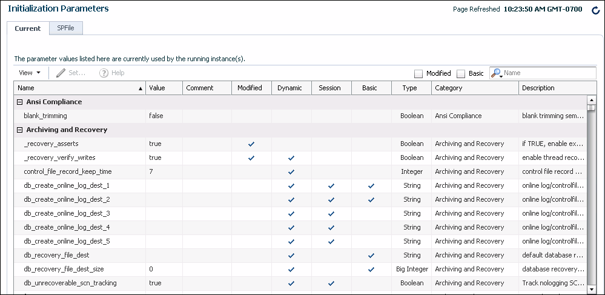
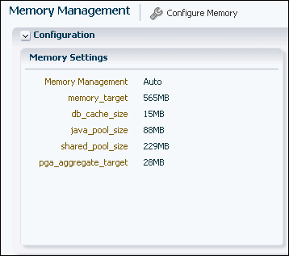
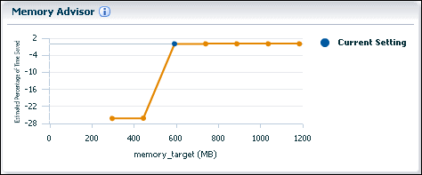
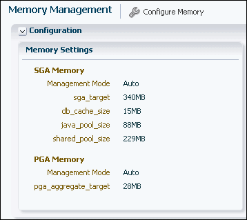
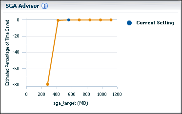
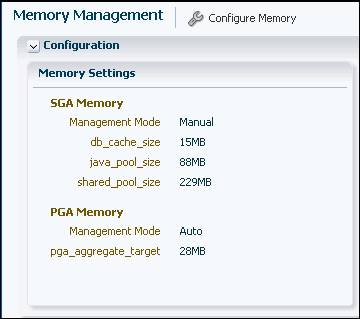
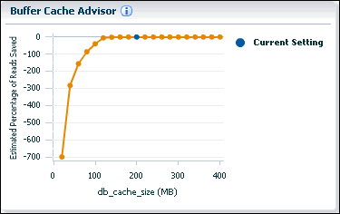
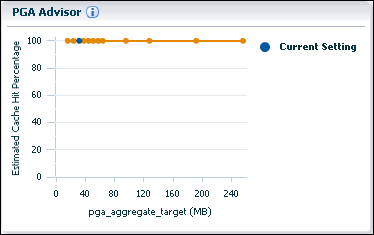

This chapter provides background information about the Oracle instance and instructions for managing the instance.

This chapter contains the following sections:

- Overview of the Oracle Instance and Instance Management

- Shutting Down and Starting Up the Oracle Instance

- Viewing and Modifying Initialization Parameters

- Managing Memory

- Managing the Oracle Instance: Oracle By Example Series

### 5.1 Overview of the Oracle Instance and Instance Management

An Oracle database system consists of an Oracle database and an Oracle instance (in an Oracle Real Application Clusters environment, there can be more than one instance).

A database consists of a set of disk files that store user data and metadata. Metadata, or "data about the data," consists of structural, configuration, and control information about the database.

An Oracle instance (also known as a database instance) contains the set of Oracle Database background processes that operate on the stored data and the shared allocated memory that those processes use to do their work.

Each instance has an instance ID, also known as a system ID (SID). Because there can be multiple Oracle databases on a host computer, each with its own set of data files, you must identify the instance to which you want to connect. For a local connection, you identify the instance by setting operating system environment variables `ORACLE_SID` and `ORACLE_HOME`. For a remote connection, you identify the instance by specifying a network address and a database service name.

An Oracle instance must be started to read and write information to the database. The Oracle instance creates the database upon receipt of instructions from the Oracle Database Configuration Assistant (DBCA) utility or the `CREATE` `DATABASE` SQL statement.

When the Oracle instance is not available, your data is safe in the database, but it cannot be accessed by any user or application.

The properties of an Oracle instance are specified using instance initialization parameters. When the instance is started, an initialization parameter file is read, and the instance is configured accordingly.

This section presents some concepts of an Oracle instance and its management. It contains the following topics:

- About Initialization Parameters

- About Background Processes

- About Server and Client Processes

- About Instance Memory Structures

- About Instance Startup and Shutdown

**See Also:**

[Oracle Database Concepts](../cncpt/oracle-instance-architecture.md) for an overview of the Oracle database instance

#### 5.1.1 About Initialization Parameters

Managing an Oracle instance includes configuring parameters that affect the basic operation of the Oracle instance. These parameters are called initialization parameters. The Oracle instance reads initialization parameters from a file at startup.

During installation, when you select a preconfigured database workload available in Database Configuration Assistant (DBCA), the initialization parameters are optimized for typical use in the environment that you specified. As the number of database users increases and the workload increases, you might have to alter some initialization parameters. You can make these changes using the Initialization Parameter page in Oracle Enterprise Manager Database Express (EM Express), or by using an advisor provided by Oracle Database, such as the Memory Advisor. See "[Optimizing Memory Usage with the Memory Advisors](monitoring-and-tuning-the-database.md)" for more information.

After being read from a file, initialization parameters are retained in memory, where the values for many of them can be changed dynamically. There are two types of parameter files. The type of file used to start the instance determines if dynamic initialization parameter changes persist across database shutdown and startup. The parameter file types are:

- Server parameter file

  The server parameter file, commonly known as the SPFILE, is the preferred form of initialization parameter file, and is a binary file that can be written to and read by the database. It must not be edited manually. It is stored on the host computer on which Oracle Database is running. Changes are made when you use EM Express or SQL\*Plus to modify one or more initialization parameters, or when Oracle Database itself makes changes for self-tuning purposes. Any changes to it persist across database shutdown and startup operations.

  **Note:**

  When changing an initialization parameter in the server parameter file, you can also specify that the in-memory value be changed, so that your change is reflected immediately in the current instance. If you do not change the in-memory value, then the change does not take effect until you shut down and restart the database.

- Text initialization parameter file

  A text initialization parameter file is a text file that can be read by the Oracle instance, but it is not written to by the instance. You can change a text initialization parameter file with a text editor, but changes do not take effect until you restart the Oracle instance. When you start the instance with this type of file, you can still change many initialization parameters dynamically with EM Express, but only for the current instance. Unless you also edit the text initialization parameter file and make the same change, the change is lost when you restart the database instance.

You can use SQL statements to create the following:

- A server parameter file from a text initialization file

- A server parameter file from the current (in-memory) values of all initialization parameters

- A text initialization parameter file from a server parameter file

When you create the database with DBCA, a server parameter file is created. This file is then used each time the database is started.

**See Also:**

- "Viewing and Modifying Initialization Parameters"

- [Oracle Database Administrator’s Guide](../admin/creating-and-configuring-an-oracle-database.md) for information about the default name and location of the server parameter file, and for commands to create a server parameter file or text initialization parameter file

- [Oracle Database Concepts](../cncpt/oracle-database-instance.md) for an overview of parameter files

#### 5.1.2 About Background Processes

The background processes of the Oracle instance manage memory structures, asynchronously perform I/O to write data to a file on a disk, and perform general maintenance tasks. The background processes consolidate functions that would otherwise be handled by multiple Oracle Database programs running for each user process. They monitor other Oracle Database processes to provide increased parallelism for better performance and reliability.

The background processes that are present depend on the features that are being used in the database. Some fundamental background processes are described in Table 5-1.

Table 5-1 Oracle Database Background Processes

| Background Process                  | Description                                                                                                                                                                                                                                                                                           |
|:------------------------------------|:------------------------------------------------------------------------------------------------------------------------------------------------------------------------------------------------------------------------------------------------------------------------------------------------------|
| Database writer (DBWn)              | The database writer writes modified blocks from the database buffer cache to the files on a disk. Oracle Database allows a maximum of 100 database writer processes.                                                                                                                                  |
| Log writer (LGWR)                   | The log writer process writes redo log entries to disk. Redo log entries are generated in the redo log buffer of the System Global Area (SGA) and the log writer process writes the redo log entries sequentially into an online redo log file.                                                       |
| Checkpoint (CKPT)                   | At specific times, all modified database buffers in the SGA are written to the data files by a database writer process (DBWn). This event is called a checkpoint. The checkpoint process signals DBWn, updates the data files and control files of the database, and records the time of this update. |
| System monitor (SMON)               | The system monitor performs instance recovery when a failed instance is restarted.                                                                                                                                                                                                                    |
| Process monitor (PMON)              | The process monitor performs a recovery when a user process fails. It cleans up the cache and frees resources that the failed process was using.                                                                                                                                                      |
| Archiver (ARCn)                     | Archiver processes copy the online redo log files to archival storage when the log files are full or a log switch occurs. The database must be in archive log mode to run archive processes. For more information, see "[Performing Backup and Recovery](performing-backup-and-recovery.md)".         |
| Manageability monitor (MMON)        | This process performs various management-related background tasks, for example: • Issuing alerts whenever a given metric violates its threshold value • Taking snapshots by spawning additional processes • Capturing statistical values for SQL objects that have been recently modified    |
| Job Queue Processes (CJQ0 and Jnnn) | Job queue processes run user jobs, often in batch mode. A job is a user-defined task scheduled to run one or more times.                                                                                                                                                                              |

**See Also:**

- [Oracle Database Reference](../refrn/background-processes.md) for a complete list of Oracle Database background processes

- [Oracle Database Concepts](../cncpt/process-architecture.md) for an overview of background processes

#### 5.1.3 About Server and Client Processes

In addition to background processes, Oracle Database creates server processes that handle the connection requests of user or client processes. A user connection is composed of the following distinct pieces:

- A client program acting on behalf of the user, such as Oracle Enterprise Manager (Enterprise Manager), SQL\*Plus, or an application

- A server process that handles the connection to the database on behalf of the client program, and that performs much of the work for the client program, such as parsing and running SQL statements, and retrieving and returning results to the client program

Server processes can be either dedicated or shared. When server processes are dedicated, Oracle Database is running in dedicated server mode. When server processes are shared, Oracle Database is running in shared server mode. In dedicated server mode, each client process has its own server process. Although a dedicated server process is good for long-running queries and administrative tasks, an idle process or too many dedicated processes can result in an inefficient use of resources.

Using shared server mode eliminates the need for a dedicated server process for each user connection, requires less memory for each user connection, and enables more users to access the database. Shared server mode is more efficient at supporting multiple client programs making frequent short-running queries.

#### 5.1.4 About Instance Memory Structures

The sizes of the instance memory structures affect database performance and are controlled by initialization parameters.

Upon installation, you can let the database manage memory for you automatically, or you can choose to manually configure the instance memory structures. If you choose manual memory management, then Oracle Database provides advisors to help you determine appropriate values for memory parameters.

The following sections describe the two important memory areas that you can monitor and size:

- System Global Area

- Program Global Area

**See Also:**

- "Managing Memory"

- [Oracle Database Concepts](../cncpt/memory-architecture.md) and [Oracle Database Administrator’s Guide](../admin/managing-memory.md) for more information about Oracle Database memory architecture

##### 5.1.4.1 System Global Area

The System Global Area (SGA) is a group of shared memory structures, known as SGA components, that contain data and control information for one Oracle Database instance. The SGA is shared by all server and background processes. Examples of data stored in the SGA include cached data blocks and shared SQL areas.

Table 5-2 lists the components of the SGA.

Table 5-2 SGA Components

| Component             | Description                                                                                                                                                                                                                                                                                                                 |
|:----------------------|:----------------------------------------------------------------------------------------------------------------------------------------------------------------------------------------------------------------------------------------------------------------------------------------------------------------------------|
| Database buffer cache | Before data stored in the database can be queried or modified, it must be read from a disk and stored in the buffer cache. All user processes connected to the database share access to the buffer cache. For optimal performance, the buffer cache should be large enough to avoid frequent disk I/O operations.           |
| Shared pool           | The shared pool caches information that is shared among users: • SQL statements that can be reused • Information from the data dictionary such as user account data, table and index descriptions, and privileges • Stored procedures, which are executable code that is stored in the database                    |
| Redo log buffer       | This buffer improves performance by caching redo information until it can be written to the physical online redo log files stored on disk. Redo information and online redo log files are discussed in "[About Online Redo Log Files](managing-database-storage-structures.md)".                                            |
| Large pool            | This optional area is used to buffer large I/O requests for various server processes.                                                                                                                                                                                                                                       |
| In-Memory Area        | This optional component contains the In-Memory Column Store (IM column store). The IM column store contains copies of tables, partitions, and materialized views in a columnar format optimized for rapid scans. The IM column store supplements the database buffer cache, which stores data in traditional row format. |
| Memoptimize Pool      | This optional component contains the buffers for use with the MEMOPTIMIZE FOR READ feature for fast lookup.                                                                                                                                                                                                                 |
| Java pool             | The Java pool is an area of memory that is used for all session-specific Java code and data within the Java Virtual Machine (JVM).                                                                                                                                                                                          |
| Streams pool          | The Streams pool is an area of memory that is used by the Oracle Replication feature.                                                                                                                                                                                                                                       |
| Result cache          | The result cache buffers query results. If a query is run for which the results are stored in the result cache, then the database returns the query results from the result cache instead of rerunning the query. This SGA component speeds the execution of frequently run queries.                                        |

**See Also:**

- "About Instance Memory Structures"

- [Oracle Database Concepts](../cncpt/memory-architecture.md) for more information about the SGA

- [Oracle Database In-Memory Guide](../inmem/in-memory-column-store-architecture.md) for more information about the In-Memory Area

- [Oracle Database Performance Tuning Guide](../tgdba/tuning-system-global-area.md) for more information about the Memoptimize Pool and the MEMOPTIMIZE FOR READ feature for fast lookup

##### 5.1.4.2 Program Global Area

A Program Global Area (PGA) is a memory region that contains data and control information for a server process. It is nonshared memory created by Oracle Database when a server process is started. Access to the PGA is exclusive to the server process. There is one PGA for each server process. Background processes also allocate their own PGAs. The total PGA memory allocated for all background and server processes attached to an Oracle Database instance is referred to as the total instance PGA memory, and the collection of all individual PGAs is referred to as the total instance PGA, or just instance PGA.

The amount of PGA memory used and the contents of the PGA depend on whether the instance is running in dedicated server or shared server mode.

The PGA is used to process SQL statements and to hold logon and other session information. A large part of the PGA is dedicated to SQL work areas, which are working memory areas for sorts and other SQL operations.

**See Also:**

- "About Server and Client Processes" for more information about dedicated server and shared server modes

- [Oracle Database Concepts](../cncpt/memory-architecture.md) for more information about the PGA

#### 5.1.5 About Instance Startup and Shutdown

After installation, the Oracle instance is started, and the database is open for access by users with database accounts. At some point, you may want to shut down and restart the instance. This section describes the startup and shutdown processes.

The phrases "starting up and shutting down the Oracle instance" are often used interchangeably with "starting up and shutting down the database."

This section contains the following topics:

- About Administration Privileges for Startup and Shutdown

- About Instance Startup

- About Instance Shutdown

**See Also:**

- "Shutting Down and Starting Up the Oracle Instance"

- [Oracle Database Concepts](../cncpt/oracle-database-instance.md)

##### 5.1.5.1 About Administration Privileges for Startup and Shutdown

To start or shut down the Oracle instance, you must connect to the instance with a special connection privilege. There are two of these privileges: `SYSDBA` for fully empowered database administrators and `SYSOPER` for users who start and shut down the database, but have no privileges to access user objects.

When you create an Oracle database, there are two primary administrative user accounts that are automatically created: `SYS` and `SYSTEM`. Both of these users have full database administration privileges, but initially, only user `SYS` or `SYSTEM` can connect with the `SYSOPER` privilege. Therefore, until you grant the `SYSOPER` privilege to other users, you must connect to the Oracle instance as user `SYS` or `SYSTEM` to start and shut down the instance. When connecting (logging in) as user `SYS`, you must always specify that you are connecting `AS` `SYSDBA`.

**See Also:**

- "[About Administrative Accounts and Privileges](administering-user-accounts-and-security.md)" for more information about the `SYS` and `SYSTEM` users, and the `SYSDBA` privilege

- "[SYS and SYSTEM Users](administering-user-accounts-and-security.md)" for information about the recommended alternative to using the `SYSTEM` account for day-to-day administrative tasks

##### 5.1.5.2 About Instance Startup

When you start the Oracle instance, you typically start it such that the state of the database is `OPEN` and ready for user connections. However, there are situations in which you may want to start the instance with the database in the `MOUNTED` state, but not open. An instance can also be started without the database either mounted or open. Thus, there are three stages to starting an instance:

1.  You start the instance using one of the following methods:

    - Using the SQL\*Plus `STARTUP` command. See "Shutting Down and Starting Up Using SQL\*Plus".

    - On Microsoft Windows, using the Services program in Control Panel to start the Oracle Database services. See "Shutting Down and Starting Up Using the Windows Services Program".

    The instance reads the initialization parameter file, allocates System Global Area (SGA) memory, and starts the background processes.

2.  If you mount the database, then the Oracle instance opens the control file for the database, but does not open the data files. The database is now considered to be in the `MOUNT` state. This state enables you to perform certain administrative functions that cannot be performed when other users are accessing the database. An example of such a function is enabling or disabling the archiving of online redo log files. See "[About Archived Redo Log Files](managing-database-storage-structures.md)" for information about online redo log file archiving.

3.  If you open the database, then, after reading the parameter file and control file, the online redo log files and data files for the database are also opened. The state of the database is now `OPEN` and user access to the data is available.

The default startup mode for the database (OPEN) completes the three stages in sequence. Unless you explicitly specify otherwise, the instance is started, the database is mounted, and then the database is opened.

##### 5.1.5.3 About Instance Shutdown

Instance shutdown is the reverse of instance startup. When you shut down the Oracle instance, the default mode is a `NORMAL` shutdown, which means users are not allowed to create new connections to the database, but the shutdown process waits for all currently connected users to exit their sessions. After all the users have disconnected, then the committed transactions are written to disk, the database files are closed, and the instance is stopped. However, there are situations in which you may not want to wait for users to disconnect on their own (`IMMEDIATE` mode), or you want to let the current transactions for each user complete before they are disconnected (`TRANSACTIONAL` mode). In emergency situations you can even shut down the database without waiting for the committed transactions to be written to disk (`ABORT` mode).

Shutting down an instance goes through the following stages:

1.  After all the users have exited from their sessions, or been disconnected, Oracle Database writes data in the System Global Area (SGA) to the data files and online redo log files. A checkpoint is performed on the data files and their headers are marked current as of the time of the instance shutdown. The data files and online redo log files are then closed and the state of the database is changed to `CLOSED`. The control file remains open to the instance.

2.  The Oracle instance dismounts the database and updates relevant entries in the control file to record a clean shutdown. The control file is closed. The database is now closed and dismounted. The instance is in the `NOMOUNT` state.

3.  The Oracle instance stops the background processes and deallocates the shared memory used by the SGA.

If a `SHUTDOWN ABORT` or abnormal termination occurs, then the instance of an open database closes and shuts down the database instantaneously. Oracle Database does not write data in the buffers of the SGA to the data files and redo log files. The subsequent reopening of the database requires instance recovery, which Oracle Database performs automatically.

### 5.2 Shutting Down and Starting Up the Oracle Instance

This section provides instructions about two methods you can use to start or shut down the Oracle instance.

- Shutting Down and Starting Up Using SQL\*Plus

- Shutting Down and Starting Up Using the Windows Services Program

**See Also:**

"About Instance Startup and Shutdown"

#### 5.2.1 Shutting Down and Starting Up Using SQL\*Plus

You can shut down and start the Oracle instance using SQL\*Plus.

##### To shut down and start the Oracle instance using SQL\*Plus:

1.  Start SQL\*Plus and connect to the database.
    See "[Connecting to an Oracle Database from a Client Computer](configuring-the-network-environment.md)".
2.  Issue the SQL\*Plus `SHUTDOWN` command:
        SQL> SHUTDOWN

    The database instance is shut down.

    The `NORMAL` clause of the `SHUTDOWN` command is optional because this is the default shutdown method.

    See "About Instance Shutdown" for more information about when to use other `SHUTDOWN` command options.
3.  Restart the database by issuing the SQL\*Plus `STARTUP` command:
        SQL> STARTUP

    The database instance is restarted.

    See "About Instance Startup" for more information about when to use other `STARTUP` command options.

#### 5.2.2 Shutting Down and Starting Up Using the Windows Services Program

On Microsoft Windows, you can also start and shut down your Oracle database using the Services program in Control Panel. You must start or stop the following services:

- `OracleService``SID`, which is your Oracle instance.

- `Oracle``ORACLE_HOME``TNSListener`, which is your listener. The listener is required for clients to connect to your database.

In the preceding service names, `SID` refers to the system identifier for the instance and `ORACLE_HOME` refers to the Oracle home name.

##### To start or stop Oracle Database services:

1.  Click Start and then select Control Panel.

    The Control Panel window opens.

2.  Double-click the Administrative Tools icon, and then double-click the Services icon.

    The Services window opens, displaying all Windows services that are available on your system.

3.  Locate the Oracle Database services listed at the beginning of this section. For example, if your SID is `orcl` and Oracle home name is `OraDb11g_home1`, then locate the following services:

    - `OracleServiceORCL`

    - `OracleOraDb11g_home1TNSListener`

4.  Start or stop the services, using the following steps for each service:

    1.  Select the service name.

    2.  In the Action menu, click Start or Stop.

### 5.3 Viewing and Modifying Initialization Parameters

This section provides instructions about viewing the initialization parameter settings for your database and modifying these parameters. You can modify the initialization parameters for the database in one of three ways:

- Until the instance is shut down: The new values for the initialization parameters are applied to the currently running instance, but, when the database is restarted, the initialization parameter values revert to their previous settings.

- From now until the initialization parameter is changed again: The changes are applied to the currently running instance and are also stored in the server parameter file. The changes made to the initialization parameters persist when the database is restarted.

- When the database is restarted: The new values for the initialization parameters are recorded in server parameter file, but are not applied to the currently running instance. The changes take effect only when the database is restarted.

**Note:**

These three scenarios correspond to using the `SCOPE=MEMORY`, `SCOPE=BOTH`, and `SCOPE=SPFILE` clauses of the `ALTER` `SYSTEM` SQL statement, respectively, when you use the `ALTER` `SYSTEM` statement to change initialization parameters.

#### To view or modify initialization parameters:

1.  In Oracle Enterprise Manager Database Express (EM Express), from the Configuration menu, select Initialization Parameters.

    The Initialization Parameters page appears.

    
    [Description of the illustration exp_init_params_page.gif](img_text/exp_init_params_page.md)
    The Initialization Parameters page has two tabs:

    - Current—This tab (the default) displays all initialization parameter values that are currently active (in memory) for the Oracle instance.

    - SPFile—This tab displays initialization parameter settings in the server parameter file (SPFILE). This tab is present only when the current instance started up with a server parameter file. The file location is displayed at the top of the tab.

      **Note:**

      In a pluggable database (PDB), the Initialization Parameters page includes the PDB Modifiable column. Each initialization parameter that can be modified at the PDB level has a check mark in the PDB Modifiable column.

      Any initialization parameter in a PDB that does not have a check mark in the PDB Modifiable column can be set and modified only in the root, and the value set in the root applies to the individual PDBs in the multitenant container database (CDB).

    For more information on individual initialization parameters, see [Oracle Database Reference](../refrn/basic-initialization-parameters.md).

2.  (Optional) On either tab, reduce the number of initialization parameters displayed by doing one or both of the following:

    - In the search field, enter text.

    - Select either the Modified or Basic option next to the search field to limit the display to either modified or basic initialization parameters.

    For example, to view only initialization parameters that have the text `DEST` anywhere in the parameter name, enter `dest` in the Search field. EM Express then restricts the list of initialization parameters accordingly.

3.  To modify an initialization parameter for the currently running instance only (the modifications will not persist when the instance is restarted), complete the following steps:

    1.  On the Current tab, select the initialization parameter whose value you want to modify.

        **Note:**

        If the Set button does not become available when you select the parameter, then the parameter is not dynamic—that is, it cannot be changed for the current instance.

    2.  Click the Set button.

        The Set Initialization Parameter page appears.

    3.  In the Value column, enter a new value for the initialization parameter.

    4.  For the Scope field, ensure that Memory is selected. The value you set will not persist when the instance is restarted.

    5.  (Optional) In the Comments column, enter text explaining the reasons for the changes.

    6.  Click OK.

        A confirmation message appears.

4.  To modify an initialization parameter for the currently running instance, and also record the modifications in the server parameter file that will persist when the database instance is restarted, complete the following steps:

    1.  On the Current tab, select the initialization parameter whose value you want to modify.

        **Note:**

        If the Set button does not become available when you select the parameter, then the parameter is not dynamic—that is, it cannot be changed for the current instance.

    2.  Click the Set button.

        The Set Initialization Parameter page appears.

    3.  For the Scope field, ensure that both Memory and SPFile are selected. The value you set will persist when the database instance is restarted.

        **Note:**

        If the SPFile option is not available, then the database instance does not have an SPFILE, and changes made to the instance will not persist when the instance is restarted.

    4.  (Optional) In the Comments column, enter text explaining the reasons for the changes.

    5.  Click OK.

        A confirmation message appears. The message includes a Show SQL button. Click the Show SQL button to see the SQL statement that was executed.

5.  To modify an initialization parameter in the server parameter file only, such that the current instance is not affected and changes take effect only when the database is next restarted, complete the following steps:

    1.  Click SPFile to view the SPFile tab.

    2.  Select the initialization parameter whose value you want to modify. If the initialization parameter does not appear on the SPFile tab, then select the initialization parameter on the Current tab, instead.

    3.  Click the Set button.

        The Set Initialization Parameter page appears.

    4.  In the Scope field, choose SPFile.

        For an initialization parameter that cannot be reset without restarting the database, the Scope field defaults to SPFile, and the Memory option does not appear.

    5.  In the Value column, enter a new value for the initialization parameter.

    6.  (Optional) In the Comments column, enter text explaining the reasons for the changes.

    7.  Click Apply.

        A confirmation message appears.

**Note:**

Changes to initialization parameters are recorded in the alert log as `ALTER` `SYSTEM` statements. See [Oracle Database Administrator’s Guide](../admin/diagnosing-and-resolving-problems.md) for information about the alert log.

**See Also:**

"About Initialization Parameters"

### 5.4 Managing Memory

This section provides background information about managing memory for the Oracle instance, and includes instructions about how to adjust the memory allocation for the Oracle instance. It contains the following topics:

- About Memory Management

- Enabling Automatic Memory Management

- Modifying Memory Settings – Automatic Memory Management

- Enabling Automatic Shared Memory Management

- Modifying Memory Settings – Automatic Shared Memory Management

- Enabling Manual Shared Memory Management

- Modifying Memory Settings - Manual Shared Memory Management

- Modifying Memory Settings – Automatic PGA Memory Management

**See Also:**

"About Instance Memory Structures"

#### 5.4.1 About Memory Management

Memory management involves maintaining optimal sizes for the Oracle instance memory structures as demands on the database change. The memory that must be managed is the System Global Area (SGA) memory and the instance Program Global Area (PGA) memory. The instance PGA memory is the collection of memory allocations for all individual PGAs.

Beginning with Oracle Database 11g Release 1 (11.1), you can let the database manage the SGA memory and instance PGA memory completely. You designate only the total memory size to be used by the instance, and Oracle Database dynamically exchanges memory between the SGA and the instance PGA as needed to meet processing demands. This capability is referred to as automatic memory management. In this memory management mode, the database also dynamically tunes the sizes of the individual SGA components and the instance PGA.

To have more direct control over the sizes of the SGA and instance PGA, you can disable automatic memory management and enable automatic shared memory management.

- With automatic shared memory management, you set target and maximum sizes for the SGA. Oracle Database then tunes the total size of the SGA to your designated target, and dynamically tunes the sizes of all SGA components.

- When you enable automatic shared memory management, you can also enable automatic PGA memory management. With automatic PGA memory management, Oracle Database automatically performs memory management of instance PGA. Optionally, you can set a target size for the instance PGA, and the database then tunes the size of the instance PGA to your target, and dynamically tunes the sizes of individual PGAs.

If you want complete control of individual SGA component sizes, you can disable both automatic memory management and automatic shared memory management. This is called manual shared memory management. In this mode, you set the sizes of several individual SGA components, thereby determining the overall SGA size. You then manually tune these individual SGA components on an ongoing basis.

Manual shared memory management mode is intended for experienced DBAs only. Note that in this mode, automatic PGA memory management remains enabled.

**Note:**

Although it is possible to disable automatic PGA memory management, it is not recommended, and is not described in this manual.

Table 5-3 summarizes the various memory management modes that you can set for your database instance.

Table 5-3 Oracle Database Memory Management Modes

| Memory Management Mode                                                                                                                               | You Set                                                                                                                     | Oracle Database Automatically Tunes                              |
|:-----------------------------------------------------------------------------------------------------------------------------------------------------|:----------------------------------------------------------------------------------------------------------------------------|:-----------------------------------------------------------------|
| Automatic memory management                                                                                                                          | • Total memory size for this instance • (Optional) Maximum memory size for this instance                                 | • Total SGA size • SGA component sizes • Instance PGA size |
| Automatic shared memory management and automatic PGA memory management (Automatic memory management disabled)                                     | • SGA target size • (Optional) SGA maximum size • (Optional) Instance PGA target size                                 | • SGA component sizes                                            |
| Manual shared memory management and automatic PGA memory management (Automatic memory management and automatic shared memory management disabled) | • Shared pool size • Buffer cache size • Java pool size • Large pool size • (Optional) Instance PGA target size | • Instance PGA size                                              |

**Note:**

Automatic Memory Management is not available on all platforms. See [Oracle Database Administrator’s Guide](../admin/managing-memory.md) for more information about supported platforms.

If you choose the basic installation option when you install the database, then automatic memory management is enabled. If you choose advanced installation, then Database Configuration Assistant (DBCA) enables you to select from the three memory management modes. Oracle recommends that you enable automatic memory management.

Whichever memory management mode you choose, you may have occasion to adjust memory settings as demands on the database or on its host computer change. Reasons why you adjust memory settings include the following:

- You receive a memory-related alert or error message.

- You receive a memory-related recommendation from Automatic Database Diagnostic Monitor (ADDM).

- You want to change the amount of memory allocated to accommodate future growth in memory demand.

You can use a memory advisor to help you adjust memory sizes. See "Modifying Memory Settings – Automatic Shared Memory Management" for an example of using a memory advisor.

**Note:**

The initialization parameters that are used to manage memory are set in the root of a multitenant container database (CDB), and the values set for those parameters are applied to all of the pluggable databases (PDBs) in the CDB.

**See Also:**

- "Enabling Automatic Memory Management"

- "Modifying Memory Settings – Automatic Memory Management"

- "Modifying Memory Settings – Automatic PGA Memory Management"

#### 5.4.2 Enabling Automatic Memory Management

If you did not enable automatic memory management when you installed and configured your database, then Oracle recommends that you do so after installation, unless you are an experienced DBA with specific reasons to manually tune memory sizes. With automatic memory management, the Oracle instance dynamically tunes all memory components to optimize performance as the workload changes.

##### To enable automatic memory management:

1.  Start SQL\*Plus and connect to the database as `SYSDBA`.

2.  Calculate the minimum value for `MEMORY_TARGET` as follows:

    1.  Determine the current sizes of `SGA_TARGET` and `PGA_AGGREGATE_TARGET` by entering the following SQL\*Plus command:

            SHOW PARAMETER TARGET

        SQL\*Plus displays the values of all initialization parameters with the string TARGET in the parameter name.

            NAME                          TYPE        VALUE
            ------------------------------ ----------- ----------------
            archive_lag_target             integer     0
            db_flashback_retention_target  integer     1440
            fast_start_io_target           integer     0
            fast_start_mttr_target         integer     0
            memory_max_target              big integer 0
            memory_target                  big integer 0
            parallel_servers_target        integer     32
            pga_aggregate_target           big integer 29M
            sga_target                     big integer 356M

        Or, on the Initialization Parameters page in Oracle Enterprise Manager Database Express (EM Express), you can enter "TARGET" in the Search field to display the values of all the initialization parameters with the string TARGET in the parameter name, as described in "Viewing and Modifying Initialization Parameters."

    2.  Run the following query to determine the maximum instance Program Global Area (PGA) allocated since the database was started:

            SQL> select value from v$pgastat where name='maximum PGA allocated';

                       VALUE
                  ----------
                   246844416

        246844416 bytes is approximately 235M.

    3.  Compute the maximum value between the query result from step 2.b and `PGA_AGGREGATE_TARGET`. Add `SGA_TARGET` to this value.

            memory_target = sga_target + max(pga_aggregate_target, maximum PGA allocated)

        For example, if `SGA_TARGET` is 356M and `PGA_AGGREGATE_TARGET` is 29M as shown above, and if the maximum PGA allocated is determined to be 235M, then `MEMORY_TARGET` should be at least 591M (356M + 235M).

3.  Choose the value for `MEMORY_TARGET` that you want to use.

    This can be the minimum value that you computed in step 2, or you can choose to use a larger value if you have enough physical memory available.

4.  For the `MEMORY_MAX_TARGET` initialization parameter, decide on a maximum amount of memory that you would want to allocate to the database for the foreseeable future. That is, determine the maximum value for the sum of the System Global Area (SGA) and instance PGA sizes. This number can be larger than or the same as the `MEMORY_TARGET` value that you chose in the previous step.

5.  Do one of the following:

    - If you started your Oracle Database instance with a server parameter file, which is the default if you created the database with the Database Configuration Assistant (DBCA), enter the following SQL\*Plus command:

          ALTER SYSTEM SET MEMORY_MAX_TARGET = nM SCOPE = SPFILE;

      where n is the value that you computed in step 4.

      The `SCOPE = SPFILE` clause sets the value only in the server parameter file, and not for the running instance. You must include this `SCOPE` clause because `MEMORY_MAX_TARGET` is not a dynamic initialization parameter.

      Or, you can also select the `MEMORY_MAX_TARGET` initialization parameter on the Initialization Parameters page in EM Express, click Set, specify a Scope of SPFile, and set a new value, as described in "Viewing and Modifying Initialization Parameters."

    - If you started your instance with a text initialization parameter file, manually edit the file so that it contains the following statements:

          memory_max_target = nM (650M for this example)
          memory_target = mM (591M for this example)

      where n is the value that you determined in step 4, and m is the value that you determined in step 3.

      **Note:**

      In a text initialization parameter file, if you omit the line for `MEMORY_MAX_TARGET` and include a value for `MEMORY_TARGET`, the database automatically sets `MEMORY_MAX_TARGET` to the value of `MEMORY_TARGET`. If you omit the line for `MEMORY_TARGET` and include a value for `MEMORY_MAX_TARGET`, the `MEMORY_TARGET` parameter defaults to zero. After startup, you can then dynamically change `MEMORY_TARGET` to a nonzero value, provided that it does not exceed the value of `MEMORY_MAX_TARGET`.

6.  Shut down and restart the database.

    See "Shutting Down and Starting Up the Oracle Instance".

7.  In EM Express, from the Configuration menu, select Memory.

    The Memory Management page appears. In the Memory Settings section, the Memory Management value is Auto. This indicates that Automatic Memory Management is enabled for the database. The initialization parameter values shown on this page are the ones that have been specified in addition to `MEMORY_MAX_TARGET`.

    
    [Description of the illustration auto_memory_mgmt_crop.gif](img_text/auto_memory_mgmt_crop.md)

8.  If you started your Oracle Database instance with a server parameter file, make these changes to the following initialization parameter values:

        MEMORY_TARGET = nM; (591M for this example)
        SGA_TARGET = 0;
        PGA_AGGREGATE_TARGET = 0;

    You can also set these initialization parameter values using the Initialization Parameters page in EM Express, specifying a scope of SPFile. See "Viewing and Modifying Initialization Parameters"for more information.

    **Note:**

    The preceding steps instruct you to set `SGA_TARGET` and `PGA_AGGREGATE_TARGET` to zero so that the sizes of the SGA and instance PGA are tuned up and down as required, without restrictions. You can omit the statements that set these parameter values to zero and leave either or both of the values as positive numbers. In this case, the values act as minimum values for the sizes of the SGA or instance PGA.

**See Also:**

"About Memory Management"

#### 5.4.3 Modifying Memory Settings – Automatic Memory Management

Before you modify memory settings for automatic memory management, use the Memory Advisor graph in Oracle Enterprise Manager Database Express (EM Express) to predict the percentage of time saved by using a different target memory size setting. The steps involved require that you must first have enabled Automatic Memory Management. See "Enabling Automatic Memory Management".

##### To predict the percentage of time saved for different target memory sizes:

1.  In EM Express, from the Configuration menu, select Memory.

    The Memory Management page appears. In the Memory Settings section, the Memory Management value is Auto. This indicates that Automatic Memory Management is enabled for the database.

2.  Use the Memory Advisor graph (which appears to the right of the Memory Settings section) to predict the percentage of time saved for potential target memory sizes.

    
    [Description of the illustration memory_advisor_graph.gif](img_text/memory_advisor_graph.md)
    In the Memory Advisor graph:

    - Potential values for the `MEMORY_TARGET` initialization parameter (in MB) are represented on the horizontal axis of the graph. The current setting of the `MEMORY_TARGET` initialization parameter is indicated by a blue dot.

    - The corresponding values of time saved are represented on the vertical axis of the graph. The plotted values are expressed as a percentage relative to the current setting of the `MEMORY_TARGET` initialization parameter.

      Negative values represent the percentage of an increase in time consumed (when the memory allotted to Oracle is smaller than the current setting), while positive values represent the percentage of decrease in time consumed (when the memory alloted to Oracle is larger than the current setting.

    An orange line on the graph plots different values that can be specified for the `MEMORY_TARGET` initialization parameter. Click any dot on the orange line to see a prediction of the decrease in time consumed for the `MEMORY_TARGET` value represented by that dot.

    In this figure, the Memory Advisor graph indicates that increasing the current value of the `MEMORY_TARGET` initialization parameter will not decrease the percentage of time saved.

3.  To change the value of the `MEMORY_TARGET` initialization parameter:

    1.  Click Configure Memory on the Memory Management page.

        The Initialization Parameter page appears.

    2.  Select the `MEMORY_TARGET` initialization parameter and click Set.

        The Set Initialization Parameter page appears.

    3.  In the Scope field, enter the scope for this change.

        See "Viewing and Modifying Initialization Parameters" for more information about specifying a scope of Memory, or SPFile, or both.

    4.  In the Value field, enter the new value for the `MEMORY_TARGET` initialization parameter.

    5.  Click OK.

        A confirmation message appears.

**See Also:**

- [Oracle Database Performance Tuning Guide](../tgdba/database-memory-allocation.md) for more information about memory management methods

- "[Optimizing Memory Usage with the Memory Advisors](monitoring-and-tuning-the-database.md)"

- "About Memory Management"

#### 5.4.4 Enabling Automatic Shared Memory Management

This section describes how to change to automatic shared memory management if either automatic memory management or manual shared memory management is currently enabled for your database instance.

##### To change to automatic shared memory management if automatic memory management is currently enabled:

If automatic memory management is currently enabled, but you would like to have more direct control over the sizes of the System Global Area (SGA) and instance Program Global Area (PGA), you can disable automatic memory management and enable automatic shared memory management. Follow these steps:

1.  In Oracle Enterprise Manager Database Express (EM Express), from the Configuration menu, select Initialization Parameters.

    The Initialization Parameters page appears, with the Current tab displayed.

2.  In the Search field, enter `MEMORY_TARGET`.

3.  Select `MEMORY_TARGET`, and then click Set.

    The Set Initialization Parameter page appears.

4.  In the Value field, enter 0, specify a Scope of Memory, and then click OK.

    A confirmation message appears.

    **Note:**

    This step changes automatic memory management to automatic shared memory management for the current session. To change automatic memory management to automatic shared memory management and keep it in effect after the database is restarted:

    - If your database uses a server parameter file, specify a Scope of SPFile as well as a Scope of Memory on the Set Initialization Parameter page.

    - If your database uses a text initialization parameter file, manually set the value of `MEMORY_TARGET` to 0 in that file.

5.  From the Configuration menu, select Memory.

    Note that in the SGA Memory subsection of the Memory Settings section, the Management Mode value is now Auto. This indicates that automatic shared memory management is enabled. The initialization parameter values shown on this page are the ones that have been specified in addition to `MEMORY_TARGET`.

    
    [Description of the illustration auto_shared_mem_crop.gif](img_text/auto_shared_mem_crop.md)

##### To change to automatic shared memory management if manual shared memory management is currently enabled:

If manual shared memory management is currently enabled, but you would like Oracle Database to help you determine optimal sizes of the SGA and instance PGA, you can disable manual shared memory management and enable automatic shared memory management. Follow these steps:

1.  In SQL\*Plus, run the following query in the database to obtain a value for `SGA_TARGET`:
        SELECT (
           (SELECT SUM(value) FROM V$SGA) -
           (SELECT CURRENT_SIZE FROM V$SGA_DYNAMIC_FREE_MEMORY)
           ) "SGA_TARGET"
        FROM DUAL;

        SGA_TARGET
        ----------
         371654656

    This value is approximately 354M.
2.  In EM Express, from the Configuration menu, select Initialization Parameters.
    The Initialization Parameters page appears.
3.  In the Search field, enter `SGA_TARGET`.
4.  Select `SGA_TARGET`, and then click Set.
    The Set Initialization Parameter page appears.
5.  In the Value field, enter the `SGA_TARGET` value from step 1 above (354M in this example), specify a Scope of Memory, and then click OK.
    A confirmation message appears.

    **Note:**

    This step changes manual shared memory management to automatic shared memory management for the current session. To change manual shared memory management to automatic shared memory management and keep it in effect after the database is restarted:

    - If your database uses a server parameter file, specify a Scope of SPFile as well as a Scope of Memory on the Set Initialization Parameter page.

    - If your database uses a text initialization parameter file, manually set the value of `MEMORY_TARGET` to 0 in that file.
6.  From the Configuration menu, select Memory.
    Note that in the SGA Memory subsection of the Memory Settings section, the Management Mode value is now Auto. This indicates that automatic shared memory management is enabled.

    
    [Description of the illustration auto_shared_mem_crop.gif](img_text/auto_shared_mem_crop.md)
7.  Do one of the following:
    - For more complete automatic tuning, set the values of the automatically sized SGA components listed in the following table to zero on the Initialization Parameters page:

      | SGA Component    | Initialization Parameter |
      |:-----------------|:-------------------------|
      | The shared pool  | `SHARED_POOL_SIZE`       |
      | The large pool   | `LARGE_POOL_SIZE`        |
      | The Java pool    | `JAVA_POOL_SIZE`         |
      | The buffer cache | `DB_CACHE_SIZE`          |
      | The Streams pool | `STREAMS_POOL_SIZE`      |

    - To control the minimum size of one or more automatically sized SGA components, set those component sizes to the desired value, as described in [Oracle Database Administrator’s Guide](../admin/index.md). Set the values of the other automatically sized SGA components to zero on the Initialization Parameters page.

#### 5.4.5 Modifying Memory Settings – Automatic Shared Memory Management

Before you modify memory settings for automatic shared memory management, use the SGA Advisor graph in Oracle Enterprise Manager Database Express (EM Express) to predict the percentage of time saved by using a different total System Global Area (SGA) size. This section assumes that automatic memory management is disabled, and that automatic shared memory management is enabled.

##### To predict the percentage of time saved for different SGA memory sizes:

1.  In EM Express, from the Configuration menu, select Memory.

    The Memory Management page appears. In the Memory Settings section, the Management Mode value is Auto in the SGA Memory subsection.This indicates that Automatic Shared Memory Management is enabled for the database.

2.  Use the SGA Advisor graph (which appears to the right of the Memory Settings section) to predict the percentage of time saved for potential SGA memory sizes.

    
    [Description of the illustration sga_advisor_graph.gif](img_text/sga_advisor_graph.md)
    In the SGA Advisor graph:

    - Potential values for the `SGA_TARGET` initialization parameter (in MB) are represented on the horizontal axis of the graph. The current setting of the `SGA_TARGET` initialization parameter is indicated by a blue dot.

    - The corresponding values of time saved are represented on the vertical axis of the graph. The plotted values are expressed as a percentage relative to the current setting of the `SGA_TARGET` initialization parameter.

      Negative values represent the percentage of an increase in time consumed (when the memory allotted to Oracle is smaller than the current setting), while positive values represent the percentage of decrease in time consumed (when the memory alloted to Oracle is larger than the current setting.

    An orange line on the graph plots different values that can be specified for the `SGA_TARGET` initialization parameter. Click any dot on the orange line to see a prediction of the decrease in time consumed for the `SGA_TARGET` value represented by that dot.

    In this figure, the SGA Advisor graph indicates that increasing the current value of the `SGA_TARGET` initialization parameter will not decrease the percentage of time saved.

3.  To change the value of the `SGA_TARGET` initialization parameter:

    1.  Click Configure Memory on the Memory Management page.

        The Initialization Parameter page appears.

    2.  Select the `SGA_TARGET` initialization parameter and click Set.

        The Set Initialization Parameter page appears.

    3.  In the Scope field, enter the scope for this change.

        See "Viewing and Modifying Initialization Parameters" for more information about setting a scope of Memory, or SPFile, or both.

    4.  In the Value field, enter the new value for the `SGA_TARGET` initialization parameter.

    5.  Click OK.

        A confirmation message appears.

**See Also:**

- [Oracle Database Performance Tuning Guide](../tgdba/database-memory-allocation.md) for more information about memory management modes

- "[Optimizing Memory Usage with the Memory Advisors](monitoring-and-tuning-the-database.md)"

- "About Memory Management"

#### 5.4.6 Enabling Manual Shared Memory Management

This section describes how to enabled manual shared memory management.

Follow these steps to enable manual shared memory management:

1.  In Oracle Enterprise Manager Database Express (EM Express), from the Configuration menu, select Initialization Parameters.
    The Initialization Parameters page appears.
2.  In the Search field, enter `SGA_TARGET`.
3.  Select `SGA_TARGET`, and then click Set.
    The Set Initialization Parameter page appears.
4.  In the Value field, enter 0, specify a Scope of Memory, and then click OK.
    A confirmation message appears.

    **Note:**

    This step sets `SGA_TARGET` to 0 for the current session. To set `SGA_TARGET` to 0 and keep it in effect after the database is restarted:

    - If your database uses a server parameter file, specify a Scope of SPFile as well as a Scope of Memory on the Set Initialization Parameter page.

    - If your database uses a text initialization parameter file, manually set the value of `SGA_TARGET` to 0 in that file.
5.  In the Search field, enter `MEMORY_TARGET`.
6.  Select `MEMORY_TARGET`, and then click Set.
    The Set Initialization Parameter page appears.
7.  In the Value field, enter 0, specify a Scope of Memory, and then click OK.
    A confirmation message appears.

    **Note:**

    This step sets `MEMORY_TARGET` to 0 for the current session. To set `MEMORY_TARGET` to 0 and keep it in effect after the database is restarted:

    - If your database uses a server parameter file, specify a Scope of SPFile as well as a Scope of Memory on the Set Initialization Parameter page.

    - If your database uses a text initialization parameter file, manually set the value of `MEMORY_TARGET` to 0 in that file.
8.  From the Configuration menu, select Memory.
    Note that under the SGA Memory section, the Management Mode value is now Manual. This indicates that manual shared memory management is enabled.

    
    [Description of the illustration man_mem_mgmt_crop.gif](img_text/man_mem_mgmt_crop.md)
9.  For details on setting values for the various SGA components, see [Oracle Database Administrator’s Guide](../admin/managing-memory.md).

#### 5.4.7 Modifying Memory Settings - Manual Shared Memory Management

Before you modify memory settings for manual shared memory management, use the Buffer Cache Advisor graph in Oracle Enterprise Manager Database Express (EM Express) to predict the estimated percentage of reads saved by using a different database cache size. This section assumes that automatic memory management is disabled, and that manual shared memory management is enabled.

##### To predict the percentage of reads saved for different database cache sizes:

1.  In EM Express, from the Configuration menu, select Memory.

    The Memory Management page appears. In the Memory Settings section, the Management Mode value is Manual in the SGA Memory subsection.This indicates that Manual Shared Memory Management is enabled for the database.

2.  Use the Buffer Cache Advisor graph (which appears to the right of the Memory Settings section) to predict the percentage of reads saved for potential database cache sizes.

    
    [Description of the illustration buffer_cache_advisor_graph.gif](img_text/buffer_cache_advisor_graph.md)
    In the Buffer Cache Advisor graph:

    - Potential values for the `DB_CACHE_SIZE` initialization parameter (in MB) are represented on the horizontal axis of the graph. The current setting of the `DB_CACHE_SIZE` initialization parameter is indicated by a blue dot.

    - The corresponding values of reads saved are represented on the vertical axis of the graph. The plotted values are expressed as a percentage relative to the current setting of the `DB_CACHE_SIZE` initialization parameter.

      Negative values represent the percentage of an increase in reads (when the memory allotted to Oracle is smaller than the current setting), while positive values represent the percentage of decrease in reads (when the memory alloted to Oracle is larger than the current setting.

    An orange line on the graph plots different values that can be specified for the `DB_CACHE_SIZE` initialization parameter. Click any dot on the orange line to see a prediction of the percentage of reads saved for the `DB_CACHE_SIZE` value represented by that dot.

    In this figure, the Buffer Cache Advisor graph indicates that increasing the current value of the `DB_CACHE_SIZE` initialization parameter will not increase the percentage of reads saved.

3.  To change the value of the `DB_CACHE_SIZE` initialization parameter:

    1.  Click Configure Memory on the Memory Management page.

        The Initialization Parameter page appears.

    2.  Select the `DB_CACHE_SIZE` initialization parameter and click Set.

        The Set Initialization Parameter page appears.

    3.  In the Scope field, enter the scope for this change.

        See "Viewing and Modifying Initialization Parameters" for more information about specifying a scope of MEMORY, or SPFile, or both.

    4.  In the Value field, enter the new value for the `DB_CACHE_SIZE` initialization parameter.

    5.  Click OK.

        A confirmation message appears.

#### 5.4.8 Modifying Memory Settings – Automatic PGA Memory Management

Modifying memory settings for automatic Program Global Area (PGA) memory management involves using the PGA Advisor graph in Oracle Enterprise Manager Database Express (EM Express) to modify the instance PGA size. This section assumes that automatic memory management is disabled, and that automatic PGA memory management is enabled.

**Note:**

When you disable automatic memory management, automatic PGA memory management remains enabled by default.

##### To modify the instance PGA size:

1.  In EM Express, from the Configuration menu, select Memory.

    The Memory Management page appears. If the database has either automatic shared memory management or manual shared memory management enabled, then the PGA Advisor Graph appears as the second chart to the right of the Memory Settings section.

2.  Use the PGA Advisor graph to predict the estimated cache hit percentage for potential database cache sizes.

    
    [Description of the illustration pga_advisor_graph.gif](img_text/pga_advisor_graph.md)
    In the PGA Advisor graph:

    - Potential values for the `PGA_AGGREGATE_TARGET` initialization parameter are represented on the horizontal axis of the graph. The unit size (for example, `MB` or `GB`) is also indicated on the horizontal axis. The current setting of the `PGA_AGGREGATE_TARGET` initialization parameter is indicated by a blue dot.

    - The corresponding estimated cache hit percentage values are represented on the vertical axis of the graph. The plotted values are expressed as a percentage relative to the current setting of the `PGA_AGGREGATE_TARGET` initialization parameter.

    An orange line on the graph plots different values that can be specified for the `PGA_AGGREGATE_TARGET` initialization parameter. Click any dot on the orange line to see an estimate of the percentage of cache hits for the `PGA_AGGREGATE_TARGET` value represented by that dot.

    In this figure, the PGA Advisor graph indicates that increasing the current value of the `PGA_AGGREGATE_TARGET` initialization parameter will not increase the percentage of cache hit.

3.  To change the value of the `PGA_AGGREGATE_TARGET` initialization parameter:

    1.  Click Configure Memory on the Memory Management page.

        The Initialization Parameters page appears.

    2.  Select the `PGA_AGGREGATE_TARGET` initialization parameter and click Set.

        The Set Initialization Parameter page appears.

    3.  In the Scope field, enter the scope for this change.

        See "Viewing and Modifying Initialization Parameters" for more information about specifying a scope of Memory, or SPFile, or both.

    4.  In the Value field, enter the new value for the `PGA_AGGREGATE_TARGET` initialization parameter.

    5.  Click OK.

        A confirmation message appears.

**See Also:**

- [Oracle Database Performance Tuning Guide](../tgdba/database-memory-allocation.md) for more information about memory management modes

- "About Memory Management"

### 5.5 Managing the Oracle Instance: Oracle By Example Series

Oracle By Example (OBE) has a series on the Oracle Database 2 Day DBA guide. This OBE series steps you through the tasks in this chapter, and includes annotated screenshots.

The series consists of the following tutorials:

1.  Start up and Shut down the Oracle Database Instance

2.  View and Modify the Initialization Parameters

The above tutorials can be accessed in two ways:

- To see a clickable list of the above tutorials, go to [Manage the Oracle Instance Series](https://docs.oracle.com/pls/topic/lookup?ctx=en/database/oracle/oracle-database/19/admqs&id=twodaydba_obe_instance).

- For seamless navigation through the tutorial series, access the following link:

  [Manage the Oracle Instance](https://docs.oracle.com/pls/topic/lookup?ctx=en/database/oracle/oracle-database/19/admqs&id=twodaydba_lp_instance)

  You can navigate across the tutorials by clicking the \> button at the bottom of the pane.
