Monitoring the performance of a database and ensuring that it performs optimally is an important task for a database administrator. This chapter discusses the features and functions included in Oracle Database that make it easy to monitor database health, identify performance problems, and implement any corrective actions.

This chapter contains the following topics:

- Proactive Database Monitoring

- Diagnosing Performance Problems Using ADDM

- Using Advisors to Optimize Database Performance

- Monitoring and Tuning the Database: Oracle by Example Series

### 10.1 Proactive Database Monitoring

Oracle Database makes it easy to monitor the health and performance of your database. It monitors the vital signs (or metrics) related to database health and performance, analyzes the workload running against the database, and automatically identifies any issues that need your attention as an administrator. Any incidents (critical errors in the database) are reported on the Database Home page in EM Express.

This section discusses the following topics:

- Monitoring General Database State and Workload

- Monitoring Performance Using the Performance Hub

- About Viewing Performance Statistics on a Standby Database

- Performance Self-Diagnostics: Automatic Database Diagnostic Monitor

#### 10.1.1 Monitoring General Database State and Workload

The Database Home page enables you to monitor the state and workload of your database. It provides a central place for general database state information and is updated periodically.

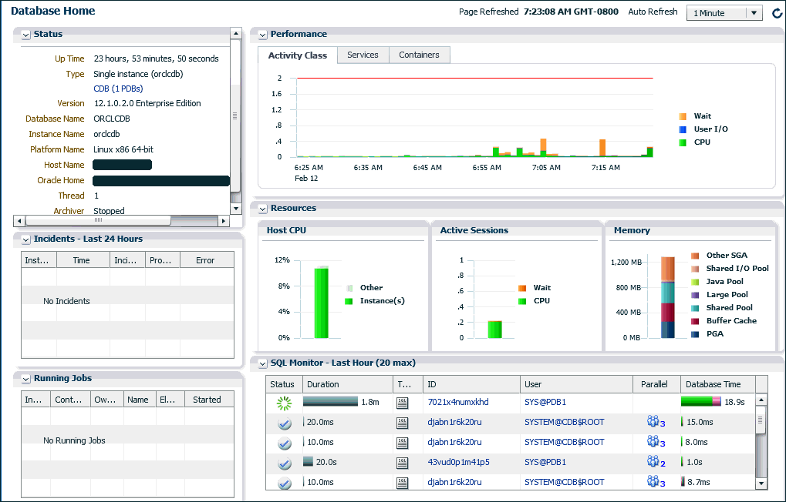
[Description of the illustration exp_db_home_page2.gif](img_text/exp_db_home_page2.md)

##### To monitor the general database state and workload:

1.  Go to the Database Home page.
    See "[Accessing the Database Home Page](getting-started-with-database-administration.md)".
2.  (Optional) Click the Refresh icon to the right of the selected refresh interval for the Auto Refresh list to update the information displayed.
    The time that the Database Home page was last collected from the database appears near the top right corner of the page.

    By default, the Database Home page automatically refreshes every 60 seconds. You can prevent automatic refresh by selecting Off in the Auto Refresh list at the top right-hand corner of the page. You must then click the Refresh icon to view the latest information.
3.  Get a quick overview of the database state in the Status section, which includes the following information:
    - Up Time

      Information about how long the database has been up

    - Type

      The database type. The type can be a single instance database (CDB or non-CDB) or an Oracle RAC database (or cluster database).

      If the database type is a CDB, the next line will identify the database as a CDB and specify the number of PDBs in the CDB. The CDB (n PDBs) line is a link to the Containers page, which shows a list of containers in the CDB (not including PDB\$SEED), as well as status, performance, and resource information about the containers.

    - Version

      The database version number

    - Database name

      The database name

    - Instance name

      The name of the database instance

    - Platform name

      The platform on which the database is running

    - Host name

      The name of the host system on which the database is running

    - Thread

      The redo log threads for the database

    - Archiver

      The status of the archiver process
4.  View active session information in the Performance section. The Performance section shows trend information for the past hour.
    The Activity Class chart shows the average number of database sessions active for the past hour. The chart shows the type of activity for each session (on CPU, waiting for I/O, or waiting for another resource).

    The Services chart shows the average number of database sessions active for the past hour for database services.

    For Oracle RAC, the Activity Class chart shows activity aggregated across all instances in the cluster. Also, an Instances chart appears for Oracle RAC that shows Average Active Sessions per instance.
5.  View resource utilization for the latest data point (the last minute) in the Resources section. The Resources section includes the following information:
    - Host CPU chart

      This chart shows the percentage of CPU time used by the database instance and other processes during the last minute. Place your cursor over the instance data to see the percentage of CPU used by foreground and background instance processes.

      If other processes are taking up most of your CPU time, then this indicates that some other application running on the database host computer could be causing performance problems.

    - Active Sessions chart

      This chart shows the average number of active sessions during the last minute, broken out by wait, user I/O, and CPU.

      - Waits

        This is the value for all wait classes combined, excluding user I/O and idle wait events. Wait classes are groupings of wait events based on the type of wait.

        Go to the Performance Hub and click the Activity tab to view more information about waits.

      - User I/O

        This is the average number of active sessions waiting for user I/O. User I/O means that the workload originating from the user causes the database to read data from disk or write data to disk.

        Go to the Performance Hub and click the Summary tab to view more information about I/O.

      - CPU

        This is the average active sessions using CPU.

        Go to the Performance Hub and click the Summary tab to view more information about CPU usage.

    - Memory (GB)

      This chart shows the current memory utilization (as of the latest refresh time) broken out by the database shared pool, java pool, buffer cache, PGA, and other SGA components.

    - Data Storage (GB)

      This chart shows the current space usage (as of the latest refresh time) broken out by user data, database log files, undo tablespaces, and temporary, SYSAUX, and SYSTEM tablespaces.
6.  View SQL activity in the SQL Monitor section:
    The table in this section displays information about monitored SQL statement executions. If there is a green spinning icon in the Status column, then the monitored statement is still running. If there is a check mark in the Status column, then the statement has completed its execution.

    SQL statements are monitored only if they have consumed at least 5 seconds of CPU or I/O time.

    For each SQL statement, the table provides information in the Status, Duration, SQL ID, Session ID, Parallel, Database Time, and SQL Text columns.

    Click a SQL ID to display the SQL Details page with more information about that SQL statement.
7.  The Incidents - Last 24 Hours section displays a table that provides information about database incidents that have occurred in the past 24 hours. The table has the Instance, Time, Incident, Problem, and Error columns.
    An incident is an occurrence of a critical error in the database. Each incident in the Incidents - Last 24 Hours table is recorded in the Automatic Diagnostic Repository (ADR), a directory structure located outside the database, which is available for problem diagnosis even when the database is down. You can investigate critical errors using the ADR Command Interpreter (ADRCI) utility.
8.  The Running Jobs section displays a table that shows database jobs that are currently running. The table has the Instance, Owner, Name, Elapsed, and Started columns.
    **See Also:**

    - [Oracle Database SQL Tuning Guide](../tgsql/monitoring-database-operations.md) for more information about the Enterprise Manager pages for monitored SQL executions

    - "About the SQL Tuning Advisor" for an introduction to SQL Tuning Advisor

    - "About the Automatic SQL Tuning Advisor" for an introduction to Automatic SQL Tuning Advisor

    - "Running the SQL Tuning Advisor" for an example of tuning a SQL statement using SQL Tuning Advisor

    - [Oracle Database Administrator’s Guide](../admin/diagnosing-and-resolving-problems.md) for information about investigating problems using ADRCI.

#### 10.1.2 Monitoring Performance Using the Performance Hub

The Performance Hub allows you to view all the performance data available for a specified time period. Once a time period is selected, the performance information is collected and presented based on performance subject areas.

This section includes the following topic:

- Specifying the Time Period for Which to Display Statistics

When real-time data is selected, more granular data is presented (because data points are available every minute).

When historical data is selected, more detailed data (broken down by different metrics) is presented, but the data points are averaged out to the Automatic Workload Repository (AWR) interval (usually an hour).

Different tabs are available in the Performance Hub, depending on whether real-time or historical data is selected for the time period.

The following table describes the Performance Hub tabs, and indicates whether the tab is available when real-time data is selected or historical data is selected, or both.

| Performance Hub Tab Name | Description                                                                                                                                                                                                                                                                                                                                                                                                                                                                                                                                                                                                                                                                                                                                                                                                                                                                                                                                                                                                                                                                                                                                                                                                                                                         | Available When                                                                                                                                                                                                                                                                                                  |
|:-------------------------|:--------------------------------------------------------------------------------------------------------------------------------------------------------------------------------------------------------------------------------------------------------------------------------------------------------------------------------------------------------------------------------------------------------------------------------------------------------------------------------------------------------------------------------------------------------------------------------------------------------------------------------------------------------------------------------------------------------------------------------------------------------------------------------------------------------------------------------------------------------------------------------------------------------------------------------------------------------------------------------------------------------------------------------------------------------------------------------------------------------------------------------------------------------------------------------------------------------------------------------------------------------------------|:----------------------------------------------------------------------------------------------------------------------------------------------------------------------------------------------------------------------------------------------------------------------------------------------------------------|
| Summary                  | The Summary tab provides an overall view of the performance of the system for the specified time period. When real-time data for the last hour is displayed in the Performance Hub page, this tab shows a summary of running processes, memory allocation, database activity by category, and I/O data during the last hour. When historical data is displayed in the Performance Hub page, this tab shows a summary of average active session waits by category, load profile per second, active session activity, host CPU usage by the database instance and other processes, I/O read and write requests per second, and memory usage during the selected time period.                                                                                                                                                                                                                                                                                                                                                                                                                                                                                                                                                                                    | Real-time data or historical data is selected in the Select Time Period field for a non-CDB, CDB, or PDB                                                                                                                                                                                                        |
| RAC                      | The RAC tab appears only when EM Express is being used with an Oracle RAC database (or cluster database). When real-time data is selected, this tab shows global cache activity information and a breakdown of activity (average active sessions) and resource usage (CPU, I/O, memory) per instance. When historical data is selected, this tab shows global cache activity information and a breakdown of activity (average active sessions) and resource usage (CPU, I/O, memory) per instance during the selected time period.                                                                                                                                                                                                                                                                                                                                                                                                                                                                                                                                                                                                                                                                                                                            | Real-time data or historical data is selected in the Select Time Period field                                                                                                                                                                                                                                   |
| Activity                 | The Activity tab shows Active Session History (ASH) analytics. It allows detailed drilldown into average active sessions for ASH over the selected time period. This tab enables you to select an average active sessions dimension and view the top activity for that dimension for a selected time period. For example, you can view the SQL statements and user sessions that had the top average active sessions activity for the selected time period.                                                                                                                                                                                                                                                                                                                                                                                                                                                                                                                                                                                                                                                                                                                                                                                                      | Real-time data or historical data is selected in the Select Time Period field for a non-CDB, CDB, or PDB                                                                                                                                                                                                        |
| Workload                 | The workload profile charts show the pattern of user calls, parse calls, Redo Size and SQL\*Net over the last 60 minutes in real-time mode. The Sessions chart show the logon rate, current logons and open cursors. Clicking a SQL_ID displays the SQL Details page with more information about that SQL statement.                                                                                                                                                                                                                                                                                                                                                                                                                                                                                                                                                                                                                                                                                                                                                                                                                                                                                                                                                | Real-time data or historical data is selected in the Select Time Period field for a non-CDB, CDB, or PDB                                                                                                                                                                                                        |
| Monitored SQL            | This tab enables you to view information about monitored SQL statements that were executing or that completed during the selected time period. The table displays information about monitored SQL statement executions. If there is a green spinning icon in the Status column, then the monitored statement did not complete during the selected time period. A red cross indicates that the SQL did not complete either due to an error or due to the session getting terminated. If there is a check mark in the Status column, then the statement completed its execution during the selected time period. SQL statements are monitored only if they have consumed at least 5 seconds of CPU or I/O time. You can view information such as the status of a statement, its duration, its type (SQL, PL/SQL, or DBOP), its SQL ID, its SQL plan hash, the user who issued it, whether it executed as a serial or parallel statement, the time the database spent performing CPU activity, I/O, or other activity for the statement, the read and write requests and bytes associated with the statement, and the start and end time for the statement. Click a SQL ID to display the SQL Details page with more information about that SQL statement. | Real-time data or historical data is selected in the Select Time Period field for a non-CDB, CDB, or PDB                                                                                                                                                                                                        |
| ADDM                     | The ADDM tab enables you to view performance findings and recommendations that have been found by Automatic Database Diagnostics Monitor (ADDM) for tasks performed in the database during the selected time period. See "Performance Self-Diagnostics: Automatic Database Diagnostic Monitor" for more information about ADDM features.                                                                                                                                                                                                                                                                                                                                                                                                                                                                                                                                                                                                                                                                                                                                                                                                                                                                                                                         | Real-time data or historical data is selected in the Select Time Period field for a non-CDB or CDB. This tab is available for a PDB only when a CDB administrator logs into a CDB and navigates (drills down) to the PDB. The tab is not available when a PDB administrator is logged directly into the PDB. |
| Database Time            | The Database Time tab enables you to view wait events by category for various metrics, and to view time statistics for various metrics for the selected time period.                                                                                                                                                                                                                                                                                                                                                                                                                                                                                                                                                                                                                                                                                                                                                                                                                                                                                                                                                                                                                                                                                                | Historical data is selected in the Select Time Period field for a non-CDB, CDB, or PDB.                                                                                                                                                                                                                         |
| Resources                | The Resources tab enables you to view operating system resource usage statistics, I/O resource usage statistics, and memory usage statistics for the selected time period.                                                                                                                                                                                                                                                                                                                                                                                                                                                                                                                                                                                                                                                                                                                                                                                                                                                                                                                                                                                                                                                                                          | Historical data is selected in the Select Time Period field for a non-CDB, CDB, or PDB.                                                                                                                                                                                                                         |
| System Statistics        | The System Statistics tab enables you to view database statistics by value, per transaction, or per second for the selected time period.                                                                                                                                                                                                                                                                                                                                                                                                                                                                                                                                                                                                                                                                                                                                                                                                                                                                                                                                                                                                                                                                                                                            | Historical data is selected in the Select Time Period field for a non-CDB, CDB, or PDB.                                                                                                                                                                                                                         |
| Containers               | The Containers tab enables you to view open time, active sessions, memory used, I/O requests, and I/O throughput information for the PDBs in the CDB.                                                                                                                                                                                                                                                                                                                                                                                                                                                                                                                                                                                                                                                                                                                                                                                                                                                                                                                                                                                                                                                                                                               | Real-time data or historical data is selected in the Select Time Period field for a CDB.                                                                                                                                                                                                                        |

The following figure shows the Performance Hub when Real Time - Last Hour data is selected.

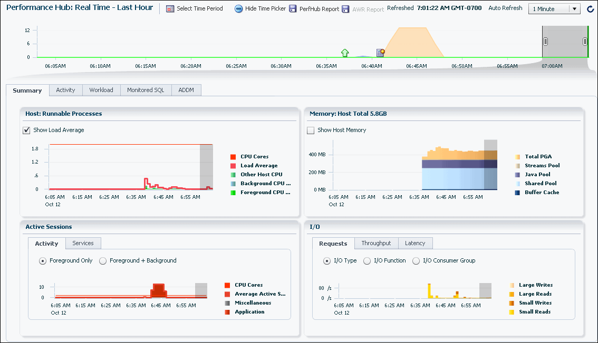
[Description of the illustration perf_hub_real_time.gif](img_text/perf_hub_real_time.md)

The following figure shows the Performance Hub when historical data is selected.

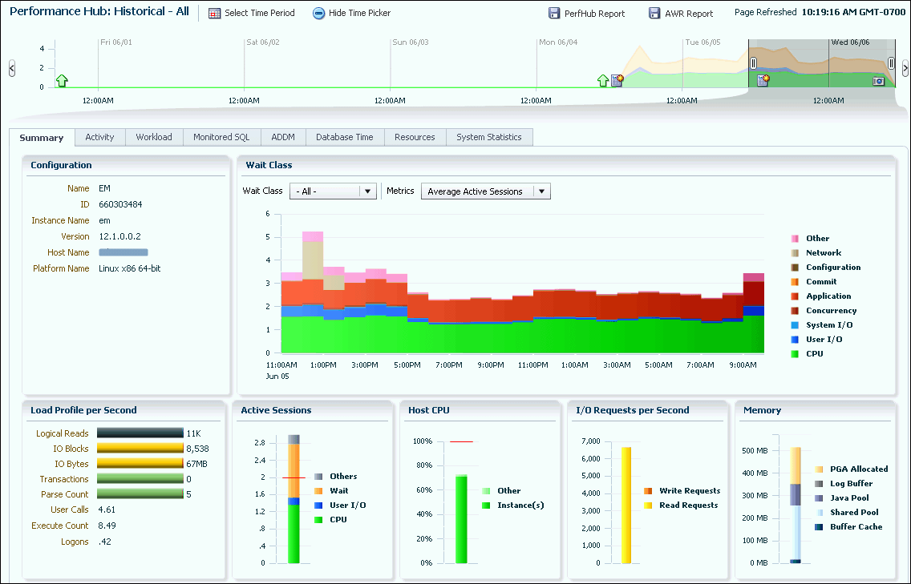
[Description of the illustration perf_hub_summary_hist.gif](img_text/perf_hub_summary_hist.md)

##### To view Performance Hub data:

1.  At the top of the Database Home page, from the Performance menu, select Performance Hub.
    The Performance Hub page appears, with the Summary tab displayed. By default, real time data for the last hour appears in the Performance Hub.

    You can select a different time period in the Select Time Period field if you would like to view historical data in the Performance Hub instead of real-time data.

    In the figure above, Historical - All is selected in the Select Time Period field.
2.  The time picker appears below the Select Time Period field.
    The shaded block area in the time picker identifies the period of time for which performance statistics are currently being displayed in the Performance Hub. This is a subset of the period of time you selected in the Select Time Period field.

    When historical data is displayed in the Performance Hub, you can increase or decrease the size of the shaded block area by clicking and dragging the user control on either end of the shaded block area.

    The shaded block area is the time period for which statistics are displayed on all of the Performance Hub tabs, not just on the currently selected tab.
3.  Click any of the tabs that appear in the Performance Hub to view the performance data on the tab.
4.  Click the PerfHub Report button to generate a Performance Hub active report, which will include the contents of the Performance Hub tabs in an HTML file. After you click PerfHub Report, you are prompted to choose one of these report types for the Performance Hub active report:
    - Basic: The basic information for all the tabs is saved in the report.

    - Typical: All the information for the basic report is saved. Also, the SQL Monitor information for the top SQL in the Monitored SQL tab is saved, and ADDM reports are saved.

    - All: All the information for the basic report is saved. Also, the SQL Monitor information for all of the SQL in the Monitored SQL tab is saved (not just for the top SQL), and all the detailed reports in all the tabs are saved.

    You are then prompted for a location and file name for the active report, and the report is generated in that file and location. You use a web browser to view the report and navigate the Performance Hub tabs in the report.
5.  When historical data is selected in the Performance Hub, you can click the AWR Report button to generate an AWR report for the selected time period.
    You are prompted for a location and file name for the AWR report, and the report is generated in that file and location. You use a web browser to view the report.

    **See Also:**

    [Oracle Database Performance Tuning Guide](../tgdba/gathering-database-statistics.md) for more information about AWR

##### 10.1.2.1 Specifying the Time Period for Which to Display Statistics

In the Real-Time: Last Hour mode, the data in the Performance Hub is sourced from Active Session History (ASH). The ASH data is written to disk when the ASH buffer is filled up or after 1 hour, and is stored as part of the AWR framework.

By default, AWR has a retention period of 8 days. When you view historical data in the Performance Hub, you are viewing statistics collected as part of the hourly snapshots in AWR.

You use the Select Time Period field in the Performance Hub to determine the time periods for which statistics are available for viewing. Because Oracle Database statistics are stored in memory for one hour, the Real Time - Last Hour option always appears in the Select Time Period list.

The historical data options that are available in the Select Time Period list change, depending on the time period for which data is available in AWR, as shown in the following table:

| Time Period for Which AWR Data is Available | Historical Options in the Select Time Period List                            |
|:--------------------------------------------|:-----------------------------------------------------------------------------|
| Less than 24 hours                          | Historical - AllFoot 1                                            |
| More than 24 hours, but less than 7 days    | Historical - Day Historical - AllFoot 1 Historical - Custom |
| 7 days                                      | Historical - Day Historical - Week Historical - Custom                 |
| 8 days or moreFoot 2             | Historical - Day Historical - Week Historical - Custom                 |

Footnote 1

This option is available only when less than one day's data or less than one week's data is available in AWR. Database statistics that are stored in memory are flushed to AWR after one hour.

Footnote 2

The default AWR retention period is 8 days, so you must change the default AWR retention period to store more than a week of data in AWR

After you choose a historical option from the Select Time Period field, you use the time picker to specify the time period for which data is displayed in the Performance Hub tabs.

The following table describes the data displayed and available for selection in the time picker when different values are selected in the Select Time Period field for the Performance Hub:

| Selected Time Period  | Time Picker                                                                                                                                  | Description                                                                                                                                                                                                                                                                                                                                                      |
|:----------------------|:---------------------------------------------------------------------------------------------------------------------------------------------|:-----------------------------------------------------------------------------------------------------------------------------------------------------------------------------------------------------------------------------------------------------------------------------------------------------------------------------------------------------------------|
| Real Time - Last Hour | Displays statistics for the past hour from memory                                                                                            | Data is displayed in 5 minute blocks in the time picker. Use the time picker to select from 1 minute to 60 minutes of data to display in the Performance Hub.                                                                                                                                                                                                    |
| Historical - Day      | Displays statistics from an hour up to 24 hours from AWR                                                                                     | Data is displayed in 1 hour blocks in the time picker. Use the time picker to select from 1 hour to 24 hours of data to display in the Performance Hub.                                                                                                                                                                                                          |
| Historical - All      | Displays statistics for the length of time for which AWR statistics exist                                                                    | Appears only when less than one day's data or less than one week's data is available in AWR. The Historical - All option is available only when there is not enough AWR data to provide the Historical - Day option or the Historical - Week option.                                                                                                             |
| Historical - Week     | Displays statistics from a day up to 7 days from AWR                                                                                         | Data is displayed in 1-day blocks in the time picker. Use the time picker to select from 1 day to 7 days of data to display in the Performance Hub. When Historical - Week is selected, the current week of AWR data appears in the time picker by default. To view AWR data from the previous week in the time picker, use the \< button in the time picker. |
| Historical - Custom   | Displays AWR statistics for the length of time you select in the Select Time Period dialog box after choosing the Historical - Custom option | Use the time picker to select the time period for which you want to display statistics in the Performance Hub.                                                                                                                                                                                                                                                   |

**See Also:**

- [Oracle Database Concepts](../cncpt/concepts-for-database-administrators.md) for more information about ASH

- [Oracle Database Performance Tuning Guide](../tgdba/index.md) for more information about changing the default AWR retention period

#### 10.1.3 About Viewing Performance Statistics on a Standby Database

You can view performance statistics for a standby database in an Oracle Active Data Guard environment using the EM Express Performance Hub.

When you use EM Express to view a standby database in an Oracle Active Data Guard environment, the top left section of the EM Express menu bar displays the name of the standby database, the release number for the database, and the string “standby.” For example, the following figure shows the menu bar for a standby database named ADG for Oracle Database 12c Release 2 (12.2.0.1.0):

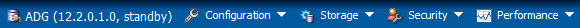
[Description of the illustration standby_db.png](img_text/standby_db.md)

The Oracle Active Data Guard redo apply mechanism applies real-time and historical data from the primary database to the standby database. However, because it is unlikely that you would want to view historical performance data from the primary database in the Performance Hub on the standby database, historical data for a standby database cannot be selected in the Performance Hub. The Select Time Period button in the Performance Hub is unavailable for a standby database, which means that only real-time data for the standby database can be viewed in the Performance Hub.

**Note:**

You must have a license for the Oracle Active Data Guard option to be able to view performance statistics on a standby database.

**See Also:**

- "Monitoring Performance Using the Performance Hub"

- "Specifying the Time Period for Which to Display Statistics"

- "About Tuning SQL Statements on a Standby Database"

#### 10.1.4 Performance Self-Diagnostics: Automatic Database Diagnostic Monitor

Oracle Database includes a self-diagnostic engine called Automatic Database Diagnostic Monitor (ADDM). ADDM makes it possible for Oracle Database to diagnose its own performance and determine how identified problems can be resolved.

To facilitate automatic performance diagnosis using ADDM, Oracle Database periodically collects snapshots of the database state and workload. Snapshots are sets of historical data for specific time periods that are used for performance comparisons by ADDM. Snapshots provide a statistical summary of the state of the system at a point in time. These snapshots are stored in Automatic Workload Repository (AWR), residing in the `SYSAUX` tablespace. The snapshots are stored in this repository for a set time (8 days by default) before they are purged to make room for new snapshots.

ADDM analyzes data to determine the major problems in the system, and may recommend solutions and quantify expected benefits. ADDM analysis results are represented as a set of findings.

EM Express provides two types of ADDM findings.

##### ADDM

ADDM performs its analysis on data that has been captured and stored in AWR. For ADDM, the default collection interval for a snapshot is one hour.

Generally, ADDM is used for identifying systemwide systemic problems. It calls attention to performance problems that include:

- Resource contention (bottlenecks), such as when your database is using large amounts of CPU time or memory due to high load SQL statements

- Poor connection management, such as when your application is making too many logins to the database

- Lock contention in a multiuser environment, such as when one user process acquires a lock to safely update data in a table, causing other user processes that must acquire locks against the same table to wait, resulting in a slower database performance

##### Real-Time ADDM

Real-Time ADDM automatically monitors the database in real time.

Real-Time ADDM proactively detects and diagnoses transient high impact problems such as these before they threaten application performance:

- High CPU

- I/O spikes

- Memory

- Interconnect issues

- Hangs and deadlocks

When Real-Time ADDM detects a possible performance problem, it triggers data collection. The data is saved in the report repository (part of AWR). When you view a Real-Time ADDM report from EM Express, an analysis is performed, and findings and recommendations are made. Because Real-Time ADDM reports are stored in AWR, they can help you identify recurrences of a problem over time.

Table 10-1 provides a summary of the ADDM features available in EM Express.

Table 10-1 ADDM Features in EM Express

| Feature        | New? | Description                                                                                                                                                 | Analysis Period                               | To View Analysis Findings                                                                               |
|:---------------|:-----|:------------------------------------------------------------------------------------------------------------------------------------------------------------|:----------------------------------------------|:--------------------------------------------------------------------------------------------------------|
| ADDM           | No   | This is the traditional ADDM that has existed in previous database releases. ADDM Tasks are presented on the ADDM tab in the Performance Hub.               | The AWR interval, which is 1 hour, by default | In the ADDM Tasks table on the ADDM tab, click a Task Name.                                             |
| Real-Time ADDM | Yes  | Proactively detects and diagnoses transient high impact problems in real time. Real-Time ADDM Reports are presented on the ADDM tab in the Performance Hub. | Real time                                     | In the Real-Time ADDM Reports table on the ADDM tab, select a report and click View Performance Report. |

**See Also:**

- [Oracle Database 2 Day + Performance Tuning Guide](../tdppt/automatic-database-performance-monitoring.md) for more information about automatic database performance monitoring

- "Diagnosing Performance Problems Using ADDM"

### 10.2 Diagnosing Performance Problems Using ADDM

At times, database performance problems arise that require your diagnosis and correction. Usually, these problems are brought to your attention by ADDM, which analyzes data for different time periods.

This section contains the following topics:

- Viewing a Summary of ADDM Performance Findings

- Responding to ADDM Performance Findings

- Viewing a Summary of Real-Time ADDM Findings

- Responding to Real-Time ADDM Findings

**See Also:**

[Oracle Database 2 Day + Performance Tuning Guide](../tdppt/automatic-database-performance-monitoring.md)

#### 10.2.1 Viewing a Summary of ADDM Performance Findings

ADDM analysis results consist of a description of each finding and a recommended action. You can view a summary of findings and their impacts on the system.

##### To view a summary of ADDM performance findings:

1.  In EM Express, from the Performance menu, select Performance Hub.
    The Performance Hub page appears in the list of tabs on the Performance Hub page.
2.  In the Select Time Period field, select one of the time period values to view performance data for that time period. The title of the page changes to indicate the selected time period.
3.  Click the ADDM tab.
    The ADDM tasks for the selected time period appear in the ADDM Tasks table on the ADDM tab.

    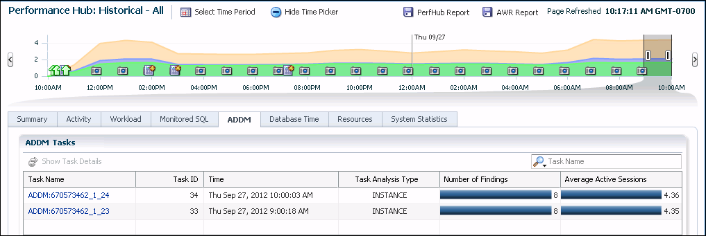
    [Description of the illustration perf_hub_period_addm.gif](img_text/perf_hub_period_addm.md)
4.  Click the link in the Task Name column for a ADDM task to view more information about that task.
    **See Also:**

    "Performance Self-Diagnostics: Automatic Database Diagnostic Monitor"

#### 10.2.2 Responding to ADDM Performance Findings

You can act upon the recommendations that accompany ADDM performance findings.

##### To respond to ADDM performance findings:

1.  In the ADDM Tasks table on the ADDM tab of the Performance Hub page, click the link in the Task Name column to view the performance findings for that task.
    The Automatic Database Diagnostic Monitor (ADDM) page appears.

    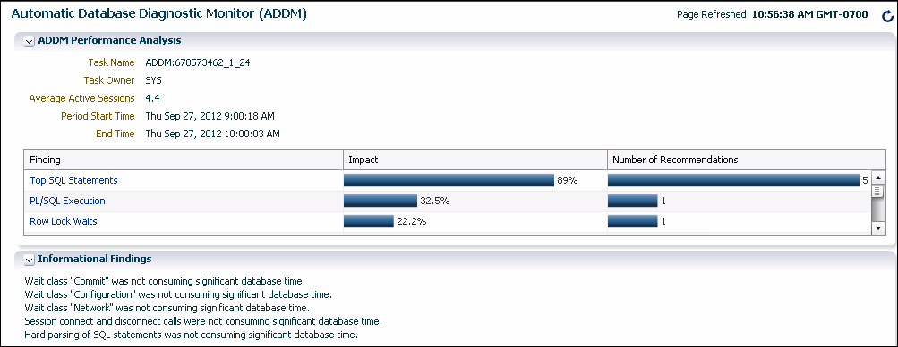
    [Description of the illustration perf_hub_paddm_perf.gif](img_text/perf_hub_paddm_perf.md)
    The performance findings for the ADDM task and the performance impact of each finding (%) are listed in the Findings table.
2.  Click the link in the Finding column for a particular finding to view the finding and recommendations (if any) associated with it.
    The Performance Finding Details page appears.

    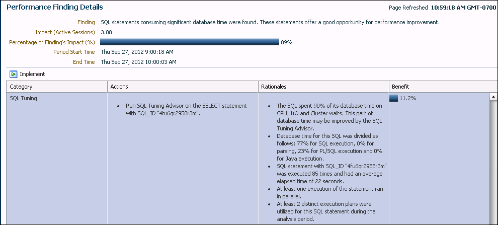
    [Description of the illustration perf_paddm_findings_det.gif](img_text/perf_paddm_findings_det.md)
    The performance findings table lists the performance findings for the ADDM task. For each finding, the table shows the finding category, recommended action, rationale for the recommendations, and the expected benefit of implementing the recommendation.

    When you select a finding that has a recommendation that you can implement using ADDM, the Implement button becomes available for that finding.
3.  For a finding that has a recommendation that you want to implement using ADDM, select the finding and click Implement.
    For this example, the Schedule SQL Tuning Advisor page appears, on which you are prompted for the information necessary to run the SQL Tuning Advisor on the selected SQL statement.

**See Also:**

"Performance Self-Diagnostics: Automatic Database Diagnostic Monitor"

#### 10.2.3 Viewing a Summary of Real-Time ADDM Findings

Real-Time ADDM results consist of a description of each finding and recommended actions for some findings at the point in time when the Real-Time ADDM report was generated. You can view a summary of findings and their impacts on the system.

##### To view a summary of Real-Time ADDM performance findings:

1.  In EM Express, from the Performance menu, select Performance Hub.
    The Performance Hub page appears in the list of tabs on the Performance Hub page.
2.  In the Select Time Period field, select one of the time period values to view performance data for that time period. The title of the page changes to indicate the selected time period.
3.  Click the ADDM tab.
    If there are Real-Time ADDM reports for the selected time period, the reports appear in the Real-Time ADDM Reports table at the bottom of the ADDM tab.

    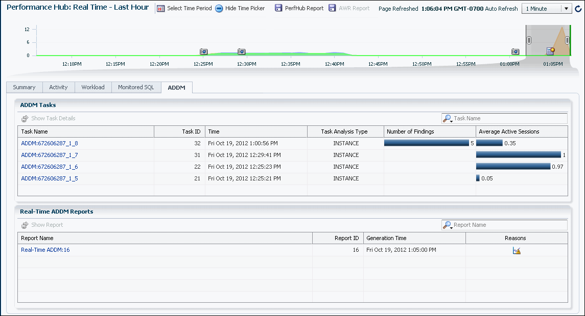
    [Description of the illustration perf_hub_rt_addm_report.gif](img_text/perf_hub_rt_addm_report.md)
4.  To view a particular report in the table, click the link for the report in the Report Name field, or select the table row and then click Show Performance Report.

**See Also:**

"Performance Self-Diagnostics: Automatic Database Diagnostic Monitor"

#### 10.2.4 Responding to Real-Time ADDM Findings

You can view the findings in a Real-Time ADDM report.

##### To respond to Real-Time ADDM performance findings:

1.  To view a particular report in the Real-Time ADDM Reports table, click the link for the report in the Report Name field, or select the table row and then click Show Performance Report.
    The Real-Time ADDM Report page appears.

    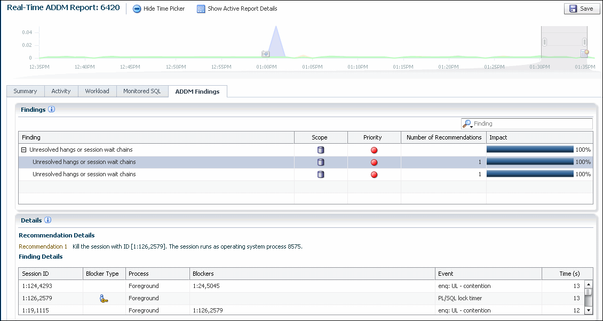
    [Description of the illustration perf_hub_rt_addm_report_det.gif](img_text/perf_hub_rt_addm_report_det.md)
2.  In the Findings table, the findings for the report, and the impact of each finding are displayed. When you select a finding in the Findings table, the recommendation details and finding details for that finding are displayed in the Recommendation Details and Finding Details sections below the Findings table.

**See Also:**

"Performance Self-Diagnostics: Automatic Database Diagnostic Monitor"

### 10.3 Using Advisors to Optimize Database Performance

Oracle Database includes a set of advisors to help you manage and tune your database. This section contains background information about these advisors and instructions for their use. The following topics are covered:

- About Advisors

- About the SQL Tuning Advisor

- About the Automatic SQL Tuning Advisor

- Configuring the Automatic SQL Tuning Advisor

- Viewing Automatic SQL Tuning Results

- Running the SQL Tuning Advisor

- About Tuning SQL Statements on a Standby Database

- Optimizing Memory Usage with the Memory Advisors

**See Also:**

[Oracle Database 2 Day + Performance Tuning Guide](../tdppt/introduction.md)

#### 10.3.1 About Advisors

Advisors are powerful tools for database management. They provide specific advice on how to address key management challenges, covering a wide range of areas including space, performance, and undo management. In general, advisors produce more comprehensive recommendations than alerts. This is because alert generation is intended to be low cost and have minimal impact on performance, whereas advisors consume more resources and perform more detailed analysis. This, along with the what-if capability of some advisors, provides vital information for tuning that cannot be procured from any other source. Some advisors are run automatically.

Advisors are provided to help you improve database performance. These advisors include Automatic Database Diagnostic Monitor (ADDM), SQL advisors, and memory advisors. For example, the SGA Advisor graphically displays the impact on performance of changing the size of the System Global Area (SGA).

You can run a performance advisor when faced with the following situations:

- You want to resolve a problem in a specific area, for example, to determine why a given SQL statement is consuming 50 percent of CPU time and what to do to reduce its resource consumption.You can use the SQL Tuning Advisor.

- You are planning to add memory to your system. You can use the Memory Advisor to determine the database performance impact of increasing your SGA or PGA (Program Global Area).

You can also invoke some of the advisors from the Performance Hub page, or through recommendations from ADDM.

Table 10-2 describes the performance advisors.

Table 10-2 Performance Advisors

| Advisor                                                                                         | Description                                                                                                                                                                                                                                                                                                                                                                                                                                                                                                                                                                                                                                                                                                                                                                                                                                                                                                                                                   |
|:------------------------------------------------------------------------------------------------|:--------------------------------------------------------------------------------------------------------------------------------------------------------------------------------------------------------------------------------------------------------------------------------------------------------------------------------------------------------------------------------------------------------------------------------------------------------------------------------------------------------------------------------------------------------------------------------------------------------------------------------------------------------------------------------------------------------------------------------------------------------------------------------------------------------------------------------------------------------------------------------------------------------------------------------------------------------------|
| Automatic Database Diagnostics Monitor (ADDM)                                                   | ADDM makes it possible for Oracle Database to diagnose its own performance and determine how any identified problems can be resolved.See "Performance Self-Diagnostics: Automatic Database Diagnostic Monitor" and "Diagnosing Performance Problems Using ADDM."                                                                                                                                                                                                                                                                                                                                                                                                                                                                                                                                                                                                                                                                                              |
| SQL Tuning Advisor                                                                              | The SQL Tuning Advisor analyzes one or more SQL statements and makes recommendations for improving performance. This advisor is run automatically during the maintenance periods, but can also be run manually. See "About the Automatic SQL Tuning Advisor" and "Running the SQL Tuning Advisor." For more information about the maintenance windows (time periods) for your database, see [Oracle Database Reference](../refrn/DBA_AUTOTASK_WINDOW_CLIENTS.md).                                                                                                                                                                                                                                                                                                                                                                                                                                                                                          |
| Memory Advisors • Memory Advisor • SGA Advisor • Buffer Cache Advisor • PGA Advisor | The Memory Advisors provide graphical analyses of total memory target settings, SGA and PGA target settings, or SGA component size settings. You use these analyses to tune database performance and for what-if planning. Depending on the current memory management mode, different memory advisors are available. • If Automatic Memory Management is enabled, the Memory Advisor is available. This advisor provides advice for the total memory target for the instance. • If Automatic Shared Memory Management is enabled, then the SGA Advisor and PGA Advisor are available. • If Manual Shared Memory Management and Automatic PGA Memory are enabled, then the Buffer Cache Advisor and PGA Advisor are available. See "Optimizing Memory Usage with the Memory Advisors" for more information about memory advisors, and see "[Managing Memory](managing-the-oracle-instance.md)" for more information about memory management modes. |
| Undo Advisor                                                                                    | The Undo Advisor assists in correctly sizing the undo tablespace. The Undo Advisor can also be used to set the low threshold value of the undo retention period for any Oracle Flashback requirements. See "[Computing the Minimum Undo Tablespace Size Using the Undo Advisor](managing-database-storage-structures.md)."                                                                                                                                                                                                                                                                                                                                                                                                                                                                                                                                                                                                                                    |
| Optimizer Statistics Advisor                                                                    | Optimizer Statistics Advisor is built-in diagnostic software that analyzes the quality of statistics and statistics-related tasks. The advisor task runs automatically in the maintenance window, but you can also run it on demand. You can then view the advisor report. If the advisor makes recommendations, then in some cases you can run system-generated scripts to implement them. See [Oracle Database SQL Tuning Guide](../tgsql/optimizer-statistics-advisor.md)for information about using the Optimizer Statistics Advisor                                                                                                                                                                                                                                                                                                                                                                                                                   |

**See Also:**

[Oracle Database 2 Day + Performance Tuning Guide](../tdppt/introduction.md)

#### 10.3.2 About the SQL Tuning Advisor

The SQL Tuning Advisor examines a given SQL statement or a set of SQL statements and provides recommendations to improve efficiency. It can make various types of recommendations, such as creating a SQL profile (a collection of information that enables the query optimizer to create an optimal execution plan for a SQL statement), restructuring SQL statements, and refreshing optimizer statistics. SQL Tuning Advisor also enables you to pick an alternative execution plan (stored in AWR) from the past and use it with the SQL statement, and can also recommend degree of parallelism profiles. EM Express enables you to accept and implement many of these recommendations with just a few mouse clicks.

You use the SQL Tuning Advisor to tune a single SQL statement or multiple SQL statements. Typically, you run the SQL Tuning Advisor in response to an ADDM performance finding that recommends its use. You can also run it periodically on the most resource-intensive SQL statements, and on a SQL workload.

When tuning multiple SQL statements, the SQL Tuning Advisor does not recognize interdependencies between the SQL statements. It solves SQL performance problems by identifying problems with individual SQL statements, such as a poorly performing optimizer plan or the mistaken use of certain SQL structures.

You can run the SQL Tuning Advisor against the following sources:

- Activity—The most resource-intensive SQL statements executed during the last hour that appear on the Activity tab of the Performance Hub that might have caused recent performance problems.

- Historical SQL—A SQL statement from the last day, week, or month that appears on the Activity tab of the Performance Hub when one of the historical settings is selected in the Select Time Period field. Use this option for proactive tuning of SQL statements.

- Historical SQL from ADDM—A resource-intensive SQL statement from an ADDM task that you discover when analyzing a task on the ADDM tab of the Performance Hub.

- SQL statement in SQL Tuning Advisor—A resource-intensive SQL statement that appears as a tuning task in SQL Tuning Advisor.

- SQL tuning sets (STS)—A set of SQL statements you provide. An STS can be created from SQL statements captured by AWR snapshots or from a SQL workload.

**Note:**

You cannot create an STS using EM Express. See [Oracle Database SQL Tuning Guide](../tgsql/managing-sql-tuning-sets.md) for information on creating an STS.

**See Also:**

- [Oracle Database 2 Day + Performance Tuning Guide](../tdppt/tuning-sql-statements.md) for more information about tuning SQL statements with the SQL Tuning Advisor

- "Running the SQL Tuning Advisor"

#### 10.3.3 About the Automatic SQL Tuning Advisor

The SQL Tuning Advisor runs automatically during system maintenance windows (time periods) as a maintenance task. During each automatic run, the advisor selects high-load SQL queries in the system and generates recommendations on how to tune these queries.

The Automatic SQL Tuning Advisor can be configured to automatically implement SQL profile recommendations. A SQL profile contains additional SQL statistics that are specific to the SQL statement and enable the query optimizer to generate a significantly better execution plan at run time. If you enable automatic implementation, then the advisor creates SQL profiles for only those SQL statements where the performance improvement would be at least threefold. Other types of recommendations, such as the creation of new indexes, refreshing optimizer statistics, or restructuring SQL, can only be implemented manually. DML statements are not considered for tuning by the Automatic SQL Tuning Advisor.

You can view a summary of the results of automatic SQL tuning, and a detailed report about recommendations made for all SQL statements that the SQL Tuning Advisor has processed. You can then implement selected recommendations. You can also view the recommendations that were automatically implemented.

You can disable the Automatic SQL Tuning Advisor, if desired.

**See Also:**

- "Viewing Automatic SQL Tuning Results"

- "Configuring the Automatic SQL Tuning Advisor"

- [Oracle Database 2 Day + Performance Tuning Guide](../tdppt/tuning-sql-statements.md)

- [Oracle Database Administrator’s Guide](../admin/managing-automated-database-maintenance-tasks.md) for more information about automated maintenance tasks

#### 10.3.4 Configuring the Automatic SQL Tuning Advisor

The following are some configuration tasks that you might want to perform for the Automatic SQL Tuning Advisor:

- Enable automatic implementation of SQL profile recommendations.

  Automatic implementation is disabled by default.

- Change the maximum number of SQL profiles implemented during one run of the SQL Tuning Advisor

  When automatic implementation of SQL profile recommendations is enabled, 20 SQL profiles are implemented during a run of the SQL Tuning Advisor, by default.

- Change the maximum number of SQL profiles that can be implemented overall.

  When automatic implementation of SQL profile recommendations is enabled, a total of 10000 SQL profiles can be implemented by SQL Tuning Advisor, by default.

##### To configure the Automatic SQL Tuning Advisor:

1.  Log into EM Express as a user who has the `EM_EXPRESS_ALL` role.
    See "[Granting Access to EM Express for Nonadministrative Users](getting-started-with-database-administration.md)" for more information about the `EM_EXPRESS_ALL` role.
2.  In EM Express, from the Performance menu, select SQL Tuning Advisor.
    The SQL Tuning Advisor page appears, with the Automatic tab showing.

    The SQL tuning task that appears on the Automatic tab is the `SYS_AUTO_SQL_TUNING_TASK`. This tuning task is created daily by the Automatic SQL Tuning Advisor. The task includes any high-load SQL queries for which the Automatic SQL Tuning Advisor has generated tuning recommendations.

    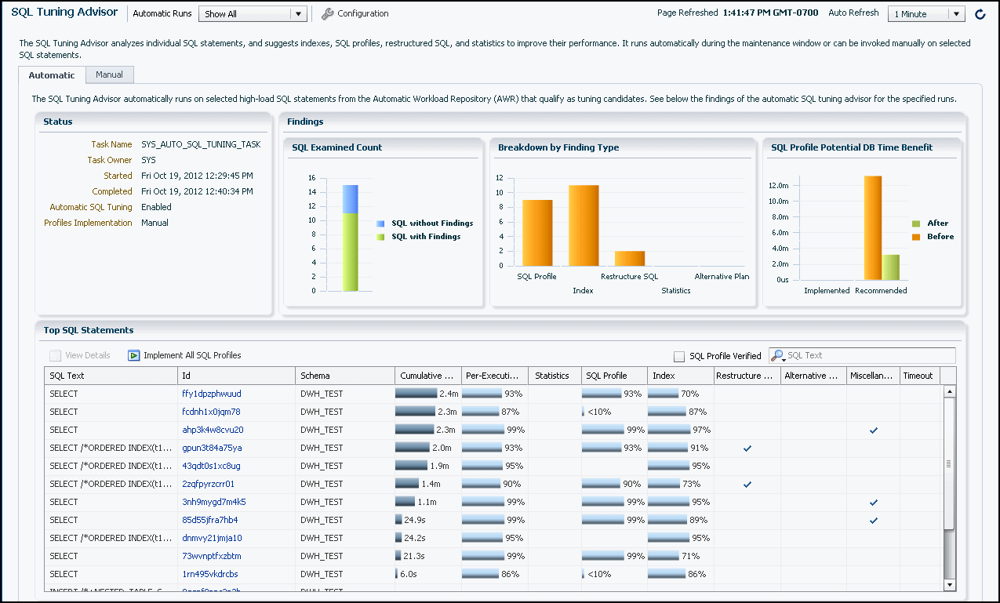
    [Description of the illustration auto_sqlt_advisor.gif](img_text/auto_sqlt_advisor.md)
3.  Click the Configuration button.
    The SQL Tuning Settings dialog box appears.

    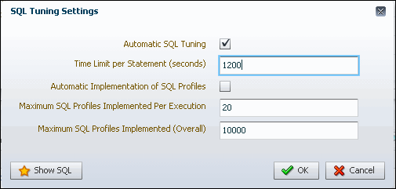
    [Description of the illustration sql_tuning_settings_dibox.gif](img_text/sql_tuning_settings_dibox.md)
4.  (Optional) To disable the Automatic SQL Tuning Advisor, remove the check mark for the the Automatic SQL Tuning option.
    **Note:**

    If you disable the Automatic SQL Tuning option, none of the other options in the SQL Tuning Settings dialog box have any effect.
5.  (Optional) In the Time Limit per Statement (seconds) field, enter the maximum time that SQL Tuning Advisor should take to tune any single SQL statement (in seconds).
6.  (Optional) In the Automatic Implementation of SQL Profiles field, enter a check mark to enable the automatic implementation of SQL profiles, or remove the check mark to disable the automatic implementation of SQL profiles.
    **Note:**

    If you disable the Automatic Implementation of SQL Profiles option, the settings for the Maximum SQL Profiles Implemented per Execution and Maximum SQL Profiles Implemented (Overall) options have no effect.
7.  (Optional) In the Maximum SQL Profiles Implemented per Execution field, enter the total number of SQL profiles that can be implemented during a single daily run of the SQL Tuning Advisor. The default value is 20.
8.  (Optional) In the Maximum SQL Profiles Implemented (Overall) field, enter the total number of SQL profiles that can be implemented overall. The default value is 10000.
9.  Click OK.
    A confirmation page appears.

**See Also:**

"About the Automatic SQL Tuning Advisor" for more information about SQL profiles

#### 10.3.5 Viewing Automatic SQL Tuning Results

You can track the activities of the Automatic SQL Tuning Advisor with EM Express.

##### To view automatic SQL tuning results:

1.  In EM Express, from the Performance menu, choose SQL Tuning Advisor.
    The SQL Tuning Advisor page appears, with the Automatic tab showing.

    The SQL tuning task that appears on the Automatic tab is the `SYS_AUTO_SQL_TUNING_TASK`. This tuning task is created daily by the Automatic SQL Tuning Advisor. The task includes any high-load SQL queries for which the Automatic SQL Tuning Advisor has generated tuning recommendations.

    
    [Description of the illustration auto_sqlt_advisor.gif](img_text/auto_sqlt_advisor.md)
    If you configured Automatic SQL Tuning Advisor to automatically implement SQL profile recommendations, then the SQL Profile Potential DB Time Benefit chart on the Automatic tab of the SQL Tuning Advisor page will include an Implemented bar. Click the Implemented bar to see all the SQL profiles that were automatically implemented.
2.  In the Top SQL Statements table, select a row that includes a SQL statement for which you want to view tuning recommendations, and then click View Details.
    In this example, the SELECT statement with a SQL ID of `ffy1dpzphwuud` was selected and View Details was clicked.

    The Tuning Result for SQL page appears, which shows a summary of the tuning recommendations for the selected SQL statement.

    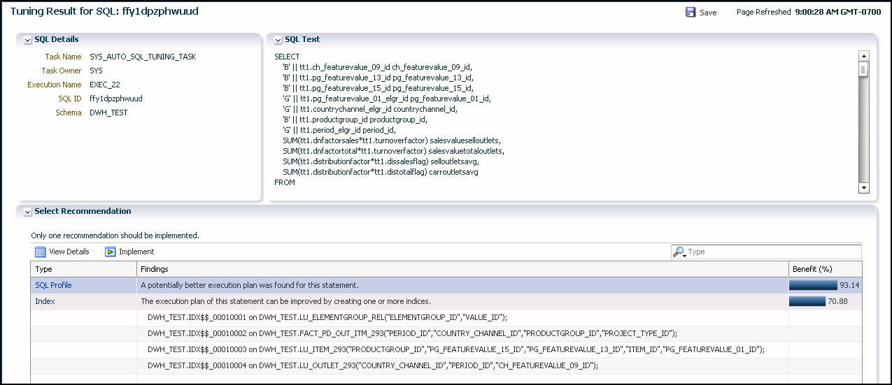
    [Description of the illustration sqlta_auto_start.gif](img_text/sqlta_auto_start.md)
3.  The Select Recommendation section advises that only one recommendation on the page should be implemented.
    To implement a recommendation, select it in the table and click Implement. You will be prompted to provide the necessary information to implement the recommendation.

    To help you decide which (if any) of the recommendations to implement, you may want to view more details about each of the recommendations.

    To view more details about a recommendation, select it in the table, then click View Details. In this example, the SQL Profile recommendation is selected.

    The Recommendation Details page appears.
4.  The top section of this page describes the performance recommendation, and the section is named after the type of recommendation. Some possible names for this section are "Stale or Missing Statistics," "Restructure SQL," and "SQL Profile." This section provides an overview of the recommendation.
    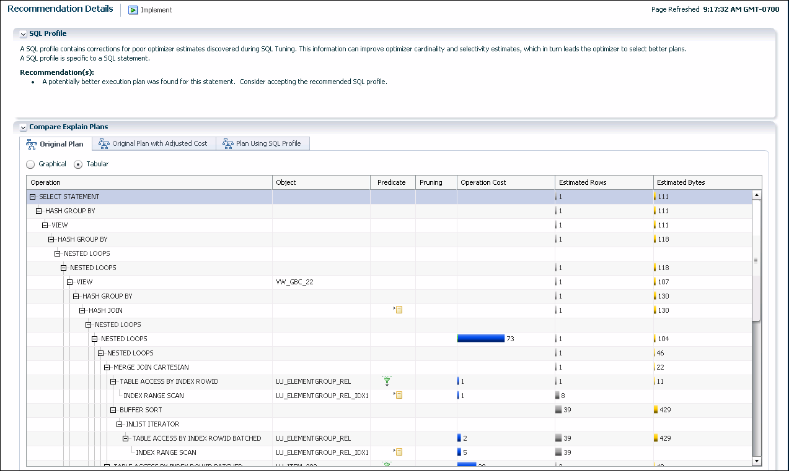
    [Description of the illustration sqlta_auto_1_stmt_recomd.gif](img_text/sqlta_auto_1_stmt_recomd.md)
    The Compare Explain Plans section at the bottom of the page includes tabs that that enable you to view one or more execution plans for the selected statement. The four tabs that can appear are the Original Plan, Original Plan with Adjusted Cost, Plan Using SQL Profile, and Alternative Plan tabs. The Graphical and Tabular buttons enable you to display an execution plan in graphical or tabular format. In this example, the execution plan is displayed in tabular format.

    For recommendations that do not include a potentially better execution plan, only the Original Plan tab appears, and the operations for the original plan are shown on the tab.

    When you click the Original Plan with Adjusted Cost tab, the execution plan steps are the same as the Original Plan steps, but the Original Plan with Adjusted Cost steps have different costs for the steps (as shown in the Operation Cost column).

    If you click the Plan Using SQL Profile tab, the steps are different than the Original Plan steps, and the steps have different costs (as shown in the Operation Cost column).

    The Alternative Plan button appears when the execution history for the original plan cannot be found. In this case, if you know that the alternative plan suggested by SQL Tuning Advisor is better than the original plan, you can create a SQL plan baseline for the alternative plan so that the Oracle optimizer will pick the alternative plan for the statement in the future.

    Click the Implement button at the top of the Recommendation Details page to implement a recommendation.

**See Also:**

- [Oracle Database 2 Day + Performance Tuning Guide](../tdppt/monitoring-real-time-database-performance.md)

- "About the Automatic SQL Tuning Advisor"

#### 10.3.6 Running the SQL Tuning Advisor

Use the SQL Tuning Advisor for tuning SQL statements. Typically, you run this advisor in response to an ADDM performance finding that recommends its use. You can also start the SQL Tuning Advisor manually. One reason is to tune statements that the Automatic SQL Tuning Advisor has not considered for tuning.

As described in "About the SQL Tuning Advisor," the SQL Tuning Advisor can select SQL statements to tune from several sources. The following scenario assumes that you want to tune the SQL statements with the most activity:

##### To run the SQL Tuning Advisor:

1.  In EM Express, from the Performance menu, choose Performance Hub.
    The Performance Hub page appears.
2.  In the Select Time Period field, select the desired time period.
    In this example, Historical - All has been selected in the Select Time Period field.
3.  Select Activity.
    The Activity tab appears.
4.  In the table at the bottom of the Activity tab, select the row that includes the SQL statement that you want to tune, and then click the Tune SQL button.
    In this example, the SQL statement in the sixth row of the table is selected.

    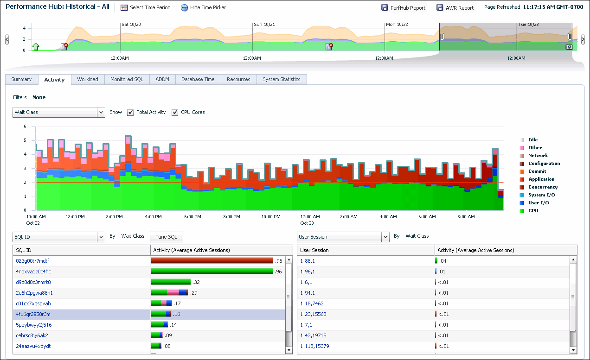
    [Description of the illustration row6_sqlta.gif](img_text/row6_sqlta.md)
5.  The Schedule SQL Tuning Advisor wizard appears, with the Task Information page showing.
    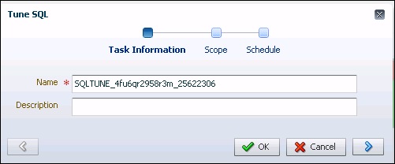
    [Description of the illustration row6_sqlta_sched1.gif](img_text/row6_sqlta_sched1.md)
    On the Task Information page, you can accept the tuning task name generated by the system, or enter a name of your choosing for the tuning task that will be created for the selected SQL statement. You also have the option of entering a description for the tuning task.

    Click the right arrow button.
6.  The Scope page appears. Specify the total time SQL Tuning Advisor should spend analyzing the statement (the default value is Unlimited), and the scope of the analysis (Comprehensive or Limited).
    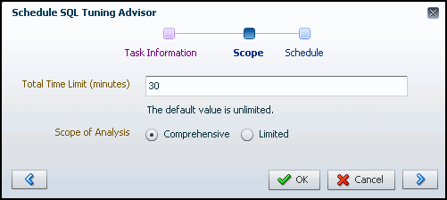
    [Description of the illustration row4_sqlta_sched2.gif](img_text/row4_sqlta_sched2.md)
    Click the right arrow button.
7.  The Schedule page appears. On this page, you can schedule SQL Tuning Advisor to analyze the statement immediately or later. If you choose to have SQL Tuning Advisor analyze the statement later, specify the time that you want SQL Tuning Advisor to analyze the statement.
    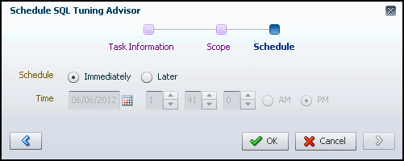
    [Description of the illustration row4_sqlta_sched3.gif](img_text/row4_sqlta_sched3.md)
    Click OK to begin the tuning task creation by SQL Tuning Advisor for the selected SQL statement.
8.  When the SQL Tuning Advisor finishes analyzing the SQL statement, the Completed (check mark) icon appears in the Status column on the SQL Tuning Advisor page.
    Select the row that includes the SQL statement that SQL Tuning Advisor has finished analyzing, and then click View Result to see the recommendations the SQL Tuning Advisor has for this SQL statement. In this example, the first row is selected.

    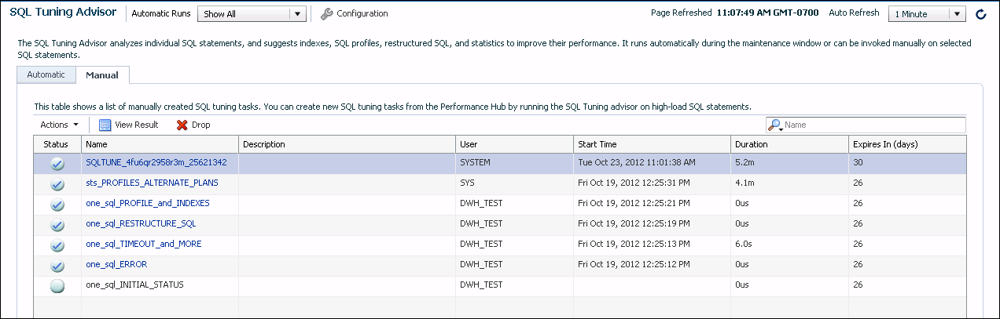
    [Description of the illustration row6_sqlta_manual_tab.gif](img_text/row6_sqlta_manual_tab.md)
    The Tuning Result for SQL: SQLID page appears, which shows a summary of the tuning recommendations for the selected SQL statement.
9.  The Select Recommendation section at the bottom of the page shows the recommendations for tuning the SQL statement.
    If there are multiple recommendations on the page, only one of them should be implemented.

    To implement a recommendation, select it in the table and click Implement. You will be prompted to provide the necessary information to implement the recommendation.

    To help you decide which (if any) of the recommendations to implement, you may want to view more details about each of the recommendations.

    **Note:**

    Some SQL statements may have a SQL Profile recommendation, which means that SQL Tuning Advisor recommends creating a SQL profile for the statement. When a SQL profile is recommended for a statement, the Select Recommendation section includes a recommendation with a value of SQL Profile in the Type column, as well as a Validate with SPA button. To validate the impact of implementing the SQL profile for a statement, select the SQL Profile recommendation and click Validate with SPA.

    To view more details about a recommendation, select it in the table, then click View Details.

    In this example, the Some alternative execution plans for this statement were found by searching the system's real-time and historical performance data recommendation is selected.

    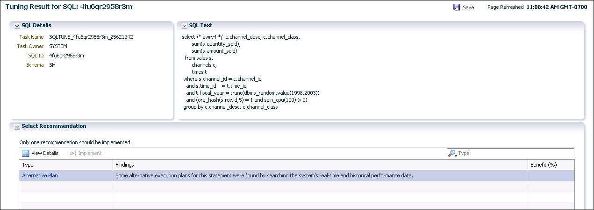
    [Description of the illustration row6_sqlta_tun_results.gif](img_text/row6_sqlta_tun_results.md)
    The Recommendation Details page appears.
10. The top section of this page describes the performance recommendation, and the section is named after the type of recommendation. Some possible names for this section are "Alternative Plan(s)," "Stale or Missing Statistics," "Restructure SQL," and "SQL Profile." This section provides an overview of the recommendation.
    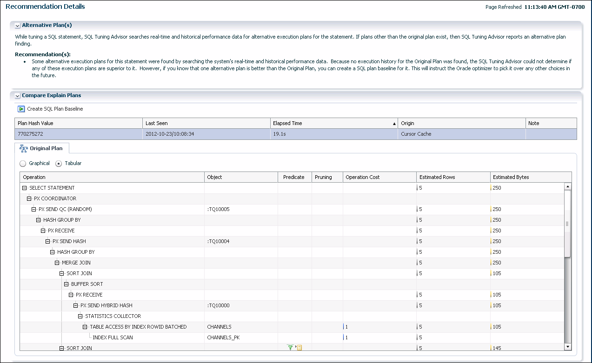
    [Description of the illustration row6_sqlta_tun_recs.gif](img_text/row6_sqlta_tun_recs.md)
    The Compare Explain Plans section at the bottom of the page includes one or more tabs that that enable you to view one or more execution plans for the selected statement. The four tabs that can appear are the Original Plan, Original Plan with Adjusted Cost, Plan Using SQL Profile, and Alternative Plan tabs. The Tabular and Graphical button enable you to display an execution plan in tabular or graphical format. In this example, the execution plan is displayed in tabular format.

    For recommendations that do not include a potentially better execution plan, only the Original Plan tab appears, and the operations for the original plan are shown on the Original Plan subpage.

    On the Original Plan with Adjusted Cost subpage, the execution plan steps are the same as the Original Plan steps, but the Original Plan with Adjusted Cost steps have different costs for the steps (as shown in the Operation Cost column).

    On the Plan Using SQL Profile subpage, the steps are different than the Original Plan steps, and the steps have different costs (as shown in the Operation Cost column).

    The Alternative Plan subpage is available when the execution history for the original plan cannot be found. In this case, if you know that the alternative plan suggested by SQL Tuning Advisor is better than the original plan, you can click the Create SQL Plan Baseline button to create a SQL plan baseline for the alternative plan so that the Oracle optimizer will pick the alternative plan for the statement in the future.

    To implement a recommendation, click the Back button in your browser, and implement the recommendation on the Tuning Result page.

**See Also:**

- "About the SQL Tuning Advisor"

- "About the Automatic SQL Tuning Advisor"

#### 10.3.7 About Tuning SQL Statements on a Standby Database

In an Oracle Active Data Guard environment, read/write queries can be executed on the primary database, while read-only SQL queries are executed on a standby database. You can use SQL Tuning Advisor in EM Express to tune expensive read-only SQL queries on a standby database.

When tuning Oracle Active Data Guard workloads using SQL Tuning Advisor, the entire SQL tuning process is executed locally at the standby while maintaining the read-only nature of the standby database. This is accomplished by using a database link from the standby to the primary to write any database state changes (such as SQL profile implementation) over to the primary. Recommendations that are implemented on the primary get applied to the standby by Oracle Data Guard redo apply.

**Note:**

You must have a license for the Oracle Active Data Guard option to be able to tune SQL statements on a standby database.

**See Also:**

- "Tuning SQL Statements on a Standby Database"

- "About Viewing Performance Statistics on a Standby Database"

- [Oracle Database SQL Tuning Guide](../tgsql/sql-tuning-advisor.md) for an introduction to tuning SQL on a remote database, including an example of creating the database link on the standby database to the primary database

##### 10.3.7.1 Tuning SQL Statements on a Standby Database

You can use the SQL Tuning Advisor in EM Express to tune SQL statements for a standby database in an Oracle Active Data Guard environment.

**Note:**

You must have a license for the Oracle Active Data Guard option to be able to tune SQL statements on a standby database.

This topic assumes that you are familiar with the SQL Tuning Advisor instructions in the "Running the SQL Tuning Advisor" topic.

To run the SQL Tuning Advisor to tune SQL statements for a standby database in an Oracle Active Data Guard environment:

1.  In EM Express, from the Performance menu, choose Performance Hub.
    The Performance Hub page appears. The Select Time Period field is unavailable. You can tune only those SQL statements that execute in real-time on the standby.
2.  Select Activity.
    The Activity tab appears.
3.  In the table at the bottom of the Activity tab, select the row that includes the SQL statement that you want to tune, and then click the Tune SQL button.
    The Task Information page of SQL Tuning Advisor appears.
4.  On the Task Information page, supply values for these fields:
    - Name: Accept the tuning task name generated by the system, or enter a name of your choosing for the tuning task that will be created for the selected SQL statement.

    - Description: You also have the option of entering a description for the tuning task.

    - Source DB Link: Click the search button, and the Select DB Link dialog box appears, which lists the database links that exist on this standby database and point to the primary database. Select the database link to use to write the SQL tuning task to the SQL tuning tables on the primary database. Then click OK.
5.  On the Task Information page, click the right arrow button.
6.  The Scope page of SQL Tuning Advisor appears. Specify the total time that SQL Tuning Advisor should spend analyzing the statement (the default value is Unlimited), and the scope of the analysis (Comprehensive or Limited).
    Click OK to begin the tuning task creation by SQL Tuning Advisor for the selected SQL statement.

    EM Express redirects to the SQL Tuning Advisor page that shows a list of SQL tuning tasks.
7.  When the SQL Tuning Advisor finishes analyzing the SQL statement, the Completed (check mark) icon appears in the Status column on the SQL Tuning Advisor page.
    Select the row that includes the SQL statement that SQL Tuning Advisor has finished analyzing, and then click View Result to see the recommendations the SQL Tuning Advisor has for this SQL statement.

    The Tuning Result for SQL: SQLID page appears, which shows a summary of the tuning recommendations for the selected SQL statement.
8.  The Select Recommendation section at the bottom of the page shows the recommendations for tuning the SQL statement.
    If there are multiple recommendations on the page, only one of them should be implemented.

    To implement a recommendation, select it in the table and click Implement. You will be prompted to provide the necessary information to implement the recommendation. Note that the recommendation is implemented on the primary database using the database link that you specified in the Source DB Link field on the Task Information page.

    To help you decide which (if any) of the recommendations to implement, you may want to view more details about each of the recommendations.

    **Note:**

    Some SQL statements may have a SQL Profile recommendation, which means that SQL Tuning Advisor recommends creating a SQL profile for the statement. When a SQL profile is recommended for a statement, the Select Recommendation section includes a recommendation with a value of SQL Profile in the Type column, as well as a Validate with SPA button. The Validate with SPA button is unavailable in a standby database because the standby is a read-only database.

    To view more details about a recommendation, select it in the table, then click View Details. You can then review the recommendation on the Recommendation Details page.
9.  After you implement a recommendation and SQL Tuning Advisor writes it to the primary database using the database link on the standby, the recommendation will then be propagated to the standby database by the Oracle Data Guard redo apply mechanism.
    From this point on, when the SQL statement that was tuned is executed on the standby, it will be executed using the new recommendations that were implemented using SQL Tuning Advisor.
    **See Also:**

    - "About Tuning SQL Statements on a Standby Database"

    - "About Viewing Performance Statistics on a Standby Database"

    - [Oracle Database SQL Tuning Guide](../tgsql/sql-tuning-advisor.md) for an introduction to tuning SQL on a remote database, including an example of creating the database link on the standby database to the primary database

#### 10.3.8 Optimizing Memory Usage with the Memory Advisors

This section includes information about memory advisors.

- About the Memory Advisors

**See Also:**

- "[Managing Memory](managing-the-oracle-instance.md)"

- "About Advisors"

##### 10.3.8.1 About the Memory Advisors

Adequate physical memory has a significant impact on the performance of your Oracle Database. With its automatic memory management capabilities, Oracle Database can automatically adjust the memory distribution among the various SGA and PGA components for optimal performance. These adjustments are made within the boundaries of the total amount of memory that you allocate to the database.

ADDM periodically evaluates the performance of your database to determine performance problems. If ADDM finds that the current amount of available memory is inadequate and adversely affecting performance, then it can recommend that you increase memory allocations. You can select new memory allocations using the Memory Advisors.

Additionally, you can use the Memory Advisors to perform what-if analysis on the following:

- The database performance benefits of adding physical memory to your database

- The database performance impact of reducing the physical memory available to your database

With the Memory Advisors, you can obtain memory sizing advice as follows:

- If automatic memory management is enabled, you can get a prediction of the percentage of time saved by using a different target memory size setting for the Oracle instance.

  See "[Modifying Memory Settings – Automatic Memory Management](managing-the-oracle-instance.md)" for more information.

- If automatic memory management is disabled and automatic shared memory management is enabled, you can get a prediction of the percentage of time saved by using a different total SGA size.

  See "[Modifying Memory Settings – Automatic Shared Memory Management](managing-the-oracle-instance.md)" for more information.

- If only manual shared memory management is enabled, then you can get a prediction of the percentage of reads saved by using a different database cache size.

  See "[Modifying Memory Settings - Manual Shared Memory Management](managing-the-oracle-instance.md)" for more information.

### 10.4 Monitoring and Tuning the Database: Oracle by Example Series

Oracle By Example (OBE) has a series on the Oracle Database 2 Day DBA guide. This OBE series steps you through the tasks in this section, and includes annotated screenshots.

The series consists of the following tutorials:

1.  Generate some Database Activity

2.  Monitor Database Performance Using Enterprise Manager Database Express

The above tutorials can be accessed in two ways:

- To see a clickable list of the above tutorials, go to [Monitor and Tune the Database Series](https://docs.oracle.com/pls/topic/lookup?ctx=en/database/oracle/oracle-database/19/admqs&id=twodaydba_obe_montune).

- For seamless navigation through the tutorial series, access the following link:

  [Monitor and Tune the Database](https://docs.oracle.com/pls/topic/lookup?ctx=en/database/oracle/oracle-database/19/admqs&id=twodaydba_lp_montune)

  You can navigate across the tutorials by clicking the \> button at the bottom of the pane.
