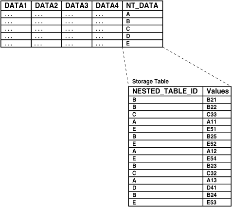
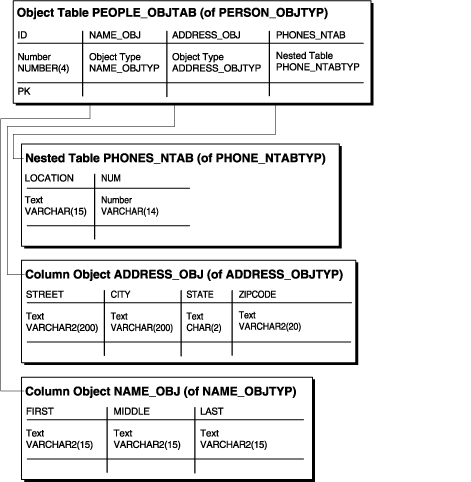
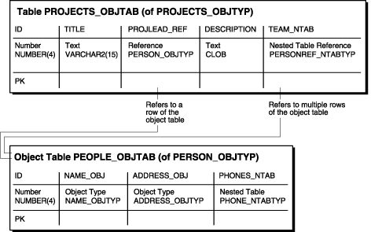

There are certain considerations to think about when you work with collections.

Topics:

- Viewing Object Data in Relational Form with Unnesting Queries

- Storage Considerations for Varrays

- Performance of Varrays Versus Nested Tables

- Design Considerations for Nested Tables

- Design Considerations for Multilevel Collections

### 9.4.1 Viewing Object Data in Relational Form with Unnesting Queries

An unnesting query on a collection allows the data to be viewed in a flat (relational) form.

You can execute unnesting queries on single-level and multilevel collections of either nested tables or varrays.

Nested tables can be unnested for queries using the `TABLE` syntax, as in the following example:

Example 9-4 Unnesting a Nested Table with the TABLE Function

    SELECT p.name_obj, n.num
       FROM people_reltab p, TABLE(p.phones_ntab) n ;

Here, `phones_ntab` specifies the attributes of the `phones_ntab` nested table. To retrieve even parent rows that have no child rows (no phone numbers, in this case), use the outer join syntax, with the `+`. For example:

    SELECT p.name_obj, n.num
       FROM people_reltab p, TABLE(p.phones_ntab) (+) n ;

If the `SELECT` list of a query does not refer to any columns from the parent table other than the nested table column, the query is optimized to execute only against the nested table's storage table.

The unnesting query syntax is the same for varrays as for nested tables. For instance, suppose the `phones_ntab` nested table is instead a varray named `phones_var`. The following example shows how to use the `TABLE` syntax to query the varray:

    SELECT p.name_obj, v.num
    FROM people_reltab p, TABLE(p.phones_var) v;

#### 9.4.1.1 Creating Procedures and Functions to Unnest Queries

You can create procedures and functions that you can then execute to perform unnesting queries. For example, you can create a function called `home_phones()` that returns only the phone numbers where `location` is `home`. To create the `home_phones()` function, you enter code like the following:

Example 9-5 Creating the home_phones Function

    CREATE OR REPLACE FUNCTION home_phones(allphones IN phone_ntabtyp)
             RETURN phone_ntabtyp IS
       homephones phone_ntabtyp := phone_ntabtyp();
       indx1      number;
       indx2      number := 0;
    BEGIN
       FOR indx1 IN 1..allphones.count LOOP
          IF
             allphones(indx1).location = 'home'
          THEN
             homephones.extend;    -- extend the local collection
             indx2 := indx2 + 1;
             homephones(indx2) := allphones(indx1);
          END IF;
       END LOOP;

       RETURN homephones;
    END;
    /

#### 9.4.1.2 Querying the TABLE Function to Unnest Data

You can query for a list of people and their home phone numbers, based on the `home_phones()` function you just created.

Example 9-6 Querying for Phone Numbers

See Example 9-5

    SELECT p.name_obj, n.num
       FROM people_reltab p, TABLE(
          CAST(home_phones(p.phones_ntab) AS phone_ntabtyp)) n ;

To query for a list of people and their home phone numbers, including those people who do not have a home phone number listed, enter the following:

    SELECT p.name_obj, n.num
       FROM people_reltab p,
           TABLE(CAST(home_phones(p.phones_ntab) AS phone_ntabtyp))(+) n ;

**See Also:**

[Oracle Database SQL Language Reference ](../sqlrf/Introduction-to-Oracle-SQL.md)and [Oracle Database Data Cartridge Developer's Guide](../addci/using-pipelined-and-parallel-table-functions.md) for more information about the `TABLE` function

### 9.4.2 Storage Considerations for Varrays

The size of a stored varray depends only on the current count of the number of elements in the varray and not on the maximum number of elements that it can hold.

Because the storage of varrays incurs some overhead, such as null information, the size of the varray stored may be slightly greater than the size of the elements multiplied by the count.

Varrays are stored in columns either as raw values or `LOB`s. Oracle decides how to store the varray when the varray is defined, based on the maximum possible size of the varray computed using the `LIMIT` of the declared varray. If the size exceeds approximately 4000 bytes, then the varray is stored in `LOB`s. Otherwise, the varray is stored in the column itself as a raw value. In addition, Oracle supports inline LOBs which means that elements that fit in the first 4000 bytes of a large varray, with some bytes reserved for the LOB locator, are stored in the column of the row. See also [Oracle Database SecureFiles and Large Objects Developer's Guide](../adlob/introduction-to-large-objects.md).

#### 9.4.2.1 About Propagating VARRAY Size Change

When changing the size of a `VARRAY` type, a new type version is generated for the dependent types.

It is important to be aware of this when a `VARRAY` column is not explicitly stored as a LOB and its maximum size is originally smaller than 4000 bytes. If the size is larger than or equal to 4000 bytes after the increase, the `VARRAY` column has to be stored as a LOB. This requires an extra operation to upgrade the metadata of the `VARRAY` column in order to set up the necessary LOB metadata information including the LOB segment and LOB index.

The `CASCADE` option in the `ALTER` `TYPE` statement propagates the `VARRAY` size change to its dependent types and tables. A new version is generated for each valid dependent type and dependent tables metadata are updated accordingly based on the different case scenarios described previously. If the `VARRAY` column is in a cluster table, an` ALTER` `TYPE` statement with the `CASCADE` option fails because a cluster table does not support a LOB.

The `CASCADE` option in the `ALTER` `TYPE` statement also provides the `[NOT]` `INCLUDING` `TABLE` `DATA` option. The `NOT` `INCLUDING` `TABLE` `DATA` option only updates the metadata of the table, but does not convert the data image. In order to convert the `VARRAY` image to the latest version format, you can either specify `INCLUDING` `TABLE` `DATA` explicitly in `ALTER` `TYPE` `CASCADE` statement or issue `ALTER` `TABLE` `UPGRADE` statement.

### 9.4.3 Performance of Varrays Versus Nested Tables

If an entire collection is manipulated as a single unit in the application, varrays perform much better than nested tables. The varray is stored packed and requires no joins to retrieve the data, unlike nested tables.

#### Varray Querying

The unnesting syntax can be used to access varray columns similar to the way it is used to access nested tables. See "Viewing Object Data in Relational Form with Unnesting Queries" for more information.

#### Varray Updates

Piece-wise updates of a varray value are not supported. Thus, when a varray is updated, the entire old collection is replaced by the new collection.

### 9.4.4 Design Considerations for Nested Tables

Topics:

There are several design considerations for using nested tables.

- Nested Table Storage

- Nested Table Indexes

- Nested Table Locators

- Set Membership Query Optimazation

#### 9.4.4.1 Nested Table Storage

Oracle stores the rows of a nested table in a separate storage table. A system generated `NESTED_TABLE_ID`, which is 16 bytes in length, correlates the parent row with the rows in its corresponding storage table.

Figure 9-2 shows how the storage table works. The storage table contains each value for each nested table in a nested table column. Each value occupies one row in the storage table. The storage table uses the `NESTED_TABLE_ID` to track the nested table for each value. So, in Figure 9-2, all of the values that belong to nested table `A` are identified, all of the values that belong to nested table `B` are identified, and so on.

Figure 9-2 Nested Table Storage

[Description of "Figure 9-2 Nested Table Storage"](img_text/adobj021.md)

#### 9.4.4.2 Nested Table Indexes

When creating nested tables stored in heap tables, Oracle database automatically creates an index on the `NESTED_TABLE_ID `column of the storage table and an index on the corresponding ID column of the parent table.

Creating an index on the `NESTED_TABLE_ID ` column enables the database to access the child rows of the nested table more efficiently, because the database must perform a join between the parent table and the nested table using the `NESTED_TABLE_ID ` column.

#### 9.4.4.3 Nested Table Locators

For large child sets, the parent row and a locator to the child set can be returned so that the child rows can be accessed on demand; the child sets also can be filtered. Using nested table locators enables you to avoid unnecessarily transporting child rows for every parent.

You can perform either one of the following actions to access the child rows using the nested table locator:

- Call the OCI collection functions. This action occurs implicitly when you access the elements of the collection in the client-side code, such as `OCIColl*` functions. The entire collection is retrieved implicitly on the first access.

  **See Also:**

  [Oracle Call Interface Programmer's Guide ](../lnoci/oci-collection-and-iterator-functions.md)for more information about OCI collection functions.

- Use SQL to retrieve the rows corresponding to the nested table.

In a multilevel collection, you can use a locator with a specified collection at any level of nesting.

The following topics specify ways that a collection can be retrieved as a locator:

- At Table Creation Time

- As a HINT During Retrieval

##### 9.4.4.3.1 At Table Creation Time

When the collection type is being used as a column type and the `NESTED` `TABLE` storage clause is used, you can use the `RETURN` `AS` `LOCATOR` clause to specify that a particular collection is to be retrieved as a locator.

For instance, suppose that `inner_table` is a collection type consisting of three levels of nested tables. In the following example, the `RETURN` `AS` `LOCATOR` clause specifies that the third level of nested tables is always to be retrieved as a locator.

Example 9-7 Using the RETURN AS LOCATOR Clause

    CREATE TYPE inner_table AS TABLE OF NUMBER;/
    CREATE TYPE middle_table AS TABLE OF inner_table;/
    CREATE TYPE outer_table AS TABLE OF middle_table;/
    CREATE TABLE tab1 (
      col1 NUMBER,
      col2 outer_table)
     NESTED TABLE col2 STORE AS col2_ntab
      (NESTED TABLE COLUMN_VALUE STORE AS cval1_ntab
        (NESTED TABLE COLUMN_VALUE STORE AS cval2_ntab RETURN AS LOCATOR) );

##### 9.4.4.3.2 As a HINT During Retrieval

A query can retrieve a collection as a locator by means of the hint `NESTED_TABLE_GET_REFS`. Here is an example of retrieving the column `col2` from the table `tab1` as a locator:

    SELECT /*+ NESTED_TABLE_GET_REFS +*/ col2
      FROM tab1
     WHERE col1 = 2;

Unlike with the `RETURN` `AS` `LOCATOR` clause, however, you cannot specify a particular inner collection to return as a locator when using the hint.

#### 9.4.4.4 Set Membership Query Optimization

Set membership queries are useful when you want to search for a specific item in a nested table.

The following query tests the membership in a child-set; specifically, whether the location `home` is in the nested table `phones_ntab`, which is in the parent table `people_reltab`:

    SELECT * FROM people_reltab p
       WHERE 'home' IN (SELECT location FROM TABLE(p.phones_ntab)) ;

Oracle can execute a query that tests the membership in a child-set more efficiently by transforming it internally into a semijoin. However, this optimization only happens if the `ALWAYS_SEMI_JOIN` initialization parameter is set. If you want to perform semijoins, the valid values for this parameter are `MERGE` and `HASH`; these parameter values indicate which join method to use.

**Note:**

In the preceding example, `home` and `location` are child set elements. If the child set elements are object types, they must have a map or order method to perform a set membership query.

### 9.4.5 Design Considerations for Multilevel Collections

You can nest collection types to create true multilevel collections.

[Support for Collection Data Types](support-for-collection-data-types.md) describes how to nest collection types such as a nested table of nested tables, a nested table of varrays, a varray of nested tables, or a varray or nested table of an object type that has an attribute of a collection type. These create true multilevel collections.

You can also nest collections indirectly using `REF`s. For example, you can create a nested table of an object type that has an attribute that references an object that has a nested table or varray attribute. If you do not actually need to access all elements of a multilevel collection, then nesting a collection with `REF`s may provide better performance because only the `REF`s need to be loaded, not the elements themselves.

True multilevel collections (specifically multilevel nested tables) perform better for queries that access individual elements of the collection. Using nested table locators can improve the performance of programmatic access if you do not need to access all elements.

A series of examples demonstrate this type of design.

Topics:

- Creating an Object Table with a Multilevel Collection

- Creating an Object Table Using REFs

- IInserting Values into Object Tables

#### 9.4.5.1 Creating an Object Table with a Multilevel Collection

You can create an object table with a multilevel collection.

To create an example of a collection that uses `REF`s to nest another collection, you create a new object type called `person_objtyp` using the object types provided: `name_objtyp`, `address_objtyp`, and `phone_ntabtyp`. Remember that the `phone_ntabtyp` object type is a nested table because each person may have more than one phone number.

To create the `person_objtyp` object type and an object table called `people_objtab` of `person_objtyp` object type, issue the following SQL statement:

Example 9-8 Creating an Object Table with a Multilevel Collection

    CREATE TYPE person_objtyp AS OBJECT (
       id            NUMBER(4),
       name_obj      name_objtyp,
       address_obj   address_objtyp,
       phones_ntab   phone_ntabtyp);
    /

    CREATE TABLE people_objtab OF person_objtyp (id PRIMARY KEY)
       NESTED TABLE phones_ntab STORE AS phones_store_ntab ;

The `people_objtab` table has the same attributes as the `people_reltab` table. The difference is that the `people_objtab` is an object table with row objects, while the `people_reltab` table is a relational table with column objects, as seen in "[Column Object Storage in Relational Tables](general-storage-considerations-for-objects.md)".

Figure 9-3 Object-Relational Representation of the people_objtab Object Table

[Description of "Figure 9-3 Object-Relational Representation of the people_objtab Object Table"](img_text/adobj015.md)

You can reference the row objects in the `people_objtab` object table from other tables. For example, suppose you want to create a `projects_objtab` table that contains:

- A project identification number for each project.

- The title of each project.

- The project lead for each project.

- A description of each project.

- Nested table collection of the team of people assigned to each project.

You can use `REF`s in the `people_objtab` for the project leads, and you can use a nested table collection of `REF`s for the team. To begin, create a nested table object type called `personref_ntabtyp` based on the `person_objtyp` object type:

    CREATE TYPE personref_ntabtyp AS TABLE OF REF person_objtyp;
    /

You are now set up to create to create an object table as shown in Creating an Object Table Using REFs.

#### 9.4.5.2 Creating an Object Table Using REFs

You can create an object table using REFs

After creating the person object table, in Creating an Object Table with a Multilevel Collection,, you are ready to create the project object table `projects_objtab`. First, create the object type `projects_objtyp`, then create the object table `projects_objtab` based on the `projects_objtyp`.

Example 9-9 Creating an Object Table Using REFs

    CREATE TYPE projects_objtyp AS OBJECT (
       id              NUMBER(4),
       title           VARCHAR2(15),
       projlead_ref    REF person_objtyp,
       description     CLOB,
       team_ntab       personref_ntabtyp);
    /
    CREATE TABLE projects_objtab OF projects_objtyp (id PRIMARY KEY)
       NESTED TABLE team_ntab STORE AS team_store_ntab ;

Figure 9-4 Object-Relational Representation of the projects_objtab Object Table

[Description of "Figure 9-4 Object-Relational Representation of the projects_objtab Object Table"](img_text/adobj016.md)

After the `people_objtab` object table and the `projects_objtab` object table are in place, you indirectly have a nested collection. That is, the `projects_objtab` table contains a nested table collection of `REF`s that point to the people in the `people_objtab` table, and the people in the `people_objtab` table have a nested table collection of phone numbers.

You are now set to insert value as shown Inserting Values into Object Tables.

#### 9.4.5.3 Inserting Values into the PEOPLE_OBJTAB Object Table

After you have created an object table, you can then insert values into it.

You can insert values into the `people_objtab` table as in this example.

Example 9-10 Inserting Values into the people_objtab Object Table

    INSERT INTO people_objtab VALUES (
       0001,
       name_objtyp('JOHN', 'JACOB', 'SCHMIDT'),
       address_objtyp('1252 Maple Road', 'Fairfax', 'VA', '22033'),
       phone_ntabtyp(
          phone_objtyp('home', '650.555.0141'),
          phone_objtyp('work', '510.555.0122'))) ;

    INSERT INTO people_objtab VALUES (
       0002,
       name_objtyp('MARY', 'ELLEN', 'MILLER'),
       address_objtyp('33 Spruce Street', 'McKees Rocks', 'PA', '15136'),
       phone_ntabtyp(
          phone_objtyp('home', '415.555.0143'),
          phone_objtyp('work', '650.555.0192'))) ;

    INSERT INTO people_objtab VALUES (
       0003,
       name_objtyp('SARAH', 'MARIE', 'SINGER'),
       address_objtyp('525 Pine Avenue', 'San Mateo', 'CA', '94403'),
       phone_ntabtyp(
          phone_objtyp('home', '510.555.0101'),
          phone_objtyp('work', '650.555.0178'),
          phone_objtyp('cell', '650.555.0143'))) ;

Example 9-11 Inserting Values into the projects_objtab Object Table

Then, you can insert into the `projects_objtab` relational table by selecting from the `people_objtab` object table using a `REF` operator, as in .

    INSERT INTO projects_objtab VALUES (
       1101,
       'Demo Product',
       (SELECT REF(p) FROM people_objtab p WHERE id = 0001),
       'Demo the product, show all the great features.',
       personref_ntabtyp(
          (SELECT REF(p) FROM people_objtab p WHERE id = 0001),
          (SELECT REF(p) FROM people_objtab p WHERE id = 0002),
          (SELECT REF(p) FROM people_objtab p WHERE id = 0003))) ;

    INSERT INTO projects_objtab VALUES (
       1102,
       'Create PRODDB',
       (SELECT REF(p) FROM people_objtab p WHERE id = 0002),
       'Create a database of our products.',
       personref_ntabtyp(
          (SELECT REF(p) FROM people_objtab p WHERE id = 0002),
          (SELECT REF(p) FROM people_objtab p WHERE id = 0003))) ;

**Note:**

This example uses nested tables to store `REF`s, but you also can store `REF`s in varrays. That is, you can have a varray of `REF`s.
