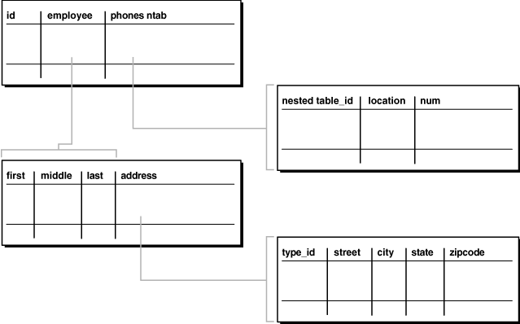

There are general storage considerations for various object types.

Topics:

- About Storing Objects as Columns or Rows

- Storage Considerations for Object Identifiers (OIDs)

### 9.1.1 About Storing Objects as Columns or Rows

You can store objects in relational tables as column objects or in object tables as row objects. Those objects that have meaning outside of the relational database they reside in, should be made referenceable as row objects in an object table. Otherwise, they should be stored as column objects in a relational table.

See "[How Objects are Stored in Tables](key-features-object-relational-model.md) " for an introduction to table storage.

This section describes the following topics:

- Column Object Storage in Relational Tables

- Row Object Storage in Object Tables

#### 9.1.1.1 Column Object Storage in Relational Tables

Column object storage is similar to storage of an equivalent set of scalar columns that collectively make up the object.

The difference is the additional overhead of maintaining the atomic null values of any noncollection columns objects and their [embedded object attribute](glossary.md)s. These values, called null indicators (or sometimes, null images), specify for every [column object](glossary.md), whether or not the column object is null and whether or not each of its embedded object attributes is null.

Note that null indicators do not specify whether the scalar attributes of a column object are null. Oracle uses a different method to determine whether scalar attributes are null.

Consider a table that holds the identification number, name, address, and phone numbers of people within an organization. You can create three different object types to hold the name, address, and phone numbers and an object `employee_objtyp` that contains the name and address objects. Because each person may have more than one phone number, you need to create a nested table type based on the phone number object type

First, enter the SQL statements in Example 9-1 to create the four object types and a table for phone number objects.

Example 9-1 Creating Object Types for Columns in a Relational Table

    CREATE TYPE name_objtyp AS OBJECT (
      first       VARCHAR2(15),
      middle      VARCHAR2(15),
      last        VARCHAR2(15));
    /
    CREATE TYPE address_objtyp AS OBJECT (
      street       VARCHAR2(200),
      city         VARCHAR2(200),
      state        VARCHAR2(2),
      zipcode      VARCHAR2(20));
    NOT FINAL;
    /
    CREATE TYPE phone_objtyp AS OBJECT (
      location     VARCHAR2(15),
      num          VARCHAR2(14));
    /

    CREATE TYPE employee_objtyp AS OBJECT (
      name name_objtyp,
      address address_objtyp);
    /

    CREATE TYPE phone_ntabtyp AS TABLE OF phone_objtyp;
    /

**See Also:**

"[Design Considerations for Nested Tables](design-considerations-for-collections.md)" for more information about nested tables

Next, create a table to hold the information about the people in the organization with the SQL statement in Example 9-2. This statement also creates an id for people in the organization.

Example 9-2 Creating a Table with Column Objects

    CREATE TABLE people_reltab (
      id            NUMBER(4)   CONSTRAINT pk_people_reltab PRIMARY KEY,
      employee      employee_objtyp
      phones_ntab   phone_ntabtyp)
      NESTED TABLE  phones_ntab STORE AS phone_store_ntab;

Figure 9-1 Representation of the people_reltab Relational Table

[Description of "Figure 9-1 Representation of the people_reltab Relational Table"](img_text/adobj014.md)

The `people_reltab` table has two column objects: `employee` and `phones_ntab`. The `phones_ntab` column object is a nested table, a collection type of column object.

The storage for each object in the `people_reltab` table is that of the attributes of the object plus overhead for the null indicator.

The null indicators for an object and its embedded object attributes occupy one bit each. Thus, an object with `n` embedded object attributes (including objects at all levels of nesting) has a storage overhead of `CEIL(n/8)` bytes. There is one null indicator column for each noncollection column object, `name_obj` and `address_obj`. The null indicator column length is one byte, as one bit represents the object itself, which translates to `CEIL(1/8)` or `1`.

Since the null indicator is one byte in size, the overhead of null information for each row of the `people_reltab` table is two bytes, one for each [object column](glossary.md).

Every noncollection object has a null indicator column, whether or not the object is `FINAL`. The columns in these examples are `FINAL`.

**See Also:**

[Oracle Database SQL Language Reference ](../sqlrf/CEIL.md)for more information about `CEIL`

#### 9.1.1.2 Row Object Storage in Object Tables

Row objects are stored in object tables. An [object table](glossary.md) is a special kind of table that holds objects and provides a relational view of the attributes of those objects. An object table is logically and physically similar to a relational table whose column types correspond to the top level attributes of the object type stored in the object table. The key difference is that an object table can optionally contain an additional object identifier (OID) column and index.

### 9.1.2 Storage Considerations for Object Identifiers (OIDs)

There are two types of object identifiers for row objects in object tables which can be stored and referenced.

An object identifier (OID) allows the corresponding row object to be referred to and from other objects or from relational tables. A built-in data type called a `REF` represents such references. `REF`s use object identifiers (OIDs) to point to row objects.

You can use either system-generated OIDs or primary-key based OIDs.

**See Also:**

"[References to Row Objects](key-features-object-relational-model.md)"

#### 9.1.2.1 System-Generated Object Identifiers (OIDs)

System-generated OIDs are the default for row objects in an object table.

Oracle assigns to each row object a unique system-generated OID, 16 bytes in length, that is automatically indexed for efficient OID-based lookups. The OID column is the equivalent of having an extra 16-byte primary key column. In a distributed environment, the system-generated unique identifier lets Oracle identify objects unambiguously.

The object identifier column is a hidden column that Oracle uses to construct references to the row objects. Oracle provides no access to the internal structure of object identifiers. This structure can change at any time. Applications are only concerned with using object references for fetching and navigating objects.

#### 9.1.2.2 Primary-Key Based Object Identifiers (OIDs)

Oracle allows the option of specifying the primary key value of a row object as its object identifier, if there is a primary key column.

Instead of using the system-generated OIDs, you use a `CREATE` `TABLE` statement with this clause, `OBJECT` `IDENTIFIER` `IS` `PRIMARY` `KEY`. This specifies that the system use the primary key column(s) as the OIDs of the objects in the table. That way, you can use existing columns as the OIDs of the objects or use application generated OIDs that are smaller than the 16-byte globally unique OIDs generated by Oracle.

**See Also:**

[Oracle Database SQL Language Reference](../sqlrf/CREATE-TABLE.md) for further information on `OBJECT` `IDENTIFER` syntax

You can enforce referential integrity on columns that store references to these row objects in a way similar to foreign keys in relational tables.

**Note:**

Each primary-key based OID is locally (but not necessarily globally) unique. If you require a globally unique identifier, you must ensure that the primary key is globally unique or use system-generated OIDs.

#### 9.1.2.3 System-Generated Versus Primary-Key Based OIDs

Primary-key based identifiers make it faster and easier to load data into an object table. By contrast, system-generated object identifiers need to be remapped using some user-specified keys, especially when references to them are also stored.

If you use system-generated OIDs for an object table, Oracle maintains an index on the column that stores these OIDs. A system-generated OID requires extra storage space for this index and an extra 16 bytes of storage for each row object.

However, if each primary key value requires more than 16 bytes of storage and you have a large number of `REF`s, using the primary key might require more space than system-generated OIDs because each `REF` is the size of the primary key.
