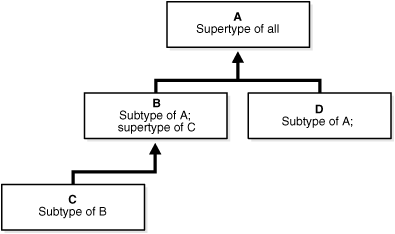
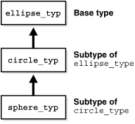

SQL object inheritance is based on a family tree of object types that forms a type hierarchy. The type hierarchy consists of a parent object type, called a supertype, and one or more levels of child object types, called subtypes, which are derived from the parent.

Topics:

- About Inheritance in SQL Object Types

- Supertypes and Subtypes

- FINAL and NOT FINAL Types and Methods for Inheritance

- Subtype Creation

- NOT INSTANTIABLE Types and Methods

- Overloaded and Overridden Methods

- Dynamic Method Dispatch

- Type Substitution in a Type Hierarchy

- Column and Row Substitutability

- Newly Created Subtypes Stored in Substitutable Columns

- Dropping Subtypes After Creating Substitutable Columns

- Turning Off Substitutability in a New Table

- Constraining Substitutability

- Modifying Substitutability on a Table

- Restrictions on Modifying Substitutability

- Assignments Across Types

### 2.3.1  About Inheritance in SQL Object Types

Inheritance is the mechanism that connects subtypes in a hierarchy to their supertypes.

Subtypes automatically inherit the attributes and methods of their parent type. Also, the inheritance link remains alive. Subtypes automatically acquire any changes made to these attributes or methods in the parent: any attributes or methods updated in a supertype are updated in subtypes as well.

**Note:**

Oracle only supports single inheritance. Therefore, a subtype can derive directly from only one supertype, not more than one.

With object types in a type hierarchy, you can model an entity such as a customer, and also define different [specializing](glossary.md) subtypes of customers under the original type. You can then perform operations on a hierarchy and have each type implement and execute the operation in a special way.

### 2.3.2 Supertypes and Subtypes

A subtype can be derived from a supertype either directly or indirectly through intervening levels of other subtypes.

A supertype can have multiple sibling subtypes, but a subtype can have at most one direct parent supertype (single inheritance).

Figure 2-1 Supertypes and Subtypes in Type Hierarchy

[Description of "Figure 2-1 Supertypes and Subtypes in Type Hierarchy"](img_text/adobj027.md)

To derive a subtype from a supertype, define a specialized variant of the supertype that adds new attributes and methods to the set inherited from the parent or redefine (override) the inherited methods. For example, from a `person_typ` object type you might derive the specialized types `student_typ` and `employee_typ`. Each of these subtypes is still a `person_typ`, but a special kind of person. What distinguishes a subtype from its parent supertype is some change made to the attributes or methods that the subtype received from its parent.

Unless a subtype redefines an inherited method, it always contains the same core set of attributes and methods that are in the parent type, plus any attributes and methods that it adds. If a `person_typ` object type has the three attributes `idno`, `name`, and `phone` and the method `get_idno()`, then any object type that is derived from `person_typ` will have these same three attributes and a method `get_idno()`. If the definition of `person_typ` changes, so do the definitions of any subtypes.

Subtypes are created using the keyword `UNDER` as follows:

`CREATE` `TYPE` `student_typ` `UNDER` `person_typ`

You can specialize the attributes or methods of a subtype in these ways:

- Add new attributes that its parent supertype does not have.

  For example, you might specialize `student_typ` as a special kind of `person_typ` by adding an attribute for `major`. A subtype cannot drop or change the type of an attribute it inherited from its parent; it can only add new attributes.

- Add entirely new methods that the parent does not have.

- Change the implementation of some of the methods that a subtype inherits so that the subtype's version executes different code from the parent's.

  For example, a ellipse object might define a method `calculate()`. Two subtypes of `ellipse_typ`, `circle_typ` and `sphere_typ`, might each implement this method in a different way.

The inheritance relationship between a supertype and its subtypes is the source of much of the power of objects and much of their complexity.

Being able to change a method in a supertype and have the change take effect in all the subtypes downstream just by recompiling is very powerful. But this same capability means that you have to consider whether or not you want to allow a type to be specialized or a method to be redefined. Similarly, for a table or column to be able to contain any type in a hierarchy is also powerful, but you must decide whether or not to allow this in a particular case. Also, you may need to constrain DML statements and queries so that they pick out just the range of types that you want from the type hierarchy.

**See Also:**

- See Example 2-15 for a complete example

- "Overloaded and Overridden Methods"

### 2.3.3 FINAL and NOT FINAL Types and Methods for Inheritance

Object types can be inheritable and methods can be overridden if they are so defined.

For an object type or method to be inheritable, the definition must specify that it is inheritable. For both types and methods, the keywords `FINAL` or `NOT` `FINAL` are used are used to determine inheritability.

- Object type: For an object type to be inheritable, thus allowing subtypes to be derived from it, the object definition must specify this.

  `NOT` `FINAL` means subtypes can be derived. `FINAL`, (default) means that no subtypes can be derived from it.

- Method: The definition must indicate whether or not it can be overridden.

  `NOT` `FINAL` (default) means the method can be overridden. `FINAL` means that subtypes cannot override it by providing their own implementation.

**See Also:**

- Example 2-13

- Example 2-12

- Changing a FINAL TYPE to NOT FINAL

#### 2.3.3.1 Creating an Object Type as NOT FINAL with a FINAL Member Function

You can create a `NOT FINAL `object type with a `FINAL `member function as in Example 2-12.

Example 2-12 Creating an Object Type as NOT FINAL with a FINAL Member Function

    DROP TYPE person_typ FORCE;
    -- above necessary if you have previously created object

    CREATE OR REPLACE TYPE person_typ AS OBJECT (
       idno           NUMBER,
       name           VARCHAR2(30),
       phone          VARCHAR2(20),
       FINAL MAP MEMBER FUNCTION get_idno RETURN NUMBER)
    NOT FINAL;
    /

#### 2.3.3.2  Creating a NOT FINAL Object Type

You can create an object type as `NOT FINAL`.

Example 2-13 declares `person_typ` to be a `NOT FINAL` type and therefore subtypes of `person_typ` can be defined.

Example 2-13 Creating the person_typ Object Type as NOT FINAL

    DROP TYPE person_typ FORCE;
    -- above necessary if you have previously created object

    CREATE OR REPLACE TYPE person_typ AS OBJECT (
       idno           NUMBER,
       name           VARCHAR2(30),
       phone          VARCHAR2(20))
    NOT FINAL;
    /

### 2.3.4 Changing a FINAL TYPE to NOT FINAL

You can change inheritance by changing a final type to a not final type and vice versa with an `ALTER` `TYPE` statement.

For example, the following statement changes `person_typ` to a final type:

    ALTER TYPE person_typ FINAL;

You can only alter a type from `NOT` `FINAL` to `FINAL` if the target type has no subtypes.

### 2.3.5 Subtype Creation

You create a subtype using a `CREATE` `TYPE` statement that specifies the immediate parent of the subtype with the `UNDER` keyword.

Topics:

- Creating a Parent or Supertype Object

- Creating a Subtype Object

- Generalized Invocation

- Creating Multiple Subtypes

- Creating Tables that Contains Supertype and Subtype Objects

#### 2.3.5.1 Creating a Parent or Supertype Object

You can create a parent or supertype object using the `CREATE TYPE` statement.

Example 2-14 provides a parent or supertype `person_typ` object to demonstrate subtype definitions in Example 2-15, Example 2-18, and Example 2-19.

Note the `show()` in Example 2-14. In the subtype examples that follow, the `show()` function of the parent type is overridden to specifications for each subtype using the `OVERRIDING` keyword.

Example 2-14 Creating the Parent or Supertype person_typ Object

    DROP TYPE person_typ FORCE;
    -- if created
    CREATE OR REPLACE TYPE person_typ AS OBJECT (
     idno           NUMBER,
     name           VARCHAR2(30),
     phone          VARCHAR2(20),
     MAP MEMBER FUNCTION get_idno RETURN NUMBER,
     MEMBER FUNCTION show RETURN VARCHAR2)
     NOT FINAL;
    /

    CREATE OR REPLACE TYPE BODY person_typ AS
     MAP MEMBER FUNCTION get_idno RETURN NUMBER IS
     BEGIN
       RETURN idno;
     END;
    -- function that can be overriden by subtypes
     MEMBER FUNCTION show RETURN VARCHAR2 IS
     BEGIN
       RETURN 'Id: ' || TO_CHAR(idno) || ', Name: ' || name;
     END;

    END;
    /

#### 2.3.5.2 Creating a Subtype Object

A subtype inherits the attributes and methods of the supertype.

These are inherited:

- All the attributes declared in or inherited by the supertype.

- Any methods declared in or inherited by supertype.

Example 2-15 defines the `student_typ` object as a subtype of `person_typ`, which inherits all the attributes declared in or inherited by `person_typ` and any methods inherited by or declared in `person_typ`.

Example 2-15 Creating a student_typ Subtype Using the UNDER Clause

    -- requires Ex. 2-14
    CREATE TYPE student_typ UNDER person_typ (
       dept_id NUMBER,
       major VARCHAR2(30),
       OVERRIDING MEMBER FUNCTION show RETURN VARCHAR2)
       NOT FINAL;
    /

    CREATE TYPE BODY student_typ AS
     OVERRIDING MEMBER FUNCTION show RETURN VARCHAR2 IS
     BEGIN
        RETURN (self AS person_typ).show || ' -- Major: ' || major ;
     END;

    END;
    /

The statement that defines `student_typ` specializes `person_typ` by adding two new attributes, `dept_id` and `major` and overrides the `show` method. New attributes declared in a subtype must have names that are different from the names of any attributes or methods declared in any of its supertypes, higher up in its type hierarchy.

#### 2.3.5.3 Generalized Invocation

Generalized invocation provides a mechanism to invoke a method of a supertype or a parent type, rather than the specific subtype member method.

Example 2-15 demonstrates this using the following syntax:

         (SELF AS person_typ).show

The `student_typ` `show` method first calls the `person_typ` `show` method to do the common actions and then does its own specific action, which is to append `'--Major:'` to the value returned by the `person_typ` `show` method. This way, overriding subtype methods can call corresponding overriding parent type methods to do the common actions before doing their own specific actions.

Methods are invoked just like normal member methods, except that the type name after `AS` should be the type name of the parent type of the type that the expression evaluates to.

#### 2.3.5.4 Using Generalized Invocation

In Example 2-16, there is an implicit `SELF` argument just like the implicit self argument of a normal member method invocation. In this case, it invokes the `person_typ` `show` method rather than the specific `student_typ` `show` method.

Example 2-16 Using Generalized Invocation

    -- Requires Ex. 2-14 and 2-15
    DECLARE
     myvar student_typ := student_typ(100, 'Sam', '6505556666', 100, 'Math');
     name VARCHAR2(100);
    BEGIN
     name := (myvar AS person_typ).show; --Generalized invocation
    END;
    /

#### 2.3.5.5 Using Generalized Expression

Generalized expression, like member method invocation, is also supported when a method is invoked with an explicit self argument.

Example 2-17 Using Generalized Expression

    -- Requires Ex. 2-14 and 2-15
    DECLARE
     myvar2 student_typ := student_typ(101, 'Sam', '6505556666', 100, 'Math');
     name2 VARCHAR2(100);
    BEGIN
     name2 := person_typ.show((myvar2 AS person_typ)); -- Generalized expression
    END;
    /

Double parentheses are used in this example because `((myvar2` `AS` `person_typ))` is both an expression that must be resolved and the parameter of the `show` function.

NOTE: Constructor methods cannot be invoked using this syntax. Also, the type name that appears after `AS` in this syntax should be one of the parent types of the type of the expression for which method is being invoked.

This syntax can only be used to invoke corresponding overriding member methods of the parent types.

#### 2.3.5.6 Creating Multiple Subtypes

A type can have multiple child subtypes, and these subtypes can also have subtypes.

Example 2-18 creates another subtype `employee_typ` under `person_typ` in addition to the already existing subtype, `student_typ`, created in Example 2-15.

Example 2-18 Creating an employee_typ Subtype Using the UNDER Clause

    -- requires Ex. 2-14

    DROP TYPE employee_typ FORCE;
    -- if previously created
    CREATE OR REPLACE TYPE employee_typ UNDER person_typ (
        emp_id NUMBER,
        mgr VARCHAR2(30),
        OVERRIDING MEMBER FUNCTION show RETURN VARCHAR2);
    /

    CREATE OR REPLACE TYPE BODY employee_typ AS
      OVERRIDING MEMBER FUNCTION show RETURN VARCHAR2 IS
      BEGIN
        RETURN (SELF AS person_typ).show|| ' -- Employee Id: '
               || TO_CHAR(emp_id) || ', Manager: ' || mgr ;
      END;

    END;
    /

#### 2.3.5.7 Creating a Subtype Under Another Subtype

A subtype can be defined under another subtype.

The new subtype inherits all the attributes and methods that its parent type has, both declared and inherited. Example 2-19 defines a new subtype `part_time_student_typ` under `student_typ` created in Example 2-15. The new subtype inherits all the attributes and methods of `student_typ` and adds another attribute, `number_hours`.

Example 2-19 Creating a part_time_student_typ Subtype Using the UNDER Clause

    CREATE TYPE part_time_student_typ UNDER student_typ (
      number_hours NUMBER,
      OVERRIDING MEMBER FUNCTION show RETURN VARCHAR2);
    /

    CREATE TYPE BODY part_time_student_typ AS
      OVERRIDING MEMBER FUNCTION show RETURN VARCHAR2 IS
      BEGIN
        RETURN (SELF AS person_typ).show|| ' -- Major: ' || major ||
               ', Hours: ' || TO_CHAR(number_hours);
      END;

    END;
    /

#### 2.3.5.8 Creating Tables that Contain Supertype and Subtype Objects

You can create tables that contain supertype and subtype instances.

You can then populate the tables as shown with the `person_obj_table` in Example 2-20.

Example 2-20 Inserting Values into Substitutable Rows of an Object Table

    CREATE TABLE person_obj_table OF person_typ;

    INSERT INTO person_obj_table
      VALUES (person_typ(12, 'Bob Jones', '650-555-0130'));

    INSERT INTO person_obj_table
      VALUES (student_typ(51, 'Joe Lane', '1-650-555-0140', 12, 'HISTORY'));

    INSERT INTO person_obj_table
      VALUES (employee_typ(55, 'Jane Smith', '1-650-555-0144',
                           100, 'Jennifer Nelson'));

    INSERT INTO person_obj_table
      VALUES (part_time_student_typ(52, 'Kim Patel', '1-650-555-0135', 14,
             'PHYSICS', 20));

You can call the `show()` function for the supertype and subtypes in the table with the following:

    SELECT p.show() FROM person_obj_table p;

The output is similar to:

    Id: 12, Name: Bob Jones
    Id: 51, Name: Joe Lane -- Major: HISTORY
    Id: 55, Name: Jane Smith -- Employee Id: 100, Manager: Jennifer Nelson
    Id: 52, Name: Kim Patel -- Major: PHYSICS, Hours: 20

Note that data that the `show()` method displayed depends on whether the object is a supertype or subtype, and if the `show()` method of the subtype is overridden. For example, Bob Jones is a `person_typ`, that is, an supertype. Only his `name` and `Id` are displayed. For Joe Lane, a `student_typ`, his `name` and `Id` are provided by the `show()` function of the supertype, and his `major` is provided by the overridden `show()` function of the subtype.

### 2.3.6 NOT INSTANTIABLE Types and Methods

Types and methods can be declared `NOT` `INSTANTIABLE` when they are created.

`NOT` `INSTANTIABLE` types and methods:

- `NOT` `INSTANTIABLE` Types

  If a type is not instantiable, you cannot instantiate instances of that type. There are no constructors (default or user-defined) for it. You might use this with types intended to serve solely as supertypes from which specialized subtypes are instantiated.

- `NOT` `INSTANTIABLE` Methods

  A non-instantiable method serves as a placeholder. It is declared but not implemented in the type. You might define a non-instantiable method when you expect every subtype to override the method in a different way. In this case, there is no point in defining the method in the supertype.

You can alter an instantiable type to a non-instantiable type and vice versa with an `ALTER` `TYPE` statement.

A type that contains a non-instantiable method must itself be declared not instantiable, as shown in Example 2-21.

### 2.3.7 Creating a Non-INSTANTIABLE Object Type

If a subtype does not provide an implementation for every inherited non-instantiable method, the subtype itself, like the supertype, must be declared not instantiable.

A non-instantiable subtype can be defined under an instantiable supertype.

Example 2-21 Creating an Object Type that is NOT INSTANTIABLE

    DROP TYPE person_typ FORCE;
    -- if previously created
    CREATE OR REPLACE TYPE person_typ AS OBJECT (
      idno           NUMBER,
      name           VARCHAR2(30),
      phone          VARCHAR2(20),
      NOT INSTANTIABLE MEMBER FUNCTION get_idno RETURN NUMBER)
      NOT INSTANTIABLE NOT FINAL;/

### 2.3.8 Changing an Object Type to INSTANTIABLE

The `ALTER` `TYPE` statement can make a non-instantiable type instantiable.

In Example 2-22 an `ALTER` `TYPE` statement makes `person_typ` instantiable.

Example 2-22 Altering an Object Type to INSTANTIABLE

    CREATE OR REPLACE TYPE person_typ AS OBJECT (
      idno           NUMBER,
      name           VARCHAR2(30),
      phone          VARCHAR2(20))
      NOT INSTANTIABLE NOT FINAL;/
    ALTER TYPE person_typ INSTANTIABLE;

Changing to a Not Instantiable Type

You can alter an instantiable type to a non-instantiable type only if the type has no columns, views, tables, or instances that reference that type, either directly, or indirectly, through another type or subtype.

You cannot declare a non-instantiable type to be `FINAL`. This would actually be pointless.

### 2.3.9 Overloaded and Overridden Methods

A subtype can redefine methods it inherits, and it can also add new methods, including methods with the same name.

Topics:

- Overloading Methods

- Overriding and Hiding Methods

- Restrictions on Overriding Methods

See the examples in "Subtype Creation " and [Example 8-7](system-defined-and-user-defined-constructors.md).

#### 2.3.9.1 Overloading Methods

Adding new methods that have the same names as inherited methods to the subtype is called overloading.

Methods that have the same name but different signatures are called overloads when they exist in the same user-defined type.

A method signature consists of the method's name and the number, types, and the order of the method's formal parameters, including the implicit `self` parameter.

Overloading is useful when you want to provide a variety of ways of doing something. For example, an ellipse object might overload a `calculate()` method with another `calculate()` method to enable calculation of a different shape.

The compiler uses the method signatures to determine which method to call when a type has several overloaded methods.

In the following pseudocode, subtype `circle_typ` creates an overload of `calculate()`:

    CREATE TYPE ellipse_typ AS OBJECT (...,
    MEMBER PROCEDURE calculate(x NUMBER, x NUMBER),
    ) NOT FINAL;
    CREATE TYPE circle_typ UNDER ellipse_typ (...,
    MEMBER PROCEDURE calculate(x NUMBER),
    ...);

The `circle_typ` contains two versions of `calculate()`. One is the inherited version with two `NUMBER` parameters and the other is the newly created method with one `NUMBER` parameter.

#### 2.3.9.2 Overriding and Hiding Methods

Redefining an inherited method to customize its behavior in a subtype is called overriding, in the case of member methods, or hiding, in the case of static methods.

Unlike overloading, you do not create a new method, just redefine an existing one, using the keyword `OVERRIDING`.

Overriding and hiding redefine an inherited method to make it do something different in the subtype. For example, a subtype `circle_typ` derived from a `ellipse_typ` supertype might override a member method `calculate()` to customize it specifically for calculating the area of a circle. For examples of overriding methods, see "Subtype Creation ".

Overriding and hiding are similar in that, in either case, the version of the method redefined in the subtype eclipses the original version of the same name and signature so that the new version is executed rather than the original one whenever a subtype instance invokes the method. If the subtype itself has subtypes, these inherit the redefined method instead of the original version.

With overriding, the system relies on type information contained in the member method's implicit self argument to dynamically choose the correct version of the method to execute. With hiding, the correct version is identified at compile time, and dynamic dispatch is not necessary. See "Dynamic Method Dispatch".

To override or hide a method, you must preserve its signature. Overloads of a method all have the same name, so the compiler uses the signature of the subtype's method to identify the particular version in the supertype that is superseded.

You signal the override with the `OVERRIDING` keyword in the `CREATE` `TYPE` `BODY` statement. This is not required when a subtype hides a static method.

In the following pseudocode, the subtype signals that it is overriding method `calculate()`:

    CREATE TYPE ellipse_typ AS OBJECT (...,
    MEMBER PROCEDURE calculate(),
    FINAL MEMBER FUNCTION function_mytype(x NUMBER)...
    ) NOT FINAL;
    CREATE TYPE circle_typ UNDER ellipse_typ (...,
    OVERRIDING MEMBER PROCEDURE calculate(),
    ...);

For a diagram of this hierarchy, see Figure 2-2.

#### 2.3.9.3 Restrictions on Overriding Methods

There are certain restrictions on overriding methods:

- Only methods that are not declared to be final in the supertype can be overridden.

- Order methods may appear only in the root type of a type hierarchy: they may not be redefined (overridden) in subtypes.

- A static method in a subtype may not redefine a member method in the supertype.

- A member method in a subtype may not redefine a static method in the supertype.

- If a method being overridden provides default values for any parameters, then the overriding method must provide the same default values for the same parameters.

### 2.3.10 Dynamic Method Dispatch

Dynamic method dispatch refers to the way that method calls are dispatched to the nearest implementation at run time, working up the type hierarchy from the current or specified type.

Dynamic method dispatch is only available when overriding member methods and does not apply to static methods.

With method overriding, a type hierarchy can define multiple implementations of the same method. In the following hierarchy of types `ellipse_typ`, `circle_typ`, and `sphere_typ`, each type might define a `calculate()` method differently.

Figure 2-2 Hierarchy of Types

[Description of "Figure 2-2 Hierarchy of Types"](img_text/adobj025.md)

When one of these methods is invoked, the type of the object instance that invokes it determines which implementation of the method to use. The call is then dispatched to that implementation for execution. This process of selecting a method implementation is called virtual or dynamic method dispatch because it is done at run time, not at compile time.

The method call works up the type hierarchy: never down. If the call invokes a member method of an object instance, the type of that instance is the current type, and the implementation defined or inherited by that type is used. If the call invokes a static method of a type, the implementation defined or inherited by that specified type is used.

**See Also:**

For information on how subprograms calls are resolved, see [Oracle Database PL/SQL Language Reference](../lnpls/subprogram-invocation-resolution.md)

### 2.3.11 Type Substitution in a Type Hierarchy

When you work with types in a type hierarchy, sometimes you need to work at the most general level, for example, to select or update all persons. But at other times, you need to select or update only a specific subtype such as a student, or only persons who are not students.

The (polymorphic) ability to select all persons and get back not only objects whose declared type is `person_typ` but also objects whose declared subtype is `student_typ` or `employee_typ` is called substitutability. A supertype is substitutable if one of its subtypes can substitute or stand in for it in a variable or column whose declared type is the supertype.

In general, types are substitutable. Object attributes, collection elements and `REF`s are substitutable. An attribute defined as a `REF`, type, or collection of type `person_typ` can hold a `REF` to an instance of, or instances of an instance of `person_typ`, or an instance of any subtype of `person_typ`.

This seems expected, given that a subtype is, after all, just a specialized kind of one of its supertypes. Formally, though, a subtype is a type in its own right: it is not the same type as its supertype. A column that holds all persons, including all persons who are students and all persons who are employees, actually holds data of multiple types.

In principle, object attributes, collection elements and `REF`s are always substitutable: there is no syntax at the level of the type definition to constrain their substitutability to some subtype. You can, however, turn off or constrain substitutability at the storage level, for specific tables and columns.

**See Also:**

- "Turning Off Substitutability in a New Table"

- "Constraining Substitutability"

### 2.3.12 Column and Row Substitutability

Object type columns and object-type rows in object tables are substitutable, and so are views: a column or row of a specific type can contain instances of that type and any of its subtypes.

Topics:

- About Column and Row Substitutability

- Using OBJECT_VALUE and OBJECT_ID with Substitutable Rows

- Subtypes with Attributes of a Supertype

- Substitution of REF Columns and Attributes

- Substitution of Collection Elements

#### 2.3.12.1  About Column and Row Substitutability

You can substitute object type columns and object type rows in object tables.

Consider the `person_typ` type hierarchy such as the one introduced in Example 2-14. You can create an object table of `person_typ` that contains rows of all types. To do this, you insert an instance of a given type into an object table using the constructor for that type in the `VALUES` clause of the `INSERT` statement as shown in Example 2-20.

Similarly, Example 2-23 shows that a substitutable column of type `person_typ` can contain instances of all three types, in a relational table or view. The example recreates person, student, and part-time student objects from that type hierarchy and inserts them into the `person_typ` column `contact`.

Example 2-23 Inserting Values into Substitutable Columns of a Table

    DROP TYPE person_typ FORCE;
    -- if previously created

    DROP TYPE student_typ FORCE; -- if previously created

    DROP TYPE part_time_student_typ FORCE; -- if previously created
    DROP TABLE contacts; if previously created
    CREATE OR REPLACE TYPE person_typ AS OBJECT (
      idno           NUMBER,
      name           VARCHAR2(30),
      phone          VARCHAR2(20))
      NOT FINAL;/
    CREATE TYPE student_typ UNDER person_typ (
        dept_id NUMBER,
        major VARCHAR2(30))
        NOT FINAL;
    /
    CREATE TYPE part_time_student_typ UNDER student_typ (
      number_hours NUMBER);
    /
    CREATE TABLE contacts (
      contact         person_typ,
      contact_date    DATE );

    INSERT INTO contacts
      VALUES (person_typ (12, 'Bob Jones', '650-555-0130'), '24 Jun 2003' );

    INSERT INTO contacts
      VALUES (student_typ(51, 'Joe Lane', '1-650-555-0178', 12, 'HISTORY'),
             '24 Jun 2003' );

    INSERT INTO contacts
      VALUES (part_time_student_typ(52, 'Kim Patel', '1-650-555-0190', 14,
              'PHYSICS', 20), '24 Jun 2003' );

A newly created subtype can be stored in any substitutable tables and columns of its supertype, including tables and columns that existed before the subtype was created.

In general, you can access attributes using dot notation. To access attributes of a subtype of a row or column's declared type, you can use the `TREAT` function. For example:

    SELECT TREAT(contact AS student_typ).major FROM contacts;

See "[TREAT](functions-and-operators-useful-with-objects.md)".

#### 2.3.12.2 Using OBJECT_VALUE and OBJECT_ID with Substitutable Rows

You can access and identify the object identifier (OID) and value of a substitutable row.

Use the `OBJECT_VALUE` and `OBJECT_ID` pseudocolumns to allow access and identify the value and object identifier of a substitutable row in an object table as shown in Example 2-24.

**See Also:**

For further information on these pseudocolumns

- [Oracle Database SQL Language Reference ](../sqlrf/OBJECT_VALUE-Pseudocolumn.md)

- [Oracle Database SQL Language Reference ](../sqlrf/OBJECT_ID-Pseudocolumn.md)

Example 2-24 Using OBJECT_VALUE and OBJECT_ID

    DROP TABLE person_obj_table; -- required if previously created
    CREATE TABLE person_obj_table OF person_typ;

    INSERT INTO person_obj_table
      VALUES (person_typ(20, 'Bob Jones', '650-555-0130'));

    SELECT p.object_id, p.object_value FROM person_obj_table p;

#### 2.3.12.3 Subtypes with Attributes of a Supertype

A subtype can have an attribute whose type is the type of a supertype. For example:

Example 2-25 Creating a Subtype with a Supertype Attribute

    -- requires Ex 2-22
    CREATE TYPE student_typ UNDER person_typ (
        dept_id   NUMBER,
        major     VARCHAR2(30),
        advisor   person_typ);
    /

However, columns of such types are not substitutable. Similarly, a subtype can have a collection attribute whose element type is one of its supertypes, but, again, columns of such types are not substitutable. For example, if `student_typ` had a nested table or varray of `person_typ`, the `student_typ` column would not be substitutable.

You can, however, define substitutable columns of subtypes that have `REF` attributes that reference supertypes. For example, the `composite_category_typ` subtype shown in Example 2-26 contains the `subcategory_ref_list` nested table. This table contains `subcategory_ref_list_typ` which are REFs to `category_typ`. The subtype was created as follows:

Example 2-26 Defining Columns of Subtypes that have REF Attributes

    -- not to be executed
    CREATE TYPE subcategory_ref_list_typ
      AS TABLE OF REF category_typ;
    /

    CREATE TYPE composite_category_typ
      UNDER category_typ
        (
          subcategory_ref_list subcategory_ref_list_typ
    ...

See "Turning Off Substitutability in a New Table".

#### 2.3.12.4 Substitution of REF Columns and Attributes

`REF` columns and attributes are substitutable in both views and tables. For example, in either a view or a table, a column declared to be `REF` `person_typ` can hold references to instances of `person_typ` or any of its subtypes.

#### 2.3.12.5 Substitution of Collection Elements

Collection elements are substitutable in both views and tables. For example, a nested table of `person_typ` can contain object instances of `person_typ` or any of its subtypes.

### 2.3.13 Newly Created Subtypes Stored in Substitutable Columns

If you create a subtype, any table that already has substitutable columns of the supertype can store the new subtype as well.

This means that your options for creating subtypes are affected by the existence of such tables. If such a table exists, you can only create subtypes that are substitutable, that is, subtypes that do not violate table limits or constraints.

The following example creates a `person_typ` and then shows several attempts to create a subtype `student_typ` under `person_typ`.

Example 2-27 Creating a Subtype After Creating Substitutable Columns

    DROP TYPE person_typ FORCE;
    DROP TABLE person_obj_table;
    DROP TYPE student_typ;
    -- perform above drops if objects/tables created
    CREATE OR REPLACE TYPE person_typ AS OBJECT (
      idno           NUMBER,
      name           VARCHAR2(30),
      phone          VARCHAR2(20))
      NOT FINAL;/

    CREATE TABLE person_obj_table (p person_typ);

The following statement fails because `student_typ` has a supertype attribute, and table `person_obj_table` has a substitutable column `p` of the supertype.

    CREATE TYPE student_typ UNDER person_typ ( -- incorrect CREATE subtype
        advisor person_typ);
    /

The next attempt succeeds. This version of the `student_typ` subtype is substitutable. Oracle Database automatically enables table `person_obj_table` to store instances of this new type.

    CREATE TYPE student_typ UNDER person_typ (
        dept_id NUMBER,
        major VARCHAR2(30));/
    INSERT INTO person_obj_table
      VALUES (student_typ(51, 'Joe Lane', '1-650-555-0178', 12, 'HISTORY'));

### 2.3.14 Dropping Subtypes After Creating Substitutable Columns

When you drop a subtype with the `VALIDATE` option, it checks that no instances of the subtype are stored in any substitutable column of the supertype. If there are no such instances, the `DROP` operation completes.

The following statement fails because an instance of `student_typ` is stored in substitutable column `p` of table `person_obj_table`:

    DROP TYPE student_typ VALIDATE -- incorrect: an instance still exists ;

To drop the type, first delete any of its instances in substitutable columns of the supertype:

    -- Delete from table and drop student_typ subtype example, not sample schema

    DELETE FROM person_obj_table WHERE p IS OF (student_typ);

    DROP TYPE student_typ VALIDATE;

**See Also:**

[Oracle Database PL/SQL Language Reference](../lnpls/DROP-TYPE-statement.md) for further information on `DROP` and `VALIDATE`

### 2.3.15 Turning Off Substitutability in a New Table

You can turn off all substitutability on a column or attribute, including embedded attributes and nested collections, while creating a table.

Use the clause `NOT` `SUBSTITUTABLE` `AT` `ALL` `LEVELS` when you create a table.

This turns off all column or attribute substitutability, including embedded attributes and collections nested to any level.

In the following example, the clause confines the column `office` of a relational table to storing only `office_typ` instances and disallows any subtype instances:

Example 2-28 Turning off Substitutability When Creating a Table

    DROP TYPE location_typ FORCE; -- required if previously created
    DROP TYPE office_typ FORCE; -- required if previously created
    CREATE OR REPLACE TYPE location_typ AS OBJECT (
      building_no  NUMBER,
      city         VARCHAR2(40) );
    /

    CREATE TYPE people_typ AS TABLE OF person_typ;
    /
    CREATE TYPE office_typ AS OBJECT (
      office_id    VARCHAR(10),
      location     location_typ,
      occupant     person_typ )
      NOT FINAL;/

    CREATE TABLE dept_office (
      dept_no      NUMBER,
      office       office_typ)
      COLUMN office NOT SUBSTITUTABLE AT ALL LEVELS;

With object tables, the clause can be applied to the table as a whole, such as:

    DROP TABLE office_tab; -- if previously created
    CREATE TABLE office_tab OF office_typ
      NOT SUBSTITUTABLE AT ALL LEVELS;

The clause can also turn off substitutability in a particular column, that is, for a particular attribute of the object type of the table:

    DROP TABLE office_tab; -- if previously created
    CREATE TABLE office_tab OF office_typ
      COLUMN occupant NOT SUBSTITUTABLE AT ALL LEVELS;

You can specify that the element type of a collection is not substitutable using syntax such as the following:

    DROP TABLE people_tab;
    -- required if previously created
    CREATE TABLE people_tab (
        people_column people_typ )
        NESTED TABLE people_column
          NOT SUBSTITUTABLE AT ALL LEVELS STORE AS people_column_nt;

There is no mechanism to turn off substitutability for `REF` columns.

You can use either `NOT` `SUBSTITUTABLE` `AT` `ALL` `LEVELS` or `IS` `OF` type to constrain an [object column](glossary.md), but you cannot use both.

### 2.3.16 Constraining Substitutability

You can impose a constraint that limits the range of subtypes permitted in an object column or attribute to a particular subtype in the declared type's hierarchy.

Do this with the`IS` `OF` `type` constraint.

The following statement creates a table of `office_typ` in which occupants are constrained to just those persons who are employees:

Example 2-29 Constraining Substitutability When Creating a Table

    DROP TABLE office_tab;
    -- if previously created
    CREATE TABLE office_tab OF office_typ
      COLUMN occupant IS OF (ONLY employee_typ);

Although the type `office_typ` allows authors to be of type `person_typ`, the column declaration imposes a constraint to store only instances of `employee_typ`.

You can only use the `IS` `OF` `type` operator to constrain row and column objects to a single subtype (not several), and you must use the `ONLY` keyword, as in the preceding example.

You can use either `IS` `OF` `type` or `NOT` `SUBSTITUTABLE` `AT` `ALL` `LEVELS` to constrain an [object column](glossary.md), but you cannot use both.

### 2.3.17 Modifying Substitutability on a Table

In an existing table, you can change an object column from `SUBSTITUTABLE` to `NOT` `SUBSTITUTABLE` (or from `NOT` `SUBSTITUTABLE` to `SUBSTITUTABLE`) by using an `ALTER` `TABLE` statement.

Specify the clause \[`NOT`\] `SUBSTITUTABLE` `AT` `ALL` `LEVELS` for the particular column in the `ALTER` `TABLE` statement.

You can modify substitutability only for a specific column, not for an object table as a whole.

The following statement makes the column `office` substitutable:

Example 2-30 Modifying Substitutability in a Table

    -- Requires Ex. 2-28
    ALTER TABLE dept_office
      MODIFY COLUMN office SUBSTITUTABLE AT ALL LEVELS;

The following statement makes the column not substitutable. Notice that it also uses the `FORCE` keyword. This keyword causes any hidden columns containing typeid information or data for subtype attributes to be dropped:

    -- Alter table substitutability with FORCE

    ALTER TABLE  dept_office
      MODIFY COLUMN office NOT SUBSTITUTABLE AT ALL LEVELS FORCE;

    --DROP TABLE dept_office;

If you do not use the `FORCE` keyword to make a column not substitutable, the column and all attributes of the type must be `FINAL` or the `ALTER` `TABLE` statement will fail.

A `VARRAY` column can be modified from `SUBSTITUTABLE` to `NOT` `SUBSTITUTABLE` only if the element type of the varray is final itself and has no embedded types (in its attributes or in their attributes, and so on) that are not final.

**See Also:**

See "[Hidden Columns for Substitutable Columns and Object Tables](storage-of-objects.md)" for more information about hidden columns for typeids and subtype attributes.

### 2.3.18 Restrictions on Modifying Substitutability

You can change the substitutability of only one column at a time with an `ALTER` `TABLE` statement.

To change substitutability for multiple columns, issue multiple statements.

In an object table, you can only modify substitutability for a column if substitutability was not explicitly set at the table level, when the table was created.

For example, the following attempt to modify substitutability for column address succeeds because substitutability has not been explicitly turned on or off at the table level in the `CREATE` `TABLE` statement:

    DROP TABLE office_tab;
    -- if previously created
    CREATE TABLE office_tab OF office_typ;

    ALTER TABLE office_tab
      MODIFY COLUMN occupant NOT SUBSTITUTABLE AT ALL LEVELS FORCE;

However, in the following example, substitutability is explicitly set at the table level, so the attempt to modify the setting for column address fails:

    DROP TABLE office_tab;
    -- if previously created
    CREATE TABLE office_tab OF office_typ
      NOT SUBSTITUTABLE AT ALL LEVELS;

    /* Following SQL statement generates an error: */
    ALTER TABLE office_tab
      MODIFY COLUMN occupant SUBSTITUTABLE AT ALL LEVELS FORCE  -- incorrect ALTER;

A column whose substitutability is already constrained by an `IS` `OF` `type` operator cannot have its substitutability modified with a \[`NOT`\] `SUBSTITUTABLE` `AT` `ALL` `LEVELS` clause.

**See Also:**

For information about `IS` `OF` `type`, see "Constraining Substitutability".

### 2.3.19 Assignments Across Types

The assignment rules described in this section apply to `INSERT/UPDATE` statements, the `RETURNING` clause, function parameters, and PL/SQL variables.

Topics:

- Typical Object to Object Assignment

- Widening Assignment

- Narrowing Assignment

- Collection Assignments

#### 2.3.19.1 Typical Object to Object Assignment

Substitutability is the ability of a subtype to stand in for one of its supertypes.

Substituting a supertype for a subtype, that is substitution in the other direction, raises an error at compile time.

Assigning a source of type `source_typ` to a target of type `target_typ` must be of one of the following two patterns:

- Case 1: `source_typ` and `target_typ` are the same type

- Case 2: `source_typ` is a subtype of `target_typ` (widening)

Case 2 illustrates widening.

#### 2.3.19.2 Widening Assignment

Widening is an assignment in which the declared type of the source is more specific than the declared type of the target.

An example of widening is assigning an employee instance to a variable of a person type.

An employee is a more narrowly defined, specialized kind of person, so you can put an employee in a slot meant for a person if you do not mind ignoring whatever extra specialization makes that person an employee. All employees are persons, so a widening assignment always works.

To illustrate widening, suppose that you have the following table:

    TABLE T(pers_col person_typ, emp_col employee_typ,
    stu_col student_typ)

The following assignments show widening. The assignments are valid unless `perscol` has been defined to be not substitutable.

`UPDATE T set pers_col = emp_col;`

The following is a PL/SQL example, which first requires you to create a `person_typ` and an `employee_typ`:

Example 2-31 PL/SQL Assignment

    DROP TYPE person_typ FORCE;
    -- if previously created
    CREATE TYPE person_typ AS OBJECT (
     idno           NUMBER,
     name           VARCHAR2(30),
     phone          VARCHAR2(20))
     NOT FINAL;
    /
    DROP TYPE employee_typ FORCE; -- if previously created
    CREATE TYPE employee_typ UNDER person_typ (
       emp_id NUMBER,
       mgr VARCHAR2(30));
    /
    -- PL/SQL assignment example
    DECLARE
      var1 person_typ;
      var2 employee_typ;
    BEGIN
      var2 := employee_typ(55, 'Jane Smith', '1-650-555-0144', 100, 'Jennifer Nelson');
      var1 := var2;
    END;
    /

#### 2.3.19.3 Narrowing Assignment

A narrowing assignment is the reverse of widening.

A narrowing assignment involves regarding a more general, less specialized type of thing, such as a person, as a more narrowly defined type of thing, such as an employee. Not all persons are employees, so a particular assignment like this works only if the person in question actually happens to be an employee. Thus, in the end, narrowing assignments only work in cases such as Case 1, described in "Typical Object to Object Assignment".

To do a narrowing assignment, you must use the `TREAT` function to test that the source instance of the more general declared type is in fact an instance of the more specialized target type and can therefore be operated on as such. The `TREAT` function does a runtime check to confirm this and returns `NULL` if the source value, the person in question, is not of the target type or one of its subtypes.

For example, the following `UPDATE` statement sets values of `person_typ` in column `perscol` into column `empcol` of `employee_typ`. For each value in `perscol`, the assignment succeeds if that person is also an employee. If the person is not an employee, `TREAT` returns `NULL`, and the assignment returns `NULL`.

`UPDATE T set emp_col = TREAT(pers_col AS employee_typ);`

The following statement attempts to do a narrowing assignment without explicitly changing the declared type of the source value. The statement will return an error:

`UPDATE T set emp_col = pers_col;`

**See Also:**

"[Using TREAT for Narrowing Assignments](functions-and-operators-useful-with-objects.md)"

#### 2.3.19.4 Collection Assignments

In assignments of expressions of a collection type, the source and target must be of the same declared type.

Neither widening nor narrowing is permitted in expression assignments of collection types. However, a subtype value can be assigned to a supertype collection. For example, after creating a new `student_typ`, suppose we have the following collection types:

Example 2-32 Create Collection person_set

    -- Requires 2-21
    DROP student_typ;
    -- if previously created
    CREATE TYPE student_typ UNDER person_typ (
        dept_id NUMBER,
        major VARCHAR2(30))
      NOT FINAL;
    /
    CREATE TYPE person_set AS TABLE OF person_typ;
    /

    CREATE TYPE student_set AS TABLE OF student_typ;
    /

Expressions of these different collection types cannot be assigned to each other, but a collection element of `student_typ` can be assigned to a collection of `person_set` type:

    DECLARE
      var1 person_set;
      var2 student_set;
      elem1 person_typ;
      elem2 student_typ;
    BEGIN
    --  var1 := var2;   /* ILLEGAL - collections not of same type */
      var1 := person_set (elem1, elem2);   /* LEGAL : Element is of subtype */
    END;
    /
