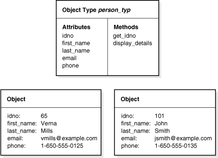
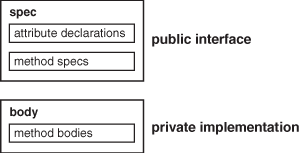
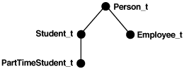

Oracle Database implements the object-type model as an extension of the relational model, while continuing to support standard relational database functionality, such as queries, fast commits, backup and recovery, scalable connectivity, row-level locking, read consistency, and more.

SQL and various programmatic interfaces and languages, including PL/SQL, Java, Oracle Call Interface, Pro\*C/C++, and C# have been enhanced with extensions to support Oracle objects. The result is an object-relational model that offers the intuitiveness and economy of an object interface while preserving the high concurrency and throughput of a relational database.

Topics:

- Database Features of Oracle Objects

- Language Binding Features of Oracle Objects

### 1.3.1 Database Features of Oracle Objects

There are certain features and concepts of the object-relational model that are related to the database.

**Note:**

Running Examples: Many examples in this guide can be run using the `HR` sample schema. Comments at the beginning of most examples indicate if any previous example code is required.

Refer to [Oracle Database Sample Schemas](../comsc/introduction-to-sample-schemas.md) for information on how these schemas were created and how you can use them yourself.

Topics:

- About Object Types

- About Object Instances

- About Object Methods

- How Objects are Stored in Tables

- Object Identifiers Used to Identify Row Objects

- References to Row Objects

- Oracle Collections Data Types

- Object Views Used to Access Relational Data

- Use of Type Inheritance

- Type Evolution Used to Change an Existing Object Type

#### 1.3.1.1 About Object Types

An object type is a kind of data type.

You can use an object in the same ways that you use standard data types such as `NUMBER` or `VARCHAR2`. For example, you can specify an object type as the data type of a column in a relational table, and you can declare variables of an object type. The value is a variable or an instance of that type. An object instance is also called an object.

Figure 1-1 shows an object type, `person_typ`, and two instances of the object type.

Figure 1-1 Object Type and Object Instances

[Description of "Figure 1-1 Object Type and Object Instances"](img_text/adobj036.md)

Object types serve as blueprints or templates that define both structure and behavior. Object types are database schema objects, subject to the same kinds of administrative control as other schema objects. Application code can retrieve and manipulate these objects. See [Managing Oracle Objects](managing-oracle-objects.md).

You use the `CREATE` `TYPE` SQL statement to define object types.

Example 1-1 shows how to create an object type named `person_typ`. In the example, an object specification and object body are defined. For information on the `CREATE` `TYPE` SQL statement and on the `CREATE` `TYPE` `BODY` SQL statement, see [Oracle Database PL/SQL Language Reference](../lnpls/CREATE-TYPE-statement.md).

**Note:**

Running Examples: Many examples on this subject can be run using the `HR` sample schemas. Comments at the beginning of most examples indicate if any previous example code is required.

Refer to [Oracle Database Sample Schemas](../comsc/introduction-to-sample-schemas.md) for information on how these schemas were created and how you can use them yourself.

Example 1-1 Creating the person_typ Object Type

    CREATE TYPE person_typ AS OBJECT (
      idno           NUMBER,
      first_name     VARCHAR2(20),
      last_name      VARCHAR2(25),
      email          VARCHAR2(25),
      phone          VARCHAR2(20),
      MAP MEMBER FUNCTION get_idno RETURN NUMBER,
      MEMBER PROCEDURE display_details ( SELF IN OUT NOCOPY person_typ ));
    /

    CREATE TYPE BODY person_typ AS
      MAP MEMBER FUNCTION get_idno RETURN NUMBER IS
      BEGIN
        RETURN idno;
      END;
      MEMBER PROCEDURE display_details ( SELF IN OUT NOCOPY person_typ ) IS
      BEGIN
        -- use the PUT_LINE procedure of the DBMS_OUTPUT package to display details
        DBMS_OUTPUT.PUT_LINE(TO_CHAR(idno) || ' ' || first_name || ' ' || last_name);
        DBMS_OUTPUT.PUT_LINE(email || ' '  || phone);
      END;
    END;
    /

Object types differ from the standard data types that are native to a relational database:

- Oracle Database does not supply predefined object types. You define the object types you want by combining built-in types with user-defined ones as shown in Example 1-1.

- Object types are composed of attributes and methods as illustrated in Figure 1-2.

  - Attributes hold the data about an object. Attributes have declared data types which can, in turn, be other object types.

  - Methods are procedures or functions that applications can use to perform operations on the attributes of the object type. Methods are optional. They define the behavior of objects of that type.

Figure 1-2 Object Attributes and Methods

Figure 1-2 shows the relationship of attributes and methods in the spec.

[Description of "Figure 1-2 Object Attributes and Methods"](img_text/adobj035.md)

#### 1.3.1.2 About Object Instances

A variable of an object type is an instance of the type, or an object.

An object has the attributes and methods defined for its type. Because an object instance is a concrete thing, you can assign values to its attributes and call its methods.

Defining an object type does not allocate any storage. After they are defined, object types can be used in SQL statements in most of the same places you use types such as `NUMBER` or `VARCHAR2`. Storage is allocated once you create an instance of the object type.

Example 1-2 shows how to create object instances of the `person_typ` created in Example 1-1, and define a relational table to keep track of these instances as contacts.

Example 1-2 Creating the contacts Table with an Object Type Column

    -- requires existing person_typ fr. Ex 1-1
    CREATE TABLE contacts (
      contact         person_typ,
      contact_date    DATE );

    INSERT INTO contacts VALUES (
      person_typ (65, 'Verna', 'Mills', 'vmills@example.com', '1-650-555-0125'),
      to_date('24 Jun 2003', 'dd Mon YYYY'));

The `contacts` table is a relational table with an object type as the data type of its contact column. Objects that occupy columns of relational tables are called [column object](glossary.md)s.

**See Also:**

How Objects are Stored in Tables

#### 1.3.1.3 About Object Methods

Object methods are functions or procedures that you can declare in an object type definition to implement behavior that you want objects of that type to perform.

The general kinds of methods that can be declared in a type definition are:

- Member Methods

  Using member methods, you can provide access to the data of an object, and otherwise define operations that an application performs on the data. To perform an operation, the application calls the appropriate method on the appropriate object.

- Static Methods

  Static methods compare object instances and perform operations that do not use the data of any particular object, but, instead, are global to an object type.

- Constructor Methods

  A default constructor method is implicitly defined for every object type, unless it is overwritten with a user-defined constructor. A constructor method is called on a type to construct or create an object instance of the type.

Example 1-3 show the `get_idno()` method, created in Example 1-1, to display the Id number of persons in the `contacts` table:

Example 1-3 Using the get_idno Object Method

    -- requires Ex 1-1 and Ex 1-2
    SELECT c.contact.get_idno() FROM contacts c;

**See Also:**

[Object Methods](object-methods.md)

#### 1.3.1.4 How Objects are Stored in Tables

Objects can be stored in two types of tables:

- Object tables: store only objects

  In an object table, each row represents an object, which is referred to as a [row object](glossary.md).

- Relational tables: store objects with other table data

  Objects that are stored as columns of a relational table, or are attributes of other objects, are called [column object](glossary.md)s. Example 1-2 shows the `contacts` table which stores an instance of the `person_typ` object.

Objects that have meaning outside of the relational database in which they are contained, or objects that are shared among more than one relational database object, should be made referenceable as row objects. That is, such objects should be stored as a row object in an object table instead of in a column of a relational table.

**See Also:**

- "[About Storing Objects as Columns or Rows](general-storage-considerations-for-objects.md)"

- "Creating and Using Object Tables"

##### 1.3.1.4.1 Creating and Using Object Tables

You create object tables using a `CREATE` `TABLE` statement.

Example 1-4 shows a `CREATE` `TABLE` statement that creates an object table for `person_typ` objects.

Example 1-4 Creating the person_obj_table Object Table

    -- requires Ex. 1-1
    CREATE TABLE person_obj_table OF person_typ;

You can view this table in two ways:

- As a single-column table, in which each row is a `person_typ` object, allowing you to perform object-oriented operations.

- As a multi-column table, in which each attribute of the object type `person_typ` such as `idno`, `first_name`, `last_name`, and so on, occupies a column, allowing you to perform relational operations.

##### 1.3.1.4.2 Performing Operations on Object Tables

You can perform various operations on object tables such as inserting objects into the table or selecting objects from the table.

Example 1-5 illustrates several operations on an object table.

Example 1-5 Operations on the person_obj_table Object Table

    -- requires Ex. 1-1 and 1-4
    INSERT INTO person_obj_table VALUES (
           person_typ(101, 'John', 'Smith', 'jsmith@example.com', '1-650-555-0135') );

    SELECT VALUE(p) FROM person_obj_table p
            WHERE p.last_name = 'Smith';

    DECLARE
      person person_typ;
    BEGIN -- PL/SQL block for selecting a person and displaying details
      SELECT VALUE(p) INTO person FROM person_obj_table p WHERE p.idno = 101;
      person.display_details();
    END;
    /

The `INSERT` `INTO` SQL statement in Example 1-5inserts a `person_typ` object into the `person_obj_table`, treating `person_obj_table` as a multi-column table.

The `SELECT` SQL statement selects from `person_obj_table` as a single-column table, using the `VALUE` function to return rows as object instances.

The PL/SQL block selects a specific person and executes a member function of `person_typ` to display details about the specified person.

**See Also:**

- For information on the `VALUE` function, see "[VALUE](functions-and-operators-useful-with-objects.md)" .

- For more information about using PL/SQL with objects, see [Using PL/SQL With Object Types](using-pl-sql-with--object-types.md).

#### 1.3.1.5 Object Identifiers Used to Identify Row Objects

Object identifiers (OIDs) uniquely identify row objects in object tables.

You cannot directly access object identifiers, but you can make references (`REF`s) to the object identifiers and directly access the `REF`s, as discussed in "References to Row Objects".

There are two types of [object identifier](glossary.md)s.

- System-Generated Object Identifiers (default)

  Oracle automatically creates system-generated object identifiers for row objects in object tables unless you choose the primary-key based option.

- Primary-Key Based Object Identifiers

  You have the option to create primary-key based OIDs when you create the table using the `CREATE` `TABLE` statement.

**Note:**

Column objects are identified by the primary key of the row, and, therefore, do not need a specific object identifier.

**See Also:**

- "[Object Identifiers for Object Views](object-identifiers-for-object-views.md)"

- "[Storage Considerations for Object Identifiers (OIDs)](general-storage-considerations-for-objects.md)"

#### 1.3.1.6 References to Row Objects

A `REF` is a logical pointer or reference to a row object that you can construct from an object identifier (OID).

You can use the `REF` to obtain, examine, or update the object. You can change a `REF` so that it points to a different object of the same object type hierarchy or assign it a null value.

`REF`s are Oracle Database built-in data types. `REF`s and collections of `REF`s model associations among objects, particularly many-to-one relationships, thus reducing the need for foreign keys. `REF`s provide an easy mechanism for navigating between objects.

Example 1-6 illustrates a simple use of a `REF`.

Example 1-6 Using a REF to the emp_person_typ Object

    CREATE TYPE emp_person_typ AS OBJECT (
      name     VARCHAR2(30),
      manager  REF emp_person_typ );
    /
    CREATE TABLE emp_person_obj_table OF emp_person_typ;

    INSERT INTO emp_person_obj_table VALUES (
       emp_person_typ ('John Smith', NULL));

    INSERT INTO emp_person_obj_table
      SELECT emp_person_typ ('Bob Jones', REF(e))
        FROM emp_person_obj_table e
        WHERE e.name = 'John Smith';

This example first creates the `emp_person_typ` John Smith, with `NULL` value for a manager. Then it adds the `emp_person_typ` Bob Jones as John Smith's supervisee.

The following query and its output show the effect:

    COLUMN name FORMAT A10
    COLUMN manager FORMAT A50
    select * from emp_person_obj_table e;

    NAME       MANAGER
    ---------- --------------------------------------------------
    John Smith
    Bob Jones  0000220208424E801067C2EABBE040578CE70A0707424E8010
               67C1EABBE040578CE70A0707

Example 1-10 shows how to dereference the object, so that `Manager` appears as a name rather than an object identifier.

**Note:**

- "[Rules for REF Columns and Attributes](Sql-object-types-and-references.md)"

- "[Design Considerations for REFs](design-considerations-for-REFs.md)"

##### 1.3.1.6.1 Using Scoped REFs

Scoped `REF` types require less storage space and allow more efficient access than unscoped `REF` types.

You can constrain a column type, collection element, or object type attribute to reference a specified object table. Use the SQL constraint subclause `SCOPE` `IS` when you declare the `REF`.

Example 1-7 shows `REF` column `contact_ref` scoped to `person_obj_table` which is an object table of type `person_typ`.

Example 1-7 Creating the contacts_ref Table Using a Scoped REF

    -- requires Ex. 1-1, 1-4, and 1-5
    CREATE TABLE contacts_ref (
      contact_ref   REF person_typ SCOPE IS person_obj_table,
      contact_date  DATE );

To insert a row in the table, you could issue the following:

    INSERT INTO contacts_ref
      SELECT REF(p), '26 Jun 2003'
        FROM person_obj_table p
        WHERE p.idno = 101;

A `REF` can be scoped to an object table of the declared type (`person_typ` in the example) or of any subtype of the declared type. If a `REF` is scoped to an object table of a subtype, the `REF` column is effectively constrained to hold only references to instances of the subtype (and its subtypes, if any) in the table..

**See Also:**

"[Inheritance in SQL Object Types](inheritance-in-sql-object-types.md)"

##### 1.3.1.6.2 Checking for Dangling REFs

Dangling `REF`s are `REF`s where the object identified by the `REF` becomes unavailable. Objects are unavailable if they have been deleted or some privilege necessary to them has been deleted.

Use the Oracle Database SQL predicate `IS` `DANGLING` to test `REF`s for dangling `REF`s.

You can avoid dangling `REF`s by defining referential integrity constraints.

**See Also:**

"[Rules for REF Columns and Attributes](Sql-object-types-and-references.md)"

#### 1.3.1.7 Dereferencing REFs

Accessing the object that the `REF` refers to is called dereferencing the `REF`.

There are various ways to dereference a `REF`, both with and without the `DEREF` command.

Topics:

- Dereferencing a REF with the DEREF Command

- Dereferencing a Dangling REF

- Dereferencing a REF Implicilty

##### 1.3.1.7.1  Dereferencing a REF with the DEREF Command

This example shows how to use the `DEREF` command to derefence a `REF`.

Example 1-8 Using DEREF to Dereference a REF

    SELECT DEREF(e.manager) FROM emp_person_obj_table e;
    DEREF(E.MANAGER)(NAME, MANAGER)
    -------------------------------------------------------------
    ---
    EMP_PERSON_TYP('John Smith', NULL)

This example shows that dereferencing a dangling `REF` returns a null object.

##### 1.3.1.7.2 Dereferencing a Dangling REF

You can dereference a dangling `REF` with the `DELETE` command.

Dereferencing a dangling `REF` returns a null object.

Example 1-9 Dereferencing a Dangling Ref

    DELETE from person_obj_table WHERE idno = 101;
    /
    SELECT DEREF(c.contact_ref), c.contact_date FROM contacts_ref c;

##### 1.3.1.7.3 Dereferencing a REF Implicilty

Oracle Database provides implicit dereferencing of `REF`s.

For example, to access the manager's name for an employee, you can use a `SELECT` statement.

Example 1-10 follows the pointer from the person's name and retrieves the manager's name `e.manager.name`.

Example 1-10 Implicitly Dereferencing a REF

    -- requires Ex. 1-6
    SELECT e.name, e.manager.name FROM emp_person_obj_table e
      WHERE e.name = 'Bob Jones';

Dereferencing the `REF` in this manner is allowed in SQL, but PL/SQL requires the `DEREF` keyword as in Example 1-8.

#### 1.3.1.8 Obtaining a REF to a Row Object

You obtain a `REF` to a row object by selecting the object from its object table and applying the `REF` operator.

- Select the object from its object table and apply the `REF` operator.

Example 1-11 shows how to obtain a `REF` to the person with an `idno` equal to `101`.

The query returns exactly one row.

Example 1-11 Obtaining a REF to a Row Object

    -- requires Ex. 1-1, 1-4, and 1-5
    DECLARE
      person_ref REF person_typ;
      person person_typ;
    BEGIN

      SELECT REF(p) INTO person_ref
        FROM person_obj_table p
        WHERE p.idno = 101;

       select deref(person_ref) into person from dual;
       person.display_details();

    END;
    /

**See Also:**

"[Storage Size of REFs](design-considerations-for-REFs.md)"

#### 1.3.1.9 REF Variables Compared

Two `REF` variables can be compared if, and only if, the targets that they reference are both of the same declared type, or one is a subtype of the other.

`REF` variables can only be compared for equality.

#### 1.3.1.10 Oracle Collections Data Types

For modeling multi-valued attributes and many-to-many relationships, Oracle Database supports these two collection data types:

- Varrays

- Nested Tables

You can use collection types anywhere other data types are used. You can have object attributes of a collection type in addition to columns of a collection type. For example, a purchase order object type might contain a nested table attribute that holds the collection of line items for the purchase order.

To define a collection type, use the `CREATE` `TYPE` `.` `.` `.` `AS` `TABLE` `OF` statement.

Example 1-12 shows `CREATE` `TYPE` statements that define a collection and an object type.

Example 1-12 Creating the people_typ Collection Data Type

    -- requires Ex. 1-1
    CREATE TYPE people_typ AS TABLE OF person_typ;
    /

    CREATE TYPE dept_persons_typ AS OBJECT (
      dept_no    CHAR(5),
      dept_name  CHAR(20),
      dept_mgr   person_typ,
      dept_emps  people_typ);
    /

Note the following about this example:

- The collection type, `people_typ`, is specifically a nested table type.

- The `dept_persons_typ` object type has an attribute `dept_emps` of `people_typ`. Each row in the `dept_emps` nested table is an object of type `person_typ` which was defined in Example 1-1.

**See Also:**

"[Collection Data Types](collection-data-types.md)"

#### 1.3.1.11 Object Views Used to Access Relational Data

An object view is a way to access relational data using object-relational features.

An object view lets you develop object-oriented applications without changing the underlying relational schema.

You can access objects that belong to an object view in the same way that you access row objects in an object table. Oracle Database also supports [materialized view](glossary.md) objects of user-defined types from data stored in relational schemas and tables.

Object views let you exploit the [polymorphism](glossary.md) that a type hierarchy makes possible. A polymorphic expression takes a value of the expression's declared type or any of that type's subtypes. If you construct a hierarchy of object views that mirrors some or all of the structure of a type hierarchy, you can query any view in the hierarchy to access data at just the level of specialization you are interested in. If you query an object view that has subviews, you can get back polymorphic data—rows for both the type of the view and for its subtypes.

**See Also:**

[Applying an Object Model to Relational Data](applying-an-object-model-to-relational-data.md)

#### 1.3.1.12 Use of Type Inheritance

Type inheritance enables you to create type hierarchies.

A type hierarchy is a set of successive levels of increasingly specialized subtypes that derive from a common ancestor object type, which is called a supertype. Derived subtypes inherit the features of the parent object type and can extend the parent type definition. The specialized types can add new attributes or methods, or redefine methods inherited from the parent. The resulting type hierarchy provides a higher level of abstraction for managing the complexity of an application model. For example, specialized types of persons, such as a student type or a part-time student type with additional attributes or methods, might be derived from a general person object type.

Figure 1-3 illustrates two subtypes, `Student_t` and `Employee_t`, created under` Person_t`, and the `PartTimeStudent_t`, a subtype under `Student_t`.

Figure 1-3 A Type Hierarchy

[Description of "Figure 1-3 A Type Hierarchy"](img_text/adobj037.md)

**See Also:**

"[Inheritance in SQL Object Types](inheritance-in-sql-object-types.md)"

#### 1.3.1.13 Type Evolution Used to Change an Existing Object Type

Type evolution enables you to modify, or evolve, an existing object type, even those already used in tables.

Type evolution works through the `ALTER` `TYPE` statement, enabling you to propagate changes through all instances of the object type.

The `ALTER` `TYPE` statement checks for dependencies of the type to be altered, using essentially the same validations as a `CREATE` `TYPE` statement. If a type or any of its dependent types fails the type validations, the `ALTER` `TYPE` statement rolls back.

Metadata for all tables and columns that use an altered type are updated for the new type definition so that data can be stored in the new format. Existing data can be converted to the new format either all at once or piecemeal, as it is updated. In either case, data is always presented in the new type definition even if it is still stored in the format of the older one.

**See Also:**

- "[Type Evolution](type-evolution.md)"

- "[Considerations Related to Type Evolution](considerations-related-to-type-evolution.md)"

### 1.3.2 Language Binding Features of Oracle Objects

Certain key features of the object-relational model are related to languages and application programming interfaces (APIs).

Related languages and application programming interfaces (APIs):

#### SQL Object Extensions

To support object-related features, Oracle Database provides SQL extensions, including DDL, to create, alter, or drop object types; to store object types in tables; and to create, alter, or drop object views. There are DML and query extensions to support object types, references, and collections.

**See Also:**

"[SQL and Object Types](sql-and-object-types.md)"

#### PL/SQL Object Extensions

PL/SQL can operate on object types seamlessly. Thus, application developers can use PL/SQL to implement logic and operations on user-defined types that execute in the database server.

**See Also:**

[Using PL/SQL With Object Types](using-pl-sql-with--object-types.md)

#### Java Support for Oracle Objects

Oracle Java VM is tightly integrated with Oracle Database and supports access to Oracle Objects through object extensions to Java Database Connectivity (JDBC). This provides dynamic SQL, and SQLJ, which provides static SQL. Thus, application developers can use Java to implement logic and operations on object types that execute in the database. You can map SQL types to existing Java classes to provide persistent storage for Java objects.

**See Also:**

"[Java Object Storage](java-tools-for-accessing-oracle-objects.md)"

#### External Procedures

You can implement database functions, procedures, or member methods of an object type in PL/SQL, Java, C, or .NET as external procedures. External procedures are best suited for tasks that are more quickly or easily done in a low-level language such as C. External procedures are always run in a safe mode outside the address space of the database. Generic external procedures can be written that declare one or more parameters to be of a system-defined generic type. Thus, an external procedure can use the system-defined generic type to work with data of any built-in or user-defined type.

#### Object Type Translator

Object Type Translator (OTT) provides client-side mappings to object type schemas by using schema information from the Oracle data dictionary to generate header files containing Java classes and C structures and indicators. You can use these generated header files in host-language applications for transparent access to database objects.

#### Client-Side Cache

Oracle Database provides an object cache for efficient access to persistent objects stored in the database. Copies of objects can be brought into the object cache. Once the data has been cached in the client, the application can traverse through these at memory speed. Any changes made to objects in the cache can be committed to the database by using the object extensions to Oracle Call Interface programmatic interfaces.

#### Oracle Call Interface and Oracle C++ Call Interface

Oracle Call Interface (OCI) and Oracle C++ Call Interface provide a comprehensive application programming interface for application and tool developers. Oracle Call Interface provides a run-time environment with functions to connect to an Oracle Database, and control transactions that access objects in the database. It allows application developers to access and manipulate objects and their attributes in the client-side object cache either navigationally, by traversing a graph of inter-connected objects, or associatively by specifying the nature of the data through declarative SQL DML. Oracle Call Interface provides a number of functions to access metadata about object types defined in the database at run-time.

**See Also:**

- "[Oracle Call Interface (OCI)](oracle-call-interface-oci.md)"

- "[Oracle C++ Call Interface (OCCI)](oracle-c-cpp-call-interface-odci.md)"

#### Pro\*C/C++ Object Extensions

The Oracle Pro\*C/C++ precompiler provides an embedded SQL application programming interface and offers a higher level of abstraction than Oracle Call Interface. Like Oracle Call Interface, the Pro\*C/C++ precompiler allows application developers to use the Oracle client-side object cache and the Object Type Translator Utility. Pro\*C/C++ supports the use of C bind variables for Oracle object types. Pro\*C/C++ also provides simplified syntax to allocate and free objects of SQL types and access them using SQL DML or the navigational interface.

**See Also:**

"[Oracle Call Interface (OCI)](oracle-call-interface-oci.md)"

#### .NET Object Extensions

Oracle Developer Tools for Visual Studio (ODT) and Oracle Data Provider for .NET (ODP.NET) support .NET custom objects that map to Oracle object-relational data types, collections, and REFs. ODT is a set of tools incorporated into a Visual Studio integrated development environment, which allow managing these data types inside the Oracle database. Through the ODT Custom Class Wizard, Oracle objects can be automatically mapped to .NET custom types to ease data sharing between Oracle databases and .NET applications. Data access to these .NET custom types occur through ODP.NET.

**See Also:**

- [Oracle Database Extensions for .NET Developer's Guide for Microsoft Windows](../clrnt/intro.md)

- [Oracle Data Provider for .NET Developer's Guide for Microsoft Windows](../odpnt/intro.md)

- Oracle Developer Tools for Visual Studio Help
