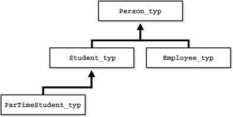
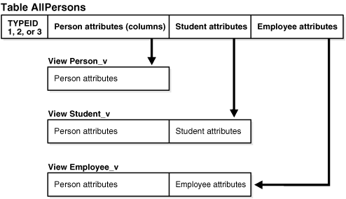
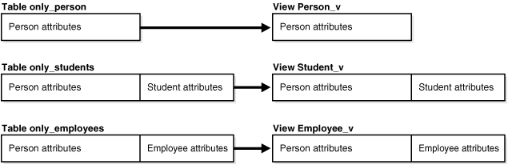
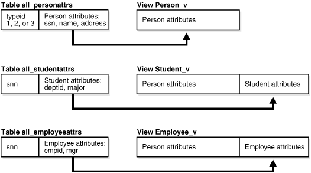

An object view hierarchy is a set of object views each of which is based on a different type in a type hierarchy. Subviews in a view hierarchy are created under a superview, analogously to the way subtypes in a type hierarchy are created under a supertype.

Each object view in a view hierarchy is populated with objects of a single type, but queries on a given view implicitly address its subviews as well. Thus an object view hierarchy gives you a simple way to frame queries that can return a polymorphic set of objects of a given level of specialization or greater.

For example, suppose you have the following type hierarchy, with `person_typ` as the root:

Figure 6-1 Object Type Hierarchy

[Description of "Figure 6-1 Object Type Hierarchy"](img_text/adobj028.md)

If you have created an object view hierarchy based on this type hierarchy, with an object view built on each type, you can query the object view that corresponds to the level of specialization you are interested in. For instance, you can query the view of `student_typ` to get a result set that contains only students, including part-time students.

You can base the root view of an object view hierarchy on any type in a type hierarchy: you do not need to start the object view hierarchy at the root type. Nor do you need to extend an object view hierarchy to every leaf of a type hierarchy or cover every branch. However, you cannot skip intervening subtypes in the line of descent. Any subview must be based on a direct subtype of the type of its direct superview.

Just as a type can have multiple sibling subtypes, an object view can have multiple sibling subviews. However, a subview based on a given type can participate in only one object view hierarchy: two different object view hierarchies cannot each have a subview based on the same subtype.

A subview inherits the object identifier (OID) from its superview. An OID cannot be explicitly specified in any subview.

A root view can explicitly specify an object identifier using the `WITH OBJECT ID` clause. If the OID is system-generated or the clause is not specified in the root view, then subviews can be created only if the root view is based on a table or view that also uses a system-generated OID.

The query underlying a view determines whether or not the view is updatable. For a view to be updatable, its query must contain no joins, set operators, aggregate functions, `GROUP` `BY` clause, `DISTINCT` clause, pseudocolumns, or expressions. The same applies to subviews.

If a view is not updatable, you can define `INSTEAD` `OF` triggers to perform appropriate DML actions. Note that `INSTEAD` `OF` triggers are not inherited by subviews.

All views in a view hierarchy must be in the same schema.

**Note:**

You can create views of types that are non-instantiable. A non-instantiable type cannot have instances, so ordinarily there would be no point in creating an object view of such a type. However, a non-instantiable type can have subtypes that are instantiable. The ability to create object views of non-instantiable types enables you to base an object view hierarchy on a type hierarchy that contains a non-instantiable type.

### 6.14.1 Creating an Object View Hierarchy

You build an object view hierarchy by creating subviews under a root view. You do this by using the `UNDER` keyword in the `CREATE` `VIEW` statement, as show in Example 6-17.

The same object view hierarchy can be based on different underlying storage models. In other words, a variety of layouts or designs of underlying tables can produce the same object view hierarchy. The design of the underlying storage model affects the performance and updatability of the object view hierarchy.

Three possible storage models are described. In the first, a flat model, all views in the object view hierarchy are based on the same table. In the second, a horizontal model, each view has a one-to-one correspondence with a different table. And in the third, a vertical model, the views are constructed using joins.

To execute any of these storage models, first create types shown in Example 6-16.

Example 6-16 Creating Types for Storage Model Examples

    CREATE TYPE person_typ AS OBJECT
    ( ssn NUMBER,
      name VARCHAR2(30),
      address VARCHAR2(100)) NOT FINAL;/

    CREATE TYPE student_typ UNDER person_typ
    ( deptid NUMBER,
       major VARCHAR2(30)) NOT FINAL;/

    CREATE TYPE employee_typ UNDER person_typ
    ( empid NUMBER,
      mgr VARCHAR2(30));/

Topics:

- The Flat Model

- The Horizontal Model

- The Vertical Model

#### 6.14.1.1 The Flat Model

In the flat model, all the views in the hierarchy are based on the same table.

In the following example, the single table `AllPersons` contains columns for all the attributes of `person_typ`, `student_typ`, and `employee_typ`.

Figure 6-2 Flat Storage Model for Object View Hierarchy

[Description of "Figure 6-2 Flat Storage Model for Object View Hierarchy"](img_text/adobj030.md)

The `typeid` column identifies the type of each row. These possible values are the types created in Example 6-16, 1 = `person_typ`, 2 = `student_typ, and `3 = `employee_typ`:

Example 6-17 creates the table `AllPersons` and then the views that make up the object view hierarchy:

Example 6-17 Creating an Object View Hierarchy

    -- Requires Ex. 6-16
    CREATE TABLE AllPersons
    ( typeid NUMBER(1),
      ssn NUMBER,
      name VARCHAR2(30),
      address VARCHAR2(100),
      deptid NUMBER,
      major VARCHAR2(30),
      empid NUMBER,
      mgr VARCHAR2(30));

    CREATE VIEW Person_v OF person_typ
      WITH OBJECT OID(ssn) AS
      SELECT ssn, name, address
      FROM AllPersons
      WHERE typeid = 1;

    CREATE VIEW Student_v OF student_typ UNDER Person_v
      AS
      SELECT ssn, name, address, deptid, major
      FROM AllPersons
      WHERE typeid = 2;

    CREATE VIEW Employee_v OF employee_typ UNDER Person_v
      AS
      SELECT ssn, name, address, empid, mgr
      FROM AllPersons
      WHERE typeid = 3;

The flat model has the advantage of simplicity and poses no obstacles to supporting indexes and constraints. Its drawbacks are:

- A single table cannot contain more than 1000 columns, so the flat model imposes a 1000-column limit on the total number of columns that the object view hierarchy can contain.

- Each row of the table will have NULLs for all the attributes not belonging to its type. Such non-trailing NULLs can adversely affect performance.

#### 6.14.1.2 The Horizontal Model

On the horizontal model, each view or subview is based on a different table.

In the example, the tables are relational, but they could just as well be object tables for which column substitutability is turned off.

Figure 6-3 Horizontal Storage Model for Object View Hierarchy

[Description of "Figure 6-3 Horizontal Storage Model for Object View Hierarchy"](img_text/adobj031.md)

Example 6-18 creates tables and then views based on these tables.

Example 6-18 -- Creating Table Horizontal Model

    -- Requires Ex. 6-16 and Ex. 6-17
    CREATE TABLE only_persons
    ( ssn NUMBER,
      name VARCHAR2(30),
      address VARCHAR2(100));

    CREATE TABLE only_students
    ( ssn NUMBER,
      name VARCHAR2(30),
      address VARCHAR2(100),
      deptid NUMBER,
      major VARCHAR2(30));

    CREATE TABLE only_employees
    ( ssn NUMBER,
      name VARCHAR2(30),
      address VARCHAR2(100),
      empid NUMBER,
      mgr VARCHAR2(30));

    CREATE OR REPLACE VIEW Person_v OF person_typ
      WITH OBJECT OID(ssn) AS
      SELECT *
      FROM only_persons;

    CREATE OR REPLACE VIEW Student_v OF student_typ UNDER Person_v
      AS
      SELECT *
      FROM only_students;

    CREATE OR REPlACE VIEW Employee_v OF employee_typ UNDER Person_v
      AS
      SELECT *
      FROM only_employees;

The horizontal model is very efficient at processing queries of the form:

Example 6-19 -- Querying views horizontal model

    -- Requires Ex. 6-16 and Ex. 6-17
    -- add the following data
    insert into only_persons values(1234,'John','abc');
    insert into only_students values(1111,'James','abc',100,'CS');
    insert into only_employees values(2222,'jack','abc',400,'Juliet');

    SELECT VALUE(p) FROM Person_v p
      WHERE VALUE(p) IS OF (ONLY student_typ);

    OUTPUT:
    VALUE(P)(SSN, NAME, ADDRESS)
    --------------------------------------------------------------------------------
    STUDENT_TYP(1111, 'James', 'abc', 100, 'CS')

Such queries only need to access a single physical table to get all the objects of the specific type. The drawbacks of this model are that queries such as `SELECT * FROM ``view` require performing a `UNION` over all the underlying tables and projecting the rows over just the columns in the specified view. Also, indexes on attributes (and unique constraints) must span multiple tables, and support for this does not currently exist.

**See Also:**

"About Querying a View in a Hierarchy".

#### 6.14.1.3 The Vertical Model

In the vertical model, there is a physical table corresponding to each view in the hierarchy.

However, the physical tables store only those attributes that are unique to their corresponding subtypes.

Figure 6-4 Vertical Storage Model for Object View Hierarchy

[Description of "Figure 6-4 Vertical Storage Model for Object View Hierarchy"](img_text/adobj032.md)

Example 6-20 creates tables and then corresponding views.

Example 6-20 Creating table, views vertical model

    CREATE TABLE all_personattrs
    ( typeid NUMBER,
      ssn NUMBER,
      name VARCHAR2(30),
      address VARCHAR2(100));

    CREATE TABLE all_studentattrs
    ( ssn NUMBER,
      deptid NUMBER,
      major VARCHAR2(30));

    CREATE TABLE all_employeeattrs
    ( ssn NUMBER,
      empid NUMBER,
      mgr VARCHAR2(30));

    CREATE OR REPLACE VIEW Person_v OF person_typ
    WITH OBJECT OID(ssn) AS
      SELECT ssn, name, address
      FROM all_personattrs
      WHERE typeid = 1;

    CREATE OR REPLACE VIEW Student_v OF student_typ UNDER Person_v
      AS
      SELECT x.ssn, x.name, x.address, y.deptid, y.major
      FROM all_personattrs x, all_studentattrs y
      WHERE x.typeid = 2 AND x.ssn = y.ssn;

    CREATE OR REPLACE VIEW Employee_v OF employee_typ UNDER Person_v
      AS
      SELECT x.ssn, x.name, x.address, y.empid, y.mgr
      FROM all_personattrs x, all_employeeattrs y
      WHERE x.typeid = 3 AND x.ssn = y.ssn;

The vertical model can efficiently process queries of the kind `SELECT * FROM ``root_view`, and it is possible to index individual attributes and impose unique constraints on them. However, to re-create an instance of a type, a join over object identifiers (OIDs) must be performed for each level that the type is removed from the root in the hierarchy.

### 6.14.2 About Querying a View in a Hierarchy

You can query any view or subview in an object view hierarchy.

The query returns rows for the declared type of the view that you query and for any of the subtypes of that type.

So, for instance, in an object view hierarchy based on the `person_typ` type hierarchy, you can query the view of `person_typ` to get a result set that contains all persons, including students and employees; or you can query the view of `student_typ` to get a result set that contains only students, including part-time students.

In the `SELECT` list of a query, you can include either functions such as `REF()` and `VALUE()` that return an object instance, or you can specify object attributes of the declared type of the view, such as the `name` and `ssn` attributes of `person_typ`.

If you specify functions, to return object instances, the query returns a polymorphic result set: that is, it returns instances of both the declared type of the view and any subtypes of that type.

For example, the following query returns instances of persons, employees, and students of all types, as well as `REF`s to those instances.

Example 6-21 Query with REF and Value

    -- Requires Ex. 6-20
    insert into all_personattrs values(1,1111,'John','abc');
    insert into all_personattrs values(2,2222,'Jack','def');
    insert into all_personattrs values(3,3333,'James','ghi');
    insert into all_studentattrs values(2222,100,'CS');
    insert into all_employeeattrs values(3333,444,'Julia');
    SELECT REF(p), VALUE(p) FROM Person_v p;

    OUTPUT:
    REF(P)
    --------------------------------------------------------------------------------
    VALUE(P)(SSN, NAME, ADDRESS)
    --------------------------------------------------------------------------------
    00004A038A00465A6E6E779EC1F25FE040578CE70A447E0000001426010001000100290000000000
    090600812A00078401FE0000000B03C20C0C00000000000000000000000000000000000000
    PERSON_TYP(1111, 'John', 'abc')

    00004A038A00465A6E6E779EC1F25FE040578CE70A447E0000001426010001000100290000000000
    090600812A00078401FE0000000B03C2222200000000000000000000000000000000000000
    EMPLOYEE_TYP(3333, 'James', 'ghi', 444, 'Julia')

    00004A038A00465A6E6E779EC1F25FE040578CE70A447E0000001426010001000100290000000000

    REF(P)
    --------------------------------------------------------------------------------
    VALUE(P)(SSN, NAME, ADDRESS)
    --------------------------------------------------------------------------------
    090600812A00078401FE0000000B03C2171700000000000000000000000000000000000000
    STUDENT_TYP(2222, 'Jack', 'def', 100, 'CS')

If you specify individual attributes of the declared type of the view in the `SELECT` list or do a `SELECT` `*`, again the query returns rows for the declared type of the view and any subtypes of that type, but these rows are projected over columns for the attributes of the declared type of the view, and only those columns are used. In other words, the subtypes are represented only with respect to the attributes they inherit from and share with the declared type of the view.

For example, the following query returns rows for all persons and rows for employees and students of all types, but the result uses only the columns for the attributes of `person_typ`—namely, `name`, `ssn`, and `address`. It does not show rows for attributes added in the subtypes, such as the `deptid` attribute of `student_typ`.

    SELECT * FROM Person_v;

To exclude subviews from the result, use the `ONLY` keyword. The `ONLY` keyword confines the selection to the declared type of the view that you are querying:

    SELECT VALUE(p) FROM ONLY(Person_v) p;

### 6.14.3 Privileges for Operations on View Hierarchies

Generally, a query on a view with subviews requires only the `SELECT` privilege on the view being referenced and does not require any explicit privileges on subviews.

For example, the following query requires only `SELECT` privileges on `Person_v` but not on any of its subviews.

    SELECT * FROM Person_v;

However, a query that selects for any attributes added in subtypes but not used by the root type requires the `SELECT` privilege on all subviews as well. Such subtype attributes may hold sensitive information that should reasonably require additional privileges to access.

The following query, for example, requires `SELECT` privileges on `Person_v` and also on `Student_v`, `Employee_v` (and on any other subview of `Person_v`) because the query selects object instances and thus gets all the attributes of the subtypes.

    SELECT VALUE(p) FROM Person_v p;

To simplify the process of granting `SELECT` privileges on an entire view hierarchy, you can use the `HIERARCHY` option. Specifying the `HIERARCHY` option when granting a user `SELECT` privileges on a view implicitly grants `SELECT` privileges on all current and future subviews of the view as well. For example:

    GRANT SELECT ON Person_v TO user WITH HIERARCHY OPTION;

A query that excludes rows belonging to subviews also requires `SELECT` privileges on all subviews. The reason is that information about which rows belong exclusively to the most specific type of an instance may be sensitive, so the system requires `SELECT` privileges on subviews for queries (such as the following one) that exclude all rows from subviews.

    SELECT * FROM ONLY(Person_v);
