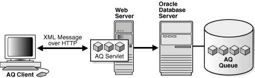
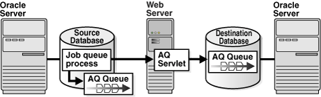

You can access Oracle Database Advanced Queuing (AQ) over the Internet by using SOAP with non-sharded queues. IDAP is the SOAP specification for Oracle Database Advanced Queuing operations.

IDAP defines XML [message](glossary.md) structure for the body of the [Simple Object Access Protocol](glossary.md) (SOAP) request. An [Internet Data Access Presentation](glossary.md) (IDAP)-structured message is transmitted over the Internet using HTTP.

Users can register for notifications using the IDAP interface.

Topics:

- Overview of Oracle Database Advanced Queuing Operations Over the Internet

- Deploying the Oracle Database Advanced Queuing XML Servlet

- Internet Data Access Presentation (IDAP)

- Request and Response IDAP Documents

- Notification of Messages by E-Mail

### Overview of Oracle Database Advanced Queuing Operations Over the Internet

The section discusses these topics.

- Oracle Database Advanced Queuing Internet Operations Architecture

- Internet Message Payloads

- Configuring the Web Server to Authenticate Users Sending POST Requests

- Client Requests Using HTTP

- Oracle Database Advanced Queuing Servlet Responses Using HTTP

- Oracle Database Advanced Queuing Propagation Using HTTP and HTTPS

#### Oracle Database Advanced Queuing Internet Operations Architecture

The figure shows the architecture for performing Oracle Database Advanced Queuing operations over HTTP.

The major components are:

- Oracle Database Advanced Queuing client program

- Web server/servlet runner hosting the Oracle Database Advanced Queuing [servlet](glossary.md)

- Oracle Database server

A Web browser or any other HTTP client can serve as an Oracle Database Advanced Queuing client program, sending XML messages conforming to IDAP to the Oracle Database Advanced Queuing servlet, which interprets the incoming XML messages. The Oracle Database Advanced Queuing servlet connects to the Oracle Database server and performs operations on user queues.

Figure 6-1 Architecture for Performing Oracle Database Advanced Queuing Operations Using HTTP

[Description of "Figure 6-1 Architecture for Performing Oracle Database Advanced Queuing Operations Using HTTP"](img_text/adque430.md)

#### Internet Message Payloads

Oracle Database Advanced Queuing supports messages of three types: RAW, Oracle object, and JMS. All these message types can be accessed using SOAP and Web services.

If the queue holds messages in RAW, Oracle object, or [Java Message Service](glossary.md) (JMS) format, then XML payloads are transformed to the appropriate internal format during enqueue and stored in the queue. During dequeue, when messages are obtained from queues containing messages in any of the preceding formats, they are converted to XML before being sent to the client.

The message payload type depends on the queue type on which the operation is being performed:

##### RAW Queues

The contents of RAW queues are raw bytes. You must supply the hex representation of the message payload in the XML message. For example, `<raw>023f4523</raw>`.

##### Oracle Object Type Queues

For Oracle [object type](glossary.md) queues that are not JMS queues (that is, they are not type `AQ$_JMS_*`), the type of the payload depends on the type specified while creating the queue table that holds the queue. The content of the XML elements must map to the attributes of the object type of the queue table.

##### JMS Type Queues/Topics

For queues with JMS types (that is, those with payloads of type `AQ$_JMS_*`), there are four XML elements, depending on the JMS type. IDAP supports queues or topics with the following JMS types:

- `TextMessage`

- `MapMessage`

- `BytesMessage`

- `ObjectMessage`

JMS queues with payload type `StreamMessage` are not supported through IDAP.

#### Configuring the Web Server to Authenticate Users Sending POST Requests

After the servlet is installed, the Web server must be configured to authenticate all users that send `POST` requests to the Oracle Database Advanced Queuing servlet. The Oracle Database Advanced Queuing servlet allows only authenticated users to access the servlet. If the user is not authenticated, then an error is returned by the servlet.

The Web server can be configured in multiple ways to restrict access. Some of the common techniques are basic authentication (user name/password) over SSL and client certificates. Consult your Web server documentation to see how you can restrict access to servlets.

In the context of the Oracle Database Advanced Queuing servlet, the user name that is used to connect to the Web server is known as the Oracle Database Advanced Queuing HTTP agent or Oracle Database Advanced Queuing Internet user.

#### Client Requests Using HTTP

An Oracle Database Advanced Queuing client begins a request to the Oracle Database Advanced Queuing servlet using HTTP by opening a connection to the server. The client logs in to the server using HTTP basic authentication (with or without SSL) or SSL certificate-based client authentication. The client constructs an XML message representing the send, publish, receive or register request.

The client sends an HTTP `POST` to the servlet at the remote server.

**See Also:**

"Request and Response IDAP Documents"

##### User Sessions and Transactions

After a client is authenticated and connects to the Oracle Database Advanced Queuing servlet, an HTTP session is created on behalf of the user. The first request in the session also implicitly starts a new database transaction. This transaction remains open until it is explicitly committed or terminated. The responses from the servlet includes the session ID in the HTTP headers as cookies.

If the client wishes to continue work in the same transaction, then it must include this HTTP header containing the session ID cookie in subsequent requests. This is automatically accomplished by most Web browsers. However, if the client is using a Java or C client to post requests, then this must be accomplished programmatically.

An explicit commit or rollback must be applied to end the transaction. The commit or rollback requests can also be included as part of other Oracle Database Advanced Queuing operations.

#### Oracle Database Advanced Queuing Servlet Responses Using HTTP

The server accepts the client HTTP(S) connection and authenticates the user (Oracle Database Advanced Queuing agent) specified by the client. The server receives the `POST` request and invokes the Oracle Database Advanced Queuing servlet.

If this is the first request from this client, then a new HTTP session is created. The XML message is parsed and its contents are validated. If a session ID is passed by the client in the HTTP headers, then this operation is performed in the context of that session.

The servlet determines which object (queue/topic) the agent is trying to perform operations on. The servlet looks through the list of database users that map to this Oracle Database Advanced Queuing agent. If any one of these users has privileges to access the queue/topic specified in the request, then the Oracle Database Advanced Queuing servlet superuser creates a session on behalf of this user.

If no transaction is active in the HTTP session, then a new database transaction is started. Subsequent requests in the session are part of the same transaction until an explicit `COMMIT` or `ROLLBACK` request is made. The effects of the transaction are visible only after it is committed. If the transaction remains inactive for 120 seconds, then it is automatically terminated.

The requested operation is performed. The response is formatted as an XML message and sent back the client. The response also includes the session ID in the HTTP headers as a cookie.

**See Also:**

"User Sessions and Transactions"

#### Oracle Database Advanced Queuing Propagation Using HTTP and HTTPS

You can propagate over HTTP and HTTPS (HTTP over SSL) instead of Oracle Net Services. HTTP, unlike Oracle Net Services, is easy to configure for firewalls. The background process doing propagation pushes messages to an Oracle Database Advanced Queuing servlet that enqueues them into the destination database, as shown in the figure.

Figure 6-2 HTTP Oracle Database Advanced Queuing Propagation

[Description of "Figure 6-2 HTTP Oracle Database Advanced Queuing Propagation"](img_text/adque445.md)

You can set up any application to use Oracle Database Advanced Queuing HTTP propagation without any change to the existing code. An application using Oracle Database Advanced Queuing HTTP propagation can easily switch back to Net Services propagation just by re-creating the database link with a Net Services connection string, without any other changes.

### Deploying the Oracle Database Advanced Queuing XML Servlet

The AQ servlet can be deployed with any Web server, for example, Tomcat. Follow these steps to deploy the AQ XML servlet using Tomcat:

1.  For JDK1.8.x, include the following in your `CLASSPATH`:
        ORACLE_HOME/jdbc/lib/ojdbc8.jar
        ORACLE_HOME/jlib/jndi.jar
        ORACLE_HOME/jlib/jta.jar
        ORACLE_HOME/jlib/orai18n.jar
        ORACLE_HOME/jlib/orai18n-collation.jar
        ORACLE_HOME/jlib/orai18n-mapping.jar
        ORACLE_HOME/jlib/orai18n-utility.jar
        ORACLE_HOME/lib/http_client.jar
        ORACLE_HOME/lib/lclasses12.zip
        ORACLE_HOME/lib/servlet.jar
        ORACLE_HOME/lib/xmlparserv2.jar
        ORACLE_HOME/lib/xschema.jar
        ORACLE_HOME/lib/xsu12.jar
        ORACLE_HOME/rdbms/jlib/aqapi.jar
        ORACLE_HOME/rdbms/jlib/aqxml.jar
        ORACLE_HOME/rdbms/jlib/jmscommon.jar
        ORACLE_HOME/rdbms/jlib/xdb.jar
2.  Copy the following jar files into the `tomcat/lib` directory:
        ORACLE_HOME/jdbc/lib/ojdbc8.jar
        ORACLE_HOME/jlib/jndi.jar
        ORACLE_HOME/jlib/jta.jar
        ORACLE_HOME/lib/http_client.jar
        ORACLE_HOME/lib/lclasses12.zip
        ORACLE_HOME/lib/servlet.jar
        ORACLE_HOME/lib/xmlparserv2.jar
        ORACLE_HOME/lib/xschema.jar
        ORACLE_HOME/lib/xsu12.jar
        ORACLE_HOME/rdbms/jlib/aqapi.jar
        ORACLE_HOME/rdbms/jlib/aqxml.jar
        ORACLE_HOME/rdbms/jlib/jmscommon.jar
        ORACLE_HOME/rdbms/jlib/xdb.jar
3.  Create or update `tomcat-users.xml` file appropriately for Web applications users accessing queues. For example:
        User            Password
        -----------------------------------
        john                  welcome
4.  Set up queues in database and create AQ agents so that Tomcat users created in step 3 get authenticated before it can access AQ queues. DBA needs to make use of `DBMS_AQADM.CREATE_AQ_AGENT` and `DBMS_AQADM.ENABLE_DB_ACCESS` procedures. For example, if we assume `JOHN` is the user created in Tomcat and `AQXMLUSER` is the AQ agent created on the database, then in order to access AQ servlet using HTTP, run the following queries:
        EXECUTE dbms_aqadm.create_aq_agent(agent_name=>'JOHN', enable_http =>true);
        EXECUTE dbms_aqadm.enable_db_access('JOHN', 'AQXMLUSER');

    Here `AQXMLUSER` is the AQ user that is created in the database.

    DBA can check internet AQ users agents details using the following query :

        SELECT agent_name, db_username, http_enabled FROM aq$internet_users ;
5.  Deploy the AQ XML servlet, which extends `oracle.AQ.xml.AQxmlServlet` class.
6.  Start or stop the Tomcat instance as follows:
    1.  Start the Tomcat instance using` sh tomcat/bin/startup.sh`
    2.  Shutdown the Tomcat instance using `sh tomcat/bin/shutdown.sh`
    3.  For logs in Tomcat check `tomcat/logs/catalina.out` file

**Related Topics**

- [Fusion Middleware Configuring and Managing JMS for Oracle WebLogic Server](https://www.oracle.com/pls/topic/lookup?ctx=en/database/oracle/oracle-database/19/adque&id=JMSAD565)

### Internet Data Access Presentation (IDAP)

Internet Data Access Presentation (IDAP) uses the Content-Type of `text/xml` to specify the body of the SOAP request.

XML provides the presentation for IDAP request and response messages as follows:

- All request and response tags are scoped in the SOAP namespace.

- Oracle Database Advanced Queuing operations are scoped in the IDAP namespace.

- The sender includes namespaces in IDAP elements and attributes in the SOAP body.

- The receiver processes SOAP messages that have correct namespaces and returns an invalid request error for requests with incorrect namespaces.

- The SOAP namespace has the value `http://schemas.xmlsoap.org/soap/envelope/`

- The IDAP namespace has the value `http://ns.oracle.com/AQ/schemas/access`

#### SOAP Message Structure

These topics shows how SOAP structures a message request or response.

- SOAP Envelope

- SOAP Header

- SOAP Body

##### SOAP Envelope

This is the root or top element in an XML tree. Its tag is `SOAP:Envelope`. SOAP defines a global attribute `SOAP:encodingStyle` that indicates serialization rules used instead of those described by the SOAP specification.

This attribute can appear on any element and is scoped to that element and all child elements not themselves containing such an attribute. Omitting this attribute means that type specification has been followed unless overridden by a parent element.

The SOAP envelope also contains namespace declarations and additional attributes, provided they are namespace-qualified. Additional namespace-qualified subelements can follow the body.

##### SOAP Header

This is the first element under the root. Its tag is `SOAP:Header`. A SOAP header passes necessary information, such as the transaction identifier.

The header is encoded as a child of the `SOAP:Envelope` XML element. Headers are identified by the name element and are namespace-qualified. A header entry is encoded as an embedded element.

##### SOAP Body

This is the Oracle Database Advanced Queuing XML document. Its tag is `SOAP:Body`, and it contains a first subelement whose name is the method name.

This method request element contains elements for each input and output parameter. The element names are the parameter names. The body also contains `SOAP:Fault`, indicating information about an error. The Oracle Database Advanced Queuing XML document has the namespace `http://ns.oracle.com/AQ/schemas/access`

#### SOAP Method Invocation

A method invocation is performed by creating the request header and body and processing the returned response header and body. The request and response headers can consist of standard transport protocol-specific and extended headers.

##### HTTP Headers

The `POST` method within the HTTP request header performs the SOAP method invocation. The request should include the header `SOAPMethodName,` whose value indicates the method to be invoked on the target. The value is of the form `URI``#``method name`.

For example:

    SOAPMethodName: http://ns.oracle.com/AQ/schemas/access#AQXmlSend

The URI used for the interface must match the implied or specified namespace qualification of the method name element in the `SOAP:Body` part of the payload. The method name must not include the "#" character.

##### Method Invocation Body

SOAP method invocation consists of a method request and optionally a method response. The SOAP method request and method response are an HTTP request and response, respectively, whose contents are XML documents consisting of the root and mandatory body elements.

These XML documents are referred to as SOAP payloads in the rest of the sections.

A SOAP payload is defined as follows:

- The SOAP root element is the top element in the XML tree.

- The SOAP payload headers contain additional information that must travel with the request.

- The method request is represented as an XML element with additional elements for parameters. It is the first child of the `SOAP:Body` element. This request can be one of the Oracle Database Advanced Queuing XML client requests described in the next section.

- The response is the return value or an error or exception that is passed back to the client.

At the receiving site, a request can have one of the following outcomes:

- The HTTP infrastructure on the receiving site can receive and process the request. In this case, the HTTP infrastructure passes the headers and body to the SOAP infrastructure.

- The HTTP infrastructure on the receiving site cannot receive and process the request. In this case, the result is an HTTP response containing an HTTP error in the status field and no XML body.

- The SOAP infrastructure on the receiving site can decode the input parameters, dispatch to an appropriate server indicated by the server address, and invoke an application-level function corresponding semantically to the method indicated in the method request. In this case, the result of the method request consists of a response or error.

- The SOAP infrastructure on the receiving site cannot decode the input parameters, dispatch to an appropriate server indicated by the server address, and invoke an application-level function corresponding semantically to the interface or method indicated in the method request. In this case, the result of the method is an error that prevented the dispatching infrastructure on the receiving side from successful completion.

In the last two cases, additional message headers can be present in the results of the request for extensibility.

##### Results from a Method Request

The results of the request are to be provided in the form of a request response. The HTTP response must be of Content-Type `text/xml`.

A SOAP result indicates success and an error indicates failure. The method response never contains both a result and an error.

### Request and Response IDAP Documents

The body of a SOAP message is an IDAP message. This XML document has the namespace `http://ns.oracle.com/AQ/schemas/access`.

The body represents:

- Client requests for [enqueue](glossary.md), [dequeue](glossary.md), and registration

- Server responses to client requests for enqueue, dequeue, and registration

- Notifications from the server to the client

  **Note:**

  Oracle Database Advanced Queuing Internet access is supported only for 8.1 or higher style queues.

  Sharded queues do not support internet access through SOAP.

This section contains these topics:

- IDAP Client Requests for Enqueue

- IDAP Client Requests for Dequeue

- IDAP Client Requests for Registration

- IDAP Client Requests to Commit a Transaction

- IDAP Client Requests to Roll Back a Transaction

- IDAP Server Response to an Enqueue Request

- IDAP Server Response to a Dequeue Request

- IDAP Server Response to a Register Request

- IDAP Commit Response

- IDAP Rollback Response

- IDAP Notification

- IDAP Response in Case of Error

#### IDAP Client Requests for Enqueue

Client send and publish requests use `AQXmlSend` to enqueue to a single-consumer queue and `AQXmlPublish` to enqueue to multiconsumer queues/topics.

`AQXmlSend` and `AQXmlPublish` contain the following elements:

- producer_options

- message_set

- message_header

- message_payload

- AQXmlCommit

##### producer_options

This is a required element. It contains the following child elements:

- `destination`

  This element is required. It specifies the [queue](glossary.md)/topic to which messages are to be sent. It has an optional `lookup_type` attribute, which determines how the destination value is interpreted. If lookup_type is `DATABASE`, which is the default, then the destination is interpreted as `schema.queue_name`. If `lookup_type` is `LDAP`, then the LDAP server is used to resolve the destination.

- `visibility`

  This element is optional. It determines when an enqueue becomes visible. The default is `ON_COMMIT`, which makes the enqueue visible when the current transaction commits. If `IMMEDIATE` is specified, then the effects of the enqueue are visible immediately after the request is completed. The enqueue is not part of the current transaction. The operation constitutes a transaction on its own.

- `transformation`

  This element is optional. It specifies the PL/SQL [transformation](glossary.md) to be invoked before the message is enqueued.

##### message_set

This is a required element and contains one or more messages. Each message consists of a message_header and a message_payload.

##### message_header

This element is optional. It contains the following child elements:

- `sender_id`

  If a `message_header` element is included, then it must contain a `sender_id` element, which specifies an application-specific identifier. The `sender_id` element can contain `agent_name`, `address`, `protocol`, and `agent_alias` elements. The `agent_alias` element resolves to a name, address, and protocol using LDAP.

- `message_id`

  This element is optional. It is a unique identifier of the message, supplied during dequeue.

- `correlation`

  This element is optional. It is the correlation identifier of the message.

- `delay`

  This element is optional. It specifies the duration in seconds after which a message is available for processing.

- `expiration`

  This element is optional. It specifies the duration in seconds that a message is available for dequeuing. This parameter is an offset from the delay. By default messages never expire. If a message is not dequeued before it expires, then it is moved to an [exception queue](glossary.md) in the `EXPIRED` state.

- `priority`

  This element is optional. It specifies the priority of the message. The priority can be any number, including negative numbers. A smaller number indicates higher priority.

- `recipient_list`

  This element is optional. It is a list of recipients which overrides the default subscriber list. Each recipient is represented in `recipient_list` by a `recipient` element, which can contain `agent_name`, `address`, `protocol`, and `agent_alias` elements. The `agent_alias` element resolves to a name, address, and protocol using LDAP.

- `message_state`

  This element is optional. It specifies the state of the message. It is filled in automatically during dequeue. If `message_state` is 0, then the message is ready to be processed. If it is 1, then the message delay has not yet been reached. If it is 2, then the message has been processed and is retained. If it is 3, then the message has been moved to an exception queue.

- `exception_queue`

  This element is optional. It specifies the name of the queue to which the message is moved if the number of unsuccessful dequeue attempts has exceeded `max_retries` or the message has expired. All messages in the exception queue are in the `EXPIRED` state.

  If the exception queue specified does not exist at the time of the move, then the message is moved to the default exception queue associated with the queue table, and a warning is logged in the alert log. If the default exception queue is used, then the parameter returns a `NULL` value at dequeue time.

##### message_payload

This is a required element. It can contain different elements based on the payload type of the destination queue/topic. The different payload types are described in "IDAP Client Requests for Dequeue".

##### AQXmlCommit

This is an optional empty element. If it is included, then the transaction is committed at the end of the request.

**See Also:**

"Internet Message Payloads" for an explanation of IDAP message payloads

#### IDAP Client Requests for Dequeue

Client requests for dequeue use `AQXmlReceive`, which contains these elements.

- consumer_options

- AQXmlCommit

##### consumer_options

This is a required element. It contains the following child elements:

- `destination`

  This element is required. It specifies the queue/topic from which messages are to be received. The `destination` element has an optional `lookup_type` attribute, which determines how the destination value is interpreted. If lookup_type is `DATABASE`, which is the default, then the destination is interpreted as `schema.queue_name`. If `lookup_type` is `LDAP`, then the LDAP server is used to resolve the destination.

- `consumer_name`

  This element is optional. It specifies the name of the [consumer](glossary.md). Only those messages matching the consumer name are accessed. If a queue is not set up for multiple consumers, then this field should not be specified.

- `wait_time`

  This element is optional. It specifies the number of seconds to wait if there is no message currently available which matches the search criteria.

- `selector`

  This element is optional. It specifies criteria used to select the message. It can contain child elements `correlation`, `message_id`, or `condition`.

  A dequeue `condition` element is a Boolean expression using syntax similar to the `WHERE` clause of a SQL query. This Boolean expression can include conditions on message properties, user object payload data properties, and PL/SQL or SQL functions. Message properties include `priority`, `corrid` and other columns in the queue table.

  To specify dequeue conditions on a message payload, use attributes of the [object type](glossary.md) in clauses. You must prefix each attribute with `tab`.`user_data` as a qualifier to indicate the specific column of the queue table that stores the payload.

  A dequeue `condition` element cannot exceed 4000 characters.

  **Note:**

  When a dequeue condition or correlation identifier is used, the order of the messages dequeued is indeterminate, and the sort order of the queue is not honored.

- `visibility`

  This element is optional. It determines when a dequeue becomes visible. The default is `ON_COMMIT`, which makes the dequeue visible when the current transaction commits. If `IMMEDIATE` is specified, then the effects of the dequeue are visible immediately after the request is completed. The dequeue is not part of the current transaction. The operation constitutes a transaction on its own.

- `dequeue_mode`

  This element is optional. It specifies the locking action associated with the dequeue. The possible values are `REMOVE`, `BROWSE`, and `LOCKED`.

  `REMOVE` is the default and causes the message to be read and deleted. The message can be retained in the queue table based on the retention properties. `BROWSE` reads the message without acquiring any lock on it. This is equivalent to a select statement. `LOCKED` reads the message and obtains a write lock on it. The lock lasts for the duration of the transaction. This is equivalent to a select for update statement.

- `navigation_mode`

  This element is optional. It specifies the position of the message that is retrieved. First, the position is determined. Second, the search criterion is applied. Finally, the message is retrieved. Possible values are `FIRST_MESSAGE`, `NEXT_MESSAGE`, and `NEXT_TRANSACTION`.

  `FIRST_MESSAGE` retrieves the first message which is available and which matches the search criteria. This resets the position to the beginning of the queue. `NEXT_MESSAGE` is the default and retrieves the next message which is available and which matches the search criteria. If the previous message belongs to a message group, then Oracle Database Advanced Queuing retrieves the next available message which matches the search criteria and which belongs to the message group.`NEXT_TRANSACTION` skips the remainder of the current transaction group and retrieves the first message of the next transaction group. This option can only be used if message grouping is enabled for the current queue.

- `transformation`

  This element is optional. It specifies the PL/SQL [transformation](glossary.md) to be invoked after the message is dequeued.

##### AQXmlCommit

This is an optional empty element. If it is included, then the transaction is committed at the end of the request.

#### IDAP Client Requests for Registration

Client requests for registration use `AQXmlRegister`, which must contain a `register_options` element. The `register_options` element contains these child elements.

- `destination`

  This element is required. It specifies the queue/topic on which notifications are registered. The `destination` element has an optional `lookup_type` attribute, which determines how the destination value is interpreted. If lookup_type is `DATABASE`, which is the default, then the destination is interpreted as `schema.queue_name`. If `lookup_type` is `LDAP`, then the LDAP server is used to resolve the destination.

- `consumer_name`

  This element is optional. It specifies the consumer name for multiconsumer queues or topics. This parameter must not be specified for single-consumer queues.

- `notify_url`

  This element is required. It specifies where notification is sent when a message is enqueued. The form can be `http://``url`, `mailto://``email address` or `plsql://``pl/sql procedure`.

#### IDAP Client Requests to Commit a Transaction

A request to commit all actions performed by the user in a session uses `AQXmlCommit`.

A commit request has the following format:

    <?xml version="1.0"?>
    <Envelope xmlns="http://schemas.xmlsoap.org/soap/envelope/">
       <Body>
          <AQXmlCommit xmlns="http://ns.oracle.com/AQ/schemas/access"/>
       </Body>
    </Envelope>

#### IDAP Client Requests to Roll Back a Transaction

A request to roll back all actions performed by the user in a session uses `AQXmlRollback`. Actions performed with `IMMEDIATE` visibility are not rolled back.

An IDAP client rollback request has the following format:

    <?xml version="1.0"?>
    <Envelope xmlns="http://schemas.xmlsoap.org/soap/envelope/">
       <Body>
          <AQXmlRollback xmlns="http://ns.oracle.com/AQ/schemas/access"/>
       </Body>
    </Envelope>

#### IDAP Server Response to an Enqueue Request

The response to an enqueue request to a single-consumer queue uses `AQXmlSendResponse`.

It contains the following elements:

- `status_response`

  This element contains child elements `status_code`, `error_code`, and `error_message`. The `status_code` element takes value `0` for success or `-1` for failure. The `error_code` element contains an Oracle error code. The `error_message` element contains a description of the error.

- `send_result`

  This element contains child elements `destination` and `message_id`. The `destination` element specifies where the message was sent. The `message_id` element uniquely identifies every message sent.

The response to an enqueue request to a multiconsumer queue or topic uses `AQXmlPublishResponse`. It contains the following elements:

- `status_response`

  This element contains child elements `status_code`, `error_code`, and `error_message`. The `status_code` element takes value `0` for success or `-1` for failure. The `error_code` element contains an Oracle error code. The `error_message` element contains a description of the error.

- `publish_result`

  This element contains child elements `destination` and `message_id`. The `destination` element specifies where the message was sent. The `message_id` element uniquely identifies every message sent.

#### IDAP Server Response to a Dequeue Request

The response to a dequeue request uses `AQXmlReceiveResponse`.

It contains the following elements:

- `status_response`

  This element contains child elements `status_code`, `error_code`, and `error_message`. The `status_code` element takes value `0` for success or `-1` for failure. The `error_code` element contains an Oracle error code. The `error_message` element contains a description of the error.

- `receive_result`

  This element contains child elements `destination` and `message_set`. The `destination` element specifies where the message was sent. The `message_set` element specifies the set of messages dequeued.

#### IDAP Server Response to a Register Request

The response to a register request uses `AQXmlRegisterResponse`.

It contains the `status_response` element described in "IDAP Server Response to a Dequeue Request".

#### IDAP Commit Response

The response to a commit request uses `AQXmlCommitResponse`.

It contains the `status_response` element described in "IDAP Server Response to a Dequeue Request". The response to a commit request has the following format:

    <?xml version = '1.0'?>
    <Envelope xmlns="http://schemas.xmlsoap.org/soap/envelope/">
       <Body>
          <AQXmlCommitResponse xmlns="http://ns.oracle.com/AQ/schemas/access">
             <status_response>
                <status_code>0</status_code>
             </status_response>
          </AQXmlCommitResponse>
       </Body>
    </Envelope>

#### IDAP Rollback Response

The response to a rollback request uses `AQXmlRollbackResponse`.

It contains the `status_response` element described in "IDAP Server Response to a Dequeue Request".

#### IDAP Notification

When an event for which a client has registered occurs, a notification is sent to the client at the URL specified in the `REGISTER` request using `AQXmlNotification`.

It contains the following elements:

- `notification_options`

  This element has child elements `destination` and `consumer_name`. The `destination` element specifies the destination queue/topic on which the event occurred. The consumer_name element specifies the consumer name for which the even occurred. It applies only to multiconsumer queues/topics.

- `message_set`

  This element specifies the set of message properties.

#### IDAP Response in Case of Error

In case of an error in any of the preceding requests, a `FAULT` is generated.

The `FAULT` element contains the following elements:

- `faultcode`

  This element specifies the error code for the fault.

- `faultstring`

  This element indicates a client error or a server error. A client error means that the request is not valid. A server error indicates that the Oracle Database Advanced Queuing servlet has not been set up correctly.

- `detail`

  This element contains the `status_response` element, which is described in "IDAP Server Response to a Dequeue Request".

### Notification of Messages by E-Mail

These are the steps for setting up your database for e-mail notifications.

1.  Set the SMTP mail host by invoking `DBMS_AQELM.SET_MAILHOST` as an Oracle Database Advanced Queuing administrator.
2.  Set the SMTP mail port by invoking `DBMS_AQELM.SET_MAILPORT` as an Oracle Database Advanced Queuing administrator. If not explicit, set defaults to 25.
3.  Set the SendFrom address by invoking `DBMS_AQELM.SET_SENDFROM`.
4.  After setup, you can register for e-mail notifications using the Oracle Call Interface (OCI) or PL/SQL API.
