Advanced Queuing (AQ) is a robust and feature-rich message queuing system integrated with Oracle Database. These topics discuss Oracle Database Advanced Queuing (AQ) and the requirements for complex information handling in an integrated environment.

- What Is Queuing?

- Oracle Database Advanced Queuing Leverages Oracle Database

- Oracle Database Advanced Queuing in Integrated Application Environments

- Buffered Messaging

- Asynchronous Notifications

- Enqueue Features

- Dequeue Features

- Propagation Features

- Message Format Transformation

- Other Oracle Database Advanced Queuing Features

- Interfaces to Oracle Database Advanced Queuing

### What Is Queuing?

Advanced Queuing stores user messages in abstract storage units called queues. When Web-based business applications communicate with each other, producer applications enqueue messages and consumer applications dequeue messages.

At the most basic level of queuing, one producer enqueues one or more messages into one queue. Each [message](glossary.md) is dequeued and processed once by one of the consumers. A message stays in the [queue](glossary.md) until a consumer dequeues it or the message expires. A [producer](glossary.md) can stipulate a delay before the message is available to be consumed, and a time after which the message expires. Likewise, a [consumer](glossary.md) can wait when trying to [dequeue](glossary.md) a message if no message were available. An agent program or application could act as both a producer and a consumer.

Producers can [enqueue](glossary.md) messages in any sequence. Messages are not necessarily dequeued in the order in which they are enqueued. Messages can be enqueued without being dequeued.

At a slightly higher level of complexity, many producers enqueue messages into a queue, all of which are processed by one consumer. Or many producers enqueue messages, each message being processed by a different consumer depending on type and correlation identifier.

Enqueued messages are said to be propagated when they are reproduced on another queue, which can be in the same database or in a remote database.

Applications often use data in different formats. A [transformation](glossary.md) defines a mapping from one data type to another. The transformation is represented by a SQL function that takes the source data type as input and returns an object of the target data type. You can arrange transformations to occur when a message is enqueued, when it is dequeued, or when it is propagated to a remote [subscriber](glossary.md).

### Oracle Database Advanced Queuing Leverages Oracle Database

Oracle Database Advanced Queuing provides database-integrated message queuing functionality. This functionality leverages the functions of Oracle Database so that messages can be stored persistently, propagated between queues on different computers and databases, and transmitted using Oracle Net Services and HTTP(S).

Because Oracle Database Advanced Queuing is implemented in database tables, all operational benefits of high availability, scalability, and reliability are also applicable to queue data. Standard database features such as recovery, restart, and security are supported by Oracle Database Advanced Queuing. You can use database development and management tools such as Oracle Enterprise Manager to monitor queues. Like other database tables, queue tables can be imported and exported. Similarly, advanced queues are supported by Oracle Data Guard for high availability, which can be critical to preserve your messages when using a stateless middle tier. By being in the database, enqueues and dequeues can be incorporated in database transactions without requiring distributed transactions. For example, Oracle XA.

Messages can be queried using standard SQL. This means that you can use SQL to access the message properties, the message history, and the payload. With SQL access you can also audit and track messages. All available SQL technology, such as indexes, can be used to optimize access to messages.

**Note:**

Oracle Database Advanced Queuing does not support [data manipulation language](glossary.md) (DML) operations on a queue table, or associated [index-organized table](glossary.md) (IOT), or associated system-partitioned tables used by sharded queues, if any. The only supported means of modifying queue tables is through the supplied APIs. Queue tables and IOTs can become inconsistent and therefore effectively ruined, if DML operations are performed on them.

#### System-Level Access Control

Oracle Database Advanced Queuing supports system-level access control for all queuing operations, allowing an application developer or DBA to designate users as queue administrators. A queue administrator can invoke Oracle Database Advanced Queuing administrative and operational interfaces on any queue in the database. This simplifies administrative work because all administrative scripts for the queues in a database can be managed under one schema.

#### Queue-Level Access Control

Oracle Database Advanced Queuing supports queue-level access control for enqueue and dequeue operations. This feature allows the application developer to protect queues created in one schema from applications running in other schemas. The application developer can grant only minimal access privileges to applications that run outside the queue schema.

#### Performance

Requests for service must be separated from the supply of services to increase efficiency and enable complex scheduling. Oracle Database Advanced Queuing exhibits high performance as measured by:

- Number of messages enqueued and dequeued each second

- Time to evaluate a complex query on a message warehouse

- Time to recover and restart the messaging process after a failure

#### Scalability

Queuing systems must be scalable. Oracle Database Advanced Queuing exhibits high performance when the number of programs using the application increases, when the number of messages increases, and when the size of the message warehouse increases.

#### Persistence for Security

Messages that constitute requests for service must be stored persistently and processed exactly once for deferred execution to work correctly in the presence of network, computer, and application failures. Oracle Database Advanced Queuing can meet requirements in the following situations:

- Applications do not have the resources to handle multiple unprocessed messages arriving simultaneously from external clients or from programs internal to the application.

- Communication links between databases are not available all the time or are reserved for other purposes. If the system falls short in its capacity to deal with these messages immediately, then the application must be able to store the messages until they can be processed.

- External clients or internal programs are not ready to receive messages that have been processed.

#### Persistence for Scheduling

Queuing systems must deal with priorities, and those priorities can change:

- Messages arriving later can be of higher priority than messages arriving earlier.

- Messages may wait for later messages before actions are taken.

- The same message may be accessed by different processes.

- Messages in a specific queue can become more important, and so must be processed with less delay or interference from messages in other queues.

- Messages sent to some destinations can have a higher priority than others.

#### Persistence for Accessing and Analyzing Metadata

Queuing systems must preserve message metadata, which can be as important as the payload data. For example, the time that a message is received or dispatched can be crucial for business and legal reasons. With the persistence features of Oracle Database Advanced Queuing, you can analyze periods of greatest demand or evaluate the lag between receiving and completing an order.

#### Object Type Support

Oracle Database Advanced Queuing supports enqueue, dequeue, and propagation operations where the queue type is an abstract datatype, [ADT](glossary.md). It also supports enqueue and dequeue operations if the types are inherited types of a base ADT. Propagation between two queues where the types are inherited from a base ADT is not supported.

Oracle Database Advanced Queuing also supports `ANYDATA` queues, which enable applications to enqueue different message types in a single queue. Oracle Database Advanced Queuing supports the `LONG VARCHAR` data type from 12c Release 1 (12.1) onwards.

If you plan to enqueue, propagate, or dequeue user-defined type messages, then each type used in these messages must exist at every database where the message can be enqueued in a queue. Some environments use directed networks to route messages through intermediate databases before they reach their destination. In such environments, the type must exist at each intermediate database, even if the messages of this type are never enqueued or dequeued at a particular intermediate database.

In addition, the following requirements must be met for such types:

- Type name must be the same at each database.

- Type must be in the same schema at each database.

- Shape of the type must match exactly at each database.

- Type cannot use inheritance or type evolution at any database.

- Type cannot contain varrays, nested tables, LOBs, rowids, or urowids.

The object identifier need not match at each database.

#### Structured and XMLType Payloads

You can use object types to structure and manage message payloads. Relational database systems in general have a richer typing system than messaging systems. Because Oracle Database is an object-relational database system, it supports traditional relational and user-defined types. Many powerful features are enabled because of having strongly typed content, such as content whose format is defined by an external type system. These include:

- Content-based routing

  Oracle Database Advanced Queuing can examine the content and automatically route the message to another queue based on the content.

- Content-based subscription

  A publish and subscribe system is built on top of a messaging system so that you can create subscriptions based on content.

- Querying

  The ability to run queries on the content of the message enables message warehousing.

You can create queues that use the new opaque type, `XMLType.` These queues can be used to transmit and store messages that are XML documents. Using `XMLType`, you can do the following:

- Store any type of message in a queue

- Store `m`ore than one type of payload in a queue

- Query XMLType columns using the operator `ExistsNode()`

- Specify the operators in subscriber rules or dequeue conditions

#### Integration with Oracle Internet Directory

You can register system events, user events, and notifications on queues with Oracle Internet Directory. System events are database startup, database shutdown, and system error events. User events include user log on and user log off, DDL statements (create, drop, alter), and [DML](glossary.md) statement triggers. Notifications on queues include OCI notifications, PL/SQL notifications, and e-mail notifications.

You can also create aliases for Oracle Database Advanced Queuing agents in Oracle Internet Directory. These aliases can be specified while performing Oracle Database Advanced Queuing enqueue, dequeue, and notification operations. This is useful when you do not want to expose an internal agent name.

**Note:**

Sharded Queues does not support OCI and thick drivers in 12c Release 2 (12.2.0.1).

#### Support for Oracle Real Application Clusters(Oracle RAC)

Oracle Real Application Clusters can be used to improve Oracle Database Advanced Queuing performance by allowing different queues to be managed by different instances. You do this by specifying different instance affinities (preferences) for the queue tables that store the queues. This allows queue operations (enqueue and dequeue) on different queues to occur in parallel. Sharded queues are recommended for applications with enqueuers or dequeuers on multiple Oracle RAC instances. Refer to [Sharded Queues and Oracle Real Application Clusters (Oracle RAC)](aq-performance-scalability.md) for more information.

If compatibility is set to Oracle8i release 8.1.5 or higher, then an application can specify the instance affinity for a queue table. When Oracle Database Advanced Queuing is used with Oracle RAC and multiple instances, this information is used to partition the queue tables between instances for queue-monitor scheduling and, also for propagation. The queue table is monitored by the queue monitors of the instance specified by the user. If the owner of the queue table is terminated, then the secondary instance or some available instance takes over the ownership for the queue table.

If an instance affinity is not specified, then the queue tables are arbitrarily partitioned among the available instances. This can result in pinging between the application accessing the queue table and the queue monitor monitoring it. Specifying the instance affinity prevents this, but does not prevent the application from accessing the queue table and its queues from other instances.

### Oracle Database Advanced Queuing in Integrated Application Environments

Oracle Database Advanced Queuing provides the message management and communication needed for application integration. In an integrated environment, messages travel between the Oracle Database server, applications, and users.This is shown in Figure 1-1.

Figure 1-1 Integrated Application Environment Using Oracle Database Advanced Queuing

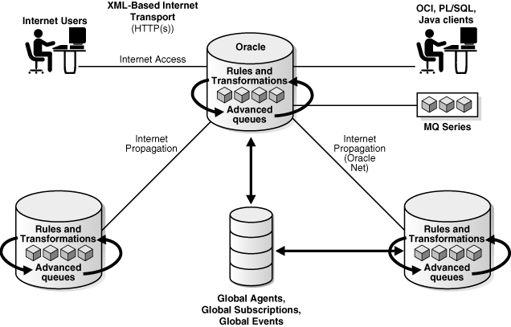
[Description of "Figure 1-1 Integrated Application Environment Using Oracle Database Advanced Queuing"](img_text/adque437.md)

Messages are exchanged between a client and the Oracle Database server or between two Oracle Database servers using Oracle Net Services. Oracle Net Services also propagates messages from one Oracle Database queue to another. Or, as shown in Figure 1-1, you can perform Oracle Database Advanced Queuing operations over the Internet using HTTP(S). In this case, the client, a user or Internet application, produces structured XML messages. During [propagation](glossary.md) over the Internet, Oracle Database servers communicate using structured XML also.

Application integration also involves the integration of heterogeneous messaging systems. Oracle Database Advanced Queuing seamlessly integrates with existing non-Oracle Database messaging systems like IBM WebSphere MQ through Messaging Gateway, thus allowing existing WebSphere MQ-based applications to be integrated into an Oracle Database Advanced Queuing environment.

Topics:

- Oracle Database Advanced Queuing Client/Server Communication

- Multiconsumer Dequeuing of the Same Message

- Oracle Database Advanced Queuing Implementation of Workflows

- Oracle Database Advanced Queuing Implementation of Publish/Subscribe

#### Oracle Database Advanced Queuing Client/Server Communication

Oracle Database Advanced Queuing provides an asynchronous alternative to the synchronous manner in which Client/Server applications usually run. This figure exemplifies Client/Server Communication Using Oracle Database Advanced Queuing.

In this example Application B (a server) provides service to Application A (a client) using a request/response queue.

Figure 1-2 Client/Server Communication Using Oracle Database Advanced Queuing

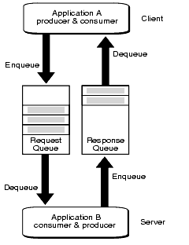
[Description of "Figure 1-2 Client/Server Communication Using Oracle Database Advanced Queuing"](img_text/adque035.md)

Application A enqueues a request into the request queue. In a different transaction, Application B dequeues and processes the request. Application B enqueues the result in the response queue, and in yet another transaction, Application A dequeues it.

The client need not wait to establish a connection with the server, and the server dequeues the message at its own pace. When the server is finished processing the message, there is no need for the client to be waiting to receive the result. A process of double-deferral frees both client and server.

#### Multiconsumer Dequeuing of the Same Message

A message can only be enqueued into one queue at a time. If a producer had to insert the same message into several queues in order to reach different consumers, then this would require management of a very large number of queues. Oracle Database Advanced Queuing provides for queue subscribers and message recipients to allow multiple consumers to dequeue the same message.

To allow for [subscriber](glossary.md) and [recipient](glossary.md) lists, the queue must reside in a [queue table](glossary.md) that is created with the multiple consumer option. Each message remains in the queue until it is consumed by all its intended consumers.

##### Queue Subscribers

Multiple consumers, which can be either applications or other queues, can be associated with a queue as subscribers. This causes all messages enqueued in the queue to be made available to be consumed by each of the queue subscribers. The subscribers to the queue can be changed dynamically without any change to the messages or message producers.

You cannot add subscriptions to single-consumer queues or exception queues. A consumer that is added as a subscriber to a queue is only able to dequeue messages that are enqueued after the subscriber is added. No two subscribers can have the same values for name, address, and protocol. At least one of these attributes must be different for two subscribers.

It cannot be known which subscriber will dequeue which message first, second, and so on, because there is no priority among subscribers. More formally, the order of dequeuing by subscribers is indeterminate.

Subscribers can also be rule-based. Similar in syntax to the `WHERE` clause of a SQL query, rules are expressed in terms of attributes that represent message properties or message content. These subscriber rules are evaluated against incoming messages, and those rules that match are used to determine message recipients.

In Figure 1-3, Application B and Application C each need messages produced by Application A, so a multiconsumer queue is specially configured with Application B and Application C as queue subscribers. Each receives every message placed in the queue.

Figure 1-3 Communication Using a Multiconsumer Queue

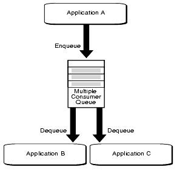
[Description of "Figure 1-3 Communication Using a Multiconsumer Queue"](img_text/adque037.md)

##### Message Recipients

A message producer can submit a list of recipients at the time a message is enqueued into a non-sharded queue. This allows for a unique set of recipients for each message in the queue. The recipient list associated with the message overrides the subscriber list associated with the queue, if there is one. The recipients need not be in the subscriber list. However, recipients can be selected from among the subscribers.

A recipient can be specified only by its name, in which case the recipient must dequeue the message from the queue in which the message was enqueued. It can be specified by its name and an address with a protocol value of 0. The address should be the name of another queue in the same database or another installation of Oracle Database (identified by the database link), in which case the message is propagated to the specified queue and can be dequeued by a consumer with the specified name. If the recipient's name is NULL, then the message is propagated to the specified queue in the address and can be dequeued by the subscribers of the queue specified in the address. If the protocol field is nonzero, then the name and address are not interpreted by the system and the message can be dequeued by a special consumer.

Subscribing to a queue is like subscribing to a magazine: each subscriber can dequeue all the messages placed into a specific queue, just as each magazine subscriber has access to all its articles. Being a recipient, however, is like getting a letter: each recipient is a designated target of a particular message.

Figure 1-4 shows how Oracle Database Advanced Queuing can accommodate both kinds of consumers. Application A enqueues messages. Application B and Application C are subscribers. But messages can also be explicitly directed toward recipients like Application D, which may or may not be subscribers to the queue. The list of such recipients for a given message is specified in the enqueue call for that message. It overrides the list of subscribers for that queue.

Figure 1-4 Explicit and Implicit Recipients of Messages

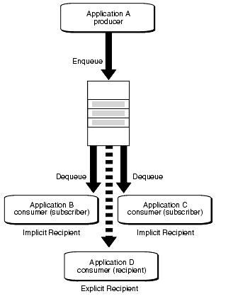
[Description of "Figure 1-4 Explicit and Implicit Recipients of Messages"](img_text/adque039.md)

**Note:**

Multiple producers can simultaneously enqueue messages aimed at different targeted recipients.

#### Oracle Database Advanced Queuing Implementation of Workflows

Oracle Database Advanced Queuing allows us to implement a workflow, also known as a chained application transaction.The figure exemplifies how a workflow is implemented using Oracle Database Advanced Queuing.

1.  Application A begins a [workflow](glossary.md) by enqueuing Message 1.

2.  Application B dequeues it, performs whatever activity is required, and enqueues Message 2.

3.  Application C dequeues Message 2 and generates Message 3.

4.  Application D, the final step in the workflow, dequeues it.

Figure 1-5 Implementing a Workflow using Oracle Database Advanced Queuing

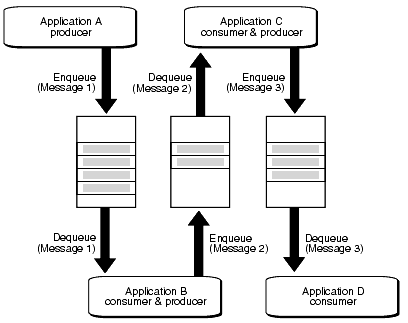
[Description of "Figure 1-5 Implementing a Workflow using Oracle Database Advanced Queuing"](img_text/adque040.md)

**Note:**

The contents of the messages 1, 2 and 3 can be the same or different. Even when they are different, messages can contain parts of the contents of previous messages.

The queues are used to buffer the flow of information between different processing stages of the business process. By specifying delay interval and expiration time for a message, a window of execution can be provided for each of the applications.

From a workflow perspective, knowledge of the volume and timing of message flows is a business asset quite apart from the value of the payload data. Oracle Database Advanced Queuing helps you gain this knowledge by supporting the optional retention of messages for analysis of historical patterns and prediction of future trends.

#### Oracle Database Advanced Queuing Implementation of Publish/Subscribe

A point-to-point message is aimed at a specific target. Senders and receivers decide on a common queue in which to exchange messages. Each message is consumed by only one receiver.

Figure 1-6 shows that each application has its own message queue, known as a single-consumer queue.

Figure 1-6 Point-to-Point Messaging

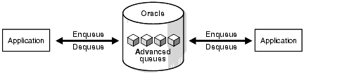
[Description of "Figure 1-6 Point-to-Point Messaging"](img_text/adque250.md)

A [publish/subscribe](glossary.md) message can be consumed by multiple receivers, as shown in Figure 1-7. Publish/subscribe messaging has a wide dissemination mode called [broadcast](glossary.md) and a more narrowly aimed mode called [multicast](glossary.md).

Broadcasting is like a radio station not knowing exactly who the audience is for a given program. The dequeuers are subscribers to multiconsumer queues. In contrast, multicast is like a magazine publisher who knows who the subscribers are. Multicast is also referred to as point-to-multipoint, because a single publisher sends messages to multiple receivers, called recipients, who may or may not be subscribers to the queues that serve as exchange mechanisms.

Figure 1-7 Publish/Subscribe Mode

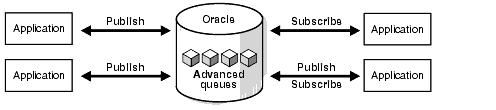
[Description of "Figure 1-7 Publish/Subscribe Mode"](img_text/adque249.md)

Publish/subscribe describes a situation in which a publisher application enqueues messages to a queue anonymously (no recipients specified). The messages are then delivered to subscriber applications based on [rules](glossary.md) specified by each application. The rules can be defined on message properties, message data content, or both.

You can implement a publish/subscribe model of communication using Oracle Database Advanced Queuing as follows:

1.  Set up one or more queues to hold messages. These queues should represent an area or subject of interest. For example, a queue can be used to represent billed orders.

2.  Set up a set of rule-based subscribers. Each subscriber can specify a rule which represents a specification for the messages that the subscriber wishes to receive. A null rule indicates that the subscriber wishes to receive all messages.

3.  Publisher applications publish messages to the queue by invoking an enqueue call.

4.  Subscriber applications can receive messages with a dequeue call. This retrieves messages that match the subscription criteria.

5.  Subscriber applications can also use a listen call to monitor multiple queues for subscriptions on different queues. This is a more scalable solution in cases where a subscriber application has subscribed to many queues and wishes to receive messages that arrive in any of the queues.

6.  Subscriber applications can also use the Oracle Call Interface (OCI) notification mechanism. This allows a push mode of message delivery. The subscriber application registers the queues (and subscriptions specified as subscribing agent) from which to receive messages. This registers a callback to be invoked when messages matching the subscriptions arrive.

Figure 1-8 illustrates the use of Oracle Database Advanced Queuing for implementing a publish/subscribe relationship between publisher Application A and subscriber Applications B, C, and D:

- Application B subscribes with rule "priority = 1".

- Application C subscribes with rule "priority \> 1".

- Application D subscribes with rule "priority = 3".

Figure 1-8 Implementing Publish/Subscribe using Oracle Database Advanced Queuing

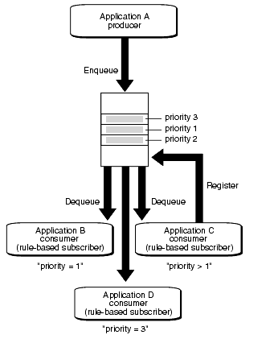
[Description of "Figure 1-8 Implementing Publish/Subscribe using Oracle Database Advanced Queuing"](img_text/adque041.md)

If Application A enqueues three messages with priorities 1, 2, and 3 respectively, then the messages will be delivered as follows:

- Application B receives a single message (priority 1).

- Application C receives two messages (priority 2, 3).

- Application D receives a single message (priority 3).

### Buffered Messaging

Buffered messaging combines the rich functionality that this product has always offered with a much faster queuing implementation. Buffered messaging is ideal for applications that do not require the reliability and transaction support of Oracle Database Advanced Queuing persistent messaging.

Buffered messaging is faster than persistent messaging, because its messages reside in shared memory. They are usually written to disk only when the total memory consumption of buffered messages approaches the available shared memory limit.

**Note:**

The portion of a queue that stores buffered messages in memory is sometimes referred to as a buffered queue.

Message retention is not supported for buffered messaging.

When using buffered messaging, Oracle recommends that you do one of the following:

- Set parameter `streams_pool_size`

  This parameter controls the size of shared memory available to Oracle Database Advanced Queuing. If unspecified, up to 10% of the shared pool size may be allocated for the Oracle Database Advanced Queuing pool from the database cache.

  Refer to [manually tuning sharded queues](aq-performance-scalability.md) for more information about setting the message cache for buffered messaging with sharded queues.

- Turn on SGA autotuning

  Oracle will automatically allocate the appropriate amount of memory from the SGA for Oracle Database Advanced Queuing, based on Oracle Database Advanced Queuing usage and, also usage of other components that use the SGA. Examples of such other components are buffer cache and library cache. If `streams_pool_size` is specified, it is used as the lower bound.

Topics:

- Enqueuing Buffered Messages

- Dequeuing Buffered Messages

- Propagating Buffered Messages

- Flow Control

- Buffered Messaging with Oracle Real Application Clusters (Oracle RAC)

- Buffered Messaging Restrictions

- Error Handling

#### Enqueuing Buffered Messages

Buffered and persistent messages use the same single-consumer or multiconsumer queues and the same administrative and operational interfaces. They are distinguished from each other by a delivery mode parameter, set by the application when enqueuing the message to an Oracle Database Advanced Queuing queue.

Recipient lists are supported for buffered messaging enqueue.

Buffered messaging is supported in all queue tables created with compatibility 8.1 or higher. Transaction grouping queues and array enqueues are not supported for buffered messages in this release. You can still use the array enqueue procedure to enqueue buffered messages, but the array size must be set to one.

Buffered messages can be queried using the `AQ$``Queue_Table_Name` view. They appear with states `IN-MEMORY` or `SPILLED`.

The queue type for buffered messaging can be `ADT`, `XML`, `ANYDATA`, or `RAW`. For `ADT` types with `LOB` attributes, only buffered messages with null `LOB` attributes can be enqueued.

All ordering schemes available for persistent messages are also available for buffered messages, but only within each message class. Ordering among persistent and buffered messages enqueued in the same session is not currently supported.

Both enqueue and dequeue buffered messaging operations must be with `IMMEDIATE` visibility mode. Thus they cannot be part of another transaction. You cannot specify delay when enqueuing buffered messages.

**See Also:**

- "[Enqueuing Messages](aq-operations-using-pl-sql.md)"

- "[AQ\$\<Queue_Table_Name\>: Messages in Queue Table](aq-messaging-gateway-views.md)"

- "Priority and Ordering of Messages in Enqueuing"

#### Dequeuing Buffered Messages

Rule-based subscriptions are supported with buffered messaging. The procedure for adding subscribers is enhanced to allow an application to express interest in persistent messages only, buffered messages only, or both.

For non-sharded queues, array dequeue is not supported for buffered messaging, but you can still use the array dequeue procedure by setting array size to one message.

Dequeuing applications can choose to dequeue persistent messages only, buffered messages only, or both types. Visibility must be set to `IMMEDIATE` for dequeuing buffered messages. All of the following dequeue options are supported:

- Dequeue modes `BROWSE`, `LOCK`, `REMOVE`, and `REMOVE_NO_DATA`

- Navigation modes `FIRST_MESSAGE` and `NEXT_MESSAGE`

- Correlation identifier

- Dequeue condition

- Message identifier

**See Also:**

- "[Adding a Subscriber](aq-administrative-interface.md)"

- "[Dequeue Options](aq-operations-using-pl-sql.md)"

#### Propagating Buffered Messages

Propagation of buffered messages is supported. A single propagation schedule serves both persistent and buffered messages. The `DBA_QUEUE_SCHEDULES` view displays statistics and error information.

Oracle Database AQ deletes buffered messages once they are propagated to the remote sites. If the receiving site fails before these messages are consumed, then these messages will be lost. The source site will not be able to re-send them. Duplicate delivery of messages is also possible.

**See Also:**

- "[DBA_QUEUE_SCHEDULES: All Propagation Schedules](aq-messaging-gateway-views.md)"

- "Buffered Messaging with Oracle Real Application Clusters (Oracle RAC)"

#### Flow Control

Oracle Database Advanced Queuing implements a flow control system that prevents applications from flooding the shared memory with messages. If the number of outstanding messages per sender exceeds a system-defined threshold, the enqueue call will block and timeout with an error message. A message sender is identified by sender_id.name in the enqueue options. A sender blocked due to flow control on a queue does not affect other message senders. The resolution is to dequeue messages, thereby resolving flow control, after which new messages can be enqueued.

Flow control threshold varies with memory pressure and could come down to the system-defined limit if streams pool usage becomes significant. Message senders will block on event `Streams AQ: enqueue blocked due to flow control` and time out with error `ORA-25307` if flow control is not resolved. Applications are expected to handle this error, and re-enqueue the failed message.

Even with flow control, slow consumers of a multiconsumer queue can cause the number of messages stored in memory to grow without limit. Provided there is at least one subscriber who is keeping pace, older messages are spilled to disk and removed from the pool to free up memory. This ensures that the cost of disk access is paid by the slower consumers, and faster subscribers can proceed unhindered.

#### Buffered Messaging with Oracle Real Application Clusters (Oracle RAC)

Sharded and non-sharded queues handle buffered messaging with Oracle RAC differently.

Sharded queues perform cross-instance communication but avoid simultaneous writes to the same block across Oracle RAC instances. Typically, dequeues occur on a shard that is local to a message’s enqueuing instance, but in certain situations, Oracle will efficiently forward messages across instances for dequeuing on another instance. For example, if a sharded queue has a single enqueuing session on one Oracle RAC instance and a single dequeuing session on another instance, then sharded queues will forward messages between the Oracle RAC instances. The forwarding of messages is done asynchronously to the enqueuing transaction to improve performance. Dequeuers may get an ORA-25228 if they are connected to an instance whose shards have no messages.

For non-sharded queues, an application can enqueue and dequeue buffered messages from any Oracle RAC instance as long as it uses password-based authentication to connect to the database. The structures required for buffered messaging are implemented on one Oracle RAC instance. The instance where the buffered messaging structures are implemented is the `OWNER_INSTANCE` of the queue table containing the queue. Enqueue and dequeue requests received at other instances are forwarded to the `OWNER_INSTANCE` over the interconnect. The `REMOTE_LISTENER` parameter in `listener.ora` must also be set to enable forwarding of buffered messaging requests to correct instance. Internally, buffered queues on Oracle RAC may use `dblinks` between instances. Definer's rights packages that enqueue or dequeue into buffered queues on Oracle RAC must grant `INHERIT REMOTE PRIVILEGES` to users of the package.

A service name is associated with each queue in Oracle RAC and displayed in the `DBA_QUEUES` and `USER_QUEUES` views. This service name always points to the instance with the most efficient access for buffered messaging, minimizing pinging between instances. OCI clients can use the service name for buffered messaging operations.

Oracle recommends that you specify instance affinity when using buffered messaging with queue-to-queue propagation. This results in transparent failover when propagating messages to a destination Oracle RAC system. You do not need to re-point your database links if the primary AQ Oracle RAC instance fails.

**See Also:**

- "[ALL_QUEUE_TABLES: Queue Tables Accessible to the Current User](aq-messaging-gateway-views.md)" for more information on `OWNER_INSTANCE`

- "REMOTE_LISTENER" in [Oracle Database Reference](../refrn/REMOTE_LISTENER.md) for more information on setting the `REMOTE_LISTENER` parameter

- "[DBA_QUEUES: All Queues in Database](aq-messaging-gateway-views.md)" or "[USER_QUEUES: Queues In User Schema](aq-messaging-gateway-views.md)"

- "Support for Oracle Real Application Clusters(Oracle RAC)"

#### Buffered Messaging Restrictions

The following Oracle Database Advanced Queuing features are only supported for buffered messaging on sharded queues:

- Message delay

- Array enqueue

- Array dequeue

- PL/SQL Notification

The following Oracle Database Advanced Queuing features are not currently supported for buffered messaging:

- Message retention

- Transaction grouping

- Message export and import

- Messaging Gateway

- OCI notification

#### Error Handling

Retry count and retry delay are not supported for buffered messages. Message expiration is supported. When a buffered message has been in the queue beyond its expiration period, it is moved into the exception queue as a persistent message.

### Asynchronous Notifications

Asynchronous notification allows clients to receive notifications of messages of interest.

The client can use these notifications to monitor multiple subscriptions. The client need not be connected to the database to receive notifications regarding its subscriptions. Asynchronous notification is supported for buffered messages. The delivery mode of the message is available in the message descriptor of the notification descriptor.

The client specifies a callback function which is run for each message. Asynchronous notification cannot be used to invoke an executable, but it is possible for the callback function to invoke a stored procedure.

Clients can receive notifications procedurally using PL/SQL, Java Message Service (JMS), or OCI callback functions, or clients can receive notifications through e-mail or HTTP post. Clients can also specify the presentation for notifications as either `RAW` or `XML`.

**Note:**

Sharded queues only support PL/SQL notification.

For JMS queues, the dequeue is accomplished as part of the notification; explicit dequeue is not required. For RAW queues, clients can specify payload delivery; but they still must dequeue the message in `REMOVE_NO_DATA` mode. For all other persistent queues, the notification contains only the message properties; clients explicitly dequeue to receive the message.

#### Payload Delivery for RAW Queues

For RAW queues, Oracle Database Advanced Queuing clients can now specify that the message payload be delivered along with its notification.

**See Also:**

"[AQ Registration Information Type](aq-basic-components.md)"

#### Reliable Notification

Clients can specify persistent message notification. If an Oracle RAC instance fails, its notifications are delivered by another Oracle RAC node. If a standalone instance fails, its notifications are delivered when the instance restarts.

**Note:**

Notification reliability refers only to server failures. If Oracle Database Advanced Queuing cannot deliver client notifications for any other reason, then the notifications are purged along with the client registration.

#### Designated Port Notification

For non-sharded queues, Oracle Database Advanced Queuing clients can use the OCI subscription handle attribute `OCI_ATTR_SUBSCR_PORTNO` to designate the port at which notifications are delivered. This is especially useful for clients on a computer behind a firewall. The port for the listener thread can be designated before the first registration, using an attribute in the environment handle. The thread is started the first time an `OCISubscriptionRegister` is called. If the client attempts to start another thread on a different port using a different environment handle, then Oracle Database Advanced Queuing returns an error.

**Note:**

Designated port notification and IP address notification apply only to OCI clients.

**See Also:**

"Publish-Subscribe Registration Functions in OCI" in [Oracle Call Interface Programmer's Guide](../lnoci/session-and-connection-pooling.md)

#### IPv6 Compliance and Designated IP Support

For non-sharded queues, Oracle Database AQ supports IPv6 and Oracle Database AQ clients can use the OCI subscription handle attribute `OCI_ATTR_SUBSCR_IPADDR` to designate the IP address at which notifications are delivered. This is especially useful for clients on a computer that has multiple network interface cards or IP addresses. The IP address for the listener thread can be designated before the first registration using an attribute in the environment handle. The thread is started the first time an `OCISubscriptionRegister` is called. If the client attempts to start another thread on a different IP address using a different environment handle, Oracle Database AQ returns an error. If no IP address is specified, Oracle Database AQ will deliver notifications on all IP addresses of the computer the client is on.

#### Registration Timeout

In earlier releases of Oracle Database Advanced Queuing, registrations for notification persisted until explicitly removed by the client or purged in case of extended client failure. From Oracle Database Advanced Queuing 10g Release 2 (10.2) onwards, clients can register for a specified time, after which the registration is automatically purged.

When the registration is purged, Oracle Database Advanced Queuing sends a notification to the client, so the client can invoke its callback and take any necessary action.

**See Also:**

"[AQ Registration Information Type](aq-basic-components.md)" for information on the `timeout` parameter

#### Purge on Notification

Clients can also register to receive only the first notification, after which the registration is automatically purged.

An example where purge on notification is useful is a client waiting for enqueues to start. In this case, only the first notification is useful; subsequent notifications provide no additional information. Previously, this client would be required to unregister once enqueuing started; now the registration can be configured to go away automatically.

#### Buffered Message Notification

Clients can register for notification of buffered messages. The registration requests apply to both buffered and persistent messages. The message properties delivered with the PL/SQL or OCI notification specify whether the message is buffered or persistent.

**See Also:**

- "[Registering for Notification](aq-operations-using-pl-sql.md)" for more information on PL/SQL notification

- Appendix C, "OCI Examples", which appears only in the HTML version of this guide, for an example of OCI notification

Reliable notification is not supported.

#### Views on Registration

The dictionary views `DBA_SUBSCR_REGISTRATIONS` and `USER_SUBSCR_REGISTRATIONS` display the various registrations in the system.

The diagnostic view `GV$SUBSCR_REGISTRATION_STATS` may be used to monitor notification statistics and performance.

#### Event-Based Notification

Event-based notifications are processed by a set of coordinator (`EMNC`) and subordinate processes.

The event notification load is distributed among these processes. These processes work on the system notifications in parallel, offering a capability to process a larger volume of notifications, a faster response time and lower shared memory use for staging notifications.

#### Notification Grouping by Time

Notification applications may register to receive a single notification for all events that occur within a specified time interval. Notification Clients may specify a start time for the notifications. Additionally, they must specify a time as the grouping class and the time interval as the grouping value.

A repeat count may be used to limit the number of notifications delivered. Clients can receive two types of grouping events, Summary or Last. A summary notification is a list of Message Identifiers of all the messages for the subscription. If last was specified as a grouping type, notification would have information about the last message in the notification interval. A count of the number of messages in the interval is also sent. The registration interfaces in PLSQL and OCI allow for specification of the `START_TIME`, `REPEAT_COUNT`, `GROUPING CLASS`, `GROUPING VALUE`, `GROUPING TYPE` in the `AQ$_REGISTRATION_INFO` and the OCI subscription Handle.

The notification descriptor received by the client initiated AQ notification provides information about the group of message identifiers and the number of notifications in the group.

**See Also:**

- [Oracle Database PL/SQL Packages and Types Reference](../arpls/advanced-queuing-AQ-types.md)

- [Oracle Call Interface Programmer's Guide](../lnoci/performance-topics.md)

### Enqueue Features

This topic describes the enqueue features Enqueuing an Array of Messages, Correlation Identifiers, Priority and Ordering of Messages in Enqueuing, Message Grouping, Sender Identification, and Time Specification and Scheduling.

The following features apply to enqueuing messages:

- Enqueue an Array of Messages

- Correlation Identifiers

- Priority and Ordering of Messages in Enqueuing

- Message Grouping

- Sender Identification

- Time Specification and Scheduling

#### Enqueue an Array of Messages

When enqueuing messages into a queue, you can operate on an array of messages simultaneously, instead of one message at a time. This can improve the performance of enqueue operations. When enqueuing an array of messages into a queue, each message shares the same enqueue options, but each message can have different message properties. You can perform array enqueue operations using PL/SQL or OCI.

Array enqueuing is not supported for buffered messages in this release.

#### Correlation Identifiers

You can assign an identifier to each message, thus providing a means to retrieve specific messages at a later time.

#### Priority and Ordering of Messages in Enqueuing

You can specify the priority of an enqueued message and its exact position in the queue. This means that users can specify the order in which messages are consumed in three ways:

- A priority can be assigned to each message.

- A sort order specifies which properties are used to order all messages in a queue. This is set when the queue table is created and cannot be changed. You can choose to sort messages by priority, enqueue time, or commit time.

  **See Also:**

  - "[Creating a Queue Table](aq-administrative-interface.md)" for more information on sort order

- A sequence deviation positions a message in relation to other messages.

**Note:**

The sequence deviation feature is deprecated in 10g Release 2 (10.2).

If several consumers act on the same queue, then each consumer gets the first message that is available for immediate consumption. A message that is in the process of being consumed by another consumer is skipped.

Priority ordering of messages is achieved by specifying priority, enqueue time as the sort order. If priority ordering is chosen, then each message is assigned a priority at enqueue time by the enqueuing agent. At dequeue time, the messages are dequeued in the order of the priorities assigned. If two messages have the same priority, then the order in which they are dequeued is determined by the enqueue time. A first-in, first-out (FIFO) priority queue can also be created by specifying enqueue time, priority as the sort order of the messages.

#### Message Grouping

Messages belonging to one queue can be grouped to form a set that can only be consumed by one user at a time. This requires that the queue be created in a queue table that is enabled for message grouping. All messages belonging to a group must be created in the same transaction, and all messages created in one transaction belong to the same group.

This feature allows users to segment complex messages into simple messages. For example, messages directed to a queue containing invoices can be constructed as a group of messages starting with a header message, followed by messages representing details, followed by a trailer message.

Message grouping is also useful if the message payload contains complex large objects such as images and video that can be segmented into smaller objects.

Group message properties priority, delay, and expiration are determined solely by the message properties specified for the first message in a group, irrespective of which properties are specified for subsequent messages in the group.

The message grouping property is preserved across propagation. However, the destination queue where messages are propagated must also be enabled for transactional grouping. There are also some restrictions you must keep in mind if the message grouping property is to be preserved while dequeuing messages from a queue enabled for transactional grouping.

#### Sender Identification

Applications can mark the messages they send with a custom identification. Oracle Database Advanced Queuing also automatically identifies the queue from which a message was dequeued. This allows applications to track the pathway of a propagated message or a string message within the same database.

#### Time Specification and Scheduling

Messages can be enqueued with an expiration that specifies the interval of time the message is available for dequeuing. The default for expiration is never. When a message expires, it is moved to an exception queue. Expiration processing requires that the queue monitor be running.

### Dequeue Features

This topic discusses the dequeue features Concurrent Dequeues, Dequeue Methods, Dequeue Modes, Dequeue an Array of Messages, Message States, Navigation of Messages in Dequeuing, Waiting for Messages, Retries with Delays, Optional Transaction Protection, and Exception Queues.

The following features apply to dequeuing messages:

- Concurrent Dequeues

- Dequeue Methods

- Dequeue Modes

- Dequeue an Array of Messages

- Message States

- Navigation of Messages in Dequeuing

- Waiting for Messages

- Retries with Delays

- Optional Transaction Protection

- Exception Queues

#### Concurrent Dequeues

When there are multiple processes dequeuing from a single-consumer queue or dequeuing for a single consumer on the multiconsumer queue, different processes skip the messages that are being worked on by a concurrent process. This allows multiple processes to work concurrently on different messages for the same consumer.

#### Dequeue Methods

A message can be dequeued using one of the following dequeue methods:

- Specifying a correlation identifier

  A correlation identifier is a user-defined message property. Multiple messages with the same correlation identifier can be present in a queue, which means that the ordering (enqueue order) between messages might not be preserved on dequeue calls.

- Specifying a message identifier

  A message identifier is a system-assigned value (of `RAW` datatype). Only one message with a given message identifier can be present in the queue.

- Specifying a dequeue condition

  A dequeue condition is expressed in terms of message properties or message content and is similar in syntax to the `WHERE` clause of a SQL query. Messages in the queue are evaluated against the condition, and messages that satisfy the given condition are returned. When a dequeue condition is used, the order of the messages dequeued is indeterminate, and the sort order of the queue is not honored.

- Default dequeue

  A default dequeue retrieves the first available message.

**Note:**

Dequeuing with correlation identifier, message identifier, or dequeue condition does not preserve the message grouping property.

#### Dequeue Modes

A dequeue request can browse a message, remove it, or remove it with no data. If a message is browsed, then it remains available for further processing. If a message is removed or removed with no data, then it is no longer available for dequeue requests. Depending on the queue properties, a removed message can be retained in the queue table. A message is retained in the queue table after it has been consumed only if a retention time is specified for its queue.

The browse mode has three risks. First, there is no guarantee that the message can be dequeued again after it is browsed, because a dequeue call from a concurrent user might have removed the message. To prevent a viewed message from being dequeued by a concurrent user, you should view the message in the locked mode.

Second, your dequeue position in browse mode is automatically changed to the beginning of the queue if a nonzero wait time is specified and the navigating position reaches the end of the queue. If you repeat a dequeue call in the browse mode with the `NEXT_MESSAGE` navigation option and a nonzero wait time, then you can end up dequeuing the same message over and over again. Oracle recommends that you use a nonzero wait time for the first dequeue call on a queue in a session, and then use a zero wait time with the `NEXT_MESSAGE` navigation option for subsequent dequeue calls. If a dequeue call gets an "end of queue" error message, then the dequeue position can be explicitly set by the dequeue call to the beginning of the queue using the `FIRST_MESSAGE` navigation option, following which the messages in the queue can be browsed again.

Third, if the sort order of the queue is `ENQ_TIME`, `PRIORITY`, or a combination of these two, then results may not be repeatable from one browse to the next. If you must have consistent browse results, then you should use a [commit-time queue](glossary.md).

**See Also:**

- "[Creating a Queue Table](aq-administrative-interface.md)"

When a message is dequeued using `REMOVE_NODATA` mode, the payload of the message is not retrieved. This mode can be useful when the user has already examined the message payload, possibly by means of a previous `BROWSE` dequeue.

#### Dequeue an Array of Messages

When dequeuing messages from a queue, you can operate on an array of messages simultaneously, instead of one message at a time. This can improve the performance of dequeue operations. If you are dequeuing from a transactional queue, you can dequeue all the messages for a transaction with a single call, which makes application programming easier.

When dequeuing an array of messages from a queue, each message shares the same dequeue options, but each message can have different message properties. You can perform array enqueue and array dequeue operations using PL/SQL or OCI.

Array dequeuing is not supported for buffered messages in this release.

#### Message States

Multiple processes or operating system threads can use the same consumer name to dequeue concurrently from a queue. In that case Oracle Database Advanced Queuing provides the first unlocked message that is at the head of the queue and is intended for the consumer. Unless the message identifier of a specific message is specified during dequeue, consumers can dequeue messages that are in the `READY` state.

A message is considered `PROCESSED` only when all intended consumers have successfully dequeued the message. A message is considered `EXPIRED` if one or more consumers did not dequeue the message before the `EXPIRATION` time. When a message has expired, it is moved to an exception queue.

Expired messages from multiconsumer queues cannot be dequeued by the intended recipients of the message. However, they can be dequeued in the `REMOVE` mode exactly once by specifying a `NULL` consumer name in the dequeue options.

**Note:**

If the multiconsumer exception queue was created in a queue table with the `compatible` parameter set to `8.0`, then expired messages can be dequeued only by specifying a message identifier.

Queues created in a queue table with `compatible` set to `8.0` (referred to in this guide as 8.0-style queues) are deprecated in Oracle Database Advanced Queuing 10g Release 2 (10.2). Oracle recommends that any new queues you create be 8.1-style or newer and that you migrate existing 8.0-style queues at your earliest convenience.

Beginning with Oracle Database Advanced Queuing release 8.1.6, only the queue monitor removes messages from multiconsumer queues. This allows dequeuers to complete the dequeue operation by not locking the message in the queue table. Because the queue monitor removes messages that have been processed by all consumers from multiconsumer queues approximately once every minute, users can see a delay between when the messages have been completely processed and when they are physically removed from the queue.

#### Navigation of Messages in Dequeuing

You have several options for selecting a message from a queue. You can select the first message with the `FIRST_MESSAGE` navigation option. Alternatively, once you have selected a message and established its position in the queue, you can then retrieve the next message with the `NEXT_MESSAGE` navigation option.

The `FIRST_MESSAGE` navigation option performs a `SELECT` on the queue. The `NEXT_MESSAGE` navigation option fetches from the results of the `SELECT` run in the `FIRST_MESSAGE` navigation. Thus performance is optimized because subsequent dequeues need not run the entire `SELECT` again.

If the queue is enabled for transactional grouping, then the navigation options work in a slightly different way. If `FIRST_MESSAGE` is requested, then the dequeue position is still reset to the beginning of the queue. But if `NEXT_MESSAGE` is requested, then the position is set to the next message in the same transaction. Transactional grouping also offers a `NEXT_TRANSACTION` option. It sets the dequeue position to the first message of the next transaction.

Transaction grouping has no effect if you dequeue by specifying a correlation identifier or message identifier, or if you dequeue some of the messages of a transaction and then commit.

If you reach the end of the queue while using the `NEXT_MESSAGE` or `NEXT_TRANSACTION` option, and you have specified a nonzero wait time, then the navigating position is automatically changed to the beginning of the queue. If a zero wait time is specified, then you can get an exception when the end of the queue is reached.

#### Waiting for Messages

Oracle Database Advanced Queuing allows applications to block on one or more queues waiting for the arrival of either a newly enqueued message or a message that becomes ready. You can use the `DEQUEUE` operation to wait for the arrival of a message in a single queue or the `LISTEN` operation to wait for the arrival of a message in more than one queue.

**Note:**

Applications can also perform a blocking dequeue on exception queues to wait for arrival of `EXPIRED` messages.

When the blocking `DEQUEUE` call returns, it returns the message properties and the message payload. When the blocking `LISTEN` call returns, it discloses only the name of the queue where a message has arrived. A subsequent `DEQUEUE` operation is needed to dequeue the message.

When there are messages for multiple agents in the agent list, `LISTEN` returns with the first agent for whom there is a message. To prevent one agent from starving other agents for messages, the application can change the order of the agents in the agent list.

Applications can optionally specify a timeout of zero or more seconds to indicate the time that Oracle Database Advanced Queuing must wait for the arrival of a message. The default is to wait forever until a message arrives in the queue. This removes the burden of continually polling for messages from the application, and it saves CPU and network resources because the application remains blocked until a new message is enqueued or becomes `READY` after its `DELAY` time.

An application that is blocked on a dequeue is either awakened directly by the enqueuer if the new message has no `DELAY` or is awakened by the queue monitor process when the `DELAY` or `EXPIRATION` time has passed. If an application is waiting for the arrival of a message in a remote queue, then the Oracle Database Advanced Queuing propagator wakes up the blocked dequeuer after a message has been propagated.

#### Retries with Delays

If the transaction dequeuing a message from a queue fails, then it is regarded as an unsuccessful attempt to consume the message. Oracle Database Advanced Queuing records the number of failed attempts to consume the message in the message history. Applications can query the `RETRY_COUNT` column of the queue table view to find out the number of unsuccessful attempts on a message. In addition, Oracle Database Advanced Queuing allows the application to specify, at the queue level, the maximum number of retries for messages in the queue. The default value for maximum retries is 5. If the number of failed attempts to remove a message exceeds this number, then the message is moved to the exception queue and is no longer available to applications.

**Note:**

If a dequeue transaction fails because the server process dies (including `ALTER` `SYSTEM` `KILL` `SESSION`) or `SHUTDOWN` `ABORT` on the instance, then `RETRY_COUNT` is not incremented.

A bad condition can cause the transaction receiving a message to end. Oracle Database Advanced Queuing allows users to hide the bad message for a specified retry delay interval, during which it is in the WAITING state. After the retry delay, the failed message is again available for dequeue. The Oracle Database Advanced Queuing time manager enforces the retry delay property. The default value for retry delay is 0.

If multiple sessions are dequeuing messages from a queue simultaneously, then `RETRY_COUNT` information might not always be updated correctly. If session one dequeues a message and rolls back the transaction, then Oracle Database AQ notes that the `RETRY_COUNT` information for this message must be updated. However `RETRY_COUNT` cannot be incremented until session one completes the rollback. If session two attempts to dequeue the same message after session one has completed the rollback but before it has incremented `RETRY_COUNT`, then the dequeue by session two succeeds. When session one attempts to increment `RETRY_COUNT`, it finds that the message is locked by session two and `RETRY_COUNT` is not incremented. A trace file is then generated in the `USER_DUMP_DESTINATION` for the instance with the following message:

    Error on rollback: ORA-25263: no message in queue schema.qname with message ID ...

**Note:**

Maximum retries and retry delay are not available with 8.0-style multiconsumer queues.

Queues created in a queue table with `compatible` set to `8.0` (referred to in this guide as 8.0-style queues) are deprecated in Oracle Database Advanced Queuing 10g Release 2 (10.2). Oracle recommends that any new queues you create be 8.1-style or newer and that you migrate existing 8.0-style queues at your earliest convenience.

#### Optional Transaction Protection

Enqueue and dequeue requests are usually part of a transaction that contains the requests, thereby providing the wanted [transactional](glossary.md) action. You can, however, specify that a specific request is a transaction by itself, making the result of that request immediately visible to other transactions. This means that messages can be made visible to the external world when the enqueue or dequeue statement is applied or after the transaction is committed.

**Note:**

Transaction protection is not supported for buffered messaging.

#### Exception Queues

An exception queue is a repository for expired or unserviceable messages. Applications cannot directly enqueue into exception queues. Also, a multiconsumer exception queue cannot have subscribers associated with it. However, an application that intends to handle these expired or unserviceable messages can dequeue them exactly once from the exception queue using remove mode. The consumer name specified while dequeuing should be null. Messages can also be dequeued from the exception queue by specifying the message identifier.

**Note:**

Expired or unserviceable buffered messages are moved to an exception queue as persistent messages.

Messages intended for single-consumer queues, or for 8.0-style multiconsumer queues, can only be dequeued by their message identifiers once the messages have been moved to an exception queue.

Queues created in a queue table with `compatible` set to `8.0` (referred to in this guide as 8.0-style queues) are deprecated in Oracle Database Advanced Queuing 10g Release 2 (10.2). Oracle recommends that any new queues you create be 8.1-style or newer and that you migrate existing 8.0-style queues at your earliest convenience.

After a message has been moved to an exception queue, there is no way to identify which queue the message resided in before moving to the exception queue. If this information is important, then the application must save this information in the message itself.

The exception queue is a message property that can be specified during enqueue time. If an exception queue is not specified, then a default exception queue is used. The default exception queue is automatically created when the queue table is created.

A message is moved to an exception queue under the following conditions:

- It was not dequeued within the specified expiration interval.

  For a message intended for multiple recipients, the message is moved to the exception queue if one or more of the intended recipients was not able to dequeue the message within the specified expiration interval. The default expiration interval is never, meaning the messages does not expire.

- The message was dequeued successfully, but the application that dequeued it rolled back the transaction because of an error that arose while processing the message. If the message has been dequeued but rolled back more than the number of times specified by the retry limit, then the message is moved to the exception queue.

  For a message intended for multiple recipients, a separate retry count is kept for each recipient. The message is moved to the exception queue only when retry counts for all recipients of the message have exceeded the specified retry limit.

  The default retry limit is five for single-consumer queues and 8.1-style multiconsumer queues. No retry limit is supported for 8.0-style multiconsumer queues, which are deprecated in Oracle Database Advanced Queuing 10g Release 2 (10.2).

  **Note:**

  If a dequeue transaction fails because the server process dies (including `ALTER` `SYSTEM` `KILL` `SESSION`) or `SHUTDOWN` `ABORT` on the instance, then `RETRY_COUNT` is not incremented.

- The statement processed by the client contains a dequeue that succeeded but the statement itself was undone later due to an exception.

  If the dequeue procedure succeeds but the PL/SQL procedure raises an exception, then Oracle Database Advanced Queuing increments the retry count of the message returned by the dequeue procedure.

- The client program successfully dequeued a message but terminated before committing the transaction.

### Propagation Features

Messages can be propagated from one queue to another, allowing applications to communicate with each other without being connected to the same database or to the same queue. The destination queue can be located in the same database or in a remote database.

Propagation enables you to fan out messages to a large number of recipients without requiring them all to dequeue messages from a single queue. You can also use propagation to combine messages from different queues into a single queue. This is known as compositing or funneling messages.

**Note:**

- You can propagate messages from a multi-consumer queue to a single-consumer queue. Propagation from a single-consumer queue to a multi-consumer queue is not possible.

- For non-sharded queues, you can propagate messages from a multi-consumer queue to a single-consumer non-sharded queue. Propagation from a single-consumer queue to a multi-consumer non-sharrded queue is not possible.

- For sharded queues, you can propagate between single-consumuer and multi-consumer sharded queues.

- You cannot propagate between sharded and non-sharded queues.

A message is marked as processed in the source queue immediately after the message has been propagated, even if the consumer has not dequeued the message at the remote queue. Similarly, when a propagated message expires at the remote queue, the message is moved to the exception queue of the remote queue, and not to the exception queue of the local queue. Oracle Database Advanced Queuing does not currently propagate the exceptions to the source queue.

To enable propagation, one or more subscribers are defined for the queue from which messages are to be propagated and a schedule is defined for each destination where messages are to be propagated from the queue.

Oracle Database Advanced Queuing automatically checks if the type of the remote queue is structurally equivalent to the type of the local queue within the context of the character sets in which they are created. Messages enqueued in the source queue are then propagated and automatically available for dequeuing at the destination queue or queues.

When messages arrive at the destination queues, sessions based on the source queue schema name are used for enqueuing the newly arrived messages into the destination queues. This means that you must grant schemas of the source queues enqueue privileges to the destination queues.

Propagation runs as an Oracle Scheduler job. A background process, the `JOB_QUEUE_PROCESS` will run the job. Propagation scheduling may be a dedicated process, running continuously and without end, or it may be event driven, in which case it runs only if there is a message to be propagated.

Oracle Database Advanced Queuing offers two kinds of propagation:

- Queue-to-dblink propagation

- Queue-to-queue propagation

Queue-to-dblink propagation delivers messages or events from the source queue to all subscribing queues at the destination database identified by the dblink.

A single propagation schedule is used to propagate messages to all subscribing queues. Hence any changes made to this schedule will affect message delivery to all the subscribing queues.

Queue-to-queue propagation delivers messages or events from the source queue to a specific destination queue identified on the dblink. This allows the user to have fine-grained control on the propagation schedule for message delivery.

This new propagation mode also supports transparent failover when propagating to a destination Oracle RAC system. With queue-to-queue propagation, you are no longer required to re-point a database link if the owner instance of the queue fails on Oracle RAC.

Oracle Database Advanced Queuing provides detailed statistics about the messages propagated and the schedule itself. This information can be used to tune propagation schedules for best performance.

#### Remote Consumers

Consumers of a message in multiconsumer queues can be local or remote. Local consumers dequeue messages from the same queues into which the producer enqueued the messages. Local consumers have a name but no address or protocol in their agent descriptions.

Remote consumers dequeue from queues that are different from the queues where the messages were enqueued. Remote consumers fall into three categories:

- The address refers to a queue in the same database.

  In this case the consumer dequeues the message from a different queue in the same database. These addresses are of the form `[schema]`.`queue_name`. If the schema is not specified, then the schema of the current user is used.

- The address refers to a queue in a different database.

  In this case the database must be reachable using database links and the protocol must be either `NULL` or 0. These addresses are of the form `[schema]`.`queue_name@dblink`. If the schema is not specified, then the schema of the current user is used. If the database link does not have a domain name specified, then the default domain as specified by the `DB_DOMAIN` `init`.`ora` parameter is used.

- The address refers to a destination that can be reached by a third party protocol.

  You must refer to the documentation of the third party software to determine how to specify the address and the protocol database link and schedule propagation.

#### Propagation to Remote Subscribers

Oracle Database Advanced Queuing validates the database link specified in a propagation schedule when the schedule runs, but not when the schedule is created. It is possible, therefore, to create a queue-to-dblink or queue-to-queue propagation before creating its associated database link. Also, the propagation schedule is not disabled if you remove the database link.

Oracle Database AQ offers two kinds of propagation:

A\) Queue-to-dblink propagation - specified by providing a (source) queue and (destination) databaselink. Messages from the source queue for any queues at the destination specified by the dblink will be handled by this propagation.

In this scenario, we cannot have multiple propagations from a source queue, with dblinks connecting to the same database. Thus(q1, dblink1) and (q1, dblink2) cannot coexist if both dblinks connect to the same database. However (q1, dblink1) and (q2, dblink1) OR (q1, dblink1) and (q2, dblink2) can coexist as source queues are different.

B\) Queue-to-queue propagation - specified by providing a (source) queue, (destination) dblink and (destination) queue. Messages from the source queue for the indicated queue at the destination dblink will be handled by this propagation. Here, either (q1, dblink1, dq1), (q1, dblink1, dq2) OR (q1, dblink1, dq1), (q1, dblink2, dq2) succeeds. This strategy works because the destination queues are different even though source queue is the same and dblink connects to the same database.

In this scenario, we cannot have multiple propagations between a source queue, destination queue, even if using different dblinks: (q1, dblink1, q2) and (q1, dblink2, q2) cannot coexist, if dblink1 and dblink2 are pointing to the same database.

#### Priority and Ordering of Messages in Propagation

The delay, expiration, and priority parameters apply identically to both local and remote consumers in both queue-to-dblink and queue-to-queue propagation. Oracle Database Advanced Queuing accounts for any delay in propagation by adjusting the delay and expiration parameters accordingly. For example, if expiration is set to one hour, and the message is propagated after 15 minutes, then the expiration at the remote queue is set to 45 minutes.

#### Inboxes and Outboxes

Figure 1-9 illustrates applications on different databases communicating using Oracle Database Advanced Queuing. Each application has an inbox for handling incoming messages and an outbox for handling outgoing messages. Whenever an application enqueues a message, it goes into its outbox regardless of the message destination. Similarly, an application dequeues messages from its inbox no matter where the message originates.

Figure 1-9 Message Propagation in Oracle Database Advanced Queuing

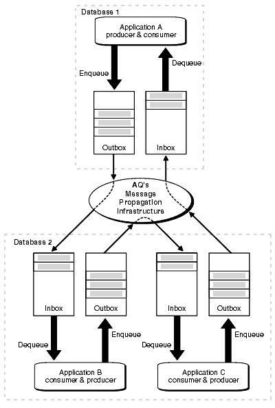
[Description of "Figure 1-9 Message Propagation in Oracle Database Advanced Queuing"](img_text/adque042.md)

#### Propagation Scheduling

A queue-to-dblink propagation schedule is defined for a pair of source and destination database links. A queue-to-queue propagation schedule is defined for a pair of source and destination queues. If a queue has messages to be propagated to several queues, then a schedule must be defined for each of the destination queues. With queue-to-dblink propagation, all schedules for a particular remote database have the same frequency. With queue-to-queue propagation, the frequency of each schedule can be adjusted independently of the others

A schedule indicates the time frame during which messages can be propagated from the source queue. This time frame can depend on several factors such as network traffic, load at the source database, and load at the destination database. If the duration is unspecified, then the time frame is an infinite single window. If a window must be repeated periodically, then a finite duration is specified along with a `NEXT_TIME` function that defines the periodic interval between successive windows.

When a schedule is created, a job is automatically submitted to the job queue facility to handle propagation.

The propagation schedules defined for a queue can be changed or dropped at any time during the life of the queue. You can also temporarily disable a schedule instead of dropping it. All administrative calls can be made irrespective of whether the schedule is active or not. If a schedule is active, then it takes a few seconds for the calls to be processed.

#### Propagation of Messages with LOBs

Large Objects can be propagated using Oracle Database Advanced Queuing using two methods:

- Propagation from `RAW` queues

  In `RAW` queues the message payload is stored as a BLOB. This allows users to store up to 32KB of data when using the PL/SQL interface and as much data as can be contiguously allocated by the client when using OCI. This method is supported by all releases after 8.0.4 inclusive.

- Propagation from object queues with LOB attributes

  The user can populate the `LOB` and read from the `LOB` using Oracle Database `LOB` handling routines. The `LOB` attributes can be `BLOB`s or `CLOB`s (not NCLOBs). If the attribute is a `CLOB`, then Oracle Database Advanced Queuing automatically performs any necessary character set conversion between the source queue and the destination queue. This method is supported by all releases from 8.1.3 inclusive.

  **Note:**

  Payloads containing LOBs require users to grant explicit `Select`, `Insert` and `Update` privileges on the queue table for doing enqueues and dequeues.

  **See Also:**

  [Oracle Database SecureFiles and Large Objects Developer's Guide](../adlob/index.md)

#### Propagation Statistics

Detailed runtime information about propagation is gathered and stored in the `DBA_QUEUE_SCHEDULES` view for each propagation schedule. This information can be used by queue designers and administrators to fix problems or tune performance. Similarly, errors reported by the view can be used to diagnose and fix problems. The view also describes additional information such as the session ID of the session handling the propagation and the process name of the job queue process handling the propagation.

For each schedule, detailed propagation statistics are maintained:

- Total number of messages propagated in a schedule

- Total number of bytes propagated in a schedule

- Maximum number of messages propagated in a window

- Maximum number of bytes propagated in a window

- Average number of messages propagated in a window

- Average size of propagated messages

- Average time to propagated a message

#### Propagation Error Handling

Propagation has built-in support for handling failures and reporting errors. For example, if the specified database link is invalid, if the remote database is unavailable, or if the remote queue is not enabled for enqueuing, then the appropriate error message is reported. Propagation uses a linear backoff scheme for retrying propagation from a schedule that encountered a failure.

If a schedule continuously encounters failures, then the first retry happens after 30 seconds, the second after 60 seconds, the third after 120 seconds and so forth. If the retry time is beyond the expiration time of the current window, then the next retry is attempted at the start time of the next window. A maximum of 16 retry attempts is made, after which the schedule is automatically disabled.

**Note:**

Once a retry attempt slips to the next propagation window, it will always do so; the exponential backoff scheme no longer governs retry scheduling. If the date function specified in the `next_time` parameter of `DBMS_AQADM.SCHEDULE_PROPAGATION` results in a short interval between windows, then the number of unsuccessful retry attempts can quickly reach 16, disabling the schedule.

When a schedule is disabled automatically due to failures, the relevant information is written into the alert log. A check for scheduling failures indicates:

- How many successive failures were encountered

- The error message indicating the cause for the failure

- The time at which the last failure was encountered

By examining this information, a queue administrator can fix the failure and enable the schedule. If propagation is successful during a retry, then the number of failures is reset to 0.

In some situations that indicate application errors in queue-to-dblink propagations, Oracle Database Advanced Queuing marks messages as `UNDELIVERABLE` and logs a message in `alert.log`. Examples of such errors are when the remote queue does not exist or when there is a type mismatch between the source queue and the remote queue. The trace files in the `background_dump_dest` directory can provide additional information about the error.

When a new job queue process starts, it clears the mismatched type errors so the types can be reverified. If you have capped the number of job queue processes and propagation remains busy, then you might not want to wait for the job queue process to terminate and restart. Queue types can be reverified at any time using `DBMS_AQADM.VERIFY_QUEUE_TYPES`.

**Note:**

When a type mismatch is detected in queue-to-queue propagation, propagation stops and throws an error. In such situations you must query the `DBA_SCHEDULES` view to determine the last error that occurred during propagation to a particular destination. The message is not marked as `UNDELIVERABLE`.

#### Propagation with Oracle Real Application Clusters

Propagation has support built-in for Oracle Real Application Clusters. It is transparent to the user and the queue administrator. The job that handles propagation is submitted to the same instance as the owner of the queue table where the queue resides.

If there is a failure at an instance and the queue table that stores the source queue is migrated to a different instance, then the propagation job is also migrated to the new instance. This minimizes pinging between instances and thus offers better performance.

The destination can be identified by a database link or by destination queue name. Specifying the destination database results in queue-to-dblink propagation. If you propagate messages to several queues in another database, then all queue-to-dblink propagations to that database have the same frequency. Specifying the destination queue name results in queue-to-queue propagation. If you propagate messages to several queues in another database, then queue-to-queue propagation enables you to adjust the frequency of each schedule independently of the others. You can even enable or disable individual propagations.

This new queue-to-queue propagation mode also supports transparent failover when propagating to a destination Oracle RAC system. With queue-to-queue propagation, you are no longer required to re-point a database link if the owner instance of the queue fails on Oracle RAC.

**See Also:**

"[Scheduling a Queue Propagation](aq-administrative-interface.md)" for more information on queue-to-queue propagation

Propagation has been designed to handle any number of concurrent schedules. The number of job queue processes is limited to a maximum of 1000, and some of these can be used to handle jobs unrelated to propagation. Hence, propagation has built-in support for multitasking and load balancing.

The propagation algorithms are designed such that multiple schedules can be handled by a single job queue process. The propagation load on a job queue process can be skewed based on the arrival rate of messages in the different source queues.

If one process is overburdened with several active schedules while another is less loaded with many passive schedules, then propagation automatically redistributes the schedules so they are loaded uniformly.

#### Third-Party Support

If the protocol number for a recipient is in the range 128 - 255, then the address of the recipient is not interpreted by Oracle Database Advanced Queuing and the message is not propagated by the Oracle Database Advanced Queuing system. Instead, a third-party propagator can dequeue the message by specifying a reserved consumer name in the dequeue operation. The reserved consumer names are of the form `AQ$_P``protocol_number`. For example, the consumer name `AQ$_P128` can be used to dequeue messages for recipients with protocol number 128. The list of recipients for a message with the specific protocol number is returned in the `recipient_list` message property on dequeue.

Another way for Oracle Database Advanced Queuing to propagate messages to and from third-party messaging systems is through Messaging Gateway. Messaging Gateway dequeues messages from an Oracle Database Advanced Queuing queue and guarantees delivery to supported third-party messaging systems. Messaging Gateway can also dequeue messages from these systems and enqueue them to an Oracle Database Advanced Queuing queue.

#### Propagation Using HTTP

In Oracle Database 10g you can set up Oracle Database Advanced Queuing propagation over HTTP and HTTPS (HTTP over SSL). HTTP propagation uses the Internet access infrastructure and requires that the Oracle Database Advanced Queuing servlet that connects to the destination database be deployed. The database link must be created with the connect string indicating the Web server address and port and indicating HTTP as the protocol. The source database must be created for running Java and XML. Otherwise, the setup for HTTP propagation is more or less the same as Oracle Net Services propagation.

### Message Format Transformation

Applications often use data in different formats. A transformation defines a mapping from one Oracle data type to another.

The [transformation](glossary.md) is represented by a SQL function that takes the source data type as input and returns an object of the target data type. Only one-to-one message transformations are supported.

To transform a message during enqueue, specify a mapping in the enqueue options. To transform a message during dequeue, specify a mapping either in the dequeue options or when you add a subscriber. A dequeue mapping overrides a subscriber mapping. To transform a message during propagation, specify a mapping when you add a subscriber.

You can create transformations by creating a single PL/SQL function or by creating an expression for each target type attribute. The PL/SQL function returns an object of the target type or the constructor of the target type. This representation is preferable for simple transformations or those not easily broken down into independent transformations for each attribute.

Creating a separate expression specified for each attribute of the target type simplifies transformation mapping creation and management for individual attributes of the destination type. It is useful when the destination type has many attributes.

As Figure 1-10 shows, queuing, routing, and transformation are essential building blocks to an integrated application architecture. The figure shows how data from the Out queue of a CRM application is routed and transformed in the integration hub and then propagated to the In queue of the Web application. The transformation engine maps the message from the format of the Out queue to the format of the In queue.

Figure 1-10 Transformations in Application Integration

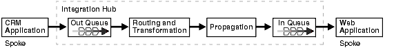
[Description of "Figure 1-10 Transformations in Application Integration"](img_text/adque448.md)

#### XML Data Transformation

You can transform XML data using the` extract()` method supported on `XMLType` to return an object of `XMLType` after applying the supplied `XPath` expression. You can also create a PL/SQL function that transforms the `XMLType` object by applying an XSLT transformation to it, using the package `XSLPROCESSOR`.

### Other Oracle Database Advanced Queuing Features

This topic describes the AQ features Queue Monitor Coordinator, Integration with Oracle Internet Directory, Integration with Oracle Enterprise Manager, Retention and Message History, Cleaning Up Message Queues, Tracking and Event Journals, Non-repudiation, and Internet Integration.

- Queue Monitor Coordinator

- Integration with Oracle Internet Directory

- Integration with Oracle Enterprise Manager

- Retention and Message History

- Cleaning Up Message Queues

- Tracking and Event Journals

- Non-repudiation

- Internet Integration

#### Queue Monitor Coordinator

Before 10g Release 1 (10.1), the Oracle Database Advanced Queuing time manager process was called queue monitor (`QMNn`), a background process controlled by setting the dynamic `init.ora` parameter `AQ_TM_PROCESSES`. Beginning with 10g Release 1 (10.1), time management and many other background processes are automatically controlled by a coordinator-slave architecture called Queue Monitor Coordinator (`QMNC`). `QMNC` dynamically spawns slaves named `qXXX depending` on the system load. The slaves provide mechanisms for:

- Message delay

- Message expiration

- Retry delay

- Garbage collection for the queue table

- Memory management tasks for buffered messages

Because the number of processes is determined automatically and tuned constantly, you are saved the trouble of setting it with `AQ_TM_PROCESSES`.

Although it is no longer necessary to set `init.ora` parameter `AQ_TM_PROCESSES`, it is still supported. If you do set it (up to a maximum of 40), then QMNC still autotunes the number of processes. But you are guaranteed at least the set number of processes for persistent queues. Processes for a [buffered queue](glossary.md) however, are not affected by this parameter.

**Note:**

If you want to disable the Queue Monitor Coordinator, then you must set `AQ_TM_PROCESSES = 0` in your `pfile` or `spfile`. Oracle strongly recommends that you do NOT set `AQ_TM_PROCESSES = 0`.

#### Integration with Oracle Internet Directory

Oracle Internet Directory is a native LDAPv3 directory service built on Oracle Database that centralizes a wide variety of information, including e-mail addresses, telephone numbers, passwords, security certificates, and configuration data for many types of networked devices. You can look up enterprise-wide queuing information—queues, subscriptions, and events—from one location, the Oracle Internet Directory. Refer to the [Oracle Fusion Middleware Administrator's Guide for Oracle Internet Directory ](https://www.oracle.com/pls/topic/lookup?ctx=en/database/oracle/oracle-database/19/adque&id=OIDAG002)for more information.

#### Integration with Oracle Enterprise Manager

You can use Oracle Enterprise Manager to:

- Create and manage queues, queue tables, propagation schedules, and transformations

- Monitor your Oracle Database Advanced Queuing environment using its topology at the database and queue levels, and by viewing queue errors and queue and session statistics

#### Retention and Message History

The systems administrator specifies the retention duration to retain messages after consumption. Oracle Database Advanced Queuing stores information about the history of each message, preserving the queue and message properties of delay, expiration, and retention for messages destined for local or remote receivers. The information contains the enqueue and dequeue times and the identification of the transaction that executed each request. This allows users to keep a history of relevant messages. The history can be used for tracking, data warehouse, data mining operations, and, also specific auditing functions.

Message retention is not supported for buffered messaging.

#### Cleaning Up Message Queues

The Oracle Database Advanced Queuing retention feature can be used to automatically clean up messages after the user-specified duration after consumption.

If messages are accidentally inserted into a queue for the wrong subscriber, you can dequeue them with the subscriber name or by message identifier. This consumes the messages, which are cleaned up after their retention time expires.

To clean up messages for a particular subscriber, you can remove the subscriber and add the subscriber again. Removing the subscriber removes all the messages for that subscriber.

#### Tracking and Event Journals

Retained messages can be related to each other to form sequences. These sequences represent event journals, which are often constructed by applications. Oracle Database Advanced Queuing is designed to let applications create event journals automatically.

#### Non-repudiation

Oracle Database Advanced Queuing maintains the entire history of information about a message along with the message itself. This information serves as proof of sending and receiving of messages and can be used for non-repudiation of the sender and non-repudiation of the receiver.

The following information is kept at enqueue for non-repudiation of the enqueuer:

- Oracle Database Advanced Queuing agent doing the enqueue

- Database user doing the enqueue

- Enqueue time

- Transaction ID of the transaction doing enqueue

The following information is kept at dequeue for non-repudiation of the dequeuer:

- Oracle Database Advanced Queuing agent doing dequeue

- Database user doing dequeue

- Dequeue time

- Transaction ID of the transaction doing dequeue

After propagation, the `ORIGINAL_MSGID` field in the destination queue of the propagation corresponds to the message ID of the source message. This field can be used to correlate the propagated messages. This is useful for non-repudiation of the dequeuer of propagated messages.

Stronger non-repudiation can be achieved by enqueuing the digital signature of the sender at the time of enqueue with the message and by storing the digital signature of the dequeuer at the time of dequeue.

#### Internet Integration

You can access Oracle Database Advanced Queuing over the Internet by using [Simple Object Access Protocol](glossary.md) (SOAP). [Internet Data Access Presentation](glossary.md) (IDAP) is the SOAP specification for Oracle Database Advanced Queuing operations. IDAP defines the XML message structure for the body of the SOAP request.

An IDAP message encapsulates the Oracle Database Advanced Queuing request and response in XML. IDAP is used to perform Oracle Database Advanced Queuing operations such as enqueue, dequeue, send notifications, register for notifications, and propagation over the Internet standard transports—HTTP(s) and e-mail. In addition, IDAP encapsulates transactions, security, transformation, and the character set ID for requests.

You can create an alias to an Oracle Database Advanced Queuing agent in Oracle Internet Directory and then use the alias in IDAP documents sent over the Internet to perform Oracle Database Advanced Queuing operations. Using aliases prevents exposing the internal name of the Oracle Database Advanced Queuing agent.

Figure 1-11 shows the architecture for performing Oracle Database Advanced Queuing operations over HTTP. The major components are:

- Oracle Database Advanced Queuing client program

- Web server/servlet runner hosting the Oracle Database Advanced Queuing [servlet](glossary.md)

- Oracle Database server

The Oracle Database Advanced Queuing client program sends XML messages (conforming to IDAP) to the Oracle Database Advanced Queuing servlet, which understands the XML message and performs Oracle Database Advanced Queuing operations. Any HTTP client, a Web browser for example, can be used. The Web server/servlet runner hosting the Oracle Database Advanced Queuing servlet, Apache/Jserv or Tomcat for example, interprets the incoming XML messages. The Oracle Database Advanced Queuing servlet connects to the Oracle Database server and performs operations on user queues.

**Note:**

This feature is certified to work with Apache, along with the Tomcat or Jserv servlet execution engines. However, the code does not prevent the servlet from working with other Web server and servlet execution engines that support Java Servlet 2.0 or higher interfaces.

Figure 1-11 Architecture for Performing Oracle Database Advanced Queuing Operations Using HTTP

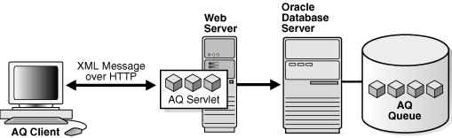
[Description of "Figure 1-11 Architecture for Performing Oracle Database Advanced Queuing Operations Using HTTP"](img_text/adque430.md)

### Interfaces to Oracle Database Advanced Queuing

You can access Oracle Database Advanced Queuing functionality through the interfaces listed in this topic.

- PL/SQL using `DBMS_AQ`, `DBMS_AQADM`, and `DBMS_AQELM`

- Java Message Service (JMS) using the `oracle.jms` Java package

- Internet access using HTTP(S)

  **Note:**

  The `oracle.AQ` Java package was deprecated in Oracle Database Advanced Queuing 10g Release 1 (10.1). Oracle recommends that you migrate existing Java AQ applications to Oracle JMS and use Oracle JMS to design your future Java AQ applications.

  **See Also:**

  - [Oracle Database PL/SQL Packages and Types Reference](../arpls/index.md)
