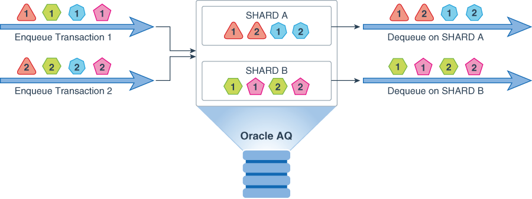
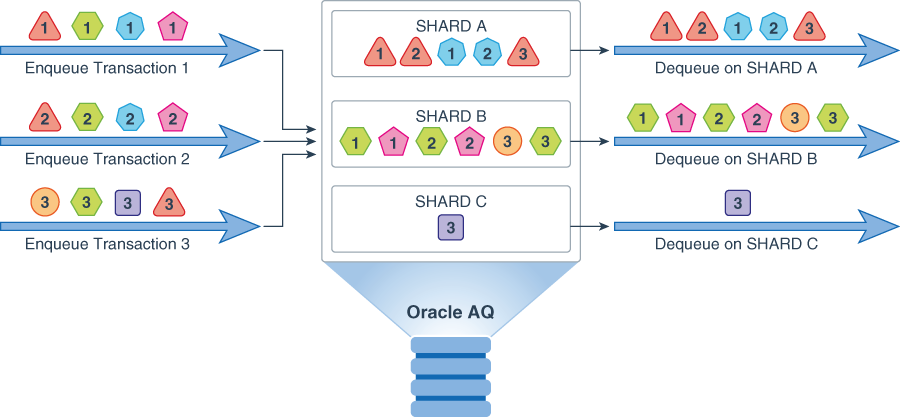

These topics discuss performance and scalability issues relating to Oracle Database Advanced Queuing (AQ).

- Sharded Queues

- Non-Sharded Queues

- Performance Views

### Sharded Queues

A [sharded queue](glossary.md) increases enqueue-dequeue throughput, especially across Oracle RAC instances, because messages from different enqueue sessions are allowed to be dequeued in parallel. Each shard of the queue is ordered based on enqueue time within a session and ordering across shards is best-effort. Sharded queues automatically manage table partitions so that enqueuers and dequeuers do not contend among themselves. In addition, sharded queues use an in-memory message cache to optimize performance and reduce the disk and CPU overhead of enqueues and dequeues.

The advantages and tradeoffs of sharded queues include the following:

- Sharded queues provide scalability of a single queue on Oracle Real Application Clusters (Oracle RAC), especially in the case where each subscriber has multiple dequeuers on each instance.

- Sharded queues trades off increased memory usage to obtain performance.

This section contains the following topics:

- Sharded Queues and the Message Cache

- Sharded Queues and Enqueuing / Dequeuing Messages

- Sharded Queues and Native JMS Support

- Sharded Queues and Partitioning

- Sharded Queues and Oracle Real Application Clusters (Oracle RAC)

- Sharded Queue Restrictions

- Sharded Queues Tuning

#### Sharded Queues and the Message Cache

Sharded queues introduce a special purpose message cache which lets you trade off SGA usage for increased throughput, reduced latency, and increased concurrency. When combined with partitioning, the message cache reduces the need for some queries, DML operations, and indexes. The message cache is most effective when all dequeuers keep up with enqueuers and when the message cache is big enough to store messages (including payloads) for each sharded queue's enqueuers and dequeuers. The message cache uses the Streams pool. If sharded queues share the Streams pool on the same instance as Streams replication functionality, you can use `DBMS_AQADM` procedures such as `SET_MIN_STREAMS_POOL` and `SET_MAX_STREAMS_POOL` to fine tune the allocation of Streams Pool memory.

**See Also:**

[Oracle Database PL/SQL Packages and Types Reference](../arpls/DBMS_AQADM.md) for information

#### Sharded Queues and Enqueuing / Dequeuing Messages

To improve throughput and reduce overhead and latency, enqueues and dequeues are optimized to use the message cache, the rules engine, and background processing when possible. For example,

- sharded queues take advantage of new rules engine improvements

- a message that has its payload in the message cache does not have to be re-read from disk during a dequeue

- dequeue by correlation id or other JMS properties can often be evaluated without accessing the disk

- partition operations on sharded queues implements efficient bulk processing.

#### Sharded Queues and Native JMS Support

Sharded queues have native support for:

- Non-Durable Subscribers

- JMS payloads

- Priorities

Sharded queues support both persistent and nonpersistent messages. Nonpersistent messages are stored in memory inside the message cache and are not stored on disk. As a result, nonpersistent messages are lost upon instance crash or shutdown.

Sharded queues natively support two kinds of subscribers to meet the JMS requirements:

- Non-durable subscribers: These subscribers receive messages on their chosen topic, only if the messages are published while the subscriber is active. This subscription is not sharable among different sessions.

- Durable subscribers: These subscribers receive all the messages published on a topic, including those that are published while the subscriber is inactive. Multiple database sessions can share the same subscription.

Sharded queues do not use ADTs to store the JMS payload. The JMS message is stored in scalar columns of the database. JMS message types such as `TEXT`, `BYTES`, `MAP`, `STREAM` and `OBJECT` store the JMS payload in scalar `TEXT`/`RAW` or `CLOB/BLOB` columns in the queue table depending on payload size and type. The JMS message properties are stored in a `CLOB` (SecureFile) column in the queue table with attribute access functions defined for the user defined properties. The payload and user properties are pickled into `RAW`, `VARCHAR2` or Secure File columns instead of being stored as an ADT. JMS Header properties and JMS provider information are stored in their own scalar columns.

Sharded queues support integer priority values ranging between 0 (lowest priority) and 9 (highest priority), with the default being priority 4, as defined by the JMS standard.

#### Sharded Queues and Partitioning

Sharded queues automatically manage the underlying partitioned tables used for the queue table. Such partition management may occur in the foreground or the background. Each shard provides session-level ordering of enqueued messages. Each enqueuing session is assigned a shard. Each shard is composed of a series of subshards. Each subshard maps to a single partition. Messages are automatically assigned to a table partition upon enqueue.

New partitions are automatically created as needed, as when the queue table needs to grow when dequeuers do not keep up with enqueuers. Partitions are truncated and reused when all messages in the partition are dequeued and no longer needed. The message cache automatically loads messages from partitions into memory as required by dequeuers. Global indexes should not be created on the partitioned table underlying a sharded queue. Local indexes are not typically recommended on the partitioned table either. If such indexes are desired and result in performance degradation, then non-sharded queues should be considered.

#### Sharded Queues and Oracle Real Application Clusters (Oracle RAC)

Sharded queues automatically provides enqueue session ordering while avoiding cross-instance communication when possible. Sometimes cross instance communication is required. For example, if a sharded queue has a single enqueuing session on one Oracle RAC instance and a single dequeuing session on another instance, then sharded queues will forward messages between the Oracle RAC instances. The forwarding of messages is non-atomic to the enqueuing transaction to improve performance. Dequeuers may get an ORA-25228 if they are connected to an instance that has no messages in its shards.

In most cases, consider having multiple dequeuers for each subscriber or single consumer queue on each Oracle RAC instance to improve throughput and reduce cross-instance overhead. An exception to this guideline is when you are using dequeue selectors that specify a single message. If you want to dequeue a message from a sharded queue by its message identifier in an Oracle RAC database, then you have to connect to the instance that is assigned dequeue ownership for the shard containing the message. Otherwise, the message will not be available for dequeue to the dequeue session. If all dequeues are performed at a single instance, then messages will be automatically forwarded to this instance. Hence, for a sharded single-consumer queue that extensively dequeues by message ID, consider having all dequeue sessions for the sharded queue connect to a single instance. Similarly, for a sharded multiconsumer queue that extensively dequeues by message ID, consider having all dequeue sessions for each subscriber connect to a single instance. Services can be used to simplify connecting dequeue sessions to a particular instance.

#### Sharded Queue Restrictions

The following Oracle Database features are not currently supported for sharded queues:

- Message retention

- Transaction grouping

- Anonymous posting for subscriber notification and OCI callback notification are not supported. PL/SQL callback notification is supported.

- Messaging Gateway

- Oracle extensions for JMS such as JMS propagation and remote subscribers

- Multiple queues per queue table. Sharded queues are created via the `CREATE_SHARDED_QUEUE` interface.

- Ordering other than message priority followed by enqueue time (as specified in the JMS standard)

- The JDBC thick (OCI) driver.

- Propagation between sharded and non-sharded queues

- Message transformations

#### Sharded Queues Tuning

Sharded queues perform best under the following conditions:

- Dequeuers for each subscriber are located on each instance

- Subscribers keep up with the enqueuers. Consider having multiple dequeuers for each subscriber on each Oracle RAC instance

The message cache is most effective when dequeuers keep up with enqueuers and where the cache is big enough to store messages (including payloads) for each sharded queue's enqueuers and dequeuers. When using sharded queues, Oracle requires that you do one of the following:

- Setting parameter `STREAMS_POOL_SIZE`

  This parameter controls the size of shared memory available to the Oracle Database for the sharded queue message cache. If unspecified, up to 10% of the shared pool size may be allocated for the Streams pool.

  Oracle's Automatic Shared Memory Management feature manages the size of the Streams pool when the `SGA_TARGET` initialization parameter is set to a nonzero value. If the `STREAMS_POOL_SIZE` initialization parameter also is set to a nonzero value, then Automatic Shared Memory Management uses this value as a minimum for the Streams pool.

  If the `STREAMS_POOL_SIZE` initialization parameter is set to a nonzero value, and the `SGA_TARGET` parameter is set to `0` (zero), then the Streams pool size is the value specified by the `STREAMS_POOL_SIZE` parameter, in bytes.

  If both the `STREAMS_POOL_SIZE` and the `SGA_TARGET` initialization parameters are set to `0` (zero), then, by default, the first use of the Streams pool in a database transfers an amount of memory equal to 10% of the shared pool from the buffer cache to the Streams pool.

  **See Also:**

  - `DBMS_AQADM.set_min_streams_pool()` and `DBMS_AQADM.set_max_streams_pool( ) `in [Oracle Database PL/SQL Packages and Types Reference](../arpls/DBMS_AQADM.md) for a finer grained control over `STREAMS_POOL` sharing with Streams processing.

- Turning on SGA autotuning

  Oracle will automatically allocate the appropriate amount of memory from the SGA for the Streams pool, based on Streams pool usage as well as usage of other components that use the SGA. Examples of such other components are buffer cache and library cache. If `STREAMS_POOL_SIZE` is specified, it is used as the lower bound.

- Manually tuning sharded queues

  Sharded queues can be tuned by allocating `STREAMS_POOL` memory for the message cache. The view `GV$AQ_MESSAGE_CACHE_ADVICE` provides advice on how much `STREAMS_POOL` should be allocated for sharded queues based on a snapshot of the current messaging load. During periods of high load, select the columns `INST_ID`, `SIZE_FOR_ESTIMATE`, and `ESTD_SIZE_TYPE`. `ESTD_SIZE_TYPE` is one of three values: `MINIMUM`, `PREFERRED`, or `MAXIMUM`. Find the maximum value of `SIZE_FOR_ESTIMATE` across Oracle RAC instances for each of the `ESTD_SIZE_TYPE` values. It is highly recommended that `STREAMS_POOL` be set at least to the `MINIMUM` recommendation to provide any message cache performance gains. There is little additional performance gains to setting `STREAMS_POOL` greater than the `MAXIMUM` recommendation value. Setting `STREAMS_POOL` to the `PREFERRED` recommendation tries to provide a reasonable space-performance tradeoff. If the `MAXIMUM` size recommendation is much greater than the `PREFERRED` recommendation, then check that the sharded queue has no orphaned subscribers, or whether more dequeuers should be added to the instance, so that dequeuers can keep up with the enqueue load. `STREAMS_POOL` tuning should be done over multiple periods of high load and whenever messaging load characteristics change.

#### User Sharding

An application can decide the way messages are sharded in the sharded queue. In such cases, the application explicitly specifies to enqueue a message in a specific shard.

For example, assume the application has four types of messages with different keys named red, green, blue, and pink. Each enqueue session can enqueue any of those messages in a transaction. Shard A is set to store the red and blue messages. Shard B is set to store the green and pink messages. Also, each shard is set to have only one active dequeue session for a single-consumer queue or JMS Queue. Similarly, each shard is set to have only one dequeue session per subscriber for a multi-consumer queue or JMS Topic. That dequeue session will stick to that shard for the dequeuer session’s lifetime.

In the following examples, enqueue transactions are performing enqueues in parallel.

[Description of the illustration adque_usershard1.eps](img_text/adque_usershard1.md)

Applications can add new shards at run time. Applications can also add new types of messages at run time by adding new keys. For example, two new types are introduced with keys orange and purple, and a third shard C is added. Shard B is set to store the orange messages. Shard C is set to store the purple messages.

[Description of the illustration adque_usershard2.eps](img_text/adque_usershard2.md)

In an Oracle RAC database, a shard is always owned by an instance. Initially, the shard is owned by the instance where the first message is enqueued in that shard. The owner instance of the shard may change when database instances are shut down.

With user sharding, a user can attempt to enqueue messages in a shard which is not owned by the instance in which the session is running. In such cases, a cross instance enqueue is triggered. To support cross instance enqueues, the enqueue requests received at other instances are forwarded to the `OWNER INSTANCE` of the shard over the RAC interconnect. The `REMOTE_LISTENER` parameter in listener.ora must also be set to enable forwarding of cross instance enqueue requests to the correct instance. Internally, sharded queues on an Oracle RAC database may use database links between instances. Definer's rights PL/SQL packages that perform cross instance enqueues in sharded queues on an Oracle RAC database must grant `INHERIT REMOTE PRIVILEGES` to users of the package.

##### Limitations of User Sharding

User sharding has the following limitations:

- Cross instance enqueues are not enabled for PL/SQL enqueue calls.

- Cross instance enqueues are not enabled for array enqueues.

Cross instance enqueues can be done through Java and OCI clients.

**See Also:**

[DBMS_AQADM](../arpls/DBMS_AQADM.md) in Oracle Database PL/SQL Packages and Types Reference for more information.

### Non-Sharded Queues

This section includes the following topics:

- Persistent Messaging Performance Overview for Non-Sharded Queues

- Persistent Messaging Basic Tuning Tips

- Propagation Tuning Tips

- Buffered Messaging Tuning

#### Persistent Messaging Basic Tuning Tips

Oracle Database Advanced Queuing table layout is similar to a layout with ordinary database tables and indexes.

**See Also:**

[Oracle Database Performance Tuning Guide ](../tgdba/performance-tuning-overview.md)for tuning recommendations

##### Memory Requirements

Streams pool size should be at least 20 MB for optimal multi-consumer dequeue performance in a non-Oracle RAC database.

Persistent queuing dequeue operations use the streams pool to optimize performance, especially under concurrency situations. This is, however, not a requirement and the code automatically switches to a less optimal code path.

Sharded queues introduces a message cache for optimal performance of high throughput messaging systems. Ideally the Streams pool size should be large enough to cache the expected backlog of messages in sharded queues.

##### Using Storage Parameters

Storage parameters can be specified when creating a queue table using the `storage_clause` parameter.

Storage parameters are inherited by other IOTs and tables created with the queue table. The tablespace of the queue table should have sufficient space to accommodate data from all the objects associated with the queue table. With retention specified, the history table and, also the queue table can grow to be quite big.

Oracle recommends you use automatic segment-space management (ASSM). Otherwise `initrans`, freelists and freelist groups must be tuned for AQ performance under high concurrency.

Increasing `PCTFREE` will reduce the number of messages in a queue table/IOT block. This will reduce block level contention when there is concurrency.

Storage parameters specified at queue table creation are shared by the queue table, IOTs and indexes. These may be individually altered by an online redefinition using `DBMS_REDEFINITION`.

##### I/O Configuration

Because Oracle Database Advanced Queuing is very I/O intensive, you will usually need to tune I/O to remove any bottlenecks.

**See Also:**

"I/O Configuration and Design" in [Oracle Database Performance Tuning Guide](../tgdba/IO-configuration-and-design.md)

##### Running Enqueue and Dequeue Processes Concurrently in a Single Non-Sharded Queue Table

Some environments must process messages in a constant flow, requiring that enqueue and dequeue processes run concurrently. If the message delivery system has only one queue table and one queue, then all processes must work on the same segment area at the same time. This precludes reasonable performance levels when delivering a high number of messages.

The best number for concurrent processes depends on available system resources. For example, on a four-CPU system, it is reasonable to start with two concurrent enqueue and two concurrent dequeue processes. If the system cannot deliver the wanted number of [message](glossary.md)s, then use several subscribers for load balancing rather than increasing the number of processes.

Tune the enqueue and dequeue rates on the queue so that in the common case the queue size remains small and bounded. A queue that grows and shrinks considerably will have indexes and IOTs that are out of balance, which will affect performance.

With multi-consumer queues, using several subscribers for load balancing rather than increasing the number of processes will reduce contention. Multiple queue tables may be used garnering horizontal scalability.

For information about tuning sharded queues refer to Sharded Queues Tuning.

##### Running Enqueue and Dequeue Processes Serially in a Single Non-Sharded Queue Table

When enqueue and dequeue processes are running serially, contention on the same data segment is lower than in the case of concurrent processes. The total time taken to deliver messages by the system, however, is longer than when they run concurrently.

Increasing the number of processes helps both enqueuing and dequeuing. The message throughput rate may be higher for enqueuers than for dequeuers when the number of processes is increased, especially with single consumer queues. Dequeue processes on multi-consumer queues scale much better.

##### Creating Indexes on a Queue Table

Creating an index on a non-sharded queue table is useful if you meet these conditions.

- Dequeue using correlation ID

  An index created on the column `corr_id` of the underlying queue table `AQ$_``QueueTableName` expedites dequeues.

- Dequeue using a condition

  This is like adding the condition to the where-clause for the `SELECT` on the underlying queue table. An index on `QueueTableName` expedites performance on this `SELECT` statement.

##### Other Tips for Non-Sharded Queues

These are some other persistent messaging basic tuning tips.

- Ensure that statistics are being gathered so that the optimal query plans for retrieving messages are being chosen. By default, queue tables are locked out from automatic gathering of statistics. The recommended use is to gather statistics with a representative queue message load and lock them.

- The queue table indexes and IOTs are automatically coalesced by AQ background processes. However, they must continue to be monitored and coalesced if needed. With automatic space segment management (ASSM), an online shrink operation may be used for the same purpose. A well balanced index reduces queue monitor CPU consumption, and ensures optimal enqueue-dequeue performance.

- Ensure that there are enough queue monitor processes running to perform the background tasks. The queue monitor must also be running for other crucial background activity. Multiple `qmn` processes share the load; make sure that there are enough of them. These are auto-tuned, but can be forced to a minimum number, if needed.

- It is recommended that dequeue with a wait time is only used with dedicated server processes. In a shared server environment, the shared server process is dedicated to the dequeue operation for the duration of the call, including the wait time. The presence of many such processes can cause severe performance and scalability problems and can result in deadlocking the shared server processes.

- Long running dequeue transactions worsen dequeue contention on the queue, and must be avoided.

- Batching multiple dequeue operations on multi-consumer queues into a single transaction gives best throughput.

- Use `NEXT` as navigation mode, if not using message priorities. This offers the same semantics but improved performance.

- Use the `REMOVE_NODATA` dequeue mode if dequeuing in `BROWSE` mode followed by a `REMOVE`.

#### Propagation Tuning Tips

Propagation can be considered a special kind of dequeue operation with an additional `INSERT` at the remote (or local) queue table. Propagation from a single schedule is not parallelized across multiple job queue processes. Rather, they are load balanced.Propagation can be considered a special kind of dequeue operation with an additional `INSERT` at the remote (or local) queue table. Propagation from a single schedule is not parallelized across multiple job queue processes. Rather, they are load balanced.

For better scalability, configure the number of [propagation](glossary.md) schedules according to the available system resources (CPUs).

Propagation rates from [transactional](glossary.md) and [nontransactional](glossary.md) (default) queue tables vary to some extent because Oracle Database Advanced Queuing determines the batching size for nontransactional queues, whereas for transactional queues, batch size is mainly determined by the user application.

Optimized propagation happens in batches. If the remote queue is in a different database, then Oracle Database Advanced Queuing uses a sequencing algorithm to avoid the need for a two-phase commit. When a message must be sent to multiple queues in the same destination, it is sent multiple times. If the message must be sent to multiple consumers in the same queue at the destination, then it is sent only once.

#### Buffered Messaging Tuning

Buffered messaging operations in a Oracle Real Application Clusters environment will be fastest on the `OWNER_INSTANCE` of the queue.

##### Persistent Messaging Performance Overview for Non-Sharded Queues

When persistent messages are enqueued, they are stored in database tables. The performance characteristics of queue operations on persistent messages are similar to underlying database operations.

The code path of an [enqueue](glossary.md) operation is comparable to `SELECT` and `INSERT` into a multicolumn [queue table](glossary.md) with three index-organized tables. The code path of a [dequeue](glossary.md) operation is comparable to a `SELECT` operation on the multi-column table and a `DELETE` operation on the dequeue index-organized table. In many scenarios, for example when Oracle RAC is not used and there is adequate streams pool memory, the dequeue operation is optimized and is comparable to a `SELECT` operation on a multi-column table.

**Note:**

Performance is not affected by the number of [queue](glossary.md)s in a table.

##### Non-Sharded Queues and Oracle Real Application Clusters

Oracle Real Application Clusters (Oracle RAC) can be used to ensure highly available access to queue data.

The entry and exit points of a queue, commonly called its tail and head respectively, can be extreme hot spots. Because Oracle RAC may not scale well in the presence of hot spots, limit usual access to a queue from one instance only. If an instance failure occurs, then messages managed by the failed instance can be processed immediately by one of the surviving instances. If non-sharded queues are experiencing hot spots, then consider using sharded queues instead.

You can associate Oracle RAC instance affinities with 8.1-compatible queue tables. If you are using `q1` and `q2` in different instances, then you can use `ALTER_QUEUE_TABLE` or `CREATE_QUEUE_TABLE` on the queue table and set `primary_instance` to the appropriate `instance_id.`

**See Also:**

- [Creating a Queue Table](aq-administrative-interface.md)

- [Altering a Queue Table](aq-administrative-interface.md)

- Sharded Queues and Oracle Real Application Clusters (Oracle RAC)

##### Oracle Database Advanced Queuing in a Shared Server Environment

Queue operation scalability is similar to the underlying database operation scalability.

If a dequeue operation with wait option is applied, then it does not return until it is successful or the wait period has expired. In a shared server environment, the shared server process is dedicated to the dequeue operation for the duration of the call, including the wait time. The presence of many such processes can cause severe performance and scalability problems and can result in deadlocking the shared server processes. For this reason, Oracle recommends that dequeue requests with wait option be applied using dedicated server processes. This restriction is not enforced.

**See Also:**

"DEQUEUE_OPTIONS_T Type" in [Oracle Database PL/SQL Packages and Types Reference](../arpls/advanced-queuing-AQ-types.md) for more information on the wait option

### Performance Views

Oracle provides these views to monitor system performance and troubleshooting.

- [V\$AQ_MESSAGE_CACHE_STAT: Memory Management for Sharded Queues](aq-messaging-gateway-views.md)

- [V\$AQ_SHARDED_SUBSCRIBER_STAT: Sharded Queue Subscriber Statistics](aq-messaging-gateway-views.md)

- [V\$AQ_MESSAGE_CACHE_ADVICE: Simulated Metrics](aq-messaging-gateway-views.md)

- [V\$AQ_REMOTE_DEQUEUE_AFFINITY: Dequeue Affinity Instance List](aq-messaging-gateway-views.md)

- [V\$PERSISTENT_QUEUES: All Active Persistent Queues in the Instance](aq-messaging-gateway-views.md)

- [V\$PERSISTENT_SUBSCRIBERS: All Active Subscribers of the Persistent Queues in the Instance](aq-messaging-gateway-views.md)

- [V\$PERSISTENT_PUBLISHERS: All Active Publishers of the Persistent Queues in the Instance](aq-messaging-gateway-views.md)

- [V\$BUFFERED_QUEUES: All Buffered Queues in the Instance.](aq-messaging-gateway-views.md)

- [V\$BUFFERED_SUBSCRIBERS: Subscribers for All Buffered Queues in the Instance](aq-messaging-gateway-views.md)

- [V\$BUFFERED_PUBLISHERS: All Buffered Publishers in the Instance](aq-messaging-gateway-views.md)

- [V\$PERSISTENT_QMN_CACHE: Performance Statistics on Background Tasks for Persistent Queues](aq-messaging-gateway-views.md)

- [V\$AQ: Number of Messages in Different States in Database](aq-messaging-gateway-views.md)

- [V\$AQ_BACKGROUND_COORDINATOR: Performance Statistics for AQ's Master Background Coordinator Process (AQPC)](aq-messaging-gateway-views.md)

- [V\$AQ_JOB_COORDINATOR: Performance Statistics per Coordinator](aq-messaging-gateway-views.md)

- [V\$AQ_NONDUR_REGISTRATIONS: Non-Durable Registrations](aq-messaging-gateway-views.md)

- [V\$AQ_SERVER_POOL: Performance Statistics for all Servers](aq-messaging-gateway-views.md)

- [V\$AQ_CROSS_INSTANCE_JOBS: Cross Process Jobs Description](aq-messaging-gateway-views.md)

- [V\$AQ_NONDUR_REGISTRATIONS: Non-Durable Registrations](aq-messaging-gateway-views.md)

- [V\$AQ_NOTIFICATION_CLIENTS: Secure OCI Client Connections](aq-messaging-gateway-views.md)

- [V\$AQ_SUBSCRIBER_LOAD: Durable Subscribers](aq-messaging-gateway-views.md)

- [V\$AQ_NONDUR_SUBSCRIBER: Non-Durable Subscribers](aq-messaging-gateway-views.md)

- [V\$AQ_NONDUR_SUBSCRIBER_LWM: LWM of Non Durable Subscriber](aq-messaging-gateway-views.md)

- [V\$AQ_MESSAGE_CACHE: Performance Statistics](aq-messaging-gateway-views.md)

These views are integrated with the Automatic Workload Repository (AWR). Users can generate a report based on two AWR snapshots to compute enqueue rate, dequeue rate, and other statistics per queue/subscriber.
