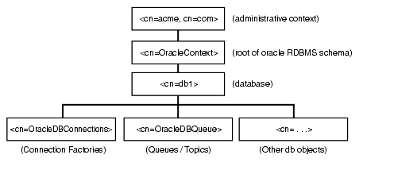

The following topics describe the Oracle [Java Message Service](glossary.md) (JMS) interface to Oracle Database Advanced Queuing (AQ).

- General Features of JMS and Oracle JMS

- Structured Payload/Message Types in JMS

- Buffered Messaging in JMS

- JMS Point-to-Point Model Features

- JMS Publish/Subscribe Model Features

- JMS Message Producer Features

- JMS Message Consumer Features

- JMS Propagation

- Message Transformation with JMS AQ

- JMS Streaming

- Java EE Compliance

### General Features of JMS and Oracle JMS

This section contains these topics:

- JMS Connection and Session

- JMS Destination

- System-Level Access Control in JMS

- Destination-Level Access Control in JMS

- Retention and Message History in JMS

- Supporting Oracle Real Application Clusters in JMS

- Supporting Statistics Views in JMS

#### JMS Connection and Session

This section contains these topics:

- ConnectionFactory Objects

- Using AQjmsFactory to Obtain ConnectionFactory Objects

- Using JNDI to Look Up ConnectionFactory Objects

- JMS Connection

- JMS Session

##### ConnectionFactory Objects

A `ConnectionFactory` encapsulates a set of connection configuration parameters that has been defined by an administrator. A client uses it to create a connection with a JMS provider. In this case Oracle JMS, part of Oracle Database, is the JMS provider.

The three types of `ConnectionFactory` objects are:

- `ConnectionFactory`

- `QueueConnectionFactory`

- `TopicConnectionFactory`

##### Using AQjmsFactory to Obtain ConnectionFactory Objects

You can use the `AQjmsFactory` class to obtain a handle to a `ConnectionFactory`, `QueueConnectionFactory`, or `TopicConnectionFactory` object.

To obtain a `ConnectionFactory`, which supports both point-to-point and publish/subscribe operations, use `AQjmsFactory.getConnectionFactory()`. To obtain a `QueueConnectionFactory`, use `AQjmsFactory.getQueueConnectionFactory()`. To obtain a `TopicConnectionFactory`, use `AQjmsFactory.getTopicConnectionFactory()`.

The `ConnectionFactory`, `QueueConnectionFactory`, or `TopicConnectionFactory` can be created using hostname, port number, and SID driver or by using JDBC URL and properties.

##### Using JNDI to Look Up ConnectionFactory Objects

A JMS administrator can register `ConnectionFactory` objects in a [Lightweight Directory Access Protocol](glossary.md) (LDAP) server. The following setup is required to enable [Java Naming and Directory Interface](glossary.md) (JNDI) lookup in JMS:

1.  Register Database
    When the Oracle Database server is installed, the database must be registered with the LDAP server. This can be accomplished using the [Database Configuration Assistant](glossary.md) (DBCA). Figure 11-1 shows the structure of Oracle Database Advanced Queuing entries in the LDAP server. `ConnectionFactory` information is stored under `<cn=OracleDBConnections>`, while topics and queues are stored under `<cn=OracleDBQueues>`.

    Figure 11-1 Structure of Oracle Database Advanced Queuing Entries in LDAP Server

    
    [Description of "Figure 11-1 Structure of Oracle Database Advanced Queuing Entries in LDAP Server"](img_text/adque446.md)
2.  Set Parameter `GLOBAL_TOPIC_ENABLED`.
    The `GLOBAL_TOPIC_ENABLED` system parameter for the database must be set to `TRUE`. This ensures that all queues and topics created in Oracle Database Advanced Queuing are automatically registered with the LDAP server. This parameter can be set by using `ALTER SYSTEM SET GLOBAL_TOPIC_ENABLED = TRUE`.
3.  Register `ConnectionFactory` Objects
    After the database has been set up to use an LDAP server, the JMS administrator can register `ConnectionFactory`, `QueueConnectionFactory`, and `TopicConnectionFactory` objects in LDAP by using `AQjmsFactory.registerConnectionFactory()`.

    The registration can be accomplished in one of the following ways:

    - Connect directly to the LDAP server

      The user must have the `GLOBAL_AQ_USER_ROLE` to register connection factories in LDAP.

      To connect directly to LDAP, the parameters for the `registerConnectionFactory` method include the LDAP context, the name of the `ConnectionFactory`, `QueueConnectionFactory`, or `TopicConnectionFactory`, hostname, database SID, port number, [JDBC driver](glossary.md) (thin or oci8) and factory type (queue or topic).

    - Connect to LDAP through the database server

      The user can log on to Oracle Database first and then have the database update the LDAP entry. The user that logs on to the database must have the `AQ_ADMINISTRATOR_ROLE` to perform this operation.

      To connect to LDAP through the database server, the parameters for the `registerConnectionFactory` method include a JDBC connection (to a user having `AQ_ADMINISTRATOR_ROLE`), the name of the `ConnectionFactory`, `QueueConnectionFactory`, or `TopicConnectionFactory`, hostname, database SID, port number, JDBC driver (thin or oci8) and factory type (queue or topic).

##### JMS Connection

A JMS `Connection` is an active connection between a client and its JMS provider. A JMS `Connection` performs several critical services:

- Encapsulates either an open connection or a pool of connections with a JMS provider

- Typically represents an open TCP/IP socket (or a set of open sockets) between a client and a provider's service daemon

- Provides a structure for authenticating clients at the time of its creation

- Creates `Sessions`

- Provides connection metadata

- Supports an optional `ExceptionListener`

A JMS `Connection` to the database can be created by invoking `createConnection()`, `createQueueConnection()`, or `createTopicConnection()` and passing the parameters `username` and `password` on the `ConnectionFactory`, `QueueConnectionFactory`, or `TopicConnectionFactory` object respectively.

Some of the methods that are supported on the `Connection` object are

- `start()`

  This method starts or restart delivery of incoming messages.

- `stop()`

  This method temporarily stops delivery of incoming messages. When a `Connection` object is stopped, delivery to all of its message consumers is inhibited. Also, [synchronous](glossary.md) receive's block and messages are not delivered to message listener.

- `close()`

  This method closes the [JMS session](glossary.md) and releases all associated resources.

- `createSession(true, 0)`

  This method creates a JMS `Session` using a JMS `Connection` instance.

- `createQueueSession(true,` `0)`

  This method creates a `QueueSession`.

- `createTopicSession(true,` `0`)

  This method creates a `TopicSession`.

- `setExceptionListener(ExceptionListener)`

  This method sets an exception listener for the `Connection`. This allows a client to be notified of a problem asynchronously. If a `Connection` only consumes messages, then it has no other way to learn it has failed.

- `getExceptionListener()`

  This method gets the `ExceptionListener` for this `Connection`.

A JMS client typically creates a `Connection`, a `Session` and several `MessageProducer` and `MessageConsumer` objects. In the current version only one open `Session` for each `Connection` is allowed, except in the following cases:

- If the JDBC oci8 driver is used to create the [JMS connection](glossary.md)

- If the user provides an `OracleOCIConnectionPool` instance during JMS connection creation

When a `Connection` is created it is in stopped mode. In this state no messages can be delivered to it. It is typical to leave the `Connection` in stopped mode until setup is complete. At that point the `Connection` `start()` method is called and messages begin arriving at the `Connection` consumers. This setup convention minimizes any client confusion that can result from [asynchronous](glossary.md) message delivery while the client is still in the process of setup.

It is possible to start a `Connection` and to perform setup subsequently. Clients that do this must be prepared to handle asynchronous message delivery while they are still in the process of setting up. A `MessageProducer` can [send](glossary.md) messages while a `Connection` is stopped.

##### JMS Session

A JMS `Session` is a single threaded context for producing and consuming messages. Although it can allocate provider resources outside the [Java Virtual Machine](glossary.md) (JVM), it is considered a lightweight JMS object.

A `Session` serves several purposes:

- Constitutes a factory for `MessageProducer` and `MessageConsumer` objects

- Provides a way to get a handle to destination objects (queues/topics)

- Supplies provider-optimized message factories

- Supports a single series of transactions that combines work spanning session `MessageProducer` and `MessageConsumer` objects, organizing these into units

- Defines a serial order for the messages it consumes and the messages it produces

- Serializes execution of `MessageListener` objects registered with it

In Oracle Database 10g, you can create as many JMS `Sessions` as resources allow using a single JMS `Connection`, when using either JDBC thin or JDBC thick (OCI) drivers.

Because a provider can allocate some resources on behalf of a `Session` outside the JVM, clients should close them when they are not needed. Relying on garbage collection to eventually reclaim these resources may not be timely enough. The same is true for `MessageProducer` and `MessageConsumer` objects created by a `Session`.

Methods on the `Session` object include:

- `commit()`

  This method commits all messages performed in the transaction and releases locks currently held.

- `rollback()`

  This method rolls back any messages accomplished in the transaction and release locks currently held.

- `close()`

  This method closes the `Session`.

- `getDBConnection()`

  This method gets a handle to the underlying JDBC connection. This handle can be used to perform other SQL [DML](glossary.md) operations as part of the same `Session`. The method is specific to Oracle JMS.

- `acknowledge()`

  This method acknowledges message receipt in a nontransactional session.

- `recover()`

  This method restarts message delivery in a nontransactional session. In effect, the series of delivered messages in the session is reset to the point after the last acknowledged message.

The following are some Oracle JMS extensions:

- `createQueueTable()`

  This method creates a [queue table](glossary.md).

- `getQueueTable()`

  This method gets a handle to an existing queue table.

- `createQueue()`

  This method creates a queue.

- `getQueue()`

  This method gets a handle to an existing queue.

- `createTopic()`

  This method creates a topic.

- `getTopic()`

  This method gets a handle to an existing topic.

The `Session` object must be cast to `AQjmsSession` to use any of the extensions.

**Note:**

The JMS specification expects providers to return null messages when receives are accomplished on a JMS `Connection` instance that has not been started.

After you create a `javax.jms.Connection` instance, you must call the `start()` method on it before you can receive messages. If you add a line like `t_conn.start();` any time after the connection has been created, but before the actual receive, then you can receive your messages.

#### JMS Destination

A `Destination` is an object a client uses to specify the destination where it sends messages, and the source from which it receives messages. A `Destination` object can be a `Queue` or a `Topic`. In Oracle Database Advanced Queuing, these map to a `schema.queue` at a specific database. `Queue` maps to a single-consumer queue, and `Topic` maps to a multiconsumer queue.

##### Using a JMS Session to Obtain Destination Objects

`Destination` objects are created from a `Session` object using the following domain-specific `Session` methods:

- `AQjmsSession.getQueue(queue_owner, queue_name)`

  This method gets a handle to a JMS queue.

- `AQjmsSession.getTopic(topic_owner, topic_name)`

  This method gets a handle to a [JMS topic](glossary.md).

##### Using JNDI to Look Up Destination Objects

The database can be configured to register [schema](glossary.md) objects with an LDAP server. If a database has been configured to use LDAP and the GLOBAL_TOPIC_ENABLED parameter has been set to TRUE, then all JMS queues and topics are automatically registered with the LDAP server when they are created. The administrator can also create aliases to the queues and topics registered in LDAP. Queues and topics that are registered in LDAP can be looked up through JNDI using the name or alias of the queue or topic.

**See Also:**

"[Adding an Alias to the LDAP Server](aq-administrative-interface.md)"

##### JMS Destination Methods

Methods on the `Destination` object include:

- `alter()`

  This method alters a `Queue` or a `Topic`.

- `schedulePropagation()`

  This method schedules [propagation](glossary.md) from a source to a destination.

- `unschedulePropagation()`

  This method unschedules a previously scheduled propagation.

- `enablePropagationSchedule()`

  This method enables a propagation schedule.

- `disablePropagationSchedule()`

  This method disables a propagation schedule.

- `start()`

  This method starts a `Queue` or a `Topic`. The queue can be started for enqueue or [dequeue](glossary.md). The topic can be started for publish or subscribe.

- `stop()`

  This method stops a `Queue` or a `Topic`. The queue is stopped for enqueue or dequeue. The topic is stopped for publish or subscribe.

- `drop()`

  This method drops a `Queue` or a `Topic`.

#### System-Level Access Control in JMS

Oracle8i or higher supports system-level access control for all queuing operations. This feature allows an application designer or DBA to create users as queue administrators. A queue administrator can invoke administrative and operational JMS interfaces on any queue in the database. This simplifies administrative work, because all administrative scripts for the queues in a database can be managed under one schema.

When messages arrive at the destination queues, sessions based on the source queue schema name are used for enqueuing the newly arrived messages into the destination queues. This means that you must grant enqueue privileges for the destination queues to schemas of the source queues.

To propagate to a remote destination queue, the login user (specified in the database link in the address field of the agent structure) should either be granted the `ENQUEUE_ANY` privilege, or be granted the rights to enqueue to the destination queue. However, you are not required to grant any explicit privileges if the login user in the database link also owns the queue tables at the destination.

**See Also:**

"[Oracle Enterprise Manager Support](managing-aq.md)"

#### Destination-Level Access Control in JMS

Oracle8i or higher supports access control for enqueue and dequeue operations at the queue or topic level. This feature allows the application designer to protect queues and topics created in one schema from applications running in other schemas. You can grant only minimal access privileges to the applications that run outside the schema of the queue or topic. The supported access privileges on a queue or topic are `ENQUEUE`, `DEQUEUE` and `ALL`.

**See Also:**

"[Oracle Enterprise Manager Support](managing-aq.md)"

#### Retention and Message History in JMS

Messages are often related to each other. For example, if a message is produced as a result of the consumption of another message, then the two are related. As the application designer, you may want to keep track of such relationships. Oracle Database Advanced Queuing allows users to retain messages in the queue table, which can then be queried in SQL for analysis.

Along with retention and message identifiers, Oracle Database Advanced Queuing lets you automatically create message journals, also called tracking journals or event journals. Taken together, retention, message identifiers and SQL queries make it possible to build powerful message warehouses.

#### Supporting Oracle Real Application Clusters in JMS

In Oracle Database 12c Release 1 (12.1), Advanced Queuing introduces high performing and scalable JMS Sharded Queues. A sharded queue is a single logical queue that is divided into multiple, independent, physical queues through system-maintained partitioning. Sharded queues are the preferred JMS queues for queues used across Oracle RAC instances, for queues with high enqueue or dequeue rates, or for queues with many subscribers. See "[Sharded Queues and Oracle Real Application Clusters (Oracle RAC)](aq-performance-scalability.md)" for more information.

For non-sharded queues, Oracle Real Application Clusters (Oracle RAC) can be used to improve Oracle Database Advanced Queuing performance by allowing different queues to be managed by different instances. You do this by specifying different instance affinities (preferences) for the queue tables that store the queues. This allows queue operations (enqueue/dequeue) or topic operations ([publish/subscribe](glossary.md)) on different queues or topics to occur in parallel.

The Oracle Database Advanced Queuing queue monitor process continuously monitors the instance affinities of the queue tables. The queue monitor assigns ownership of a queue table to the specified primary instance if it is available, failing which it assigns it to the specified secondary instance.

If the owner instance of a queue table terminates, then the queue monitor changes ownership to a suitable instance such as the secondary instance.

Oracle Database Advanced Queuing propagation can make use of Oracle Real Application Clusters, although it is transparent to the user. The affinities for jobs submitted on behalf of the propagation schedules are set to the same values as that of the affinities of the respective queue tables. Thus, a `job_queue_process` associated with the owner instance of a queue table is handling the propagation from queues stored in that queue table, thereby minimizing pinging.

**See Also:**

- "[Sharded Queues](aq-performance-scalability.md)"

- "[Scheduling a Queue Propagation](aq-administrative-interface.md)"

- [Oracle Real Application Clusters Administration and Deployment Guide](../racad/introduction-to-oracle-rac.md)

#### Supporting Statistics Views in JMS

Each instance keeps its own Oracle Database Advanced Queuing statistics information in its own [System Global Area](glossary.md) (SGA), and does not have knowledge of the statistics gathered by other instances. Then, when a `GV$AQ` view is queried by an instance, all other instances funnel their statistics information to the instance issuing the query.

The `GV$AQ` view can be queried at any time to see the number of messages in waiting, ready or expired state. The view also displays the average number of seconds messages have been waiting to be processed.

**See Also:**

"[V\$AQ: Number of Messages in Different States in Database](aq-messaging-gateway-views.md)"

### Structured Payload/Message Types in JMS

JMS messages are composed of a header, properties, and a body.

The header consists of header fields, which contain values used by both clients and providers to identify and route messages. All messages support the same set of header fields.

Properties are optional header fields. In addition to standard properties defined by JMS, there can be provider-specific and application-specific properties.

The body is the message payload. JMS defines various types of message payloads, and a type that can store JMS messages of any or all JMS-specified message types.

This section contains these topics:

- JMS Message Headers

- JMS Message Properties

- JMS Message Bodies

- Using Message Properties with Different Message Types

- Buffered Messaging with Oracle JMS

#### JMS Message Headers

A JMS message header contains the following fields:

- `JMSDestination`

  This field contains the destination to which the message is sent. In Oracle Database Advanced Queuing this corresponds to the destination queue/topic. It is a `Destination` type set by JMS after the `Send` method has completed.

- `JMSDeliveryMode`

  This field determines whether the message is logged or not. JMS supports `PERSISTENT` delivery (where messages are logged to stable storage) and `NONPERSISTENT` delivery (messages not logged). It is a `INTEGER` set by JMS after the `Send` method has completed. JMS permits an administrator to configure JMS to override the client-specified value for `JMSDeliveryMode`.

- `JMSMessageID`

  This field uniquely identifies a message in a provider. All message IDs must begin with the string `ID:`. It is a `String` type set by JMS after the `Send` method has completed.

- `JMSTimeStamp`

  This field contains the time the message was handed over to the provider to be sent. This maps to Oracle Database Advanced Queuing message enqueue time. It is a `Long` type set by JMS after the `Send` method has completed.

- `JMSCorrelationID`

  This field can be used by a client to link one message with another. It is a `String` type set by the JMS client.

- `JMSReplyTo`

  This field contains a `Destination` type supplied by a client when a message is sent. Clients can use `oracle.jms.AQjmsAgent`; `javax.jms.Queue`; or `javax.jms.Topic`.

- `JMSType`

  This field contains a message type identifier supplied by a client at send time. It is a `String` type. For portability Oracle recommends that the `JMSType` be symbolic values.

- `JMSExpiration`

  This field is the sum of the enqueue time and the `TimeToLive` in non-Java EE compliance mode. In compliant mode, the `JMSExpiration` header value in a dequeued message is the sum of `JMSTimeStamp` when the message was enqueued (Greenwich Mean Time, in milliseconds) and the `TimeToLive` (in milliseconds). It is a `Long` type set by JMS after the `Send` method has completed. JMS permits an administrator to configure JMS to override the client-specified value for `JMSExpiration`.

- `JMSPriority`

  This field contains the priority of the message. It is a `INTEGER` set by JMS after the `Send` method has completed. In Java EE-compliance mode, the permitted values for priority are `0`–`9`, with `9` the highest priority and `4` the default, in conformance with the Sun Microsystem JMS 1.1 standard. Noncompliant mode is the default. JMS permits an administrator to configure JMS to override the client-specified value for `JMSPriority`.

- `JMSRedelivered`

  This field is a Boolean set by the JMS provider.

**See Also:**

"Java EE Compliance"

#### JMS Message Properties

JMS properties are set either explicitly by the client or automatically by the JMS provider (these are generally read-only). Some JMS properties are set using the parameters specified in `Send` and `Receive` operations.

Properties add optional header fields to a message. Properties allow a client, using a `messageSelector`, to have a JMS provider select messages on its behalf using application-specific criteria. Property names are strings and values can be: `Boolean`, `byte`, `short`, `int`, `long`, `float`, `double`, and `string`.

JMS-defined properties, which all begin with `"JMSX"`, include the following:

- `JMSXUserID`

  This field is the identity of the user sending the message. It is a `String` type set by JMS after the `Send` method has completed.

- `JMSXAppID`

  This field is the identity of the application sending the message. It is a `String` type set by JMS after the `Send` method has completed.

- `JMSXDeliveryCount`

  This field is the number of message delivery attempts. It is an `Integer` set by JMS after the `Send` method has completed.

- `JMSXGroupid`

  This field is the identity of the message group that this message belongs to. It is a `String` type set by the JMS client.

- `JMSXGroupSeq`

  This field is the sequence number of a message within a group. It is an `Integer` set by the JMS client.

- `JMSXRcvTimeStamp`

  This field is the time the message was delivered to the consumer (dequeue time). It is a `String` type set by JMS after the `Receive` method has completed.

- `JMSXState`

  This field is the message state, set by the provider. The message state can be `WAITING`, `READY`, `EXPIRED`, or `RETAINED`.

Oracle-specific JMS properties, which all begin with `JMS_Oracle`, include the following:

- `JMS_OracleExcpQ`

  This field is the queue name to send the message to if it cannot be delivered to the original destination. It is a `String` type set by the JMS client. Only destinations of type `EXCEPTION` can be specified in the `JMS_OracleExcpQ` property.

- `JMS_OracleDelay`

  This field is the time in seconds to delay the delivery of the message. It is an `Integer` set by the JMS client. This can affect the order of message delivery.

- `JMS_OracleOriginalMessageId`

  This field is set to the message identifier of the message in the source if the message is propagated from one destination to another. It is a `String` type set by the JMS provider. If the message is not propagated, then this property has the same value as `JMSMessageId`.

A client can add additional header fields to a message by defining properties. These properties can then be used in a `messageSelector` to select specific messages.

#### JMS Message Bodies

JMS provides five forms of message body:

- StreamMessage

- BytesMessage

- MapMessage

- TextMessage

- ObjectMessage

- AdtMessage

##### StreamMessage

A `StreamMessage` object is used to send a stream of Java primitives. It is filled and read sequentially. It inherits from `Message` and adds a `StreamMessage` body. Its methods are based largely on those found in `java.io.DataInputStream` and `java.io.DataOutputStream`.

The primitive types can be read or written explicitly using methods for each type. They can also be read or written generically as objects. To use `StreamMessage` objects, create the queue table with the `SYS.AQ$_JMS_STREAM_MESSAGE` or `AQ$_JMS_MESSAGE` payload types.

`StreamMessage` objects support the conversions shown in Table 11-1. A value written as the row type can be read as the column type.

Table 11-1 StreamMessage Conversion

| Input     | Boolean | byte | short | char | int | long | float | double | String | byte\[\] |
|:----------|:--------|:-----|:------|:-----|:----|:-----|:------|:-------|:-------|:---------|
| `Boolean` | X       | \-   | \-    | \-   | \-  | \-   | \-    | \-     | X      | \-       |
| `byte`    | \-      | X    | X     | \-   | X   | X    | \-    | \-     | X      | \-       |
| `short`   | \-      | \-   | X     | \-   | X   | X    | \-    | \-     | X      | \-       |
| `char`    | \-      | \-   | \-    | X    | \-  | \-   | \-    | \-     | X      | \-       |
| `int`     | \-      | \-   | \-    | \-   | X   | X    | \-    | \-     | X      | \-       |
| `long`    | \-      | \-   | \-    | \-   | \-  | X    | \-    | \-     | X      | \-       |
| `float`   | \-      | \-   | \-    | \-   | \-  | \-   | X     | X      | X      | \-       |
| `double`  | \-      | \-   | \-    | \-   | \-  | \-   | \-    | X      | X      | \-       |
| `string`  | X       | X    | X     | X    | X   | X    | X     | X      | X      | \-       |
| `byte[]`  | \-      | \-   | \-    | \-   | \-  | \-   | \-    | \-     | \-     | X        |

##### BytesMessage

A `BytesMessage` object is used to send a message containing a stream of uninterpreted bytes. It inherits `Message` and adds a `BytesMessage` body. The receiver of the message interprets the bytes. Its methods are based largely on those found in `java.io.DataInputStream` and `java.io.DataOutputStream`.

This message type is for client encoding of existing message formats. If possible, one of the other self-defining message types should be used instead.

The primitive types can be written explicitly using methods for each type. They can also be written generically as objects. To use `BytesMessage` objects, create the queue table with `SYS.AQ$_JMS_BYTES_MESSAGE` or `AQ$_JMS_MESSAGE` payload types.

##### MapMessage

A `MapMessage` object is used to send a set of name-value pairs where the names are `String` types, and the values are Java primitive types. The entries can be accessed sequentially or randomly by name. The order of the entries is undefined. It inherits from `Message` and adds a `MapMessage` body. The primitive types can be read or written explicitly using methods for each type. They can also be read or written generically as objects.

To use `MapMessage` objects, create the queue table with the `SYS.AQ$_JMS_MAP_MESSAGE` or `AQ$_JMS_MESSAGE` payload types. `MapMessage` objects support the conversions shown in Table 11-2. An "X" in the table means that a value written as the row type can be read as the column type.

Table 11-2 MapMessage Conversion

| Input     | Boolean | byte | short | char | int | long | float | double | String | byte\[\] |
|:----------|:--------|:-----|:------|:-----|:----|:-----|:------|:-------|:-------|:---------|
| `Boolean` | X       | \-   | \-    | \-   | \-  | \-   | \-    | \-     | X      | \-       |
| `byte`    | \-      | X    | X     | \-   | X   | X    | \-    | \-     | X      | \-       |
| `short`   | \-      | \-   | X     | \-   | X   | X    | \-    | \-     | X      | \-       |
| `char`    | \-      | \-   | \-    | X    | \-  | \-   | \-    | \-     | X      | \-       |
| `int`     | \-      | \-   | \-    | \-   | X   | X    | \-    | \-     | X      | \-       |
| `long`    | \-      | \-   | \-    | \-   | \-  | X    | \-    | \-     | X      | \-       |
| `float`   | \-      | \-   | \-    | \-   | \-  | \-   | X     | X      | X      | \-       |
| `double`  | \-      | \-   | \-    | \-   | \-  | \-   | \-    | X      | X      | \-       |
| `string`  | X       | X    | X     | X    | X   | X    | X     | X      | X      | \-       |
| `byte[]`  | \-      | \-   | \-    | \-   | \-  | \-   | \-    | \-     | \-     | X        |

##### TextMessage

A `TextMessage` object is used to send a message containing a `java.lang.StringBuffer`. It inherits from `Message` and adds a `TextMessage` body. The text information can be read or written using methods `getText()` and `setText(`...`)`. To use `TextMessage` objects, create the queue table with the `SYS.AQ$_JMS_TEXT_MESSAGE` or `AQ$_JMS_MESSAGE` payload types.

##### ObjectMessage

An `ObjectMessage` object is used to send a message that contains a serializable Java object. It inherits from Message and adds a body containing a single Java reference. Only serializable Java objects can be used. If a collection of Java objects must be sent, then one of the collection classes provided in JDK 1.4 can be used. The objects can be read or written using the methods `getObject()` and `setObject(`...`)`.To use `ObjectMessage` objects, create the queue table with the `SYS.AQ$_JMS_OBJECT_MESSAGE` or `AQ$_JMS_MESSAGE` payload types.

##### AdtMessage

An `AdtMessage` object is used to send a message that contains a Java object that maps to an Oracle object type. These objects inherit from `Message` and add a body containing a Java object that implements the `CustomDatum` or `ORAData` interface.

To use `AdtMessage` objects, create the queue table with payload type as the Oracle object type. The `AdtMessage` payload can be read and written using the `getAdtPayload` and `setAdtPayload` methods.

You can also use an `AdtMessage` object to send messages to queues of type `SYS.XMLType`. You must use the `oracle.xdb.XMLType` class to create the message.

For `AdtMessage` objects, the client can get:

- `JMSXDeliveryCount`

- `JMSXRecvTimeStamp`

- `JMSXState`

- `JMS_OracleExcpQ`

- `JMS_OracleDelay`

**See Also:**

[Oracle Database Java Developer's Guide](../jjdev/Java-overview.md) for information about the `CustomDatum` and `ORAData` interfaces

#### Using Message Properties with Different Message Types

The following message properties can be set by the client using the `setProperty` call. For `StreamMessage`, `BytesMessage`, `ObjectMessage`, `TextMessage`, and `MapMessage` objects, the client can set:

- `JMSXAppID`

- `JMSXGroupID`

- `JMSXGroupSeq`

- `JMS_OracleExcpQ`

- `JMS_OracleDelay`

For `AdtMessage` objects, the client can set:

- `JMS_OracleExcpQ`

- `JMS_OracleDelay`

The following message properties can be obtained by the client using the `getProperty` call. For `StreamMessage`, `BytesMessage`, `ObjectMessage`, `TextMessage`, and `MapMessage` objects, the client can get:

- `JMSXuserID`

- `JMSXAppID`

- `JMSXDeliveryCount`

- `JMSXGroupID`

- `JMSXGroupSeq`

- `JMSXRecvTimeStamp`

- `JMSXState`

- `JMS_OracleExcpQ`

- `JMS_OracleDelay`

- `JMS_OracleOriginalMessageID`

#### Buffered Messaging with Oracle JMS

Users can send a nonpersistent JMS message by specifying the `deliveryMode` to be `NON_PERSISTENT` when sending a message. JMS nonpersistent messages are not required to be logged to stable storage, so they can be lost after a JMS system failure. JMS nonpersistent messages are similar to the buffered messages available in Oracle Database Advanced Queuing, but there are also important differences between the two.

**Note:**

Do not confuse Oracle JMS nonpersistent messages with Oracle Database Advanced Queuing nonpersistent queues, which are deprecated in Oracle Database 10g Release 2 (10.2).

**See Also:**

- "[Buffered Messaging](aq-introduction.md)"

- [Nonpersistent Queues](non-persistent-queues.md)

##### Transaction Commits and Client Acknowledgments

The JMS `deliveryMode` is orthogonal to the transaction attribute of a message. JMS nonpersistent messages can be sent and received by either a transacted session or a nontransacted session. If a JMS nonpersistent message is sent and received by a transacted session, then the effect of the JMS operation is only visible after the transacted session commits. If it is received by a nontransacted session with `CLIENT_ACKNOWLEDGE` acknowledgment mode, then the effect of receiving this message is only visible after the client acknowledges the message. Without the acknowledgment, the message is not removed and will be redelivered if the client calls `Session.recover`.

Oracle Database Advanced Queuing buffered messages, however, do not support these transaction or acknowledgment concepts. Both sending and receiving a buffered message must be in the `IMMEDIATE` visibility mode. The effects of the sending and receiving operations are therefore visible to the user immediately, no matter whether the session is committed or the messages are acknowledged.

##### Different APIs

Messages sent with the regular JMS send and publish methods are treated by Oracle Database Advanced Queuing as persistent messages. The regular JMS receive methods receive only AQ persistent messages. To send and receive buffered messages, you must use the Oracle extension APIs `bufferSend`, `bufferPublish`, and `bufferReceive`.

**See Also:**

[Oracle Database Advanced Queuing Java API Reference](../jajms/index.md) for more information on `bufferSend`, `bufferPublish`, and `bufferReceive`

##### Payload Limits

The Oracle Database Advanced Queuing implementation of buffered messages does not support `LOB` attributes. This places limits on the payloads for the five types of standard JMS messages:

- JMS `TextMessage` payloads cannot exceed 4000 bytes.

  This limit might be even lower with some database character sets, because during the Oracle JMS character set conversion, Oracle JMS sometimes must make a conservative choice of using `CLOB` instead of `VARCHAR` to store the text payload in the database.

- JMS `BytesMessage` payloads cannot exceed 2000 bytes.

- JMS `ObjectMessage`, `StreamMessage`, and `MapMessage` data serialized by JAVA cannot exceed 2000 bytes.

- For all other Oracle JMS ADT messages, the corresponding Oracle database ADT cannot contain `LOB` attributes.

##### Different Constants

The Oracle Database Advanced Queuing and Oracle JMS APIs use different numerical values to designate buffered and persistent messages, as shown in Table 11-3.

Table 11-3 Oracle Database AQ and Oracle JMS Buffered Messaging Constants

| API                              | Persistent Message | Buffered Message      |
|:---------------------------------|:-------------------|:----------------------|
| Oracle Database Advanced Queuing | `PERSISTENT := 1`  | `BUFFERED :=2`        |
| Oracle JMS                       | `PERSISTENT := 2`  | `NON_PERSISTENT := 1` |

### Buffered Messaging in JMS

Buffered messaging fully supports JMS messaging standards. Oracle JMS extends those standards in several ways.

**See Also:**

"[Buffered Messaging](aq-introduction.md)"

#### Enqueuing JMS Buffered Messages

Oracle JMS allows applications to send buffered messages by setting `JMSDeliveryMode` for individual messages, so persistent and buffered messages can be enqueued to the same JMS queue/topic.

Oracle JMS buffered messages can be ordered by enqueue time, priority, or both. The ordering does not extend across message types. So a persistent message sent later, for example, can be delivered before an buffered message sent earlier. Expiration is also supported for buffered messages in Oracle JMS.

**See Also:**

"JMS Message Headers"

#### Dequeuing JMS Buffered Messages

JMS does not require subscribers to declare interest in just persistent messages or just buffered messages, so JMS subscribers can be interested in both message types.

Oracle JMS supports fast and efficient dequeue of messages by `JMSMessageID`, selectors on message headers, and selectors on message properties. The Oracle JMS dequeue call checks for both persistent and buffered messages.

**Note:**

Oracle JMS persistent messages have unique message identifiers. Oracle JMS buffered message identifiers are unique only within a queue/topic.

If concurrent dequeue processes are dequeuing from the same queue as the same subscriber, then they will skip messages that are locked by the other process.

**See Also:**

- "MessageSelector"

- "Receiving Messages "

#### Transactions Support

If buffered messages are enqueued in a transacted session, then JMS requires transaction support for them. Oracle JMS guarantees that transacted sessions involving buffered messages meet the following standards:

- Atomicity

  Both persistent and buffered messages within an Oracle JMS transaction are committed or rolled back atomically. Even if buffered messages were written to disk, as in the case of messages involving LOBs, rollback nevertheless removes them.

- Consistency

  If persistent and buffered messaging operations interleave in a transaction, then all Oracle JMS users share a consistent view of the affected queues/topics. All persistent and buffered messages enqueued by a transaction become visible at commit time. If a process ends in the middle of a transaction, then both persistent and buffered messages are undone. Oracle JMS users see either all persistent and buffered messages in a transaction or none of them.

- Isolation

  An buffered enqueue operation in a transaction is visible only to the owner transaction before the transaction is committed. It is visible to all consumers after the transaction is committed.

Messages locked by dequeue transaction may be browsed.

#### Acknowledging Message Receipt

Three values are defined for the `ack_mode` parameter for acknowledging message receipt in nontransacted sessions:

- `DUPS_OK_ACKNOWLEDGE`

  In this mode, duplicate messages are allowed.

- `AUTO_ACKNOWLEDGE`

  In this mode, the session automatically acknowledges messages.

- `CLIENT_ACKNOWLEDGE`

  In this mode, the client explicitly acknowledges messages by calling the message producer acknowledge method. Acknowledging a message acknowledges all previously consumed messages.

**See Also:**

"[Creating a Session](jms-point-to-point.md)"

#### Buffered Messaging Quality of Service

JMS requires providers to support at-most-once delivery of unpropagated buffered messages. If recovery of buffered messages is disabled, then Oracle JMS meets this standard.

Duplicate delivery of messages is possible with the current implementation of message propagation. But this does not violate the JMS standard, because message propagation is an extension offered by Oracle JMS.

**See Also:**

"[Propagating Buffered Messages](aq-introduction.md)" for the causes of duplicate delivery of buffered messages

#### JMS Types Support for Buffered Messages

Oracle JMS maps the JMS-defined types to Oracle user-defined types and creates queues of these user-defined types for storing JMS messages. Some of these types have LOB attributes, which Oracle JMS writes to disk whether the message is persistent or buffered.

The user-defined type `SYS.AQ$_JMS_TEXT_MESSAGE` for JMS type `JMSTextMessage`, for example, stores text strings smaller than 4k in a `VARCHAR2` column. But it has a CLOB attribute for storing text strings larger than 4k.

Because JMS messages are often larger than 4k, Oracle JMS offers a new ADT that allows larger messages to be stored in memory. The disk representation of the ADT remains unchanged, but several `VARCHAR2`/`RAW` attributes allow for JMS messages of sizes up to 100k to be stored in memory. Messages larger than 100k can still be published as buffered messages, but they are written to disk.

**See Also:**

"[Enqueuing Buffered Messages](aq-introduction.md)"

### JMS Point-to-Point Model Features

In the point-to-point model, clients exchange messages from one point to another. Message producers and consumers send and receive messages using single-consumer queues. An administrator creates the single-consumer queues with the `createQueue` method in `AQjmsSession`. Before they can be used, the queues must be enabled for enqueue/dequeue using the `start` call in `AQjmsDestination`. Clients obtain a handle to a previously created queue using the `getQueue` method on `AQjmsSession`.

In a single-consumer queue, a message can be consumed exactly once by a single consumer. If there are multiple processes or operating system threads concurrently dequeuing from the same queue, then each process dequeues the first unlocked message at the head of the queue. A locked message cannot be dequeued by a process other than the one that has created the lock.

After processing, the message is removed if the retention time of the queue is 0, or it is retained for a specified retention time. As long as the message is retained, it can be either queried using SQL on the queue table view or dequeued by specifying the message identifier of the processed message in a `QueueBrowser`.

#### QueueSender

A client uses a `QueueSender` to send messages to a queue. It is created by passing a queue to the `createSender` method in a client `Session`. A client also has the option of creating a `QueueSender` without supplying a queue. In that case a queue must be specified on every send operation.

A client can specify a default delivery mode, priority and `TimeToLive` for all messages sent by the `QueueSender`. Alternatively, the client can define these options for each message.

#### QueueReceiver

A client uses a `QueueReceiver` to receive messages from a queue. It is created using the `createQueueReceiver` method in a client `Session`. It can be created with or without a `messageSelector`.

#### QueueBrowser

A client uses a `QueueBrowser` to view messages on a queue without removing them. The browser method returns a `java`.`util`.`Enumeration` that is used to scan messages in the queue. The first call to `nextElement` gets a snapshot of the queue. A `QueueBrowser` can be created with or without a `messageSelector`.

A `QueueBrowser` can also optionally lock messages as it is scanning them. This is similar to a "`SELECT`... `for` `UPDATE"` command on the message. This prevents other consumers from removing the message while they are being scanned.

#### MessageSelector

A `messageSelector` allows the client to restrict messages delivered to the consumer to those that match the `messageSelector` expression. A `messageSelector` for queues containing payloads of type `TextMessage`, `StreamMessage`, `BytesMessage`, `ObjectMessage`, or `MapMessage` can contain any expression that has one or more of the following:

- JMS message identifier prefixed with "ID:"

      JMSMessageID ='ID:23452345'

- JMS message header fields or properties

      JMSPriority < 3 AND JMSCorrelationID = 'Fiction'

      JMSCorrelationID LIKE 'RE%'

- User-defined message properties

      color IN ('RED', BLUE', 'GREEN') AND price < 30000

The `messageSelector` for queues containing payloads of type `AdtMessage` can contain any expression that has one or more of the following:

- Message identifier without the "ID:" prefix

      msgid = '23434556566767676'

- Priority, correlation identifier, or both

      priority < 3 AND corrid = 'Fiction'

- Message payload

      tab.user_data.color = 'GREEN' AND tab.user_data.price < 30000

### JMS Publish/Subscribe Model Features

This section contains these topics:

- JMS Publish/Subscribe Overview

- DurableSubscriber

- RemoteSubscriber

- TopicPublisher

- Recipient Lists

- TopicReceiver

- TopicBrowser

- Setting Up JMS Publish/Subscribe Operations

#### JMS Publish/Subscribe Overview

JMS enables flexible and dynamic communication between applications functioning as publishers and applications playing the role of subscribers. The applications are not coupled together; they interact based on messages and message content.

In distributing messages, publisher applications are not required to handle or manage message recipients explicitly. This allows new subscriber applications to be added dynamically without changing any publisher application logic.

Similarly, subscriber applications receive messages based on message content without regard to which publisher applications are sending messages. This allows new publisher applications to be added dynamically without changing any subscriber application logic.

Subscriber applications specify interest by defining a rule-based subscription on message properties or the message content of a topic. The system automatically routes messages by computing recipients for published messages using the rule-based subscriptions.

In the publish/subscribe model, messages are published to and received from topics. A topic is created using the `CreateTopic()` method in an `AQjmsSession`. A client can obtain a handle to a previously-created topic using the `getTopic()` method in `AQjmsSession`.

#### DurableSubscriber

A client creates a `DurableSubscriber` with the `createDurableSubscriber()` method in a client `Session`. It can be created with or without a `messageSelector`.

A `messageSelector` allows the client to restrict messages delivered to the subscriber to those that match the selector. The syntax for the selector is described in detail in `createDurableSubscriber` in [Oracle Database Advanced Queuing Java API Reference](../jajms/index.md).

When subscribers use the same name, durable subscriber action depends on the Java EE compliance mode set for an [Oracle Java Message Service](glossary.md) (Oracle JMS) client at runtime.

In noncompliant mode, two durable `TopicSubscriber` objects with the same name can be active against two different topics. In compliant mode, durable subscribers with the same name are not allowed. If two subscribers use the same name and are created against the same topic, but the selector used for each subscriber is different, then the underlying Oracle Database Advanced Queuing subscription is altered using the internal `DBMS_AQJMS.ALTER_SUBSCRIBER()` call.

If two subscribers use the same name and are created against two different topics, and if the client that uses the same subscription name also originally created the subscription name, then the existing subscription is dropped and the new subscription is created.

If two subscribers use the same name and are created against two different topics, and if a different client (a client that did not originate the subscription name) uses an existing subscription name, then the subscription is not dropped and an error is thrown. Because it is not known if the subscription was created by JMS or PL/SQL, the subscription on the other topic should not be dropped.

**See Also:**

- "MessageSelector"

- "Java EE Compliance"

#### RemoteSubscriber

Remote subscribers are defined using the `createRemoteSubscriber` call. The remote subscriber can be a specific consumer at the remote topic or all subscribers at the remote topic

A remote subscriber is defined using the `AQjmsAgent` structure. An `AQjmsAgent` consists of a name and address. The name refers to the `consumer_name` at the remote topic. The address refers to the remote topic:

    schema.topic_name[@dblink]

To publish messages to a particular consumer at the remote topic, the `subscription_name` of the [recipient](glossary.md) at the remote topic must be specified in the name field of `AQjmsAgent`. The remote topic must be specified in the address field of `AQjmsAgent`.

To publish messages to all subscribers of the remote topic, the name field of `AQjmsAgent` must be set to null. The remote topic must be specified in the address field of `AQjmsAgent`.

#### TopicPublisher

Messages are published using `TopicPublisher`, which is created by passing a `Topic` to a `createPublisher` method. A client also has the option of creating a `TopicPublisher` without supplying a `Topic`. In this case, a `Topic` must be specified on every publish operation. A client can specify a default delivery mode, priority and `TimeToLive` for all messages sent by the `TopicPublisher`. It can also specify these options for each message.

#### Recipient Lists

In the JMS publish/subscribe model, clients can specify explicit recipient lists instead of having messages sent to all the subscribers of the topic. These recipients may or may not be existing subscribers of the topic. The recipient list overrides the subscription list on the topic for this message. Recipient lists functionality is an Oracle extension to JMS.

#### TopicReceiver

If the recipient name is explicitly specified in the recipient list, but that recipient is not a subscriber to the queue, then messages sent to it can be received by creating a `TopicReceiver`. If the subscriber name is not specified, then clients must use durable subscribers at the remote site to receive messages. `TopicReceiver` is an Oracle extension to JMS.

A `TopicReceiver` can be created with a `messageSelector`. This allows the client to restrict messages delivered to the recipient to those that match the selector.

**See Also:**

"MessageSelector"

#### TopicBrowser

A client uses a `TopicBrowser` to view messages on a topic without removing them. The browser method returns a `java.util.Enumeration` that is used to scan topic messages. Only durable subscribers are allowed to create a `TopicBrowser`. The first call to `nextElement` gets a snapshot of the topic.

A `TopicBrowser` can optionally lock messages as it is scanning them. This is similar to a `SELECT`... `for` `UPDATE` command on the message. This prevents other consumers from removing the message while it is being scanned.

A `TopicBrowser` can be created with a `messageSelector`. This allows the client to restrict messages delivered to the browser to those that match the selector.

`TopicBrowser` supports a purge feature. This allows a client using a `TopicBrowser` to discard all messages that have been seen during the current browse operation on the topic. A purge is equivalent to a destructive receive of all of the seen messages (as if performed using a `TopicSubscriber`).

For a purge, a message is considered seen if it has been returned to the client using a call to the `nextElement()` operation on the `java.lang.Enumeration` for the `TopicBrowser`. Messages that have not yet been seen by the client are not discarded during a purge. A purge operation can be performed multiple times on the same `TopicBrowser`.

The effect of a purge becomes stable when the JMS `Session` used to create the `TopicBrowser` is committed. If the operations on the session are rolled back, then the effects of the purge operation are also undone.

**See Also:**

- "[Creating a TopicBrowser for Standard JMS Messages](jms-publish-subscribe.md)"

- "[Creating a TopicBrowser for Standard JMS Messages\_ Locking Messages](jms-publish-subscribe.md)"

- "MessageSelector"

- "[Browsing Messages Using a TopicBrowser](jms-publish-subscribe.md)"

#### Setting Up JMS Publish/Subscribe Operations

Follow these steps to use the publish/subscribe model of communication in JMS:

1.  Set up one or more topics to hold messages. These topics represent an area or subject of interest. For example, a topic can represent billed orders.
2.  Enable enqueue/dequeue on the topic using the `start` call in `AQjmsDestination`.
3.  Create a set of durable subscribers. Each subscriber can specify a `messageSelector` that selects the messages that the subscriber wishes to receive. A null `messageSelector` indicates that the subscriber wishes to receive all messages published on the topic.
    Subscribers can be local or remote. Local subscribers are durable subscribers defined on the same topic on which the message is published. Remote subscribers are other topics, or recipients on other topics that are defined as subscribers to a particular queue. In order to use remote subscribers, you must set up propagation between the source and destination topics. Remote subscribers and propagation are Oracle extensions to JMS.

    **See Also:**

    "[Managing Propagations](aq-administrative-interface.md)"
4.  Create `TopicPublisher` objects using the `createPublisher()` method in the publisher `Session`. Messages are published using the `publish` call. Messages can be published to all subscribers to the topic or to a specified subset of recipients on the topic.
5.  Subscribers receive messages on the topic by using the `receive` method.
6.  Subscribers can also receive messages asynchronously by using message listeners.
    **See Also:**

    "[Listening to One or More Queues](aq-operations-using-pl-sql.md)"

### JMS Message Producer Features

- Priority and Ordering of Messages

- Specifying a Message Delay

- Specifying a Message Expiration

- Message Grouping

#### Priority and Ordering of Messages

Message ordering dictates the order in which messages are received from a queue or topic. The ordering method is specified when the queue table for the queue or topic is created. Currently, Oracle Database Advanced Queuing supports ordering on message priority and enqueue time, producing four possible ways of ordering:

- First-In, First-Out (FIFO)

  If enqueue time was chosen as the ordering criteria, then messages are received in the order of the enqueue time. The enqueue time is assigned to the message by Oracle Database Advanced Queuing at message publish/send time. This is also the default ordering.

- Priority Ordering

  If priority ordering was chosen, then each message is assigned a priority. Priority can be specified as a message property at publish/send time by the `MessageProducer`. The messages are received in the order of the priorities assigned.

- FIFO Priority

  If FIFO priority ordering was chosen, then the topic/queue acts like a priority queue. If two messages are assigned the same priority, then they are received in the order of their enqueue time.

- Enqueue Time Followed by Priority

  Messages with the same enqueue time are received according to their priorities. If the ordering criteria of two message is the same, then the order they are received is indeterminate. However, Oracle Database Advanced Queuing does ensure that messages produced in one session with a particular ordering criteria are received in the order they were sent.

All ordering schemes available for persistent messages are also available for buffered messages, but only within each message class. Ordering among persistent and buffered messages enqueued/published in the same session is not currently supported.

#### Specifying a Message Delay

Messages can be sent/published to a queue/topic with delay. The delay represents a time interval after which the message becomes available to the message consumer. A message specified with a delay is in a waiting state until the delay expires. Receiving by message identifier overrides the delay specification.

Delay is an Oracle Database Advanced Queuing extension to JMS message properties. It requires the Oracle Database Advanced Queuing background process queue monitor to be started.

#### Specifying a Message Expiration

Producers of messages can specify expiration limits, or `TimeToLive` for messages. This defines the period of time the message is available for a Message Consumer.

`TimeToLive` can be specified at send/publish time or using the set `TimeToLive` method of a `MessageProducer`, with the former overriding the latter. The Oracle Database Advanced Queuing background process queue monitor must be running to implement `TimeToLive`.

#### Message Grouping

Messages belonging to a queue/topic can be grouped to form a set that can be consumed by only one consumer at a time. This requires the queue/topic be created in a queue table that is enabled for [transactional](glossary.md) message grouping. All messages belonging to a group must be created in the same transaction, and all messages created in one transaction belong to the same group.

Message grouping is an Oracle Database Advanced Queuing extension to the JMS specification.

You can use this feature to divide a complex message into a linked series of simple messages. For example, an invoice directed to an invoices queue could be divided into a header message, followed by several messages representing details, followed by the trailer message.

Message grouping is also very useful if the message payload contains complex large objects such as images and video that can be segmented into smaller objects.

The priority, delay, and expiration properties for the messages in a group are determined solely by the message properties specified for the first message (head) of the group. Properties specified for subsequent messages in the group are ignored.

Message grouping is preserved during propagation. The destination topic must be enabled for transactional grouping.

**See Also:**

"[Dequeue Features](aq-introduction.md)" for a discussion of restrictions you must keep in mind if message grouping is to be preserved while dequeuing messages from a queue enabled for transactional grouping

### JMS Message Consumer Features

This section contains these topics:

- Receiving Messages

- Message Navigation in Receive

- Browsing Messages

- Remove No Data

- Retry with Delay Interval

- Asynchronously Receiving Messages Using MessageListener

- Exception Queues

#### Receiving Messages

A JMS application can receive messages by creating a message consumer. Messages can be received synchronously using the `receive` call or asynchronously using a message listener.

There are three modes of receive:

- Block until a message arrives for a consumer

- Block for a maximum of the specified time

- Nonblocking

#### Message Navigation in Receive

If a consumer does not specify a navigation mode, then its first `receive` in a session retrieves the first message in the queue or topic, its second `receive` gets the next message, and so on. If a high priority message arrives for the consumer, then the consumer does not receive the message until it has cleared the messages that were already there before it.

To provide the consumer better control in navigating the queue for its messages, Oracle Database Advanced Queuing offers several navigation modes as JMS extensions. These modes can be set at the `TopicSubscriber`, `QueueReceiver` or the `TopicReceiver`.

Two modes are available for ungrouped messages:

- `FIRST_MESSAGE`

  This mode resets the position to the beginning of the queue. It is useful for priority ordered queues, because it allows the consumer to remove the message on the top of the queue.

- `NEXT_MESSAGE`

  This mode gets whatever message follows the established position of the consumer. For example, a `NEXT_MESSAGE` applied when the position is at the fourth message will get the fifth message in the queue. This is the default action.

Three modes are available for grouped messages:

- `FIRST_MESSAGE`

  This mode resets the position to the beginning of the queue.

- `NEXT_MESSAGE`

  This mode sets the position to the next message in the same transaction.

- `NEXT_TRANSACTION`

  This mode sets the position to the first message in the next transaction.

**Note:**

Sharded queues does not support the three preceding modes.

The transaction grouping property can be negated if messages are received in the following ways:

- Receive by specifying a correlation identifier in the selector

- Receive by specifying a message identifier in the selector

- Committing before all the messages of a transaction group have been received

If the consumer reaches the end of the queue while using the `NEXT`\_`MESSAGE` or `NEXT`\_`TRANSACTION` option, and you have specified a blocking `receive()`, then the navigating position is automatically changed to the beginning of the queue.

By default, a `QueueReceiver`, `TopicReceiver`, or `TopicSubscriber` uses `FIRST_MESSAGE` for the first receive call, and `NEXT_MESSAGE` for subsequent `receive()` calls.

#### Browsing Messages

Aside from the usual `receive`, which allows the dequeuing client to delete the message from the queue, JMS provides an interface that allows the JMS client to browse its messages in the queue. A `QueueBrowser` can be created using the `createBrowser` method from `QueueSession`.

If a message is browsed, then it remains available for further processing. That does not necessarily mean that the message will remain available to the JMS session after it is browsed, because a `receive` call from a concurrent session might remove it.

To prevent a viewed message from being removed by a concurrent JMS client, you can view the message in the locked mode. To do this, you must create a `QueueBrowser` with the locked mode using the Oracle Database Advanced Queuing extension to the JMS interface. The lock on the message is released when the session performs a commit or a rollback.

To remove a message viewed by a `QueueBrowser`, the session must create a `QueueReceiver` and use the `JMSmesssageID` as the selector.

#### Remove No Data

The consumer can remove a message from a queue or topic without retrieving it using the `receiveNoData` call. This is useful when the application has already examined the message, perhaps using a `QueueBrowser`. This mode allows the JMS client to avoid the overhead of retrieving a payload from the database, which can be substantial for a large message.

#### Retry with Delay Interval

If a transaction receiving a message from a queue/topic fails, then it is regarded as an unsuccessful attempt to remove the message. Oracle Database Advanced Queuing records the number of failed attempts to remove the message in the message history.

An application can specify the maximum number of retries supported on messages at the queue/topic level. If the number of failed attempts to remove a message exceeds this maximum, then the message is moved to an exception queue.

Oracle Database Advanced Queuing allows users to specify a `retry_delay` along with `max_retries`. This means that a message that has undergone a failed attempt at retrieving remains visible in the queue for dequeue after `retry_delay` interval. Until then it is in the `WAITING` state. The Oracle Database Advanced Queuing background process time manager enforces the retry delay property.

The maximum retries and retry delay are properties of the queue/topic. They can be set when the queue/topic is created or by using the alter method on the queue/topic. The default value for `MAX_RETRIES` is `5`.

**Note:**

Sharded queues does not support retry delay.

#### Asynchronously Receiving Messages Using MessageListener

The JMS client can receive messages asynchronously by setting the `MessageListener` using the `setMessageListener` method.

When a message arrives for the consumer, the `onMessage` method of the message listener is invoked with the message. The message listener can commit or terminate the receipt of the message. The message listener does not receive messages if the JMS `Connection` has been stopped. The `receive` call must not be used to receive messages once the message listener has been set for the consumer.

The JMS client can receive messages asynchronously for all consumers in the session by setting the `MessageListener` at the session. No other mode for receiving messages must be used in the session once the message listener has been set.

#### Exception Queues

An exception queue is a repository for all expired or unserviceable messages. Applications cannot directly enqueue into exception queues. However, an application that intends to handle these expired or unserviceable messages can receive/remove them from the exception queue.

To retrieve messages from exception queues, the JMS client must use the point-to-point interface. The exception queue for messages intended for a topic must be created in a queue table with multiple consumers enabled. Like any other queue, the exception queue must be enabled for receiving messages using the `start` method in the `AQOracleQueue` class. You get an exception if you try to enable it for enqueue.

Sharded queues now supports Exception Queues through the `DBMS_AQADM.CREATE_EXCEPTION_QUEUE` API.

      PROCEDURE CREATE_EXCEPTION_QUEUE(
        sharded_queue_name     IN VARCHAR2,
        exception_queue_name   IN VARCHAR2 DEFAULT NULL,
        multiple_consumers     IN BOOLEAN DEFAULT FALSE,
        storage_clause         IN VARCHAR2 DEFAULT NULL,
        sort_list              IN VARCHAR DEFAULT NULL,
        comment                IN VARCHAR2 DEFAULT NULL
        );

The exception queue is an Oracle-specific message property called `"JMS_OracleExcpQ"` that can be set with the message before sending/publishing it. If an exception queue is not specified, then the default exception queue is used. For non-sharded queues, the default exception queue is automatically created when the queue table is created and is named `AQ$_``queue_table_name``_E`. By default, no exception queue is created for sharded queues.

Messages are moved to the exception queue under the following conditions:

- The message was not dequeued within the specified `timeToLive`.

  For messages intended for more than one subscriber, the message is moved to the exception queue if one or more of the intended recipients is not able to dequeue the message within the specified `timeToLive`.

- The message was received successfully, but the application terminated the transaction that performed the `receive` because of an error while processing the message. The message is returned to the queue/topic and is available for any applications that are waiting to receive messages.

  A `receive` is considered rolled back or undone if the application terminates the entire transaction, or if it rolls back to a savepoint that was taken before the `receive`.

  Because this was a failed attempt to receive the message, its retry count is updated. If the retry count of the message exceeds the maximum value specified for the queue/topic where it resides, then it is moved to the exception queue.

  If a message has multiple subscribers, then the message is moved to the exception queue only when all the recipients of the message have exceeded the retry limit.

**Note:**

If a dequeue transaction failed because the server process died (including `ALTER` `SYSTEM` `KILL` `SESSION`) or `SHUTDOWN` `ABORT` on the instance, then `RETRY_COUNT` is not incremented.

### JMS Propagation

This section contains these topics:

- RemoteSubscriber

- Scheduling Propagation

- Enhanced Propagation Scheduling Capabilities

- Exception Handling During Propagation

**Note:**

Sharded queues does not support RemoteSubscriber, Scheduling Propagation, Enhanced Propagation Scheduling Capabilities, and Exception Handling During Propagation.

#### RemoteSubscriber

Oracle Database Advanced Queuing allows a subscriber at another database to subscribe to a topic. If a message published to the topic meets the criterion of the remote subscriber, then it is automatically propagated to the queue/topic at the remote database specified for the remote subscriber. Propagation is performed using database links and Oracle Net Services. This enables applications to communicate with each other without having to be connected to the same database.

There are two ways to implement remote subscribers:

- The `createRemoteSubscriber` method can be used to create a remote subscriber to/on the topic. The remote subscriber is specified as an instance of the class `AQjmsAgent`.

- The `AQjmsAgent` has a name and an address. The address consists of a queue/topic and the database link to the database of the subscriber.

There are two kinds of remote subscribers:

- The remote subscriber is a topic.

  This occurs when no name is specified for the remote subscriber in the `AQjmsAgent` object and the address is a topic. The message satisfying the subscriber's subscription is propagated to the remote topic. The propagated message is now available to all the subscriptions of the remote topic that it satisfies.

- A specific remote recipient is specified for the message.

  The remote subscription can be for a particular consumer at the remote database. If the name of the remote recipient is specified (in the `AQjmsAgent` object), then the message satisfying the subscription is propagated to the remote database for that recipient only. The recipient at the remote database uses the `TopicReceiver` interface to retrieve its messages. The remote subscription can also be for a point-to-point queue.

#### Scheduling Propagation

Propagation must be scheduled using the `schedule_propagation` method for every topic from which messages are propagated to target destination databases.

A schedule indicates the time frame during which messages can be propagated from the source topic. This time frame can depend on several factors such as network traffic, the load at the source database, the load at the destination database, and so on. The schedule therefore must be tailored for the specific source and destination. When a schedule is created, a job is automatically submitted to the `job_queue` facility to handle propagation.

The administrative calls for propagation scheduling provide great flexibility for managing the schedules. The duration or propagation window parameter of a schedule specifies the time frame during which propagation must take place. If the duration is unspecified, then the time frame is an infinite single window. If a window must be repeated periodically, then a finite duration is specified along with a `next_time` function that defines the periodic interval between successive windows.

The propagation schedules defined for a queue can be changed or dropped at any time during the life of the queue. In addition there are calls for temporarily disabling a schedule (instead of dropping the schedule) and enabling a disabled schedule. A schedule is active when messages are being propagated in that schedule. All the administrative calls can be made irrespective of whether the schedule is active or not. If a schedule is active, then it takes a few seconds for the calls to be executed.

Job queue processes must be started for propagation to take place. At least 2 job queue processes must be started. The database links to the destination database must also be valid. The source and destination topics of the propagation must be of the same message type. The remote topic must be enabled for enqueue. The user of the database link must also have enqueue privileges to the remote topic.

**See Also:**

"[Scheduling a Propagation](jms-basic-operation.md)"

#### Enhanced Propagation Scheduling Capabilities

Catalog views defined for propagation provide the following information about active schedules:

- Name of the background process handling the schedule

- SID (session and serial number) for the session handling the propagation

- Instance handling a schedule (if using Oracle RAC)

- Previous successful execution of a schedule

- Next planned execution of a schedule

The following propagation statistics are maintained for each schedule, providing useful information to queue administrators for tuning:

- The total number of messages propagated in a schedule

- Total number of bytes propagated in a schedule

- Maximum number of messages propagated in a window

- Maximum number of bytes propagated in a window

- Average number of messages propagated in a window

- Average size of propagated messages

- Average time to propagated a message

Propagation has built-in support for handling failures and reporting errors. For example, if the database link specified is invalid, or if the remote database is unavailable, or if the remote topic/queue is not enabled for enqueuing, then the appropriate error message is reported. Propagation uses an exponential backoff scheme for retrying propagation from a schedule that encountered a failure. If a schedule continuously encounters failures, then the first retry happens after 30 seconds, the second after 60 seconds, the third after 120 seconds and so forth. If the retry time is beyond the expiration time of the current window, then the next retry is attempted at the start time of the next window. A maximum of 16 retry attempts are made after which the schedule is automatically disabled.

**Note:**

Once a retry attempt slips to the next propagation window, it will always do so; the exponential backoff scheme no longer governs retry scheduling. If the date function specified in the `next_time` parameter of `DBMS_AQADM.SCHEDULE_PROPAGATION()` results in a short interval between windows, then the number of unsuccessful retry attempts can quickly reach 16, disabling the schedule.

When a schedule is disabled automatically due to failures, the relevant information is written into the alert log. It is possible to check at any time if there were failures encountered by a schedule and if so how many successive failures were encountered, the error message indicating the cause for the failure and the time at which the last failure was encountered. By examining this information, an administrator can fix the failure and enable the schedule.

If propagation is successful during a retry, then the number of failures is reset to 0.

Propagation has built-in support for Oracle Real Application Clusters and is transparent to the user and the administrator. The job that handles propagation is submitted to the same instance as the owner of the queue table where the source topic resides. If at any time there is a failure at an instance and the queue table that stores the topic is migrated to a different instance, then the propagation job is also automatically migrated to the new instance. This minimizes the pinging between instances and thus offers better performance. Propagation has been designed to handle any number of concurrent schedules.

The number of `job_queue_processes` is limited to a maximum of 1000 and some of these can be used to handle jobs unrelated to propagation. Hence, propagation has built in support for multitasking and load balancing. The propagation algorithms are designed such that multiple schedules can be handled by a single snapshot (`job_queue`) process. The propagation load on a `job_queue` processes can be skewed based on the arrival rate of messages in the different source topics. If one process is overburdened with several active schedules while another is less loaded with many passive schedules, then propagation automatically redistributes the schedules among the processes such that they are loaded uniformly.

#### Exception Handling During Propagation

When a system error such as a network failure occurs, Oracle Database Advanced Queuing continues to attempt to propagate messages using an exponential back-off algorithm. In some situations that indicate application errors in queue-to-dblink propagations, Oracle Database Advanced Queuing marks messages as `UNDELIVERABLE` and logs a message in `alert.log`. Examples of such errors are when the remote queue does not exist or when there is a type mismatch between the source queue and the remote queue. The trace files in the `background_dump_dest` directory can provide additional information about the error.

When a new job queue process starts, it clears the mismatched type errors so the types can be reverified. If you have capped the number of job queue processes and propagation remains busy, then you might not want to wait for the job queue process to terminate and restart. Queue types can be reverified at any time using `DBMS_AQADM.VERIFY_QUEUE_TYPES`.

**Note:**

When a type mismatch is detected in queue-to-queue propagation, propagation stops and throws an error. In such situations you must query the `DBA_SCHEDULES` view to determine the last error that occurred during propagation to a particular destination. The message is not marked as `UNDELIVERABLE`.

### Message Transformation with JMS AQ

A [transformation](glossary.md) can be defined to map messages of one format to another. Transformations are useful when applications that use different formats to represent the same information must be integrated. Transformations can be SQL expressions and PL/SQL functions. Message transformation is an Oracle Database Advanced Queuing extension to the standard JMS interface.

The transformations can be created using the `DBMS_TRANSFORM.create_transformation` procedure. Transformation can be specified for the following operations:

- Sending a message to a queue or topic

- Receiving a message from a queue or topic

- Creating a `TopicSubscriber`

- Creating a `RemoteSubscriber`. This enables propagation of messages between topics of different formats.

**Note:**

JMS Sharded Queues does not support message transformation.

### JMS Streaming

AQ JMS supports streaming with enqueue and dequeue for sharded queues through `AQjmsBytesMessage` and `AQjmsStreamMessage` for applications to send and receive large message data or payload.

JMS streaming reduces the memory requirement when dealing with large messages, by dividing the message payload into small chunks rather than sending or receiving a large contiguous array of bytes. As JMS standard does not have any streaming mechanism, AQ JMS will provide proprietary interfaces to expose AQ streaming enqueue and dequeue features. This allows users to easily use an existing java input output stream to send and receive message data or payload.

In order to allow the existing applications to work without any changes on upgrading database to RDBMS 12.2, the streaming APIs will be disabled by default.

The client application can enable JMS Streaming by using the system property `oracle.jms.useJmsStreaming` set to `true`.

**Note:**

JMS Streaming is supported only for thin drivers.

#### JMS Streaming with Enqueue

AQ JMS provides the new API `setInputStream(java.io.InputStream)` in `AQjmsBytesMessage` and `AQjmsStreamMessage`, to set an input stream for message data.

        /**
         * @param inputStream - InputStream to read the message payload
         * @throws JMSException - if the JMS provided fails to read the payload due to
         *                        some internal error
         */
        public void setInputStream(InputStream inputStream) throws JMSException

The following code snippet creates a message of type `AQjmsBytesMessage` and sets a `FileInputStream` for the message data.

        Session session = connection.createSession(false, Session.CLIENT_ACKNOWLEDGE);
        Destination destination = session.createQueue("queueName");
        MessageProducer producer = session.createProducer(destination);

         AQjmsBytesMessage bytesMessage = (AQjmsBytesMessage)session.createBytesMessage();
         InputStream input = new FileInputStream("somefile.data");
         bytesMessage.setInputStream(input);
         producer.send(bytesMessage);

**Note:**

- The methods in `BytesMessage` and `StreamMessage` are based on the methods found in `java.io.DataInputStream` and `java.io.DataOutputStream`, and hence, meaningful conversion of various `read*()` and `write*() `methods is not possible with streaming. The following scenarios will result in an exception:

  - `bytesMessage.setInputStream(input);`

    `bytesMessage.writeInt(99);`

  - `bytesMessage.writeInt(99);`

    `bytesMessage.setInputStream(input);`

- As with normal enqueue operation, the enqueue with streaming is going to be a synchronous one and we will return the control to the client only after the enqueue is complete.

- Streaming will be used with enqueue only when these APIs are explicitly used by the client. AQ JMS will not use streaming with enqueue with the normal enqueue, irrespective of the size of the message data.

#### JMS Streaming with Dequeue

The dequeue operation with streaming is achieved in two steps. The server decides whether to stream the message body or not based on the size of the message body. The default threshold limit is 10 MB. So when the message body is greater than 10MB and streaming is enabled by the client using the system property oracle.jms.useJmsStreaming, server will use streaming with dequeue.

- This is the normal dequeue process where a client calls the `receive()` method.

      Destination destination = session.createQueue ("queueName");
      AQjmsConsumer consumer = (AQjmsConsumer) session.createConsumer(destination);
      Message message = consumer.receive(10000);

- When the client receives the message without the payload, client can figure out whether the streaming is used for dequeue by calling `isLargeBody()` on the received message.

        /**
         * This method can be used by the client applications to check whether the message
         * contains large messaege body and hence requires streaming with dequeue.
         *
         * @return true when the message body is large and server decides to stream
         *         the payload with dequeue
         */
        public boolean isLargeBody()

  A value of true returned by `isLargeBody()` indicates streaming with dequeue. When the dequeue uses streaming, AQ JMS will populate the length of the message body properly for `AQjmsStreamMessage` along with `AQjmsBytesMessage`. So the client application can call the `getBodyLength() `on the message to determine the size of the payload.

       public long getBodyLength()

Once client has the understanding about the streaming with dequeue, the message data can be fetched by using one of the following APIs on the received message.

The client application can use on the following APIs available in `AQjmsBytesMessage` and `AQjmsStreamMessage` to receive the message data.

     /**
         * Writes the message body to the OutputStream specified.
         *
         * @param outputStream - the OutputStream to which message body can be written
         * @return the OutputStream containing the message body.
         * @throws JMSException - if the JMS provided fails to receive the message body
         *                        due to some internal error
         */
        public OutputStream getBody(OutputStream outputStream) throws JMSException

        /**
         * Writes the message body to the OutputStream specified, with chunkSize bytes
         * written at a time.
         *
         * @param outputStream - the OutputStream to which message body can be written
         * @param chunkSize - the number of bytes to be written at a time, default value
         *                    8192 (ie. 8KB)
         * @return the OutputStream containing the message body.
         * @throws JMSException - if the JMS provided fails to receive the message body
         *                        due to some internal error
         */
        public OutputStream getBody(OutputStream outputStream, int chunkSize)throws JMSException

        /**
         * Writes the message body to the OutputStream specified. This method waits until
         * the message body is written completely to the OutputStream or the timeout expires.
         *
         * A timeout of zero never expires, and a timeout of negative value is ignored.
         *
         * @param outputStream - the OutputStream to which message body can be written
         * @param timeout - the timeout value (in milliseconds)
         * @return the OutputStream containing the message body.
         * @throws JMSException - if the JMS provided fails to receive the message body
         *                        due to some internal error
         */
        public OutputStream getBody(OutputStream outputStream, long timeout) throws JMSException

        /**
         * Writes the message body to the OutputStream specified, chunkSize bytes at a time.
         * This method waits until the message body is written completely to the OutputStream
         * or the timeout expires.
         *
         * A timeout of zero never expires, and a timeout of negative value is ignored.
         *
         * @param outputStream - the OutputStream to which message body can be written
         * @param chunkSize - the number of bytes to be written at a time,
         *                    default value 8192 (ie. 8KB)
         * @param timeout - the timeout value (in milliseconds)
         * @return the OutputStream containing the message body.
         * @throws JMSException - if the JMS provided fails to receive the message body
         *                        due to some internal error
         */
        public OutputStream getBody(OutputStream outputStream, int chunkSize, long timeout) throws JMSException

The following code snippet checks whether streaming is used with dequeue and the payload received will be written to a `FileOutputStream`.

         if (message instanceof BytesMessage && (AQjmsBytesMessage)message.isLargeBody()){
             // optional : check the size of the payload and take appropriate action before
             // receiving the payload.
              (AQjmsBytesMessage) message.getBody(new FileOutputStream(new File("…")));
         } else {
              // normal dequeue
         }

In general, when both the steps are complete, the message is considered as consumed completely. The AQ server keeps a lock on the message after Step 1 which will be released only after Step 2.

Considering the possible issues with partially consumed messages by the message consumers, we have restricted the Streaming APIs for the session with acknowledgement modes `CLIENT_ACKNOWLEDGE` and `SESSION_TRANSACTED`.

So all the messages including partially consumed messages are considered fully consumed when:

- `message.acknowledge()` is called with `CLIENT_ACKNOWLEDGE` session.

- Session's `commit()` is called in a transacted session.

As in normal case, session `rollback()`, rolls back the messages received in that session.

The JMS Streaming is available with the following restrictions:

- Streaming is disabled by default, and can be enabled by the client application using the system property `oracle.jms.useJmsStreaming`

- Dequeue uses streaming when the size of the message data is more than the threshold value. The default threshold value is 10 MB.

- Streaming support is available with `AQjmsBytesMessage` and `AQjmsStreamMessage`

- Streaming support is available only for sharded queues

- Streaming support is available only with thin drivers

- Streaming support is not available when the message producer uses the message delivery mode as `NON_PERSISTENT`

- Streaming is not supported with message listener. So when a MessageConsumer has a message listener set and if the message data crosses threshold limit, internally we will use the normal dequeue.

- Streaming support is available with Sessions using acknowledgement modes `CLIENT_ACKNOWLEDGE` and `SESSION_TRANSACTED`.

### Java EE Compliance

Oracle JMS conforms to the Oracle Sun Microsystems JMS 1.1 standard. You can define the Java EE compliance mode for an [Oracle Java Message Service](glossary.md) (Oracle JMS) client at runtime. For compliance, set the Java property` oracle.jms.j2eeCompliant` to `TRUE` as a command line option. For noncompliance, do nothing. `FALSE` is the default value.

Features in Oracle Database Advanced Queuing that support Java EE compliance (and are also available in the noncompliant mode) include:

- Nontransactional sessions

- Durable subscribers

- Temporary queues and topics

- Nonpersistent delivery mode

- Multiple JMS messages types on a single JMS [queue](glossary.md) or topic (using Oracle Database Advanced Queuing queues of the `AQ$_JMS_MESSAGE` type)

- The `noLocal` option for durable subscribers

- JMS Sharded Queues have native JMS support and conform to Java EE compliance

**See Also:**

- Java Message Service Specification, version 1.1, March 18, 2002, Sun Microsystems, Inc.

- "JMS Message Headers" for information on how the Java property `oracle.jms.j2eeCompliant` affects JMSPriority and JMSExpiration

- "DurableSubscriber" for information on how the Java property `oracle.jms.j2eeCompliant` affects durable subscribers
