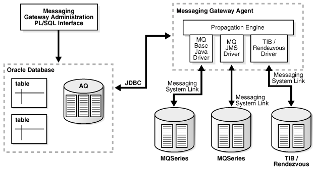

The Messaging Gateway administration package DBMS_MGWADM provides an interface for creating Messaging Gateway agents, managing agents, creating messaging system links, registering non-Oracle queues, and setting up propagation jobs.

Topics:

- Oracle Messaging Gateway Overview

- Oracle Messaging Gateway Features

- Oracle Messaging Gateway Architecture

- Propagation Processing Overview

- Oracle Database AQ Buffered Messages and Messaging Gateway

### Oracle Messaging Gateway Overview

Messaging Gateway enables communication between applications based on non-Oracle messaging systems and Oracle Database Advanced Queuing.

Oracle Database Advanced Queuing provides [propagation](glossary.md) between two Oracle Database Advanced Queuing queues to enable e-business (HTTP through [IDAP](glossary.md)). Messaging Gateway extends this to applications based on non-Oracle messaging systems.

Because Messaging Gateway is integrated with Oracle Database Advanced Queuing and Oracle Database, it offers reliable [message](glossary.md) delivery. Messaging Gateway guarantees that messages are delivered once and only once between Oracle Database Advanced Queuing and non-Oracle messaging systems that support persistence. The PL/SQL interface provides an easy-to-learn administrative [API](glossary.md), especially for developers already proficient in using Oracle Database Advanced Queuing.

This release of Messaging Gateway supports the integration of Oracle Database Advanced Queuing with applications based on WebSphere MQ 9.0 and TIB/Rendezvous 8.2.

### Oracle Messaging Gateway Features

Messaging Gateway provides the following features:

- Extends Oracle Database Advanced Queuing message propagation

  Messaging Gateway propagates messages between Oracle Database Advanced Queuing and non-Oracle messaging systems. Messages sent by Oracle Database Advanced Queuing applications can be received by non-Oracle messaging system applications. Conversely, messages published by non-Oracle messaging system applications can be consumed by Oracle Database Advanced Queuing applications.

<!-- -->

- Support for [Java Message Service](glossary.md) (JMS) messaging systems

  Messaging Gateway propagates messages between Oracle Java Message Service (Oracle JMS) and WebSphere MQ Java Message Service (WebSphere MQ JMS).

- Native message format support

  Messaging Gateway supports the native message formats of messaging systems. Oracle Database Advanced Queuing messages can have `RAW` or any Oracle [object type](glossary.md) payload. WebSphere MQ messages can be text or byte messages. TIB/Rendezvous messages can be any TIB/Rendezvous wire format datatype except the nested datatype `MSG` and those with unsigned integers.

- Message conversion

  Messaging Gateway facilitates message conversion between Oracle Database Advanced Queuing messages and non-Oracle messaging system messages. Messages are converted through either automatic routines provided by Messaging Gateway or customized message [transformation](glossary.md) functions that you provide.

  **Note:**

  - Messaging Gateway does not support message propagation between JMS and non-JMS messaging systems.

  - Oracle Database AQ Sharded Queues are not supported by MGW in 12c Release 2 (12.2)

<!-- -->

- Integration with Oracle Database

  Messaging Gateway is managed through a PL/SQL interface similar to that of Oracle Database Advanced Queuing. Configuration information is stored in Oracle Database tables. Message propagation is carried out by an external process of the Oracle Database server.

- Guaranteed message delivery

  If the messaging systems at the propagation source and propagation destination both support transactions, then Messaging Gateway guarantees that persistent messages are propagated exactly once. If messages are not persistent or transactions are not supported by the messaging systems at the propagation source or propagation destination, then at-most-once propagation is guaranteed.

- Security support

  Messaging Gateway supports client authentication of Oracle Database and non-Oracle messaging systems.

  Messaging Gateway also allows Secure Socket Layer (SSL) support for IBM WebSphere MQ and WebSphere MQ JMS connections made by the Messaging Gateway agent.

- Multiple agent support

  Messaging Gateway supports multiple agents for a given database. Users can partition propagation jobs based on functionality, organizations, or workload and assign them to different Messaging Gateway agents. This allows Messaging Gateway to scale in an Oracle RAC environment and enables propagation job grouping and isolation.

**See Also:**

- "Propagation Processing Overview"

- [Oracle Messaging Gateway Message Conversion](omg-message-conversion.md)

- "[Converting Oracle Messaging Gateway Non-JMS Messages](omg-message-conversion.md)"

### Oracle Messaging Gateway Architecture

Messaging Gateway has two main components:

- Administration Package DBMS_MGWADM

- Messaging Gateway Agent

Figure 17-1 shows how these components work together with Oracle Database and non-Oracle messaging systems.

Figure 17-1 Messaging Gateway Architecture

[Description of "Figure 17-1 Messaging Gateway Architecture"](img_text/adque449.md)

#### Administration Package DBMS_MGWADM

The Messaging Gateway administration package `DBMS_MGWADM` provides an interface for creating named Messaging Gateway agents, managing agents, creating messaging system links, registering non-Oracle queues, and setting up propagation jobs.

Users call the procedures in the package to make configuration changes regardless of whether the Messaging Gateway agent is running. If the Messaging Gateway agent is running, then the procedures in the package send notifications for configuration changes to the agent. The agent dynamically alters its configuration for most configuration changes, although some changes require that the agent be shut down and restarted before they take effect. All the procedures in the package are serialized to guarantee that the Messaging Gateway agent receives and processes notifications in the same order as they are made.

**See Also:**

[Oracle Database PL/SQL Packages and Types Reference](../arpls/DBMS_MGWADM.md) for more information on `DBMS_MGWADM`

#### Oracle Messaging Gateway Agent

The Messaging Gateway agent runs as an external process of the Oracle Database server and processes propagation jobs. It is started and shut down by calling the `STARTUP` and `SHUTDOWN` procedures in `DBMS_MGWADM` package.

The Messaging Gateway agent contains a multithreaded propagation engine and a set of drivers for messaging systems. The propagation engine fairly schedules propagation jobs and processes propagation jobs concurrently. The polling thread in the agent periodically polls the source queues of enabled propagation jobs and wakes up worker threads to process propagation jobs if messages are available. The drivers for non-Oracle messaging systems run as clients of the messaging systems for all messaging operations.

#### Oracle Database

As an Oracle Database feature, Messaging Gateway provides a mechanism of message propagation between Oracle Database Advanced Queuing and non-Oracle messaging systems. Oracle Database Advanced Queuing is involved in every propagation job as either propagation source or propagation destination.

Messaging Gateway is managed through the PL/SQL administration package `DBMS_MGWADM`. All configuration information and execution state information of Messaging Gateway are stored in Oracle Database and can be accessed through database views.

The Messaging Gateway agent runs as an external procedure of the Oracle Database server. Therefore, it runs only when its associated database server is running.

#### Non-Oracle Messaging Systems

The Messaging Gateway agent connects to non-Oracle messaging systems through messaging system links. Messaging system links are communication channels between the Messaging Gateway agent and non-Oracle messaging systems. Users can use the administration package `DBMS_MGWADM` to configure multiple links to the same or different non-Oracle messaging systems.

Queues in non-Oracle messaging systems, such as WebSphere MQ queues, TIB/Rendezvous subjects, and WebSphere MQ JMS destinations (queues and topics) can all serve as propagation sources and destinations for Messaging Gateway. They are referred to as foreign queues. All foreign queues involved in message propagation as source queues, destination queues, or exception queues must be registered through the administration package. The registration of a foreign [queue](glossary.md) does not create the physical queue in a non-Oracle messaging system, but merely records information about the queue, such as the messaging system link to access it, its native name, and its domain (queue or topic). The physical queue must be created through the administration interface of the non-Oracle messaging system.

**See Also:**

"[Registering a Non-Oracle Queue](omg-working.md)"

### Propagation Processing Overview

Propagation jobs must be defined in order for messages to be propagated from one messaging system to another. A propagation job defines the source queue, destination queue, and various other attributes that affect the processing of the propagation job.

If the propagation source is a queue (point-to-point), then the Messaging Gateway agent moves all messages in the queue to the destination. If the propagation source is a topic ([publish/subscribe](glossary.md)), then the Messaging Gateway agent creates a subscription on the propagation source topic. The agent moves all messages that are published to the topic after the subscription is created.

A propagation job is processed when it is enabled. Disabling a propagation job stops propagation processing but does not stop message subscription.

When the Messaging Gateway agent processes a propagation job, it dequeues messages from the source queue and enqueues the messages to the destination queue. As each message is propagated, it is converted from its native format in the source messaging system to its native format in the destination messaging system. Messaging Gateway provides automatic message conversions between simple and commonly used message formats. You can customize message conversions by providing your own message transformation functions.

When the Messaging Gateway agent fails to convert a message from the source format to the destination format, the agent moves the message from the source queue to an [exception queue](glossary.md), if the exception queue exists, and continues to process the propagation job.

If the Messaging Gateway agent runs into failures when processing a propagation job, it retries up to sixteen times in an exponential backoff scheme (from two seconds up to thirty minutes) before it stops retrying.

To guarantee reliable message delivery, Messaging Gateway requires logging queues in messaging systems that support transactions and persistent messages. The Messaging Gateway agent uses the logging queues to store the processing states of propagation jobs so that it can restore propagation processing from failures.

**See Also:**

"[Configuring Oracle Messaging Gateway Propagation Jobs](omg-working.md)"

### Oracle Database AQ Buffered Messages and Messaging Gateway

Messaging Gateway does not support propagation of buffered messages. In outbound propagation, the Messaging Gateway agent dequeues only persistent messages from AQ queues. In inbound propagation, the Messaging Gateway agent always enqueues persistent messages into AQ queues.
