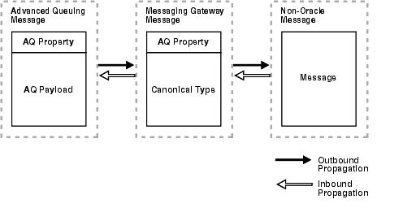
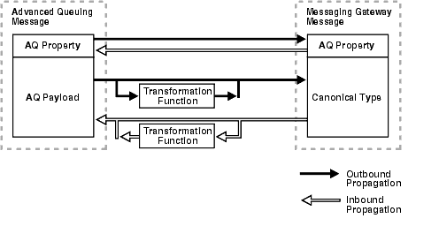
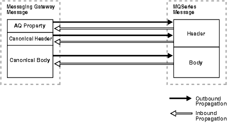
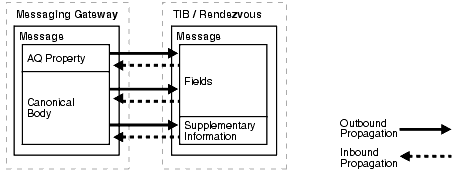
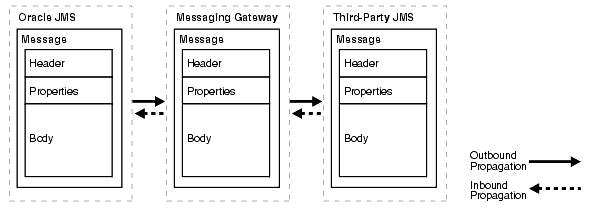

The following topics discuss how Oracle Messaging Gateway (MGW) converts [message](glossary.md) formats from one messaging system to another. A conversion is generally necessary when moving messages between Oracle Database Advanced Queuing and another system, because different messaging systems have different message formats. [Java Message Service](glossary.md) (JMS) messages are a special case. A [JMS message](glossary.md) can be propagated only to a JMS destination, making conversion a simple process.

- Converting Oracle Messaging Gateway Non-JMS Messages

- Message Conversion for WebSphere MQ

- Message Conversion for TIB/Rendezvous

- JMS Messages

### Converting Oracle Messaging Gateway Non-JMS Messages

MGW converts the native message format of the source messaging system to the native message format of the destination messaging system during [propagation](glossary.md). MGW uses [canonical](glossary.md) types and a model centering on Oracle Database Advanced Queuing for the conversion.

#### Overview of the Non-JMS Message Conversion Process

When a message is propagated by MGW, the message is converted from the native format of the source [queue](glossary.md) to the native format of the destination queue.

A native message usually contains a message header and a message body. The header contains the fixed header fields that all messages in that messaging system have, such as message properties in Oracle Database Advanced Queuing and the fixed header in WebSphere MQ. The body contains message contents, such as the Oracle Database Advanced Queuing payload, the WebSphere MQ message body, or the entire TIB/Rendezvous message. MGW converts both message header and message body components.

Figure 20-1shows how non-JMS messages are converted in two stages. A message is first converted from the native format of the source queue to the MGW internal message format, and then it is converted from the internal message format to the native format of the destination queue.

Figure 20-1 Non-JMS Message Conversion

[Description of "Figure 20-1 Non-JMS Message Conversion"](img_text/adqmg003.md)

The MGW agent uses an internal message format consisting of a header that is similar to the Oracle Database Advanced Queuing message properties and a body that is a representation of an MGW canonical type.

#### Oracle Messaging Gateway Canonical Types

MGW defines canonical types to support message conversion between Oracle Database Advanced Queuing and non-Oracle messaging systems. A canonical type is a message type representation in the form of a PL/SQL Oracle type in Oracle Database. The canonical types are `RAW`, `SYS.MGW_BASIC_MSG_T`, and `SYS.MGW_TIBRV_MSG_T`.

WebSphere MQ propagation supports the canonical types `SYS.MGW_BASIC_MSG_T` and `RAW`. TIB/Rendezvous propagation supports the canonical types `SYS.MGW_TIBRV_MSG_T` and `RAW`.

**See Also:**

"DBMS_MGWMSG" in [Oracle Database PL/SQL Packages and Types Reference](../arpls/DBMS_MGWMSG.md) for Syntax and attribute information for `SYS.MGW_BASIC_MSG_T `and `SYS.MGW_TIBRV_MSG_T`

#### Message Header Conversion

MGW provides default mappings between Oracle Database Advanced Queuing message properties and non-Oracle message header fields that have a counterpart in Oracle Database Advanced Queuing message properties with the same semantics. Where MGW does not provide a mapping, the message header fields are set to a default value, usually the default value defined by the messaging system.

#### Handling Arbitrary Payload Types Using Message Transformations

When converting to or from Oracle Database Advanced Queuing messages, the MGW agent uses only its canonical types. Arbitrary payload types are supported, however, with the assistance of user-defined Oracle Database Advanced Queuing message transformations to convert between an Oracle Database Advanced Queuing queue payload and an MGW canonical type.

For MGW to propagate messages from an Oracle Database Advanced Queuing queue with an arbitrary [ADT](glossary.md) payload (outbound propagation), you must provide a mapping to an MGW canonical ADT. The [transformation](glossary.md) is invoked when the MGW agent dequeues messages from the Oracle Database Advanced Queuing queue. Similarly, for MGW to propagate messages to an Oracle Database Advanced Queuing queue with an arbitrary ADT payload (inbound propagation), you must provide a mapping from an MGW canonical ADT. The transformation is invoked when the MGW agent enqueues messages to the Oracle Database Advanced Queuing queue.

Figure 20-2 Oracle Database Advanced Queuing Message Conversion

[Description of "Figure 20-2 Oracle Database Advanced Queuing Message Conversion"](img_text/adqmg004.md)

The transformation is always executed in the context of the MGW agent, which means that the MGW agent user (the user specified using `DBMS_MGWADM`.`CREATE_AGENT` or `DBMS_MGWADM`.`ALTER_AGENT`) must have `EXECUTE` privileges on the transformation function and the Oracle Database Advanced Queuing payload type. This can be accomplished by granting the `EXECUTE` privilege to `PUBLIC` or by granting the `EXECUTE` privilege directly to the MGW agent user.

To configure a MGW propagation job with a transformation:

1.  Create the transformation function.
2.  Grant `EXECUTE` to the MGW agent user or to `PUBLIC` on the function and the object types it references.
3.  Call `DBMS_TRANSFORM.CREATE_TRANSFORMATION` to register the transformation.
4.  Call `DBMS_MGWADM`.`CREATE_JOB` to create a MGW propagation job using the transformation, or `DBMS_MGWADM`.`ALTER_JOB` to alter an existing job.

Example 20-1 Transformation Function Signature

    FUNCTION trans_sampleadt_to_mgw_basic(in_msg IN mgwuser.sampleADT)
    RETURN SYS.MGW_BASIC_MSG_T;

You can create a transformation using `DBMS_TRANSFORM.CREATE_TRANSFORMATION`, as shown in Example 20-2.

Example 20-2 Creating a Transformation

    BEGIN
      DBMS_TRANSFORM.CREATE_TRANSFORMATION(
            schema         => 'mgwuser',
            name           => 'sample_adt_to_mgw_basic',
            from_schema    => 'mgwuser',
            from_type      => 'sampleadt',
            to_schema      => 'sys',
            to_type        => 'MGW_BASIC_MSG_T',
            transformation => 'mgwuser.trans_sampleadt_to_mgw_basic(user_data)');
    END;

Example 20-3 Registering a Transformation

    BEGIN
      DBMS_MGWADM.CREATE_JOB(
        job_name          =>   'job_aq2mq',
        propagation_type  =>    DBMS_MGWADM.OUTBOUND_PROPAGATION,
        source            =>   'mgwuser.srcq',
        destination       =>   'destq.mqlink',
        transformation    =>   'mgwuser.sample_adt_to_mgw_basic',
        exception_queue   =>   'mgwuser.excq');
    END;

The value passed in the transformation parameter for these APIs must be the registered transformation name and not the function name. For example, `trans_sampleadt_to_mgw_basic` is a stored procedure representing a transformation function with the signature shown in Example 20-1.

**Note:**

All commands in the examples must be run as a user granted `MGW_ADMINISTRATOR_ROLE`, except for the commands to create transformations.

Once created, this transformation can be registered with MGW when creating a propagation job. Example 20-3 creates job `job_aq2mq`, for whom messages are propagated from Oracle Database Advanced Queuing queue `mgwuser.srcq` to non-Oracle messaging system queue `destq@mqlink` using transformation `mgwuser.sample_adt_to_mgw_basic`.

An error that occurs while attempting a user-defined transformation is usually considered a message conversion exception, and the message is moved to the [exception queue](glossary.md) if it exists.

**See Also:**

"DBMS_MGWADM", "DBMS_MGWMSG", and "DBMS_TRANSFORM" in [Oracle Database PL/SQL Packages and Types Reference](../arpls/DBMS_MGWMSG.md)

#### Handling Logical Change Records

MGW provides facilities to propagate Logical Change Records (LCRs). Routines are provided to help in creating transformations to handle the propagation of both row LCRs and DDL LCRs stored in queues with payload type `ANYDATA`. An LCR is propagated as an XML string stored in the appropriate message type.

**Note:**

For LCR propagation, you must load the XDB package.

Because Oracle Streams uses `ANYDATA` queues to store LCRs, an `ANYDATA` queue is the source for outbound propagation. The transformation must first convert the `ANYDATA` object containing an LCR into an XMLType object using the MGW routine `DBMS_MGWMSG.LCR_TO_XML`. If the `ANYDATA` object does not contain an LCR, then this routine raises an error. The XML document string of the LCR is then extracted from the XMLType and placed in the appropriate MGW canonical type (`SYS.MGW_BASIC_MSG_T` or `SYS.MGW_TIBRV_MSG_T`).

Example 20-4 illustrates a simplified transformation used for LCR outbound propagation. The transformation converts an `ANYDATA` payload containing an LCR to a `SYS.MGW_TIBRV_MSG_T` object. The string representing the LCR as an XML document is put in a field named `ORACLE_LCR`.

For LCR inbound propagation, an MGW canonical type (`SYS.MGW_BASIC_MSG_T` or `SYS.MGW_TIBRV_MSG_T`) is the transformation source type. A string in the format of an XML document representing an LCR must be contained in the canonical type. The transformation function must extract the string from the message, create an XMLType object from it, and convert it to an `ANYDATA` object containing an LCR with the MGW routine `DBMS_MGWMSG.XML_TO_LCR`. If the original XML document does not represent an LCR, then this routine raises an error.

Example 20-5 illustrates a simplified transformation used for LCR inbound propagation. The transformation converts a `SYS.MGW_TIBRV_MSG_T` object with a field containing an XML string representing an LCR to an `ANYDATA` object. The string representing the LCR as an XML document is taken from a field named `ORACLE_LCR`.

**See Also:**

- "DBMS_MGWMSG" in [Oracle Database PL/SQL Packages and Types Reference](../arpls/DBMS_MGWMSG.md)

- `ORACLE_HOME``/mgw/samples/lcr` for complete examples of LCR transformations

Example 20-4 Outbound LCR Transformation

    create or replace function any2tibrv(adata in anydata)
    return SYS.MGW_TIBRV_MSG_T is
        v_xml   XMLType;
        v_text  varchar2(2000);
        v_tibrv sys.mgw_tibrv_msg_t;
    BEGIN
        v_xml   := dbms_mgwmsg.lcr_to_xml(adata);
        -- assume the lcr is smaller than 2000 characters long.
        v_text  := v_xml.getStringVal();
        v_tibrv := SYS.MGW_TIBRV_MSG_T.CONSTRUCT;
        v_tibrv.add_string('ORACLE_LCR', 0, v_text);
        return v_tibrv;
    END any2tibrv;

Example 20-5 Inbound LCR Transformation

    create or replace function tibrv2any(tdata in sys.mgw_tibrv_msg_t)
    return anydata is
        v_field   sys.mgw_tibrv_field_t;
        v_xml     XMLType;
        v_text    varchar2(2000);
        v_any     anydata;
    BEGIN
        v_field := tdata.get_field_by_name('ORACLE_LCR');
        -- type checking
        v_text  := v_field.text_value;
        -- assume it is not null
        v_xml  := XMLType.createXML(v_text);
        v_any  := dbms_mgwmsg.xml_to_lcr(v_xml);
        return v_any;
    END tibrv2any;

### Message Conversion for WebSphere MQ

MGW converts between the MGW canonical types and the WebSphere MQ native message format. WebSphere MQ native messages consist of a fixed message header and a message body. The message body is treated as either a `TEXT` value or `RAW` (bytes) value. The canonical types supported for WebSphere MQ propagation are `SYS.MGW_BASIC_MSG_T` and `RAW`.

Figure 20-3 Message Conversion for WebSphere MQ Using MGW_BASIC_MSG_T

[Description of "Figure 20-3 Message Conversion for WebSphere MQ Using MGW_BASIC_MSG_T"](img_text/adqmg005.md)

Figure 20-3 illustrates the message conversion performed by the MGW WebSphere MQ driver when using the canonical type `SYS.MGW_BASIC_MSG_T`. For outbound propagation, the driver maps the Oracle Database Advanced Queuing message properties and canonical message to a WebSphere MQ message having a fixed header and a message body. For inbound propagation, the driver maps a native message to a set of Oracle Database Advanced Queuing message properties and a canonical message. When the canonical type is `RAW`, the mappings are the same, except no canonical headers exist.

#### WebSphere MQ Message Header Mappings

When the MGW canonical type used in an outbound propagation job is `RAW`, no WebSphere MQ header information is set from the `RAW` message body. Similarly, for inbound propagation no WebSphere MQ header information is preserved in the `RAW` message body. MGW canonical type `SYS.MGW_BASIC_MSG_T`, however, has a header that can be used to specify WebSphere MQ header fields for outbound propagation, and preserve WebSphere MQ header fields for inbound propagation.

This section describes the message properties supported for the WebSphere MQ messaging system when using `SYS.MGW_BASIC_MSG_T` as the canonical type. Table 20-1 defines the MGW {name, value} pairs used to describe the WebSphere MQ header properties. The first column refers to valid string values for the `SYS.MGW_NAME_VALUE_T.NAME` field in the `SYS.MGW_BASIC_MSG_T` header. The second column refers to the `SYS.MGW_NAME_VALUE_T.TYPE` value corresponding to the name. (Refer to "Notes on Rows correspond to Messaging Gateway names. The first column is the name, the second column is its Messaging Gateway type, the third column is the corresponding WebSphere MQ property name, and the fourth column indicates what it is used for." for explanations of the numbers in parentheses.)

For inbound propagation, the WebSphere MQ driver generates {name,value} pairs based on the source message header and stores them in the header part of the canonical message of the `SYS.MGW_BASIC_MSG_T` type. For outbound propagation, the WebSphere MQ driver sets the message header and enqueue options from {name,value} pairs for these properties stored in the header part of the `SYS.MGW_BASIC_MSG_T` canonical message.

Table 20-1 MGW Names for WebSphere MQ Header Values

| MGW Name                         | MGW Type               | WebSphere MQ Property Name | Used For              |
|:---------------------------------|:-----------------------|:---------------------------|:----------------------|
| `MGW_MQ_accountingToken`         | `RAW_VALUE (size 32)`  | `accountingToken`          | Outbound (1), Inbound |
| `MGW_MQ_applicationIdData`       | `TEXT_VALUE (size 32)` | `applicationIdData `       | Outbound (1), Inbound |
| `MGW_MQ_applicationOriginData`   | `TEXT_VALUE (size 4)`  | `applicationOriginData`    | Outbound (1), Inbound |
| `MGW_MQ_backoutCount`            | `INTEGER_VALUE`        | `backoutCount`             | Inbound               |
| `MGW_MQ_characterSet`            | `INTEGER_VALUE`        | `characterSet`             | Outbound, Inbound     |
| `MGW_MQ_correlationId`           | `RAW_VALUE (size 24)`  | `correlationId`            | Outbound (1), Inbound |
| `MGW_MQ_encoding`                | `INTEGER_VALUE`        | `encoding`                 | Outbound, Inbound     |
| `MGW_MQ_expiry`                  | `INTEGER_VALUE`        | `expiry`                   | Outbound, Inbound     |
| `MGW_MQ_feedback`                | `INTEGER_VALUE`        | `feedback`                 | Outbound, Inbound     |
| `MGW_MQ_format`                  | `TEXT_VALUE (size 8)`  | `format`                   | Outbound (1), Inbound |
| `MGW_MQ_groupId`                 | `RAW_VALUE (size 24)`  | `groupId`                  | Outbound (1), Inbound |
| `MGW_MQ_messageFlags`            | `INTEGER_VALUE`        | `messageFlags`             | Outbound, Inbound     |
| `MGW_MQ_messageId`               | `RAW_VALUE (size 24)`  | `messageId`                | Outbound, Inbound     |
| `MGW_MQ_messageSequenceNumber`   | `INTEGER_VALUE`        | `messageSequenceNumber`    | Outbound, Inbound     |
| `MGW_MQ_messageType`             | `INTEGER_VALUE`        | `messageType`              | Outbound, Inbound     |
| `MGW_MQ_offset`                  | `INTEGER_VALUE`        | `offset`                   | Outbound, Inbound     |
| `MGW_MQ_originalLength`          | `INTEGER_VALUE`        | `originalLength`           | Outbound, Inbound     |
| `MGW_MQ_persistence`             | `INTEGER_VALUE`        | `persistence`              | Inbound               |
| `MGW_MQ_priority`                | `INTEGER_VALUE`        | `priority`                 | Outbound, Inbound     |
| `MGW_MQ_putApplicationName`      | `TEXT_VALUE (size 28)` | `putApplicationName`       | Outbound (1), Inbound |
| `MGW_MQ_putApplicationType`      | `INTEGER_VALUE`        | `putApplicationType`       | Outbound (1), Inbound |
| `MGW_MQ_putDateTime`             | `DATE_VALUE`           | `putDateTime`              | Inbound               |
| `MGW_MQ_putMessageOptions`       | `INTEGER_VALUE`        | `putMessageOptions`        | Outbound (1) (2)      |
| `MGW_MQ_replyToQueueManagerName` | `TEXT_VALUE (size 48)` | `replyToQueueManagerName`  | Outbound, Inbound     |
| `MGW_MQ_replyToQueueName`        | `TEXT_VALUE (size 48)` | `replyToQueueName`         | Outbound, Inbound     |
| `MGW_MQ_report`                  | `INTEGER_VALUE`        | `report`                   | Outbound (1), Inbound |
| `MGW_MQ_userId`                  | `TEXT_VALUE (size 12)` | `userId`                   | Outbound, Inbound     |

**See Also:**

"DBMS_MGWMSG" in [Oracle Database PL/SQL Packages and Types Reference](../arpls/DBMS_MGWMSG.md)

##### Notes on Table 20-1

1.  This use is subject to WebSphere MQ restrictions. For example, if `MGW_MQ_accountingToken` is set for an outgoing message, then WebSphere MQ overrides its value unless `MGW_MQ_putMessageOptions` is set to the WebSphere MQ constant `MQPMD_SET_ALL_CONTEXT`.

2.  `MGW_MQ_putMessageOptions` is used as the `putMessageOptions` argument to the WebSphere MQ Base Java `Queue.put()` method. It is not part of the WebSphere MQ header information and is therefore not an actual message property.

    The value for the `openOptions` argument of the WebSphere MQ Base Java `MQQueueManager.accessQueue` method is specified when the WebSphere MQ queue is registered using the `DBMS_MGWADM.REGISTER_FOREIGN_QUEUE `call. Dependencies can exist between the two. For instance, for `MGW_MQ_putMessageOptions` to include `MQPMD_SET_ALL_CONTEXT,` `the MQ_openMessageOptions` queue option must include `MQOO_SET_CONTEXT`.

    The MGW agent adds the value `MQPMO_SYNCPOINT` to any value that you can specify.

MGW sets default values for two WebSphere MQ message header fields: `messageType` defaults to `MQMT_DATAGRAM` and `putMessageOptions` defaults to `MQPMO_SYNCPOINT`.

MGW provides two default mappings between Oracle Database Advanced Queuing message properties and WebSphere MQ header fields.

One maps the Oracle Database Advanced Queuing message property `expiration`, representing the time-to-live of the message at the time the message becomes available in the queue, to the WebSphere MQ header field `expiry`, representing the time-to-live of the message. For outbound propagation, the value used for `expiry` is determined by subtracting the time the message was available in the queue from the `expiration`, converted to tenths of a second. Oracle Database Advanced Queuing value `NEVER` is mapped to `MQEI_UNLIMITED`. For inbound propagation, the value of `expiration` is simply `expiry` converted to seconds. WebSphere MQ value `MQEI_UNLIMITED` is mapped to `NEVER`.

The other default maps Oracle Database Advanced Queuing message property `priority` with the WebSphere MQ header field `priority`. It is described in Table 20-2.

Table 20-2 Default Priority Mappings for Propagation

| Propagation Type | Message System                   | Priority Values |     |     |     |     |     |     |     |     |     |
|:-----------------|:---------------------------------|:----------------|:----|:----|:----|:----|:----|:----|:----|:----|:----|
| Outbound         | Oracle Database Advanced Queuing | 0               | 1   | 2   | 3   | 4   | 5   | 6   | 7   | 8   | 9   |
| Outbound         | WebSphere MQ                     | 9               | 8   | 7   | 6   | 5   | 4   | 3   | 2   | 1   | 0   |
| Inbound          | Oracle Database Advanced Queuing | 9               | 8   | 7   | 6   | 5   | 4   | 3   | 2   | 1   | 0   |
| Inbound          | WebSphere MQ                     | 0               | 1   | 2   | 3   | 4   | 5   | 6   | 7   | 8   | 9   |

**Note:**

For outbound propagation, Oracle Database Advanced Queuing priority values less than 0 are mapped to WebSphere MQ priority 9, and Oracle Database Advanced Queuing priority values greater than 9 are mapped to WebSphere MQ priority 0.

#### WebSphere MQ Outbound Propagation

If no message transformation is provided for outbound propagation, then the Oracle Database Advanced Queuing source queue payload type must be either `SYS.MGW_BASIC_MSG_T` or `RAW`. If a message transformation is specified, then the target ADT of the transformation must be `SYS.MGW_BASIC_MSG_T`, but the source ADT can be any ADT supported by Oracle Database Advanced Queuing.

If the Oracle Database Advanced Queuing queue payload is RAW, then the resulting WebSphere MQ message has the message body set to the value of the RAW bytes and, by default, the `format` field set to the value "`MGW_Byte`".

If the Oracle Database Advanced Queuing queue payload or transformation target ADT is `SYS.MGW_BASIC_MSG_T`, then the message is mapped to a WebSphere MQ native message as follows:

- The WebSphere MQ fixed header fields are based on the internal Oracle Database Advanced Queuing message properties and the `SYS.MGW_BASIC_MSG_T.header` attribute of the canonical message, as described in "WebSphere MQ Message Header Mappings".

- If the canonical message has a `TEXT` body, then the WebSphere MQ format header field is set to `MQFMT_STRING` unless overridden by the header property `MGW_MQ_format`. The message body is treated as text.

- If the canonical message has a `RAW` body, then the WebSphere MQ format header field is set to "`MGW_Byte`" unless overridden by the header property `MGW_MQ_format`. The message body is treated as raw bytes.

- If the canonical message has both a `TEXT` and `RAW` body, then message conversion fails.

- If the canonical message has neither a `TEXT` nor `RAW` body, then no message body is set, and the WebSphere MQ format header field is `MQFMT_NONE`.

- If the canonical message has a `TEXT` body with both small and large values set (`SYS.MGW_BASIC_MSG_T.TEXT_BODY.small_value` and `SYS.MGW_BASIC_MSG_T.TEXT_BODY.large_value` not empty), then message conversion fails.

- If the canonical message has a `RAW` body with both small and large values set (`SYS.MGW_BASIC_MSG_T.RAW_BODY.small_value` and `SYS.MGW_BASIC_MSG_T.RAW_BODY.large_value` not empty), then message conversion fails.

If the job option `PreserveMessageID` is specified with a value of `TRUE`, then the `correlationId` field of the WebSphere message header will be set to the AQ source message identifier. The `correlationId` value will be a 24-byte value of the form `"AQMSGID:"+``AQ_msgid` where `AQ_msgid` represents the 16-byte Database AQ message identifier.

#### WebSphere MQ Inbound Propagation

If no message transformation is provided for inbound propagation, then the Oracle Database Advanced Queuing destination queue payload type must be either `SYS.MGW_BASIC_MSG_T` or `RAW`. If a message transformation is specified, then the source ADT of the transformation must be `SYS.MGW_BASIC_MSG_T`, but the destination ADT can be any ADT supported by Oracle Database Advanced Queuing.

If the Oracle Database Advanced Queuing queue payload is `RAW` and the incoming WebSphere MQ message has a `format` of `MQFMT_STRING`, then message conversion fails. Otherwise the message body is considered as raw bytes and enqueued directly to the destination queue. If the number of bytes is greater than 32KB, then message conversion fails. The actual limit is 32512 bytes rather than 32767 bytes.

If the Oracle Database Advanced Queuing queue payload or transformation source ADT is `SYS.MGW_BASIC_MSG_T`, then the WebSphere MQ message is mapped to a `SYS.MGW_BASIC_MSG_T` message as follows:

- Specific WebSphere MQ header fields are mapped to Oracle Database Advanced Queuing message properties as previously described.

- The `SYS.MGW_BASIC_MSG_T.header` attribute of the canonical message is set to {name, value} pairs based on the WebSphere MQ header fields, as described in Table 20-1. These values preserve the original content of the WebSphere MQ message header.

- If the WebSphere MQ `format` header field is `MQFMT_STRING`, then the WebSphere MQ message body is treated as text, and its value is mapped to `SYS.MGW_BASIC_MSG_T.text_body`. For any other `format` value, the message body is treated as raw bytes, and its value is mapped to `SYS.MGW_BASIC_MSG_T.raw_body`.

**See Also:**

"WebSphere MQ Message Header Mappings"

### Message Conversion for TIB/Rendezvous

MGW regards a TIB/Rendezvous message as a set of fields and supplementary information. Figure 20-4 shows how messages are converted between MGW and TIB/Rendezvous.

Figure 20-4 Message Conversion for TIB/Rendezvous

[Description of "Figure 20-4 Message Conversion for TIB/Rendezvous"](img_text/adque447.md)

When a message conversion failure occurs, messages are moved to an exception queue (if one has been provided), so that MGW can continue propagation of the remaining messages in the source queue. In inbound propagation from TIB/Rendezvous, an exception queue is a registered subject.

All TIB/Rendezvous wire format datatypes for TIB/Rendezvous fields are supported, except for the datatypes with unsigned integers and the nested message type. User-defined custom datatypes are not supported in this release. If a message contains data of the unsupported datatypes, then a message conversion failure occurs when the message is processed. A message conversion failure results in moving the failed message from the source queue to the exception queue, if an exception queue is provided.

Table 20-3 shows the datatype mapping used when MGW converts between a native TIB/Rendezvous message and the canonical ADT. For each supported TIB/Rendezvous wire format type, it shows the Oracle type used to store the data and the `DBMS_MGWMSG` constant that represents that type.

Table 20-3 TIB/Rendezvous Datatype Mapping

| TIB/Rendezvous Wire Format | Oracle Type              | ADT Field Type      |
|:---------------------------|:-------------------------|:--------------------|
| `Bool`                     | `NUMBER`                 | `TIBRVMSG_BOOL`     |
| `F32`                      | `NUMBER`                 | `TIBRVMSG_F32`      |
| `F64`                      | `NUMBER`                 | `TIBRVMSG_F64`      |
| `I8`                       | `NUMBER`                 | `TIBRVMSG_I8`       |
| `I16`                      | `NUMBER`                 | `TIBRVMSG_I16`      |
| `I32`                      | `NUMBER`                 | `TIBRVMSG_I32`      |
| `I64`                      | `NUMBER`                 | `TIBRVMSG_I64`      |
| `U8`                       | not supported            | not supported       |
| `U16`                      | not supported            | not supported       |
| `U32`                      | not supported            | not supported       |
| `U64`                      | not supported            | not supported       |
| `IPADDR32`                 | `VARCHAR2`               | `TIBRVMSG_IPADDR32` |
| `IPPORT16`                 | `NUMBER`                 | `TIBRVMSG_IPPORT16` |
| `DATETIME`                 | `DATE`                   | `TIBRVMSG_DATETIME` |
| `F32ARRAY`                 | `SYS.MGW_NUMBER_ARRAY_T` | `TIBRVMSG_F32ARRAY` |
| `F64ARRAY`                 | `SYS.MGW_NUMBER_ARRAY_T` | `TIBRVMSG_F64ARRAY` |
| `I8ARRAY`                  | `SYS.MGW_NUMBER_ARRAY_T` | `TIBRVMSG_I8ARRAY`  |
| `I16ARRAY`                 | `SYS.MGW_NUMBER_ARRAY_T` | `TIBRVMSG_I16ARRAY` |
| `I32ARRAY`                 | `SYS.MGW_NUMBER_ARRAY_T` | `TIBRVMSG_I32ARRAY` |
| `I64ARRAY`                 | `SYS.MGW_NUMBER_ARRAY_T` | `TIBRVMSG_I64ARRAY` |
| `U8ARRAY`                  | not supported            | not supported       |
| `U16ARRAY`                 | not supported            | not supported       |
| `U32ARRAY`                 | not supported            | not supported       |
| `U64ARRAY`                 | not supported            | not supported       |
| `MSG`                      | not supported            | not supported       |
| `OPAQUE`                   | `RAW` or `BLOB`          | `TIBRVMSG_OPAQUE`   |
| `STRING`                   | `VARCHAR2` or `CLOB`     | `TIBRVMSG_STRING`   |
| `XML`                      | `RAW` or `BLOB`          | `TIBRVMSG_XML`      |

For propagation between Oracle Database Advanced Queuing and TIB/Rendezvous, MGW provides direct support for the Oracle Database Advanced Queuing payload types `RAW` and `SYS.MGW_TIBRV_MSG_T`. To support any other Oracle Database Advanced Queuing payload type, you must supply a transformation.

#### AQ Message Property Mapping for TIB/Rendezvous

This section describes the mapping between Oracle Database AQ message properties and TIB/Rendezvous fields. This mapping is used to preserve Database AQ message properties during outbound propagation, and set Database AQ message properties during inbound propagation.

Table 20-4 describes the Database AQ message properties supported using TIB/Rendezvous fields. The first column indicates the `DBMS_AQ.MESSAGE_PROPERTIES_T` field for the Database AQ message property. The second and third columns indicate the name and datatype used for the TIB/Rendezvous field. The last column indicates if the message property is supported for inbound and outbound propagation.

Table 20-4 TIB/Rendezvous and MGW Names for Oracle Database Advanced Queuing Message Properties

| Oracle Database Advanced Queuing Message Property | MGW Name                 | TIB/Rendezvous Wire Format Datatype | Used For          |
|:--------------------------------------------------|:-------------------------|:------------------------------------|:------------------|
| `priority`                                        | `MGW_AQ_priority`        | `TibrvMsg.I32`                      | Outbound, Inbound |
| `expiration`                                      | `MGW_AQ_expiration`      | `TibrvMsg.I32`                      | Outbound, Inbound |
| `delay`                                           | `MGW_AQ_delay`           | `TibrvMsg.I32`                      | Outbound, Inbound |
| `correlation`                                     | `MGW_AQ_correlation`     | `TibrvMsg.STRING`                   | Outbound, Inbound |
| `exception_queue`                                 | `MGW_AQ_exception_queue` | `TibrvMsg.STRING`                   | Outbound, Inbound |
| `enqueue_time`                                    | `MGW_AQ_enqueue_time`    | `TibrvMsg.DATETIME`                 | Outbound          |
| `original_msgid`                                  | `MGW_AQ_original_msgid`  | `TibrvMsg.OPAQUE`                   | Outbound          |
| `msgid` (1)                                       | `MGW_AQ_messageID`       | `TibrvMsg.OPAQUE`                   | Outbound          |

##### Notes on Table 20-4:

1.  The `msgid` Database AQ property represents the Database AQ message identifier, rather than a particular field of the `DBMS_AQ.MESSAGE_PROPERTIES_T` record.

#### TIB/Rendezvous Outbound Propagation

If no propagation transformation is provided for outbound propagation, then the Oracle Database Advanced Queuing source queue payload type must be either `SYS.MGW_TIBRV_MSG_T` or `RAW`. If a propagation transformation is specified, then the target ADT of the transformation must be `SYS.MGW_TIBRV_MSG_T`, but the source ADT can be any ADT supported by Oracle Database Advanced Queuing.

If the Oracle Database Advanced Queuing queue payload or transformation target ADT is `SYS.MGW_TIBRV_MSG_T`, then:

- Every field in the source message is converted to a TIB/Rendezvous message field of the resulting TIB/Rendezvous message.

- If the `reply_subject` attribute is not `NULL`, then the reply subject supplementary information is set.

- The `send_subject` field is ignored.

If the Oracle Database Advanced Queuing queue payload is `RAW`, then:

- The resulting message contains a field named `MGW_RAW_MSG` with value `TibrvMsg.OPAQUE`. The field ID is set to 0.

If the job option `AQ_MsgProperties` is specified with a value of `TRUE`, then the MGW agent generates fields to preserve the Database AQ message properties in the TIB/Rendezvous message according to Table 20-4.

If the `PreserveMessageID` job option is specified with a value of `TRUE`, then the Database AQ message identifier (`msgid`) is preserved in the TIB/Rendezvous message according to Table 20-4.

#### TIB/Rendezvous Inbound Propagation

If no propagation transformation is provided for inbound propagation, then the Oracle Database Advanced Queuing destination queue payload type must be either `RAW` or `SYS.MGW_TIBRV_MSG_T`. If a propagation transformation is specified, then the target ADT of the transformation can be any ADT supported by Oracle Database Advanced Queuing, but the source ADT of the transformation must be `SYS.MGW_TIBRV_MSG_T`.

If the Oracle Database Advanced Queuing queue payload or transformation source ADT is `SYS.MGW_TIBRV_MSG_T`, then:

- Every field in the source TIB/Rendezvous message is converted to a field of the resulting message of the` SYS.MGW_TIBRV_MSG_T` type.

- The MGW agent extracts the send subject name from the source TIB/Rendezvous message and sets the `send_subject` attribute in `SYS.MGW_TIBRV_MSG_T`. The send subject name is usually the same as the subject name of the registered propagation source queue, but it might be different when wildcards are used.

- The MGW agent extracts the reply subject name from the source TIB/Rendezvous message, if it exists, and sets the `reply_subject` attribute in `SYS.MGW_TIBRV_MSG_T`.

- If the source TIB/Rendezvous message contains more than three large text fields (greater than 4000 bytes of text) or more than three large bytes fields (greater than 2000 bytes), then message conversion fails.

If the Oracle Database Advanced Queuing queue payload is `RAW`, then:

- The Oracle Database Advanced Queuing message payload is the field data if the source TIB/Rendezvous message has a field named `MGW_RAW_MSG` of type `TibrvMsg.OPAQUE` or `TibrvMsg.XML`. The field name and ID are ignored. If no such field exists or has an unexpected type, then a message conversion failure occurs.

- A message conversion failure occurs if the `RAW` data size is greater than 32KB. This is due to a restriction on the data size allowed for a bind variable. Also, the actual limit is 32512 rather than 32767.

If the job option `AQ_MsgProperties` is specified with a value of `TRUE`, then the MGW agent searches for fields in the original TIB/Rendezvous messages with reserved field names. Table 20-4 shows the field name strings and the corresponding values used in the TIB/Rendezvous message.

If such fields exist, then the MGW agent uses the field value to set the corresponding Oracle Database Advanced Queuing message properties, instead of using the default values. If there is more than one such field with the same name, then only the first one is used. Such fields are removed from the resulting payload only if the Oracle Database Advanced Queuing queue payload is `RAW`. If a field with the reserved name does not have the expected datatype, then it causes a message conversion failure.

**See Also:**

"DBMS_MGWMSG" in [Oracle Database PL/SQL Packages and Types Reference](../arpls/DBMS_MGWMSG.md) for the value datatypes

### JMS Messages

MGW propagates only JMS messages between Oracle JMS and non-Oracle JMS systems, without changing the message content. Figure 20-5 shows JMS message propagation.

MGW supports only the standard JMS message types. It does not support:

- JMS provider extensions, because any such extensions would not be recognized by the destination JMS system. An attempt to propagate any such non-JMS message results in an error.

- User transformations for JMS propagation.

- Propagation of Logical Change Records (LCRs).

Figure 20-5 JMS Message Propagation

[Description of "Figure 20-5 JMS Message Propagation"](img_text/adque450.md)

For the purposes of this discussion, a JMS message is a Java object of a class that implements one of the five JMS message interfaces. Table 20-5 shows the JMS message interfaces and the corresponding Oracle JMS ADTs. The table also shows the interface, `javax.jms.Message`, which can be any one of the five specific types, and the corresponding generic Oracle JMS type `SYS.AQ$_JMS_MESSAGE`.

Table 20-5 Oracle JMS Message Conversion

| JMS Message               | ADT                          |
|:--------------------------|:-----------------------------|
| `javax.jms.TextMessage`   | `SYS.AQ$_JMS_TEXT_MESSAGE`   |
| `javax.jms.BytesMessage`  | `SYS.AQ$_JMS_BYTES_MESSAGE`  |
| `javax.jms.MapMessage`    | `SYS.AQ$_JMS_MAP_MESSAGE`    |
| `javax.jms.StreamMessage` | `SYS.AQ$_JMS_STREAM_MESSAGE` |
| `javax.jms.ObjectMessage` | `SYS.AQ$_JMS_OBJECT_MESSAGE` |
| `javax.jms.Message`       | `SYS.AQ$_JMS_MESSAGE`        |

When a propagation job is activated, the MGW agent checks the Oracle Database Advanced Queuing payload type for the propagation source or destination. If the type is one of those listed in Table 20-5 or `ANYDATA`, then message propagation is attempted. Otherwise an exception is logged and propagation is not attempted.

The MGW agent may add a JMS `String` property named `OracleMGW_OriginalMessageID` to the JMS message sent to the destination queue in order to preserve the original message identifier of the source message. This property is added if the `PreserveMessageID` job option is specified with a value of `TRUE`. It will also be added for any message moved to an exception queue upon a message conversion failure.

#### JMS Outbound Propagation

When dequeuing a message from an Oracle Database Advanced Queuing queue, Oracle JMS converts instances of the ADTs shown in Table 20-5 into JMS messages. In addition it can convert instances of `ANYDATA` into JMS messages, depending on the content.

A queue with payload type `ANYDATA` can hold messages that do not map to a JMS message. MGW fails to dequeue such a message. An error is logged and propagation of messages from that queue does not continue until the message is removed.

#### JMS Inbound Propagation

Every message successfully dequeued using WebSphere MQ JMS is a JMS message. No message conversion is necessary prior to enqueuing using Oracle JMS. However, if the payload ADT of the propagation destination does not accept the type of the inbound message, then an exception is logged and an attempt is made to place the message in an exception queue. An example of such type mismatches is a JMS` TextMessage` and a queue payload type `SYS.AQ$_JMS_BYTES_MESSAGE`.
