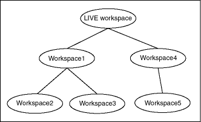
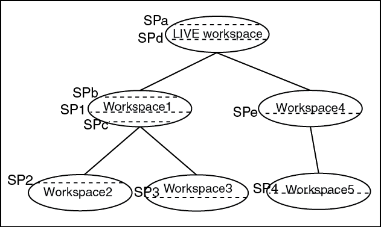
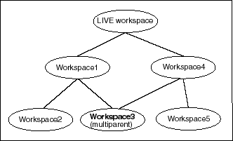

Oracle Workspace Manager, often referred to as Workspace Manager, provides an infrastructure that enables applications to create workspaces and group different versions of table row values in different workspaces.

Users are permitted to create new versions of data to update, while maintaining a copy of the old data. The ongoing results of the activity are stored persistently, assuring concurrency and consistency.

Applications that can benefit from Workspace Manager typically do one or more of the following operations:

- Manage a collection of updates and insertions as a unit before incorporating them into production data

  You can review changes and roll back undesirable ones before making the changes public. Until you make the changes public, they are invisible to other users of the database, who will access only the regular production data. You can organize the changes in a simple set of workspaces or in a complex workspace hierarchy. A typical example might be a life sciences application in which Workspace Manager supports the discovery and quality assurance (QA) processes by managing a collection of updates before they are merged with the production data.

- Support a collaborative development effort

  A team can share access to a collection of updates and insertions for a collaborative project. Workspace privileges control access to a workspace and its operations, and you can restrict workspace access to single-writer, read-only, or no access. Workspace locks prevent update conflicts between projects in separate workspaces. A typical example might be an application to design an engineering project, in which multiple subprojects are concurrently developed in separate workspaces.

- Use a common data set to create multiple scenarios for what-if analyses or multiple editions of data for publication

  You can organize changes in workspaces to view them in the context of the whole database, but without requiring that you actually copy data between tables. Different users can make simultaneous changes to the same row, and you can detect and resolve conflicts. A typical example might be a telecommunications application in which you create multiple cell phone coverage scenarios to find the optimal design.

- Keep a history of changes to data

  You can navigate workspaces and row versions to view the database as of a particular milestone or point in time. You can roll back changes to a row or table in a workspace to a milestone. A typical example might be a land information management application where Workspace Manager supports regulatory requirements by maintaining a history of all changes to land parcels.

Workspace Manager is also useful in managing long-transaction scenarios, where complex, long-duration database transactions can take days to complete, and multiple users must access the same database.

This chapter explains concepts and operations that you must understand to use Workspace Manager. For complete examples of Workspace Manager, see Simplified Examples Using Workspace Manager. However, you may want to read the rest of this chapter first, to understand the concepts that the examples illustrate.

**Note:**

Workspace Manager is installed by default in the Oracle seed database and any database created using the Database Configuration Assistant (DBCA). To use Workspace Manager in any other Oracle database, you must first perform the installation procedure described in [Installing Workspace Manager with Custom Databases](installing-workspace-manager-custom-databases.md).

- Workspace Manager Overview
  Workspace Manager enables you to version-enable one or more user tables in the database. When a table is version-enabled, all rows in the table can support multiple versions of the data.
- Session Context Information for Workspace Manager
  Users perform Workspace Manager operations within a standard Oracle session.
- Lock Management with Workspace Manager
- Privilege Management with Workspace Manager
  Workspace Manager provides a set of privileges that are separate from standard Oracle database privileges.
- System Parameters for Workspace Manager
  Workspace Manager provides a set of system parameters that allow a user with the WM_ADMIN system privilege to enforce global Workspace Manager-specific settings for the database.
- Import and Export Considerations
  Workspace Manager supports the import and export of version-enabled tables in any of the following ways: a full database import and export, an import and export that only includes the schemas required by Workspace Manager, or a workspace-level import and export through Workspace Manager procedures.
- Bulk Loading into Version-Enabled Tables
  You can use SQL\*Loader to perform bulk loading into version-enabled tables, but you must also call some special Workspace Manager procedures, and some restrictions apply.
- DDL Operations Related to Version-Enabled Tables
  To perform DDL (data definition language) operations on a version-enabled table, you must use special Workspace Manager procedures before and after the DDL operations, and you must specify the name of a special table created by Workspace Manager.
- Constraint Support with Workspace Manager
  This section describes Workspace Manager considerations relating to the use of database constraints.
- Triggers on Version-Enabled Tables
  Version-enabled tables can have triggers defined; however, the following considerations and restrictions apply.
- Virtual Private Database Considerations
  You can use Workspace Manager in conjunction with the Oracle Virtual Private Database (VPD) technology.
- Support for Table Synonyms
  For any Workspace Manager procedure or function input parameter that calls for a table name, you can instead specify a synonym.
- Materialized View Support
  This section describes considerations for using Workspace Manager with materialized views.
- Spatial and Graph Topology Support
  This section describes special considerations and techniques for using Workspace Manager with tables in Oracle Spatial and Graph topologies,
- Workspace Manager Reserved Words and Characters
  Because Workspace Manager creates internal objects using its own naming conventions, you must avoid some words and characters in the names for certain kinds objects.
- DBMS_WM Subprogram Categories
  The Workspace Manager application programming interface (API) consists of PL/SQL subprograms (procedures and functions) in a single PL/SQL package named `DBMS_WM`.
- Simplified Examples Using Workspace Manager
  This topic presents two simplified examples of using Workspace Manager to try out some scenarios and select one of them.

**Parent topic:** [Conceptual and Usage Information](workspace-manager-concepts-usage.md)

### 1.1 Workspace Manager Overview

Workspace Manager enables you to version-enable one or more user tables in the database. When a table is version-enabled, all rows in the table can support multiple versions of the data.

The versioning infrastructure is not visible to the users of the database, and application SQL statements for selecting, inserting, modifying, and deleting data continue to work in the usual way with version-enabled tables, although you cannot update a primary key column value in a version-enabled table. (Workspace Manager implements these capabilities by maintaining system views and creating `INSTEAD OF` triggers, as explained in Infrastructure for Version-Enabling of Tables; however, application developers and users do not need to see or interact with the views and triggers.)

After a table is version-enabled, users in a workspace automatically see the correct version of the record in which they are interested. If you no longer need a table to be version-enabled, you can disable versioning for the table.

A workspace is a virtual environment that one or more users can share to make changes to the data in the database. A workspace logically groups collections of new row versions from one or more version-enabled tables, and isolates these versions until they are explicitly merged with production data or discarded, thus providing maximum concurrency. Users can perform a variety of operations involving workspaces: go to, create, refresh, merge, roll back, remove, compress, alter, and other operations.

Users in a workspace always see a transactionally consistent view of the entire database; that is, they see changes made in their current workspace plus the rest of the data in the database as it existed either when the workspace was created or when the workspace was most recently refreshed with changes from the parent workspace. (Workspace hierarchy and parent and child workspaces are explained in Workspace Hierarchy.)

Workspace Manager automatically detects conflicts, which are differences in data values resulting from changes to the same row in a workspace and its parent workspace. You must resolve conflicts before merging changes from a workspace into its parent workspace. You can use workspace locks to avoid conflicts.

Savepoints are points in the workspace to which row changes in version-enabled tables can be rolled back, and to which users can go to see the database as it existed at that point. Savepoints are usually created in response to a business-related milestone, such as the completion of a design phase or the end of a billing period. (For more information about savepoints, see Using Savepoints.)

The history option enables you to timestamp changes made to all rows in a version-enabled table and to save a copy of either all changes or only the most recent changes to each row. If you keep all changes (specifying the "without overwrite" history option) when version-enabling a table, you keep a persistent history of all changes made to all row versions, and enable users to go to any point in time to view the database as it existed from the perspective of that workspace.

Workspace Manager provides a comprehensive PL/SQL API that you can add to new and existing applications to manage workspaces, savepoints, history information, privileges, access modes, and Workspace Manager locks, and to detect and resolve conflicts. You can also perform many of these operations using the Oracle Enterprise Manager graphical user interface.

Another database object created by Workspace Manager is a database-wide system table that maps row versions to workspaces. This table is not visible to users.

- Workspace Hierarchy
- Using Savepoints
- Merging and Rolling Back Workspace Changes
- Resolving Conflicts Before a Merge or Refresh Operation
- Freezing and Unfreezing Workspaces
- Removing Workspaces
- Using Workspace Manager Events
- Autocommitting of Workspace Manager Operations
- Continually Refreshed Workspaces
- Multiparent Workspaces
- Infrastructure for Version-Enabling of Tables
- Creation of Row Versions and Historical Copies
- Workspace Manager Schema, Metadata, and Package

**Parent topic:** Introduction to Workspace Manager

#### 1.1.1 Workspace Hierarchy

There can be a hierarchy of workspaces in the database. For example, a workspace can be a parent to one or more workspaces (child workspaces). By default, when a workspace is created, it is created from the topmost, or `LIVE`, database workspace. (Workspace names are case-sensitive, and the workspace name of the live database is spelled `LIVE`. The length of a workspace name must not exceed 30 characters, and the depth of the workspace hierarchy must not exceed 30 levels.) Users are included in a workspace by a [GotoWorkspace](DBMS_WM-reference.md) operation.

Figure 1-1 shows a hierarchy of workspaces. `Workspace1` and `Workspace4` were formed off the `LIVE` database workspace; `Workspace2` and `Workspace3` were formed off `Workspace1`, and `Workspace5` was formed off `Workspace4`. After `Workspace1` was created, a user executed a [GotoWorkspace](DBMS_WM-reference.md) operation specifying `Workspace1`, and then executed [CreateWorkspace](DBMS_WM-reference.md) operations to create `Workspace2` and `Workspace3`. A comparable sequence was followed with `Workspace4` and `Workspace5`.

Figure 1-1 Workspace Tree

[Description of "Figure 1-1 Workspace Tree"](img_text/vm_state_tree.md)

See also Design Issue: Savepoint or Child Workspace? for a discussion of design issues in deciding whether to create a child workspace or a savepoint for certain needs

**Parent topic:** Workspace Manager Overview

#### 1.1.2 Using Savepoints

A savepoint is a point in the workspace to which data changes can be rolled back. Workspace Manager accomplishes the rollback by deleting the row versions that contain the unwanted changes.

An explicit savepoint is a savepoint that you create and name. You can later roll back changes in version-enabled tables to the savepoint, or you can go to the savepoint to view the state of the entire database (including versioned rows) at the time the savepoint was created. In Figure 1-2, `SP1`, `SP2`, `SP3`, and `SP4` are explicit savepoints that were created in the workspaces indicated. (Savepoints are indicated by dashed lines in Figure 1-2.)

Figure 1-2 Savepoints

[Description of "Figure 1-2 Savepoints"](img_text/wm_savepoints.md)

In addition, implicit savepoints are created automatically whenever a new workspace is created. An implicit savepoint is needed so that the users in the child workspace get a view of the database that is frozen at the time of the workspace creation. Thus, in Figure 1-2 two implicit savepoints (`SPa` and `SPd`) are created in the `LIVE` workspace corresponding to `Workspace1` and `Workspace4` creation; two implicit savepoints (`SPb` and `SPc`) are created in `Workspace1` corresponding to `Workspace2` and `Workspace3` creation; and one implicit savepoint (`SPe`) is created in `Workspace4` corresponding to `Workspace5` creation.

Workspace Manager uses the name `LATEST` to designate a logical savepoint that refers to the latest version in the workspace. `LATEST` is often the default when a savepoint is an optional parameter for a `DBMS_WM` subprogram (procedure or function).

A removable savepoint is a savepoint that can be deleted by the [CompressWorkspace](DBMS_WM-reference.md), [CompressWorkspaceTree](DBMS_WM-reference.md), and [DeleteSavepoint](DBMS_WM-reference.md) procedures. A savepoint is removable if either of the following applies:

- It is an explicit savepoint.

- It is an implicit savepoint that does not have any child dependencies.

<!-- -->

- Design Issue: Savepoint or Child Workspace?

**Parent topic:** Workspace Manager Overview

##### 1.1.2.1 Design Issue: Savepoint or Child Workspace?

A Workspace Manager design issue that you may face is whether to create a savepoint or a child workspace to "save" a project at a given point. Both a savepoint and a child workspace allow you to group a set of changes, compare changes in different row versions, and roll back a set of changes. However, creating a savepoint enables you to continue to make changes in the same workspace, and it allows other users in the workspace immediate access to the changes. (Changes in another workspace are not visible to users until the current workspace is refreshed or merged.) Creating a savepoint also makes it convenient to archive a set of changes, to which you can later roll back.

On the other hand, creating a child workspace is convenient for providing an isolated environment in which a complex set of changes can be made, completely removed from the parent workspace (for example, the production data). If you want to set up an independent environment for a scenario, and if regular users in the parent workspace do not need access to this scenario's data, you probably want to create a child workspace instead of simply creating a savepoint in the parent workspace.

**Parent topic:** Using Savepoints

#### 1.1.3 Merging and Rolling Back Workspace Changes

Workspaces can be merged or rolled back.

Merging a workspace involves applying changes made in a child workspace to its parent workspace, after which the child workspace is removed. To merge a workspace, use the [MergeWorkspace](DBMS_WM-reference.md) procedure.

Rolling back a workspace involves deleting either all data changes (row versions) made in the workspace or all changes made after an explicit savepoint.

- To roll back all changes made in the workspace, use the [RollbackWorkspace](DBMS_WM-reference.md) procedure.

- To roll back changes made in the workspace after a savepoint, use the [RollbackToSP](DBMS_WM-reference.md) procedure.

  **Note:**

  You cannot roll back to a savepoint if any implicit savepoints were created since the specified savepoint, unless you first merge or remove the descendent workspaces that caused the implicit savepoints to be created. For example, referring to the figure in Using Savepoints, the user in `Workspace1` cannot roll back to savepoint `SP1` until `Workspace3` (which caused implicit savepoint `SPc` to be created) is merged or removed.

A workspace cannot be rolled back when it has open database transactions. Rollback of a workspace leaves behind the workspace structure for future use; only the data in the workspace is deleted. (To completely remove a workspace, use the [RemoveWorkspace](DBMS_WM-reference.md) procedure, as described in Removing Workspaces.)

**Parent topic:** Workspace Manager Overview

#### 1.1.4 Resolving Conflicts Before a Merge or Refresh Operation

When a child workspace is merged, the row changes in the child workspace are incorporated in its parent workspace; and when a child workspace is refreshed, row changes in the parent workspace are incorporated in the child workspace. When a row is changed in both the child and parent workspace, a data conflict is created. Conflicts are automatically detected when a merge or refresh operation is requested, and they are presented to the user in conflict (xxx\_CONF) views. There is one conflict view for each table, as described in [xxx_CONF Views](workspace-manager-views.md). This view lists the column values of the rows in the two workspaces involved in the conflict.

You must resolve conflicts manually by setting the workspace conflict context for the session and then using the [ResolveConflicts](DBMS_WM-reference.md) procedure. For each conflict you can choose to keep the row from the child workspace, the row from the parent workspace, or the common base row (that is, no change: keep the original data values for the row). You must resolve the conflicts before you can perform a merge ([MergeWorkspace](DBMS_WM-reference.md)) or refresh ([RefreshWorkspace](DBMS_WM-reference.md)) operation.

The base row is the currently visible row at the time of the first update or delete operation in the child workspace. In the case of an insert operation, the base row does not exist, except if the inserted row was previously deleted in an ancestor version of a parent workspace, the base row is that deleted row. The parent row is the currently visible row in the parent workspace at the time of the conflict resolution, and the child row is the currently visible row in the child workspace at the time of the conflict resolution.

Absence of data is not a conflict. In these cases, you can use the xxx\_DIFF view (described in [xxx_DIFF Views](workspace-manager-views.md)) to detect a change in one workspace when there is no row or no change to the row in the other workspace.

The general process for resolving conflicts is as follows:

1.  Use the [GotoWorkspace](DBMS_WM-reference.md) or [SetConflictWorkspace](DBMS_WM-reference.md) procedure to set the workspace conflict context for the session.

2.  Examine the xxx\_CONF views (described in [xxx_CONF Views](workspace-manager-views.md)) to see what conflicts exist.

3.  Execute the [BeginResolve](DBMS_WM-reference.md) procedure.

4.  Execute the [ResolveConflicts](DBMS_WM-reference.md) procedure as often as needed: once for each affected combination of table and workspace.

5.  After resolving all conflicts, execute one of the following procedures:

    - [CommitResolve](DBMS_WM-reference.md) if you want to make permanent all changes from the preceding step. (However, the changes are not made permanent in the database until you perform a standard database commit operation and execute the [MergeWorkspace](DBMS_WM-reference.md) or [RefreshWorkspace](DBMS_WM-reference.md) procedure, as described in the next step.)

    - [RollbackResolve](DBMS_WM-reference.md) to discard all changes from the preceding step. (If you discard all changes, do not perform the next step.)

6.  Perform a standard database commit operation and execute the [MergeWorkspace](DBMS_WM-reference.md) or [RefreshWorkspace](DBMS_WM-reference.md) procedure.

**Parent topic:** Workspace Manager Overview

#### 1.1.5 Freezing and Unfreezing Workspaces

You can control read and write access to a workspace by freezing and unfreezing the workspace. If a workspace is frozen, the ability of users to access the workspace and to make changes to rows in version-enabled tables is restricted. You can freeze a workspace in any of the following modes: no access, read-only, and one writer only (`1WRITER`).

To make a workspace frozen, use the [FreezeWorkspace](DBMS_WM-reference.md) procedure. To make a frozen workspace not frozen, use the [UnfreezeWorkspace](DBMS_WM-reference.md) procedure.

In addition, some procedures automatically freeze one or more workspaces. Table 1-1 lists these procedures, the workspaces affected, and the mode in which the workspaces are frozen. (For explanations of the mode values, see the [FreezeWorkspace](DBMS_WM-reference.md) procedure description in [DBMS_WM Package: Reference](DBMS_WM-reference.md) .)

Table 1-1 Freeze Results of Procedures

| Procedure                                     | Workspace and Mode                                                                                                      |
|:----------------------------------------------|:------------------------------------------------------------------------------------------------------------------------|
| [BeginResolve](DBMS_WM-reference.md)          | Specified workspace: `1WRITER`                                                                                          |
| [MergeWorkspace](DBMS_WM-reference.md)        | Specified workspace: `NO_ACCESS` Parent workspace: `READ_ONLY`                                                       |
| [CompressWorkspace](DBMS_WM-reference.md)     | Specified workspace: `NO_ACCESS` (Also, checks to ensure that there are no sessions on savepoints other than `LATEST`.) |
| [CompressWorkspaceTree](DBMS_WM-reference.md) | Specified workspace: `NO_ACCESS` (Also, checks to ensure that there are no sessions on savepoints other than `LATEST`.) |
| [CreateSavepoint](DBMS_WM-reference.md)       | Specified workspace: `READ_ONLY`                                                                                        |
| [DeleteSavepoint](DBMS_WM-reference.md)       | Specified workspace: `NO_ACCESS`                                                                                        |
| [CreateWorkspace](DBMS_WM-reference.md)       | Specified workspace: `READ_ONLY`                                                                                        |
| [RemoveWorkspace](DBMS_WM-reference.md)       | Specified workspace: `NO_ACCESS`                                                                                        |
| [RefreshWorkspace](DBMS_WM-reference.md)      | Specified workspace: `READ_ONLY` Parent workspace: `READ_ONLY`                                                       |
| [RollbackResolve](DBMS_WM-reference.md)       | Specified workspace: `1WRITER`                                                                                          |
| [RollbackWorkspace](DBMS_WM-reference.md)     | Specified workspace: `NO_ACCESS`                                                                                        |

**Parent topic:** Workspace Manager Overview

#### 1.1.6 Removing Workspaces

A workspace can be removed with the [RemoveWorkspace](DBMS_WM-reference.md) procedure. [RemoveWorkspace](DBMS_WM-reference.md) rolls back the data in a workspace and then deletes the workspace structure. An entire tree of workspaces can be removed with the [RemoveWorkspaceTree](DBMS_WM-reference.md) procedure. This will remove the workspace and all its descendant workspaces. A workspace cannot be removed when it has users in it.

**Parent topic:** Workspace Manager Overview

#### 1.1.7 Using Workspace Manager Events

Several types of Workspace Manager operations can be captured as events, and can be communicated to applications through the Oracle Advanced Queuing (AQ) framework. Messaging features provided by AQ, such as asynchronous notification, persistence, propagation, access control, history, and rule-based subscription, can be used for Workspace Manager events.

Support for Workspace Manager events includes the `ALLOW_CAPTURE_EVENTS` Workspace Manager system parameter, the [SetCaptureEvent](DBMS_WM-reference.md) procedure, and the [WM_EVENTS_INFO](workspace-manager-views.md) metadata view.

[Workspace Manager Events](workspace-manager-events.md) describes Workspace Manager events and explains how to use them in applications.

**Parent topic:** Workspace Manager Overview

#### 1.1.8 Autocommitting of Workspace Manager Operations

Many Workspace Manager operations are by default executed as autonomous database transactions that will be committed when they finish. That is, each such transaction is an independent transaction that is called from within the current database transaction, leaves the context of the calling transaction, performs the Workspace Manager operation and then automatically commits it, and then returns to the calling transaction's context and continues with that transaction. Workspace Manager (`DBMS_WM`) subprograms that operate in this way have an optional `auto_commit` parameter, which has a default value of `TRUE`.

For example, the [CompressWorkspace](DBMS_WM-reference.md) procedure by default starts an autonomous transaction, compresses the workspace, commits the compression operation, and returns to the calling transaction's context, where the current database transaction continues.

However, if you want such subprograms not to start an autonomous transaction, but instead to execute in the context of the calling transaction, you can specify the `auto_commit` parameter with a value of `FALSE`. In this case, the Workspace Manager operation is executed as part of the current database transaction; and if there is no current open transaction, the Workspace Manager operation starts a new transaction. In either case, the Workspace Manager operation does not take effect until that transaction ends with a commit operation. For example, if you call the [CompressWorkspace](DBMS_WM-reference.md) procedure with the `auto_commit` parameter specified as `FALSE`, the workspace is not compressed until the transaction is committed; and if the transaction is rolled back, the workspace is not compressed.

Note that if you specify `FALSE` for the `auto_commit` parameter, you must remember to commit or roll back the transaction explicitly.

If the `auto_commit` parameter value is `TRUE` and any open transactions exist, the following considerations apply:

- For the [CompressWorkspace](DBMS_WM-reference.md) and [CompressWorkspaceTree](DBMS_WM-reference.md) procedures, an exception is raised if there is any open transaction.

- For all other Workspace Manager procedures, an exception is raised if there is an open transaction in a parent or child workspace of any table that needs to be modified.

**Parent topic:** Workspace Manager Overview

#### 1.1.9 Continually Refreshed Workspaces

A continually refreshed workspace is a workspace that is automatically refreshed from its parent workspace whenever data changes are committed in the parent workspace or are merged into the parent workspace from another child workspace. You do not need to call the [RefreshWorkspace](DBMS_WM-reference.md) procedure for a continually refreshed workspace.

Any workspace in a branch of the workspace tree can be continually refreshed. A child workspace can be a continually refreshed workspace, regardless of whether its parent workspace is continually refreshed. However, if a parent workspace is a continually refreshed workspace, its child workspaces must also be continually refreshed.

To create a continually refreshed workspace, specify `TRUE` for the `isrefreshed` parameter in the call to the [CreateWorkspace](DBMS_WM-reference.md) procedure. See the Usage Notes for the [CreateWorkspace](DBMS_WM-reference.md) procedure for rules that apply to the creation of a continually refreshed workspace.

To change a workspace that is not continually refreshed to be continually refreshed, use the [ChangeWorkspaceType](DBMS_WM-reference.md) procedure.

If a workspace is not continually refreshed, you must call the [RefreshWorkspace](DBMS_WM-reference.md) procedure whenever you want to ensure that data changes in its parent workspace are visible in the workspace.

**Parent topic:** Workspace Manager Overview

#### 1.1.10 Multiparent Workspaces

A multiparent workspace is a child workspace that has two or more parent workspaces. A workspace is initially created with a single parent workspace. However, if the need arises, you can add other workspaces as parent workspaces to an existing workspace, thus making it a multiparent workspace. The multiparent workspace can see data from all of its parent workspaces and their ancestor workspaces, and it can be merged with and refreshed from its parent workspaces.

Figure 1-3 shows the same hierarchy of workspaces in Figure 1-1, except that `Workspace3` is now a multiparent workspace with two parent workspaces: `Workspace1` and `Workspace4`.

Figure 1-3 Multiparent Workspace in a Workspace Hierarchy

[Description of "Figure 1-3 Multiparent Workspace in a Workspace Hierarchy"](img_text/multiparent_ws.md)

A multiparent workspace is also called a multiparent leaf workspace. Thus, in Figure 1-3, `Workspace3` is a multiparent leaf workspace. The nearest common ancestor of all parent workspaces of a multiparent lead workspace is called the multiparent root workspace. In Figure 1-3, the `LIVE` workspace is the multiparent root workspace of `Workspace3`. All of the workspaces in the directed acyclic graph (DAG) formed as a result of adding parent workspaces as parents of a leaf workspace are called multiparent graph workspaces. In Figure 1-3, `Workspace1`, `Workspace4`, and `Workspace3` are the multiparent graph workspaces.

Multiparent workspaces are allowed only if the `ALLOW_MULTI_PARENT_WORKSPACE` Workspace Manager system parameter is set to `ON.` In addition, for a continually refreshed workspace to be a multiparent workspace, the `CR_WORKSPACE_MODE` Workspace Manager system parameter must be set to `PESSIMISTIC_LOCKING`; and for a workspace that is not continually refreshed to be a multiparent workspace, the `NONCR_WORKSPACE_MODE` Workspace Manager system parameter must be set to `PESSIMISTIC_LOCKING`. For information about Workspace Manager system parameters, see System Parameters for Workspace Manager.

To create a multiparent workspace, use the [AddAsParentWorkspace](DBMS_WM-reference.md) procedure. To remove a workspace as a parent of a multiparent workspace, use the [RemoveAsParentWorkspace](DBMS_WM-reference.md) procedure. To grant and revoke privileges on multiparent graph workspaces, use the [GrantGraphPriv](DBMS_WM-reference.md) and [RevokeGraphPriv](DBMS_WM-reference.md) procedures, respectively. These procedures are described in [DBMS_WM Package: Reference](DBMS_WM-reference.md) .

Workspace Manager provides the following static data dictionary views (described in [Workspace Manager Static Data Dictionary Views](workspace-manager-views.md) ) to store information about multiparent workspaces:

- [USER_MP_GRAPH_WORKSPACES](workspace-manager-views.md) and [ALL_MP_GRAPH_WORKSPACES](workspace-manager-views.md) contain information about multiparent graph workspaces.

- [USER_MP_PARENT_WORKSPACES](workspace-manager-views.md) and [ALL_MP_PARENT_WORKSPACES](workspace-manager-views.md) contain information about parent workspaces of multiparent leaf workspaces.

**Parent topic:** Workspace Manager Overview

#### 1.1.11 Infrastructure for Version-Enabling of Tables

When you version-enable a table using the [EnableVersioning](DBMS_WM-reference.md) procedure, Workspace Manager automatically performs operations and creates data structures that are invisible to non-DBA users, but that permit Workspace Manager to function. Some of the information maintained by Workspace Manager is stored in the static data dictionary views described in [Workspace Manager Static Data Dictionary Views](workspace-manager-views.md) , and some is stored in system data structures not accessible by users.

When a table is version-enabled, Workspace Manager renames the table to \<table-name\>\_LT, and it adds several columns to this table to store versioning metadata. The added columns have names starting with WM\_: WM_VERSION, WM_CREATETIME, WM_RETIRETIME, WM_NEXTVER, WM_DELSTATUS, and WM_LTLOCK.

Note that users and applications should not specify the \<table-name\>\_LT table in SQL statements; they should continue to specify the original table name (\<table-name\>). (If you ever need to find the name of the \<table_name\>\_LT table associated with a version-enabled table, or if you want to find out if a table is version-enabled by checking for the existence of a \<table_name\>\_LT table, use the [GetPhysicalTableName](DBMS_WM-reference.md) function.)

Workspace Manager also creates a view on the original table (\<table-name\>), as well as `INSTEAD OF` triggers on the view for insert, update, and delete operations. When an application executes a statement to insert, update, or delete data in a version-enabled table, the appropriate `INSTEAD OF` trigger performs the actual operation. When the view is accessed, it uses the workspace metadata to show only the row versions relevant to the current workspace of the user.

Because Workspace Manager uses the original object name when it creates infrastructure objects, the effective maximum length of the name for some kinds of objects is shorter than the maximum permitted by Oracle Database. The database can be defined to support either 30 or 128 character identifiers based on the database's compatible setting. If the compatibility setting is \>= 12.2 then the identifier length (\<DB–identifier–length\>) is 128; otherwise, it is 30.  The specific object length restrictions are expressed as an offset of (a value to be subtracted from) that \<DB–identifier–length\> value.

Table 1-2 provides guidelines for the maximum name length for version-enabled tables and related objects. (See also the information in Workspace Manager Reserved Words and Characters about reserved words and characters for certain names.)

Table 1-2 Name Length Guidelines for Workspace Manager

| Type of Object | Maximum Name Length in Characters                                                                                                                                                                      |
|:---------------|:-------------------------------------------------------------------------------------------------------------------------------------------------------------------------------------------------------|
| Table          | \<DB–identifier–length\> – 5                                                                                                                                                                           |
| Column         | \<DB–identifier–length\> – 2                                                                                                                                                                           |
| Index          | \<DB–identifier–length\> (\<DB–identifier–length\> — 4 if the index is created or altered between calls to the [BeginDDL](DBMS_WM-reference.md) and [CommitDDL](DBMS_WM-reference.md) procedures)      |
| Trigger        | \<DB–identifier–length\>                                                                                                                                                                               |
| Constraint     | \<DB–identifier–length\> (\<DB–identifier–length\> - 4 if the constraint is created or altered between calls to the [BeginDDL](DBMS_WM-reference.md) and [CommitDDL](DBMS_WM-reference.md) procedures) |

Workspace Manager does not support SQL MERGE statement (any use), or the RETURNING clause with INSERT or UPDATE statements, on version-enabled tables. The RETURNING clause restriction is caused by the fact that Workspace Manager creates views with `INSTEAD OF` triggers on version-enabled tables, and Oracle Database does not support the RETURNING clause on views that have `INSTEAD OF` triggers defined on them.

**Parent topic:** Workspace Manager Overview

#### 1.1.12 Creation of Row Versions and Historical Copies

This section describes the process by which Workspace Manager creates new row versions and maintains historical copies of old versions.

A new row version is created in a version-enabled table when you do either of the following:

- Create an explicit savepoint in the current workspace, and update the row.

- Create a child workspace (using the [CreateWorkspace](DBMS_WM-reference.md) procedure) under the current workspace, thus creating an implicit savepoint in the current workspace; execute the [GotoWorkspace](DBMS_WM-reference.md) procedure to go to the child workspace; and update the row.

Any subsequent update of the current row overwrites the current row version, unless history is enabled on the table or another savepoint is created.

- If history is enabled without overwrite (`VIEW_WO_OVERWRITE`), each update of the current row version creates a full copy of the current row version with the changes and with a timestamp based on the transaction time. This copy becomes the new current row version.

- If history is enabled with overwrite (`VIEW_W_OVERWRITE`), each update of the current row version overwrites the current row version and updates the transaction timestamp.

- If a savepoint is created in the workspace, the next change to the row creates a new version, and the history cycle begins again.

Row versions created in a workspace are not visible from the parent workspace until you execute the [MergeWorkspace](DBMS_WM-reference.md) or [MergeTable](DBMS_WM-reference.md) procedure.

When you execute the [MergeWorkspace](DBMS_WM-reference.md) procedure for a child workspace, only the current row version in the child workspace is merged into the parent workspace. If you specify the `remove_workspace` parameter as `TRUE`, any intermediate row versions in the child workspace are deleted when the child workspace is removed. To retain all intermediate versions created in the child workspace, the `remove_workspace` parameter value must be `FALSE` (the default).

When you execute the [CompressWorkspace](DBMS_WM-reference.md) procedure on a child workspace to eliminate intermediate savepoints, you can also remove the associated historical copies of that row version. If you do not remove these copies, they are associated with the next version.

Intermediate row versions can only be selected for read-only access. To select an intermediate row version for read-only access, go to the workspace ([GotoWorkspace](DBMS_WM-reference.md) procedure) if you are not already in it, and execute either the [GotoDate](DBMS_WM-reference.md) procedure to set the session context to a historical time or the [GotoSavepoint](DBMS_WM-reference.md) procedure to set the session context to a specific savepoint. Subsequent SELECT statements will select, for read-only access, the latest row version as of the specified date or savepoint.

Example 1-1 shows when row versions are created for a version-enabled table after the creation of an implicit savepoint and an explicit savepoint. For the example, assume that the EMP table contains columns named EMPNO, SALARY, and COMMISSION.

If Example 1-1 is executed for a table that has the `VIEW_WO_OVERWRITE` history option, then the xxx\_HIST views (see [xxx_HIST Views](workspace-manager-views.md)) will contain a single row for each DML operation. For example:

    select salary, commission, wm_workspace, wm_optype from EMP_HIST where empno = 100;

| SALARY | COMMISSION | WM_WORKSPACE | WM_OPTYPE |
|:-------|:-----------|:-------------|:----------|
| 0      | 0          | LIVE         | I         |
| 10000  | 0          | LIVE         | U         |
| 10000  | 1000       | LIVE         | U         |
| 20000  | 1000       | Workspace 1  | U         |
| 20000  | 2000       | Workspace 1  | U         |
| 30000  | 3000       | LIVE         | U         |
| 40000  | 3000       | LIVE         | U         |
| 40000  | 4000       | LIVE         | U         |
| 40000  | 4000       | LIVE         | D         |

However, if Example 1-1 is executed for a table that has the `VIEW_W_OVERWRITE` or `NONE` history option, then the xxx\_HIST views (see [xxx_HIST Views](workspace-manager-views.md)) will contain only a single row for each savepoint, because the row version is overridden by subsequent DML operations within the same savepoint. For example:

    select salary, commission, wm_workspace, wm_optype from EMP_HIST where empno = 100;

| SALARY | COMMISSION | WM_WORKSPACE | WM_OPTYPE |
|:-------|:-----------|:-------------|:----------|
| 10000  | 1000       | LIVE         | U         |
| 20000  | 2000       | Workspace 1  | U         |
| 30000  | 3000       | LIVE         | U         |
| 40000  | 4000       | LIVE         | D         |

Example 1-1 Row Versions Created After Implicit and Explicit Savepoints

    execute dbms_wm.GotoWorkspace('LIVE') ;
    insert into EMP(empno, salary, commission) values (100, 0, 0) ;
    update EMP set salary = 10000 ;
    update EMP set commission = 1000 ;
    commit ;

    –- CreateWorkspace creates an implicit savepoint in 'LIVE'; DML operations
    –- create new row versions for both workspaces.
    execute dbms_wm.CreateWorkspace('WorkSpace 1') ;
    execute dbms_wm.GotoWorkspace('WorkSpace 1') ;
    update EMP set salary = 20000 ;
    update EMP set commission = 2000 ;
    commit ;

    execute dbms_wm.GotoWorkspace('LIVE') ;
    update EMP set salary = 30000, commission = 3000 ;
    commit ;

    -– CreateSavepoint creates an explicit savepoint in 'LIVE'; DML operations
    -– create new row versions for only the LIVE workspace.
    execute dbms_wm.CreateSavepoint('LIVE', 'SP1') ;
    update EMP set salary = 40000 ;
    update EMP set commission = 4000 ;
    delete EMP where empno = 100 ;
    commit ;

**Parent topic:** Workspace Manager Overview

#### 1.1.13 Workspace Manager Schema, Metadata, and Package

Workspace Manager creates a user named `WMSYS`. The `WMSYS` schema is used to store all the metadata information for Workspace Manager. A PL/SQL package with the public synonym `DBMS_WM` contains the Workspace Manager subprograms (procedures and functions).

The following privileges are granted to the `PUBLIC` user group:

- `SELECT` privilege on Workspace Manager static data dictionary views (described in [Workspace Manager Static Data Dictionary Views](workspace-manager-views.md) )

- `EXECUTE` privilege on the `DBMS_WM` package (described in [DBMS_WM Package: Reference](DBMS_WM-reference.md) )

**Parent topic:** Workspace Manager Overview

### 1.2 Session Context Information for Workspace Manager

Users perform Workspace Manager operations within a standard Oracle session.

A session is a specific connection of a user to an Oracle instance through a user process; a session lasts from the time the user connects until the time the user disconnects or exits the database application. When you perform Workspace Manager operations, information relating to the session context is automatically recorded.

The session context information includes the workspace name and a context value, and it determines what data the session can see in the workspace and what workspaces the session can enter. The context value is one of the following:

- `LATEST`: The session is currently set to the `LATEST` savepoint (explained in Using Savepoints), and it can see changes as they are made in the workspace. The context is automatically set to `LATEST` when the session enters the workspace (using the [GotoWorkspace](DBMS_WM-reference.md) procedure).

- A savepoint name: The session is currently set to a savepoint in the workspace. The session cannot see changes as they are made in the latest version of the workspace, but instead sees a static view of the data as of the savepoint creation time. The session context is set to the savepoint name after a call to the [GotoDate](DBMS_WM-reference.md) procedure.

- An instant (a point in time): The session is currently set to a specific point in time. The session cannot see changes as they are made in the latest version of the workspace, but instead sees a static view of the data as of the specific time. The session context is set to an instant after a call to the [GotoDate](DBMS_WM-reference.md) procedure. (The exact time point depends on the history option for tracking modifications, as set by the [EnableVersioning](DBMS_WM-reference.md) procedure or modified by the [SetWoOverwriteOFF](DBMS_WM-reference.md) or [SetWoOverwriteON](DBMS_WM-reference.md) procedure.)

You can retrieve information about the session context by using the [GetSessionInfo](DBMS_WM-reference.md) procedure. Retrieving this information can be useful if you need to know where a session is (workspace and context) -- for example, after you performed a combination of [GotoWorkspace](DBMS_WM-reference.md), [GotoSavepoint](DBMS_WM-reference.md), and [GotoDate](DBMS_WM-reference.md) operations.

**Parent topic:** Introduction to Workspace Manager

### 1.3 Lock Management with Workspace Manager

In addition to locks provided by regular Oracle database transactions, Workspace Manager provides two types of version locks. These locks are primarily intended to eliminate row conflicts between a parent workspace and a child workspace. You can enable locking for the workspace, the session, or specified rows, or some combination:

- Lock at the workspace level ([SetWorkspaceLockModeON](DBMS_WM-reference.md) procedure) if the data changes are in one or a few workspaces, or if you want all data changes in the workspace to be locked.

- Lock at the session level ([SetLockingON](DBMS_WM-reference.md) procedure) if the data changes are being made in many workspaces. When locking is enabled for a session, Workspace Manager locks rows in all workspaces in which the session participates.

- Lock specific rows ([LockRows](DBMS_WM-reference.md) procedure) either to lock the rows before they are updated or to automatically lock rows after they are inserted (or updated if they satisfy the `WHERE` clause after the update).

Workspace or session locks persist for the duration of the workspace or session, respectively, or until the workspace is merged or rolled back.

Like database locks, Workspace Manager locks can be exclusive or shared:

- Exclusive locks - The locks are very similar to database transaction locks in that once an exclusive lock is placed on a record, no other user in the database can change the record except for the session (user) that locked it. When exclusive locking is enabled for a user, any row that the user changes is locked exclusively. In addition, the parent row to that row is also locked exclusively. Thus, exclusive locking can be used to eliminate data conflicts between a child and its parent workspace. (However, see Exclusive Locking and Row Versions for information about row versions with exclusive locking, and how the timing of an exclusive lock with respect to an update operation can affect whether other users can update a row.)

- Shared locks - Once a shared lock is placed on a row, only users in the workspace in which it is locked are allowed to modify it. Shared locks are also placed on the parent version of the row, thus protecting the row from conflicts. The benefit of shared locks over exclusive locks is that all users in the workspace where the row is locked can access the row for changes. An ideal use for this kind of lock is on a row that needs to have no conflicts with its parent, but that needs to be changed by a collection of users participating in a group project. Note that shared locking must be individually enabled for each session in the workspace.

Workspace-exclusive locks and version-exclusive locks are forms of exclusive locking that control which users can and cannot change data values, but (unlike exclusive locking) they do not prevent conflicts from occurring. Workspace-exclusive locks lock rows such that only the user that set the lock can change the values in the current workspace; however, other users in other workspaces can change the values. Version-exclusive locks lock rows such that only the user that set the lock can change the values (and that user can be in any workspace); no other users (in any workspace) can change the values.

The following table indicates, for a row locked by a specific user in a specific workspace, which users in which workspaces can and cannot modify the row. For example, the first two entries in this table mean that when a shared (S) lock is placed on a row, any user in the workspace in which the row was locked can modify the row, but any user in a workspace different from the workspace in which the row was locked cannot modify the row.

Table 1-3 Workspace Manager Lock Modes and Data Modification Ability

| Lock Mode                | User                                            | Workspace of User                                | Can Modify? |
|:-------------------------|:------------------------------------------------|:-------------------------------------------------|:------------|
| Shared (S)               | Any user                                        | Workspace in which row was locked                | Yes         |
| Shared (S)               | Any user                                        | Different from workspace in which row was locked | No          |
| Exclusive (E)            | User that locked the row                        | Workspace in which row was locked                | Yes         |
| Exclusive (E)            | User that locked the row                        | Different from workspace in which row was locked | No          |
| Exclusive (E)            | Different user from the one that locked the row | Any workspace                                    | No          |
| Workspace Exclusive (WE) | User that locked the row                        | Any workspace                                    | Yes         |
| Workspace Exclusive (WE) | Different user from the one that locked the row | Different from workspace in which row was locked | Yes         |
| Workspace Exclusive (WE) | Different user from the one that locked the row | Workspace in which row was locked                | No          |
| Version Exclusive (VE)   | User that locked the row                        | Any workspace                                    | Yes         |
| Version Exclusive (VE)   | Different user from the one that locked the row | Any workspace                                    | No          |

Locking a row does not affect workspace merge, refresh, and rollback operations, but it affects what can be done with the row after these operations. You can control these workspace operations by using workspace privileges, calling the [FreezeWorkspace](DBMS_WM-reference.md) procedure, and checking the workspace xxx\_LOCK view or views (described in [xxx_LOCK Views](workspace-manager-views.md)) before performing the operations.

The xxx\_LOCK static data dictionary views (described in [xxx_LOCK Views](workspace-manager-views.md)) contain information about locks in each version-enabled table.

For information about Workspace Manager locking with DML operations on tables with referential integrity constraints, see Locking with DML Operations on Tables with Referential Integrity Constraints.

- Exclusive Locking and Row Versions
- Locks Taken for Workspace Manager Operations

**Parent topic:** Introduction to Workspace Manager

#### 1.3.1 Exclusive Locking and Row Versions

The timing of an exclusive lock with respect to an update operation in a child workspace can affect which version, if any, of the row can be updated in a parent workspace. For example, when a table is version-enabled in the `LIVE` workspace, each original row is assigned version 0. Assume that a workspace named `W1` is created as a child of the `LIVE` workspace. When workspace `W1` is created, the following things happen:

- Version 1 is assigned to the `LIVE` workspace (but no additional row is created).

- Version 2 is assigned to workspace `W1` (but no additional row is created). Queries in workspace `W1` still return version 0 of the row that is in the `LIVE` workspace.

Using this example, if a user in workspace `W1` places an exclusive lock on a row before it updates the row, only that user in workspace `W1` can update the row. Specifically:

- Version 0 of the row is locked, preventing any update of the row from any workspace until the row is unlocked.

- The lock can be placed from workspace `W1` (or a descendent workspace of `W1`) because version 0 is the current physical row for the workspace.

- When a user in workspace `W1` updates the row, a new row (version 2) is created that is visible only from workspace `W1` and any of its child workspaces.

However, if the row is not locked in the `LIVE` workspace and if a user in workspace W1 updates the row and then places an exclusive lock on the row, a user in the `LIVE` workspace can update the row. Specifically:

- A new row (version 2) is created that is visible only from workspace `W1` and any of its child workspaces.

- Version 2 of the row is locked. No user in workspace `W1` other than the user that placed the lock, or no user in any child workspace of `W1`, can update the row or create a new version of the row.

- Version 0 of the row in the `LIVE` workspace is not locked. If a user in the `LIVE` workspace or a sibling workspace of `W1` updates the row, a new version (version 1) of the row is created. (Version 0 is not locked because it is no longer the current version of the row for users in workspace `W1`; rather, version 2 is the current version of the row in that workspace.)

In other words, an exclusive lock after an update does not lock previous versions of the row in workspaces above the locking workspace in the workspace tree or in other branches of the workspace tree.

**Parent topic:** Lock Management with Workspace Manager

#### 1.3.2 Locks Taken for Workspace Manager Operations

Workspace Manager automatically takes locks when performing certain operations related to DBMS_WM subprograms. Workspace Manager checks:

- If the required lock can be successfully requested

- If the workspace is frozen in a mode that is incompatible with the requested operation

If the required lock cannot be requested or if the workspace is frozen in an incompatible mode, an error is generated.

Table 1-4 lists Workspace Manager operations and the incompatible freeze modes for certain types of workspaces (parent workspace, current workspace, intermediate multiparent workspace) to be locked for the operation. In Table 1-4:

- N/A means not applicable; that is, no freeze modes are incompatible.

- Exclusive + means that in addition to an exclusive lock, no sessions can be in the workspace.

- Sub eXclusive means the SX_MODE constant as used in the [`DBMS_LOCK`](../arpls/DBMS_LOCK.md) procedure, described in Oracle Database PL/SQL Packages and Types Reference. SX_MODE can be used on an aggregate object to indicate that exclusive locks are being acquired on sub-parts of the object.

- Shared Sub eXclusive means the SSX_MODE constant as used in the [`DBMS_LOCK`](../arpls/DBMS_LOCK.md) procedure, described in Oracle Database PL/SQL Packages and Types Reference. SSX_MODE can be used to indicate that the entire aggregate object has a shared lock, but some of the sub-parts may also have exclusive locks.

- Sub Shared means the SS_MODE constant as used in the [`DBMS_LOCK`](../arpls/DBMS_LOCK.md) procedure, described in Oracle Database PL/SQL Packages and Types Reference. SS_MODE can be used on an aggregate object to indicate that share locks are being acquired on subparts of the object.

- Shared(1) means shared, except Shared Sub eXclusive when ROW_LEVEL_LOCKING=OFF.

For [CompressWorkspace](DBMS_WM-reference.md)and [CompressWorkspaceTree](DBMS_WM-reference.md), when the current version within any affected workspace is contained in a compressible range with at least one other version,  an attempt is made to acquire a Shared Sub eXclusive lock on that workspace.  If it fails to be acquired, no error is raised, but the current version is not compressed.

When the [MergeTable](DBMS_WM-reference.md) and [MergeWorkspace](DBMS_WM-reference.md) procedures are executed with the `create_savepoint` parameter set to `true`, the parent workspace lock taken is an SSX (Shared Sub eXclusive) lock.

Table 1-4 Operations and Incompatible Freeze Modes for Workspace Types

| Operation                                                         | Parent Workspace | Incompatible Freeze Modes                                   | Current Workspace                                              | Incompatible Freeze Modes                                                                    | Intermediate Multiparent Workspace | Incompatible Freeze Modes                                   |
|:------------------------------------------------------------------|:-----------------|:------------------------------------------------------------|:---------------------------------------------------------------|:---------------------------------------------------------------------------------------------|:-----------------------------------|:------------------------------------------------------------|
| Any DML                                                           | None             | N/A                                                         | Shared                                                         | DEFERRED_REMOVAL, NO_ACCESS, READ_ONLY, ONEWRITER, ONEWRITER_SESSION, WM_ONLY | None                               | N/A                                                         |
| [BeginResolve](DBMS_WM-reference.md)                              | None             | N/A                                                         | Shared Sub eXclusive                                           | DEFERRED_REMOVAL                                                                             | None                               | N/A                                                         |
| [ChangeWorkspaceType](DBMS_WM-reference.md)                       | Shared           | N/A                                                         | Shared Sub eXclusive                                           | DEFERRED_REMOVAL, NO_ACCESS, ONEWRITER, ONEWRITER_SESSION, READ_ONLY             | Exclusive                          | NO_ACCESS, ONEWRITER, ONEWRITER_SESSION, READ_ONLY |
| [CommitResolve](DBMS_WM-reference.md)                             | None             | N/A                                                         | Shared Sub eXclusive                                           | DEFERRED_REMOVAL                                                                             | None                               | N/A                                                         |
| [CompressWorkspace](DBMS_WM-reference.md)                         | None             | N/A                                                         | Shared                                                         | DEFERRED_REMOVAL, NO_ACCESS, READ_ONLY, ONEWRITER, ONEWRITER_SESSION             | None                               | N/A                                                         |
| [CompressWorkspaceTree](DBMS_WM-reference.md)                     | None             | N/A                                                         | Shared                                                         | DEFERRED_REMOVAL, NO_ACCESS, READ_ONLY, ONEWRITER, ONEWRITER_SESSION             | None                               | N/A                                                         |
| [CopyWorkspace](DBMS_WM-reference.md)                             | None             | N/A                                                         | Shared                                                         | DEFERRED_REMOVAL, NO_ACCESS, READ_ONLY, ONEWRITER, ONEWRITER_SESSION             | None                               | N/A                                                         |
| [CreateSavepoint](DBMS_WM-reference.md)                           | None             | N/A                                                         | Shared (Shared Sub eXclusive when new version must be created) | DEFERRED_REMOVAL, NO_ACCESS                                                               | None                               | N/A                                                         |
| [CreateWorkspace](DBMS_WM-reference.md)                           | None             | N/A                                                         | Shared (Shared Sub eXclusive when new version must be created) | DEFERRED_REMOVAL, NO_ACCESS                                                               | None                               | N/A                                                         |
| [DeleteSavepoint](DBMS_WM-reference.md)                           | None             | N/A                                                         | Exclusive +                                                    | DEFERRED_REMOVAL, NO_ACCESS, READ_ONLY, ONEWRITER, ONEWRITER_SESSION             | None                               | N/A                                                         |
| [Export](DBMS_WM-reference.md)                                    | None             | N/A                                                         | Shared                                                         | DEFERRED_REMOVAL, NO_ACCESS                                                               | None                               | N/A                                                         |
| [FreezeWorkspace](DBMS_WM-reference.md)                           | None             | N/A                                                         | Shared Sub eXclusive                                           | DEFERRED_REMOVAL                                                                             | None                               | N/A                                                         |
| [GotoWorkspace](DBMS_WM-reference.md)                             | None             | N/A                                                         | Sub Shared                                                     | DEFERRED_REMOVAL, NO_ACCESSFoot 1                                              | None                               | N/A                                                         |
| [Import](DBMS_WM-reference.md)                                    | None             | N/A                                                         | Shared Sub eXclusive                                           | DEFERRED_REMOVAL, NO_ACCESS, READ_ONLY, ONEWRITER, ONEWRITER_SESSION             | None                               | N/A                                                         |
| [LockRows](DBMS_WM-reference.md)                                  | None             | N/A                                                         | Shared                                                         | DEFERRED_REMOVAL, NO_ACCESS, READ_ONLY, ONEWRITER, ONEWRITER_SESSION             | None                               | N/A                                                         |
| [MergeTable](DBMS_WM-reference.md) (remove_data=\>false)          | Shared           | NO_ACCESS, READ_ONLY, ONEWRITER, ONEWRITER_SESSION | Sub eXclusive                                                  | DEFERRED_REMOVAL, NO_ACCESS                                                               | Sub eXclusive                      | NO_ACCESS                                                   |
| [MergeTable](DBMS_WM-reference.md) (remove_data=\>true)           | Shared           | NO_ACCESS, READ_ONLY, ONEWRITER, ONEWRITER_SESSION | Sub eXclusive                                                  | DEFERRED_REMOVAL, NO_ACCESS, READ_ONLY, ONEWRITER, ONEWRITER_SESSION             | Sub eXclusive                      | NO_ACCESS, READ_ONLY, ONEWRITER, ONEWRITER_SESSION |
| [MergeWorkspace](DBMS_WM-reference.md) (remove_workspace=\>false) | Shared(1)        | NO_ACCESS, READ_ONLY, ONEWRITER, ONEWRITER_SESSION | Shared Sub eXclusive                                           | DEFERRED_REMOVAL, NO_ACCESS                                                               | Exclusive                          | NO_ACCESS                                                   |
| [MergeWorkspace](DBMS_WM-reference.md) (remove_workspace=\>true)  | Shared(1)        | NO_ACCESS, READ_ONLY, ONEWRITER, ONEWRITER_SESSION | Exclusive +                                                    | DEFERRED_REMOVAL, NO_ACCESS, READ_ONLY, ONEWRITER, ONEWRITER_SESSION             | Exclusive +                        | NO_ACCESS, READ_ONLY, ONEWRITER, ONEWRITER_SESSION |
| [PurgeTable](DBMS_WM-reference.md)                                | None             | N/A                                                         | None; table locked in Exclusive mode                           | None                                                                                         | None                               | N/A                                                         |
| [RefreshTable](DBMS_WM-reference.md)                              | Shared(1)        | NO_ACCESS                                                   | Shared                                                         | DEFERRED_REMOVAL, NO_ACCESS, READ_ONLY, ONEWRITER, ONEWRITER_SESSION             | Shared                             | NO_ACCESS, READ_ONLY, ONEWRITER, ONEWRITER_SESSION |
| [RefreshWorkspace](DBMS_WM-reference.md)                          | Shared(1)        | NO_ACCESS                                                   | Shared                                                         | DEFERRED_REMOVAL, NO_ACCESS, READ_ONLY, ONEWRITER, ONEWRITER_SESSION             | Exclusive                          | NO_ACCESS, READ_ONLY, ONEWRITER, ONEWRITER_SESSION |
| [RemoveDeferredWorkspaces](DBMS_WM-reference.md)                  | None             | N/A                                                         | Exclusive +                                                    | N/A                                                                                          | None                               | N/A                                                         |
| [RemoveWorkspace](DBMS_WM-reference.md)                           | Shared(1)        | N/A                                                         | Exclusive +                                                    | NO_ACCESS, READ_ONLY, ONEWRITER, ONEWRITER_SESSION                                  | Shared                             | N/A                                                         |
| [RenameSavepoint](DBMS_WM-reference.md)                           | None             | N/A                                                         | Exclusive +                                                    | DEFERRED_REMOVAL NO_ACCESS, READ_ONLY, ONEWRITER, ONEWRITER_SESSION              | None                               | N/A                                                         |
| [RenameWorkspace](DBMS_WM-reference.md)                           | None             | N/A                                                         | Exclusive +                                                    | DEFERRED_REMOVAL NO_ACCESS, READ_ONLY, ONEWRITER, ONEWRITER_SESSION              | None                               | N/A                                                         |
| [RollbackResolve](DBMS_WM-reference.md)                           | None             | N/A                                                         | Shared Sub eXclusive                                           | DEFERRED_REMOVAL                                                                             | None                               | N/A                                                         |
| [RollbackTable](DBMS_WM-reference.md)                             | None             | N/A                                                         | Shared Sub eXclusive                                           | DEFERRED_REMOVAL, NO_ACCESS, READ_ONLY, ONEWRITER, ONEWRITER_SESSION             | None                               | N/A                                                         |
| [RollbackWorkspace](DBMS_WM-reference.md)                         | None             | N/A                                                         | Shared Sub eXclusive                                           | DEFERRED_REMOVAL, NO_ACCESS, READ_ONLY, ONEWRITER, ONEWRITER_SESSION             | None                               | N/A                                                         |
| [SetConflictWorkspace](DBMS_WM-reference.md)                      | None             | NO_ACCESS                                                   | Sub Shared                                                     | DEFERRED_REMOVAL, NO_ACCESS                                                               | None                               | N/A                                                         |
| [SetDiffVersions](DBMS_WM-reference.md)                           | None             | N/A                                                         | Sub Shared                                                     | DEFERRED_REMOVAL, NO_ACCESS                                                               | None                               | N/A                                                         |
| [SetMultiWorkspaces](DBMS_WM-reference.md)                        | None             | N/A                                                         | Sub Shared                                                     | DEFERRED_REMOVAL, NO_ACCESS                                                               | None                               | N/A                                                         |
| [SetWorkspaceLockModeOFF](DBMS_WM-reference.md)                   | None             | N/A                                                         | Shared Sub eXclusive                                           | DEFERRED_REMOVAL, NO_ACCESS                                                               | None                               | N/A                                                         |
| [SetWorkspaceLockModeON](DBMS_WM-reference.md)                    | None             | N/A                                                         | Shared Sub eXclusive                                           | DEFERRED_REMOVAL, NO_ACCESS                                                               | None                               | N/A                                                         |
| [UnfreezeWorkspace](DBMS_WM-reference.md)                         | None             | N/A                                                         | Shared Sub eXclusive                                           | DEFERRED_REMOVAL                                                                             | None                               | N/A                                                         |
| [UnlockRows](DBMS_WM-reference.md)                                | None             | N/A                                                         | Shared                                                         | DEFERRED_REMOVAL, NO_ACCESS, READ_ONLY, ONEWRITER, ONEWRITER_SESSION             | None                               | N/A                                                         |

Footnote 1

The LIVE workspace cannot be frozen in NO_ACCESS mode.

**Parent topic:** Lock Management with Workspace Manager

### 1.4 Privilege Management with Workspace Manager

Workspace Manager provides a set of privileges that are separate from standard Oracle database privileges.

Workspace Manager workspace-level privileges (with names in the form xxx_WORKSPACE) allow the user to affect a specified workspace, and system-level privileges (with names in the form xxx_ANY_WORKSPACE) allow the user to affect any workspace.

Table 1-5 lists the Workspace Manager privileges.

Table 1-5 Workspace Manager Privileges

| Privilege                 | Description                                                                                                                                |
|:--------------------------|:-------------------------------------------------------------------------------------------------------------------------------------------|
| `ACCESS_WORKSPACE`        | Allows the user to go to a specified workspace. `ACCESS_WORKSPACE` or `ACCESS_ANY_WORKSPACE` privilege is needed for all other privileges. |
| `ACCESS_ANY_WORKSPACE`    | Allows the user to go to any workspace. `ACCESS_WORKSPACE` or `ACCESS_ANY_WORKSPACE` privilege is needed for all other privileges.         |
| `CREATE_WORKSPACE`        | Allows the user to create a child workspace in a specified workspace.                                                                      |
| `CREATE_ANY_WORKSPACE`    | Allows the user to create a child workspace in any workspace.                                                                              |
| `FREEZE_WORKSPACE`        | Allows the user to freeze and unfreeze a specified workspace.                                                                              |
| `FREEZE_ANY_WORKSPACE`    | Allows the user to freeze and unfreeze any workspace.                                                                                      |
| `GRANTPRIV_WORKSPACE`     | Allows the user to grant privileges on the workspace to other users.                                                                       |
| `GRANTPRIV_ANY_WORKSPACE` | Allows the user to grant privileges on any workspace to other users.                                                                       |
| `MERGE_WORKSPACE`         | Allows the user to merge the changes in a specified workspace to its parent workspace.                                                     |
| `MERGE_ANY_WORKSPACE`     | Allows the user to merge the changes in any workspace to its parent workspace.                                                             |
| `REMOVE_WORKSPACE`        | Allows the user to remove a specified workspace.                                                                                           |
| `REMOVE_ANY_WORKSPACE`    | Allows the user to remove any workspace.                                                                                                   |
| `ROLLBACK_WORKSPACE`      | Allows the user to roll back the changes in a specified workspace.                                                                         |
| `ROLLBACK_ANY_WORKSPACE`  | Allows the user to roll back the changes in any workspace.                                                                                 |
| `WM_ADMIN`                | Provides the user with all Workspace Manager-related privileges with the grant option.                                                     |

Each privilege can be granted with or without the grant option. The grant option allows the user to which the privilege is granted to grant the privilege to other users.

The `WM_ADMIN` system privilege has all Workspace Manager privileges with the grant option. By default, the `WM_ADMIN` system privilege is granted to `WM_ADMIN_ROLE`. This role is in turn granted to the database administrator (`DBA` role). Thus, after you decide which users should be granted which privileges, either have the DBA grant the privileges, or have the DBA grant the `WM_ADMIN_ROLE` role to one or more selected users and have these users grant the privileges.

The [GrantWorkspacePriv](DBMS_WM-reference.md) and [GrantSystemPriv](DBMS_WM-reference.md) procedures are used to grant workspace-level privileges and system-level privileges, respectively.

The [RevokeWorkspacePriv](DBMS_WM-reference.md) and [RevokeSystemPriv](DBMS_WM-reference.md) procedures are used to revoke workspace-level privileges and system-level privileges, respectively. These procedures require that the user have sufficient privilege to revoke the specified privilege from the specified user. The user that granted a privilege can revoke it.

**Parent topic:** Introduction to Workspace Manager

### 1.5 System Parameters for Workspace Manager

Workspace Manager provides a set of system parameters that allow a user with the WM_ADMIN system privilege to enforce global Workspace Manager-specific settings for the database.

The `WM_ADMIN` system privilege is described in Privilege Management with Workspace Manager. These Workspace Manager system parameters are not Oracle initialization parameters. The only way to set Workspace Manager system parameters is to use the [SetSystemParameter](DBMS_WM-reference.md) procedure, described in [DBMS_WM Package: Reference](DBMS_WM-reference.md) .

To set a system parameter, use the [SetSystemParameter](DBMS_WM-reference.md) procedure. To get the current setting for a system parameter, use the [GetSystemParameter](DBMS_WM-reference.md) procedure. Both procedures are described in [DBMS_WM Package: Reference](DBMS_WM-reference.md).

The following table lists the Workspace Manager system parameters.

Table 1-6 Workspace Manager System Parameters

| Parameter Name                      | Values                                                                                                                                                                                                                                                                                                                                                                                                                                                                                                                                                                                                                                                                                                                                                                                                                                                                                                                                                                                                                                                                                                                                                                                                                                                                                                                                                                                                                                         |
|:------------------------------------|:-----------------------------------------------------------------------------------------------------------------------------------------------------------------------------------------------------------------------------------------------------------------------------------------------------------------------------------------------------------------------------------------------------------------------------------------------------------------------------------------------------------------------------------------------------------------------------------------------------------------------------------------------------------------------------------------------------------------------------------------------------------------------------------------------------------------------------------------------------------------------------------------------------------------------------------------------------------------------------------------------------------------------------------------------------------------------------------------------------------------------------------------------------------------------------------------------------------------------------------------------------------------------------------------------------------------------------------------------------------------------------------------------------------------------------------------------|
| `ADD_UNIQUE_COLUMN_TO_HISTORY_VIEW` | `ON` adds columns to the xxx_HIST views (described in [xxx_HIST Views](workspace-manager-views.md)) of version-enabled tables. When a table is version-enabled with valid time support (described in [Workspace Manager Valid Time Support](valid-time-support.md)), `WM_ROWID` (rowid) and `WM_FLAG` (integer) are added. When a table is version-enabled without valid time support, only the `WM_ROWID` column is added. These columns can be used to uniquely identify each row in the xxx_HIST views. For a table with valid time support, you must use the `WM_ROWID` column and the `WM_FLAG` column in any `WHERE` clauses. `OFF` (the default) does not add any columns to the xxx_HIST views.                                                                                                                                                                                                                                                                                                                                                                                                                                                                                                                                                                                                                                                                                                                                     |
| `ALLOW_CAPTURE_EVENTS`              | `ON` allows Workspace Manager events (described in [Workspace Manager Events](workspace-manager-events.md)) to be captured. Setting this parameter to `ON` causes some additional internal Workspace Manager processing operations; therefore, for performance reasons you should not set the value to `ON` unless you plan to capture events. `OFF` (the default) does not allow Workspace Manager events to be captured.                                                                                                                                                                                                                                                                                                                                                                                                                                                                                                                                                                                                                                                                                                                                                                                                                                                                                                                                                                                                                  |
| `ALLOW_MULTI_PARENT_WORKSPACES`     | `ON` allows multiparent workspaces (described in Multiparent Workspaces) to be created. Setting this parameter to `ON` causes some additional internal Workspace Manager processing operations; therefore, for performance reasons you should not set the value to `ON` unless you plan to use multiparent workspaces. `OFF` (the default) does not allow multiparent workspaces to be created.                                                                                                                                                                                                                                                                                                                                                                                                                                                                                                                                                                                                                                                                                                                                                                                                                                                                                                                                                                                                                                             |
| `ALLOW_NESTED_TABLE_COLUMNS`        | `ON` allows tables containing a nested table column to be version-enabled. Setting this parameter to `ON` causes some additional internal Workspace Manager processing operations; therefore, for performance reasons you should not set the value to `ON` unless you plan to version-enable any tables with nested table columns. `OFF` (the default) does not allow tables containing a nested table column to be version-enabled.                                                                                                                                                                                                                                                                                                                                                                                                                                                                                                                                                                                                                                                                                                                                                                                                                                                                                                                                                                                                        |
| `COMPRESS_PARENT_AFTER_REMOVE`      | `ON` (the default) implicitly calls the [CompressWorkspace](DBMS_WM-reference.md) procedure to compress the parent workspace after a [RemoveWorkspace](DBMS_WM-reference.md) operation, or after a [MergeWorkspace](DBMS_WM-reference.md) operation in which the `remove_workspace` parameter was set to `true`. `OFF` does not compress the parent workspace in these cases.                                                                                                                                                                                                                                                                                                                                                                                                                                                                                                                                                                                                                                                                                                                                                                                                                                                                                                                                                                                                                                                               |
| `CR_WORKSPACE_MODE`                 | `OPTIMISTIC_LOCKING` allows a record to be edited in two or more continually refreshed workspaces. If differences occur between parent and child workspaces, the record is considered to be in conflict, and the conflict must be resolved before the child workspace can be merged or refreshed. `PESSIMISTIC_LOCKING` does not allow a record to be edited in two or more continually refreshed workspaces. This setting ensures that there are no conflicts between parent and child workspaces. `OPTIMISTIC_LOCKING` is the default for new installations, but `PESSIMISTIC_LOCKING` is the default for upgrades from a version before release 9.2.0.2.                                                                                                                                                                                                                                                                                                                                                                                                                                                                                                                                                                                                                                                                                                                                                                              |
| `CREATEWORKSPACE_SHARED_LOCK`       | Applies to the creation of workspaces that are not continually refreshed. `ON` causes the [CreateWorkspace](DBMS_WM-reference.md) procedure to acquire only a Shared lock on the parent workspace when creating the workspace, if possible. This allows multiple [CreateWorkspace](DBMS_WM-reference.md) procedures from the same parent workspace to be executed simultaneously, as well to run at the same time as other procedures that have a compatible lock on the same workspace.  This is implemented by creating the workspace not from the latest version, but from the most recent non-latest savepoint. Any modified rows in the latest version of the workspace will not be seen by the workspace until a refresh operation occurs. `OFF` (the default) causes the [CreateWorkspace](DBMS_WM-reference.md) procedure to acquire a Shared Sub eXclusive (SSX) lock on the parent workspace when creating a workspace. This prevents multiple [CreateWorkspace](DBMS_WM-reference.md) procedures from the same parent workspace being run simultaneously, but creates the workspace from the latest version of the workspace, and so all data from the parent workspace is immediately seen.                                                                                                                                                                                                                                  |
| `DEFAULT_WORKSPACE`                 | The name of an existing workspace, identifying the default workspace that users are placed into when first connecting to the database. This is the workspace that will be used for all queries and DML operations until the [GotoWorkspace](DBMS_WM-reference.md) procedure is explicitly executed. The default is the `LIVE` workspace. Any workspace specified must have the `ACCESS_WORKSPACE` privilege granted to `PUBLIC`.                                                                                                                                                                                                                                                                                                                                                                                                                                                                                                                                                                                                                                                                                                                                                                                                                                                                                                                                                                                                               |
| `FIRE_TRIGGERS_FOR_NONDML_EVENTS`   | `ON` (the default) causes user-defined triggers on version-enabled tables to be fired when a workspace non-DML operation (such as [MergeWorkspace](DBMS_WM-reference.md) or [MergeTable](DBMS_WM-reference.md)) is executed, unless later overridden for specific triggers by the [SetTriggerEvents](DBMS_WM-reference.md) procedure. `OFF` causes user-defined triggers on version-enabled tables not to be fired when a workspace non-DML operation (such as [MergeWorkspace](DBMS_WM-reference.md) or [MergeTable](DBMS_WM-reference.md)) is executed, unless later overridden for specific triggers by the [SetTriggerEvents](DBMS_WM-reference.md) procedure.                                                                                                                                                                                                                                                                                                                                                                                                                                                                                                                                                                                                                                                                                                                                                                          |
| `KEEP_REMOVED_WORKSPACES_INFO`      | `ON` keeps information about any workspaces that are removed. This information will be available in the DBA_REMOVED_WORKSPACES, ALL_REMOVED_WORKSPACES, and USER_REMOVED_WORKSPACES views. `ON` also adds two new columns to xxx_HIST views (described in [xxx_HIST Views](workspace-manager-views.md)): WM_CREATEWORKSPACEID and WM_RETIREWORKSPACEID can be used to determine the workspace from which a row was merged and the workspace that merged a row that caused the row to be retired. `OFF` (the default) does not keep this information about any workspaces that are removed.                                                                                                                                                                                                                                                                                                                                                                                                                                                                                                                                                                                                                                                                                                                                                                                                                                                  |
| `NONCR_WORKSPACE_MODE`              | `OPTIMISTIC_LOCKING` (the default for both new installations and upgrades) allows a record to be edited in two or more workspaces that are not continually refreshed. If differences occur between parent and child workspaces, the record is considered to be in conflict, and the conflict must be resolved before the child workspace can be merged or refreshed. `PESSIMISTIC_LOCKING` does not allow a record to be edited in two or more workspaces that are not continually refreshed. This setting ensures that there are no conflicts between parent and child workspaces.                                                                                                                                                                                                                                                                                                                                                                                                                                                                                                                                                                                                                                                                                                                                                                                                                                                         |
| `NUMBER_OF_COMPRESS_BATCHES`        | A number from 1 to 1000, identifying the number of batches to be used when the `batch_size` parameter value is `PRIMARY_KEY_RANGE` and general statistics, but not histogram statistics, are available for a primary key column of type NUMBER, INTEGER, DATE, or TIMESTAMP. (See the reference information for any DBMS_WM subprogram that has a `batch_size` parameter.)                                                                                                                                                                                                                                                                                                                                                                                                                                                                                                                                                                                                                                                                                                                                                                                                                                                                                                                                                                                                                                                                     |
| `REMOVEWORKSPACE_DEFERRED`          | Specifies the default value for the `defer_option` parameter of the [RemoveWorkspace](DBMS_WM-reference.md) and [RemoveWorkspaceTree](DBMS_WM-reference.md) procedures. `OFF` (the default) causes the [RemoveWorkspace](DBMS_WM-reference.md) and [RemoveWorkspaceTree](DBMS_WM-reference.md) operations to completely remove any rows or locks associated with the removed workspace from any version-enabled table that was modified in the workspace. `FAST` removes the workspace in its entirety, so that it is no longer available for use. However, any rows associated with the workspace that are stored in a version-enabled table are not deleted. Keeping the rows means locks that were associated with the workspace might not be released. These locks, along with the versioned rows, will remain until the [RemoveDeferredWorkspaces](DBMS_WM-reference.md) procedure is executed. `REMOVE_LOCKS`, like `FAST`, removes the workspace in its entirety, and any rows associated with the workspace that are stored in a version-enabled table are not deleted. Unlike with `FAST`, though, any locks that could prevent other users in different workspaces from modifying or obtaining a lock on a row are released. The rows that are contained within version-enabled tables that are part of the workspace will not be removed until the [RemoveDeferredWorkspaces](DBMS_WM-reference.md) procedure is executed. |
| `ROW_LEVEL_LOCKING`                 | `ON` takes row-level locks on any rows that need to be merged or refreshed during [MergeTable](DBMS_WM-reference.md), [MergeWorkspace](DBMS_WM-reference.md), or [RefreshWorkspace](DBMS_WM-reference.md) operations. This allows these procedures to run in parallel for workspaces that share the same parent. It allows multiple workspaces or session threads to issue merge or refresh requests concurrently against the same table; it does not parallelize a single merge or refresh operation that includes a list of tables. (However, parallel merge and refresh operations are supported only for tables without valid time support, and only for workspaces that are not continually refreshed.) The `ON` setting does not take effect for continually refreshed workspaces or if any of the tables that need to be merged or refreshed have valid time support enabled. `OFF` (the default) takes workspace-level locks for all workspace operations. This setting prevents [MergeTable](DBMS_WM-reference.md), [MergeWorkspace](DBMS_WM-reference.md), and [RefreshWorkspace](DBMS_WM-reference.md) operations from running in parallel while operating on the same parent workspace.                                                                                                                                                                                                                                         |
| `TARGET_PGA_MEMORY`                 | A number representing the maximum amount of memory, specified in bytes, that should be used for selecting rows into memory during any [MergeTable](DBMS_WM-reference.md), [MergeWorkspace](DBMS_WM-reference.md), or [RefreshWorkspace](DBMS_WM-reference.md) operation. The default is 8388608 (8 megabytes). Workspace Manager uses this value to determine the optimal number of rows to fetch at any one time. This value does not affect the amount of memory used by other database processes, but only internal workspace operations.                                                                                                                                                                                                                                                                                                                                                                                                                                                                                                                                                                                                                                                                                                                                                                                                                                                                                                   |
| `UNDO_SPACE`                        | A string containing `UNLIMITED` (for no specified limit) or a number representing the maximum number of bytes for undo space available for Workspace Manager operations. Example: `'1048576' `for 1 megabyte. Workspace manager tries to minimize the amount of undo space used in a single transaction so as not to exceed the `UNDO_SPACE` value. You can override the value of the `UNDO_SPACE` system parameter by specifying the `undo_space` parameter in the call to the [EnableVersioning](DBMS_WM-reference.md) procedure.                                                                                                                                                                                                                                                                                                                                                                                                                                                                                                                                                                                                                                                                                                                                                                                                                                                                                                         |
| `USE_SCALAR_TYPES_FOR_VALIDTIME`    | `ON` causes Workspace Manager to use two columns, named WM_VALIDFROM and WM_VALIDTILL, of type `TIMESTAMP WITH TIME ZONE`, instead of a single column named WM_VALID (of type `WM_PERIOD`) to indicate the valid time range in views created on a version-enabled table that has valid time support. (The WM_PERIOD type is described in [WM_PERIOD Data Type](valid-time-support.md).) `OFF` (the default) causes Workspace Manager to a single column named WM_VALID (of type `WM_PERIOD`) to indicate the valid time range in views created on a version-enabled table that has valid time support. This parameter affects only tables that are subsequently version-enabled; it does not affect the views on existing version-enabled tables. To change the views on an existing version-enabled table, use the [AlterVersionedTable](DBMS_WM-reference.md) procedure and specify the `alter_option` parameter value `USE_SCALAR_TYPES_FOR_VALIDTIME` or `USE_WM_PERIOD_FOR_VALIDTIME`.                                                                                                                                                                                                                                                                                                                                                                                                                                              |
| `USE_TIMESTAMP_TYPE_FOR_HISTORY`    | `ON` (the default) causes Workspace Manager, if the Oracle database release is 9.0.1 or later, to use the `TIMESTAMP WITH TIME ZONE` type for WM_CREATETIME and WM_RETIRETIME columns. `OFF` causes Workspace Manager to use the `DATE` type for WM_CREATETIME and WM_RETIRETIME columns.                                                                                                                                                                                                                                                                                                                                                                                                                                                                                                                                                                                                                                                                                                                                                                                                                                                                                                                                                                                                                                                                                                                                                   |

**Parent topic:** Introduction to Workspace Manager

### 1.6 Import and Export Considerations

Workspace Manager supports the import and export of version-enabled tables in any of the following ways: a full database import and export, an import and export that only includes the schemas required by Workspace Manager, or a workspace-level import and export through Workspace Manager procedures.

No other export modes, such as single schema, table, or partition level, are currently supported.

Full database import and export operations can be performed on version-enabled databases using the Oracle utilities; however, the following considerations and restrictions apply:

- A database with version-enabled tables can be exported to another Oracle database only if the other database has Workspace Manager installed and does not currently have any version-enabled tables or workspaces (that is, other than the `LIVE` workspace).

- For an import operation using the Oracle Data Pump Import utility, if the dump file includes the WMSYS schema, you must specify `table_exists_action=truncate`. If the dump file does not include the WMSYS schema, you can specify `table_exists_action=append` if the version-enabled tables being imported do not yet exist or are empty. (In general, dump files generated by Oracle Database release 10.2 or later will not include the WMSYS schema, while dump files generated by earlier releases will include the WMSYS schema.)

  The dump files must be from compatible versions of Workspace Manager. In general, any dump file created with `VERSION=12` is capable of being supported.

- If you are using Data Pump Import, the dump file must have been created using Data Pump Export.

- The `REMAP_SCHEMA` capability in Data Pump Import utility is not supported with version-enabled databases.

- Workspace Manager no longer supports using the original Import and Export utilities for this mode.

Do not use the SYS schema when performing Workspace Manager import or export operations.

You can perform a limited (as opposed to full) export and import that includes all schemas related to version-enabled tables and workspaces, as well as any Workspace Manager metadata, but excludes all other schemas, as follows:

1.  Call the [Export_Schemas](DBMS_WM-reference.md) procedure to generate a dump file with the necessary objects and data.

2.  Call the [Import_Schemas](DBMS_WM-reference.md) procedure. (As with a full database import, Workspace Manager must already be installed and there must be no existing version-enabled tables or workspaces other than the `LIVE` workspace.)

For workspace-level export operations, each version-enabled table can be exported at the workspace level. Follow these steps to export a version-enabled table from one database into another database:

1.  Call the [Export](DBMS_WM-reference.md) procedure to store all of the data that needs to be exported into a staging table (for example, `t1`). The data that is exported can either be all of the data as seen from a particular workspace, savepoint, or instant, or only the data that was modified in the particular workspace. See the information about the [Export](DBMS_WM-reference.md) procedure in [DBMS_WM Package: Reference](DBMS_WM-reference.md) for more details.

    **Note:**

    Tables with valid time support (that is, with a column named WM_VALID of type WM_PERIOD) are not supported with the [Export](DBMS_WM-reference.md) procedure. (Valid time support is explained in [Workspace Manager Valid Time Support](valid-time-support.md).)

    To export multiple workspaces for a version-enabled table, call the [Export](DBMS_WM-reference.md) procedure again, specifying the new workspace that needs to be exported as well as the original staging table. If you intend to import the data into a non-versioned table, specify the `versioned_db` parameter as `FALSE`.

2.  Export the staging table (for example, `t1`), using the Oracle Data Pump Export utility or the original Export utility.

3.  Import the staging table (for example, `t1`), using the Oracle Data Pump Import utility or the original Import utility, into the destination database.

4.  If you are importing into a version-enabled table, call the [Import](DBMS_WM-reference.md) procedure to move the data from the staging table to the version-enabled table, specifying the workspace where the data resided on the source database and the workspace into which the data should be stored.

    The structure of the staging table must match that of the version-enabled table. By default, all enabled constraints must be validated before the import procedure successfully completes.

**Note:**

For exporting or importing version-enabled topologies, see also the Usage Notes for the relevant DBMS_WM procedures, including [Export_Schemas](DBMS_WM-reference.md) and [Initialize_After_Import](DBMS_WM-reference.md).

**Parent topic:** Introduction to Workspace Manager

### 1.7 Bulk Loading into Version-Enabled Tables

You can use SQL\*Loader to perform bulk loading into version-enabled tables, but you must also call some special Workspace Manager procedures, and some restrictions apply.

You can perform both direct-path and conventional-path bulk loading of data into either the latest version of any workspace or into the root version (version number 0, which is in the `LIVE` workspace). The root version is the ancestor of all other versions, so data in the root version is visible from all other workspaces (unless non-`LIVE` workspaces have updated the data).

Follow these general steps for bulk loading into a version-enabled table:

1.  Call the [BeginBulkLoading](DBMS_WM-reference.md) procedure to prepare the table for bulk loading. When data is being bulk loaded into a version-enabled table, DML and workspace operations on the table are not allowed, although workspace operations that do not involve this table are allowed. The [BeginBulkLoading](DBMS_WM-reference.md) procedure prevents invalid operations from being performed on this table.
2.  Use SQL\*Loader to perform the bulk loading. Only one line needs to be changed in the control file, to specify the \<table_name\>`_LT` name. For example, assume that the existing control file has the following line:
        Load data into table departments (name, loc)

    The line in the control file for bulk loading into the version-enabled table should be changed to:

        Load data into table departments_LT (name, loc)

    **Note:**

    In versions of Workspace Manager before 12.1, it was necessary to include the `wm_version` column. This column is now automatically populated by Workspace Manager, and an error will be generated if you populate it explicitly. This ensures that all the bulk-loaded rows will be tagged with the appropriate version, and that the other Workspace Manager-specific columns for these rows will have null values.

    If the table was version-enabled with the history option, create and retire times can be bulk loaded into the `wm_createtime` and `wm_retiretime` columns of \<table_name\>`_LT`.
3.  Complete the bulk loading process by calling either the [CommitBulkLoading](DBMS_WM-reference.md) procedure to commit the bulk loading changes or the [RollbackBulkLoading](DBMS_WM-reference.md) procedure to roll back the bulk loading changes.

If you commit the bulk loading changes, Workspace Manager ensures that the data is updated in the required workspace and version. By default, the bulk-loaded data is checked for each unique or referential constraint defined on the table, and any bulk-loaded rows that are in violation of any constraints are moved to a discards table specified as a parameter to the [CommitBulkLoading](DBMS_WM-reference.md) procedure. If you specified to check for duplicates (that is, records in the data to be bulk loaded that have the same values in the primary key columns), for any duplicate records only the record with the lowest ROWID value is loaded into the table, and the rest are moved to the discards table.

The following restrictions apply to bulk loading with version-enabled tables in the current release:

- Bulk loading into a table with a self-referential integrity constraint is not allowed.

- Bulk loading into a workspace, other than `LIVE`, that has continually refreshed child workspaces is not allowed.

- Only the owner of a table or a user with the `WM_ADMIN` system privilege can bulk load into a version-enabled table.

- The user that is bulk loading the version-enabled table must have the `INSERT` privilege for \<table_name\>`_LT`.

- User-defined triggers on version-enabled tables are not executed during bulk loading.

- Session locking mode is not enforced for the bulk-loaded rows. Use the [LockRows](DBMS_WM-reference.md) procedure to lock these rows.

**Parent topic:** Introduction to Workspace Manager

### 1.8 DDL Operations Related to Version-Enabled Tables

To perform DDL (data definition language) operations on a version-enabled table, you must use special Workspace Manager procedures before and after the DDL operations, and you must specify the name of a special table created by Workspace Manager.

You cannot perform DDL operations in the usual manner on the table or any index or trigger that refers to the table. For example, to add a column to a table named `EMPLOYEES` that has been version-enabled, you cannot simply enter a statement in the form `ALTER TABLE EMPLOYEES ADD (`column-name data-type`)`.

The reason for these requirements is to ensure that Workspace Manager versioning metadata is updated to reflect the DDL changes. Therefore, DDL operations affecting a version-enabled table must be preceded by a call to the [BeginDDL](DBMS_WM-reference.md) procedure, and must be concluded by a call to either the [CommitDDL](DBMS_WM-reference.md) or [RollbackDDL](DBMS_WM-reference.md) procedure. The [BeginDDL](DBMS_WM-reference.md) procedure creates an empty temporary table with a name in the form \<table-name\>\_LTS (the S standing for skeleton). The actual DDL statement must specify the name of the temporary \<table-name\>\_LTS table, and must not specify the \<table-name\> or \<table-name\>\_LT name. The [CommitDDL](DBMS_WM-reference.md) and [RollbackDDL](DBMS_WM-reference.md) procedures delete the temporary \<table-name\>\_LTS table.

**Note:**

An exception to this procedure is adding valid time support to an existing version-enabled table. To add valid time support, use the [AlterVersionedTable](DBMS_WM-reference.md) procedure, as explained in [Adding Valid Time Support to an Existing Table](valid-time-support.md).

The following DDL operations related to version-enabled tables are supported:

- Table-related: Modifying the following table properties: `logging`, `pctfree`, `pctused`, `initrans`, `next`, `minextents`, `maxextents`, `pctincrease`, `freelists`, and `buffer_pool`; adding and removing supplemental logging on the table; modifying the compression options on the table

- Column-related: `ADD`, `DROP`, `MODIFY` (but for `MODIFY` only the following operations: changing the default value of a column; changing the data type of a column that contains only null values or for which there are no existing data rows; changing the length of a column of type `VARCHAR2`, `VARCHAR`, `CHAR`, `NCHAR`, `NVCHAR`, or `NVCHAR2`; changing the scale or precision of a column of type `NUMBER`); renaming a column

  Note that any new length, scale, or precision for a column should be adequate for any existing data in the column.

- Index-related: `CREATE INDEX`, `DROP INDEX`, `ALTER INDEX` (but for `ALTER INDEX` only the following options: `logging`, `pctfree`, `initrans`, `initialextent`, `minextents`, `nextextent`, `maxextents`, `pctincrease`, `freelists`, `freelist groups`, and `buffer_pool`)

  If the name of the index on a version-enabled table is longer than 26 characters, you must use the [AlterVersionedTable](DBMS_WM-reference.md) procedure if you want to rename the index; you cannot use the ALTER INDEX statement with the RENAME clause. If the name of the index on a version-enabled table is 26 or fewer characters long, you can do either of the following to rename the index: use the [AlterVersionedTable](DBMS_WM-reference.md) procedure, or use the ALTER INDEX statement with the RENAME clause between calls to the [BeginDDL](DBMS_WM-reference.md) and [CommitDDL](DBMS_WM-reference.md) procedures. See the Usage Notes for [AlterVersionedTable](DBMS_WM-reference.md) for more information.

- Trigger-related: `CREATE TRIGGER`, `DROP TRIGGER`, `ALTER TRIGGER ENABLE/DISABLE`

- Referential integrity constraint-related: add, drop, enable, or disable a referential integrity constraint. For information about Workspace Manager referential integrity support, see Referential Integrity Support.

- Unique constraint-related: add, drop, enable, or disable a unique constraint. For information about Workspace Manager unique constraint support, see Unique Constraints.

- Privilege-related: grant table-level privileges to users and revoke these privileges from users.

You can create the following types of indexes on version-enabled tables: normal, bitmap, function-based normal, function-based bitmap, invisible, reverse, and domain. You cannot create or drop a partitioned or join index on a version-enabled table. (You can, however, version-enable a table that has a partitioned or join index.) You can use the `compress` and `prefix_length` parameters in index DDL operations.

Invisible columns are not supported in any DDL operations.

If an identity column is added to the table during a DDL session, there is no support for the `LIMIT VALUE` keyword. If that keyword is specified, the start value is reset based on the start value of the skeleton \_LTS table.

If you try to perform an unsupported DDL operation, the change will not be made, and an exception might be raised by the [CommitDDL](DBMS_WM-reference.md) procedure.

If the DDL operation involving a version-enabled table is on a domain index (for example, creating an R-tree index on the table), you must have the `CREATE TABLE` privilege.

If you need to perform DDL operations on a version-enabled table in an Oracle Label Security (OLS) environment, you can use the `apply_table_policy`, `remove_table_policy`, `enable_table_policy`, and `disable_table_policy` procedures of the SA_POLICY_ADMIN package on the skeleton (\_LTS) table, and the changes will be transferred to the version-enabled table.

The following example shows the statements needed to add a column named `COMMENTS` to the `COLA_MARKETING_BUDGET` table by using the special table named `COLA_MARKETING_BUDGET_LTS`. It also includes a `DESCRIBE` statement to show the addition of the column.

Example 1-2 DDL Operation on a Version-Enabled Table

    EXECUTE DBMS_WM.BeginDDL('COLA_MARKETING_BUDGET');
    ALTER TABLE cola_marketing_budget_lts ADD (comments VARCHAR2(100));
    DESCRIBE cola_marketing_budget_lts;

     Name                                      Null?    Type
     ----------------------------------------- -------- ----------------------------
     PRODUCT_ID                                NOT NULL NUMBER
     PRODUCT_NAME                                       VARCHAR2(32)
     MANAGER                                            VARCHAR2(32)
     BUDGET                                             NUMBER
     COMMENTS                                           VARCHAR2(100)

    EXECUTE DBMS_WM.CommitDDL('COLA_MARKETING_BUDGET');

In the preceding example, the `ALTER TABLE` statement specifies the `COLA_MARKETING_BUDGET_LTS` table, which is created by the [BeginDDL](DBMS_WM-reference.md) procedure. The [CommitDDL](DBMS_WM-reference.md) procedure applies the change to the `COLA_MARKETING_BUDGET` table and deletes the `COLA_MARKETING_BUDGET_LTS` table.

**Parent topic:** Introduction to Workspace Manager

### 1.9 Constraint Support with Workspace Manager

This section describes Workspace Manager considerations relating to the use of database constraints.

- Referential Integrity Support
- Unique Constraints
- SET NULL Constraints

**Parent topic:** Introduction to Workspace Manager

#### 1.9.1 Referential Integrity Support

Version-enabled tables can have referential integrity constraints, including constraints with the `CASCADE` and `RESTRICT` options; however, the following considerations and restrictions apply:

- If the parent table in a referential integrity relationship is version-enabled, the child table must be version-enabled also. (The child table is the one on which the constraint is defined.) For example, consider the following `EMPLOYEE` and `DEPARTMENT` table definitions, with a foreign key constraint added after the creation (that is, the `dept_id` value in each `EMPLOYEE` row must match an existing `dept_id` value in a `DEPARTMENT` row).

      CREATE TABLE employee (
        employee_id NUMBER,
        last_name VARCHAR2(32),
        first_name VARCHAR2(32),
        dept_id NUMBER);
      CREATE TABLE department (
        dept_id NUMBER,
        name VARCHAR2(32);
      ALTER TABLE employee ADD CONSTRAINT emp_forkey_deptid
        FOREIGN KEY (dept_id) REFERENCES department (dept_id)
        ON DELETE CASCADE;

  In this example, `DEPARTMENT` is considered the parent and `EMPLOYEE` is considered the child in the referential integrity relationship; and if `DEPARTMENT` is version-enabled, `EMPLOYEE` must be version-enabled also. In this relationship definition, when a `DEPARTMENT` row is deleted, all its child rows in the `EMPLOYEE` table are deleted (cascading delete operation).

- A child table in a referential integrity relationship is allowed to be version-enabled without the parent table being version-enabled.

- The foreign key in a child table must refer to the primary key in the parent table.

- Primary key values in the parent table cannot be updated. For example, if `DEPARTMENT` is the parent table and `EMPLOYEE` is the child table, you cannot change the department ID of a department.

- Multilevel referential integrity constraints are permitted on version-enabled tables. For example, the table `EMPLOYEE(emp_id, dept_id)` could have the constraint that the department ID must exist in the table `DEPARTMENT(dept_id, dept_name, loc_id)`; and the table `DEPARTMENT(dept_id, dept_name, loc_id)` could have the constraint that the location ID must exist in the table `LOCATION(loc_id, loc_name)`. However, all tables that are involved in multilevel referential integrity constraints must be version-enabled and version-disabled together, unless all the referential integrity constraints involved have the `Restrict` rule. If all the constraints involved have the `Restrict` rule, you can version-enable the tables either all together or one at a time with child tables preceding their parent tables. The table names must be passed as a comma-delimited list to the [EnableVersioning](DBMS_WM-reference.md) and [DisableVersioning](DBMS_WM-reference.md) procedures.

Workspace Manager uses the static data dictionary views [ALL_WM_RIC_INFO](workspace-manager-views.md) and [USER_WM_RIC_INFO](workspace-manager-views.md) (described in [Workspace Manager Static Data Dictionary Views](workspace-manager-views.md) ) to hold information pertinent to referential integrity support.

If you need to add, drop, enable, or disable a referential integrity constraint that involves two tables, it is more convenient if you perform the operation before version-enabling the tables. However, you can add, drop, enable, or disable a referential integrity constraint that involves a version-enabled table if you follow these steps:

1.  If the parent table has been version-enabled, begin a DDL session specifying the parent table.

2.  Begin a DDL session specifying the child table.

3.  Alter the \<table-name\>\_LTS table for the child table to add the foreign key constraint. If a version-enabled table is the referenced table, specify \<table-name\>\_LTS for the parent table. (See DDL Operations Related to Version-Enabled Tables for information about \<table-name\>\_LTS tables and performing DDL operations on version-enabled tables.)

4.  Commit the DDL changes specifying the child table.

5.  If the parent table has been version-enables, commit the DDL changes specifying the parent table.

Example 1-3 adds a foreign key constraint. Assume that the `EMPLOYEE` and `DEPARTMENT` tables are version-enabled and are defined as follows:

    EMPLOYEE(emp_id number  primary key, dept_id number)
    DEPARTMENT(dept_id number  primary key, dept_name varchar2(30))

Example 1-3 Adding a Referential Integrity Constraint

    -- Begin a DDL session on the parent table.
    DBMS_WM.BeginDDL('DEPARTMENT');

    -- Begin a DDL session on the child table.
    DBMS_WM.BeginDDL('EMPLOYEE');

    -- Add the constraint between EMPLOYEE_LTS and DAPATMENT_LTS.
    ALTER TABLE employee_lts ADD CONSTRAINT employee_fk FOREIGN KEY (dept_id)
       REFERENCES department_lts(dept_id);

    -- Commit DDL on the child table (transfers the constraint on employee_lts
    -- to employee and drops employee_lts).
    EXECUTE DBMS_WM.CommitDDL('EMPLOYEE');

    -- Commit DDL on the parent table (drops the department_lts table).
    EXECUTE DBMS_WM.CommitDDL('DEPARTMENT');

If you are in a DDL session (that is, if you have called the [BeginDDL](DBMS_WM-reference.md) procedure), you cannot add, drop, enable, or disable a referential integrity constraint that involves two tables if one table is version-enabled and the other is not version-enabled. Both tables must be version-enabled.

- Locking with DML Operations on Tables with Referential Integrity Constraints

**Parent topic:** Constraint Support with Workspace Manager

##### 1.9.1.1 Locking with DML Operations on Tables with Referential Integrity Constraints

When data manipulation language (DML) operations are performed on version-enabled tables that have referential integrity constraints, Workspace Manager acquired shared locks so that the following conditions are enforced:

- During an insert operation or an update operation affecting the foreign key column on the child table, delete operations cannot be performed on the parent table. For example, if `DEPARTMENT` is the parent table and `EMPLOYEE` is the child table, during the time that a new employee is being added or an existing employee is being assigned to a different department, no departments can be deleted.

- During a delete operation on the parent table, insert operations or updates operation affecting the foreign key column cannot be performed on the child table. For example, during the time that a department is being deleted, new employees cannot be added and existing employees cannot be assigned to different departments.

**Note:**

For general information about locking performed by Workspace Manager, including explanations of shared and exclusive locks, see Lock Management with Workspace Manager.

Multiple sessions can simultaneously perform either of the following, but not both of the following, DML operations simultaneously:

- Insert operations or update operations affecting the foreign key column on the child table

- Delete operations on the parent table

Multiple sessions can simultaneously perform any of the following Workspace Manager operations simultaneously:

- Use the [MergeTable](DBMS_WM-reference.md) procedure to apply changes to a child table or parent table in different workspaces.

- Use the [MergeTable](DBMS_WM-reference.md) procedure to apply changes to a child table in one workspace, and insert or update the child table in another workspace.

- Use the [MergeTable](DBMS_WM-reference.md) procedure to apply changes to a parent table in one workspace, and delete from the parent table in another workspace.

One session will be blocked until the other session finishes in the following situations:

- A session tries to merge changes to a child table in one workspace, and another session tries to merge changes to the parent table in another workspace.

- A session tries to merge changes to a child table in one workspace, and another session tries to delete from the parent table.

- A session tries to merge changes to a parent table in one workspace, and another session tries to insert into a child table or change a value in the foreign key of a child table.

**Parent topic:** Referential Integrity Support

#### 1.9.2 Unique Constraints

Tables with unique constraints defined on them can be version-enabled. The following are supported:

- `UNIQUE` constraint on a single column or multiple columns

- Unique index on a single column or multiple columns

- Functional unique index on the table

The treatment of null values is the same for version-enabled tables as for tables that are not version-enabled.

Workspace Manager uses the following static data dictionary views (described in [Workspace Manager Static Data Dictionary Views](workspace-manager-views.md) ) to hold information pertinent to support for unique constraints:

- [ALL_WM_CONSTRAINTS](workspace-manager-views.md) and [USER_WM_CONSTRAINTS](workspace-manager-views.md) contain information about columns in unique constraints on version-enabled tables.

- [ALL_WM_CONS_COLUMNS](workspace-manager-views.md) and [USER_WM_CONS_COLUMNS](workspace-manager-views.md) contain information about constraints on version-enabled tables.

- [ALL_WM_IND_COLUMNS](workspace-manager-views.md) and [USER_WM_IND_COLUMNS](workspace-manager-views.md) contain information about indexes used for enforcing unique constraints on version-enabled tables.

- [ALL_WM_IND_EXPRESSIONS](workspace-manager-views.md) and [USER_WM_IND_EXPRESSIONS](workspace-manager-views.md) contain information about functional expressions on functional unique indexes on version-enabled tables.

**Parent topic:** Constraint Support with Workspace Manager

#### 1.9.3 SET NULL Constraints

`SET NULL` constraints are not supported by Workspace Manager. If a table has any `SET NULL` constraints, they are converted to the `RESTRICT` option when the table is version-enabled.

For example, the constraint `ON DELETE SET NULL` is converted to `ON DELETE RESTRICT`.

**Parent topic:** Constraint Support with Workspace Manager

### 1.10 Triggers on Version-Enabled Tables

Version-enabled tables can have triggers defined; however, the following considerations and restrictions apply.

- Only per-row triggers are supported. Per-statement triggers are not supported.

- The only call-out supported is to PL/SQL procedures. That is, the `action_type` must be PL/SQL.

Any triggers that are not supported for version-enabled tables are deactivated when versioning is enabled, and are activated when versioning is disabled.

You can selectively enable specific user-defined triggers for certain kinds of events by using the [SetTriggerEvents](DBMS_WM-reference.md) procedure.

**Parent topic:** Introduction to Workspace Manager

### 1.11 Virtual Private Database Considerations

You can use Workspace Manager in conjunction with the Oracle Virtual Private Database (VPD) technology.

Virtual private databases are described in [Oracle Database Security Guide](../dbseg/using-oracle-vpd-to-control-data-access.md). However, the following considerations apply Workspace Manager in a VPD:

- Row-level security policies are not enforced during workspace operations, such as [MergeWorkspace](DBMS_WM-reference.md). A call to [MergeWorkspace](DBMS_WM-reference.md) will merge all the changes made in a workspace, not just the changes that the current user can see. You can use Workspace Manager privileges (such as `MERGE_WORKSPACE`) to control workspace operations.

- Row-level security policies cannot be defined on a version-enabled table by defining them only on the specified table (\<table_name\>). Instead, you must define row-level security policies on all of the following that exist: \<table_name\>, \<table_name\>\_LOCK, \<table_name\>\_CONF, \<table_name\>\_DIFF, and \<table_name\>\_HIST. Do not use the Workspace Manager DDL framework described in DDL Operations Related to Version-Enabled Tables (that is, do not use the [BeginDDL](DBMS_WM-reference.md) and [CommitDDL](DBMS_WM-reference.md) procedures) when defining row-level security policies.

**Parent topic:** Introduction to Workspace Manager

### 1.12 Support for Table Synonyms

For any Workspace Manager procedure or function input parameter that calls for a table name, you can instead specify a synonym.

When Workspace Manager looks for a table, it searches in the following sequence and uses the first match for the specified name:

1.  A table in the specified schema (or local schema if no schema is specified)

2.  A private synonym in the specified schema (or local schema if no schema is specified)

3.  A public synonym

**Parent topic:** Introduction to Workspace Manager

### 1.13 Materialized View Support

This section describes considerations for using Workspace Manager with materialized views.

You can create a materialized view on a version-enabled table only if you specify the complete refresh method (`REFRESH COMPLETE`) when you create the materialized view. You cannot specify any of the following clauses in the `CREATE MATERIALIZED VIEW` statement:

- `FAST` (incremental refresh)

- `ON COMMIT`

- `FOR UPDATE`

You cannot version-enable a materialized view or the base table of a materialized view.

When the materialized view is created, its content is based on the workspace in which the session is at that time. When the materialized view is refreshed, its content is based on the workspace in which the session is when the DBMS_MVIEW.REFRESH operation is performed. When the materialized view is created or refreshed, it shows the same data in all workspaces.

**Parent topic:** Introduction to Workspace Manager

### 1.14 Spatial and Graph Topology Support

This section describes special considerations and techniques for using Workspace Manager with tables in Oracle Spatial and Graph topologies,

Topologies are documented in [Oracle Spatial and Graph Topology Data Model and Network Data Model Graph Developer's Guide](../topol/topology-data-model-overview.md).

A topology consists of feature tables, as well as tables with names in the form `<topology-name>``_NODE$`, `<topology-name>``_EDGE$`, `<topology-name>``_FACE$`, `<topology-name>``_RELATION$`, and `<topology-name>``_HISTORY$`. If you want to version-enable any topology tables, you must version-enable all tables associated with the topology. To do so, you must specify the topology name as the `table_name` parameter to the [EnableVersioning](DBMS_WM-reference.md) procedure, and you must specify the `isTopology` parameter as `TRUE`. For example:

    EXECUTE DBMS_WM.EnableVersioning(table_name => 'xyz_topo', isTopology => TRUE);

The preceding example version-enables the `xyz_topo` topology; that is, it version-enables all feature tables associated with the `xyz_topo` topology, as well as the `XYZ_TOPO_NODE$`, `XYZ_TOPO_FACE$`, `XYZ_TOPO_EDGE$`, `XYZ_TOPO_RELATION$`, and `XYZ_TOPO_HISTORY$` tables.

A version-enabled topology must have at least one feature table.

To disable versioning on any topology tables, you must disable versioning on all tables associated with the topology by specifying the topology name as the `table_name` parameter to the [DisableVersioning](DBMS_WM-reference.md) procedure and the `isTopology` parameter as `TRUE`.

However, exceptions apply to the preceding guidelines about version-enabling and version-disabling topology tables in the following cases:

- If a feature table of a topology is the child table of a referential integrity constraint with `CASCADE` option with a table that is not in the topology

- If a feature table of a topology is the parent table of a referential integrity constraint with a table that is not in the topology

In these cases, you must version-enable or version-disable the feature table separately. That is, first call the [EnableVersioning](DBMS_WM-reference.md) or [DisableVersioning](DBMS_WM-reference.md) procedure on the feature table (along with any tables required by the referential integrity constraint), and then invoke the [EnableVersioning](DBMS_WM-reference.md) or [DisableVersioning](DBMS_WM-reference.md) procedure specifying the topology name.

- Locking Considerations with Topologies
- Additional Considerations with Topologies

**Parent topic:** Introduction to Workspace Manager

#### 1.14.1 Locking Considerations with Topologies

To lock or unlock rows in tables associated with a topology, you must specify the topology name as the `table_name` parameter to the [LockRows](DBMS_WM-reference.md) or [UnlockRows](DBMS_WM-reference.md) procedure, and you must identify the window containing the rows by using the `Xmin`, `Ymin`, `Xmax`, and `Ymax` parameters. You must also not specify the `where_clause` parameter. For example:

    EXECUTE DBMS_WM.LockRows (workspace => 'ws1', table_name => 'xyz_topo', Xmin => 0.1, Ymin => 0.1,  Xmax => 0.5, Ymax => 0.5 );

The preceding example puts version locks on all the rows of the specified topology contained in the specified window. To edit the elements of a topology in a workspace (including the `LIVE` workspace), follow these steps:

1.  Invoke the [LockRows](DBMS_WM-reference.md) procedure to put version locks on all the elements of the topology contained in a window of interest.

2.  Invoke the Oracle Spatial and Graph Topology Java client `loadWindow` method for the same window of interest.

**Parent topic:** Spatial and Graph Topology Support

#### 1.14.2 Additional Considerations with Topologies

The following additional considerations apply to using Workspace Manager with Spatial and Graph topologies:

- You must invoke the SDO_TOPO.INITIALIZE_METADATA procedure at least once on a topology before you version-enable the tables associated with the topology. (You can also invoke the SDO_TOPO.INITIALIZE_METADATA procedure as needed after version-enabling a topology.)

- Do not use the [MergeTable](DBMS_WM-reference.md), [RefreshTable](DBMS_WM-reference.md), or [RollbackTable](DBMS_WM-reference.md) procedure on a version-enabled table associated with a topology. Instead, use the [MergeWorkspace](DBMS_WM-reference.md), [RefreshWorkspace](DBMS_WM-reference.md), or [RollbackWorkspace](DBMS_WM-reference.md) procedure to merge, refresh, or roll back tables associated with a topology.

**Parent topic:** Spatial and Graph Topology Support

### 1.15 Workspace Manager Reserved Words and Characters

Because Workspace Manager creates internal objects using its own naming conventions, you must avoid some words and characters in the names for certain kinds objects.

Table 1-7 lists kinds of objects and restrictions that apply to their names. (See also the name length guidelines in Table 1-2 in Infrastructure for Version-Enabling of Tables.)

Table 1-7 Workspace Manager Reserved Words and Characters

| Object                            | Name Cannot Be Any of the Following                                                                                                                   |
|:----------------------------------|:------------------------------------------------------------------------------------------------------------------------------------------------------|
| Workspace                         | `BASE`, `LIVE`, or a string containing any of the following characters: `/` (slash), `*` (asterisk), `,` (comma), `$` (dollar sign), `#` (pound sign) |
| Column in a version-enabled table | A string starting with `WM$` or `WM_`                                                                                                                 |
| Index on a version-enabled table  | A string of the form `<table_name>``_PKI$` or `<table_name>``_TI$` based on the name of the table on which the index exists                           |

**Parent topic:** Introduction to Workspace Manager

### 1.16 DBMS_WM Subprogram Categories

The Workspace Manager application programming interface (API) consists of PL/SQL subprograms (procedures and functions) in a single PL/SQL package named `DBMS_WM`.

The subprograms can be logically grouped into the categories described in this section.

**Note:**

Most Workspace Manager subprograms are procedures, but a few are functions. (A function returns a value; a procedure does not return a value.)

Most functions have names starting with Get (such as [GetConflictWorkspace](DBMS_WM-reference.md) and [CreateSavepoint](DBMS_WM-reference.md) ).

Reference information for all subprograms is in [DBMS_WM Package: Reference](DBMS_WM-reference.md) .

- Table Management Subprograms
- Workspace Management Subprograms
- Savepoint Management Subprograms
- Privilege Management Subprograms
- Lock Management Subprograms
- Conflict Management Subprograms
- Bulk Load Support Subprograms

**Parent topic:** Introduction to Workspace Manager

#### 1.16.1 Table Management Subprograms

Table management subprograms enable and disable workspace management on a table, and perform other table-related operations.

Table 1-8 shows the subprograms available for table management.

Table 1-8 Table Management Subprograms

| Procedure                                         | Description                                                                                                                                                                                                                         |
|:--------------------------------------------------|:------------------------------------------------------------------------------------------------------------------------------------------------------------------------------------------------------------------------------------|
| [EnableVersioning](DBMS_WM-reference.md)          | Version-enables a table, creating the necessary structures to enable the table to support multiple versions of rows.                                                                                                                |
| [DisableVersioning](DBMS_WM-reference.md)         | Deletes all support structures that were created to enable the table to support versioned rows.                                                                                                                                     |
| [SetWoOverwriteOFF](DBMS_WM-reference.md)         | Disables the `VIEW_WO_OVERWRITE` history option that was enabled by the [EnableVersioning](DBMS_WM-reference.md) or [SetWoOverwriteON](DBMS_WM-reference.md) procedure, changing the option to `VIEW_W_OVERWRITE` (with overwrite). |
| [SetWoOverwriteON](DBMS_WM-reference.md)          | Enables the `VIEW_WO_OVERWRITE` history option that was disabled by the [SetWoOverwriteOFF](DBMS_WM-reference.md) procedure.                                                                                                        |
| [BeginDDL](DBMS_WM-reference.md)                  | Starts a DDL (data definition language) session for a specified table.                                                                                                                                                              |
| [CommitDDL](DBMS_WM-reference.md)                 | Commits DDL changes made during a DDL session for a specified table, and ends the DDL session.                                                                                                                                      |
| [RollbackDDL](DBMS_WM-reference.md)               | Rolls back (cancels) DDL changes made during a DDL session for a specified table, and ends the DDL session.                                                                                                                         |
| [RecoverAllMigratingTables](DBMS_WM-reference.md) | Attempts to complete the migration process on a table that was left in an inconsistent state after the Workspace Manager migration procedure failed.                                                                                |
| [RecoverAllMigratingTables](DBMS_WM-reference.md) | Attempts to complete the migration process on all tables that were left in an inconsistent state after the Workspace Manager migration procedure failed.                                                                            |
| [CopyForUpdate](DBMS_WM-reference.md)             | Allows LOB columns (BLOB, CLOB, or NCLOB) in version-enabled tables to be modified.                                                                                                                                                 |
| [Export](DBMS_WM-reference.md)                    | Exports data from a version-enabled table (all rows, or as limited by any combination of several parameters) to a staging table.                                                                                                    |
| [Import](DBMS_WM-reference.md)                    | Imports data from a staging table (all rows, or as limited by any combination of several parameters) into a version-enabled table in a specified workspace.                                                                         |

**Parent topic:** DBMS_WM Subprogram Categories

#### 1.16.2 Workspace Management Subprograms

Workspace management subprograms perform operations on workspaces.

Table 1-9 shows the subprograms available for workspace management.

Table 1-9 Workspace Management Subprograms

| Procedure                                       | Description                                                                                                                                                                                                                                                     |
|:------------------------------------------------|:----------------------------------------------------------------------------------------------------------------------------------------------------------------------------------------------------------------------------------------------------------------|
| [CreateWorkspace](DBMS_WM-reference.md)         | Creates a new workspace in the database.                                                                                                                                                                                                                        |
| [GotoWorkspace](DBMS_WM-reference.md)           | Moves the current session to the specified workspace.                                                                                                                                                                                                           |
| [SetDiffVersions](DBMS_WM-reference.md)         | Finds differences in values in version-enabled tables for two savepoints and their common ancestor (base). It creates rows in the differences views describing these differences.                                                                               |
| [GetDiffVersions](DBMS_WM-reference.md)         | Returns the names of the (workspace, savepoint) pairs on which the session has performed the [SetDiffVersions](DBMS_WM-reference.md) operation.                                                                                                                 |
| [MergeTable](DBMS_WM-reference.md)              | Applies changes to a table (all rows or as specified in the `WHERE` clause) in a workspace to its parent workspace.                                                                                                                                             |
| [MergeWorkspace](DBMS_WM-reference.md)          | Applies all changes in a workspace to its parent workspace, and optionally removes the workspace.                                                                                                                                                               |
| [RollbackWorkspace](DBMS_WM-reference.md)       | Discards all data changes made in the workspace to version-enabled tables.                                                                                                                                                                                      |
| [RollbackTable](DBMS_WM-reference.md)           | Discards all changes made in the workspace to a specified table (all rows or as specified in the `WHERE` clause).                                                                                                                                               |
| [RollbackToSP](DBMS_WM-reference.md)            | Discards all data changes made in the workspace to version-enabled tables since the specified savepoint.                                                                                                                                                        |
| [RefreshTable](DBMS_WM-reference.md)            | Applies to a workspace all changes made to a table (all rows or as specified in the `WHERE` clause) in its parent workspace.                                                                                                                                    |
| [RefreshWorkspace](DBMS_WM-reference.md)        | Applies to a workspace all changes made in its parent workspace.                                                                                                                                                                                                |
| [AlterWorkspace](DBMS_WM-reference.md)          | Modifies the description of a workspace.                                                                                                                                                                                                                        |
| [ChangeWorkspaceType](DBMS_WM-reference.md)     | Changes a workspace that is not continually refreshed to be continually refreshed.                                                                                                                                                                              |
| [RemoveWorkspace](DBMS_WM-reference.md)         | Discards all row versions associated with a workspace and deletes the workspace.                                                                                                                                                                                |
| [RemoveWorkspaceTree](DBMS_WM-reference.md)     | Discards all row versions associated with a workspace and its descendant workspaces, and deletes the affected workspaces.                                                                                                                                       |
| [FreezeWorkspace](DBMS_WM-reference.md)         | Restricts access to a workspace and the ability of users to make changes in the workspace.                                                                                                                                                                      |
| [UnfreezeWorkspace](DBMS_WM-reference.md)       | Enables access and changes to a workspace, reversing the effect of the [FreezeWorkspace](DBMS_WM-reference.md) procedure.                                                                                                                                       |
| [CompressWorkspace](DBMS_WM-reference.md)       | Deletes removable savepoints in a workspace, and minimizes the Workspace Manager metadata structures for the workspace.                                                                                                                                         |
| [CompressWorkspaceTree](DBMS_WM-reference.md)   | Deletes removable savepoints in a workspace and all its descendant workspaces. It also minimizes the Workspace Manager metadata structures for the affected workspaces, and eliminates any redundant data that might arise from the deletion of the savepoints. |
| [IsWorkspaceOccupied](DBMS_WM-reference.md)     | Checks whether or not a workspace has any active sessions.                                                                                                                                                                                                      |
| [CreateSavepoint](DBMS_WM-reference.md)         | Returns the current workspace for the session.                                                                                                                                                                                                                  |
| [SetMultiWorkspaces](DBMS_WM-reference.md)      | Makes the specified workspace or workspaces visible in the multiworkspace views for version-enabled tables.                                                                                                                                                     |
| [GetMultiWorkspaces](DBMS_WM-reference.md)      | Returns the names of workspaces visible in the multiworkspace views for version-enabled tables.                                                                                                                                                                 |
| [GetOpContext](DBMS_WM-reference.md)            | Returns the context of the current operation for the current session.                                                                                                                                                                                           |
| [AddAsParentWorkspace](DBMS_WM-reference.md)    | Adds a workspace as a parent workspace to a child workspace in a multiparent workspace environment.                                                                                                                                                             |
| [RemoveAsParentWorkspace](DBMS_WM-reference.md) | Removes a workspace as a parent workspace in a multiparent workspace environment.                                                                                                                                                                               |

**Parent topic:** DBMS_WM Subprogram Categories

#### 1.16.3 Savepoint Management Subprograms

Savepoint management subprograms perform operations related to savepoints.

Table 1-10 shows the subprograms available for savepoint management.

Table 1-10 Savepoint Management Subprograms

| Procedure                               | Description                                                                                                                                   |
|:----------------------------------------|:----------------------------------------------------------------------------------------------------------------------------------------------|
| [CreateSavepoint](DBMS_WM-reference.md) | Creates a savepoint for the current version.                                                                                                  |
| [GotoSavepoint](DBMS_WM-reference.md)   | Goes to the specified savepoint in the current workspace.                                                                                     |
| [GotoDate](DBMS_WM-reference.md)        | Goes to a point at or near the specified date and time in the current workspace.                                                              |
| [GetSessionInfo](DBMS_WM-reference.md)  | Retrieves information about the current workspace and session context; useful for finding the session's current savepoint or instant in time. |
| [AlterSavepoint](DBMS_WM-reference.md)  | Modifies the description of a savepoint.                                                                                                      |
| [DeleteSavepoint](DBMS_WM-reference.md) | Deletes a savepoint and associated rows in version-enabled tables.                                                                            |

**Parent topic:** DBMS_WM Subprogram Categories

#### 1.16.4 Privilege Management Subprograms

Privilege management subprograms grant and revoke Workspace Manager privileges.

Table 1-11 shows the subprograms available for privilege management.

Table 1-11 Privilege Management Subprograms

| Procedure                                   | Description                                                                                             |
|:--------------------------------------------|:--------------------------------------------------------------------------------------------------------|
| [GrantWorkspacePriv](DBMS_WM-reference.md)  | Grants workspace-level privileges to users, roles, or `PUBLIC`.                                         |
| [RevokeWorkspacePriv](DBMS_WM-reference.md) | Revokes workspace-level privileges from users and roles.                                                |
| [GrantSystemPriv](DBMS_WM-reference.md)     | Grants privileges on all workspaces to users, roles, or `PUBLIC`.                                       |
| [RevokeSystemPriv](DBMS_WM-reference.md)    | Revokes system-level privileges from users and roles.                                                   |
| [GetPrivs](DBMS_WM-reference.md)            | Returns a comma-delimited list of all privileges that the current user has for the specified workspace. |

**Parent topic:** DBMS_WM Subprogram Categories

#### 1.16.5 Lock Management Subprograms

Lock management subprograms control Workspace Manager locking.

Table 1-12 shows the subprograms available for lock management.

Table 1-12 Lock Management Subprograms

| Procedure                                       | Description                                                                                                                                                           |
|:------------------------------------------------|:----------------------------------------------------------------------------------------------------------------------------------------------------------------------|
| [SetLockingON](DBMS_WM-reference.md)            | Enables Workspace Manager locking for the current session.                                                                                                            |
| [SetLockingOFF](DBMS_WM-reference.md)           | Disables Workspace Manager locking for the current session.                                                                                                           |
| [SetWorkspaceLockModeON](DBMS_WM-reference.md)  | Enables Workspace Manager locking for the specified workspace.                                                                                                        |
| [SetWorkspaceLockModeOFF](DBMS_WM-reference.md) | Disables Workspace Manager locking for the specified workspace.                                                                                                       |
| [GetLockMode](DBMS_WM-reference.md)             | Returns the locking mode for the current session, which determines whether or not access is enabled to versioned rows and corresponding rows in the previous version. |
| [LockRows](DBMS_WM-reference.md)                | Controls access to versioned rows in a specified table and to corresponding rows in the parent workspace.                                                             |
| [UnlockRows](DBMS_WM-reference.md)              | Enables access to versioned rows in a specified table and to corresponding rows in the parent workspace.                                                              |

**Parent topic:** DBMS_WM Subprogram Categories

#### 1.16.6 Conflict Management Subprograms

Conflict management subprograms detect and resolve conflicts between workspaces.

Table 1-13 shows the subprograms available for conflict management.

Table 1-13 Conflict Management Subprograms

| Procedure                                    | Description                                                                                                                                                        |
|:---------------------------------------------|:-------------------------------------------------------------------------------------------------------------------------------------------------------------------|
| [SetConflictWorkspace](DBMS_WM-reference.md) | Determines whether or not conflicts exist between a workspace and its parent workspace.                                                                            |
| [GetConflictWorkspace](DBMS_WM-reference.md) | Returns the name of the workspace on which the session has performed the [SetConflictWorkspace](DBMS_WM-reference.md) procedure.                                   |
| [BeginResolve](DBMS_WM-reference.md)         | Starts a conflict resolution session.                                                                                                                              |
| [ResolveConflicts](DBMS_WM-reference.md)     | Resolves conflicts between workspaces.                                                                                                                             |
| [CommitResolve](DBMS_WM-reference.md)        | Ends a conflict resolution session and saves (makes permanent) any changes in the workspace since the [BeginResolve](DBMS_WM-reference.md) procedure was executed. |
| [RollbackResolve](DBMS_WM-reference.md)      | Quits a conflict resolution session and discards all changes in the workspace since the [BeginResolve](DBMS_WM-reference.md) procedure was executed.               |

**Parent topic:** DBMS_WM Subprogram Categories

#### 1.16.7 Bulk Load Support Subprograms

Bulk load support subprograms enable SQL\*Loader to be used for bulk loading data into version-enabled tables, as explained in Bulk Loading into Version-Enabled Tables.

Table 1-14 shows the subprograms available for bulk loading support.

Table 1-14 Bulk Loading Support Subprograms

| Procedure                                   | Description                                                                                                    |
|:--------------------------------------------|:---------------------------------------------------------------------------------------------------------------|
| [GetBulkLoadVersion](DBMS_WM-reference.md)  | Returns a version number to be specified when you call the [BeginBulkLoading](DBMS_WM-reference.md) procedure. |
| [BeginBulkLoading](DBMS_WM-reference.md)    | Starts the bulk loading process for a version-enabled table.                                                   |
| [CommitBulkLoading](DBMS_WM-reference.md)   | Ends the bulk loading process for a version-enabled table by committing the bulk load changes.                 |
| [RollbackBulkLoading](DBMS_WM-reference.md) | Rolls back changes made to a version-enabled table during a bulk load operation.                               |

**Parent topic:** DBMS_WM Subprogram Categories

### 1.17 Simplified Examples Using Workspace Manager

This topic presents two simplified examples of using Workspace Manager to try out some scenarios and select one of them.

Each example uses workspaces and one or more savepoints. One example (in Example: Warehouse Expansion Options) uses the `OE.WAREHOUSES` table in the Oracle sample schemas.

The examples refer to concepts that were explained in this chapter, and they use procedures documented in [DBMS_WM Package: Reference](DBMS_WM-reference.md) .

- Example: Marketing Budget Options
- Example: Warehouse Expansion Options

**Parent topic:** Introduction to Workspace Manager

#### 1.17.1 Example: Marketing Budget Options

In Example 1-4, a soft drink (cola) manufacturer has four products, each with a marketing manager and a marketing budget. Because of an exceptional opportunity for growth in the market for one product (`cola_b`), the company wants to do what-if analyses involving different managers and budget amounts.

Example 1-4 Marketing Budget Options

    -------------------------------------------------------------------
    -- INITIAL SET-UP
    -------------------------------------------------------------------
    -- Create the user for schema objects.
    CREATE USER wm_developer IDENTIFIED BY password;

    -- Grant regular privileges.
    GRANT create session,
      unlimited tablespace,
      create table
    TO wm_developer;

    -- Grant WM-specific privileges (with grant_option = YES).
    EXECUTE DBMS_WM.GrantSystemPriv ('ACCESS_ANY_WORKSPACE, MERGE_ANY_WORKSPACE,
     CREATE_ANY_WORKSPACE, REMOVE_ANY_WORKSPACE, ROLLBACK_ANY_WORKSPACE',
     'wm_developer', 'YES');

    ---------------------------------------------------------------------------
    -- CREATE AND POPULATE DATA TABLE --
    ---------------------------------------------------------------------------
    CONNECT wm_developer
    -- Enter password when prompted.

    -- Cleanup: remove B_focus_2 workspace if it exists from previous run.
    EXECUTE DBMS_WM.RemoveWorkspace ('B_focus_2');

    -- Create a table for the annual marketing budget for
    -- several cola (soft drink) products.
    -- Each row will contain budget data for a specific
    -- product. Note: This table does not reflect recommended
    -- database design. (For example, a manager ID should
    -- be used, not a name.) It is deliberately oversimplified
    -- for purposes of illustration.

    CREATE TABLE cola_marketing_budget (
      product_id NUMBER PRIMARY KEY,
      product_name VARCHAR2(32),
      manager VARCHAR2(32),  -- Here a name, just for simplicity
      budget NUMBER  -- Budget in millions of dollars. Example: 3 = $3,000,000.
    );

    -- Version-enable the table. Specify hist option of VIEW_WO_OVERWRITE so that
    -- the COLA_MARKETING_BUDGET_HIST view contains complete history information
    -- about data changes.
    EXECUTE DBMS_WM.EnableVersioning ('cola_marketing_budget', 'VIEW_WO_OVERWRITE');

    INSERT INTO cola_marketing_budget VALUES(
      1,
      'cola_a',
      'Alvarez',
      2.0
    );
    INSERT INTO cola_marketing_budget VALUES(
      2,
      'cola_b',
      'Baker',
      1.5
    );
    INSERT INTO cola_marketing_budget VALUES(
      3,
      'cola_c',
      'Chen',
      1.5
    );
    INSERT INTO cola_marketing_budget VALUES(
      4,
      'cola_d',
      'Davis',
      3.5
    );
    COMMIT;

    -- Relevant data values now in LIVE workspace:
    -- 1, cola_a, Alvarez, 2.0
    -- 2, cola_b, Baker, 1.5
    -- 3, cola_c, Chen, 1.5
    -- 4, cola_d, Davis, 3.5

    ---------------------------------------------------------------------------
    -- CREATE WORKSPACES --
    ---------------------------------------------------------------------------
    -- Create workspaces for the following scenario: a major marketing focus
    -- for the cola_b product. Managers and budget amounts for each
    -- product can change, but the total marketing budget cannot grow.
    --
    -- One scenario (B_focus_1) features a manager with more expensive
    -- plans (which means more money taken from other products' budgets).
    -- The other scenario (B_focus_2) features a manager with less expensive
    -- plans (which means less money taken from other products' budgets).
    --
    -- Two workspaces (B_focus_1 and B_focus_2) are created as child workspaces
    -- of the LIVE database workspace.

    EXECUTE DBMS_WM.CreateWorkspace ('B_focus_1');
    EXECUTE DBMS_WM.CreateWorkspace ('B_focus_2');

    ---------------------------------------------------------------------------
    -- WORK IN FIRST WORKSPACE --
    ---------------------------------------------------------------------------
    -- Enter the B_focus_1 workspace and change the cola_b manager to Beasley and
    -- raise the cola_b budget amount by 1.5 to bring it to 3.0. Reduce all other
    -- products' budget amounts by 0.5 to stay within the overall budget.

    EXECUTE DBMS_WM.GotoWorkspace ('B_focus_1');
    UPDATE cola_marketing_budget
      SET manager = 'Beasley' WHERE product_name = 'cola_b';
    UPDATE cola_marketing_budget
      SET budget = 3 WHERE product_name = 'cola_b';
    UPDATE cola_marketing_budget
      SET budget = 1.5 WHERE product_name = 'cola_a';
    UPDATE cola_marketing_budget
      SET budget = 1 WHERE product_name = 'cola_c';
    UPDATE cola_marketing_budget
      SET budget = 3 WHERE product_name = 'cola_d';
    COMMIT;

    -- Relevant data values now in B_focus_1 workspace::
    -- 1, cola_a, Alvarez, 1.5
    -- 2, cola_b, Beasley, 3.0
    -- 3, cola_c, Chen, 1.0
    -- 4, cola_d, Davis, 3.0

    -- Freeze this workspace to prevent any changes until workspace is unfrozen.
    -- However, first go to the LIVE workspace, because a workspace cannot be frozen
    -- if any users (including you) are in it.
    EXECUTE DBMS_WM.GotoWorkspace ('LIVE');
    EXECUTE DBMS_WM.FreezeWorkspace ('B_focus_1');

    ---------------------------------------------------------------------------
    -- CREATE ANOTHER SCENARIO IN SECOND WORKSPACE --
    ---------------------------------------------------------------------------
    -- Enter the B_focus_2 workspace and change the cola_b manager to Burton and
    -- raise the cola_b budget amount by 0.5 to bring it to 2.0. Reduce only the
    -- cola_d amount by 0.5 to stay within the overall budget.

    EXECUTE DBMS_WM.GotoWorkspace ('B_focus_2');
    UPDATE cola_marketing_budget
      SET manager = 'Burton' WHERE product_name = 'cola_b';
    UPDATE cola_marketing_budget
      SET budget = 2 WHERE product_name = 'cola_b';
    UPDATE cola_marketing_budget
      SET budget = 3 WHERE product_name = 'cola_d';
    COMMIT;

    -- Relevant data values now in B_focus_2 workspace::
    -- 1, cola_a, Alvarez, 2.0 (no change from LIVE)
    -- 2, cola_b, Burton, 2.0
    -- 3, cola_c, Chen, 1.5 (no change from LIVE)
    -- 4, cola_d, Davis, 3.0 (same manager, new budget)

    -- Create a savepoint (B_focus_2_SP1), then change scenario to
    -- raise cola_b budget and reduce cola_d budget by 0.5 each.

    EXECUTE DBMS_WM.CreateSavepoint ('B_focus_2', 'B_focus_2_SP1');
    UPDATE cola_marketing_budget
      SET budget = 2.5 WHERE product_name = 'cola_b';
    UPDATE cola_marketing_budget
      SET budget = 2.5 WHERE product_name = 'cola_d';
    COMMIT;

    -- Relevant data values now in B_focus_2 workspace:
    -- 1, cola_a, Alvarez, 2.0 (no change from LIVE)
    -- 2, cola_b, Burton, 2.5
    -- 3, cola_c, Chen, 1.5 (no change from LIVE)
    -- 4, cola_d, Davis, 2.5 (same manager, new budget)

    -- Discard this scenario; roll back to row values at the time savepoint
    -- B_focus_2_SP1 was created. First, though, get out of the workspace
    -- so it can be rolled back (no users in it).

    EXECUTE DBMS_WM.GotoWorkspace ('LIVE');
    EXECUTE DBMS_WM.RollbackToSP ('B_focus_2', 'B_focus_2_SP1');

    -- Go back to the B_focus_2 workspace and display current values
    -- (should include budget of 2 for cola_b and 3 for cola_d).
    EXECUTE DBMS_WM.GotoWorkspace ('B_focus_2');
    SELECT * FROM cola_marketing_budget;

    ---------------------------------------------------------------------------
    -- SELECT SCENARIO AND UPDATE DATABASE --
    ---------------------------------------------------------------------------
    -- Assume that you have decided to adopt the scenario of the second
    -- workspace (B_focus_2) using that workspace's current values.

    -- First go to the LIVE workspace, because a workspace cannot be removed
    -- or merged if any users (including you) are in it.
    EXECUTE DBMS_WM.GotoWorkspace ('LIVE');

    -- Unfreeze the first workspace and remove it to discard any changes there.
    EXECUTE DBMS_WM.UnfreezeWorkspace ('B_focus_1');
    EXECUTE DBMS_WM.RemoveWorkspace ('B_focus_1');

    -- Apply changes in the second workspace to the LIVE database workspace.
    -- Note that the workspace is not removed by default after MergeWorkspace.
    EXECUTE DBMS_WM.MergeWorkspace ('B_focus_2');

    -- Display the current data values as seen by the LIVE workspace.
    SELECT * FROM cola_marketing_budget;

    ---------------------------------------------------------------------------
    -- DISABLE VERSIONING --
    ---------------------------------------------------------------------------
    -- Disable versioning on the table because you are finished testing scenarios.
    -- Set force parameter to TRUE if you want to force the disabling even
    -- if changes were made in a non-LIVE workspace.

    EXECUTE DBMS_WM.DisableVersioning ('cola_marketing_budget', TRUE);

**Parent topic:** Simplified Examples Using Workspace Manager

#### 1.17.2 Example: Warehouse Expansion Options

In Example 1-5, a company that uses the Oracle sample schemas decided that it needs additional warehouse space. It wants to consider two scenarios: a single large warehouse in Town A, and two smaller warehouses in Town B and Town C that together offer more total storage capacity. There are potential advantages and disadvantages to each scenario, and financial and legal issues to be resolved with each. Later, the company decides that it might need even more warehouse space under each scenario, so it wants to consider the same additional warehouse in each scenario.

Example 1-5 creates a workspace for each scenario; and within each workspace it creates a savepoint before adding an extra new warehouse to the table, because the company might decide not to use the extra warehouse. The warehouse rows are stored on the `OE.WAREHOUSES` table, which is part of the Oracle sample schemas.

Example 1-5 Warehouse Expansion Options

    -------------------------------------------------------------------
    -- INITIAL SET-UP
    -------------------------------------------------------------------
    -- Clean up from any previous running of this procedure.
    DROP USER wm_developer CASCADE;

    -- Create the user for schema objects.
    CREATE USER wm_developer IDENTIFIED BY password;

    -- Grant regular privileges.
    GRANT create session,
      unlimited tablespace,
      create table
    TO wm_developer;

    -- Grant privileges on tables to be modified.
    GRANT select, insert, delete, update ON oe.warehouses TO wm_developer;
    GRANT select, insert, delete, update ON hr.locations TO wm_developer;

    -- Grant WM-specific privileges (with grant_option = YES).
    EXECUTE DBMS_WM.GrantSystemPriv ('ACCESS_ANY_WORKSPACE, MERGE_ANY_WORKSPACE,
     CREATE_ANY_WORKSPACE, REMOVE_ANY_WORKSPACE, ROLLBACK_ANY_WORKSPACE',
     'wm_developer', 'YES');

    -- WM_ADMIN_ROLE grants the ability to version-enable a table in another schema.
    GRANT wm_admin_role TO wm_developer;

    -- Create rows for new locations, since a valid location ID is needed for each
    -- proposed new warehouse.
    INSERT INTO hr.locations VALUES
       (4000, '123 Any Street', '01234', 'Town A', 'MA', 'US');
    INSERT INTO hr.locations VALUES
       (4100, '456 Some Street', '01235', 'Town B', 'MA', 'US');
    INSERT INTO hr.locations VALUES
       (4200, '789 Other Street', '01236', 'Town C', 'MA', 'US');
    INSERT INTO hr.locations VALUES
       (4300, '1 Yetanother Street', '01237', 'Town D', 'MA', 'US');

    ---------------------------------------------------------------------------
    -- CREATE AND VERSION-ENABLE THE DATA TABLE --
    ---------------------------------------------------------------------------
    CONNECT wm_developer
    -- Enter password when prompted.
    set echo on
    set serveroutput on

    -- Version-enable the OE.WAREHOUSES table. Specify hist option of
    -- VIEW_WO_OVERWRITE so that the WAREHOUSES_HIST view contains
    -- complete history information about data changes. However, because
    -- OE.WAREHOUSES is the parent table in a referential integrity constraint
    -- with OE.INVENTORIES, you must also version-enable that table.

    EXECUTE DBMS_WM.EnableVersioning ('OE.WAREHOUSES, OE.INVENTORIES', hist => 'VIEW_WO_OVERWRITE');

    ------------------------------------------------------------------------
    -- CREATE AND USE WORKSPACES --
    ------------------------------------------------------------------------
    -- The company has decided that it needs additional warehouse space.
    -- It wants to consider two scenarios: a single large warehouse in Town A,
    -- and two smaller warehouses in Town B and Town C that together offer more
    -- total storage capacity. There are potential advantages and disadvantages
    -- to each scenario, and financial and legal issues to be resolved with each.
    --
    -- Later, the company decides that it might need even more warehouse
    -- space under each scenario, so it wants to consider the same additional
    -- warehouse in each scenario.

    -- Create a workspace for each scenario, with both created as child
    -- workspaces of the LIVE database workspace.
    -- In workspace large_warehouse, add one row for the single large warehouse.
    -- In workspace smaller_warehouses, add two rows, one for each warehouse.
    --
    -- Also, within each workspace create a savepoint before adding the
    -- extra warehouse, because the company might decide it does not
    -- need the warehouse.

    EXECUTE DBMS_WM.CreateWorkspace (workspace => 'large_warehouse');
    EXECUTE DBMS_WM.CreateWorkspace (workspace => 'smaller_warehouses');

    -- Set up the first scenario: Go to the large_warehouse workspace and first add
    -- one row for a warehouse.

    EXECUTE DBMS_WM.GotoWorkspace (workspace => 'large_warehouse');

    INSERT INTO oe.warehouses VALUES (10, NULL, 'Town A', 4000,
      SDO_GEOMETRY(2001, 8307,
      SDO_POINT_TYPE(-71.00703, 42.27099, NULL), NULL, NULL));

    UPDATE oe.warehouses SET warehouse_spec = sys.xmltype.createxml(
    '<?xml version="1.0"?>
    <Warehouse>
    <Building>Owned</Building>
    <Area>100000</Area>
    <Docks>2</Docks>
    <DockType>Side load</DockType>
    <WaterAccess>Y</WaterAccess>
    <RailAccess>Y</RailAccess>
    <Parking>Lot</Parking>
    <VClearance>15 ft</VClearance>
    </Warehouse>'
    ) WHERE warehouse_id = 10;

    COMMIT;

    -- Create a savepoint so that you can, if necessary, roll back to the point
    -- before the extra warehouse was added.
    EXECUTE DBMS_WM.CreateSavepoint ('large_warehouse', 'large_warehouse_add_wh');

    -- Add another warehouse for this scenario.
    INSERT INTO oe.warehouses VALUES (11, NULL, 'Town D', 4300,
      SDO_GEOMETRY(2001, 8307,
      SDO_POINT_TYPE(-71.00707, 42.35226, NULL), NULL, NULL));

    UPDATE oe.warehouses SET warehouse_spec = sys.xmltype.createxml(
    '<?xml version="1.0"?>
    <Warehouse>
    <Building>Leased</Building>
    <Area>55000</Area>
    <Docks>1</Docks>
    <DockType>Rear load</DockType>
    <WaterAccess>N</WaterAccess>
    <RailAccess>N</RailAccess>
    <Parking>Street</Parking>
    <VClearance>10 ft</VClearance>
    </Warehouse>'
    ) WHERE warehouse_id = 11;

    COMMIT;

    -- Freeze this workspace to prevent any changes until the workspace is unfrozen.
    -- However, first go to the LIVE workspace, because a workspace cannot be frozen
    -- if any users (including you) are in it.
    EXECUTE DBMS_WM.GotoWorkspace ('LIVE');
    EXECUTE DBMS_WM.FreezeWorkspace ('large_warehouse');

    -- Set up the second scenario: Go to the smaller_warehouses workspace and first
    -- add two rows for the smaller warehouses.

    EXECUTE DBMS_WM.GotoWorkspace ('smaller_warehouses');

    INSERT INTO oe.warehouses VALUES (10, NULL, 'Town B', 4100,
      SDO_GEOMETRY(2001, 8307,
      SDO_POINT_TYPE(-71.02439, 42.28628, NULL), NULL, NULL));

    INSERT INTO oe.warehouses VALUES (11, NULL, 'Town C', 4200,
      SDO_GEOMETRY(2001, 8307,
      SDO_POINT_TYPE(-70.97980, 42.37961, NULL), NULL, NULL));

    UPDATE oe.warehouses SET warehouse_spec = sys.xmltype.createxml(
    '<?xml version="1.0"?>
    <Warehouse>
    <Building>Owned</Building>
    <Area>60000</Area>
    <Docks>1</Docks>
    <DockType>Side load</DockType>
    <WaterAccess>Y</WaterAccess>
    <RailAccess>Y</RailAccess>
    <Parking>Lot</Parking>
    <VClearance>15 ft</VClearance>
    </Warehouse>'
    ) WHERE warehouse_id = 10;

    UPDATE oe.warehouses SET warehouse_spec = sys.xmltype.createxml(
    '<?xml version="1.0"?>
    <Warehouse>
    <Building>Leased</Building>
    <Area>550000</Area>
    <Docks>1</Docks>
    <DockType>Rear load</DockType>
    <WaterAccess>N</WaterAccess>
    <RailAccess>Y</RailAccess>
    <Parking>Street</Parking>
    <VClearance>12 ft</VClearance>
    </Warehouse>'
    ) WHERE warehouse_id = 11;

    COMMIT;

    -- Create a savepoint so that you can, if necessary, roll back to the point
    -- before the extra warehouse was added.
    EXECUTE DBMS_WM.CreateSavepoint ('smaller_warehouses', 'smaller_warehouses_add_wh');

    -- Add the extra warehouse for this scenario.
    INSERT INTO oe.warehouses VALUES (12, NULL, 'Town D', 4300,
      SDO_GEOMETRY(2001, 8307,
      SDO_POINT_TYPE(-71.00707, 42.35226, NULL), NULL, NULL));

    UPDATE oe.warehouses SET warehouse_spec = sys.xmltype.createxml(
    '<?xml version="1.0"?>
    <Warehouse>
    <Building>Leased</Building>
    <Area>55000</Area>
    <Docks>1</Docks>
    <DockType>Rear load</DockType>
    <WaterAccess>N</WaterAccess>
    <RailAccess>N</RailAccess>
    <Parking>Street</Parking>
    <VClearance>10 ft</VClearance>
    </Warehouse>'
    ) WHERE warehouse_id = 12;

    COMMIT;

    ---------------------------------------------------------------------------
    -- SELECT A SCENARIO, AND APPLY IT --
    ---------------------------------------------------------------------------
    -- Later, the company makes its decisions:
    -- 1. Add two smaller warehouses.
    -- 2. Do not add the extra warehouse (that is, no third new warehouse).
    -- Consequently, you need to discard the first scenario (large_warehouse
    -- workspace) completely, discard the warehouse addition in the second
    -- scenario (roll back to smaller_warehouses_add_wh savepoint), and
    -- apply the second scenario.

    -- First go to the LIVE workspace, because a workspace cannot be removed
    -- or merged if any users (including you) are in it.
    EXECUTE DBMS_WM.GotoWorkspace ('LIVE');

    -- Unfreeze the first workspace and remove it to discard any changes there.
    EXECUTE DBMS_WM.UnfreezeWorkspace ('large_warehouse');
    EXECUTE DBMS_WM.RemoveWorkspace ('large_warehouse');

    -- Rollback the workspace for the second scenario to the savepoint created
    -- before the extra warehouse was added.
    EXECUTE DBMS_WM.RollbackToSP ('smaller_warehouses', 'smaller_warehouses_add_wh');

    -- Apply changes in the smaller_warehouses workspace to the LIVE database
    -- workspace; use the remove_workspace parameter to remove the
    -- smaller_warehouses workspace after the merge.
    EXECUTE DBMS_WM.MergeWorkspace ('smaller_warehouses', remove_workspace => TRUE);

    -- The OE.WAREHOUSES table now has the desired data (two additional warehouses
    -- from the smaller_warehouses scenario). Display the IDs and names just to be
    -- sure.
    SELECT warehouse_id, warehouse_name FROM oe.warehouses
       ORDER BY warehouse_id;

    -- Disable versioning on the table because you are finished testing scenarios.
    -- Set the force parameter to TRUE to force disabling even though changes
    -- were made in a non-LIVE workspace. You must also version-disable
    -- the other tables previously version-enabled (along with OE.WAREHOUSES).

    EXECUTE DBMS_WM.DisableVersioning ('OE.WAREHOUSES, OE.INVENTORIES', force => TRUE);

    -- Clean up by deleting the rows that were added to the OE.WAREHOUSES table.
    DELETE FROM oe.warehouses WHERE warehouse_id >= 10;

    -- Clean up by deleting the locations that were added.
    DELETE FROM hr.locations WHERE location_id >= 4000;

The `SELECT` statement near the end of Example 1-5 displays the IDs and names of warehouses in the `OE.WAREHOUSES` table, including the newly added warehouses in Town B and Town C, as shown in the following example:

    SELECT warehouse_id, warehouse_name FROM oe.warehouses
       ORDER BY warehouse_id;

    WAREHOUSE_ID WAREHOUSE_NAME
    ------------ -----------------------------------
               1 Southlake, Texas
               2 San Francisco
               3 New Jersey
               4 Seattle, Washington
               5 Toronto
               6 Sydney
               7 Mexico City
               8 Beijing
               9 Bombay
              10 Town B
              11 Town C

**Parent topic:** Simplified Examples Using Workspace Manager
