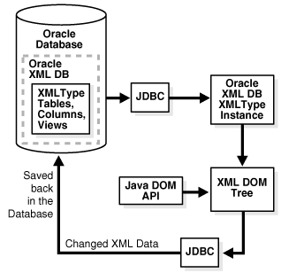

The Java DOM API for `XMLType` lets you operate on `XMLType` instances using a DOM. You can use it to manipulate XML data in Java, including fetching it through Java Database Connectivity (JDBC).

- Overview of Java DOM API for XMLType
  Oracle XML DB supports the Java Document Object Model (DOM) Application Program Interface (API) for `XMLType`. This is a generic API for client and server, for both XML Schema-based and non-schema-based documents.
- Access to XMLType Data Using JDBC
  Java Database Connectivity (JDBC) is a SQL-based way for Java applications to access any data in Oracle Database, including XML documents in Oracle XML DB.
- Manipulating XML Database Documents Using JDBC
  You can update, insert, and delete `XMLType` data stored in the database using Java Database Connectivity (JDBC) with Oracle XML DB.
- Loading a Large XML Document into the Database Using JDBC
  To load a large XML document into the database using Java Database Connectivity (JDBC), use a Java `CLOB` object to hold the document, and use Java method `insertXML()` to perform the insertion.
- MS Windows Java Security Manager Permissions for Java DOM API with a Thick Connection
  If you use Java Security Manager (class `SecurityManager`) on MS Windows to implement a security policy for your application, then you must add certain permissions to your security policy file, in order to use the Java DOM API for `XMLType` with a thick connection.
- Creating XML Schema-Based Documents
  To create XML Schema-based documents, Java DOM API for `XMLType` uses an extension to specify which XML schema URL to use. It also verifies that the DOM being created conforms to the specified XML schema, that is, that the appropriate children are being inserted under the appropriate documents.
- XMLType Instance Representation in Java (JDBC or SQLJ)
  An `XMLType` instance is represented in Java by `oracle.xdb.XMLType`. When an instance of `XMLType` is fetched using JDBC or a SQLJ client, it is automatically manifested as an object of the provided `XMLType` class.
- Classes of Java DOM API for XMLType
  Oracle XML DB supports the W3C DOM Level 2 Recommendation. It also provides Oracle-specific extensions, to facilitate interfacing your application with Oracle XML Developer's Kit for Java. The Java DOM API for `XMLType` provides classes that implement W3C DOM interfaces.
- Using the Java DOM API for XMLType
  Retrieve data from an `XMLType` table or column and obtain a Java `XMLDocument` instance from it. Manipulate elements of the DOM tree for the data using the Java DOM API for `XMLType`.
- Large XML Node Handling with Java
  Oracle XML DB provides abstract streams and stream-manipulation methods that you can use to handle XML nodes that are larger than 64 K bytes. Use Java classes `XMLNode` and `XMLAttr`, together with a thick or kprb connection, to manipulate large nodes.
- Using the Java DOM API and JDBC with Binary XML
  You can use the Java DOM API for XML and Java Database Connectivity (JDBC) to read or write XML data that is encoded as binary XML from or to Oracle XML DB. Doing so involves the usual read and write procedures.

**Related Topics**

- [Using XQuery with XQJ to Access Database Data](query-and-update-XML.md)

**Parent topic:** [XMLType APIs](XMLType-APIs.md)

### 13.1 Overview of Java DOM API for XMLType

Oracle XML DB supports the Java Document Object Model (DOM) Application Program Interface (API) for `XMLType`. This is a generic API for client and server, for both XML Schema-based and non-schema-based documents.

DOM is a tree-based object representation of XML documents in dynamic memory that enables programmatic access to their elements and attributes. The DOM object and interface are part of a W3C recommendation. As discussed in [PL/SQL APIs for XMLType](PLSQL-APIs-for-XMLType.md), the Oracle XML DB DOM APIs are compliant with the W3C DOM Level 1.0 and Level 2.0 Core Recommendation.

The Java DOM API for `XMLType` handles all well-formed XML documents stored in Oracle XML DB. It presents a uniform view of an XML document, whether it is XML Schema-based or non-schema-based and whatever the underlying `XMLType` storage model. The Java DOM API works on both client and server.

The Java DOM API for `XMLType` can be used to construct an `XMLType` instance from data encoded in different character sets.

You can use the Java DOM API for `XMLType` to access XML documents stored in Oracle XML DB Repository from Java applications. Naming conforms to the Java binding for DOM as specified by the W3C DOM Recommendation. The repository can contain both XML schema-based and non-schema-based documents.

To access `XMLType` data using JDBC, use the class `oracle.xdb.XMLType`.

The Java DOM API for `XMLType` is implemented using Java package `oracle.xml.parser.v2`.

**See Also:**

[Oracle Database XML Java API Reference](../jaxml/index.md)

**Parent topic:** Java DOM API for XMLType

### 13.2 Access to XMLType Data Using JDBC

Java Database Connectivity (JDBC) is a SQL-based way for Java applications to access any data in Oracle Database, including XML documents in Oracle XML DB.

You use Java class `oracle.xdb.XMLType` or Java interface `java.sql.SQLXML` to create XML data.

The JDBC 4.0 standard data type for XML data is `java.sql.SQLXML`. Method `getObject()` returns an object of type `oracle.xdb.XMLType`. Starting with Oracle Database 11g Release 2 (11.2.0.3), `oracle.xdb.XMLType` implements interface `java.sql.SQLXML`.

- Using JDBC to Access XML Documents in Oracle XML DB
  JDBC users can query an `XMLType` table to obtain a JDBC `XMLType` interface that supports all SQL/XML functions supported by SQL data type `XMLType`. The Java (JDBC) API for `XMLType` interface can implement the DOM document interface.

**Parent topic:** Java DOM API for XMLType

#### 13.2.1 Using JDBC to Access XML Documents in Oracle XML DB

JDBC users can query an `XMLType` table to obtain a JDBC `XMLType` interface that supports all SQL/XML functions supported by SQL data type `XMLType`. The Java (JDBC) API for `XMLType` interface can implement the DOM document interface.

Example 13-1 illustrates how to use JDBC to query an `XMLType` table.

You can select `XMLType` data using JDBC in any of these ways:

- Use SQL/XML function `XMLSerialize` in SQL, and obtain the result as an `oracle.jdbc.OracleClob` or `java.lang.String` instance in Java. The Java snippet in Example 13-2 illustrates this.

- Call method `getSQLXML()` in the `ResultSet` to obtain the whole `SQLXML` instance. The return value of this method is of type `java.sql.SQLXML`. Then you can use Java methods in interface `SQLXML` to access the data. Example 13-3 shows how to do this.

Example 13-3 shows the use of method `getObject()` to directly obtain an `XMLType` instance from `ResultSet`.

Example 13-4 shows how to bind an output parameter of type `XMLType` to a SQL statement. The output parameter is registered as having data type `XMLType`.

Example 13-1 Querying an XMLType Table Using JDBC

    PreparedStatement statement = connection.prepareStatement("SELECT e.poDoc FROM po_xml_tab e");

    ResultSet resultSet = statement.executeQuery();

    while(resultSet.next())
    {
      // Get result as SQLXML data.
      // Use that to get a DomSource instance.
      SQLXML sqlXml = resultSet.getSQLXML(1);
      DomSource source = sqlXml.getSource(DOMSource.class);

      // Get document from the DomSource instance as a DOM node.
      Document document = (Document) source.getNode();

      // Use the document object
      ...
    }

Example 13-2 Selecting XMLType Data Using getString() and getCLOB()

    PreparedStatement statement = connection.prepareStatement(
      "SELECT XMLSerialize(DOCUMENT e.poDoc AS CLOB) poDoc, " +
      "XMLSerialize(DOCUMENT e.poDoc AS VARCHAR2(2000)) poString " +
      " FROM po_xml_tab e");

    ResultSet resultSet = statement.executeQuery();
    while(resultSet.next())
    {
      // The first result is an OracleClob instance
      OracleClob clob = resultSet.getClob(1));

      // The second result is a String instance
      String poString = resultSet.getString(2);

      // Use clob and poString
      ...
    }

Example 13-3 Returning XMLType Data Using getSQLXML()

    PreparedStatement statement = connection.prepareStatement(
                               "SELECT e.poDoc FROM po_xml_tab e");

    ResultSet resultSet = statement.executeQuery();

    while(resultSet.next())
    {
      // Get the SQLXML
      SQLXML sqlXml = resultSet.getSQLXML(1);

      // Convert the SQLXML to an xmlString instance
      String xmlString = sqlXml.getString();

      //Use the xmlString instance
      ...
    }

Example 13-4 Returning XMLType Data Using an Output Parameter

    public void doCall (String[] args) throws Exception
    {
      //  CREATE OR REPLACE FUNCTION getPurchaseOrder(reference VARCHAR2)
      //  RETURN XMLTYPE
      //  AS
      //    xml XMLTYPE;
      //  BEGIN
      //    SELECT OBJECT_VALUE INTO xml
      //      FROM purchaseorder
      //      WHERE XMLCast(XMLQuery('$p/PurchaseOrder/Reference'
      //                             PASSING OBJECT_VALUE AS "p" RETURNING CONTENT)
      //                    AS VARCHAR2(30))
      //            = reference;
      //      RETURN xml;
      //  END;

      String SQLTEXT = "{? = call getPurchaseOrder('BLAKE-2002100912333601PDT')}";
      super.doSomething(args);
      createConnection();
      try
      {
        System.out.println("SQL := " + SQLTEXT);
        CallableStatement sqlStatement = getConnection().prepareCall(SQLTEXT);
        sqlStatement.registerOutParameter (1, java.sql.Types.SQLXML);
        sqlStatement.execute();

        SQLXML sqlXml = sqlStatement.getSQLXML(1);
        System.out.println(sqlXml.getString());
      }
      catch (SQLException exception)
      {
        if (sqlStatement != null)
        {
          sqlStatement.close();
          throw exception;
        }
      }
    }

**Parent topic:** Access to XMLType Data Using JDBC

### 13.3 Manipulating XML Database Documents Using JDBC

You can update, insert, and delete `XMLType` data stored in the database using Java Database Connectivity (JDBC) with Oracle XML DB.

**Note:**

`XMLType` method `transform()` works only with the OCI driver.

Not all `oracle.xdb.XMLType` functions are supported by the thin JDBC driver. If you do not use `oracle.xdb.XMLType` classes and the OCI driver, you could lose performance benefits associated with the intelligent handling of XML.

You can update, insert, or delete `XMLType` data in either of these ways:

- Bind a string to an `INSERT`, `UPDATE`, or `DELETE` statement, and use the `XMLType` constructor inside SQL to construct the XML instance. Example 13-5 illustrates this.

- Use `setSQLXML()` in a `PreparedStatement` instance to set an entire `XMLType` instance. Example 13-6 illustrates this.

When selecting `SQLXML` values, JDBC describes the column as `SQLXML`. You can select the column type name and compare it with `SQLXML` to see whether you are dealing with a `SQLXML` instance. Example 13-7 illustrates this.

Example 13-8 updates element `discount` inside element `PurchaseOrder` stored in an `XMLType` column. It uses JDBC and `SQLXML`. It uses the XML parser to update a DOM tree and write the updated XML value to the `XMLType` column.

Example 13-9 shows the updated purchase order that results from Example 13-8.

Example 13-5 Updating an XMLType Column Using SQL Constructor XMLType and Java String

    PreparedStatement statement =
        connection.prepareStatement("UPDATE po_xml_tab SET poDoc = XMLType(?)");

    String poString = "<PO><PONO>200</PONO><PNAME>PO_2</PNAME></PO>";

    // Bind the string
    statement.setString(1,poString);
    statement.execute();

Example 13-6 Updating an XMLType Column Using SQLXML

    PreparedStatement statement =
        connection.prepareStatement("UPDATE po_xml_tab SET poDoc = ?");

    String xmlString = "<PO><PONO>200</PONO><PNAME>PO_2</PNAME></PO>";
    SQLXML sqlXml = connection.createSQLXML();
    sqlXml.setString(xmlString);

    // Bind the SQLXML
    statement.setSQLXML(1, sqlXml);
    statement.execute();

Example 13-7 Retrieving Metadata About an XMLType Column Using JDBC

    PreparedStatement statement =
        connection.prepareStatement("SELECT poDoc FROM po_xml_tab");
    ResultSet resultSet = statement.executeQuery();

    // Get the resultSet metadata
    ResultSetMetaData mdata = (ResultSetMetaData)resultSet.getMetaData();

    // The column type is SQLXML
    if (mdata.getColumnType(1) == java.sql.Types.SQLXML)
    {
      // It is a SQLXML instance
    }

Example 13-8 Updating an XMLType Column Using JDBC

    public class UpdateXMLType
    {
      static String qryStr =
        "SELECT x.poDoc from po_xml_tab x " +
        "WHERE XMLCast(XMLQuery('/PO/PONO/text()'" +
        " PASSING x.poDoc RETURNING CONTENT)" +
        " AS NUMBER)" +
        " = 200";

      static String updateXML(String xmlTypeStr)
      {
        System.out.println("\n===============================");
        System.out.println(xmlTypeStr);
        System.out.println("===============================");
        String outXML = null;

        try
        {
          DOMParser parser = new DOMParser();
          parser.setValidationMode(false);
          parser.setPreserveWhitespace (true);
          parser.parse(new StringReader(xmlTypeStr));

          System.out.println("XML string is well-formed");
          XMLDocument document = parser.getDocument();
          NodeList nl = document.getElementsByTagName("DISCOUNT");

          for(int i=0;i<nl.getLength();i++)      {
            XMLElement discount = (XMLElement)nl.item(i);
            XMLNode textNode    = (XMLNode)discount.getFirstChild();
            textNode.setNodeValue("10");
          }

          StringWriter sw = new StringWriter();
          document.print(new PrintWriter(sw));
          outXML = sw.toString();

          //Print modified xml
          System.out.println("\n===============================");
          System.out.println("Updated PurchaseOrder:");
          System.out.println(outXML);
          System.out.println("===============================");
        }
        catch (Exception e)
        {
          e.printStackTrace(System.out);
        }
        return outXML;
      }

      public static void main(String args[]) throws Exception
      {
        try
        {
          PreparedStatement statement = connection.createStatement();
          ResultSet resultSet = statement.executeQuery(qryStr);

          while(orset.next())
          {
            //retrieve PurchaseOrder xml document from database
            SQLXML sqlXml = resultSet.getSQLXML(1);

            //store this PurchaseOrder in po_xml_hist table
            statement = connection.prepareStatement("INSERT INTO po_xml_hist VALUES(?)");
            statement.setSQLXML(1,sqlXml); // bind the SQLXML instance
            statement.execute();

            //update "DISCOUNT" element
            String newXML = updateXML(sqlXml.getString());
            // create a new instance of an XMLtype from the updated value
            SQLXML sqlXml2 = connection.createSQLXML();
            sqlXml2.setString(newXml);

            // update PurchaseOrder xml document in database
            statement = connection.prepareStatement(
                           "UPDATE po_xml_tab x SET x.poDoc =? WHERE " +
                           "XMLCast(XMLQuery('/PO/PONO/text()'" +
                           " PASSING value(xmltab) RETURNING CONTENT)" +
                           " AS NUMBER)" +
                           "= 200");

            statement.setSQLXML(1, sqlXml2); // bind the XMLType instance
            statement.execute();
            connection.commit();
            System.out.println("PurchaseOrder 200 Updated!");
          }

          //delete PurchaseOrder 1001
          statement.execute("DELETE FROM po_xml x WHERE" +
                            "XMLCast(XMLQuery('/PurchaseOrder/PONO/text()'" +
                            " PASSING value(xmltab) RETURNING CONTENT)" +
                            " AS NUMBER)" +
                            "= 1001");

          System.out.println("PurchaseOrder 1001 deleted!");
        }
        catch(Exception e)
        {
          e.printStackTrace(System.out);
        }
      }
    }

Example 13-9 Updated Purchase-Order Document

    <?xml version = "1.0"?>
    <PurchaseOrder>
      <PONO>200</PONO>
      <CUSTOMER>
       <CUSTNO>2</CUSTNO>
       <CUSTNAME>John Nike</CUSTNAME>
       <ADDRESS>
        <STREET>323 College Drive</STREET>
        <CITY>Edison</CITY>
        <STATE>NJ</STATE>
        <ZIP>08820</ZIP>
       </ADDRESS>
       <PHONELIST>
        <VARCHAR2>609-555-1212</VARCHAR2>
        <VARCHAR2>201-555-1212</VARCHAR2>
       </PHONELIST>
      </CUSTOMER>
      <ORDERDATE>20-APR-97</ORDERDATE>
      <SHIPDATE>20-MAY-97 12.00.00.000000 AM</SHIPDATE>
      <LINEITEMS>
       <LINEITEM_TYP LineItemNo="1">
        <ITEM StockNo="1004">
         <PRICE>6750</PRICE>
         <TAXRATE>2</TAXRATE>
        </ITEM>
        <QUANTITY>1</QUANTITY>
        <DISCOUNT>10</DISCOUNT>
       </LINEITEM_TYP>
       <LINEITEM_TYP LineItemNo="2">
        <ITEM StockNo="1011">
         <PRICE>4500.23</PRICE>
         <TAXRATE>2</TAXRATE>
        </ITEM>
        <QUANTITY>2</QUANTITY>
        <DISCOUNT>10</DISCOUNT>
       </LINEITEM_TYP>
      </LINEITEMS>
      <SHIPTOADDR>
       <STREET>55 Madison Ave</STREET>
       <CITY>Madison</CITY>
       <STATE>WI</STATE>
       <ZIP>53715</ZIP>
      </SHIPTOADDR>
    </PurchaseOrder>

**Parent topic:** Java DOM API for XMLType

### 13.4 Loading a Large XML Document into the Database Using JDBC

To load a large XML document into the database using Java Database Connectivity (JDBC), use a Java `CLOB` object to hold the document, and use Java method `insertXML()` to perform the insertion.

If a large XML document (greater than 4000 characters, typically) is inserted into an `XMLType` table or column using a `String` object in JDBC, this run-time error occurs:

    "java.sql.SQLException: Data size bigger than max size for this type"

This error can be avoided by using a Java `OracleClob` object to hold the large XML document. Example 13-10 shows code that uses this technique. It defines `XMLType` method `insertXML()`, which can be used to insert a large XML document into `XMLType` column `purchaseOrder` of table `poTable`. The same approach can be used for an `XMLType` table.

Method `insertXML()` uses an `OracleClob` object that contains the XML document. Interface `OracleClob` is a sub-interface of the standard JDBC interface `java.sql.Clob`. Method `insertXML()` binds the `OracleClob` object to a JDBC prepared statement, which inserts the data into the `XMLType` column.

The prerequisites for using `insertXML()` are as follows:

- Oracle Database, release 9.2.0.1 or later.

- The target database table. Execute the following SQL before running the example:

  `CREATE TABLE poTable (purchaseOrder XMLType);`

The formal parameters of `XMLType` method `insertXML()` are as follows:

- `xmlString` – XML data to be inserted into the `XMLType` column

- `connection` – database connection object (Oracle Connection Object)

Java method `insertXML()` calls method `getCLOB()` to create and return the `CLOB` object that holds the XML data. The formal parameters of method `getCLOB()`, which is defined in Example 13-11, are as follows:

- `xmlString` – XML data to be inserted into the `XMLType` column

- `connection` – database connection object (Oracle Connection Object)

**See Also:**

[Oracle Database SecureFiles and Large Objects Developer's Guide](../adlob/overview-of-supplied-LOB-APIs.md)

Example 13-10 Inserting an XMLType column using JDBC

    private void insertXML(Connection connection, String xmlString)
    {
      OracleClob clob = null;
      try
      {
        String query = "INSERT INTO potable (purchaseOrder) VALUES (XMLType(?)) ";

        // Get the statement Object
        PreparedStatement statement = connection.prepareStatement(query);

        // Get the OracleClob instance from xmlString
        clob = getOracleClob(connection, xmlString);
        statement.setObject(1, clob);

        // Execute the prepared statement
        if (statement.executeUpdate () == 1)
        {
          System.out.println ("Successfully inserted a Purchase Order");
        }
      }
      catch(Exception exp)
      {
        exp.printStackTrace();
      }
      finally
      {
        if(clob !=null)
          clob.close();
      }
    }

Example 13-11 Converting an XML String to an OracleClob Instance

    private OracleClob getOracleClob(Connection connection, String xmlString) throws SQLException
    {
        OracleClob clob =(OracleClob) connection.createClob();
        clob.setString(1, xmlString);
        return clob;
    }

**Parent topic:** Java DOM API for XMLType

### 13.5 MS Windows Java Security Manager Permissions for Java DOM API with a Thick Connection

If you use Java Security Manager (class `SecurityManager`) on MS Windows to implement a security policy for your application, then you must add certain permissions to your security policy file, in order to use the Java DOM API for `XMLType` with a thick connection.

Example 13-12 shows the contents of such a policy file, where the workspace folder that contains the jars related to Oracle XML DB is `c:\myworkspace`. (The policy file must be in the same folder.)

The libraries used in Example 13-12 are `orageneric12` and `oraxml12`. The last two characters (`12` here) must correspond to your major database release number (so for Oracle Database 13 Release 2, for example, you would use `orageneric``13` and `oraxml``13`).

After you have created the policy file, you can invoke your program using the following command-line switches:

    -Djava.security.manager=default -Djava.security.policy=c:\myworkspace\ojdbc.policy

Example 13-12 Policy File Granting Permissions for Java DOM API

    grant codeBase "file:c:\myworkspace" {
      permission java.lang.RuntimePermission "loadLibrary.orageneric12";
      permission java.lang.RuntimePermission "loadLibrary.oraxml12";
    }

    grant codeBase "file:c:\myworkspace\xdb6.jar" {
      permission java.lang.RuntimePermission "loadLibrary.orageneric12";
      permission java.lang.RuntimePermission "loadLibrary.oraxml12";
    }

    grant codeBase "file:c:\myworkspace\ojdbc6.jar" {
      permission java.lang.RuntimePermission "loadLibrary.orageneric12";
      permission java.lang.RuntimePermission "loadLibrary.oraxml12";
    }

**Parent topic:** Java DOM API for XMLType

### 13.6 Creating XML Schema-Based Documents

To create XML Schema-based documents, Java DOM API for `XMLType` uses an extension to specify which XML schema URL to use. It also verifies that the DOM being created conforms to the specified XML schema, that is, that the appropriate children are being inserted under the appropriate documents.

**Note:**

The Java DOM API for `XMLType` does not perform type and constraint checks.

Once the DOM object has been created, it can be saved to Oracle XML DB Repository using the Oracle XML DB resource API for Java. The XML document is stored in the appropriate format:

- As a BLOB instance for non-schema-based documents.

- In the format specified by the XML schema for XML schema-based documents.

Example 13-13 shows how you can use the Java DOM API for `XMLType` to create a DOM object and store it in the format specified by the associated XML schema. Validation against the XML schema is not shown here.

Example 13-13 Creating a DOM Object with the Java DOM API

    PreparedStatement statement = connection.prepareStatement(
                                    "update po_xml_XMLTypetab set poDoc = ? ");
    String xmlString = "<PO><PONO>200</PONO><PNAME>PO_2</PNAME></PO>";

    OracleClob clob = (OracleClob)connection.createClob();
    clob.setString(1, xmlString);
    SQLXML sqlXml    = clob.toSQLXML();

    DOMSource domSource = sqlXml.getSource(DOMSource.class);
    Document  document  = (Document) domSource.getNode();
    Element   rootElem  = document.createElement("PO");
    document.insertBefore(document, rootElem, null);

    SQLXML sqlXml2 = clob.toSQLXML();

    DOMResult domResult = sqlXml2.setResult(DomResult.class);
    domResult.setNode(document);
    statement.setSQLXML(1, sqlXml2);
    statement.execute();

**Parent topic:** Java DOM API for XMLType

### 13.7 XMLType Instance Representation in Java (JDBC or SQLJ)

An `XMLType` instance is represented in Java by `oracle.xdb.XMLType`. When an instance of `XMLType` is fetched using JDBC or a SQLJ client, it is automatically manifested as an object of the provided `XMLType` class.

You can bind objects of this class as values to Data Manipulation Language (DML) statements where an `XMLType` is expected.

**Parent topic:** Java DOM API for XMLType

### 13.8 Classes of Java DOM API for XMLType

Oracle XML DB supports the W3C DOM Level 2 Recommendation. It also provides Oracle-specific extensions, to facilitate interfacing your application with Oracle XML Developer's Kit for Java. The Java DOM API for `XMLType` provides classes that implement W3C DOM interfaces.

`XMLDocument` is a class that represents the DOM for the instantiated XML document. You can retrieve a `SQLXML` instance from a document and a connection object as follows:

    SQLXML sqlXml = connection.createSQLXML();
    DOMResult domResult = sqlXml.setResult(DOMResult.class);
    domResult.setNode(document);

Table 13-1 lists the Java DOM API for `XMLType` classes and the W3C DOM interfaces they implement. The Java DOM API classes are in package `oracle.xml.parser.v2`.

Table 13-1 Java DOM API for XMLType: Classes

| Java DOM API for XMLType Class | W3C DOM Interface Recommendation Class |
|:-------------------------------|:---------------------------------------|
| `XMLDocument`                  | `org.w3c.dom.Document `                |
| `XMLCDATA`                     | `org.w3c.dom.CDataSection `            |
| `XMLComment`                   | `org.w3c.dom.Comment `                 |
| `XMLPI`                        | `org.w3c.dom.ProcessingInstruction `   |
| `XMLText `                     | `org.w3c.dom.Text `                    |
| `XMLEntity`                    | `org.w3c.dom.Entity `                  |
| `DTD`                          | `org.w3c.dom.DocumentType `            |
| `XMLNotation`                  | `org.w3c.dom.Notation `                |
| `XMLAttr`                      | `org.w3c.dom.Attribute `               |
| `XMLDomImplementation`         | `org.w3c.dom.DOMImplementation `       |
| `XMLElement`                   | `org.w3c.dom.Element `                 |
| `XMLAttrList`                  | `org.w3c.dom.NamedNodeMap `            |
| `XMLNode `                     | `org.w3c.dom.Node `                    |

**See Also:**

[Oracle XML DB on OTN](https://www.oracle.com/pls/topic/lookup?ctx=en/database/oracle/oracle-database/19/adxdb&id=otn_db_xmldb_overview) for Oracle extensions for interfacing an application with Oracle XML Developer's Kit for Java

**Parent topic:** Java DOM API for XMLType

### 13.9 Using the Java DOM API for XMLType

Retrieve data from an `XMLType` table or column and obtain a Java `XMLDocument` instance from it. Manipulate elements of the DOM tree for the data using the Java DOM API for `XMLType`.

The Java DOM API for `XMLType` lets you find and retrieve nodes within a document at any level. You can use it to create XML documents programmatically, including on the fly (dynamically). These documents can conform to a registered XML schema or not. The Java API for `XMLType` conforms to the DOM 2.0 recommendation, and it is namespace-aware.

Figure 13-1 illustrates how to use the Java DOM API for `XMLType`.Foot 1 These are the steps:

1.  Retrieve the XML data from the `XMLType` table or `XMLType` column in the table. When you fetch XML data, Oracle creates a `Document` instance. You can then use method `getNode()` to retrieve an `XMLDocument` instance.

2.  Use the Java DOM API for `XMLType` to manipulate elements of the DOM tree. The `XMLType` instance holds the modified data, but the data is sent back using a JDBC update.

The `XMLType` and `XMLDocument` instances should be closed using method `free()` in the respective classes. This frees any underlying memory that is held.

Figure 13-1 Using the Java DOM API for XMLType

[Description of "Figure 13-1 Using the Java DOM API for XMLType"](img_text/adxdb024b.md)

**Parent topic:** Java DOM API for XMLType

### 13.10 Large XML Node Handling with Java

Oracle XML DB provides abstract streams and stream-manipulation methods that you can use to handle XML nodes that are larger than 64 K bytes. Use Java classes `XMLNode` and `XMLAttr`, together with a thick or kprb connection, to manipulate large nodes.

**Note:**

The large-node feature works only with a thick or kprb connection. It does not work with a thin connection.

Prior to Oracle Database 11g Release 1 (11.1), each text node or attribute value processed by Oracle XML DB was limited in size to 64 K bytes. Starting with release 11.1, this restriction no longer applies.

The former restrictions on the size of nodes were because the Java methods to set and get a node value supported only arguments of type `java.lang.String`. The maximum size of a string is dependent on the implementation of the Java VM, but it is bounded. Prior to Release 11.1, the Java DOM APIs to manage a node value, contained within class `oracle.xdb.dom.XDBNode.java`, were these:

    public String getNodeValue ();
    public void setNodeValue (String value);

Prior to Release 11.1, the Java DOM APIs to manage an attribute, contained within class `oracle.xdb.dom.XDBAttribute.java`, were these:

    public String getValue ();
    public void setValue (String value);

Package `oracle.xdb.dom` is deprecated, starting with Oracle Database 11g Release 1 (11.1). Java classes `XDBNode` and `XDBAttribute` in that package are replaced by classes `XMLNode` and `XMLAttr`, respectively, in package `oracle.xml.parser.v2`. In addition, these DOM APIs were extended in Release 11.1 to support text and binary node values of arbitrary size.

- Stream Extensions to Java DOM
  All Java `String`, `Reader`, and `Writer` data is represented in UCS2, which might be different from the database character set. Additionally, node character data is tagged with a character set id, which is set at the time the node value is populated.

**Related Topics**

- [Large Node Handling Using DBMS_XMLDOM](PLSQL-APIs-for-XMLType.md)

**Parent topic:** Java DOM API for XMLType

#### 13.10.1 Stream Extensions to Java DOM

All Java `String`, `Reader`, and `Writer` data is represented in UCS2, which might be different from the database character set. Additionally, node character data is tagged with a character set id, which is set at the time the node value is populated.

The following methods of `oracle.xml.parser.v2.XMLNode.java` can be used to access nodes of size greater than 64 KB. These APIs throw exceptions if you try to get or set a node that is not a leaf node (attribute, `PI`, `CDATA`, and so on). Also, be sure to use `close()` which actually writes the value and frees resources used to maintain the state for streaming access to nodes.

- Get-Pull Model
  You can use methods `getNodeValueAsBinaryStream()` and `getNodeValueAsCharacterStream()` to retrieve the value of a DOM node, using a parser that is in pull mode. Oracle XML DB reads the event data from an input stream written by the parser.
- Get-Push Model
  In this model, you retrieve the value of a DOM node, using a parser that is in push mode. Oracle XML DB writes the node data to an output stream that the parser reads.
- Set-Pull Model
  In this model, you set the value of a DOM node, using a parser that is in pull mode. Oracle XML DB reads the event data from an input stream written by the parser.
- Set-Push Model
  In this model, you set the value of a DOM node, using a parser that is in push mode. Oracle XML DB writes the node data to an output stream that the parser reads.

**Parent topic:** Large XML Node Handling with Java

##### 13.10.1.1 Get-Pull Model

You can use methods `getNodeValueAsBinaryStream()` and `getNodeValueAsCharacterStream()` to retrieve the value of a DOM node, using a parser that is in pull mode. Oracle XML DB reads the event data from an input stream written by the parser.

For a binary input stream:

    public java.io.InputStream getNodeValueAsBinaryStream ()
      throws java.io.IOException,
             DOMException;

Method `getNodeValueAsBinaryStream()` returns an instance of` java.io.InputStream` that can be read using the defined methods for this class. The data type of the node must be `RAW` or `BLOB`. If not, an `IOException` is thrown. The following example fragment illustrates reading the value of a node in binary 50-byte segments:

    ...
    oracle.xml.parser.v2.XMLNode node = null;
    ...
    java.io.InputStream value = node.getNodeValueAsBinaryStream ();
    // now read InputStream...
    byte buffer [] = new byte [50];
    int returnValue = 0;
    while ((returnValue = value.read (buffer)) != -1)
    {
      // process next 50 bytes of node
    }
    ...

For a character input stream:

    public java.io.Reader getNodeValueAsCharacterStream()
      throws java.io.IOException,
             DOMException;

Method `getNodeValueAsCharacterStream()` returns an instance of `java.io.Reader` that can be read using the defined methods for this class. If the data type of the node is neither character nor `CLOB`, the node data is first converted to character. All node data is ultimately in character format and is converted to `UCS2`, if necessary. The following example fragment illustrates reading the node value in segments of 50 characters:

    ...
    oracle.xml.parser.v2.XMLNode node = null;
    ...
    java.io.Reader value = node.getNodeValueAsCharacterStream ();
    // now read InputStream
    char buffer [] = new char [50];
    int returnValue = 0;
    while ((returnValue = value.read (buffer)) != -1)
    {
      // process next 50 characters of node
    }
    ...

**Parent topic:** Stream Extensions to Java DOM

##### 13.10.1.2 Get-Push Model

In this model, you retrieve the value of a DOM node, using a parser that is in push mode. Oracle XML DB writes the node data to an output stream that the parser reads.

For a binary output stream:

    public void getNodeValueAsBinaryStream (java.io.OutputStream pushValue)
      throws java.io.IOException,
             DOMException;

The state of the `java.io.OutputStream` specified by `pushValue` must be open. The data type of the node must be `RAW` or `BLOB`. If not, an `IOException` is thrown. The node binary data is written to `pushValue` using method `write()` of `OutputStream`, and method `close()` is called when the node value has been completely written to the stream.

For a character output stream:

    public void getNodeValueAsCharacterStream (java.io.Writer pushValue)
      throws java.io.IOException,
             DOMException;

The state of the `java.io.Writer` specified by `pushValue` must be open. If the data type of the node is neither character nor `CLOB`, then the data is first converted to character. The node data, always in character format, is converted, as necessary, to `UCS2` and then pushed into the `java.io.Writer`.

**Parent topic:** Stream Extensions to Java DOM

##### 13.10.1.3 Set-Pull Model

In this model, you set the value of a DOM node, using a parser that is in pull mode. Oracle XML DB reads the event data from an input stream written by the parser.

For a binary input stream:

    public void setNodeValueAsBinaryStream (java.io.InputStream pullValue)
      throws java.io.IOException,
             DOMException;

The state of the `java.io.InputStream` specified by `pullValue` must be open. The data type of the node must be `RAW` or `BLOB`. If not, an `IOException` is thrown. The binary data from `pullValue` is read in its entirety using method `read()` of `InputStream` and replaces the node value.

    import java.io.InputStream;
    import oracle.xml.parser.*;
    ...
    oracle.xml.parser.v2.XMLNode node = null;
    ...
    byte [] buffer = new byte [500];
    java.io.InputStream  istream; //user-defined input stream
    node.setNodeValueAsBinaryStream (istream);

For a character input stream:

    public void setNodeValueAsCharacterStream (java.io.Reader pullValue)
      throws java.io.IOException,
             DOMException;

The state of the `java.io.Reader` specified by `pullValue` must be open. If the data type of the node is neither character nor `CLOB`, the character data is converted from `UCS2` to the node data type. If the data type of the node is character or `CLOB`, then the character data read from `pullValue` is converted from `UCS2` to the character set of the node.

**Parent topic:** Stream Extensions to Java DOM

##### 13.10.1.4 Set-Push Model

In this model, you set the value of a DOM node, using a parser that is in push mode. Oracle XML DB writes the node data to an output stream that the parser reads.

For a binary output stream:

    public java.io.OutputStream setNodeValueAsBinaryStream ()
      throws java.io.IOException,
             DOMException;

Method `setNodeValueAsBinaryStream()` returns an instance of `java.io.OutputStream`, into which the caller can write the node value. The data type of the node must be `RAW` or `BLOB`. Otherwise, an `IOException` is raised. The following example fragment illustrates setting the value of a node to binary data by writing to the implementation of `java.io.OutputStream` provided by Oracle XML DB or Oracle XML Developer's Kit.

For a character output stream:

    public java.io.Writer setNodeValueAsCharacterStream ()
      throws java.io.IOException,
             DOMException;

Method `setNodeValueAsCharacterStream()` returns an instance of `java.io.Writer` into which the caller can write the node value. The character data written is first converted from `UCS2` to the node character set, if necessary. If the data type of the node is neither character nor `CLOB`, then the character data is converted to the node data type. Similarly, the following example fragment illustrates setting the value of a node to character data by writing to the implementation of `java.io.Writer` provided by Oracle XML DB or Oracle XML Developer's Kit.

    import java.io.Writer;
    import oracle.xml.parser.*;
    ...
    oracle.xml.parser.v2.XMLNode node = null;
    ...
    char [] buffer = new char [500];
    java.io.Writer  writer = node.setNodeValueAsCharacterStream ();
    for (int k = 0; k < 10; k++)
    {
      byte segment [] = new byte [50];
      // copy next subset of buffer into segment
      writer.write (segment);
    }
    writer.flush ();
    writer.close();

Oracle XML DB creates a `writer` or `OutputStream` and passes it to the user who calls method `write()` repeatedly until the complete node value has been written. The new node value is reflected only when the user calls method `close()`.

**See Also:**

- [Oracle Database XML Java API Reference](../jaxml/index.md)

- [Oracle Database XML C API Reference ](../caxml/package-DOM-API.md) for information about C functions for large nodes

**Parent topic:** Stream Extensions to Java DOM

### 13.11 Using the Java DOM API and JDBC with Binary XML

You can use the Java DOM API for XML and Java Database Connectivity (JDBC) to read or write XML data that is encoded as binary XML from or to Oracle XML DB. Doing so involves the usual read and write procedures.

XML data can be stored in Oracle XML DB using data type `XMLType`, and one of the storage models for this abstract data type is binary XML, a compact, XML Schema-aware encoding of XML data. You can use binary XML as a storage model for `XMLType` in the database, but you can also use it for XML data located outside the database. Client-side processing of XML data can involve data stored in Oracle XML DB or transient data that resides outside the database.

Binary XML is XML Schema-aware and can use various encoding schemes, depending on your needs and your data. Because of this, in order to manipulate binary XML data, you must have both the data and this metadata about the relevant XML schemas and encodings.

For `XMLType` data stored in the database, this metadata is also stored in the database. However, depending on how your database and data are set up, the metadata might not be on the same server as the data it applies to. If this is the case, then, before you can read or write binary XML data from or to the database, you must carry out these steps:

1.  Create a context instance for the metadata.

2.  Associate this context with a data connection that you use to access binary XML data in the database. A data connection can be a dedicated connection or a connection pool. You use methods `getDedicatedConn()` and `getConnPool()` in class `java.sql.Connection` to obtain handles to these two types of connection, respectively.

Then, when your application needs to encode or decode binary XML data on the data connection, it automatically fetches the metadata needed for that. The overall sequence of actions is thus as follows:

1.  Create an XML data connection object, in class `java.sql.Connection`.

2.  Create one or more metadata contexts, as needed, using method `BinXMLMetadataProviderFactory.createDBMetadataProvider()` in package `oracle.xml.binxml`. A metadata context is sometimes referred to as a metadata repository. You can create a metadata context from a dedicated connection or from a connection pool.

3.  Associate the metadata context(s) with the binary XML data connection(s). Use method `DBBinXMLMetadataProvider.associateDataConnection()` in package `oracle.xml.binxml` to do this.

4.  (Optional) If the XML data originated outside of the database, use method `oracle.xdb.XMLType.setFormatPref()` to specify that XML data to be sent to the database be encoded in the binary XML format. This applies to a DOM document (class `oracle.xdb.XMLType`). If you do not specify binary XML, the data is sent to the database as text.

5.  Use the usual Java methods to read and write XML data from and to the database. Whenever it is needed for encoding or decoding binary XML documents, the necessary metadata is fetched automatically using the metadata context.

    Use the Java DOM API for XML to operate on the XML data at the client level.

Example 13-14 illustrates this.

**See Also:**

[Oracle XML Developer's Kit Programmer's Guide](../adxdk/using-binary-XML-with-Java.md)

Example 13-14 Using the Java DOM API with a Binary XML Column

    class PrintBinaryXML
    {
      public static void printBinXML() throws SQLException, BinXMLException
      {
        // Create datasource to connect to local database
        OracleDataSource ods = new OracleDataSource();
        ods.setURL("jdbc:oracle:kprb");

        System.out.println("Starting Binary XML Java Example");

        // Create data connection
        Connection connection = ods.getConnection();
        // Create binary XML metadata context, using connection pool
        DBBinXMLMetadataProvider repos =
          BinXMLMetadataProviderFactory.createDBMetadataProvider();
        repos.setConnectionPool(ods);

        // Associate metadata context with data connection
        repos.associateDataConnection(connection);

        // Query XML data stored in SQLXML column as binary XML
        Statement statement = connection.createStatement();
        ResultSet resultSet = statement.executeQuery("SELECT doc FROM po_binxmltab");

        // Get the SQLXML object
        while (resultSet.next())
        {
          SQLXML sqlXml = resultSet.getSQLXML(1);

          // Convert SQLXML to a String
          String xmlString = sqlXml.getString();
          System.out.println(xmlString);
        }

        resultSet.close();
        statement.close();
        connection.close();

        System.out.println("Completed Binary XML Java Example");
      }
    }

**Related Topics**

- [XMLType Storage Models](intro-to-XML-DB.md)

**Parent topic:** Java DOM API for XMLType

------------------------------------------------------------------------

Footnote Legend

Footnote 1:

This assumes that your XML data is pre-registered with an XML schema, and that it is stored in an `XMLType` column.
