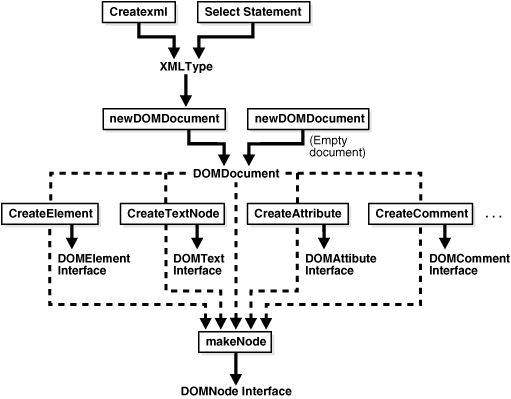
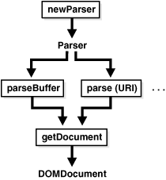
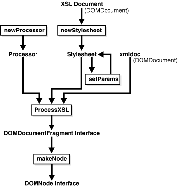

There are several PL/SQL packages that provide APIs for `XMLType`.

- Overview of PL/SQL APIs for XMLType
  The PL/SQL Application Program Interfaces (APIs) for `XMLType` include a DOM API, a parser API, and a processor API.
- PL/SQL DOM API for XMLType (DBMS_XMLDOM)
  The PL/SQL DOM API for `XMLType`, `DBMS_XMLDOM` lets you operate on `XMLType` instances using a DOM.
- PL/SQL Parser API for XMLType (DBMS_XMLPARSER)
  The PL/SQL Parser API for `XMLType` (`DBMS_XMLPARSER`) builds a parsing result tree that can be accessed by PL/SQL APIs. If parsing fails, it raises an error.
- PL/SQL XSLT Processor for XMLType (DBMS_XSLPROCESSOR)
  You can use PL/SQL package `DBMS_XSLPROCESSOR` to transform one XML document to another or to convert XML data into HTML, PDF, or other formats. This package traverses the DOM tree for the document and applies Extensible Stylesheet Language Transformation (XSLT) statements to it to produce the transformed document.

**Parent topic:** [XMLType APIs](XMLType-APIs.md)

### 11.1 Overview of PL/SQL APIs for XMLType

The PL/SQL Application Program Interfaces (APIs) for `XMLType` include a DOM API, a parser API, and a processor API.

- PL/SQL Document Object Model (DOM) API for `XMLType` (package `DBMS_XMLDOM`): For accessing `XMLType` objects. You can access both XML schema-based and non-schema-based documents.

  A **DOM** is a tree-based object representation of an XML document in dynamic memory. It enables programmatic access to its elements and attributes. The DOM object and its interface is a W3C recommendation. It specifies the Document Object Model of an XML document including APIs for programmatic access. DOM views the parsed document as a tree of objects.

- PL/SQL XML Parser API for `XMLType` (package `DBMS_XMLPARSER`): For creating a DOM and accessing the content and structure of XML documents.

- PL/SQL XSLT Processor for `XMLType` (package `DBMS_XSLPROCESSOR`): For transforming XML documents to other formats using XSLT.

<!-- -->

- PL/SQL APIs for XMLType: Features
  You can use the PL/SQL APIs for `XMLType` to create `XMLType` tables, columns, and views; construct `XMLType` instances from data encoded in different character sets; and access and manipulate `XMLType` in various ways.
- PL/SQL APIs for XMLType: References
  The PL/SQL Application Programming Interfaces (APIs) for `XMLType` are described.

**Parent topic:** PL/SQL APIs for XMLType

#### 11.1.1 PL/SQL APIs for XMLType: Features

You can use the PL/SQL APIs for `XMLType` to create `XMLType` tables, columns, and views; construct `XMLType` instances from data encoded in different character sets; and access and manipulate `XMLType` in various ways.

- Lazy Load of XML Data (Lazy Manifestation)
  Lazy XML loading loads rows of data only when they are requested, enhancing scalability of your applications that involve large XML documents and many concurrent users.
- XMLType Data Type Supports XML Schema
  SQL data type `XMLType` supports XML Schema.
- XMLType Supports Data in Different Character Sets
  You can use PL/SQL to create `XMLType` instances from data that is encoded in any Oracle-supported character set. To do this, you use the PL/SQL `XMLType` constructor or `XMLType` method `createXML()`.

**Related Topics**

- [Oracle XML DB Features](intro-to-XML-DB.md)
- [Query and Update of XML Data](query-and-update-XML.md)

**Parent topic:** Overview of PL/SQL APIs for XMLType

##### 11.1.1.1 Lazy Load of XML Data (Lazy Manifestation)

Lazy XML loading loads rows of data only when they are requested, enhancing scalability of your applications that involve large XML documents and many concurrent users.

Because `XMLType` provides a dynamic memory or virtual Document Object Model (DOM), it can use a memory conserving process called lazy XML loading, also sometimes referred to as lazy manifestation. This process optimizes memory usage by only loading rows of data when they are requested. It throws away previously-referenced sections of the document if memory usage grows too large. Lazy XML loading supports highly scalable applications that have many concurrent users needing to access large XML documents.

**Parent topic:** PL/SQL APIs for XMLType: Features

##### 11.1.1.2 XMLType Data Type Supports XML Schema

SQL data type `XMLType` supports XML Schema.

You can create an XML schema and annotate it with mappings from XML to object-relational storage. To take advantage of the PL/SQL DOM API, first create an XML schema and register it. Then, when you create `XMLType` tables and columns, you can specify that these conform to the registered XML schema.

**Parent topic:** PL/SQL APIs for XMLType: Features

##### 11.1.1.3 XMLType Supports Data in Different Character Sets

You can use PL/SQL to create `XMLType` instances from data that is encoded in any Oracle-supported character set. To do this, you use the PL/SQL `XMLType` constructor or `XMLType` method `createXML()`.

The source XML data must be supplied using data type `BFILE` or `BLOB`. The encoding of the data is specified through argument `csid`. When this argument is zero (`0`), the encoding of the source data is determined from the XML prolog, as specified in Appendix F of the XML 1.0 Reference.

**Caution:**

AL32UTF8 is the Oracle Database character set that is appropriate for `XMLType` data. It is equivalent to the IANA registered standard UTF-8 encoding, which supports all valid XML characters.

Do not confuse Oracle Database database character set UTF8 (no hyphen) with database character set AL32UTF8 or with character encoding UTF-8. Database character set UTF8 has been superseded by AL32UTF8. Do not use UTF8 for XML data. Character set UTF8 supports only Unicode version 3.1 and earlier. It does not support all valid XML characters. AL32UTF8 has no such limitation.

Using database character set UTF8 for XML data could potentially stop a system or affect security negatively. If a character that is not supported by the database character set appears in an input-document element name, a replacement character (usually "`?`") is substituted for it. This terminates parsing and raises an exception. It could cause an irrecoverable error.

**Parent topic:** PL/SQL APIs for XMLType: Features

#### 11.1.2 PL/SQL APIs for XMLType: References

The PL/SQL Application Programming Interfaces (APIs) for `XMLType` are described.

Table 11-1 lists the reference documentation for the PL/SQL APIs that you can use to manipulate XML data. The main reference for PL/SQL APIs is [Oracle Database PL/SQL Packages and Types Reference](../arpls/index.md).

**See Also:**

- [Oracle Database XML Java API Reference](../jaxml/index.md) for information about Java APIs for XML

- [Oracle Database XML C API Reference](../caxml/index.md) for information about C APIs for XML

- [Oracle Database XML C++ API Reference](../cpxml/index.md)for information about C++ APIs for XML

Table 11-1 PL/SQL APIs Related to XML

| API                       | Documentation                                                                                                                 | Description                                                                                                                                                   |
|:--------------------------|:------------------------------------------------------------------------------------------------------------------------------|:--------------------------------------------------------------------------------------------------------------------------------------------------------------|
| `XMLType`                 | [Oracle Database PL/SQL Packages and Types Reference, chapter "XMLType"](../arpls/XMLTYPE.md)                                 | PL/SQL APIs with XML operations on `XMLType` data – validation, transformation.                                                                               |
| Database URI types        | [Oracle Database PL/SQL Packages and Types Reference, chapter "Database URI TYPEs"](../arpls/Database-URI-TYPEs.md)           | Functions used for various URI types.                                                                                                                         |
| `DBMS_METADATA`           | [Oracle Database PL/SQL Packages and Types Reference, chapter "DBMS_METADATA"](../arpls/DBMS_METADATA.md)                     | PL/SQL API for retrieving metadata from the database dictionary as XML, or retrieving creation DDL and submitting the XML to re-create the associated object. |
| `DBMS_RESCONFIG`          | [Oracle Database PL/SQL Packages and Types Reference, chapter "DBMS_RESCONFIG"](../arpls/DBMS_RESCONFIG.md)                   | PL/SQL API to operate on a resource configuration list, and to retrieve listener information for a resource.                                                  |
| `DBMS_XDB_ADMIN`          | [Oracle Database PL/SQL Packages and Types Reference, chapter "DBMS_XDB_ADMIN"](../arpls/DBMS_XDB_ADMIN.md)                   | PL/SQL API for the management of Oracle XML DB Repository by database administrators.                                                                         |
| `DBMS_XDB_CONFIG`         | [Oracle Database PL/SQL Packages and Types Reference, chapter "DBMS_XDB_CONFIG"](../arpls/DBMS_XDB_CONFIG.md)                 | PL/SQL API for managing Oracle XML DB configuration sessions.                                                                                                 |
| `DBMS_XDB_CONSTANTS`      | [Oracle Database PL/SQL Packages and Types Reference, chapter "DBMS_XDB_CONSTANTS"](../arpls/DBMS_XDB_CONSTANTS.md)           | PL/SQL constants for use with Oracle XML DB                                                                                                                   |
| `DBMS_XDB_REPOS`          | [Oracle Database PL/SQL Packages and Types Reference, chapter "DBMS_XDB_REPOS"](../arpls/DBMS_XDB_REPOS.md)                   | PL/SQL API for the use of Oracle XML DB Repository by application developers.                                                                                 |
| `DBMS_XDBRESOURCE`        | [Oracle Database PL/SQL Packages and Types Reference, chapter "DBMS_XDBRESOURCE"](../arpls/DBMS_XDBRESOURCE.md)               | PL/SQL API to operate on repository resource metadata and contents.                                                                                           |
| `DBMS_XDBT`               | [Oracle Database PL/SQL Packages and Types Reference, chapter "DBMS_XDBT"](../arpls/DBMS_XDBT.md)                             | PL/SQL API for creation of text indexes on repository resources.                                                                                              |
| `DBMS_XDB_VERSION`        | [Oracle Database PL/SQL Packages and Types Reference, chapter "DBMS_XDB_VERSION"](../arpls/DBMS_XDB_VERSION.md)               | PL/SQL API for version management of repository resources.                                                                                                    |
| `DBMS_XDBZ`               | [Oracle Database PL/SQL Packages and Types Reference, chapter "DBMS_XDBZ"](../arpls/DBMS_XDBZ.md)                             | Oracle XML DB Repository ACL-based security.                                                                                                                  |
| `DBMS_XEVENT`             | [Oracle Database PL/SQL Packages and Types Reference, chapter "DBMS_XEVENT"](../arpls/DBMS_XEVENT.md)                         | PL/SQL API providing event-related types and supporting interface..                                                                                           |
| `DBMS_XMLDOM`             | [Oracle Database PL/SQL Packages and Types Reference, chapter "DBMS_XMLDOM"](../arpls/DBMS_XMLDOM.md)                         | PL/SQL implementation of the DOM API for `XMLType`.                                                                                                           |
| `DBMS_XMLGEN`             | [Oracle Database PL/SQL Packages and Types Reference, chapter "DBMS_XMLGEN"](../arpls/DBMS_XMLGEN.md)                         | PL/SQL API for transformation of SQL query results into canonical XML format.                                                                                 |
| `DBMS_XMLINDEX`           | [Oracle Database PL/SQL Packages and Types Reference, chapter "DBMS_XMLINDEX](../arpls/DBMS_XMLINDEX.md)                      | PL/SQL API for `XMLIndex`.                                                                                                                                    |
| `DBMS_XMLPARSER`          | [Oracle Database PL/SQL Packages and Types Reference, chapter "DBMS_XMLPARSER"](../arpls/DBMS_XMLPARSER.md)                   | PL/SQL implementation of the DOM Parser API for `XMLType`.                                                                                                    |
| `DBMS_XMLSCHEMA`          | [Oracle Database PL/SQL Packages and Types Reference, chapter "DBMS_XMLSCHEMA](../arpls/DBMS_XMLSCHEMA.md)                    | PL/SQL API for managing XML schemas within Oracle Database – schema registration, deletion.                                                                   |
| `DBMS_XMLSCHEMA_ANNOTATE` | [Oracle Database PL/SQL Packages and Types Reference](../arpls/DBMS_XMLSCHEMA_ANNOTATE.md), chapter "DBMS_XMLSCHEMA_ANNOTATE" | PL/SQL API for adding and managing Oracle-specific XML Schema annotations.                                                                                    |
| `DBMS_XMLSTORAGE_MANAGE`  | [Oracle Database PL/SQL Packages and Types Reference](../arpls/DBMS_XMLSTORAGE_MANAGE.md), chapter "DBMS_XMLSTORAGE_MANAGE"   | PL/.SQL API managing and modifying storage of XML data after XML schema registration.                                                                         |
| `DBMS_XMLSTORE`           | [Oracle Database PL/SQL Packages and Types Reference, chapter "DBMS_XMLSTORE"](../arpls/DBMS_XMLSTORE.md)                     | PL/SQL API for storing XML data in relational tables.                                                                                                         |
| `DBMS_XSLPROCESSOR`       | [Oracle Database PL/SQL Packages and Types Reference, chapter "DBMS_XSLPROCESSOR"](../arpls/DBMS_XSLPROCESSOR.md)             | PL/SQL implementation of an XSLT processor.                                                                                                                   |

**Parent topic:** Overview of PL/SQL APIs for XMLType

### 11.2 PL/SQL DOM API for XMLType (DBMS_XMLDOM)

The PL/SQL DOM API for `XMLType`, `DBMS_XMLDOM` lets you operate on `XMLType` instances using a DOM.

- Overview of the W3C Document Object Model (DOM) Recommendation
  The Document Object Model (DOM) recommended by the World Wide Web Consortium (W3C) is a universal API for accessing the structure of XML documents.
- PL/SQL DOM API for XMLType (DBMS_XMLDOM): Features
  Oracle XML DB extends the Oracle Database XML development platform beyond SQL support for storage and retrieval of XML data. It lets you operate on `XMLType` instances using DOM in PL/SQL, Java, and C.
- Application Design Using Oracle XML Developer's Kit and Oracle XML DB
  When you build applications based on Oracle XML DB, you do not need the additional components provided by Oracle XML Developer's Kit (XDK). However, you can use XDK components with Oracle XML DB to deploy a full suite of XML-enabled applications that run end-to-end.
- Preparing XML Data to Use the PL/SQL DOM API for XMLType
  Create an XML schema, annotate it to map XML to SQL objects, and register the XML schema.
- XML Schema Types Are Mapped to SQL Object Types
  An XML schema must be registered with Oracle XML DB before it can be referenced by an XML document. When you register an XML schema, elements and attributes it declares are mapped to attributes of corresponding SQL object types within the database.
- Wrap Existing Data as XML with XMLType Views
  To make existing relational and object-relational data available to your XML applications, you can create `XMLType` views based on it. You can then access the resulting XML data using the PL/SQL DOM API.
- DBMS_XMLDOM Methods Supported by Oracle XML DB
  All `DBMS_XMLDOM` methods are supported by Oracle XML DB, with a few exceptions.
- PL/SQL DOM API for XMLType: Node Types
  The DOM specifies the way elements within an XML document are used to create an object-based tree structure. It defines and exposes interfaces to manage and use the objects stored in XML documents. The DOM supports storage of documents in diverse systems.
- PL/SQL Function NEWDOMDOCUMENT and DOMDOCUMENT Nodes
  PL/SQL function `newDOMDocument` constructs a DOM document handle, given an `XMLType` value. The resulting handle is of type `DOMDocument`.
- DOM NodeList and NamedNodeMap Objects
  When you change the document structure underlying a `DOMDocument` instance, the changes are reflected in all relevant `NodeList` and `NamedNodeMap` objects.
- Overview of Using the PL/SQL DOM API for XMLType (DBMS_XMLDOM)
  Using PL/SQL package `DBMS_XMLDOM` typically involves creating DOM documents, traversing or extending the DOM tree, and creating and manipulating nodes.
- PL/SQL DOM API for XMLType – Examples
  Examples are presented of using the PL/SQL DOM API for `XMLType`.
- Large Node Handling Using DBMS_XMLDOM
  Oracle XML DB provides abstract streams and stream-manipulation methods that you can use to handle XML nodes that are larger than 64 K bytes.
- Get-Push Model for Large Node Handling
  In this model, you retrieve the value of a DOM node, using a parser that is in push mode. Oracle XML DB writes the node data to an output stream that the parser reads.
- Get-Pull Model for Large Node Handling
  In this model, you retrieve the value of a DOM node, using a parser that is in pull mode. Oracle XML DB reads the event data from an input stream written by the parser.
- Set-Pull Model for Large Node Handling
  In this model, you set the value of a DOM node, using a parser that is in pull mode. Oracle XML DB reads the event data from an input stream written by the parser.
- Set-Push Model for Large Node Handling
  In this model, you set the value of a DOM node, using a parser that is in push mode. Oracle XML DB writes the node data to an output stream that the parser reads.
- Determining Binary Stream or Character Stream for Large Node Handling
  You can use subprogram `DBMS_XMLDOM.useBinaryStream` to determine whether to use a character stream or a binary stream to access the content of a large node.

**See Also:**

[Oracle Database PL/SQL Packages and Types Reference](../arpls/DBMS_XMLDOM.md) for descriptions of the individual `DBMS_XMLDOM` methods

**Parent topic:** PL/SQL APIs for XMLType

#### 11.2.1 Overview of the W3C Document Object Model (DOM) Recommendation

The Document Object Model (DOM) recommended by the World Wide Web Consortium (W3C) is a universal API for accessing the structure of XML documents.

The DOM is a universal API for accessing the structure of XML documents. It was originally developed to formalize Dynamic HTML, which is used for animation, interaction, and dynamic updating of Web pages. DOM provides a language-neutral and platform-neutral object model for Web pages and XML documents. DOM describes language-independent and platform-independent interfaces to access and operate on XML components and elements. It expresses the structure of an XML document in a universal, content-neutral way. Applications can be written to dynamically delete, add, and edit the content, attributes, and style of XML documents. DOM makes it possible to create applications that work properly on all browsers, servers, and platforms.

- Oracle XML Developer's Kit Extensions to the W3C DOM Standard
  Oracle XML Developer's Kit (XDK) extends the W3C DOM API. These extensions are supported by Oracle XML DB except for those relating to client-side operations that are not applicable in the database. See the Simple API for XML (SAX) interface in the Oracle XML Developer's Kit Java and C components.
- Supported W3C DOM Recommendations
  All Oracle XML DB APIs for accessing and manipulating XML data comply with standard XML processing requirements as approved by the W3C. The PL/SQL DOM supports Levels 1 and 2 of the W3C DOM specifications.
- Difference Between DOM and SAX
  DOM is the primary generic tree-based API for XML. SAX (Simple API for XML) is the primary generic event-based programming interface between an XML parser and an XML application.

**Parent topic:** PL/SQL DOM API for XMLType (DBMS_XMLDOM)

##### 11.2.1.1 Oracle XML Developer's Kit Extensions to the W3C DOM Standard

Oracle XML Developer's Kit (XDK) extends the W3C DOM API. These extensions are supported by Oracle XML DB except for those relating to client-side operations that are not applicable in the database. See the Simple API for XML (SAX) interface in the Oracle XML Developer's Kit Java and C components.

**See Also:**

[Oracle XML Developer's Kit Programmer's Guide](../adxdk/index.md)

**Parent topic:** Overview of the W3C Document Object Model (DOM) Recommendation

##### 11.2.1.2 Supported W3C DOM Recommendations

All Oracle XML DB APIs for accessing and manipulating XML data comply with standard XML processing requirements as approved by the W3C. The PL/SQL DOM supports Levels 1 and 2 of the W3C DOM specifications.

- DOM Level 1.0 – The first formal Level of the DOM specifications, completed in October 1998. Level 1.0 defines support for XML 1.0 and HTML.

- DOM Level 2.0 – Completed in November 2000, Level 2.0 extends Level 1.0 with support for XML 1.0 with namespaces and adds support for Cascading Style Sheets (CSS) and events (user-interface events and tree manipulation events), and enhances tree manipulations (tree ranges and traversal mechanisms). CSS are a simple mechanism for adding style (fonts, colors, spacing, and so on) to Web documents.

Oracle support for DOM is as follows:

- In Oracle9i release 1 (9.0.1), Oracle XML Developer's Kit for PL/SQL implemented DOM Level 1.0 and parts of DOM Level 2.0.

- In Oracle9i release 2 (9.2) and Oracle Database 10g release 1 (10.1), the PL/SQL API for `XMLType` implements DOM Levels 1.0 and Level 2.0 Core, and is fully integrated in the database through extensions to the `XMLType` API.

**Parent topic:** Overview of the W3C Document Object Model (DOM) Recommendation

##### 11.2.1.3 Difference Between DOM and SAX

DOM is the primary generic tree-based API for XML. SAX (Simple API for XML) is the primary generic event-based programming interface between an XML parser and an XML application.

DOM works by creating objects. These objects have child objects and properties. The child objects have their own child objects and properties, and so on. Objects are referenced either by moving down the object hierarchy or by explicitly giving an HTML element an ID attribute. For example:

    

Examples of structural manipulations are:

- Reordering elements

- Adding or deleting elements

- Adding or deleting attributes

- Renaming elements

**See Also:**

- [Document Object Model (DOM)](https://www.oracle.com/pls/topic/lookup?ctx=en/database/oracle/oracle-database/19/adxdb&id=w3_org_dom)

- [SAX Project](https://www.oracle.com/pls/topic/lookup?ctx=en/database/oracle/oracle-database/19/adxdb&id=sax_project_org)

**Parent topic:** Overview of the W3C Document Object Model (DOM) Recommendation

#### 11.2.2 PL/SQL DOM API for XMLType (DBMS_XMLDOM): Features

Oracle XML DB extends the Oracle Database XML development platform beyond SQL support for storage and retrieval of XML data. It lets you operate on `XMLType` instances using DOM in PL/SQL, Java, and C.

The default action for the PL/SQL DOM API for `XMLType` (`DBMS_XMLDOM`) does the following:

- Produce a parse tree that can be accessed by DOM APIs.

- Validate, if a DTD is found. Otherwise, do not validate.

- Raise an application error if parsing fails.

DTD validation occurs when the object document is manifested. If lazy manifestation is employed, then the document is validated when it is used.

The PL/SQL DOM API exploits a C-based representation of XML in the server and operates on XML schema-based XML instances. The PL/SQL, Java, and C DOM APIs for `XMLType` comply with the W3C DOM Recommendations to define and implement object-relational storage of XML data in relational or object-relational columns and as dynamic memory instances of `XMLType`. See Preparing XML Data to Use the PL/SQL DOM API for XMLType, for a description of W3C DOM Recommendations.

- PL/SQL DOM API Support for XML Schema
  The PL/SQL DOM API for `XMLType` supports XML Schema. Oracle XML DB uses annotations within an XML schema as metadata to determine the structure of an XML document and the mapping of the document to a database schema.
- Enhanced DOM Performance
  Oracle XML DB uses DOM to provide a standard way to translate data between XML and multiple back-end data sources. This eliminates the need to use separate XML translation techniques for the different data sources in your environment.

**Parent topic:** PL/SQL DOM API for XMLType (DBMS_XMLDOM)

##### 11.2.2.1 PL/SQL DOM API Support for XML Schema

The PL/SQL DOM API for `XMLType` supports XML Schema. Oracle XML DB uses annotations within an XML schema as metadata to determine the structure of an XML document and the mapping of the document to a database schema.

**Note:**

For backward compatibility and flexibility, the PL/SQL DOM supports both XML Schema-based documents and non-schema-based documents.

After an XML schema is registered with Oracle XML DB, the PL/SQL DOM API for `XMLType` builds a tree representation of an associated XML document in dynamic memory as a hierarchy of node objects, each with its own specialized interfaces. Most node object types can have child node types, which in turn implement additional, more specialized interfaces. Nodes of some node types can have child nodes of various types, while nodes of other node types must be leaf nodes, which do not have child nodes.

**Parent topic:** PL/SQL DOM API for XMLType (DBMS_XMLDOM): Features

##### 11.2.2.2 Enhanced DOM Performance

Oracle XML DB uses DOM to provide a standard way to translate data between XML and multiple back-end data sources. This eliminates the need to use separate XML translation techniques for the different data sources in your environment.

Applications needing to exchange XML data can use a single native XML database to cache XML documents. Oracle XML DB can thus speed up application performance by acting as an intermediate cache between your Web applications and your back-end data sources, whether they are in relational databases or file systems.

**Related Topics**

- [Java DOM API for XMLType](Java-DOM-API-for-XMLType.md)

**Parent topic:** PL/SQL DOM API for XMLType (DBMS_XMLDOM): Features

#### 11.2.3 Application Design Using Oracle XML Developer's Kit and Oracle XML DB

When you build applications based on Oracle XML DB, you do not need the additional components provided by Oracle XML Developer's Kit (XDK). However, you can use XDK components with Oracle XML DB to deploy a full suite of XML-enabled applications that run end-to-end.

These XDK features are particularly useful for developing XML applications based on Oracle XML DB.

- Simple API for XML (SAX) interface processing. SAX is an XML standard interface provided by XML parsers and used by procedural and event-based applications.

- DOM interface processing, for structural and recursive object-based processing.

Oracle XML Developer's Kit contains the basic building blocks for creating applications that run on a client, in a browser or a plug-in. Such applications typically read, manipulate, transform and view XML documents. To provide a broad variety of deployment options, Oracle XML Developer's Kit is available for Java, C, and C++. Oracle XML Developer's Kit is fully supported and comes with a commercial redistribution license.

Oracle XML Developer's Kit for Java consists of these components:

- XML Parsers – Creates and parses XML using industry standard DOM and SAX interfaces. Supports Java, C, C++, and the Java API for XML Processing (JAXP).

- XSL Processor – Transforms or renders XML into other text-based formats such as HTML. Supports Java, C, and C++.

- XML Schema Processor – Uses XML simple and complex data types. Supports Java, C, and C++.

- XML Class Generator, Oracle JAXB Class Generator – Automatically generate C++ and Java classes, respectively, from DTDs and XML schemas, to send XML data from Web forms or applications. Class generators accept an input file and create a set of output classes that have corresponding functionality. For the XML Class Generator, the input file is a DTD, and the output is a series of classes that can be used to create XML documents conforming with the DTD.

- XML SQL Utility – Generates XML documents, DTDs, and XML schemas from SQL queries. Supports Java.

- TransX Utility – Loads data encapsulated in XML into the database. Has additional functionality useful for installations.

- XML Pipeline Processor – Invokes Java processes through XML control files.

- XSLT VM and Compiler – Provides a high-performance C-based XSLT transformation engine that uses compiled XSL stylesheets.

- XML Java Beans – Parses, transforms, compares, retrieves, and compresses XML documents using Java components.

**See Also:**

[Oracle XML Developer's Kit Programmer's Guide](../adxdk/index.md)

**Parent topic:** PL/SQL DOM API for XMLType (DBMS_XMLDOM)

#### 11.2.4 Preparing XML Data to Use the PL/SQL DOM API for XMLType

Create an XML schema, annotate it to map XML to SQL objects, and register the XML schema.

To prepare data for using PL/SQL DOM APIs in Oracle XML DB:

1.  Create a standard XML schema.
2.  Annotate the XML schema with definitions for the SQL objects you use.
3.  Register the XML schema, to generate the necessary database mappings.

You can then do any of the following:

- Use `XMLType` views to wrap existing relational or object-relational data in XML formats, making it available to your applications in XML form. See Wrap Existing Data as XML with XMLType Views.

- Insert XML data into `XMLType` columns.

- Use Oracle XML DB PL/SQL and Java DOM APIs to manipulate XML data stored in `XMLType` columns and tables.

**Parent topic:** PL/SQL DOM API for XMLType (DBMS_XMLDOM)

#### 11.2.5 XML Schema Types Are Mapped to SQL Object Types

An XML schema must be registered with Oracle XML DB before it can be referenced by an XML document. When you register an XML schema, elements and attributes it declares are mapped to attributes of corresponding SQL object types within the database.

After XML schema registration, XML documents that conform to the XML schema and reference it can be managed by Oracle XML DB. Tables and columns for storing the conforming documents can be created for root elements defined by the XML schema.

An XML schema is registered by using PL/SQL package `DBMS_XMLSCHEMA` and by specifying the schema document and its schema-location URL. This URL is a name that uniquely identifies the registered schema within the database. It need not correspond to any real location — in particular, it need not indicate where the schema document is located.

The target namespace of the schema is another URL used in the XML schema. It specifies a namespace for the XML-schema elements and types. An XML document should specify both the namespace of the root element and the schema-location URL identifying the schema that defines this element.

When documents are inserted into Oracle XML DB using path-based protocols such as HTTP(S) and FTP, the XML schema to which the document conforms is registered implicitly, provided its name and location are specified and it has not yet been registered.

- DOM Fidelity for XML Schema Mapping
  Elements and attributes declared within an XML schema get mapped to separate attributes of the corresponding SQL object type. Other information encoded in an XML document, such as comments, processing instructions, namespace declarations and prefix definitions, and whitespace, is not represented directly.

**Related Topics**

- [XML Schema Storage and Query: Basic](XML-Schema-and-query-basic.md)

**See Also:**

[Oracle Database PL/SQL Packages and Types Reference](../arpls/DBMS_XMLSCHEMA.md) descriptions of the individual `DBMS_XMLSCHEMA` methods

**Parent topic:** PL/SQL DOM API for XMLType (DBMS_XMLDOM)

##### 11.2.5.1 DOM Fidelity for XML Schema Mapping

Elements and attributes declared within an XML schema get mapped to separate attributes of the corresponding SQL object type. Other information encoded in an XML document, such as comments, processing instructions, namespace declarations and prefix definitions, and whitespace, is not represented directly.

To store this additional information, binary attribute `SYS_XDBPD$` is present in all generated SQL object types. This database attribute stores all information in the original XML document that is not stored using the other database attributes. Retaining this accessory information ensures DOM fidelity for XML documents stored in Oracle XML DB: an XML document retrieved from the database is identical to the original document that was stored.

**Note:**

In this book, attribute `SYS_XDBPD$` has been omitted from most examples, for simplicity. However, the attribute is always present in SQL object types generated by schema registration.

**Related Topics**

- [SYS_XDBPD\$ and DOM Fidelity for Object-Relational Storage](XML-Schema-and-query-object-relational-storage.md)

**Parent topic:** XML Schema Types Are Mapped to SQL Object Types

#### 11.2.6 Wrap Existing Data as XML with XMLType Views

To make existing relational and object-relational data available to your XML applications, you can create `XMLType` views based on it. You can then access the resulting XML data using the PL/SQL DOM API.

After you register an XML schema containing annotations that represent the mapping between XML types and SQL object types, you can create an `XMLType` view that conforms to the XML schema.

**Related Topics**

- [XMLType Views](XMLType-views.md)

**Parent topic:** PL/SQL DOM API for XMLType (DBMS_XMLDOM)

#### 11.2.7 DBMS_XMLDOM Methods Supported by Oracle XML DB

All `DBMS_XMLDOM` methods are supported by Oracle XML DB, with a few exceptions.

These methods are not supported by Oracle XML DB:

- `writeExternalDTDToFile()`

- `writeExternalDTDToBuffer()`

- `writeExternalDTDToClob()`

**See Also:**

[Oracle Database PL/SQL Packages and Types Reference](../arpls/DBMS_XMLDOM.md) for descriptions of the individual `DBMS_XMLDOM` methods

**Parent topic:** PL/SQL DOM API for XMLType (DBMS_XMLDOM)

#### 11.2.8 PL/SQL DOM API for XMLType: Node Types

The DOM specifies the way elements within an XML document are used to create an object-based tree structure. It defines and exposes interfaces to manage and use the objects stored in XML documents. The DOM supports storage of documents in diverse systems.

In the DOM specification, the term "document" describes a container for many different kinds of information or data, which the DOM objectifies.

When a request such as `getNodeType(myNode)` is invoked, it returns `myNodeType`, which is the node type supported by the parent node. The following constants represent the different types that a node can adopt:

- `ELEMENT_NODE `

- `ATTRIBUTE_NODE `

- `TEXT_NODE `

- `CDATA_SECTION_NODE `

- `ENTITY_REFERENCE_NODE `

- `ENTITY_NODE `

- `PROCESSING_INSTRUCTION_NODE `

- `COMMENT_NODE `

- `DOCUMENT_NODE `

- `DOCUMENT_TYPE_NODE `

- `DOCUMENT_FRAGMENT_NODE `

- `NOTATION_NODE`

Table 11-2 shows the node types for XML and HTML, and the allowed corresponding child node types.

Table 11-2 XML and HTML DOM Node Types and Their Child Node Types

| Node Type               | Children Node Types                                                                             |
|:------------------------|:------------------------------------------------------------------------------------------------|
| `Document`              | `Element` (maximum of one), `ProcessingInstruction`, `Comment`, `DocumentType` (maximum of one) |
| `DocumentFragment`      | `Element`, `ProcessingInstruction`, `Comment`, `Text`, `CDATASection`, `EntityReference`        |
| `DocumentType`          | No children                                                                                     |
| `EntityReference`       | `Element`, `ProcessingInstruction`, `Comment`, `Text`, `CDATASection`, `EntityReference`        |
| `Element`               | `Element`, `Text`, `Comment`, `ProcessingInstruction`, `CDATASection`, `EntityReference`        |
| `Attr`                  | `Text`, `EntityReference`                                                                       |
| `ProcessingInstruction` | No children                                                                                     |
| `Comment`               | No children                                                                                     |
| `Text`                  | No children                                                                                     |
| `CDATASection`          | No children                                                                                     |
| `Entity`                | `Element`, `ProcessingInstruction`, `Comment`, `Text`, `CDATASection`, `EntityReference`        |
| `Notation`              | No children                                                                                     |

Oracle XML DB DOM API for `XMLType` also specifies the following interfaces:

- A NodeList interface to handle ordered lists of Nodes, for example:

  - The children of a Node

  - Elements returned by method `getElementsByTagName()` of the element interface

- A NamedNodeMap interface to handle unordered sets of nodes, referenced by their name attribute, such as the attributes of an element.

**Parent topic:** PL/SQL DOM API for XMLType (DBMS_XMLDOM)

#### 11.2.9 PL/SQL Function NEWDOMDOCUMENT and DOMDOCUMENT Nodes

PL/SQL function `newDOMDocument` constructs a DOM document handle, given an `XMLType` value. The resulting handle is of type `DOMDocument`.

A typical usage scenario for a PL/SQL application is:

1.  Fetch or construct an `XMLType` instance

2.  Construct a `DOMDocument` node over the `XMLType` instance

3.  Use the DOM API to access and manipulate the XML data

    **Note:**

    For `DOMDocument`, node types represent handles to XML fragments but do not represent the data itself.

    For example, if you copy a node value, `DOMDocument` clones the handle to the same underlying data. Any data modified by one of the handles is visible when accessed by the other handle. The `XMLType` value from which the `DOMDocument` handle is constructed is the data, and reflects the results of all DOM operations on it.

**Parent topic:** PL/SQL DOM API for XMLType (DBMS_XMLDOM)

#### 11.2.10 DOM NodeList and NamedNodeMap Objects

When you change the document structure underlying a `DOMDocument` instance, the changes are reflected in all relevant `NodeList` and `NamedNodeMap` objects.

For example, if a DOM user gets a `NodeList` object containing the children of an element, and then subsequently adds more children to that element (or removes children, or modifies existing children) then those changes automatically propagate to the `NodeList` without additional action from the user. Likewise, changes to a node in the tree are propagated throughout all references to that node in `NodeList` and `NamedNodeMap` objects.

The interfaces: `Text`, `Comment`, and `CDATASection,` all inherit from the `CharacterData` interface.

**Parent topic:** PL/SQL DOM API for XMLType (DBMS_XMLDOM)

#### 11.2.11 Overview of Using the PL/SQL DOM API for XMLType (DBMS_XMLDOM)

Using PL/SQL package `DBMS_XMLDOM` typically involves creating DOM documents, traversing or extending the DOM tree, and creating and manipulating nodes.

Figure 11-1 illustrates the use of PL/SQL DOM API for `XMLType` (`DBMS_XMLDOM`).

- You can create a DOM document (`DOMDocument`) from an existing `XMLType` or as an empty document. Procedure `newDOMDocument` processes the `XMLType` instance or empty document.

  This creates a `DOMDocument` instance.

- You can use DOM API PL/SQL methods such as `createElement()`, `createText()`, `createAttribute()`, and `createComment()` to traverse and extend the DOM tree.

- The results of PL/SQL methods such as `DOMElement()` and `DOMText()` can also be passed to PL/SQL function `makeNode` to obtain the `DOMNode` interface.

Figure 11-1 Using the PL/SQL DOM API for XMLType

[Description of "Figure 11-1 Using the PL/SQL DOM API for XMLType"](img_text/adxdb014.md)

**Parent topic:** PL/SQL DOM API for XMLType (DBMS_XMLDOM)

#### 11.2.12 PL/SQL DOM API for XMLType – Examples

Examples are presented of using the PL/SQL DOM API for `XMLType`.

Remember to call procedure `freeDocument` for each `DOMDocument` instance, when you are through with the instance. This procedure frees the document and all of its nodes. You can still access `XMLType` instances on which `DOMDocument` instances were built, even after the `DOMDocument` instances have been freed.

Example 11-1 creates a hierarchical, representation of an XML document in dynamic memory: a DOM document.

Example 11-1 uses a handle to the DOM document to manipulate it: print it, change part of it, and print it again after the change. Manipulating the DOM document by its handle also indirectly affects the XML data represented by the document, so that querying that data after the change shows the changed result.

The DOM document is created from an `XMLType` variable using PL/SQL function `newDOMDocument`. The handle to this document is created using function `makeNode`. The document is written to a `VARCHAR2` buffer using function `writeToBuffer`, and the buffer is printed using `DBMS_OUTPUT.put_line`.

After manipulating the document using various `DBMS_XMLDOM` procedures, the (changed) data in the `XMLType` variable is inserted into a table and queried, showing the change. It is only when the data is inserted into a database table that it becomes persistent. Until then, it exists in memory only. This persistence is demonstrated by the fact that the database query is made after the document (`DOMDocument` instance) has been freed from dynamic memory.

Example 11-2 creates an empty DOM document, and then adds an element node (`<ELEM>`) to the document. `DBMS_XMLDOM` API node procedures are used to obtain the name (`<ELEM>`), value (`NULL`), and type (`1` = element node) of the element node.

Example 11-1 Creating and Manipulating a DOM Document

    CREATE TABLE person OF XMLType;

    DECLARE
      var       XMLType;
      doc       DBMS_XMLDOM.DOMDocument;
      ndoc      DBMS_XMLDOM.DOMNode;
      docelem   DBMS_XMLDOM.DOMElement;
      node      DBMS_XMLDOM.DOMNode;
      childnode DBMS_XMLDOM.DOMNode;
      nodelist  DBMS_XMLDOM.DOMNodelist;
      buf       VARCHAR2(2000);
    BEGIN
      var := XMLType('<PERSON><NAME>ramesh</NAME></PERSON>');

      -- Create DOMDocument handle
      doc     := DBMS_XMLDOM.newDOMDocument(var);
      ndoc    := DBMS_XMLDOM.makeNode(doc);

      DBMS_XMLDOM.writeToBuffer(ndoc, buf);
      DBMS_OUTPUT.put_line('Before:'||buf);

      docelem := DBMS_XMLDOM.getDocumentElement(doc);

      -- Access element
      nodelist := DBMS_XMLDOM.getElementsByTagName(docelem, 'NAME');
      node := DBMS_XMLDOM.item(nodelist, 0);
      childnode := DBMS_XMLDOM.getFirstChild(node);

      -- Manipulate element
      DBMS_XMLDOM.setNodeValue(childnode, 'raj');
      DBMS_XMLDOM.writeToBuffer(ndoc, buf);
      DBMS_OUTPUT.put_line('After:'||buf);
      DBMS_XMLDOM.freeDocument(doc);
      INSERT INTO person VALUES (var);
    END;
    /

This produces the following output:

    Before:<PERSON>
      <NAME>ramesh</NAME>
    </PERSON>

    After:<PERSON>
      <NAME>raj</NAME>
    </PERSON>

This query confirms that the data has changed:

    SELECT * FROM person;
    SYS_NC_ROWINFO$
    ---------------
    <PERSON>
      <NAME>raj</NAME>
    </PERSON>

    1 row selected.

Example 11-2 Creating an Element Node and Obtaining Information About It

    DECLARE
      doc   DBMS_XMLDOM.DOMDocument;
      elem  DBMS_XMLDOM.DOMElement;
      nelem DBMS_XMLDOM.DOMNode;
    BEGIN
      doc := DBMS_XMLDOM.newDOMDocument;
      elem := DBMS_XMLDOM.createElement(doc, 'ELEM');
      nelem := DBMS_XMLDOM.makeNode(elem);
      DBMS_OUTPUT.put_line('Node name = ' || DBMS_XMLDOM.getNodeName(nelem));
      DBMS_OUTPUT.put_line('Node value = '|| DBMS_XMLDOM.getNodeValue(nelem));
      DBMS_OUTPUT.put_line('Node type = ' || DBMS_XMLDOM.getNodeType(nelem));
      DBMS_XMLDOM.freeDocument(doc);
    END;
    /

This produces the following output:

    Node name = ELEM
    Node value =
    Node type = 1

**Parent topic:** PL/SQL DOM API for XMLType (DBMS_XMLDOM)

#### 11.2.13 Large Node Handling Using DBMS_XMLDOM

Oracle XML DB provides abstract streams and stream-manipulation methods that you can use to handle XML nodes that are larger than 64 K bytes.

Prior to Oracle Database 11g Release 1 (11.1), each text node or attribute value processed by Oracle XML DB was limited in size to 64 K bytes. Starting with release 11.1, this restriction no longer applies.

To overcome this size limitation and allow nodes to contain graphics files, PDF files, and multibyte character encodings, the following abstract streams are available. These abstract PL/SQL streams are analogous to the corresponding Java streams. Each input stream has an associated writer, or data producer, and each output stream has an associated reader, or data consumer.

- Binary Input Stream: This provides the data consumer with read-only access to source data, as a sequential (non-array) linear space of bytes. The consumer has iterative read access to underlying source data (whatever representation) in binary format, that is, read access to source data in unconverted, "raw" format. The consumer sees a sequence of bytes as they exist in the node. There is no specification of the format or representation of the source data. In particular, there is no associated character set.

- Binary Output Stream: This provides the data producer with write-only access to target data as a sequential (non-array) linear space of bytes. The producer has iterative write access to target data in binary format, that is, write access to target data in pure binary format with no data semantics at all. The producer passes a sequence of bytes and the target data is replaced by these bytes. No data conversion occurs.

- Character Input Stream: This provides the data consumer iterative read-only access to source data as a sequential (non-array) linear space of characters, independent of the representation and format of the source data. Conversion of the source data may or may not occur.

- Character Output Stream: This provides the data producer with iterative write-only access to target data as a sequential (non-array) linear space of characters. The producer passes a sequence of characters and the target data is replaced by this sequence of characters. Conversion of the passed data may or may not occur.

Each of the input streams has the following abstract methods: open, read, and close. Each of the output streams has the following abstract methods: open, write, flush, and close. For output streams, you must close the stream before any nodes are physically written.

There are four general node-access models, for reading and writing. Each access model has both binary and character versions. Binary and character stream methods defined on data type `DOMNode` realize these access models.

Your application acts as the client, with the parser as its service provider. The parser mode determines whether the parser or your application drives the stream dataflow.

- For a parser in push mode, your application pushes data to the parser in an output stream, and the parser returns the result of the requested operation.

- For a parser in pull mode, your application pulls data from the parser in an input stream. Each data item in the stream is the result of a parsing event.

Each access model is described in a separate section, with an explanation of the PL/SQL functions and procedures in package `DBMS_XMLDOM` that operate on large nodes. The name of each subprogram reflects whether it reads (“get”) or writes (“set”) data, and whether the parser is being used in push (“push”) or pull (“pull”) mode.

For all except the get-push and set-pull access models (whether binary or character), Oracle supplies a concrete stream that you can use (implicitly). For get-push and set-pull, you must define a subtype of the abstract stream type that Oracle provides, and you must implement its access methods (open, close, and so on). For get-push and set-pull, you then instantiate your stream type and supply your stream as an argument to the access method. So, for example, you would use `my_node.getNodeValueAsCharacterStream(my-stream)` for get-push, but just `my_node.getNodeValueAsCharacterStream()` for get-pull. The latter requires no explicit stream argument, because the concrete stream supplied by Oracle is used.

**Note:**

When you access a character-data stream, the access method you use determines the apparent character set of the nodes accessed. If you use Java to access the stream, then the character set seen by your Java program is UCS2 (or an application-specified character set). If you use PL/SQL to access the stream, then the character set seen by your PL/SQL program is the database-session character set (or an application-specified character set). In all cases, however, the XML data is stored in the database in the database character set.

In the following descriptions, C1 is the character set of the node as stored in the database, and C2 is the character set of the node as seen by your program.

**Related Topics**

- Get-Push Model for Large Node Handling
- Get-Pull Model for Large Node Handling
- Set-Pull Model for Large Node Handling
- Set-Push Model for Large Node Handling
- [Large XML Node Handling with Java](Java-DOM-API-for-XMLType.md)

**See Also:**

- [Oracle Database PL/SQL Packages and Types Reference](../arpls/DBMS_XMLDOM.md)

- [Oracle Database XML Java API Reference](../jaxml/index.md) for information about Java functions for handling large nodes

- [Oracle Database XML C API Reference ](../caxml/package-DOM-API.md)for information about C functions for handling large nodes

**Parent topic:** PL/SQL DOM API for XMLType (DBMS_XMLDOM)

#### 11.2.14 Get-Push Model for Large Node Handling

In this model, you retrieve the value of a DOM node, using a parser that is in push mode. Oracle XML DB writes the node data to an output stream that the parser reads.

To read a node value in this model, your application creates a binary output stream or character output stream and passes this to Oracle XML DB. In this case, the source data is the node value. Oracle XML DB populates the output stream by adding node data to the stream. If the stream is a character output stream, then the character set, C2, is the session character set, and node data is converted, if necessary, from C1 to C2. Additionally, the data type of the node can be any that is supported by Oracle XML DB. If the node data type is not character data then the node data is first converted to character data in C2. If a binary output stream, the data type of the node must be `RAW` or `BLOB`.

The procedures of the `DBMS_XMLDOM` package to be used for this case are:

    PROCEDURE getNodeValueAsBinaryStream (n     IN DBMS_XMLDOM.domnode,
                                          value IN SYS.utl_BinaryOutputStream);

The application passes an implementation of `SYS.utl_BinaryOutputStream` into which Oracle XML DB writes the contents of the node. The data type of the node must be `RAW` or `CLOB` or else an exception is raised.

    PROCEDURE getNodeValueAsCharacterStream (n     IN DBMS_XMLDOM.domnode,
                                             value IN SYS.utl_CharacterOutputStream);

The node data is converted, as necessary, to the session character set and then "pushed" into the `SYS.utl_CharacterOutputStream`.

The following example fragments illustrate reading the node value as binary data and driving the write methods in a user-defined subtype of `SYS.utl_BinaryOutPutStream`, which is called `MyBinaryOutputStream`:

Example 11-3 Creating a User-Defined Subtype of SYS.util_BinaryOutputStream()

    CREATE TYPE MyBinaryOutputStream UNDER SYS.utl_BinaryOutputStream (
        CONSTRUCTOR FUNCTION MyBinaryOutputStream ()
        RETURN SELF AS RESULT,
        MEMBER FUNCTION  write (bytes IN RAW) RETURN INTEGER,
        MEMBER PROCEDURE write (bytes IN RAW, offset IN INTEGER, length IN OUT
               INTEGER),
        MEMBER FUNCTION flush () RETURN BOOLEAN,
        MEMBER FUNCTION close () RETURN BOOLEAN);
    );

    -- Put code here that implements these methods
    ...

Example 11-4 Retrieving Node Value with a User-Defined Stream

    DECLARE
      ostream     MyBinaryOutputStream = MyBinaryOutputStream ();
      node        DBMS_XMLDOM.domnode;
      ...
    BEGIN
      ...
      -- This drives the write methods in MyBinaryOutputStream,
      -- flushes the data, and closes the stream after the value has been
      -- completely written.
      DBMS_XMLDOM.getNodeValueAsBinaryStream (node, ostream);
      ...
    END;

**Parent topic:** PL/SQL DOM API for XMLType (DBMS_XMLDOM)

#### 11.2.15 Get-Pull Model for Large Node Handling

In this model, you retrieve the value of a DOM node, using a parser that is in pull mode. Oracle XML DB reads the event data from an input stream written by the parser.

To read the value of a node in this model, Oracle XML DB creates a binary input stream or character input stream and returns this to the caller. The character set, C2, of the character input stream is the current session character set. Oracle XML DB populates the input stream as the caller pulls the node data from the stream so Oracle XML DB is again the producer of the data. If the stream is a character input stream, then the node data type may be any supported by Oracle XML DB and node data, if character, is converted, if necessary, from C1 to C2. If the node data is non-character, it is converted to character in C2. If a binary input stream, the data type of the node must be `RAW` or `BLOB`.

The functions of the `DBMS_XMLDOM` package to be used for this case are `getNodeValueAsBinaryStream` and `getNodeValueAsCharacterStream`.

    FUNCTION getNodeValueAsBinaryStream(n IN DBMS_XMLDOM.domnode)
             RETURN SYS.utl_BinaryInputStream;

This function returns an instance of the new PL/SQL `SYS.utl_BinaryInputStream` that can be read using defined methods as described in the section Set-Pull Model for Large Node Handling. The node data type must be `RAW` or `BLOB` or else an exception is raised.

    FUNCTION getNodeValueAsCharacterStream (n IN DBMS_XMLDOM.domnode)
             RETURN SYS.utl_CharacterInputStream;

This function returns an instance of the new PL/SQL `SYS.utl_CharacterInputStream` that can be read using defined methods. If the node data is character it is converted to the current session character set. If the node data is not character data, it is first converted to character data.

Example 11-5 illustrates reading a node value as binary data in 50-byte increments:

Example 11-6 illustrates reading a node value as character data in 50-character increments:

Example 11-5 Get-Pull of Binary Data

    DECLARE
      istream      SYS.utl_BinaryInputStream;
      node         DBMS_XMLDOM.domnode;
      buffer       raw(50);
      numBytes     pls_integer;
      ...
    BEGIN
      ...
      istream := DBMS_XMLDOM.getNodeValueAsBinaryStream (node);
      -- Read stream in 50-byte chunks
      LOOP
        numBytes := 50;
        istream.read ( buffer, numBytes);
        if numBytes <= 0 then
           exit;
        end if;
    -- Process next 50 bytes of node value in buffer
    END LOOP
    ...
    END;

Example 11-6 Get-Pull of Character Data

    DECLARE
      istream      SYS.utl_CharacterInputStream;
      node         DBMS_XMLDOM.domnode;
      buffer       varchar2(50);
      numChars     pls_integer;
      ...
    BEGIN
      ...
      istream := DBMS_XMLDOM.getNodeValueAsCharacterStream (node);
    -- Read stream in 50-character chunks
    LOOP
       numChars := 50;
       istream.read ( buffer, numChars);
       IF numChars <= 0 then
          exit;
       END IF;
    -- Process next 50 characters of node value in buffer
    END LOOP
    ...
    END;

**Parent topic:** PL/SQL DOM API for XMLType (DBMS_XMLDOM)

#### 11.2.16 Set-Pull Model for Large Node Handling

In this model, you set the value of a DOM node, using a parser that is in pull mode. Oracle XML DB reads the event data from an input stream written by the parser.

To write a node value in this mode, the application creates a binary input stream or character input stream and passes this to Oracle XML DB.

The character set of the character input stream, C2, is the session character set. Oracle XML DB pulls the data from the input stream and populates the node. If the stream is a character input stream, then the data type of the node may be any supported by Oracle XML DB. If the data type of the node is not character, the stream data is first converted to the node data type. If the node data type is character, then no conversion occurs, so the node data remains in character set C2. If the stream is a `binary input stream`, then the data type of the node must be `RAW` or `BLOB` and no conversion occurs.

The procedures of the `DBMS_XMLDOM` package to be used for this case are `setNodeValueAsBinaryStream` and `setNodeValueAsCharacterStream`.

    PROCEDURE setNodeValueAsBinaryStream(n IN DBMS_XMLDOM.domnode,
              value IN SYS.utl_BinaryInputStream);

The application passes in an implementation of `SYS.utl_BinaryInputStream` from which Oracle XML DB reads data to populate the node. The data type of the node must be `RAW` or `BLOB` or else an exception is raised.

    PROCEDURE setNodeValueAsCharacterStream (n IN DBMS_XMLDOM.domnode,
              value IN SYS.utl_CharacterInputStream);

The application passes in an implementation of `SYS.utl_CharacterInputStream` from which Oracle XML DB reads to populate the node. The data type of the node may be any valid type supported by Oracle XML DB. If it is a non-character data type, the character data read from the stream is converted to the data type of the node. If the data type of the node is either character or `CLOB`, then no conversion occurs and the character set of the node becomes the character set of the PL/SQL session.

Example 11-7 illustrates setting the node value to binary data produced by the read methods defined in a user-defined subtype of `SYS.utl_BinaryInputStream`, which is called `MyBinaryInputStream`:

You can use an object of type `MyBinaryInputStream` to set the value of a node as follows:

    DECLARE
      istream     MyBinaryInputStream = MyBinaryInputStream ();
      node        DBMS_XMLDOM.domnode;
      ...
    BEGIN
      ...
      -- This drives the read methods in MyBinaryInputStream
      DBMS_XMLDOM.setNodeValueAsBinaryStream (node, istream);
      ...
    END;

Example 11-7 Set-Pull of Binary Data

    CREATE TYPE MyBinaryInputStream UNDER SYS.utl_BinaryInputStream (
        CONSTRUCTOR FUNCTION MyBinaryInputStream ()
        RETURN SELF AS RESULT,
      MEMBER FUNCTION read () RETURN RAW,
      MEMBER PROCEDURE read (bytes IN OUT RAW, numbytes IN OUT INTEGER),
      MEMBER PROCEDURE read (bytes IN OUT RAW,
                             offset IN INTEGER,
                             length IN OUT INTEGER),
      MEMBER FUNCTION close () RETURN BOOLEAN);

**Parent topic:** PL/SQL DOM API for XMLType (DBMS_XMLDOM)

#### 11.2.17 Set-Push Model for Large Node Handling

In this model, you set the value of a DOM node, using a parser that is in push mode. Oracle XML DB writes the node data to an output stream that the parser reads.

To write a new node value in this mode, Oracle XML DB creates a binary output stream or character output stream and returns this to the caller. The character set of the character output stream, C2, is the current session character set. The caller pushes data into the output stream and Oracle XML DB then writes this to the Oracle XML DB Node. If the stream is a character output stream, then the data type of the node may be any type supported by Oracle XML DB. In this case, the character data is converted to the node data type. If the node data type is character, then the character set, C1, is changed to C2. No data conversion occurs. If the stream is a binary input stream, and the data type of the node must be `RAW` or `BLOB`. In this case, the stream is read without data conversion.

The procedures of the `DBMS_XMLDOM` package to be used for this case are `setNodeValueAsBinaryStream` and `setNodeValueAsCharacterStream`.

    FUNCTION setNodeValueAsBinaryStream(n IN DBMS_XMLDOM.domnode)
             RETURN SYS.utl_BinaryOutputStream;

This function returns an instance of `SYS.utl_BinaryOutputStream` into which the caller can write the node value. The data type of the node must be `RAW` or `BLOB` or else an exception is raised.

    FUNCTION setNodeValueAsCharacterStream (n IN DBMS_XMLDOM.domnode)
             RETURN SYS.utl_CharacterOutputStream;

This function returns an instance of the PL/SQL `SYS.utl_CharacterOutputStream` type into which the caller can write the node value. The data type of the node can be any valid Oracle XML DB data type. If the type is not character or `CLOB`, the character data written to the stream is converted to the node data type. If the data type of the node is character or `CLOB`, then the character data written to the stream is converted from PL/SQL session character set to the character set of the node

Example 11-8 illustrates setting the value of a node to binary data by writing 50-byte segments into the `SYS.utl_BinaryOutputStream`:

Example 11-8 Set-Push of Binary Data

    DECLARE
      ostream      SYS.utl_BinaryOutputStream;
      node         DBMS_XMLDOM.domnode;
      buffer       raw(500);
      segment      raw(50);
      numBytes     pls_integer;
      offset       pls_integer;
      ...
    BEGIN
      ...
      ostream := DBMS_XMLDOM.setNodeValueAsBinaryStream (node);
      offset := 0;
      length := 500;
      -- Write to stream in 50-byte chunks
      LOOP
        numBytes := 50;
        -- Get next 50 bytes of buffer
        ostream.write ( segment, offset, numBytes);
        length := length - numBytes;
        IF length  <= 0 then
           exit;
        END IF;
      END LOOP
      ostream.close();
      ...
    END;

**Parent topic:** PL/SQL DOM API for XMLType (DBMS_XMLDOM)

#### 11.2.18 Determining Binary Stream or Character Stream for Large Node Handling

You can use subprogram `DBMS_XMLDOM.useBinaryStream` to determine whether to use a character stream or a binary stream to access the content of a large node.

    FUNCTION useBinaryStream (n IN DBMS_XMLDOM.domnode) RETURN BOOLEAN;

This function returns `TRUE` if the data type of the node is `RAW` or `BLOB`, so that the node value may be read or written using either a `SYS.utl_BinaryInputStream` or a `SYS.utl_BinaryOutputStream`. If a value of `FALSE` is returned, the node value can be accessed only using a `SYS.utl_CharacterInputStream` or a `SYS.utl_CharacterOutputStream`.

**Parent topic:** PL/SQL DOM API for XMLType (DBMS_XMLDOM)

### 11.3 PL/SQL Parser API for XMLType (DBMS_XMLPARSER)

The PL/SQL Parser API for `XMLType` (`DBMS_XMLPARSER`) builds a parsing result tree that can be accessed by PL/SQL APIs. If parsing fails, it raises an error.

A software module called an XML parser or processor reads XML documents and provides access to their content and structure. An XML parser usually does its work on behalf of another module, typically the application.

XML documents are made up of storage units, called entities, that contain either parsed or unparsed data. Parsed data is made up of characters, some of which constitute character data and some of which act as markup. Markup encodes a description of the document storage layout and logical structure. XML provides a mechanism for imposing constraints on the storage layout and logical structure.

Figure 11-2 illustrates how to use the PL/SQL Parser for `XMLType` (`DBMS_XMLPARSER`). These are the steps:

1.  Construct a parser instance using PL/SQL method `newParser()`.

2.  Parse XML documents using PL/SQL methods such as `parseBuffer()`, `parseClob()`, and `parse(URI)`. An error is raised if the input is not a valid XML document.

3.  Call PL/SQL function `getDocument` on the parser to obtain a `DOMDocument` interface.

Figure 11-2 Using the PL/SQL Parser API for XMLType

[Description of "Figure 11-2 Using the PL/SQL Parser API for XMLType"](img_text/adxdb015.md)

Example 11-9 parses a simple XML document. It creates an XML parser (instance of `DBMS_XMLPARSER.parser`) and uses it to parse the XML document (text) in variable `indoc`. Parsing creates a DOM document, which is retrieved from the parser using `DBMS_XMLPARSER.getDocument`. A DOM node is created that contains the entire document, and the node is printed. After freeing (destroying) the DOM document, the parser instance is freed using `DBMS_XMLPARSER.freeParser`.

**Note:**

Method `DBMS_XMLPARSER.setErrorLog()` is not supported.

**See Also:**

[Oracle Database PL/SQL Packages and Types Reference](../arpls/DBMS_XMLPARSER.md) for descriptions of individual `DBMS_XMLPARSER` methods

Example 11-9 Parsing an XML Document

    DECLARE
      indoc    VARCHAR2(2000);
      indomdoc DBMS_XMLDOM.DOMDocument;
      innode   DBMS_XMLDOM.DOMNode;
      myparser DBMS_XMLPARSER.parser;
      buf      VARCHAR2(2000);
    BEGIN
      indoc := '<emp><name>De Selby</name></emp>';
      myParser := DBMS_XMLPARSER.newParser;
      DBMS_XMLPARSER.parseBuffer(myParser, indoc);
      indomdoc := DBMS_XMLPARSER.getDocument(myParser);
      innode := DBMS_XMLDOM.makeNode(indomdoc);
      DBMS_XMLDOM.writeToBuffer(innode, buf);
      DBMS_OUTPUT.put_line(buf);
      DBMS_XMLDOM.freeDocument(indomdoc);
      DBMS_XMLPARSER.freeParser(myParser);
    END;
    /

This produces the following output:

    <emp><name>De Selby</name></emp>

**Parent topic:** PL/SQL APIs for XMLType

### 11.4 PL/SQL XSLT Processor for XMLType (DBMS_XSLPROCESSOR)

You can use PL/SQL package `DBMS_XSLPROCESSOR` to transform one XML document to another or to convert XML data into HTML, PDF, or other formats. This package traverses the DOM tree for the document and applies Extensible Stylesheet Language Transformation (XSLT) statements to it to produce the transformed document.

The W3C XSL Recommendation describes rules for transforming a source tree into a result tree. A transformation expressed in XSL is called an **XSLT stylesheet**. The transformation specified is achieved by associating patterns with templates defined in the XSLT stylesheet. A template is instantiated to create part of the result tree. XSLT is widely used to convert XML data to HTML for web browser display.

**Note:**

Oracle XML DB applications do not require a separate XML parser. However, applications requiring external processing can still use the XML Parser for PL/SQL first to expose the document structure. The XML Parser for PL/SQL in Oracle XML Developer's Kit parses an XML document (or a standalone DTD) so that the XML document can be processed by an application, typically running on the client. PL/SQL APIs for `XMLType` are used for applications that run on the server and are natively integrated in the database. Benefits of running applications on the server include performance improvements and enhanced access and manipulation options.

- PL/SQL XSLT Processor for XMLType: Features
  PL/SQL XSLT Processor for `XMLType` (`DBMS_XSLPROCESSOR`) follows the W3C XSLT final recommendation (REC-xslt-19991116). It provides a convenient and efficient way of applying a single XSL stylesheet to multiple documents.
- Using the PL/SQL XSLT Processor API for XMLType (DBMS_XSLPROCESSOR)
  You create an XSLT processor, build a `STYLESHEET` object from a DOM document, transform the document using the processor and the stylesheet, and use the DOM API for `XMLType` to manipulate the result of XSLT processing.

**Related Topics**

- [Transformation and Validation of XMLType Data](transformation-and-validation-of-XMLType-data.md)

**Parent topic:** PL/SQL APIs for XMLType

#### 11.4.1 PL/SQL XSLT Processor for XMLType: Features

PL/SQL XSLT Processor for `XMLType` (`DBMS_XSLPROCESSOR`) follows the W3C XSLT final recommendation (REC-xslt-19991116). It provides a convenient and efficient way of applying a single XSL stylesheet to multiple documents.

The methods in PL/SQL package `DBMS_XSLPROCESSOR` use PL/SQL data types `PROCESSOR` and `STYLESHEET`, which are specific to the XSL Processor implementation. All `DBMS_XSLPROCESSOR` methods are supported by Oracle XML DB, with the exception of method `setErrorLog()`.

**See Also:**

[Oracle Database PL/SQL Packages and Types Reference](../arpls/DBMS_XSLPROCESSOR.md) for descriptions of the individual `DBMS_XSLPROCESSOR` methods

**Parent topic:** PL/SQL XSLT Processor for XMLType (DBMS_XSLPROCESSOR)

#### 11.4.2 Using the PL/SQL XSLT Processor API for XMLType (DBMS_XSLPROCESSOR)

You create an XSLT processor, build a `STYLESHEET` object from a DOM document, transform the document using the processor and the stylesheet, and use the DOM API for `XMLType` to manipulate the result of XSLT processing.

Figure 11-3 illustrates how to use the XSLT Processor for `XMLType` (`DBMS_XSLPROCESSOR`).

Figure 11-3 Using the PL/SQL XSLT Processor for XMLType

[Description of "Figure 11-3 Using the PL/SQL XSLT Processor for XMLType"](img_text/adxdb016.md)

These are the steps:

1.  Construct an XSLT processor using `newProcessor`.

2.  Use `newStylesheet` to build a `STYLESHEET` object from a DOM document.

3.  Optionally, you can set parameters for the `STYLESHEET` object using `setParams`.

4.  Use `processXSL` to transform a DOM document using the processor and `STYLESHEET` object.

5.  Use the PL/SQL DOM API for `XMLType` to manipulate the result of XSLT processing.

Example 11-10 transforms an XML document using procedure `processXSL`. It uses the same parser instance to create two different DOM documents: the XML text to transform and the XSLT stylesheet. An XSL processor instance is created, which applies the stylesheet to the source XML to produce a new DOM fragment. A DOM node (`outnode`) is created from this fragment, and the node content is printed. The output DOM fragment, parser, and XSLT processor instances are freed using procedures `freeDocFrag`, `freeParser`, and `freeProcessor`, respectively.

Example 11-10 Transforming an XML Document Using an XSL Stylesheet

    DECLARE
      indoc      VARCHAR2(2000);
      xsldoc     VARCHAR2(2000);
      myParser   DBMS_XMLPARSER.parser;
      indomdoc   DBMS_XMLDOM.DOMDocument;
      xsltdomdoc DBMS_XMLDOM.DOMDocument;
      xsl        DBMS_XSLPROCESSOR.stylesheet;
      outdomdocf DBMS_XMLDOM.DOMDocumentFragment;
      outnode    DBMS_XMLDOM.DOMNode;
      proc       DBMS_XSLPROCESSOR.processor;
      buf        VARCHAR2(2000);
    BEGIN
      indoc := '<emp><empno>1</empno>
                  <fname>robert</fname>
                  <lname>smith</lname>
                  <sal>1000</sal>
                  <job>engineer</job>
                </emp>';
      xsldoc := '<?xml version="1.0"?>
                 <xsl:stylesheet version="1.0"
                                 xmlns:xsl="http://www.w3.org/1999/XSL/Transform">
                   <xsl:output encoding="utf-8"/>
                   <!-- alphabetizes an xml tree -->
                   <xsl:template match="*">
                     <xsl:copy>
                       <xsl:apply-templates select="*|text()">
                         <xsl:sort select="name(.)" data-type="text"
                                   order="ascending"/>
                       </xsl:apply-templates>
                     </xsl:copy>
                   </xsl:template>
                   <xsl:template match="text()">
                     <xsl:value-of select="normalize-space(.)"/>
                   </xsl:template>
                 </xsl:stylesheet>';
      myParser := DBMS_XMLPARSER.newParser;
      DBMS_XMLPARSER.parseBuffer(myParser, indoc);
      indomdoc   := DBMS_XMLPARSER.getDocument(myParser);
      DBMS_XMLPARSER.parseBuffer(myParser, xsldoc);
      xsltdomdoc := DBMS_XMLPARSER.getDocument(myParser);
      xsl        := DBMS_XSLPROCESSOR.newStyleSheet(xsltdomdoc, '');
      proc       := DBMS_XSLPROCESSOR.newProcessor;
      --apply stylesheet to DOM document
      outdomdocf := DBMS_XSLPROCESSOR.processXSL(proc, xsl, indomdoc);
      outnode    := DBMS_XMLDOM.makeNode(outdomdocf);
      -- PL/SQL DOM API for XMLType can be used here
      DBMS_XMLDOM.writeToBuffer(outnode, buf);
      DBMS_OUTPUT.put_line(buf);
      DBMS_XMLDOM.freeDocument(indomdoc);
      DBMS_XMLDOM.freeDocument(xsltdomdoc);
      DBMS_XMLDOM.freeDocFrag(outdomdocf);
      DBMS_XMLPARSER.freeParser(myParser);
      DBMS_XSLPROCESSOR.freeProcessor(proc);
    END;
    /

This produces the following output:

    <emp>
    <empno>1</empno>
    <fname>robert</fname>
    <job>engineer</job>
    <lname>smith</lname>
    <sal>1000</sal>
    </emp>

**Parent topic:** PL/SQL XSLT Processor for XMLType (DBMS_XSLPROCESSOR)
