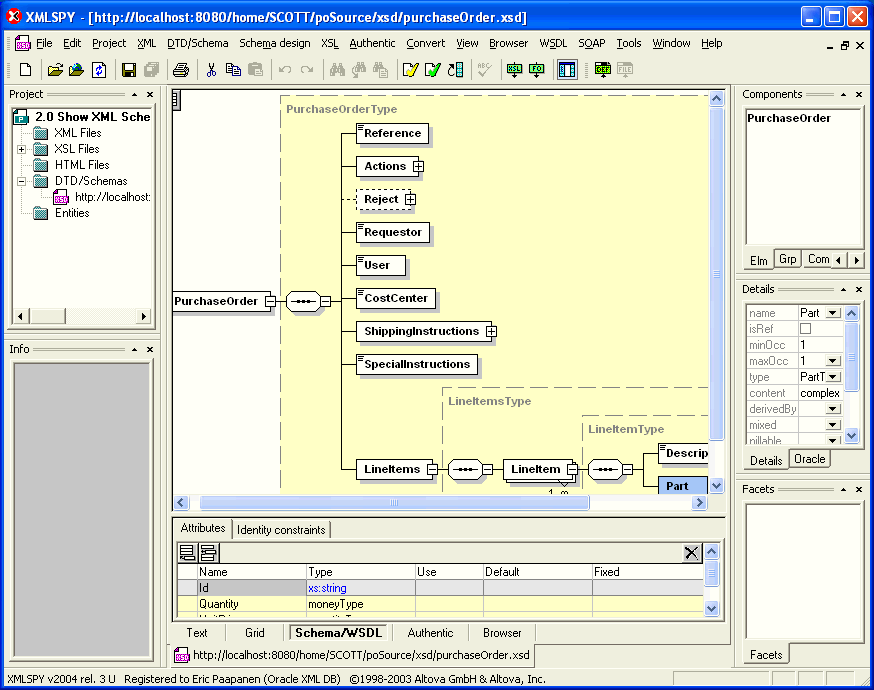
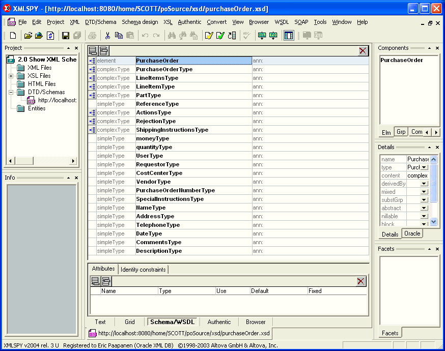
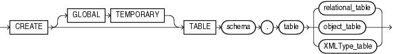
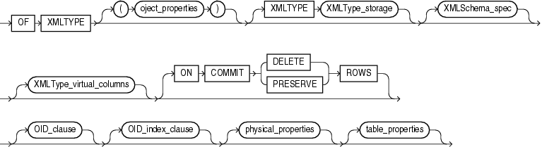
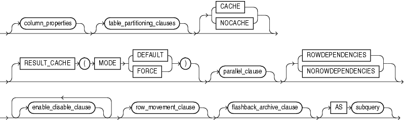
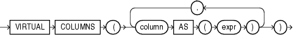
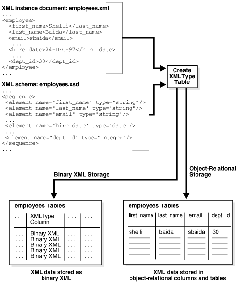

XML Schema is a standard for describing the content and structure of XML documents. You can register, update, and delete an XML schema used with Oracle XML DB. You can define storage structures to use for your XML schema-based data and map XML Schema data types to SQL data types.

The XML Schema Recommendation was created by the World Wide Web Consortium (W3C) to describe the content and structure of XML documents. It includes the full capabilities of Document Type Definitions (DTDs) so that existing DTDs can be converted to XML Schema. XML schemas have additional capabilities compared to DTDs.

- Overview of XML Schema
  The W3C XML Schema Recommendation defines a standardized language for specifying the structure, content, and certain semantics of a set of XML documents. An XML schema can be considered as the metadata that describes a class of XML documents.
- Overview of Using XML Schema with Oracle XML DB
  Oracle XML DB supports registering XML schemas, validating documents against an XML schema, generating XML schemas from SQL object types, mapping from XML Schema to SQL, creating and querying XML Schema-based tables, views, and columns, and automatically inserting data when XML Schema-based documents are inserted into Oracle XML DB Repository.
- XML Schema Registration with Oracle XML DB
  Before an XML schema can be used by Oracle XML DB, you must register it. It can then be used to create `XMLType` tables and columns and to validate XML documents. If schema registration fails then the database is restored to the state it had prior to the registration attempt.
- Creation of XMLType Tables and Columns Based on XML Schemas
  You can create `XMLType` tables and columns that are constrained to a global element defined by an XML schema. After an `XMLType` column has been constrained to a particular element and a particular schema, it can only contain documents that are compliant with the schema definition of that element.
- Ways to Identify XML Schema Instance Documents
  Before an XML document can be inserted into an XML Schema-based `XMLType` table or column, the associated XML schema must be identified. You can do this when you create the table or column, or you can use `XMLSchema-instance` to explicitly add the required schema identification to the XML instance document.
- XML Schema Data Types Are Mapped to Oracle XML DB Storage
  Data that conforms to an XML schema uses XML Schema data types. When this XML data is stored in Oracle XML DB, its storage data types are derived from the XML Schema data types using a default mapping and, optionally, using mapping information that you specify using XML schema annotations.

**See Also:**

- [XML Schema Storage and Query: Object-Relational Storage](XML-Schema-and-query-object-relational-storage.md) for more advanced information about using XML Schema with Oracle XML DB

- [XPath Rewrite for Object-Relational Storage](XPath-rewrite-for-object-relational-storage.md) for information about the optimization of XPath expressions in Oracle XML DB

- [XML Schema Part 0: Primer Second Edition](https://www.oracle.com/pls/topic/lookup?ctx=en/database/oracle/oracle-database/19/adxdb&id=w3_org_tr_xschema0_primer) for an introduction to XML Schema

**Parent topic:** [XML Schema and Object-Relational XMLType](XML-Schema-and-object-relational-XMLType.md)

### 17.1 Overview of XML Schema

The W3C XML Schema Recommendation defines a standardized language for specifying the structure, content, and certain semantics of a set of XML documents. An XML schema can be considered as the metadata that describes a class of XML documents.

This documentation refers to an XML Schema instance definition as an **XML schema** (lowercase).

- XML Schema for Schemas
  The W3C Schema working group publishes an XML schema, often referred to as the "Schema for Schemas". This XML schema provides the definition, or vocabulary, of the XML Schema language. All valid XML schemas can be considered to be members of the class defined by this XML schema.
- XML Schema Features
  XML Schema defines 47 scalar data types, for strong typing of elements and attributes. It supports object-oriented inheritance and extension, so you can design an XML schema with complex objects from base data types. It includes constructs for defining and ordering, default values, mandatory content, nesting, repeated sets, and redefines.
- XML Instance Documents
  Documents conforming to an XML schema can be considered as instances of the class defined by that XML schema. A common use of an XML schema is to validate that a given such **instance document**conforms to the rules defined by the XML schema.
- XML Namespaces and XML Schemas
  An XML schema can specify a `targetNamespace` attribute, whose value is a URL. If omitted, the schema has no target namespace. The target namespace is the namespace for everything defined in the XML schema. The `targetNamespace` value is typically a URL where the XML schema can be accessed.
- Overview of Editing XML Schemas
  You can author and edit XML schemas anyway you like.

**See Also:**

[XML Schema Part 0: Primer](https://www.oracle.com/pls/topic/lookup?ctx=en/database/oracle/oracle-database/19/adxdb&id=w3_org_tr_xschema0_primer) for a general description of the XML Schema recommendation

**Parent topic:** XML Schema Storage and Query: Basic

#### 17.1.1 XML Schema for Schemas

The W3C Schema working group publishes an XML schema, often referred to as the "Schema for Schemas". This XML schema provides the definition, or vocabulary, of the XML Schema language. All valid XML schemas can be considered to be members of the class defined by this XML schema.

An XML schema is thus an XML document that conforms to the class defined by the XML schema published at [`https://www.w3.org/2001/XMLSchema`](https://www.oracle.com/pls/topic/lookup?ctx=en/database/oracle/oracle-database/19/adxdb&id=w3_org_2001_xmlschema).

**Parent topic:** Overview of XML Schema

#### 17.1.2 XML Schema Features

XML Schema defines 47 scalar data types, for strong typing of elements and attributes. It supports object-oriented inheritance and extension, so you can design an XML schema with complex objects from base data types. It includes constructs for defining and ordering, default values, mandatory content, nesting, repeated sets, and redefines.

Oracle XML DB supports all of the constructs defined by XML Schema, except for redefines.

**Parent topic:** Overview of XML Schema

#### 17.1.3 XML Instance Documents

Documents conforming to an XML schema can be considered as instances of the class defined by that XML schema. A common use of an XML schema is to validate that a given such **instance document**conforms to the rules defined by the XML schema.

**Parent topic:** Overview of XML Schema

#### 17.1.4 XML Namespaces and XML Schemas

An XML schema can specify a `targetNamespace` attribute, whose value is a URL. If omitted, the schema has no target namespace. The target namespace is the namespace for everything defined in the XML schema. The `targetNamespace` value is typically a URL where the XML schema can be accessed.

An XML instance document must specify the namespace of the root element of the document (same as the target namespace of the XML schema that the instance conforms to) and the location (URL) of the XML schema that defines this root element. This information is specified by attribute `xsi:schemaLocation`. When the XML schema has no target namespace, use attribute `xsi:noNamespaceSchemaLocation` to specify the schema URL.

**Parent topic:** Overview of XML Schema

#### 17.1.5 Overview of Editing XML Schemas

You can author and edit XML schemas anyway you like.

For example, you can use any of the following:

- A simple text editor, such as Emacs or vi

- An XML Schema-aware editor, such as the XML editor included with Oracle JDeveloper

- An explicit XML Schema authoring tool, such as XMLSpy from Altova Corporation

Figure 17-1 shows a purchase-order XML schema being edited using XMLSpy. XMLSpy is a graphical XML tool from Altova Corporation that you can use to create and edit XML schemas and other XML documents. See [Altova.com](https://www.oracle.com/pls/topic/lookup?ctx=en/database/oracle/oracle-database/19/adxdb&id=altova_com) for details.Foot 1

Figure 17-1 XMLSpy Graphical Representation of a Purchase-Order XML Schema

[Description of "Figure 17-1 XMLSpy Graphical Representation of a Purchase-Order XML Schema"](img_text/po_spy.md)

**Parent topic:** Overview of XML Schema

### 17.2 Overview of Using XML Schema with Oracle XML DB

Oracle XML DB supports registering XML schemas, validating documents against an XML schema, generating XML schemas from SQL object types, mapping from XML Schema to SQL, creating and querying XML Schema-based tables, views, and columns, and automatically inserting data when XML Schema-based documents are inserted into Oracle XML DB Repository.

XML schemas are stored in Oracle XML DB as `XMLType` instances, just like the XML documents that reference them. You must register an XML schema with Oracle XML DB in order to use it with XML data that is stored in the database.

Oracle XML DB takes advantage of the strong typing and other features of XML Schema to process XML database data safely and efficiently.

To be registered with Oracle XML DB, an XML schema must conform to the **root XML Schema**, **XDBSchema.xsd**. This is the XML schema for Oracle XML DB XML schemas. You can access `XDBSchema.xsd` at Oracle XML DB Repository location `/sys/schemas/PUBLIC/xmlns.oracle.com/xdb/XDBSchema.xsd`.

Oracle XML DB uses annotated XML schemas as metadata. The standard XML Schema definitions are used, along with several Oracle namespace attributes. These attributes determine how XML instance documents get mapped to the database. Because these attributes are in a different namespace from the XML Schema namespace, such annotated XML schemas respect the XML Schema standard.

Oracle XML DB provides XML Schema support for the following tasks:

- Registering W3C-compliant XML schemas, both local and global.

- Validating your XML documents against registered XML schema definitions.

- Generating XML schemas from SQL object types.

- Referencing an XML schema owned by another user.

- Referencing a global XML schema when a local XML schema exists with the same name.

- Generating a database mapping from your XML schemas during XML schema registration. This includes generating SQL object types, collection types, and default tables, and capturing the mapping information using XML schema attributes.

- Specifying a particular SQL data type mapping when there are multiple allowed mappings.

- Creating `XMLType` tables, views, and columns based on registered XML schemas.

- Manipulating and querying XML schema-based `XMLType` tables.

- Automatically inserting data into default tables when XML schema-based documents are inserted into Oracle XML DB Repository using protocols (FTP, HTTP(S)/WebDAV) and languages other than SQL.

<!-- -->

- Why Use XML Schema with Oracle XML DB?
  Common reasons to use XML Schema include validation, constraint definition, storage specification, and optimization of document insertion, storage, and access.
- Overview of Annotating an XML Schema to Control Naming, Mapping, and Storage
  The W3C XML Schema Recommendation lets vendor-specific annotations be added to an XML schema. Oracle XML DB uses annotations to control the mapping between an XML schema and various database features. You can use annotations to specify which tables store XML data. Annotation is especially useful for object-relational storage.
- DOM Fidelity
  DOM fidelity means that all information in an XML document is preserved except whitespace that is insignificant. You can use DOM fidelity to ensure the accuracy and integrity of XML documents stored in Oracle XML DB.
- XMLType Methods Related to XML Schema
  The most important `XMLType` methods for working with XML schemas are: `isSchemaBased()`, `getSchemaURL()`, `schemaValidate()`, `isSchemaValid()`, `isSchemaValidated()`, and `setSchemaValidated()`.

**Parent topic:** XML Schema Storage and Query: Basic

#### 17.2.1 Why Use XML Schema with Oracle XML DB?

Common reasons to use XML Schema include validation, constraint definition, storage specification, and optimization of document insertion, storage, and access.

- The most common use of XML Schema is as a mechanism for validating that XML instance documents conform to a given XML schema, that is, verify that your XML data conforms to its intended definition. This definition includes data types, numbers of allowed item occurrences, and allowed lengths of items.

- An XML schema can also be used as a constraint when creating `XMLType` tables or columns. For example, the table or column can be constrained to store only XML documents that compliant with one of the global elements defined by the XML schema.

- Oracle XML DB also uses XML Schema as a mechanism for defining how the contents of an `XMLType` instance should be stored inside the database. Both binary XML and object-relational storage models for `XMLType` support the use of XML Schema. When `XMLType` data is stored object-relationally, XML Schema is used to efficiently map XML Schema data types to SQL data types and object-relational tables and columns.

- XML schema information can also improve the efficiency of document insertion when you storing XML Schema-based documents in Oracle XML DB using protocols FTP and HTTP(S).

- When XML instances must be handled without any prior information about them, XML schemas can be useful in predicting optimum storage, fidelity, and access.

**Related Topics**

- [XMLType Storage Models](intro-to-XML-DB.md)

**Parent topic:** Overview of Using XML Schema with Oracle XML DB

#### 17.2.2 Overview of Annotating an XML Schema to Control Naming, Mapping, and Storage

The W3C XML Schema Recommendation lets vendor-specific annotations be added to an XML schema. Oracle XML DB uses annotations to control the mapping between an XML schema and various database features. You can use annotations to specify which tables store XML data. Annotation is especially useful for object-relational storage.

You can use XML schema annotations with Oracle XML DB to do the following:

- Specify which database tables are used to store the XML data.

- Override the default mapping between XML Schema data types and SQL data types, for object-relational storage.

- Name the database objects and attributes that are created to store XML data (for object-relational storage).

[Example A-2](oracle-supplied-XML-schemas-and-examples.md) shows an annotated purchase-order XML schema. It defines the following two XML namespaces:

- `http://www.w3c.org/2001/XMLSchema`. This is reserved by W3C for the Schema for Schemas.

- `http://xmlns.oracle.com/xdb`. This is reserved by Oracle for the Oracle XML DB schema annotations.

Before annotating an XML schema you must declare the Oracle XML DB namespace. The Oracle XML DB namespace is `http://xmlns.oracle.com/xdb`. [Example A-2](oracle-supplied-XML-schemas-and-examples.md) makes use of the namespace prefix `xdb` to abbreviate the Oracle XML DB namespace.

[Example A-2](oracle-supplied-XML-schemas-and-examples.md) uses several XML schema annotations, including the following:

- `defaultTable` annotation in the `PurchaseOrder` element. This specifies that XML documents, compliant with this XML schema are stored in a database table called `purchaseorder`.

- `SQLType` annotation.

  The first occurrence of annotation `SQLType` specifies that the name of the SQL data type generated from `complexType` element `PurchaseOrderType` is `purchaseorder_t`.

  The second occurrence of annotation `SQLType` specifies that the name of the SQL data type generated from `complexType` element `LineItemType` is `lineitem_t`.

- `SQLCollType` annotation. This specifies that the name of the SQL varray type that manages the collection of `LineItem` elements is `lineitem_v`.

- `SQLName` annotation. This provides an explicit name for each SQL object attribute of `purchaseorder_t`.

Figure 17-2 shows the XMLSpy Oracle tab, which facilitates adding Oracle XML DB annotations to an XML schema while working in the graphical editor.

Figure 17-2 XMLSpy Support for Oracle XML DB Schema Annotations

[Description of "Figure 17-2 XMLSpy Support for Oracle XML DB Schema Annotations"](img_text/annot_spy.md)

**Parent topic:** Overview of Using XML Schema with Oracle XML DB

#### 17.2.3 DOM Fidelity

DOM fidelity means that all information in an XML document is preserved except whitespace that is insignificant. You can use DOM fidelity to ensure the accuracy and integrity of XML documents stored in Oracle XML DB.

**Document Object Model (DOM) fidelity** is the concept of retaining the structure of a retrieved XML document, compared to the original XML document, for DOM traversals.

With DOM fidelity, XML data retrieved from the database has the same information as before it was inserted into the database, with the single exception of insignificant whitespace. The term "DOM fidelity" is used because this kind of fidelity is particularly important for DOM traversals.

With binary XML storage of XML data, all of the significant information is encoded in the binary XML format, ensuring DOM fidelity.

**See Also:**

[SYS_XDBPD\$ and DOM Fidelity for Object-Relational Storage](XML-Schema-and-query-object-relational-storage.md) for information about DOM fidelity and object-relational storage of XML data

**Parent topic:** Overview of Using XML Schema with Oracle XML DB

#### 17.2.4 XMLType Methods Related to XML Schema

The most important `XMLType` methods for working with XML schemas are: `isSchemaBased()`, `getSchemaURL()`, `schemaValidate()`, `isSchemaValid()`, `isSchemaValidated()`, and `setSchemaValidated()`.

Table 17-1 XMLType Methods Related to XML Schema

| XMLType Method                                                                             | Description                                                                                                                                                                                                                                       |
|:-------------------------------------------------------------------------------------------|:--------------------------------------------------------------------------------------------------------------------------------------------------------------------------------------------------------------------------------------------------|
| `isSchemaBased()`                                                                          | Returns `TRUE` if the `XMLType` instance is based on an XML schema, `FALSE` otherwise.                                                                                                                                                            |
| `getSchemaURL() `                                                                          | The XML schema URL for an `XMLType` instance.                                                                                                                                                                                                     |
| `schemaValidate()` `isSchemaValid()` `isSchemaValidated()` `setSchemaValidated()` | Validation of an `XMLType` instance against a registered XML schema: validate, check validation status, or set recorded validation status. See [Transformation and Validation of XMLType Data](transformation-and-validation-of-XMLType-data.md). |

**Parent topic:** Overview of Using XML Schema with Oracle XML DB

### 17.3 XML Schema Registration with Oracle XML DB

Before an XML schema can be used by Oracle XML DB, you must register it. It can then be used to create `XMLType` tables and columns and to validate XML documents. If schema registration fails then the database is restored to the state it had prior to the registration attempt.

Like all DDL operations, XML schema registration is non-transactional. However, registration is atomic, in this sense:

- If registration succeeds then the operation is auto-committed.

- If registration fails then the database is rolled back to the state it had before registration began.

Because XML schema registration potentially involves creating object types and tables, error recovery involves dropping any types and tables thus created. The entire XML schema registration process is guaranteed to be atomic: either it succeeds or the database is restored to its state before the start of registration.

Two items are required to register an XML schema with Oracle XML DB:

- The XML schema document

- A string that can be used as a unique identifier for the XML schema, after it is registered with Oracle Database. XML instance documents use this unique identifier to identify themselves as members of the class defined by the XML schema. The identifier is typically in the form of a URL, and is often referred to as the **schema location hint** or the **document location hint**.

**Note:**

The act of registering an XML schema has no effect on the status of any instance documents that are already loaded into Oracle XML DB Repository and that reference that XML schema.

Such instance documents were treated as non XML-schema-based when they were loaded. They remain such. After schema registration, you must delete such documents and reload them, in order to obtain XML schema-based documents.

- XML Schema Registration Actions
  As part of registering an XML schema, Oracle XML DB performs several actions that facilitate storing, accessing, and manipulating XML instances that conform to the XML schema.
- Registering an XML Schema with Oracle XML DB
  An example illustrates the use of PL/SQL procedure `DBMS_XMLSCHEMA.registerSchema` to register an XML schema. The main parameters of this procedure are the schema URL, the schema source document, the character-set ID of the source-document encoding, and options that specify how the schema should be registered.
- SQL Types and Tables Created During XML Schema Registration
  Registration of an XML schema results in the creation of object types and tables.
- Default Tables for Global Elements
  By default, tables with system-generated names are created for all global elements. You can specify names to use instead. You can prevent the creation of default tables for particular elements, which can reduce processor time and space used, especially if an XML schema contains many global element definitions.
- Database Objects That Depend on Registered XML Schemas
  Several kinds of database object can depend on registered XML schemas: tables, views, other XML schemas, and cursors that reference an XML schema.
- Local and Global XML Schemas
  An XML schema can be registered as local (visible only to its owner, by default) or global (visible to all database users, by default).
- Fully Qualified XML Schema URLs
  Fully qualified XML schema URLs permit explicit reference to particular XML schemas. The name of the database user owning the XML schema is specified as part of the URL. Fully qualified schema URLs belong to the Oracle XML DB namespace.
- Deletion of an XML Schema
  You can delete a registered XML schema using procedure `DBMS_XMLSCHEMA.``deleteSchema`.
- Listing All Registered XML Schemas
  An example lists all XML schemas that are registered with Oracle XML DB.

**Parent topic:** XML Schema Storage and Query: Basic

#### 17.3.1 XML Schema Registration Actions

As part of registering an XML schema, Oracle XML DB performs several actions that facilitate storing, accessing, and manipulating XML instances that conform to the XML schema.

These include:

- Mapping XML Schema data types to Oracle XML DB storage. When XML schema-based data is stored, its storage data types are derived from the XML Schema data types using a default mapping and, optionally, using mapping information that you specify using XML schema annotations. For binary XML storage, XML Schema types are mapped to binary XML encoding types. For object-relational storage, XML schema registration creates the appropriate SQL object types for the object-relational storage of conforming documents.

- Creating default tables. XML schema registration generates default `XMLType` tables for all global elements. You can use XML-schema annotations to control the names of the tables, and to provide column-level and table-level storage clauses and constraints for use during table creation.

After XML schema registration, documents that reference the XML schema using the XML Schema instance mechanism can be processed automatically by Oracle XML DB. For XML data that is stored object-relationally, `XMLType` tables and columns can be created that are constrained to the global elements defined by the XML schema.

**Related Topics**

- XML Schema Data Types Are Mapped to Oracle XML DB Storage
- [Default Tables Created during XML Schema Registration](XML-Schema-and-query-object-relational-storage.md)
- [Oracle XML Schema Annotations](XML-Schema-and-query-object-relational-storage.md)

**Parent topic:** XML Schema Registration with Oracle XML DB

#### 17.3.2 Registering an XML Schema with Oracle XML DB

An example illustrates the use of PL/SQL procedure `DBMS_XMLSCHEMA.registerSchema` to register an XML schema. The main parameters of this procedure are the schema URL, the schema source document, the character-set ID of the source-document encoding, and options that specify how the schema should be registered.

The main parameters to `DBMS_XMLSCHEMA.registerSchema` are as follows:

- `SCHEMAURL` – the XML schema URL. This is a unique identifier for the XML schema within Oracle XML DB. It is conventionally in the form of a URL, but this is not a requirement. The XML schema URL is used with Oracle XML DB to identify instance documents, by making the schema location hint identical to the XML schema URL. Oracle XML DB never tries to access a Web server identified by the specified URL.

  **Note:**

  - You cannot register an XML schema using the same `SCHEMAURL` as any system-defined XML schema.

  - The non-protocol part of the URL must be unique. The protocol part (for example, `http` or `https`) is ignored in the test for uniqueness.

- `SCHEMADOC` – The XML schema source document. This is a `VARCHAR`, `CLOB`, `BLOB`, `BFILE`, `XMLType`, or `URIType` value.

- `CSID` – The character-set ID of the source-document encoding, when `schemaDoc` is a `BFILE` or `BLOB` value.

- `OPTIONS` – Options that specify how the XML schema should be registered. The most important option is `REGISTER_BINARYXML`, which indicates that the XML schema is used for binary XML storage. Another option is `REGISTER_NT_AS_IOT`, which forces OCTs to be stored as index-organized tables (IOTs).

**See Also:**

[Oracle Database PL/SQL Packages and Types Reference](../arpls/DBMS_XMLSCHEMA.md)

Example 17-1 registers the annotated XML schema of [Example A-2](oracle-supplied-XML-schemas-and-examples.md).

In [Example A-2](oracle-supplied-XML-schemas-and-examples.md), the unique identifier for the XML schema is:

    http://localhost:8080/source/schemas/poSource/xsd/purchaseOrder.xsd

The XML schema document was previously loaded into Oracle XML DB Repository at this path: `/source/schemas/poSource/xsd/purchaseOrder.xsd`.

During XML schema registration, option `SCHEMADOC` specifies that PL/SQL constructor `XDBURIType` is to access the content of the XML schema document, based on its location in the repository. Other options passed to procedure `registerSchema` specify that the schema in [Example A-2](oracle-supplied-XML-schemas-and-examples.md) is to be registered as a local XML schema (option `LOCAL`), and that SQL objects, and that tables are to be generated during the registration process (option `GENTABLES`).

PL/SQL procedure `DBMS_XMLSCHEMA.registerSchema` performs the following operations:

- Parses and validates the XML schema.

- Creates a set of entries in Oracle Data Dictionary that describe the XML schema.

- Creates a set of SQL object definitions, based on `complexType` elements defined in the XML schema.

- Creates an `XMLType` table for each global element defined by the XML schema.

By default, when an XML schema is registered, Oracle XML DB automatically generates all of the SQL object types and `XMLType` tables required to manage the instance documents. An XML schema can be registered as global or local.

**See Also:**

[Oracle Database PL/SQL Packages and Types Reference](../arpls/DBMS_XMLSCHEMA.md) for information about `DBMS_XMLSCHEMA.registerSchema`

Example 17-1 Registering an XML Schema Using DBMS_XMLSCHEMA.REGISTERSCHEMA

    BEGIN
      DBMS_XMLSCHEMA.registerSchema(
        SCHEMAURL => 'http://localhost:8080/source/schemas/poSource/xsd/purchaseOrder.xsd',
        SCHEMADOC => XDBURIType('/source/schemas/poSource/xsd/purchaseOrder.xsd').getCLOB(),
        LOCAL     => TRUE,
        GENTYPES  => TRUE,
        GENTABLES => TRUE);
    END;
    /

**Related Topics**

- Local and Global XML Schemas
- SQL Types and Tables Created During XML Schema Registration

**Parent topic:** XML Schema Registration with Oracle XML DB

#### 17.3.3 SQL Types and Tables Created During XML Schema Registration

Registration of an XML schema results in the creation of object types and tables.

Example 17-2 shows the SQL type definitions that were created during an XML schema registration such as that of Example 17-1. These SQL type definitions include:

- `purchaseorder_t`. This type is used to persist the SQL objects generated from a `PurchaseOrder` element. When an XML document containing a `PurchaseOrder` element is stored in Oracle XML DB the document is broken up, and the contents of the document are stored as an instance of `purchaseorder_t`.

- `lineitems_t`, `lineitem_v`, and `lineitem_t`. These types manage the collection of `LineItem` elements that may be present in a `PurchaseOrder` document. Type `lineitems_t` consists of a single attribute `lineitem`, defined as an instance of type `lineitem_v`. Type `lineitem_v` is defined as a varray of `linteitem_t` objects. There is one instance of the `lineitem_t` object for each `LineItem` element in the document.

Example 17-2 Objects Created During XML Schema Registration

    DESCRIBE purchaseorder_t
     purchaseorder_t is NOT FINAL
     Name                                      Null?    Type
     ----------------------------------------- -------- ----------------------------
     SYS_XDBPD$                                         XDB.XDB$RAW_LIST_T
     REFERENCE                                          VARCHAR2(30 CHAR)
     ACTIONS                                            ACTIONS_T
     REJECTION                                          REJECTION_T
     REQUESTOR                                          VARCHAR2(128 CHAR)
     USERID                                             VARCHAR2(10 CHAR)
     COST_CENTER                                        VARCHAR2(4 CHAR)
     SHIPPING_INSTRUCTIONS                              SHIPPING_INSTRUCTIONS_T
     SPECIAL_INSTRUCTIONS                               VARCHAR2(2048 CHAR)
     LINEITEMS                                          LINEITEMS_T

    DESCRIBE lineitems_t
     lineitems_t is NOT FINAL
     Name                                      Null?    Type
     ----------------------------------------- -------- ----------------------------
     SYS_XDBPD$                                         XDB.XDB$RAW_LIST_T
     LINEITEM                                           LINEITEM_V

    DESCRIBE lineitem_v
     lineitem_v VARRAY(2147483647) OF LINEITEM_T
     LINEITEM_T is NOT FINAL
     Name                                      Null?    Type
     ----------------------------------------- -------- ----------------------------
     SYS_XDBPD$                                         XDB.XDB$RAW_LIST_T
     ITEMNUMBER                                         NUMBER(38)
     DESCRIPTION                                        VARCHAR2(256 CHAR)
     PART                                               PART_T

**Parent topic:** XML Schema Registration with Oracle XML DB

#### 17.3.4 Default Tables for Global Elements

By default, tables with system-generated names are created for all global elements. You can specify names to use instead. You can prevent the creation of default tables for particular elements, which can reduce processor time and space used, especially if an XML schema contains many global element definitions.

By default, when an XML schema is registered with the database, Oracle XML DB generates a default table for each global element defined by the XML schema.

You can use attribute `xdb:defaultTable` to specify the name of the default table for a given global element. Each `xdb:defaultTable` attribute value you provide must be unique among all schemas registered by a given database user. If you do not supply a nonempty default table name for some element, then a unique name is provided automatically.

In practice, however, you do not want to create a default table for most global elements. Elements that never serve as the root element for an XML instance document do not need default tables — such tables are never used. Creating default tables for all global elements can lead to significant overhead in processor time and space used, especially if an XML schema contains a large number of global element definitions.

As a general rule, then, you want to prevent the creation of a default table for any global element (or any local element stored out of line) that you are sure will not be used as a root element in any document. You can do this in one of the following ways:

- Add the annotation `xdb:defaultTable = ``""` (empty string) to the definition of each global element that will not appear as the root element of an XML instance document. Using this approach, you allow automatic default-table creation, in general, and you prohibit it explicitly where needed, using `xdb:defaultTable = ""`.

- Set parameter `GENTABLES` to `FALSE` when registering the XML schema, and then manually create the default table for each global element that can legally appear as the root element of an instance document. Using this approach, you inhibit automatic default-table creation, and you create only the tables that are needed, by hand.

**Parent topic:** XML Schema Registration with Oracle XML DB

#### 17.3.5 Database Objects That Depend on Registered XML Schemas

Several kinds of database object can depend on registered XML schemas: tables, views, other XML schemas, and cursors that reference an XML schema.

More precisely:

- Tables or views that have an `XMLType` column that conforms to an element in an XML schema.

- Other XML schemas that include or import a given XML schema as part of their definition.

- Cursors that reference an XML schema. This includes references within functions of package `DBMS_XMLGEN`. Such cursors are purely transient objects.

**Parent topic:** XML Schema Registration with Oracle XML DB

#### 17.3.6 Local and Global XML Schemas

An XML schema can be registered as local (visible only to its owner, by default) or global (visible to all database users, by default).

When you register an XML schema, PL/SQL package `DBMS_XMLSCHEMA` adds a corresponding resource to Oracle XML DB Repository. The XML schema URL determines the path name of the XML schema resource in the repository (and it is associated with parameter `SCHEMAURL` of PL/SQL procedure `DBMS_XMLSCHEMA.registerSchema`).

**Note:**

In Oracle Enterprise Manager, local and global registered XML schemas are referred to as **private** and **public**, respectively.

- Local XML Schema
  By default, an XML schema is local, meaning that it belongs to you alone, after you register it with Oracle XML DB. A reference to the XML schema document is stored in Oracle XML DB Repository under your user (database schema) name.
- Global XML Schema
  In contrast to local XML schemas, a privileged user can register an XML schema as global by specifying an argument to registration function `DBMS_XMLSCHEMA`. are visible to all users. They are stored under folder `/sys/schemas/PUBLIC/` in Oracle XML DB Repository.

**Parent topic:** XML Schema Registration with Oracle XML DB

##### 17.3.6.1 Local XML Schema

By default, an XML schema is local, meaning that it belongs to you alone, after you register it with Oracle XML DB. A reference to the XML schema document is stored in Oracle XML DB Repository under your user (database schema) name.

Such XML schemas are referred to as **local**. By default, they are usable only by you, the owner. In Oracle XML DB, local XML schema resources are created under folder `/sys/schemas/``username`. The rest of the repository path name is derived from the schema URL.

For example, if the XML schema `purchaseOrder.xsd` is registered as a local schema by user `QUINE`, it is given this path name:

    /sys/schemas/QUINE/xmlns.oracle.com/xdb/documentation/purchaseOrder.xsd

Database users need appropriate permissions and Access Control Lists (ACLs) to create a resource with a given path name, in order to register the XML schema as a local XML schema. Some ways in which a local XML schema can be registered require one or more of the following privileges:

- `ALTER SESSION`

- `CREATE PROCEDURE`

- `CREATE SESSION`

- `CREATE TABLE`

- `CREATE TRIGGER`

- `CREATE TYOE`

**Note:**

Typically, only the owner of the XML schema can use it to define `XMLType` tables, columns, or views, validate documents, and so on. However, Oracle XML DB supports fully qualified XML schema URLs. For example: `http://xmlns.oracle.com/xdb/schemas/QUINE/xmlns.oracle.com/xdb/documentation/purchaseOrder.xsd`. Privileged users can use such an extended URL to specify XML schemas belonging to other users (in this case, user `QUINE`).

Example 17-3 Registering a Local XML Schema

    BEGIN
      DBMS_XMLSCHEMA.registerSchema(
        SCHEMAURL => 'http://xmlns.oracle.com/xdb/documentation/purchaseOrder.xsd',
        SCHEMADOC => bfilename('XMLDIR','purchaseOrder.xsd'),
        LOCAL     => TRUE,
        GENTYPES  => TRUE,
        GENTABLES => FALSE,
        CSID      => nls_charset_id('AL32UTF8'));
    END;
    /

**Related Topics**

- [Repository Access Control](repository-access-control.md)

**Parent topic:** Local and Global XML Schemas

##### 17.3.6.2 Global XML Schema

In contrast to local XML schemas, a privileged user can register an XML schema as global by specifying an argument to registration function `DBMS_XMLSCHEMA`. are visible to all users. They are stored under folder `/sys/schemas/PUBLIC/` in Oracle XML DB Repository.

**Note:**

Access to folder `/sys/schemas/PUBLIC` is controlled by access control lists (ACLs). By default, this folder is writable only by a database administrator. You need write privileges on this folder to register global XML schemas. Role `XDBADMIN` provides write access to this folder, assuming that it is protected by the default ACLs. See [Repository Access Control](repository-access-control.md).

You can register a local schema with the same URL as an existing global schema. A local schema always shadows (hides) any global schema with the same name (URL).

Example 17-4 illustrates the registration of a global schema.

Example 17-4 Registering a Global XML Schema

    GRANT XDBADMIN TO QUINE;

    Grant succeeded.

    CONNECT quine
    Enter password: password

    Connected.

    BEGIN
      DBMS_XMLSCHEMA.registerSchema(
        SCHEMAURL => 'http://xmlns.oracle.com/xdb/documentation/purchaseOrder.xsd',
        SCHEMADOC => bfilename('XMLDIR','purchaseOrder.xsd'),
        LOCAL     => FALSE,
        GENTYPES  => TRUE,
        GENTABLES => FALSE,
        CSID      => nls_charset_id('AL32UTF8'));
    END;
    /

If this global XML schema is registered by user `QUINE`, it is given this path name:

    /sys/schemas/PUBLIC/xmlns.oracle.com/xdb/documentation/purchaseOrder.xsd

Database users need appropriate permissions (ACL access) to create this resource in order to register the XML schema as global.

**Parent topic:** Local and Global XML Schemas

#### 17.3.7 Fully Qualified XML Schema URLs

Fully qualified XML schema URLs permit explicit reference to particular XML schemas. The name of the database user owning the XML schema is specified as part of the URL. Fully qualified schema URLs belong to the Oracle XML DB namespace.

By default, XML schema URLs are referenced within the scope of the current database user. XML schema URLs are first resolved as the names of local XML schemas owned by the current user.

- If there are no such XML schemas, then they are resolved as names of global XML schemas.

- If there are no global XML schemas either, then Oracle XML DB raises an error.

The Oracle XML DB namespace is:

    http://xmlns.oracle.com/xdb/schemas/<database-user>/<schemaURL-minus-protocol>

For example, suppose there is a registered global XML schema with the URL `http://www.example.com/po.xsd`, and user `QUINE` has a local registered XML schema with the same URL. Another user can reference the schema owned by `QUINE` as follows using this fully qualified XML Schema URL:

    http://xmlns.oracle.com/xdb/schemas/QUINE/www.example.com/po.xsd

The fully qualified URL for the global XML schema is:

    http://xmlns.oracle.com/xdb/schemas/PUBLIC/www.example.com/po.xsd

**Related Topics**

- Local and Global XML Schemas

**Parent topic:** XML Schema Registration with Oracle XML DB

#### 17.3.8 Deletion of an XML Schema

You can delete a registered XML schema using procedure `DBMS_XMLSCHEMA.``deleteSchema`.

This does the following, by default:

1.  Checks that the current user has the appropriate privileges to delete the resource corresponding to the XML schema within Oracle XML DB Repository. You can control which users can delete which XML schemas, by setting the appropriate ACLs on the XML schema resources.

2.  Checks whether there are any tables dependent on the XML schema that is to be deleted. If so, raises an error and cancels the deletion. This check is not performed if option `delete_invalidate` or `delete_cascade_force` is used. In that case, no error is raised.

3.  Removes the XML schema document from the Oracle XML DB Repository (folder `/sys/schemas`).

4.  Removes the XML schema document from `DBA_XML_SCHEMAS`, unless it was registered for use with binary XML instances and neither `delete_invalidate` nor `delete_cascade_force` is used.

5.  Drops the default table, if either `delete_cascade` or `delete_cascade_force` is used. Raises an error if `delete_cascade` is specified and there are instances in other tables that are also dependent on the XML schema.

The following values are available for option `DELETE_OPTION` of procedure `DBMS_XMLSCHEMA.deleteSchema`:

- `DELETE_RESTRICT` – Raise an error and cancel deletion if dependencies are detected. This is the default behavior.

- `DELETE_INVALIDATE` – Do not raise an error if dependencies are detected. Instead, mark each of the dependencies as being invalid.

- `DELETE_CASCADE` – Drop all types and default tables that were generated during XML schema registration. Raise an error if there are instances that depend upon the XML schema that are stored in tables other than the default table. However, do not raise an error for any such instances that are stored in `XMLType` columns that were created using `ANY_SCHEMA`. If the XML schema was registered for use with binary XML, do not remove it from `DBA_XML_SCHEMAS`.

- `DELETE_CASCADE_FORCE` – Drop all types and default tables that were generated during XML schema registration. Do not raise an error if there are instances that depend upon the XML schema that are stored in tables other than the default table. Instead, mark each of the dependencies as being invalid. Remove the XML schema from `DBA_XML_SCHEMAS`.

**See Also:**

[Oracle Database PL/SQL Packages and Types Reference](../arpls/DBMS_XMLSCHEMA.md)

Example 17-5 illustrates the use of `DELETE_CASCADE_FORCE`.

If an XML schema was registered for use with binary XML, it is not removed from `DBA_XML_SCHEMAS` when you delete it using option `DELETE_RESTRICT` (the default value) or `DELETE_CASCADE`. Therefore, although you can no longer use the XML schema to encode new XML instance documents, any existing documents in Oracle XML DB that reference the XML schema can still be decoded using it.

This remains the case until you remove the XML schema from `DBA_XML_SCHEMAS` using `DBMS_XMLSCHEMA.``purgeSchema`. Oracle recommends that, in general, you use `delete_restrict` or `delete_cascade`. Instead of using `DELETE_CASCADE_FORCE`, call `DBMS_XMLSCHEMA.purgeSchema` when you are sure you no longer need the XML schema.

Procedure `purgeSchema` removes the XML schema completely from Oracle XML DB. In particular, it removes it from `DBA_XML_SCHEMAS`. Before you use `DBMS_XMLSCHEMA.purgeSchema`, be sure that you have transformed all existing XML documents that reference the XML schema to be purged, so they reference a different XML schema or no XML schema. Otherwise, it will be impossible to decode them after the purge.

Example 17-5 Deleting an XML Schema with DBMS_XMLSCHEMA.DELETESCHEMA

    BEGIN
      DBMS_XMLSCHEMA.deleteSchema(
        SCHEMAURL => 'http://xmlns.oracle.com/xdb/documentation/purchaseOrder.xsd',
        DELETE_OPTION => DBMS_XMLSCHEMA.DELETE_CASCADE_FORCE);
    END;
    /

**Parent topic:** XML Schema Registration with Oracle XML DB

#### 17.3.9 Listing All Registered XML Schemas

An example lists all XML schemas that are registered with Oracle XML DB.

Example 17-6 shows how to use PL/SQL procedure `DBMS_XMLSCHEMA.registerSchema` to obtain a list of all XML schemas registered with Oracle XML DB. You can also examine views `USER_XML_SCHEMAS`, `ALL_XML_SCHEMAS`, `USER_XML_TABLES`, and `ALL_XML_TABLES`.

Example 17-6 Data Dictionary Table for Registered Schemas

    DESCRIBE DBA_XML_SCHEMAS

    Name         Null? Type
    ------------ ----- -----------------------
    OWNER              VARCHAR2(30)
    SCHEMA_URL         VARCHAR2(700)
    LOCAL              VARCHAR2(3)
    SCHEMA             XMLTYPE(XMLSchema "http://xmlns.oracle.com/xdb/XDBSchema.xsd"
                               Element "schema")
    INT_OBJNAME        VARCHAR2(4000)
    QUAL_SCHEMA_URL    VARCHAR2(767)
    HIER_TYPE          VARCHAR2(11)
    BINARY             VARCHAR2(3)
    SCHEMA_ID          RAW(16)
    HIDDEN             VARCHAR2(3)

    SELECT OWNER, LOCAL, SCHEMA_URL FROM DBA_XML_SCHEMAS;

    OWNER   LOC   SCHEMA_URL
    -----   ---   ----------------------
    XDB     NO    http://xmlns.oracle.com/xdb/XDBSchema.xsd
    XDB     NO    http://xmlns.oracle.com/xdb/XDBResource.xsd
    XDB     NO    http://xmlns.oracle.com/xdb/acl.xsd
    XDB     NO    http://xmlns.oracle.com/xdb/dav.xsd
    XDB     NO    http://xmlns.oracle.com/xdb/XDBStandard.xsd
    XDB     NO    http://www.w3.org/2001/xml.xsd
    XDB     NO    http://xmlns.oracle.com/xdb/stats.xsd
    XDB     NO    http://xmlns.oracle.com/xdb/xdbconfig.xsd
    SCOTT   YES   http://xmlns.oracle.com/xdb/documentation/purchaseOrder.xsd

    13 rows selected.

    DESCRIBE DBA_XML_TABLES

    Name         Null? Type
    ------------ ----- -----------------------
    OWNER              VARCHAR2(30)
    TABLE_NAME         VARCHAR2(30)
    XMLSCHEMA          VARCHAR2(700)
    SCHEMA_OWNER       VARCHAR2(30)
    ELEMENT_NAME       VARCHAR2(2000)
    STORAGE_TYPE       VARCHAR2(17)
    ANYSCHEMA          VARCHAR2(3)
    NONSCHEMA          VARCHAR2(3)

    SELECT TABLE_NAME FROM DBA_XML_TABLES
      WHERE XMLSCHEMA = 'http://xmlns.oracle.com/xdb/documentation/purchaseOrder.xsd';

    TABLE_NAME
    ---------------------
    PurchaseOrder1669_TAB

    1 row selected.

**Parent topic:** XML Schema Registration with Oracle XML DB

### 17.4 Creation of XMLType Tables and Columns Based on XML Schemas

You can create `XMLType` tables and columns that are constrained to a global element defined by an XML schema. After an `XMLType` column has been constrained to a particular element and a particular schema, it can only contain documents that are compliant with the schema definition of that element.

You constrain an `XMLType` table column to a particular element and XML schema by adding appropriate `XMLSCHEMA` and `ELEMENT` clauses to the `CREATE TABLE` operation.

Figures Figure 17-3 through Figure 17-6 show the syntax for creating an `XMLType` table.

**See Also:**

[Oracle Database SQL Language Reference](../sqlrf/CREATE-TABLE.md) for the complete description of `CREATE TABLE`, including syntax elements such as `object_properties`.

**Note:**

To create an `XMLType` table in a different database schema from your own, you must have not only privilege `CREATE ANY TABLE` but also privilege `CREATE ANY INDEX`. This is because a unique index is created on column `OBJECT_ID` when you create the table. Column `OBJECT_ID` stores a system-generated object identifier.

Figure 17-3 Creating an XMLType Table – CREATE TABLE Syntax

[Description of "Figure 17-3 Creating an XMLType Table – CREATE TABLE Syntax"](img_text/create_table.md)

Figure 17-4 Creating an XMLType Table – XMLType_table Syntax

[Description of "Figure 17-4 Creating an XMLType Table – XMLType_table Syntax"](img_text/xmltype_table.md)

Figure 17-5 Creating an XMLType Table – table_properties Syntax

[Description of "Figure 17-5 Creating an XMLType Table – table_properties Syntax"](img_text/table_properties.md)

Figure 17-6 Creating an XMLType Table – XMLType_virtual_columns Syntax

[Description of "Figure 17-6 Creating an XMLType Table – XMLType_virtual_columns Syntax"](img_text/xmltype_virtual_columns.md)

**Note:**

- Clause `XMLType_virtual_columns` can be used only for `XMLType` data that is stored as binary XML. In particular, if you use it for data that is stored object-relationally, and if you use a partitioning clause, then an error is raised.

- For XML data, virtual columns are used primarily for partitioning or defining SQL constraints. If your need is to project out specific XML data in order to access it relationally, then consider using SQL/XML function `XMLTable` or `XMLIndex` with a structured component.

A subset of the XPointer notation can also be used to provide a single URL that contains the XML schema location and element name. See also [Query and Update of XML Data](query-and-update-XML.md).

Example 17-7 shows two `CREATE TABLE` statements. The first creates `XMLType` table `purchaseorder_as_table`. The second creates relational table `purchaseorder_as_column`, which has `XMLType` column `xml_document`. In each table, the `XMLType` instance is constrained to the `PurchaseOrder` element that is defined by the XML schema registered with URL `http://xmlns.oracle.com/xdb/documentation/purchaseOrder.xsd`.

There are two ways to specify `XMLSchema` and `Element`:

- as separate clauses, `XMLSchema` and `Element`

- using only the `Element` clause with an XPointer notation

The data associated with an `XMLType` table or column that is constrained to an XML schema can be stored in different ways:

- Decomposed and stored object-relationally

- Stored as binary XML, using a single binary-XML column

Example 17-7 Creating XML Schema-Based XMLType Tables and Columns

    CREATE TABLE purchaseorder_as_table OF XMLType
      XMLSCHEMA "http://xmlns.oracle.com/xdb/documentation/purchaseOrder.xsd"
      ELEMENT "PurchaseOrder";

    CREATE TABLE purchaseorder_as_column (id NUMBER, xml_document XMLType)
      XMLTYPE COLUMN xml_document
      ELEMENT
        "http://xmlns.oracle.com/xdb/documentation/purchaseOrder.xsd#PurchaseOrder";

- Specification of XMLType Storage Options for XML Schema-Based Data
  You can specify storage options to use when you manually create a table that stores XML instance documents that reference an XML schema. To specify a particular `XMLType` storage model, use a `STORE AS` clause in the `CREATE TABLE` statement.

**Related Topics**

- [Creating Virtual Columns on XMLType Data Stored as Binary XML](how-to-use-XML-DB.md)
- [XMLTABLE SQL/XML Function in Oracle XML DB](xquery-and-XML-DB.md)
- [XMLIndex Structured Component](indexes-for-XMLType-data.md)

**Parent topic:** XML Schema Storage and Query: Basic

#### 17.4.1 Specification of XMLType Storage Options for XML Schema-Based Data

You can specify storage options to use when you manually create a table that stores XML instance documents that reference an XML schema. To specify a particular `XMLType` storage model, use a `STORE AS` clause in the `CREATE TABLE` statement.

Otherwise, the storage model specified during registration of the XML schema is used. If no storage model was specified during registration, then object-relational storage is used.

Besides specifying storage options for XML schema-based data, you can also specify storage options for tables that are created automatically, by using XML schema annotations.

- Binary XML Storage of XML Schema-Based Data
  If you specify `STORE AS BINARY_XML` then binary XML storage is used. If you specify an XML schema that the documents must conform to then you can use that schema only to create `XMLType` tables and columns that are stored as binary XML.
- Object-Relational Storage of XML Schema-Based Data
  After you register an XML schema you can create an object-relational `XMLType` table or column for documents that conform to that schema. You can optionally specify object-relational storage options for the table or column.

**Related Topics**

- [Oracle XML Schema Annotations](XML-Schema-and-query-object-relational-storage.md)
- [Choice of XMLType Storage and Indexing](choice-of-XMLType-storage-and-indexing.md)

**Parent topic:** Creation of XMLType Tables and Columns Based on XML Schemas

##### 17.4.1.1 Binary XML Storage of XML Schema-Based Data

If you specify `STORE AS BINARY_XML` then binary XML storage is used. If you specify an XML schema that the documents must conform to then you can use that schema only to create `XMLType` tables and columns that are stored as binary XML.

You cannot use the same XML schema to create `XMLType` tables and columns that are stored object-relationally.

The converse is also true: If you use object-relational storage for the registered XML schema, then you can use only that XML schema to create `XMLType` tables and columns that are stored as binary XML.

Binary XML storage offers a great deal of flexibility for XML data, especially concerning the use of XML schemas. Binary XML encodes XML data differently, depending upon whether or not an XML schema is used for the encoding, and it can encode the same data differently using different XML schemas.

When an XML schema is taken into account for encoding binary XML data, the XML Schema data types are mapped to encoded types for storage. Alternatively, you can encode XML data as non-schema-based binary XML, whether or not the data references an XML schema. In that case, any referenced XML schema is ignored, and there is no encoding of XML Schema data types.

When you create an `XMLType` table or column and you use binary XML storage, you can specify how to encode the column or table to make use of XML schemas. Choose from among these possibilities:

- Encode the column or table data as non-schema-based binary XML. The XML data stored in the column can nevertheless conform to an XML schema, but it need not. Any referenced XML schema is ignored for encoding purposes, and documents are not automatically validated when they are inserted or updated.

  You can nevertheless explicitly validate an XML schema-based document that is encoded as non-schema-based binary XML. This represents an important use case: situations where you do not want to tie documents too closely to a particular XML schema, because you might change it or delete it.

- Encode the column or table data to conform to a single XML schema. All rows (documents) must conform to the same XML schema. You can nevertheless specify, as an option, that non-schema-based documents can also be stored in the same column.

- Encode the column or table data to conform to whatever XML schema it references Each row (document) can reference any XML schema, and that XML schema is used to encode that particular XML document. In this case also, you can specify, as an option, that non-schema-based documents can also be stored in the same column.

  You can use multiple versions of the same XML schema in this way. Store documents that conform to different versions. Each is encoded according to the XML schema that it references.

You can specify that any XML schema can be used for encoding by using option `ALLOW ANYSCHEMA` when you create the table.

**Note:**

- If you use option `ALLOW ANYSCHEMA`, then any XML schema referenced by your instance documents is used only for validation. It is not used at query time. Queries of your data treat it as if it were non XML schema-based data.

- Oracle recommends that you do not use option `ALLOW ANYSCHEMA` if you anticipate using copy-based XML schema evolution (see [Copy-Based Schema Evolution](XML-Schema-evolution.md)). If you use this option, it is impossible to determine which rows (documents) might conform to the XML schema that is evolved. Conforming rows are not transformed during copy-based evolution, and afterward they are not decodable.

You can specify, for tables and columns that use XML schema-based encodings, that they can accept also non-schema-based documents by using option `ALLOW NONSCHEMA`. In the absence of keyword `XMLSCHEMA`, encoding is for non-schema-based documents. In the absence of the keywords `ALLOW NONSCHEMA` but the presence of keyword `XMLSCHEMA`, encoding is for the single XML schema specified. In the absence of the keywords `ALLOW NONSCHEMA` but the presence of the keywords `ALLOW ANYSCHEMA`, encoding is for any XML schema that is referenced.

An error is raised if you try to insert an XML document into an `XMLType` table or column that does not correspond to the document.

The various possibilities are summarized in Table 17-2.

Table 17-2 CREATE TABLE Encoding Options for Binary XML

| Storage Options                                                   | Encoding Effect                                                                                                                                                                                                                                                                                                                       |
|:------------------------------------------------------------------|:--------------------------------------------------------------------------------------------------------------------------------------------------------------------------------------------------------------------------------------------------------------------------------------------------------------------------------------|
| `STORE AS BINARY XML`                                             | Encodes all documents using the non-schema-based encoding.                                                                                                                                                                                                                                                                            |
| `STORE AS BINARY XML` ` XMLSCHEMA ...`                         | Encodes all documents using an encoding based on the referenced XML schema. Trying to insert or update a document that does not conform to the XML schema raises an error.                                                                                                                                                         |
| `STORE AS BINARY XML` ` XMLSCHEMA ...` ` ALLOW NONSCHEMA`   | Encodes all XML schema-based documents using an encoding based on the referenced XML schema. Encodes all non-schema-based documents using the non-schema-based encoding. Trying to insert or update an XML schema-based document that does not conform to the referenced XML schema raises an error.                               |
| `STORE AS BINARY XML` ` ALLOW ANYSCHEMA`                       | Encodes all XML schema-based documents using an encoding based on the XML schema referenced by the document. Trying to insert or update a document that does not reference a registered XML schema or that does not conform to the XML schema it references raises an error.                                                       |
| `STORE AS BINARY XML` ` ALLOW ANYSCHEMA` ` ALLOW NONSCHEMA` | Encodes all XML schema-based documents using an encoding based on the XML schema referenced by the document. Encodes all non-schema-based documents using the non-schema-based encoding. Trying to insert or update an XML schema-based document that does not conform to the registered XML schema it references raises an error. |

**Note:**

If you use `CREATE TABLE` with `ALLOW NONSCHEMA` but not `ALLOW ANYSCHEMA`, then all documents, even XML schema-based documents, are encoded using the non-schema-based encoding. If you later use `ALTER TABLE` with `ALLOW ANYSCHEMA` on the same table, this has no effect on the encoding of documents that were stored prior to the `ALTER TABLE` operation — all such documents continue to be encoded using the non-schema-based encoding, regardless of whether they reference an XML schema. Only XML schema-based documents that you insert in the table after the `ALTER TABLE` operation are encoded using XML schema-based encodings.

**Parent topic:** Specification of XMLType Storage Options for XML Schema-Based Data

##### 17.4.1.2 Object-Relational Storage of XML Schema-Based Data

After you register an XML schema you can create an object-relational `XMLType` table or column for documents that conform to that schema. You can optionally specify object-relational storage options for the table or column.

Suppose that you have registered a purchase-order XML schema, identified by URL `http://xmlns.oracle.com/xdb/documentation/purchaseOrder.xsd`. You then create an object-relational `XMLType` table, `purchaseorder_as_table`, to store instances that conform to element `PurchaseOrder` of the XML schema, as in Example 17-8.

This automatically creates hidden columns that correspond to the database object type to which the `PurchaseOrder` element has been mapped. In addition, an `XMLEXTRA` object column is created, to store top-level instance data such as namespace declarations. `XMLEXTRA` is reserved for internal use.

Suppose that XML schema `purchaseOrder.xsd` defines element `LineItems` as a child of element `PurchaseOrder`, and that `LineItems` is a collection of `LineItem` elements.

With object-relational storage, collections are mapped to SQL varray values. An XML **collection** is any element that is defined by the XML schema with `maxOccurs` \> 1, allowing it to appear multiple times. By default, the entire contents of such a varray is stored as a set of rows in an ordered collection table (OCT).

Example 17-9 creates table `purchaseorder_as_table` differently from Example 17-8. It specifies additional storage options:

- The `LineItems` collection varray is stored as a LOB, not as a table.

- Tablespace `USERS` is used for storing element `Notes`.

- The table is compressed for online transaction processing (OLTP).

**Note:**

In releases prior to Oracle Database 11gR2, the default behavior for `CREATE TABLE` was to store a collection using a varray stored as a LOB, not a varray stored as a table.

**Note:**

When compression is specified for a parent `XMLType` table or column, all descendant `XMLType` ordered collection tables (OCTs) are similarly compressed.

**See Also:**

- [Oracle XML Schema Annotations](XML-Schema-and-query-object-relational-storage.md) for information about specifying storage options by using XML schema annotations

- [Oracle Database SQL Language Reference](../sqlrf/CREATE-TABLE.md) for information about compression for OLTP

As a convenience, if you need to specify that all varrays in an `XMLType` table or column are to be stored as LOBs, or all are to be stored as tables, then you can use the syntax clause `STORE ALL VARRAYS AS`, followed by `LOBS` or `TABLES`, respectively. This is a convenient alternative to using multiple `VARRAY`...`STORE AS` clauses, one for each collection. Example 17-10 illustrates this.

**See Also:**

[Oracle Database SQL Language Reference](../sqlrf/CREATE-TABLE.md) for information about using `STORE ALL VARRAYS AS LOBS`

Example 17-8 Creating an Object-Relational XMLType Table with Default Storage

    CREATE TABLE purchaseorder_as_table OF XMLType
       ELEMENT
       "http://xmlns.oracle.com/xdb/documentation/purchaseOrder.xsd#PurchaseOrder";

Example 17-9 Specifying Object-Relational Storage Options for XMLType Tables and Columns

    CREATE TABLE purchaseorder_as_table
      OF XMLType (UNIQUE ("XMLDATA"."Reference"),
                  FOREIGN KEY ("XMLDATA"."User") REFERENCES hr.employees (email))
    ELEMENT
      "http://xmlns.oracle.com/xdb/documentation/purchaseOrder.xsd#PurchaseOrder"
      VARRAY "XMLDATA"."LineItems"."LineItem" STORE AS LOB lineitem_lob
      LOB ("XMLDATA"."Notes")
        STORE AS (TABLESPACE USERS ENABLE STORAGE IN ROW
                  STORAGE(INITIAL 4K NEXT 32K))
        COMPRESS FOR OLTP;

    CREATE TABLE purchaseorder_as_column (
      id NUMBER,
      xml_document XMLType,
      UNIQUE (xml_document."XMLDATA"."Reference"),
      FOREIGN KEY (xml_document."XMLDATA"."User") REFERENCES hr.employees (email))
      XMLTYPE COLUMN xml_document
      XMLSCHEMA "http://xmlns.oracle.com/xdb/documentation/purchaseOrder.xsd"
      ELEMENT "PurchaseOrder"
      VARRAY xml_document."XMLDATA"."LineItems"."LineItem" STORE AS LOB lineitem_lob
      LOB (xml_document."XMLDATA"."Notes")
        STORE AS (TABLESPACE USERS ENABLE STORAGE IN ROW
                  STORAGE(INITIAL 4K NEXT 32K))
        COMPRESS FOR OLTP;

Example 17-10 Using STORE ALL VARRAYS AS

    CREATE TABLE purchaseorder_as_table OF XMLType (UNIQUE ("XMLDATA"."Reference"),
      FOREIGN KEY ("XMLDATA"."User") REFERENCES hr.employees (email))
      ELEMENT
        "http://xmlns.oracle.com/xdb/documentation/purchaseOrder.xsd#PurchaseOrder"
      STORE ALL VARRAYS AS LOBS;

**Parent topic:** Specification of XMLType Storage Options for XML Schema-Based Data

### 17.5 Ways to Identify XML Schema Instance Documents

Before an XML document can be inserted into an XML Schema-based `XMLType` table or column, the associated XML schema must be identified. You can do this when you create the table or column, or you can use `XMLSchema-instance` to explicitly add the required schema identification to the XML instance document.

To explicitly identify the XML schema when creating the `XMLType` table or column, you can pass the name of the XML schema to the `XMLType` constructor, or you can invoke `XMLType` method `createSchemaBasedXML()`.

The advantage of the `XMLSchema-instance` mechanism is that it lets the Oracle XML DB protocol servers recognize that an XML document inserted into Oracle XML DB Repository is an instance of a registered XML schema. The content of the instance document is automatically stored in the default table specified by that XML schema.

The `XMLSchema-instance` mechanism is defined by the W3C XML Schema working group. It is based on adding attributes that identify the target XML schema to the root element of the instance document. These attributes are defined by the `XMLSchema-instance` namespace.

To identify an instance document as a member of the class defined by a particular XML schema you must declare the `XMLSchema-instance` namespace by adding a namespace declaration to the root element of the instance document. For example:

`xmlns:xsi = http://www.w3.org/2001/XMLSchema-instance`

Once the `XMLSchema-instance` namespace has been declared and given a `namespace` prefix, attributes that identify the XML schema can be added to the root element of the instance document. In the preceding example, the namespace prefix for the `XMLSchema-instance` namespace was defined as `xsi`. This prefix can then be used when adding the `XMLSchema-instance` attributes to the root element of the instance document.

Which attributes must be added depends on several factors. There are two possibilities, `noNamespaceSchemaLocation` and `schemaLocation`. Depending on the XML schema, one or both of these attributes is required to identify the XML schemas that the instance document is associated with.

- Attributes noNamespaceSchemaLocation and schemaLocation
  If the target XML schema does not declare a target namespace, attribute `noNamespaceSchemaLocation` is used to identify the XML schema. The attribute value is the schema location hint. This is the unique identifier that is passed to PL/SQL procedure `DBMS_XMLSCHEMA.registerSchema` when the XML schema is registered with the database.
- XML Schema and Multiple Namespaces
  When an XML schema includes elements defined in multiple namespaces, an entry must occur in the `schemaLocation` attribute for each of the XML schemas. Each entry consists of the namespace declaration and the schema location hint.

**Parent topic:** XML Schema Storage and Query: Basic

#### 17.5.1 Attributes noNamespaceSchemaLocation and schemaLocation

If the target XML schema does not declare a target namespace, attribute `noNamespaceSchemaLocation` is used to identify the XML schema. The attribute value is the schema location hint. This is the unique identifier that is passed to PL/SQL procedure `DBMS_XMLSCHEMA.registerSchema` when the XML schema is registered with the database.

For XML schema `purchaseOrder.xsd`, the correct definition of the root element of the instance document would read as follows:

    <PurchaseOrder
      xmlns:xsi=http://www.w3.org/2001/XMLSchema-instance
      xsi:noNamespaceSchemaLocation=
        "http://localhost:8080/source/schemas/poSource/xsd/purchaseOrder.xsd">

If the target XML schema declares a target namespace, then the `schemaLocation` attribute is used to identify the XML schema. The value of this attribute is a pair of values separated by a space:

- The value of the target namespace declared in the XML schema

- The schema location hint, the unique identifier passed to procedure `DBMS_XMLSCHEMA.registerSchema` when the schema is registered with the database

For example, assume that the `PurchaseOrder` XML schema includes a target namespace declaration. The root element of the schema would look like this:

    <xs:schema targetNamespace="http://demo.oracle.com/xdb/purchaseOrder"
               xmlns:xs="http://www.w3.org/2001/XMLSchema"
               xmlns:xdb="http://xmlns.oracle.com/xdb"
               version="1.0">
       <xs:element name="PurchaseOrder" type="PurchaseOrderType"
                   xdb:defaultTable="PURCHASEORDER"/>

In this case, the correct form of the root element of the instance document would read as follows:

    <PurchaseOrder
        xnlns="http://demo.oracle.com/xdb/purchaseOrder"
        xmlns:xsi=http://www.w3.org/2001/XMLSchema-instance
        xsi:schemaLocation=
          "http://demo.oracle.com/xdb/purchaseOrder
           http://mdrake-lap:8080/source/schemas/poSource/xsd/purchaseOrder.xsd">

**Parent topic:** Ways to Identify XML Schema Instance Documents

#### 17.5.2 XML Schema and Multiple Namespaces

When an XML schema includes elements defined in multiple namespaces, an entry must occur in the `schemaLocation` attribute for each of the XML schemas. Each entry consists of the namespace declaration and the schema location hint.

The entries are separated from each other by one or more whitespace characters.

If the primary XML schema does not declare a target namespace, then the XML instance document also needs to include a `noNamespaceSchemaLocation` attribute that provides the schema location hint for the primary XML schema.

**Parent topic:** Ways to Identify XML Schema Instance Documents

### 17.6 XML Schema Data Types Are Mapped to Oracle XML DB Storage

Data that conforms to an XML schema uses XML Schema data types. When this XML data is stored in Oracle XML DB, its storage data types are derived from the XML Schema data types using a default mapping and, optionally, using mapping information that you specify using XML schema annotations.

Whenever you do not specify a data type to use for storage, Oracle XML DB uses the default mapping to annotate the XML schema appropriately, during registration. In this way, the registered XML schema has a complete set of data-type annotations.

- For object-relational storage, XML Schema data types are mapped to SQL data types.

- For binary XML storage, XML Schema data types are mapped to Oracle XML DB binary XML encoding types.

Figure 17-7 shows how Oracle XML DB creates XML schema-based `XMLType` tables using an XML document and a mapping specified in an XML schema. Depending on the storage method specified in the XML schema, an XML instance document is stored either as a binary XML value in a single `XMLType` column, or using multiple object-relational columns.

Figure 17-7 How Oracle XML DB Maps XML Schema-Based XMLType Tables

[Description of "Figure 17-7 How Oracle XML DB Maps XML Schema-Based XMLType Tables"](img_text/adxdb025.md)

**Related Topics**

- [Use DBMS_XMLSCHEMA to Map XML Schema Data Types to SQL Data Types](XML-Schema-and-query-object-relational-storage.md)

**Parent topic:** XML Schema Storage and Query: Basic

------------------------------------------------------------------------

Footnote Legend

Footnote 1:

XMLSpy also supports WebDAV and FTP protocols, so you can use it to directly access and edit content stored in Oracle XML DB Repository.
