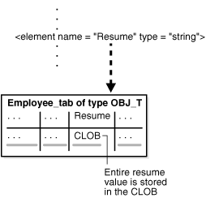
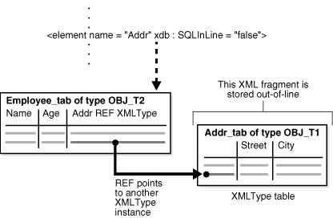
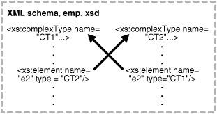
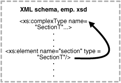
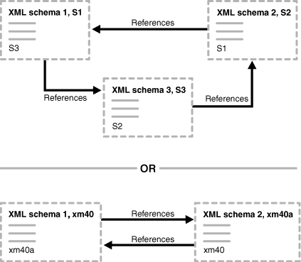
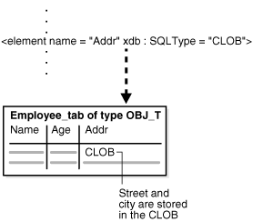

Advanced techniques for XML Schema-based data include using object-relational storage; annotating XML schemas; mapping Schema data types to SQL; using `complexType` extensions and restrictions; creating, specifying relational constraints on, and partitioning XML Schema-based data, storing `XMLType` data out of line, working with complex or large schemas, and debugging schema registration.

**See Also:**

- [XML Schema Storage and Query: Basic](XML-Schema-and-query-basic.md) for basic information about using XML Schema with Oracle XML DB

- [XPath Rewrite for Object-Relational Storage](XPath-rewrite-for-object-relational-storage.md) for information about the optimization of XPath expressions in Oracle XML DB

- [XML Schema Evolution](XML-Schema-evolution.md) for information about updating an XML schema after you have registered it with Oracle XML DB

- [XML Schema Part 0: Primer Second Edition](https://www.oracle.com/pls/topic/lookup?ctx=en/database/oracle/oracle-database/19/adxdb&id=w3_org_tr_xschema0_primer) for an introduction to XML Schema

<!-- -->

- Object-Relational Storage of XML Documents
  Object-relational storage of XML documents is based on decomposing the document content into a set of SQL objects. These SQL objects are based on the SQL 1999 Type framework. When an XML schema is registered with Oracle XML DB, the required SQL type definitions are automatically generated from the schema.
- Oracle XML Schema Annotations
  You can annotate XML schemas to influence the objects and tables that are generated by the XML schema registration process. You do this by adding Oracle-specific attributes to `complexType`, `element`, and `attribute` definitions that are declared by the XML schema.
- Use DBMS_XMLSCHEMA to Map XML Schema Data Types to SQL Data Types
  You use PL/SQL package `DBMS_XMLSCHEMA` to map data types for XML Schema attributes and elements to SQL data types.
- complexType Extensions and Restrictions in Oracle XML DB
  In XML Schema, `complexType` values are declared based on `complexContent` and `simpleContent`. Oracle XML DB defines various extensions and restrictions to `complexType`.
- Creating XML Schema-Based XMLType Columns and Tables
  After an XML schema has been registered with Oracle XML DB, you can reference it when you define `XMLType` tables or columns.
- Overview of Partitioning XMLType Tables and Columns Stored Object-Relationally
  When you partition an object-relational `XMLType` table or a table with an `XMLType` column that is stored object-relationally and you use list, range, or hash partitioning, any ordered collection tables (OCTs) or out-of-line tables within the data are automatically partitioned accordingly, by default.
- Specification of Relational Constraints on XMLType Tables and Columns
  For `XMLType` data stored object-relationally, you can specify typical relational constraints for elements and attributes that occur only once in an XML document.
- Out-Of-Line Storage of XMLType Data
  By default, when `XMLType` data is stored object-relationally a child element is mapped to an embedded SQL object attribute. Sometimes better performance can be obtained by storing some `XMLType` data out of line. Use XML schema annotation `xdb:SQLInline` to do this.
- Considerations for Working with Complex or Large XML Schemas
  XML schemas can be complex. Examples of complex schemas include those that are recursive and those that contain circular or cyclical references. Working with complex or large XML schemas can be challenging and requires taking certain considerations into account.
- Debugging XML Schema Registration for XML Data Stored Object-Relationally
  For XML data stored object-relationally, you can monitor the object types and tables created during XML schema registration by setting the event 31098 before invoking PL/SQL procedure `DBMS_XMLSCHEMA.registerSchema`.

**Parent topic:** [XML Schema and Object-Relational XMLType](XML-Schema-and-object-relational-XMLType.md)

### 18.1 Object-Relational Storage of XML Documents

Object-relational storage of XML documents is based on decomposing the document content into a set of SQL objects. These SQL objects are based on the SQL 1999 Type framework. When an XML schema is registered with Oracle XML DB, the required SQL type definitions are automatically generated from the schema.

A SQL type definition is generated from each `complexType` defined by the XML schema. Each element or attribute defined by the `complexType` becomes a SQL attribute in the corresponding SQL type. Oracle XML DB automatically maps the 47 scalar data types defined by the XML Schema Recommendation to the 19 scalar data types supported by SQL. A varray type is generated for each element and this can occur multiple times.

The generated SQL types allow XML content that is compliant with the XML schema to be decomposed and stored in the database as a set of objects, without any loss of information. When an XML document is ingested, the constructs defined by the XML schema are mapped directly to the equivalent SQL types. This lets Oracle XML DB leverage the full power of Oracle Database when managing XML, and it can lead to significant reductions in the amount of space required to store the document. It can also reduce the amount of memory required to query and update XML content.

- How Collections Are Stored for Object-Relational XMLType Storage
  You can store an ordered collection as a varray in an ordered collection table (OCT), which can be either a heap-based table (recommended) or an index-organized table (IOT). You can store the actual data out of line by using varray entries that are `REF`s to the data.
- SQL Types Created during XML Schema Registration for Object-Relational Storage
  Use `TRUE` as the value of parameter `GENTYPES` when you register an XML schema for use with XML data stored object-relationally (`TRUE` is the default value). Oracle XML DB then creates the appropriate SQL object types that enable object-relational storage of conforming XML documents.
- Default Tables Created during XML Schema Registration
  You can create default tables as part of XML schema registration. Default tables are most useful when documents are inserted using APIs and protocols such as FTP and HTTP(S), which do not provide any table specification.
- Do Not Use Internal Constructs Generated during XML Schema Registration
  In general, the SQL constructs (data types, nested tables, and tables associated with out-of-line storage) that are automatically generated during XML schema registration are internal to Oracle XML DB. Oracle recommends that you do not use them in your code.
- Generated Names are Case Sensitive
  The names of any SQL tables, objects, and attributes generated by XML schema registration are case sensitive.
- SYS_XDBPD\$ and DOM Fidelity for Object-Relational Storage
  In order to provide DOM fidelity for XML data that is stored object-relationally, Oracle XML DB records all information that cannot be stored in any of the other object attributes as instance-level metadata using the system-defined binary object attribute `SYS_XDBPD$` (positional descriptor, or PD).

**Parent topic:** XML Schema Storage and Query: Object-Relational Storage

#### 18.1.1 How Collections Are Stored for Object-Relational XMLType Storage

You can store an ordered collection as a varray in an ordered collection table (OCT), which can be either a heap-based table (recommended) or an index-organized table (IOT). You can store the actual data out of line by using varray entries that are `REF`s to the data.

When you register an XML schema for `XMLType` data that is stored object-relationally and you set registration parameter `GENTABLES` to `TRUE`, default tables are created automatically to store the associated XML instance documents.

Order is preserved among XML collection elements when they are stored. The result is an **ordered collection**. You can store data in an ordered collection in these ways:

- **Varray in a table**. Each element in the collection is mapped to a SQL object. The collection of SQL objects is stored as a set of rows in a table, called an **ordered collection table** (**OCT**). All collections are stored in OCTs.

You can also use out-of-line storage for an ordered collection. This corresponds to XML schema annotation` SQLInline = "false"`, and it means that a varray of `REF`s in the collection table (or the LOB) tracks the collection content, which is stored out of line.

There is no requirement to annotate an XML schema before using it. Oracle XML DB uses a set of default assumptions when processing an XML schema that contains no annotations.

If you do not supply any of the annotations mentioned in this section, then Oracle XML DB stores a collection as a heap-based OCT. You can force OCTs to be stored as **index-organized tables** (**IOTs**) instead, by passing `REGISTER_NT_AS_IOT` in the `OPTIONS` parameter of `DBMS_XMLSCHEMA.registerSchema`.

**Note:**

Use heap-based OCTs, not IOTs, unless you are explicitly advised by Oracle to use IOTs. IOT storage has these significant limitations:

- It disables partitioning of the collection tables (IOTs).

- It supports only document-level Oracle Text indexes. It disables indexes that are element-specific or attribute-specific.

**Related Topics**

- Setting Annotation Attribute xdb:SQLInline to false for Out-Of-Line Storage
- Overview of Partitioning XMLType Tables and Columns Stored Object-Relationally

**See Also:**

Object-Relational Storage of XML Documents for information about collection storage when you create `XMLType` tables and columns manually using object-relational storage

**Parent topic:** Object-Relational Storage of XML Documents

#### 18.1.2 SQL Types Created during XML Schema Registration for Object-Relational Storage

Use `TRUE` as the value of parameter `GENTYPES` when you register an XML schema for use with XML data stored object-relationally (`TRUE` is the default value). Oracle XML DB then creates the appropriate SQL object types that enable object-relational storage of conforming XML documents.

By default, all SQL object types are created in the database schema of the user who registers the XML schema. If annotation `xdb:defaultSchema` is used, then Oracle XML DB attempts to create the object type using the specified database schema. The current user must have the necessary privileges to create these object types.

Example 18-1 shows the SQL object types that are created automatically when XML schema `purchaseOrder.xsd` is registered with Oracle XML DB.

**Note:**

By default, the names of the SQL object types and attributes are system-generated. This is the case in Example 18-1. If the XML schema does not contain attribute `SQLName`, then the SQL name is derived from the XML name. You can use XML schema annotations to provide user-defined names (see Oracle XML Schema Annotations for details).

**Note:**

Starting with Oracle Database 12c Release 2 (12.2.0.1), if you register an XML schema for object-relational storage for an application common user then you must annotate each complex type in the schema with `xdb:SQLType`, to name the SQL data type. Otherwise, an error is raised.

Example 18-1 SQL Object Types for Storing XMLType Tables

    DESCRIBE "PurchaseOrderType1668_T"

    "PurchaseOrderType1668_T" is NOT FINAL
    Name                 Null?  Type
    -------------------- ------ -------------------------------
    SYS_XDBPD$                  XDB.XDB$RAW_LIST_T
    Reference                   VARCHAR2(30 CHAR)
    Actions                     ActionsType1661_T
    Reject                      RejectionType1660_T
    Requestor                   VARCHAR2(128 CHAR)
    User                        VARCHAR2(10 CHAR)
    CostCenter                  VARCHAR2(4 CHAR)
    ShippingInstructions        ShippingInstructionsTyp1659_T
    SpecialInstructions         VARCHAR2(2048 CHAR)
    LineItems                   LineItemsType1666_T
    Notes                       VARCHAR2(4000 CHAR)

    DESCRIBE "LineItemsType1666_T"

    "LineItemsType1666_T" is NOT FINAL
    Name                 Null? Type
    -------------------- ----- -------------------------------
    SYS_XDBPD$                 XDB.XDB$RAW_LIST_T
    LineItem                   LineItem1667_COLL

    DESCRIBE "LineItem1667_COLL"

    "LineItem1667_COLL" VARRAY(2147483647) OF LineItemType1665_T
    "LineItemType1665_T" is NOT FINAL
    Name                Null? Type
    ------------------- ----- --------------------------------
    SYS_XDBPD$                XDB.XDB$RAW_LIST_T
    ItemNumber                NUMBER(38)
    Description               VARCHAR2(256 CHAR)
    Part                      PartType1664_T

**Parent topic:** Object-Relational Storage of XML Documents

#### 18.1.3 Default Tables Created during XML Schema Registration

You can create default tables as part of XML schema registration. Default tables are most useful when documents are inserted using APIs and protocols such as FTP and HTTP(S), which do not provide any table specification.

In such cases, the XML instance is inserted into the default table.

Example 18-2 describes the default purchase-order table.

If you provide a value for attribute `xdb:defaultTable`, then the `XMLType` table is created with that name. Otherwise it is created with an internally generated name.

Any text specified using attributes `xdb:tableProps` and `xdb:columnProps` is appended to the generated `CREATE TABLE` statement.

Example 18-2 Default Table for Global Element PurchaseOrder

    DESCRIBE "PurchaseOrder1669_TAB"

    Name                        Null? Type
    --------------------------- ----- -----------------------
    TABLE of
      SYS.XMLTYPE(
        XMLSchema "http://xmlns.oracle.com/xdb/documentation/purchaseOrder.xsd"
        Element "PurchaseOrder")
      STORAGE OBJECT-RELATIONAL TYPE "PurchaseOrderType1668_T"

**Parent topic:** Object-Relational Storage of XML Documents

#### 18.1.4 Do Not Use Internal Constructs Generated during XML Schema Registration

In general, the SQL constructs (data types, nested tables, and tables associated with out-of-line storage) that are automatically generated during XML schema registration are internal to Oracle XML DB. Oracle recommends that you do not use them in your code.

More precisely, generated SQL data types, nested tables, and tables associated with out-of-line storage are based on specific internal XML schema-to-object type mappings that are subject to change and redefinition by Oracle at any time. In general:

- Do not use any generated SQL data types.

- Do not access or modify any generated nested tables or out-of-line tables.

You can, however, modify the storage options, such as partitioning, of generated tables, and you can create indexes and constraints on generated tables. You can also freely use any XML schema annotations provided by Oracle XML DB, including annotations that name generated constructs.

**Parent topic:** Object-Relational Storage of XML Documents

#### 18.1.5 Generated Names are Case Sensitive

The names of any SQL tables, objects, and attributes generated by XML schema registration are case sensitive.

For instance, in Example 18-2, the name of table `PurchaseOrder1669_TAB` is derived from the name of element `PurchaseOrder`, so it too is mixed case. You must therefore refer to this table using a quoted identifier: `"``PurchaseOrder1669_TAB``"`. Failure to do so results in an object-not-found error, such as` ORA-00942: table or view does not exist`.

**Parent topic:** Object-Relational Storage of XML Documents

#### 18.1.6 SYS_XDBPD\$ and DOM Fidelity for Object-Relational Storage

In order to provide DOM fidelity for XML data that is stored object-relationally, Oracle XML DB records all information that cannot be stored in any of the other object attributes as instance-level metadata using the system-defined binary object attribute `SYS_XDBPD$` (positional descriptor, or PD).

With object-relational storage of XML data, the elements and attributes declared in an XML schema are mapped to separate attributes of the corresponding SQL object types. However, the following information in XML instance documents is not stored in these object attributes:

- Namespace declarations

- Comments

- Prefix information

In order to provide DOM fidelity for XML data stored object-relationally, Oracle XML DB uses a separate mechanism to keep track of this information: it is recorded as instance-level metadata.

This metadata is tracked at the type level using the system-defined binary object attribute `SYS_XDBPD$`. This object attribute is referred to as the **positional descriptor**, or **PD** for short.

The PD is intended for Oracle XML DB internal use only. You should never directly access or manipulate column PD.

The positional descriptor stores all information that cannot be stored in any of the other object attributes. PD information is used to ensure the DOM fidelity of all XML documents stored in Oracle XML DB. Examples of PD information include: ordering information, comments, processing instructions, and namespace prefixes.

If DOM fidelity is not required, you can suppress the use of `SYS_XDBPD$` by setting attribute `xdb:maintainDOM` to `false` in the XML schema, at the type level.

**Note:**

For clarity, object attribute `SYS_XDBPD$` is omitted in many examples in this book. However, it is always present as a positional descriptor (PD) column in all SQL object types that are generated by the XML schema registration process.

In general, Oracle recommends that you do not suppress the PD attribute, because the extra information, such as comments and processing instructions, could be lost if there is no PD column.

**Related Topics**

- You Can Override the SQLType Value in an XML Schema When Declaring Attributes
- Override of the SQLType Value in an XML Schema When Declaring Elements

**See Also:**

[DOM Fidelity](XML-Schema-and-query-basic.md) for information about DOM fidelity and binary XML storage of XML data

**Parent topic:** Object-Relational Storage of XML Documents

### 18.2 Oracle XML Schema Annotations

You can annotate XML schemas to influence the objects and tables that are generated by the XML schema registration process. You do this by adding Oracle-specific attributes to `complexType`, `element`, and `attribute` definitions that are declared by the XML schema.

You can add such annotations manually by editing the XML schema document or, for the most common annotations, by invoking annotation-specific PL/SQL subprograms. See [Oracle Database PL/SQL Packages and Types Reference](../arpls/DBMS_XMLSCHEMA_ANNOTATE.md), chapter "DBMS_XMLSCHEMA_ANNOTATE".

If you edit an XML schema manually using the Altova XMLSpy editor then you can take advantage of the Oracle tab in the editor for adding and editing Oracle-specific annotations. See [Figure 17-2](XML-Schema-and-query-basic.md).

Most XML attributes used by Oracle XML DB belong to the namespace `http://xmlns.oracle.com/xdb`. XML attributes used for encoding XML data as binary XML belong to the namespace `http://xmlns.oracle.com/2004/CSX`. To simplify the process of annotating an XML schema, Oracle recommends that you declare namespace prefixes in the root element of the XML schema.

- Common Uses of XML Schema Annotations
  You can annotate an XML schema to customize the names of object-relational tables, objects, and object attributes or to allow XPath rewrite when XQuery-expression arguments target recursive XML data.
- XML Schema Annotation Example
  A sample XML schema illustrates some of the most important Oracle XML DB annotations.
- Annotating an XML Schema Using DBMS_XMLSCHEMA_ANNOTATE
  PL/SQL package `DBMS_XMLSCHEMA_ANNOTATE` provides subprograms to annotate an XML schema. Using these subprograms can often be more convenient and less error prone than manually editing the XML schema.
- Available Oracle XML DB XML Schema Annotations
  The Oracle XML DB annotations that you can specify in element and attribute declarations are described, along with the PL/SQL subprograms in package `DBMS_XMLSCHEMA_ANNOTATE` that you can use to manipulate them.
- XML Schema Annotation Guidelines for Object-Relational Storage
  For `XMLType` data stored object-relationally, careful planning is called for, to optimize performance. Similar considerations are in order as for relational data: entity-relationship models, indexing, data types, table partitions, and so on. To enable XPath rewrite and achieve optimal performance, you implement many such design choices using XML schema annotations.
- Querying a Registered XML Schema to Obtain Annotations
  You can query database views `USER_XML_SCHEMAS` and `ALL_XML_SCHEMAS` to obtain a registered XML schema with all of its annotations. The registered version of an XML schema contains a full set of Oracle XML DB annotations. These annotations were supplied by a user or set by default during XML schema registration.

**Parent topic:** XML Schema Storage and Query: Object-Relational Storage

#### 18.2.1 Common Uses of XML Schema Annotations

You can annotate an XML schema to customize the names of object-relational tables, objects, and object attributes or to allow XPath rewrite when XQuery-expression arguments target recursive XML data.

Common reasons for wanting to annotate an XML schema include the following:

- To ensure that the names of the tables, objects, and object attributes created by PL/SQL procedure `DBMS_XMLSCHEMA.registerSchema` for object-relational storage of `XMLType` data are easy to recognize and compliant with any application-naming standards. Set parameter `GENTYPES` or `GENTABLES` to `TRUE` for this (`TRUE` is the default value for each of these parameters).

- To prevent the generation of mixed-case names that require the use of quoted identifiers when working directly with SQL.

- To allow XPath rewrite for object-relational storage in the case of document-correlated recursive XPath queries. This applies to certain applications of SQL/XML access and query functions whose XQuery-expression argument targets recursive XML data.

The most commonly used XML schema annotations are the following:

- `xdb:defaultTable` – Name of the default table generated for each global element when parameter `GENTABLES` is `TRUE`. Setting this to the empty string, `""`, prevents a default table from being generated for the element in question.

- `xdb:SQLName` – Name of the SQL object attribute that corresponds to each element or attribute defined in the XML schema.

- `xdb:SQLType` – For `complexType` definitions, the corresponding object type. For `simpleType` definitions, `SQLType` is used to override the default mapping between XML schema data types and SQL data types. A common use of `SQLType` is to define when unbounded strings should be stored as `CLOB` values, rather than as `VARCHAR(4000) CHAR` values (the default). Note: You cannot use data type `NCHAR`, `NVARCHAR2`, or `NCLOB` as the value of a `SQLType` annotation.

  **Note:**

  Starting with Oracle Database 12c Release 2 (12.2.0.1), if you register an XML schema for object-relational storage for an application common user then you must annotate each complex type in the schema with `xdb:SQLType`, to name the SQL data type. Otherwise, an error is raised.

- `xdb:SQLCollType` – Used to specify the varray type that manages a collection of elements.

- `xdb:maintainDOM` – Used to determine whether or not DOM fidelity should be maintained for a given `complexType` definition

You need not specify values for any of these attributes. Oracle XML DB provides appropriate values by default during the XML schema registration process. However, if you are using object-relational storage, then Oracle recommends that you specify the names of at least the top-level SQL types, so that you can reference them later.

**Parent topic:** Oracle XML Schema Annotations

#### 18.2.2 XML Schema Annotation Example

A sample XML schema illustrates some of the most important Oracle XML DB annotations.

The XML schema in Example 18-3 is similar to the one in [Example A-2](oracle-supplied-XML-schemas-and-examples.md), but it also defines a `Notes` element and its type, `NotesType`.

- The `schema` element includes the declaration of the `xdb` namespace.

- The definition of global element `PurchaseOrder` includes a `defaultTable` annotation that specifies that the name of the default table associated with this element is `purchaseorder`.

- The definition of global complex type `PurchaseOrderType` includes a `SQLType` annotation that specifies that the generated SQL object type is named `purchaseorder_t`. Within the definition of this type, the following annotations are used:

  - The definition of element `Reference` includes a `SQLName` annotation that specifies that the SQL attribute corresponding to XML element `Reference` is named `reference`.

  - The definition of element `Actions` includes a `SQLName` annotation that specifies that the SQL attribute corresponding to XML element `Actions` is named `action_collection`.

  - The definition of element `USER` includes a `SQLName` annotation that specifies that the SQL attribute corresponding to XML element `User` is named `email`.

  - The definition of element `LineItems` includes a `SQLName` annotation that specifies that the SQL attribute corresponding to XML element `LineItems` is named `lineitem_collection`.

  - The definition of element `Notes` includes a `SQLType` annotation that specifies that the data type of the SQL attribute corresponding to XML element `Notes` is `CLOB`.

- The definition of global complex type `LineItemsType` includes a `SQLType` annotation that specifies that the generated SQL object type is named `lineitems_t`. Within the definition of this type, the following annotation is used:

  - The definition of element `LineItem` includes a `SQLName` annotation that specifies that the data type of the SQL attribute corresponding to XML element `LineItems` is named `lineitem_varray`, and a `SQLCollName` annotation that specifies that the SQL object type that manages the collection is named `lineitem_v`.

- The definition of global complex type `LineItemType` includes a `SQLType` annotation that specifies that generated SQL object type is named `lineitem_t`.

- The definition of complex type `PartType` includes a `SQLType` annotation that specifies that the SQL object type is named `part_t`. It also includes the annotation `xdb:maintainDOM = "false"`, specifying that there is no need for Oracle XML DB to maintain DOM fidelity for elements based on this data type.

Example 18-4 shows some of the tables and objects that are created when the annotated XML schema of Example 18-3 is registered.

The following are results of this XML schema registration:

- A table called `purchaseorder` was created.

- Types called `purchaseorder_t`, `lineitems_t`, `lineitem_v`, `lineitem_t`, and `part_t` were created. The attributes defined by these types are named according to supplied the `SQLName` annotations.

- The `Notes` attribute defined by `purchaseorder_t` is of data type `CLOB`.

- Type `part_t` does not include a positional descriptor (PD) attribute.

- Ordered collection tables (OCTs) were created to manage the collections of `LineItem` and `Action` elements.

Example 18-3 Using Common Schema Annotations

    <xs:schema
      targetNamespace="http://xmlns.oracle.com/xdb/documentation/purchaseOrder"
      xmlns:xs="http://www.w3.org/2001/XMLSchema"
      xmlns:xdb="http://xmlns.oracle.com/xdb"
      xmlns:po="http://xmlns.oracle.com/xdb/documentation/purchaseOrder"
      version="1.0">
      <xs:element name="PurchaseOrder" type="po:PurchaseOrderType"
                  xdb:defaultTable="PURCHASEORDER"/>
      <xs:complexType name="PurchaseOrderType" xdb:SQLType="PURCHASEORDER_T">
        <xs:sequence>
          <xs:element name="Reference" type="po:ReferenceType" minOccurs="1"
                      xdb:SQLName="REFERENCE"/>
          <xs:element name="Actions" type="po:ActionsType"
                      xdb:SQLName="ACTION_COLLECTION"/>
          <xs:element name="Reject" type="po:RejectionType" minOccurs="0"/>
          <xs:element name="Requestor" type="po:RequestorType"/>
          <xs:element name="User" type="po:UserType" minOccurs="1"
                      xdb:SQLName="EMAIL"/>
          <xs:element name="CostCenter" type="po:CostCenterType"/>
          <xs:element name="ShippingInstructions"
                      type="po:ShippingInstructionsType"/>
          <xs:element name="SpecialInstructions" type="po:SpecialInstructionsType"/>
          <xs:element name="LineItems" type="po:LineItemsType"
                      xdb:SQLName="LINEITEM_COLLECTION"/>
          <xs:element name="Notes" type="po:NotesType" xdb:SQLType="CLOB"/>
        </xs:sequence>
      </xs:complexType>
      <xs:complexType name="LineItemsType" xdb:SQLType="LINEITEMS_T">
        <xs:sequence>
          <xs:element name="LineItem" type="po:LineItemType" maxOccurs="unbounded"
                      xdb:SQLCollType="LINEITEM_V" xdb:SQLName="LINEITEM_VARRAY"/>
       </xs:sequence>
      </xs:complexType>
      <xs:complexType name="LineItemType" xdb:SQLType="LINEITEM_T">
        <xs:sequence>
          <xs:element name="Description" type="po:DescriptionType"/>
          <xs:element name="Part" type="po:PartType"/>
        </xs:sequence>
        <xs:attribute name="ItemNumber" type="xs:integer"/>
      </xs:complexType>
      <xs:complexType name="PartType" xdb:SQLType="PART_T" xdb:maintainDOM="false">
        <xs:attribute name="Id">
          <xs:simpleType>
            <xs:restriction base="xs:string">
              <xs:minLength value="10"/>
              <xs:maxLength value="14"/>
            </xs:restriction>
          </xs:simpleType>
        </xs:attribute>
        <xs:attribute name="Quantity" type="po:moneyType"/>
        <xs:attribute name="UnitPrice" type="po:quantityType"/>
      </xs:complexType>
      <xs:simpleType name="NotesType">
        <xs:restriction base="xs:string">
          <xs:minLength value="1"/>
          <xs:maxLength value="32767"/>
        </xs:restriction>
      </xs:simpleType>
    </xs:schema>

Example 18-4 Registering an Annotated XML Schema

    BEGIN
      DBMS_XMLSCHEMA.registerSchema(
        SCHEMAURL => 'http://xmlns.oracle.com/xdb/documentation/purchaseOrder.xsd',
        SCHEMADOC => bfilename('XMLDIR', 'purchaseOrder.Annotated.xsd'),
        LOCAL     => TRUE,
        GENTYPES  => TRUE,
        GENTABLES => TRUE,
        CSID      => nls_charset_id('AL32UTF8'));
    END;
    /

    SELECT table_name, xmlschema, element_name FROM USER_XML_TABLES;

    TABLE_NAME     XMLSCHEMA                             ELEMENT_NAME
    -------------  -----------------------------------   -------------
    PURCHASEORDER  http://xmlns.oracle.com/xdb/documen   PurchaseOrder
                   tation/purchaseOrder.xsd

    1 row selected.

    DESCRIBE purchaseorder

    Name                            Null? Type
    ------------------------------  ----- -----------------
    TABLE of SYS.XMLTYPE(XMLSchema
     "http://xmlns.oracle.com/xdb/documentation/purchaseOrder.xsd"
     ELEMENT "PurchaseOrder") STORAGE Object-relational TYPE "PURCHASEORDER_T"

    DESCRIBE purchaseorder_t

    PURCHASEORDER_T is NOT FINAL
    Name                 Null? Type
    -------------------- ----- --------------------------
    SYS_XDBPD$                 XDB.XDB$RAW_LIST_T
    REFERENCE                  VARCHAR2(30 CHAR)
    ACTION_COLLECTION          ACTIONS_T
    REJECT                     REJECTION_T
    REQUESTOR                  VARCHAR2(128 CHAR)
    EMAIL                      VARCHAR2(10 CHAR)
    COSTCENTER                 VARCHAR2(4 CHAR)
    SHIPPINGINSTRUCTIONS       SHIPPING_INSTRUCTIONS_T
    SPECIALINSTRUCTIONS        VARCHAR2(2048 CHAR)
    LINEITEM_COLLECTION        LINEITEMS_T
    Notes                      CLOB

    DESCRIBE lineitems_t
    LINEITEMS_T is NOT FINAL
    Name                 Null? Type
    -------------------- ----- --------------------------
    SYS_XDBPD$                 XDB.XDB$RAW_LIST_T
    LINEITEM_VARRAY            LINEITEM_V

    DESCRIBE lineitem_v

    LINEITEM_V VARRAY(2147483647) OF LINEITEM_T
    LINEITEM_T is NOT FINAL
    Name                 Null? Type
    -------------------- ----- --------------------------
    SYS_XDBPD$                 XDB.XDB$RAW_LIST_T
    ITEMNUMBER                 NUMBER(38)
    DESCRIPTION                VARCHAR2(256 CHAR)
    PART                       PART_T

    DESCRIBE part_t

    PART_T is NOT FINAL
    Name                 Null? Type
    -------------------- ----- --------------------------
    ID                         VARCHAR2(14 CHAR)
    QUANTITY                   NUMBER(12,2)
    UNITPRICE                  NUMBER(8,4)

    SELECT table_name, parent_table_column FROM USER_NESTED_TABLES
      WHERE parent_table_name = 'purchaseorder';

    TABLE_NAME                       PARENT_TABLE_COLUMN
    ----------                       -----------------------
    SYS_NTNOHV+tfSTRaDTA9FETvBJw==   "XMLDATA"."LINEITEM_COLLECTION"."LINEITEM_VARRAY"
    SYS_NTV4bNVqQ1S4WdCIvBK5qjZA==   "XMLDATA"."ACTION_COLLECTION"."ACTION_VARRAY"

    2 rows selected.

**Parent topic:** Oracle XML Schema Annotations

#### 18.2.3 Annotating an XML Schema Using DBMS_XMLSCHEMA_ANNOTATE

PL/SQL package `DBMS_XMLSCHEMA_ANNOTATE` provides subprograms to annotate an XML schema. Using these subprograms can often be more convenient and less error prone than manually editing the XML schema.

In particular, you can use the PL/SQL subprograms in a script, which you can run at any time or multiple times, as needed. This can be especially useful if you are using a large XML schema or a standard or other third-party XML schema that you do not want to modify manually.

There are specific PL/SQL subprograms for each Oracle annotation. For example, you use PL/SQL procedure `setDefaultTable` to add a `xdb:defaultTable` annotation, and `removeDefaultTable` to remove a `xdb:defaultTable` annotation.

Each annotation subprogram has the following as its parameters:

- The XML schema to be annotated. This parameter is `IN OUT`.

- The name of the global element where the annotation is to be added or removed.

- The annotation (XML attribute) value.

- A Boolean flag indicating whether any corresponding existing annotation is to be overwritten. By default, it is overwritten.

If the element to be annotated is not a global element then you provide the local element name as an additional parameter. The global and local names together identify the target element. The element with the local name must be a descendent of the element with the global name.

If you use SQL\*Plus, you can use PL/SQL procedure `DBMS_XMLSCHEMA_ANNOTATE.printWarnings` to enable and disable printing of SQL\*Plus warnings during the use of other `DBMS_XMLSCHEMA_ANNOTATE` subprograms. By default, no warnings are printed. An example of a warning is an inability to annotate the XML schema because there is no element with the name you provided to the annotation subprogram.

Example 18-5 uses subprograms in PL/SQL package `DBMS_XMLSCHEMA_ANNOTATE` to produce the annotated XML schema shown in Example 18-3.

**See Also:**

[Oracle Database PL/SQL Packages and Types Reference](../arpls/DBMS_XMLSCHEMA_ANNOTATE.md), chapter "DBMS_XMLSCHEMA_ANNOTATE"

Example 18-5 Using DBMS_XMLSCHEMA_ANNOTATE

    CREATE TABLE annotation_tab (id NUMBER, inp XMLType, out XMLType);
    INSERT INTO annotation_tab VALUES (1, ... unannotated XML schema...);

    DECLARE
      schema XMLType;
    BEGIN
      SELECT t.inp INTO schema FROM annotation_tab t WHERE t.id = 1;

      DBMS_XMLSCHEMA_ANNOTATE.setDefaultTable(schema, 'PurchaseOrder', 'PURCHASEORDER');
      DBMS_XMLSCHEMA_ANNOTATE.setSQLType(schema, 'PurchaseOrderType', 'PURCHASEORDER_T');
      DBMS_XMLSCHEMA_ANNOTATE.setSQLName(schema, 'complexType', 'PurchaseOrderType', 'element', 'Reference',
                                         'REFERENCE');
      DBMS_XMLSCHEMA_ANNOTATE.setSQLName(schema, 'complexType', 'PurchaseOrderType', 'element', 'Actions',
                                         'ACTIONS_COLLECTION');
      DBMS_XMLSCHEMA_ANNOTATE.setSQLName(schema, 'complexType', 'PurchaseOrderType', 'element', 'User', 'EMAIL');
      DBMS_XMLSCHEMA_ANNOTATE.setSQLName(schema, 'complexType', 'PurchaseOrderType', 'element', 'LineItems',
                                         'LINEITEM_COLLECTION');
      DBMS_XMLSCHEMA_ANNOTATE.setSQLType(schema, 'complexType', 'PurchaseOrderType', 'element', 'Notes', 'CLOB');
      DBMS_XMLSCHEMA_ANNOTATE.setSQLType(schema, 'LineItemsType', 'LINEITEMS_T');
      DBMS_XMLSCHEMA_ANNOTATE.setSQLCollType(schema, 'complexType', 'LineItemsType', 'LineItem', 'LINEITEM_V');
      DBMS_XMLSCHEMA_ANNOTATE.setSQLName(schema, 'complexType', 'LineItemsType', 'element', 'LineItem',
                                         'LINEITEM_VARRAY');
      DBMS_XMLSCHEMA_ANNOTATE.setSQLType(schema, 'LineItemType', 'LINEITEM_T');
      DBMS_XMLSCHEMA_ANNOTATE.setSQLType(schema, 'PartType', 'PART_T');
      DBMS_XMLSCHEMA_ANNOTATE.disableMaintainDom(schema, 'PartType');

    UPDATE annotation_tab t SET t.out = schema WHERE t.id = 1;
    END;
    /

**Parent topic:** Oracle XML Schema Annotations

#### 18.2.4 Available Oracle XML DB XML Schema Annotations

The Oracle XML DB annotations that you can specify in element and attribute declarations are described, along with the PL/SQL subprograms in package `DBMS_XMLSCHEMA_ANNOTATE` that you can use to manipulate them.

All annotations except those that have the prefix `csx` are applicable to XML schemas registered for object-relational storage.

The following annotations apply to XML schemas that are registered for binary XML storage:

- `xdb:defaultTable`

- `xdb:tableProps`

**See Also:**

[Oracle Database PL/SQL Packages and Types Reference](../arpls/DBMS_XMLSCHEMA_ANNOTATE.md), chapter "DBMS_XMLSCHEMA_ANNOTATE"

Table 18-1 Annotations in Elements

| Attribute and PL/SQL                                                                                                                        | Values                                                                       | Default                          | Description                                                                                                                                                                                                                                                                                                                                             |
|:--------------------------------------------------------------------------------------------------------------------------------------------|:-----------------------------------------------------------------------------|:---------------------------------|:--------------------------------------------------------------------------------------------------------------------------------------------------------------------------------------------------------------------------------------------------------------------------------------------------------------------------------------------------------|
| `xdb:columnProps` No applicable PL/SQL.                                                                                                  | Any column storage clause                                                    | `NULL`                           | Specifies the `COLUMN` storage clause that is inserted into the default `CREATE TABLE` statement. It is useful mainly for elements that get mapped to SQL tables, namely top-level element declarations and out-of-line element declarations.                                                                                                           |
| `xdb:defaultTable` PL/SQL: `setDefaultTable` `removeDefaultTable` `enableDefaultTableCreation` `disableDefaultTableCreation` | Any table name                                                               | Based on element name            | Specifies the name of the SQL table into which XML instances of this XML schema are stored. This is most useful in cases where the XML data is inserted from APIs and protocols, such as FTP and HTTP(S), where the table name is not specified. Applicable to object-relational storage and binary XML storage.                                        |
| `xdb:maintainDOM` PL/SQL: `enableMaintainDOM` `disableMaintainDOM`                                                                 | `true` \| `false`                                                            | `true`                           | If `true`, then instances of this element are stored so that they retain DOM fidelity on output. This implies that all comments, processing instructions, namespace declarations, and so on are retained, in addition to the ordering of elements. If `false`, then the output is not guaranteed to have the same DOM action as the input.           |
| `xdb:SQLCollType` PL/SQL: `setSQLCollType` `removeSQLCollType`                                                                     | Any SQL collection type                                                      | Name generated from element name | Name of the SQL collection type that corresponds to this XML element. The XML element must be specified with `maxOccurs` \> 1.                                                                                                                                                                                                                          |
| `xdb:SQLInline` PL/SQL: `setOutOfLine` `removeOutOfLine`                                                                           | `true` \| `false`                                                            | `true`                           | If `true`, then this element is stored inline as an embedded object attribute (or as a collection, if `maxOccurs` \> 1). If `false`, then a `REF` value is stored (or a collection of `REF` values, if `maxOccurs` \> 1). This attribute is forced to `false` in certain situations, such as cyclic references, where SQL does not support inlining. |
| `xdb:SQLName` PL/SQL: `setSQLName` `removeSQLName`                                                                                 | Any SQL identifier                                                           | Element name                     | Name of the attribute within the SQL object that maps to this XML element.                                                                                                                                                                                                                                                                              |
| `xdb:SQLType` PL/SQL: `setSQLType` `removeSQLType`                                                                                 | Any SQL data typeFoot 1, except `NCHAR`, `NVARCHAR2`, and `NCLOB` | Name generated from element name | Name of the SQL type corresponding to this XML element declaration.                                                                                                                                                                                                                                                                                     |
| `xdb:tableProps` PL/SQL: `setTableProps` `removeTableProps`                                                                        | Any table storage clause                                                     | `NULL`                           | Specifies the `TABLE` storage clause that is appended to the default `CREATE TABLE` statement. This is meaningful mainly for global and out-of-line elements. Applicable to object-relational storage and binary XML storage.                                                                                                                           |

Footnote 1

See Use DBMS_XMLSCHEMA to Map XML Schema Data Types to SQL Data Types.

**See Also:**

[Object-Relational Storage of XML Schema-Based Data](XML-Schema-and-query-basic.md) for information about specifying storage options when manually creating `XMLType` tables for object-relational storage

Table 18-2 Annotations in Elements Declaring Global complexType Elements

| Attribute                                                                   | Values                                                                      | Default                          | Description                                                                                                                                                                                                                                                                                                                                   |
|:----------------------------------------------------------------------------|:----------------------------------------------------------------------------|:---------------------------------|:----------------------------------------------------------------------------------------------------------------------------------------------------------------------------------------------------------------------------------------------------------------------------------------------------------------------------------------------|
| `xdb:maintainDOM` PL/SQL: `enableMaintainDom` `disableMaintainDom` | `true` \| `false`                                                           | `true`                           | If `true`, then instances of this element are stored so that they retain DOM fidelity on output. This implies that all comments, processing instructions, namespace declarations, and so on are retained, in addition to the ordering of elements. If `false`, then the output is not guaranteed to have the same DOM action as the input. |
| `xdb:SQLType` PL/SQL: `setSQLType` `removeSQLType`                 | Any SQL data typeFoot 2 except `NCHAR`, `NVARCHAR2`, and `NCLOB` | Name generated from element name | Name of the SQL type that corresponds to this XML element declaration.                                                                                                                                                                                                                                                                        |

Footnote 2

See Use DBMS_XMLSCHEMA to Map XML Schema Data Types to SQL Data Types.

**Parent topic:** Oracle XML Schema Annotations

#### 18.2.5 XML Schema Annotation Guidelines for Object-Relational Storage

For `XMLType` data stored object-relationally, careful planning is called for, to optimize performance. Similar considerations are in order as for relational data: entity-relationship models, indexing, data types, table partitions, and so on. To enable XPath rewrite and achieve optimal performance, you implement many such design choices using XML schema annotations.

- Avoid Creation of Unnecessary Tables for Unused Top-Level Elements
  Whenever a top-level element in an XML schema is never used at the top level in any corresponding XML instance, you can avoid the creation of associated tables by adding annotation `xdb:defaultTable = ``""` to the element in the XML schema. An empty value for this attribute prevents default-table creation.
- Provide Your Own Names for Default Tables
  For tuning purposes, you examine execution plan output for your queries. This refers to the tables that underlie `XMLType` data stored object-relationally. By default, these tables have system-generated names. Oracle recommends that you provide your own table names instead, especially for tables that you are sure to be interested in.
- Turn Off DOM Fidelity If Not Needed
  By default, XML schema registration generates tables that maintain DOM fidelity. It is often the case that for data-centric XML data DOM fidelity is not needed. You can improve the performance of storage, queries, and data modification by instead using object-relational tables that do not maintain DOM fidelity.
- Annotate Time-Related Elements with a Timestamp Data Type
  If your application needs to work with time-zone indicators, then annotate any XML schema elements of type `xs:time` and `xs:dateTime` with `xdb:SQLType = "``TIMESTAMP WITH TIME ZONE``"`. This ensures that values containing time-zone indicators can be stored, retrieved, and compared.
- Add Table and Column Properties
  If a table or column underlying object-relational `XMLType` data needs additional properties specified, such as partition, tablespace, or compression, use annotation `xdb:tableProps` or `xdb:columnProps`. You can do this to add primary keys or constraints, for example.
- Store Large Collections Out of Line
  If you have large collections then you might need to use annotations `xdb:defaultTable` and `xdb:SQLInline` to specify that collection elements be stored out of line.

**Related Topics**

- [XPath Rewrite for Object-Relational Storage](XPath-rewrite-for-object-relational-storage.md)

**See Also:**

Table 18-1

**Parent topic:** Oracle XML Schema Annotations

##### 18.2.5.1 Avoid Creation of Unnecessary Tables for Unused Top-Level Elements

Whenever a top-level element in an XML schema is never used at the top level in any corresponding XML instance, you can avoid the creation of associated tables by adding annotation `xdb:defaultTable = ``""` to the element in the XML schema. An empty value for this attribute prevents default-table creation.

By default, XML schema registration creates a top-level table for each top-level element defined in the schema. Some such elements might be used at top level in XML instances that conform to the schema. For example, elements in an XML schema might be top-level in order to be used as a `REF` target.

You can use PL/SQL procedure `DBMS_XMLSCHEMA_ANNOTATE.disableDefaultTableCreation` to add an empty `xdb:defaultTable` attribute to each top-level element that has no `xdb:defaultTable` attribute.

**Note:**

Any top-level XML schema element that is used as the root element of any instance documents must have a non-empty `xdb:defaultTable` attribute.

**See Also:**

[Oracle Database PL/SQL Packages and Types Reference](../arpls/DBMS_XMLSCHEMA_ANNOTATE.md), chapter "DBMS_XMLSCHEMA_ANNOTATE" for information about PL/SQL procedure `disableDefaultTableCreation`.

**Parent topic:** XML Schema Annotation Guidelines for Object-Relational Storage

##### 18.2.5.2 Provide Your Own Names for Default Tables

For tuning purposes, you examine execution plan output for your queries. This refers to the tables that underlie `XMLType` data stored object-relationally. By default, these tables have system-generated names. Oracle recommends that you provide your own table names instead, especially for tables that you are sure to be interested in.

You do that using annotation `xdb:defaultTable`.

**Related Topics**

- Default Tables Created during XML Schema Registration

**Parent topic:** XML Schema Annotation Guidelines for Object-Relational Storage

##### 18.2.5.3 Turn Off DOM Fidelity If Not Needed

By default, XML schema registration generates tables that maintain DOM fidelity. It is often the case that for data-centric XML data DOM fidelity is not needed. You can improve the performance of storage, queries, and data modification by instead using object-relational tables that do not maintain DOM fidelity.

You use the annotation` xdb:maintainDOM = "``false``"` to do that.

**Related Topics**

- [DOM Fidelity](XML-Schema-and-query-basic.md)

**Parent topic:** XML Schema Annotation Guidelines for Object-Relational Storage

##### 18.2.5.4 Annotate Time-Related Elements with a Timestamp Data Type

If your application needs to work with time-zone indicators, then annotate any XML schema elements of type `xs:time` and `xs:dateTime` with `xdb:SQLType = "``TIMESTAMP WITH TIME ZONE``"`. This ensures that values containing time-zone indicators can be stored, retrieved, and compared.

**Parent topic:** XML Schema Annotation Guidelines for Object-Relational Storage

##### 18.2.5.5 Add Table and Column Properties

If a table or column underlying object-relational `XMLType` data needs additional properties specified, such as partition, tablespace, or compression, use annotation `xdb:tableProps` or `xdb:columnProps`. You can do this to add primary keys or constraints, for example.

For example, to achieve table compression for online transaction processing (OLTP), you would add `COMPRESS FOR OLTP` using a `tableProps` attribute.

**See Also:**

[Example 17-9](XML-Schema-and-query-basic.md) for an example of specifying Advanced Row Compression when creating `XMLType` tables and columns manually

**Parent topic:** XML Schema Annotation Guidelines for Object-Relational Storage

##### 18.2.5.6 Store Large Collections Out of Line

If you have large collections then you might need to use annotations `xdb:defaultTable` and `xdb:SQLInline` to specify that collection elements be stored out of line.

The maximum number of elements and attributes defined by a `complexType` is 1000. It is not possible to create a single table that can manage the SQL objects that are generated when an instance of that type is stored. If you have large collections, then you might run up against this limit of 1000 columns for a table.

You can use annotations `xdb:defaultTable` and `xdb:SQLInline` to specify that such collection elements be stored out of line. That means that their data is stored in a separate table — only a reference to a row in that table is stored in the main collection table. Use `xdb:defaultTable` to name the out-of -line table. Annotate each element of a potentially large collection with `xdb:SQLInline = "``false``",` to store it out of line.

**Note:**

For each inheritance hierarchy or substitution group in an XML schema, a table is created whose columns cover the content models of that hierarchy or substitution group. This too can cause the 1000-column limit to be reached.

**Related Topics**

- ORA-01792 and ORA-04031: Issues with Large XML Schemas
- Setting Annotation Attribute xdb:SQLInline to false for Out-Of-Line Storage

**Parent topic:** XML Schema Annotation Guidelines for Object-Relational Storage

#### 18.2.6 Querying a Registered XML Schema to Obtain Annotations

You can query database views `USER_XML_SCHEMAS` and `ALL_XML_SCHEMAS` to obtain a registered XML schema with all of its annotations. The registered version of an XML schema contains a full set of Oracle XML DB annotations. These annotations were supplied by a user or set by default during XML schema registration.

Example 18-6 illustrates this. It returns the XML schema as an `XMLType` instance.

As shown in [Example 17-3](XML-Schema-and-query-basic.md) and [Example 17-4](XML-Schema-and-query-basic.md), the location of the registered XML schema depends on whether it is local or global. If you want to project specific annotation information to relational columns, you can query `RESOURCE_VIEW`. Example 18-7 illustrates this. It obtains the set of global `complexType` definitions declared by an XML schema for object-relational storage of `XMLType` data, and the corresponding SQL object types and DOM fidelity values.

Example 18-6 Querying View USER_XML_SCHEMAS for a Registered XML Schema

    SELECT SCHEMA FROM USER_XML_SCHEMAS
      WHERE SCHEMA_URL = 'http://xmlns.oracle.com/xdb/documentation/purchaseOrder.xsd';

Example 18-7 Querying Metadata from a Registered XML Schema

    SELECT ct.xmlschema_type_name, ct.sql_type_name, ct.dom_fidelity
      FROM RESOURCE_VIEW,
           XMLTable(
             XMLNAMESPACES (
               'http://xmlns.oracle.com/xdb/XDBResource.xsd' AS "r",
               'http://xmlns.oracle.com/xdb/documentation/purchaseOrder' AS "po",
               'http://www.w3.org/2001/XMLSchema' AS "xs",
               'http://xmlns.oracle.com/xdb' AS "xdb"),
             '/r:Resource/r:Contents/xs:schema/xs:complexType' PASSING RES
             COLUMNS
               xmlschema_type_name VARCHAR2(30) PATH '@name',
               sql_type_name       VARCHAR2(30) PATH '@xdb:SQLType',
               dom_fidelity        VARCHAR2(6)  PATH '@xdb:maintainDOM') ct
      WHERE
        equals_path(
          RES,
          '/sys/schemas/SCOTT/xmlns.oracle.com/xdb/documentation/purchaseOrder.xsd')
        =1;

    XMLSCHEMA_TYPE_NAME        SQL_TYPE_NAME            DOM_FIDELITY
    -------------------------  -----------------------  ------------
    PurchaseOrderType          PURCHASEORDER_T          true
    LineItemsType              LINEITEMS_T              true
    LineItemType               LINEITEM_T               true
    PartType                   PART_T                   true
    ActionsType                ACTIONS_T                true
    RejectionType              REJECTION_T              true
    ShippingInstructionsType   SHIPPING_INSTRUCTIONS_T  true

    7 rows selected.

- You Can Apply Annotations from One XML Schema to Another
  Sometimes you need to apply the annotations from one XML schema to another XML schema. A typical use case is applying the annotations from an older version of a schema to a new version. You can get and set annotations using PL/SQL subprograms `getSchemaAnnotations` and `setSchemaAnnotations`, respectively.

**Parent topic:** Oracle XML Schema Annotations

##### 18.2.6.1 You Can Apply Annotations from One XML Schema to Another

Sometimes you need to apply the annotations from one XML schema to another XML schema. A typical use case is applying the annotations from an older version of a schema to a new version. You can get and set annotations using PL/SQL subprograms `getSchemaAnnotations` and `setSchemaAnnotations`, respectively.

PL/SQL function `getSchemaAnnotations` returns all of the annotations from an XML schema. PL/SQL procedure `setSchemaAnnotations` sets annotations. These subprograms are in PL/SQL package `DBMS_XMLSCHEMA_ANNOTATE`.

**See Also:**

[Oracle Database PL/SQL Packages and Types Reference](../arpls/DBMS_XMLSCHEMA_ANNOTATE.md), chapter "DBMS_XMLSCHEMA_ANNOTATE" for information about PL/SQL subprograms `getSchemaAnnotations` and `setSchemaAnnotations`.

**Parent topic:** Querying a Registered XML Schema to Obtain Annotations

### 18.3 Use DBMS_XMLSCHEMA to Map XML Schema Data Types to SQL Data Types

You use PL/SQL package `DBMS_XMLSCHEMA` to map data types for XML Schema attributes and elements to SQL data types.

**Note:**

Do not directly access the SQL data types that are mapped from XML Schema data types during XML schema registration. These SQL types are part of the implementation of Oracle XML DB. They are not exposed for your use. Oracle reserves the right to change the implementation at any time, including in a product patch. Such a change by Oracle will have no effect on applications that abide by the XML abstraction, but it might impact applications that directly access these data types.

- Example of Mapping XML Schema Data Types to SQL
  An example illustrates mapping XML Schema data types to SQL data types.
- XML Schema Attribute Data Types Mapped to SQL
  An XML attribute declaration can specify its XML Schema data type in terms of a primitive type, a local `simpleType`, a global `simpleType`, or a reference to a global attribute (`ref=".."`). The SQL data type and its associated information are derived from the base XML Schema type.
- XML Schema Element Data Types Mapped to SQL
  An XML element declaration can specify its XML Schema data type using a primitive type, a local or global `simpleType`, a local or global `complexType`, or a reference to a global element (`ref=".."`). The SQL data type and its associated information are derived from the base XML Schema type.
- How XML Schema simpleType Is Mapped to SQL
  XML `simpleType` is mapped to SQL object types in various ways, depending on how the `simpleType` is defined.
- How XML Schema complexType Is Mapped to SQL
  XML `complexType` is mapped to SQL object types in various ways, depending on how the `complexType` is defined.

**Parent topic:** XML Schema Storage and Query: Object-Relational Storage

#### 18.3.1 Example of Mapping XML Schema Data Types to SQL

An example illustrates mapping XML Schema data types to SQL data types.

Example 18-8 uses attribute `SQLType` to specify the data-type mapping. It also uses attribute `SQLName` to specify the object attributes to use for various XML elements and attributes.

Example 18-8 Mapping XML Schema Data Types to SQL Data Types Using Attribute SQLType

    <xs:schema xmlns:xs="http://www.w3.org/2001/XMLSchema"
               xmlns:xdb="http://xmlns.oracle.com/xdb"
               version="1.0">
      <xs:element name="PurchaseOrder" type="PurchaseOrderType" xdb:defaultTable="PURCHASEORDER"/>
      <xs:complexType name="PurchaseOrderType" xdb:SQLType="PURCHASEORDER_T">
        <xs:sequence>
          <xs:element name="Reference" type="ReferenceType" minOccurs="1" xdb:SQLName="REFERENCE"/>
          <xs:element name="Actions" type="ActionsType" xdb:SQLName="ACTIONS"/>
          <xs:element name="Reject" type="RejectionType" minOccurs="0" xdb:SQLName="REJECTION"/>
          <xs:element name="Requestor" type="RequestorType" xdb:SQLName="REQUESTOR"/>
          <xs:element name="User" type="UserType" minOccurs="1" xdb:SQLName="USERID"/>
          <xs:element name="CostCenter" type="CostCenterType" xdb:SQLName="COST_CENTER"/>
          <xs:element name="ShippingInstructions" type="ShippingInstructionsType"
                      xdb:SQLName="SHIPPING_INSTRUCTIONS"/>
          <xs:element name="SpecialInstructions" type="SpecialInstructionsType"
                      xdb:SQLName="SPECIAL_INSTRUCTIONS"/>
          <xs:element name="LineItems" type="LineItemsType" xdb:SQLName="LINEITEMS"/>
          <xs:element name="Notes" type="po:NotesType" xdb:SQLType="CLOB"/>
        </xs:sequence>
      </xs:complexType>
      <xs:complexType name="LineItemsType" xdb:SQLType="LINEITEMS_T">
        <xs:sequence>
          <xs:element name="LineItem" type="LineItemType" maxOccurs="unbounded"
                      xdb:SQLName="LINEITEM" xdb:SQLCollType="LINEITEM_V"/>
        </xs:sequence>
      </xs:complexType>
      <xs:complexType name="LineItemType" xdb:SQLType="LINEITEM_T">
        <xs:sequence>
          <xs:element name="Description" type="DescriptionType"
                      xdb:SQLName="DESCRIPTION"/>
          <xs:element name="Part" type="PartType" xdb:SQLName="PART"/>
        </xs:sequence>
        <xs:attribute name="ItemNumber" type="xs:integer" xdb:SQLName="ITEMNUMBER"
                      xdb:SQLType="NUMBER"/>
      </xs:complexType>
      <xs:complexType name="PartType" xdb:SQLType="PART_T">
        <xs:attribute name="Id" xdb:SQLName="PART_NUMBER" xdb:SQLType="VARCHAR2">
          <xs:simpleType>
            <xs:restriction base="xs:string">
              <xs:minLength value="10"/>
              <xs:maxLength value="14"/>
            </xs:restriction>
          </xs:simpleType>
        </xs:attribute>
        <xs:attribute name="Quantity" type="moneyType" xdb:SQLName="QUANTITY"/>
        <xs:attribute name="UnitPrice" type="quantityType" xdb:SQLName="UNITPRICE"/>
      </xs:complexType>

      ...

      <xs:complexType name="ActionsType" xdb:SQLType="ACTIONS_T">
        <xs:sequence>
          <xs:element name="Action" maxOccurs="4" xdb:SQLName="ACTION" xdb:SQLCollType="ACTION_V">
            <xs:complexType xdb:SQLType="ACTION_T">
              <xs:sequence>
                <xs:element name="User" type="UserType" xdb:SQLName="ACTIONED_BY"/>
                <xs:element name="Date" type="DateType" minOccurs="0" xdb:SQLName="DATE_ACTIONED"/>
              </xs:sequence>
            </xs:complexType>
          </xs:element>
        </xs:sequence>
      </xs:complexType>
      <xs:complexType name="RejectionType" xdb:SQLType="REJECTION_T">
        <xs:all>
          <xs:element name="User" type="UserType" minOccurs="0" xdb:SQLName="REJECTED_BY"/>
          <xs:element name="Date" type="DateType" minOccurs="0" xdb:SQLName="DATE_REJECTED"/>
          <xs:element name="Comments" type="CommentsType" minOccurs="0" xdb:SQLName="REASON_REJECTED"/>
        </xs:all>
      </xs:complexType>
      <xs:complexType name="ShippingInstructionsType" xdb:SQLType="SHIPPING_INSTRUCTIONS_T">
        <xs:sequence>
          <xs:element name="name" type="NameType" minOccurs="0" xdb:SQLName="SHIP_TO_NAME"/>
          <xs:element name="address" type="AddressType" minOccurs="0" xdb:SQLName="SHIP_TO_ADDRESS"/>
          <xs:element name="telephone" type="TelephoneType" minOccurs="0" xdb:SQLName="SHIP_TO_PHONE"/>
        </xs:sequence>
      </xs:complexType>
      ...
    </xs:schema>

**Parent topic:** Use DBMS_XMLSCHEMA to Map XML Schema Data Types to SQL Data Types

#### 18.3.2 XML Schema Attribute Data Types Mapped to SQL

An XML attribute declaration can specify its XML Schema data type in terms of a primitive type, a local `simpleType`, a global `simpleType`, or a reference to a global attribute (`ref=".."`). The SQL data type and its associated information are derived from the base XML Schema type.

An attribute declaration can specify its XML Schema data type in terms of any of the following:

- Primitive type

- Global `simpleType`, declared within this XML schema or in an external XML schema

- Reference to global attribute (`ref=".."`), declared within this XML schema or in an external XML schema

- Local `simpleType`

In all cases, the SQL data type, any associated information (length, precision), and the memory mapping information are derived from the `simpleType` on which the attribute is based.

- You Can Override the SQLType Value in an XML Schema When Declaring Attributes
  You can explicitly specify a `SQLType` value in an XML schema, as an annotation. The SQL data type that you specify is used for XML schema validation, overriding the default SQL data types.

**Parent topic:** Use DBMS_XMLSCHEMA to Map XML Schema Data Types to SQL Data Types

##### 18.3.2.1 You Can Override the SQLType Value in an XML Schema When Declaring Attributes

You can explicitly specify a `SQLType` value in an XML schema, as an annotation. The SQL data type that you specify is used for XML schema validation, overriding the default SQL data types.

Only the following specific forms of such SQL data-type overrides are allowed:

- If the default SQL data type is `STRING` then you can override it with `CHAR`, `VARCHAR`, or `CLOB`.

- If the default SQL data type is `RAW` then you can override it with `RAW` or `BLOB`.

**Parent topic:** XML Schema Attribute Data Types Mapped to SQL

#### 18.3.3 XML Schema Element Data Types Mapped to SQL

An XML element declaration can specify its XML Schema data type using a primitive type, a local or global `simpleType`, a local or global `complexType`, or a reference to a global element (`ref=".."`). The SQL data type and its associated information are derived from the base XML Schema type.

An element declaration can specify its XML Schema data type in terms of any of the following:

- Any of the ways for specifying type for an attribute declaration. See XML Schema Attribute Data Types Mapped to SQL.

- Global `complexType`, specified within this XML schema document or in an external XML schema.

- Reference to a global element (`ref="..."`), which could itself be within this XML schema document or in an external XML schema.

- Local `complexType`.

<!-- -->

- Override of the SQLType Value in an XML Schema When Declaring Elements
  An element based on a `complexType` is, by default, mapped to a SQL object type that contains object attributes corresponding to each of its sub-elements and attributes. You can override this mapping by explicitly specifying a value for attribute `SQLType` in the input XML schema.

**Parent topic:** Use DBMS_XMLSCHEMA to Map XML Schema Data Types to SQL Data Types

##### 18.3.3.1 Override of the SQLType Value in an XML Schema When Declaring Elements

An element based on a `complexType` is, by default, mapped to a SQL object type that contains object attributes corresponding to each of its sub-elements and attributes. You can override this mapping by explicitly specifying a value for attribute `SQLType` in the input XML schema.

The following values for `SQLType` are permitted here:

- `VARCHAR2`

- `RAW`

- `CLOB`

- `BLOB`

These represent storage of the XML data in a text form in the database.

For example, to override the `SQLType` from `VARCHAR2` to `CLOB`, declare the `xdb` namespace using `xmlns:xdb="http://xmlns.oracle.com/xdb"`, and then use `xdb:SQLType = "CLOB"`.

The following special cases are handled:

- If a cycle is detected when processing the `complexType` values that are used to declare elements and the elements declared within the c`omplexType`, the `SQLInline` attribute is forced to be `false`, and the correct SQL mapping is set to `REF` `XMLType`.

- If `maxOccurs > 1`, a varray type might be created.

  - If `SQLInline` `= "true"`, then a varray type is created whose element type is the SQL data type previously determined. Cardinality of the varray is based on the value of attribute `maxOccurs`. Either you specify the name of the varray type using attribute `SQLCollType`, or it is derived from the element name.

  - If `SQLInline = "false"`, then the SQL data type is set to `XDB.XDB$XMLTYPE_REF_LIST_T`. This is a predefined data type that represents an array of `REF` values pointing to `XMLType` instances.

- If the element is a global element, or if `SQLInline = "false"`, then the system creates a default table. Either you specify the name of the default table, or it is derived from the element name.

**Parent topic:** XML Schema Element Data Types Mapped to SQL

#### 18.3.4 How XML Schema simpleType Is Mapped to SQL

XML `simpleType` is mapped to SQL object types in various ways, depending on how the `simpleType` is defined.

Figure 18-1 illustrates one such mapping, XML string type to SQL `VARCHAR2` or `CLOB`.

Figure 18-1 simpleType Mapping: XML Strings to SQL VARCHAR2 or CLOB

[Description of "Figure 18-1 simpleType Mapping: XML Strings to SQL VARCHAR2 or CLOB"](img_text/adxdb038.md)

Table 18-3 through Table 18-6 present the default mapping of XML Schema `simpleType` to SQL, as specified in the XML Schema definition.

For example:

- An XML Schema primitive type is mapped to the closest SQL data type. For example, `DECIMAL`, `POSITIVEINTEGER`, and `FLOAT` are all mapped to SQL `NUMBER`.

- An XML Schema enumeration type is mapped to a SQL object type with a single `RAW(``n``)` object attribute. The value of `n` is determined by the number of possible values in the enumeration declaration.

- An XML Schema list or a union type is mapped to a SQL string (`VARCHAR2` or `CLOB`) data type.

Table 18-3 XML Schema String Data Types Mapped to SQL

| XML Schema String Type | Length or MaxLength Facet | Default SQL Data Type                                           | Compatible SQL Data Type |
|:-----------------------|:--------------------------|:----------------------------------------------------------------|:-------------------------|
| `string`               | n                         | `VARCHAR2(n)` if `n` \< 4000, else `VARCHAR2(4000)`             | `CHAR`, `CLOB`           |
| `string`               | \-                        | `VARCHAR2(4000)` if `mapUnboundedStringToLob = "false"`, `CLOB` | `CHAR`, `CLOB`           |

Table 18-4 XML Schema Binary Data Types (hexBinary/base64Binary) Mapped to SQL

| XML Schema Binary Type      | Length or MaxLength Facet | Default SQL Data Type                                      | Compatible SQL Data Type |
|:----------------------------|:--------------------------|:-----------------------------------------------------------|:-------------------------|
| `hexBinary`, `base64Binary` | n                         | `RAW(n)` if `n` \< 2000, else `RAW(2000)`                  | `RAW`, `BLOB`            |
| `hexBinary`, `base64Binary` | \-                        | `RAW(2000)` if `mapUnboundedStringToLob = "false"`, `BLOB` | `RAW`, `BLOB`            |

Table 18-5 Default Mapping of Numeric XML Schema Primitive Types to SQL

| XML Schema Simple Type | Default SQL Data Type | totalDigits (m), fractionDigits(n) Specified | Compatible SQL Data Types          |
|:-----------------------|:----------------------|:---------------------------------------------|:-----------------------------------|
| `float`                | `NUMBER`              | `NUMBER(m+n,n)`                              | `FLOAT`, `DOUBLE`, `BINARY_FLOAT`  |
| `double`               | `NUMBER`              | `NUMBER(m+n,n)`                              | `FLOAT`, `DOUBLE`, `BINARY_DOUBLE` |
| `decimal`              | `NUMBER`              | `NUMBER(m+n,n)`                              | `FLOAT`, `DOUBLE`                  |
| `integer`              | `NUMBER`              | `NUMBER(m+n,n)`                              | `NUMBER`                           |
| `nonNegativeInteger`   | `NUMBER`              | `NUMBER(m+n,n)`                              | `NUMBER`                           |
| `positiveInteger`      | `NUMBER`              | `NUMBER(m+n,n)`                              | `NUMBER`                           |
| `nonPositiveInteger`   | `NUMBER`              | `NUMBER(m+n,n)`                              | `NUMBER`                           |
| `negativeInteger`      | `NUMBER`              | `NUMBER(m+n,n)`                              | `NUMBER`                           |
| `long`                 | `NUMBER(20)`          | `NUMBER(m+n,n)`                              | `NUMBER`                           |
| `unsignedLong`         | `NUMBER(20)`          | `NUMBER(m+n,n)`                              | `NUMBER`                           |
| `int`                  | `NUMBER(10)`          | `NUMBER(m+n,n)`                              | `NUMBER`                           |
| `unsignedInt`          | `NUMBER(10)`          | `NUMBER(m+n,n)`                              | `NUMBER`                           |
| `short`                | `NUMBER(5)`           | `NUMBER(m+n,n)`                              | `NUMBER`                           |
| `unsignedShort`        | `NUMBER(5)`           | `NUMBER(m+n,n)`                              | `NUMBER`                           |
| `byte`                 | `NUMBER(3)`           | `NUMBER(m+n,n)`                              | `NUMBER`                           |
| `unsignedByte`         | `NUMBER(3)`           | `NUMBER(m+n,n)`                              | `NUMBER`                           |

Table 18-6 XML Schema Date and Time Data Types Mapped to SQL

| XML Schema Date or Time Type | Default SQL Data Type | Compatible SQL Data Types          |
|:-----------------------------|:----------------------|:-----------------------------------|
| `dateTime`                   | `TIMESTAMP`           | `TIMESTAMP WITH TIME ZONE`, `DATE` |
| `time`                       | `TIMESTAMP`           | `TIMESTAMP WITH TIME ZONE`, `DATE` |
| `date`                       | `DATE`                | `TIMESTAMP WITH TIME ZONE`         |
| `gDay`                       | `DATE`                | `TIMESTAMP WITH TIME ZONE`         |
| `gMonth`                     | `DATE`                | `TIMESTAMP WITH TIME ZONE`         |
| `gYear`                      | `DATE`                | `TIMESTAMP WITH TIME ZONE`         |
| `gYearMonth`                 | `DATE`                | `TIMESTAMP WITH TIME ZONE`         |
| `gMonthDay`                  | `DATE`                | `TIMESTAMP WITH TIME ZONE`         |
| `duration`                   | `VARCHAR2(4000)`      | none                               |

Table 18-7 Default Mapping of Other XML Schema Primitive and Derived Data Types to SQL

| XML Schema Primitive or Derived Type | Default SQL Data Type | Compatible SQL Data Types |
|:-------------------------------------|:----------------------|:--------------------------|
| `boolean`                            | `RAW(1)`              | `VARCHAR2`                |
| `language(string)`                   | `VARCHAR2(4000)`      | `CLOB`, `CHAR`            |
| `NMTOKEN(string)`                    | `VARCHAR2(4000)`      | `CLOB`, `CHAR`            |
| `NMTOKENS(string)`                   | `VARCHAR2(4000)`      | `CLOB`, `CHAR`            |
| `Name(string)`                       | `VARCHAR2(4000)`      | `CLOB`, `CHAR`            |
| `NCName(string)`                     | `VARCHAR2(4000)`      | `CLOB`, `CHAR`            |
| `ID`                                 | `VARCHAR2(4000)`      | `CLOB`, `CHAR`            |
| `IDREF`                              | `VARCHAR2(4000)`      | `CLOB`, `CHAR`            |
| `IDREFS`                             | `VARCHAR2(4000)`      | `CLOB`, `CHAR`            |
| `ENTITY`                             | `VARCHAR2(4000)`      | `CLOB`, `CHAR`            |
| `ENTITIES`                           | `VARCHAR2(4000)`      | `CLOB`, `CHAR`            |
| `NOTATION`                           | `VARCHAR2(4000)`      | `CLOB`, `CHAR`            |
| `anyURI`                             | `VARCHAR2(4000)`      | `CLOB`, `CHAR`            |
| `anyType`                            | `VARCHAR2(4000)`      | `CLOB`, `CHAR`            |
| `anySimpleType`                      | `VARCHAR2(4000)`      | `CLOB`, `CHAR`            |
| `QName`                              | `XDB.XDB$QNAME`       | none                      |
| `normalizedString`                   | `VARCHAR2(4000)`      | none                      |
| `token`                              | `VARCHAR2(4000)`      | none                      |

- NCHAR, NVARCHAR2, and NCLOB SQLType Values Are Not Supported for SQLType
  Oracle XML DB does not support `NCHAR`, `NVARCHAR2`, and `NCLOB` as values for attribute `SQLType`: You cannot specify that an XML element or attribute is to be of type `NCHAR`, `NVARCHAR2`, or `NCLOB`. Also, if you provide your own data type, do not use any of these data types.
- simpleType: How XML Strings Are Mapped to SQL VARCHAR2 Versus CLOB
  If an XML schema specifies a data type as a string with `maxLength` less than 4000, it is mapped to a `VARCHAR2` object attribute of the specified length. If `maxLength` is not specified in the schema then the XML Schema data type can only be mapped to a LOB.
- How XML Schema Time Zones Are Mapped to SQL
  If your application needs to work with time-zone indicators, then use attribute `SQLType` to specify the SQL data type as `TIMESTAMP WITH TIME ZONE`. This ensures that values containing time-zone indicators can be stored and retrieved correctly.

**Parent topic:** Use DBMS_XMLSCHEMA to Map XML Schema Data Types to SQL Data Types

##### 18.3.4.1 NCHAR, NVARCHAR2, and NCLOB SQLType Values Are Not Supported for SQLType

Oracle XML DB does not support `NCHAR`, `NVARCHAR2`, and `NCLOB` as values for attribute `SQLType`: You cannot specify that an XML element or attribute is to be of type `NCHAR`, `NVARCHAR2`, or `NCLOB`. Also, if you provide your own data type, do not use any of these data types.

**Related Topics**

- [Oracle XML DB Restrictions](XML-DB-restrictions.md)

**Parent topic:** How XML Schema simpleType Is Mapped to SQL

##### 18.3.4.2 simpleType: How XML Strings Are Mapped to SQL VARCHAR2 Versus CLOB

If an XML schema specifies a data type as a string with `maxLength` less than 4000, it is mapped to a `VARCHAR2` object attribute of the specified length. If `maxLength` is not specified in the schema then the XML Schema data type can only be mapped to a LOB.

This is sub-optimal when most of the string values are small and only a small fraction of them are large enough to need a LOB.

**See Also:**

Table 18-3

**Parent topic:** How XML Schema simpleType Is Mapped to SQL

##### 18.3.4.3 How XML Schema Time Zones Are Mapped to SQL

If your application needs to work with time-zone indicators, then use attribute `SQLType` to specify the SQL data type as `TIMESTAMP WITH TIME ZONE`. This ensures that values containing time-zone indicators can be stored and retrieved correctly.

The following XML Schema data types allow for an optional time-zone indicator as part of their literal values:

- `xsd:dateTime`

- `xsd:time`

- `xsd:date`

- `xsd:gYear`

- `xsd:gMonth`

- `xsd:gDay`

- `xsd:gYearMonth`

- `xsd:gMonthDay`

By default, XML schema registration maps `xsd:dateTime` and `xsd:time` to SQL data type `TIMESTAMP`, and it maps all other date types to SQL data type `DATE`.

SQL data types `TIMESTAMP` and `DATE` do not permit a time-zone indicator. For this reason, if your application needs time-zone information then you must use attribute `SQLType` to specify SQL data type `TIMESTAMP WITH TIME ZONE`. For example:

    <element name="dob" type="xsd:dateTime"
              xdb:SQLType="TIMESTAMP WITH TIME ZONE"/>
    <attribute name="endofquarter" type="xsd:gMonthDay"
               xdb:SQLType="TIMESTAMP WITH TIME ZONE"/>

- Use Trailing Z to Indicate UTC Time Zone
  You can specify an XML Schema time-zone component as `Z`, to indicate UTC time zone. When a value with a trailing `Z` is stored as SQL `TIMESTAMP WITH TIME ZONE`, the time zone is actually stored as `+00:00`. The retrieved value contains the trailing `+00:00` and not the original `Z`.

**Parent topic:** How XML Schema simpleType Is Mapped to SQL

###### 18.3.4.3.1 Use Trailing Z to Indicate UTC Time Zone

You can specify an XML Schema time-zone component as `Z`, to indicate UTC time zone. When a value with a trailing `Z` is stored as SQL `TIMESTAMP WITH TIME ZONE`, the time zone is actually stored as `+00:00`. The retrieved value contains the trailing `+00:00` and not the original `Z`.

For example, if the value in an input XML document is `1973-02-12T13:44:32``Z` then the output is `1973-02-12T13:44:32``.000000+00:00`.

**Parent topic:** How XML Schema Time Zones Are Mapped to SQL

#### 18.3.5 How XML Schema complexType Is Mapped to SQL

XML `complexType` is mapped to SQL object types in various ways, depending on how the `complexType` is defined.

Using XML Schema, a `complexType` is mapped to a SQL object type as follows:

- XML attributes declared within the `complexType` are mapped to SQL object attributes. The `simpleType` defining an XML attribute determines the SQL data type of the corresponding object attribute.

- XML elements declared within the `complexType` are also mapped to SQL object attributes. The `simpleType` or `complexType` defining an XML element determines the SQL data type of the corresponding object attribute.

If the XML element is declared with attribute `maxOccurs` \> 1 then it is mapped to a SQL collection (object) attribute. The collection is a varray value that is an ordered collections table (OCT).

- Attribute Specification in a complexType XML Schema Declaration
  When an element is based on a global `complexType`, attribute `SQLType` must be specified for the `complexType` declaration. You can optionally include the same `SQLType` attribute within the element declaration.

**Parent topic:** Use DBMS_XMLSCHEMA to Map XML Schema Data Types to SQL Data Types

##### 18.3.5.1 Attribute Specification in a complexType XML Schema Declaration

When an element is based on a global `complexType`, attribute `SQLType` must be specified for the `complexType` declaration. You can optionally include the same `SQLType` attribute within the element declaration.

If you do not specify attribute `SQLType` for the global `complexType`, Oracle XML DB creates a `SQLType` attribute with an internally generated name. The elements that reference this global type cannot then have a different value for `SQLType`. The following code is acceptable:

      <xs:complexType name="LineItemsType" xdb:SQLType="LINEITEMS_T">
        <xs:sequence>
          <xs:element name="LineItem" type="LineItemType" maxOccurs="unbounded"
                      xdb:SQLName="LINEITEM" xdb:SQLCollType="LINEITEM_V"/>
        </xs:sequence>
      </xs:complexType>
      <xs:complexType name="LineItemType" xdb:SQLType="LINEITEM_T">
        <xs:sequence>
          <xs:element name="Description" type="DescriptionType"
                      xdb:SQLName="DESCRIPTION"/>
          <xs:element name="Part" type="PartType" xdb:SQLName="PART"/>
        </xs:sequence>
        <xs:attribute name="ItemNumber" type="xs:integer" xdb:SQLName="ITEMNUMBER"
                      xdb:SQLType="NUMBER"/>
      </xs:complexType>
      <xs:complexType name="PartType" xdb:SQLType="PART_T">
        <xs:attribute name="Id" xdb:SQLName="PART_NUMBER" xdb:SQLType="VARCHAR2">
          <xs:simpleType>
            <xs:restriction base="xs:string">
              <xs:minLength value="10"/>
              <xs:maxLength value="14"/>
            </xs:restriction>
          </xs:simpleType>
        </xs:attribute>
        <xs:attribute name="Quantity" type="moneyType" xdb:SQLName="QUANTITY"/>
        <xs:attribute name="UnitPrice" type="quantityType" xdb:SQLName="UNITPRICE"/>
      </xs:complexType>

**Parent topic:** How XML Schema complexType Is Mapped to SQL

### 18.4 complexType Extensions and Restrictions in Oracle XML DB

In XML Schema, `complexType` values are declared based on `complexContent` and `simpleContent`. Oracle XML DB defines various extensions and restrictions to `complexType`.

- `simpleContent` is declared as an extension of `simpleType`.

- `complexContent` is declared as one of the following:

  - Base type

  - `complexType` extension

  - `complexType` restriction

<!-- -->

- complexType Declarations in XML Schema: Handling Inheritance
  For `complexType`, Oracle XML DB handles inheritance in an XML schema differently for types that extend and types that restrict other complex types
- How a complexType Based on simpleContent Is Mapped to an Object Type
  A complex type based on a `simpleContent` declaration is mapped to an object type with attributes corresponding to the XML attributes and an extra `SYS_XDBBODY$` attribute, which corresponds to the body value. The data type of the body attribute is based on a `simpleType` that defines the body type.
- How any and anyAttribute Declarations Are Mapped to Object Type Attributes
  Oracle XML DB maps the element declaration `any` and the attribute declaration `anyAttribute `to `VARCHAR2` attributes, or optionally to Large Objects (LOBs), in the created object type. The object attribute stores the text of the XML fragment that matches the `any` declaration.

**Parent topic:** XML Schema Storage and Query: Object-Relational Storage

#### 18.4.1 complexType Declarations in XML Schema: Handling Inheritance

For `complexType`, Oracle XML DB handles inheritance in an XML schema differently for types that extend and types that restrict other complex types

- For complex types declared to extend other complex types, the SQL type corresponding to the base type is specified as the supertype for the current SQL type. Only the additional attributes and elements declared in the sub-complextype are added as attributes to the sub-object-type.

- For complex types declared to restrict other complex types, the SQL type for the sub-complex type is set to be the same as the SQL type for its base type. This is because SQL does not support restriction of object types through the inheritance mechanism. Any constraints are imposed by the restriction in XML schema.

Example 18-9 shows the registration of an XML schema that defines a base `complexType` `Address` and two extensions `USAddress` and `IntlAddress`.

**Note:**

Type `intladdr_t` is created as a final type because the corresponding `complexType` specifies the "`final`" attribute. By default, all `complexTypes` can be extended and restricted by other types, so all SQL object types are created as types that are not final.

    CREATE TYPE addr_t AS OBJECT(SYS_XDBPD$ XDB.XDB$RAW_LIST_T,
                                 "street" VARCHAR2(4000),
                                 "city" VARCHAR2(4000)) NOT FINAL;
    CREATE TYPE usaddr_t UNDER addr_t ("zip" VARCHAR2(4000)) NOT FINAL;
    CREATE TYPE intladdr_t UNDER addr_t ("country" VARCHAR2(4000)) FINAL;

Example 18-10 shows the registration of an XML schema that defines a base `complexType` `Address` and a restricted type `LocalAddress` that prohibits the specification of `country` attribute.

Because SQL inheritance does not support a notion of restriction, the SQL data type corresponding to a restricted `complexType` is a empty subtype of the parent object type. For the XML schema of Example 18-10, Oracle XML DB generates the following SQL types:

    CREATE TYPE addr_t AS OBJECT (SYS_XDBPD$ XDB.XDB$RAW_LIST_T,
                                  "street"   VARCHAR2(4000),
                                  "city"     VARCHAR2(4000),
                                  "zip"      VARCHAR2(4000),
                                  "country"  VARCHAR2(4000)) NOT FINAL;
    CREATE TYPE usaddr_t UNDER addr_t;

Example 18-9 XML Schema Inheritance: complexContent as an Extension of complexTypes

    DECLARE
      doc VARCHAR2(3000) :=
        '<xs:schema xmlns:xs="http://www.w3.org/2001/XMLSchema"
                    xmlns:xdb="http://xmlns.oracle.com/xdb">
           <xs:complexType name="Address" xdb:SQLType="ADDR_T">
             <xs:sequence>
               <xs:element name="street" type="xs:string"/>
               <xs:element name="city" type="xs:string"/>
             </xs:sequence>
           </xs:complexType>
           <xs:complexType name="USAddress" xdb:SQLType="USADDR_T">
             <xs:complexContent>
               <xs:extension base="Address">
                 <xs:sequence>
                   <xs:element name="zip" type="xs:string"/>
                 </xs:sequence>
               </xs:extension>
             </xs:complexContent>
           </xs:complexType>
           <xs:complexType name="IntlAddress" final="#all" xdb:SQLType="INTLADDR_T">
             <xs:complexContent>
               <xs:extension base="Address">
                 <xs:sequence>
                   <xs:element name="country" type="xs:string"/>
                 </xs:sequence>
               </xs:extension>
             </xs:complexContent>
           </xs:complexType>
         </xs:schema>';
    BEGIN
      DBMS_XMLSCHEMA.registerSchema(
        SCHEMAURL => 'http://www.oracle.com/PO.xsd',
        SCHAMEDOC => doc);
    END;

Example 18-10 Inheritance in XML Schema: Restrictions in complexTypes

    DECLARE
      doc varchar2(3000) :=
        '<xs:schema xmlns:xs="http://www.w3.org/2001/XMLSchema"
                    xmlns:xdb="http://xmlns.oracle.com/xdb">
           <xs:complexType name="Address" xdb:SQLType="ADDR_T">
             <xs:sequence>
               <xs:element name="street" type="xs:string"/>
               <xs:element name="city" type="xs:string"/>
               <xs:element name="zip" type="xs:string"/>
               <xs:element name="country" type="xs:string" minOccurs="0"
                           maxOccurs="1"/>
             </xs:sequence>
           </xs:complexType>
           <xs:complexType name="LocalAddress" xdb:SQLType="USADDR_T">
             <xs:complexContent>
               <xs:restriction base="Address">
                 <xs:sequence>
                   <xs:element name="street" type="xs:string"/>
                   <xs:element name="city" type="xs:string"/>
                   <xs:element name="zip" type="xs:string"/>
                   <xs:element name="country" type="xs:string"
                               minOccurs="0" maxOccurs="0"/>
                 </xs:sequence>
               </xs:restriction>
             </xs:complexContent>
           </xs:complexType>
         </xs:schema>';
    BEGIN
      DBMS_XMLSCHEMA.registerSchema(
        SCHEMAURL => 'http://www.oracle.com/PO.xsd',
        SCHEMADOC => doc);
    END;

**Parent topic:** complexType Extensions and Restrictions in Oracle XML DB

#### 18.4.2 How a complexType Based on simpleContent Is Mapped to an Object Type

A complex type based on a `simpleContent` declaration is mapped to an object type with attributes corresponding to the XML attributes and an extra `SYS_XDBBODY$` attribute, which corresponds to the body value. The data type of the body attribute is based on a `simpleType` that defines the body type.

For the XML schema of Example 18-11, Oracle XML DB generates the following type:

    CREATE TYPE obj_t AS OBJECT(SYS_XDBPD$ XDB.XDB$RAW_LIST_T,
                                SYS_XDBBODY$ VARCHAR2(4000));

Example 18-11 XML Schema complexType: Mapping complexType to simpleContent

    DECLARE
      doc VARCHAR2(3000) :=
        '<schema xmlns="http://www.w3.org/2001/XMLSchema"
                 targetNamespace="http://www.oracle.com/emp.xsd"
                 xmlns:emp="http://www.oracle.com/emp.xsd"
                 xmlns:xdb="http://xmlns.oracle.com/xdb">
           <complexType name="name" xdb:SQLType="OBJ_T">
             <simpleContent>
               <restriction base="string">
               </restriction>
             </simpleContent>
           </complexType>
         </schema>';
    BEGIN
      DBMS_XMLSCHEMA.registerSchema(
        SCHEMAURL => 'http://www.oracle.com/emp.xsd',
        SCHEMADOC => doc);
    END;

**Parent topic:** complexType Extensions and Restrictions in Oracle XML DB

#### 18.4.3 How any and anyAttribute Declarations Are Mapped to Object Type Attributes

Oracle XML DB maps the element declaration `any` and the attribute declaration `anyAttribute `to `VARCHAR2` attributes, or optionally to Large Objects (LOBs), in the created object type. The object attribute stores the text of the XML fragment that matches the `any` declaration.

- The `namespace` attribute can be used to restrict the contents so that they belong to a specified namespace.

- The `processContents` attribute within the `any` element declaration, indicates the level of validation required for the contents matching the `any` declaration.

**Note:**

Starting with Oracle Database 12c Release 2 (12.2.0.1), when an XML schema is registered for object-relational `XMLType` storage by the common user of a multitenant container database (CDB) or by an application common user, you must annotate the complex type with `xdb:SQLType` to specify the corresponding SQL type to use. Otherwise, an error is raised.

The code in Example 18-12 declares an `any` element and maps it to the column `SYS_XDBANY$`, in object type `obj_t`. It also declares that attribute `processContents` does not validate contents that match the `any` declaration.

For the XML schema of Example 18-12, Oracle XML DB generates the following type:

    CREATE TYPE obj_t AS OBJECT(SYS_XDBPD$ XDB.XDB$RAW_LIST_T,
                                Name VARCHAR2(4000),
                                Age NUMBER,
                                SYS_XDBANY$ VARCHAR2(4000));

Example 18-12 XML Schema: Mapping complexType to any/anyAttribute

    DECLARE
      doc VARCHAR2(3000) :=
        '<schema xmlns="http://www.w3.org/2001/XMLSchema"
                 targetNamespace="http://www.oracle.com/any.xsd"
                 xmlns:emp="http://www.oracle.com/any.xsd"
                 xmlns:xdb="http://xmlns.oracle.com/xdb">
           <complexType name="Employee" xdb:SQLType="OBJ_T">
             <sequence>
               <element name="Name" type="string"/>
               <element name="Age" type="decimal"/>
               <any namespace="http://www/w3.org/2001/xhtml"
                    processContents="skip"/>
             </sequence>
           </complexType>
         </schema>';
    BEGIN
      DBMS_XMLSCHEMA.registerSchema(
        SCHEMAURL => 'http://www.oracle.com/emp.xsd',
        SCHEMADOC => doc);
    END;

**Parent topic:** complexType Extensions and Restrictions in Oracle XML DB

### 18.5 Creating XML Schema-Based XMLType Columns and Tables

After an XML schema has been registered with Oracle XML DB, you can reference it when you define `XMLType` tables or columns.

If you specify no storage model when creating an `XMLType` table or column for XML Schema-based data then the storage model used is that specified during registration of the referenced XML schema. If no storage model was specified for the XML schema registration, then object-relational storage is used.

Example 18-13 shows how to manually create table `purchaseorder`, the default table for `PurchaseOrder` elements.

The `CREATE TABLE` statement of Example 18-13 is equivalent to the `CREATE TABLE` statement that is generated automatically by Oracle XML DB when you set parameter `GENTABLES` to `TRUE` during XML schema registration.

The XML schema referenced Example 18-13 specifies that table `purchaseorder` is the default table for `PurchaseOrder` elements. When an XML document compliant with the XML schema is inserted into Oracle XML DB Repository using protocols or PL/SQL, the content of the document is stored as a row in table `purchaseorder`.

When an XML schema is registered as a global schema, you must grant the appropriate access rights on the default table to all other users of the database, before they can work with instance documents that conform to the globally registered XML schema.

Each member of the varray that manages the collection of `Action` elements is stored in the ordered collection table `action_table`. Each member of the varray that manages the collection of `LineItem` elements is stored as a row in ordered collection table `lineitem_table`. The ordered collection tables are heap-based. Because of the `PRIMARY KEY` specification, they automatically contain pseudocolumn `NESTED_TABLE_ID` and column `SYS_NC_ARRAY_INDEX$`, which are required to link them back to the parent column.

XML schema registration automatically generates ordered collection tables (OCTs) for collections. These OCTs are given system-generated names, which can be difficult to work with. You can give them more meaningful names using the SQL statement `RENAME TABLE`.

The `CREATE TABLE` statement in Example 18-13 corresponds to a purchase-order document with a single level of nesting: The varray that manages the collection of `LineItem` elements is ordered collection table `lineitem_table`.

What if you had a different XML schema that had, say, a collection of `Shipment` elements inside a `Shipments` element that was, in turn, inside a `LineItem` element? In that case, you could create the table manually as shown in Example 18-14.

A SQL\*Plus `DESCRIBE` statement can be used to view information about an `XMLType` table, as shown in Example 18-15.

The output of the `DESCRIBE` statement of Example 18-15 shows the following information about table `purchaseorder`:

- The table is an `XMLType` table

- The table is constrained to storing `PurchaseOrder` documents as defined by the `PurchaseOrder` XML schema

- Rows in this table are stored as a set of objects in the database

- SQL type `purchaseorder_t` is the base object for this table

Example 18-13 Creating an XMLType Table that Conforms to an XML Schema

    CREATE TABLE purchaseorder OF XMLType
      XMLSCHEMA "http://localhost:8080/source/schemas/poSource/xsd/purchaseOrder.xsd"
      ELEMENT "PurchaseOrder"
      VARRAY "XMLDATA"."ACTIONS"."ACTION"
        STORE AS TABLE action_table
                       ((PRIMARY KEY (NESTED_TABLE_ID, SYS_NC_ARRAY_INDEX$)))
      VARRAY "XMLDATA"."LINEITEMS"."LINEITEM"
        STORE AS TABLE lineitem_table
                       ((PRIMARY KEY (NESTED_TABLE_ID, SYS_NC_ARRAY_INDEX$)));

Example 18-14 Creating an XMLType Table for Nested Collections

    CREATE TABLE purchaseorder OF XMLType
      XMLSCHEMA "http://localhost:8080/source/schemas/poSource/xsd/purchaseOrder.xsd"
      ELEMENT "PurchaseOrder"
      VARRAY "XMLDATA"."ACTIONS"."ACTION"
        STORE AS TABLE action_table
                       ((PRIMARY KEY (NESTED_TABLE_ID, SYS_NC_ARRAY_INDEX$)))
                       VARRAY "XMLDATA"."LINEITEMS"."LINEITEM"
        STORE AS TABLE lineitem_table
                       ((PRIMARY KEY (NESTED_TABLE_ID, SYS_NC_ARRAY_INDEX$))
                        VARRAY "SHIPMENTS"."SHIPMENT"
                          STORE AS TABLE shipments_table
                                         ((PRIMARY KEY (NESTED_TABLE_ID,
                                                        SYS_NC_ARRAY_INDEX$))));

Example 18-15 Using DESCRIBE with an XML Schema-Based XMLType Table

    DESCRIBE purchaseorder
     Name                                      Null?    Type
     ----------------------------------------- -------- ----------------------------
    TABLE of SYS.XMLTYPE(XMLSchema
    "http://localhost:8080/source/schemas/poSource/xsd/purchaseOrder.xsd"
    Element "PurchaseOrder") STORAGE Object-relational TYPE "PURCHASEORDER_T"

**Related Topics**

- [Local and Global XML Schemas](XML-Schema-and-query-basic.md)

**Parent topic:** XML Schema Storage and Query: Object-Relational Storage

### 18.6 Overview of Partitioning XMLType Tables and Columns Stored Object-Relationally

When you partition an object-relational `XMLType` table or a table with an `XMLType` column that is stored object-relationally and you use list, range, or hash partitioning, any ordered collection tables (OCTs) or out-of-line tables within the data are automatically partitioned accordingly, by default.

This **equipartitioning** means that the partitioning of an OCT or an out-of-line table follows the partitioning scheme of its parent (base) table. There is a corresponding child-table partition for each partition of the base table. A child element is stored in the child-table partition that corresponds to the base-table partition of its parent element.

Storage attributes for a base table partition are, by default, also used for the corresponding child-table partitions. You can override these storage attributes for a given child-table partition.

Similarly, by default, the name of an OCT partition is the same as its base (parent) table, but you can override this behavior by specifying the name to use. The name of an out-of-line table partition is always the same as the partition of its parent-table (which could be a base table or an OCT).

**Note:**

- Equipartitioning of `XMLType` data stored object-relationally is not available in releases prior to Oracle Database 11g Release 1 (11.1).

- Equipartitioning of `XMLType` data that is stored out of line is not available in releases prior to Oracle Database 11g Release 2 (11.2.0.2). Starting with that release, out-of-line tables are not shared: You cannot create two top-level tables that are based on the same XML schema, if that schema specifies an out-of-line table.

You can prevent partitioning of OCTs by specifying the keyword `GLOBAL` in a `CREATE TABLE` statement. (Starting with Oracle Database 11g Release 1 (11.1), the default behavior uses keyword `LOCAL`). For information about converting a non-partitioned collection table to a partitioned collection table, see [Oracle Database VLDB and Partitioning Guide](../vldbg/evolve-nopartition-table.md).

You can prevent partitioning of out-of-line tables, and thus allow out-of-line sharing, by turning on event 31178 with level 0x200:

    ALTER SESSION SET EVENTS '31178 TRACE NAME CONTEXT FOREVER, LEVEL 0x200'

- Examples of Partitioning XMLType Data Stored Object-Relationally
  You can specify partitioning information for an object-relational `XMLType` base table during either the XML schema registration or the table creation. Examples here illustrate this.
- Partition Maintenance for XMLType Data Stored Object-Relationally
  You need not define or maintain child-table partitions manually. When you perform partition maintenance on the base (parent) table, corresponding maintenance is automatically performed on the child tables as well.

**See Also:**

[Oracle Database SQL Language Reference](../sqlrf/CREATE-TABLE.md) for information about creating tables with partitions using keywords `GLOBAL` and `LOCAL`

**Parent topic:** XML Schema Storage and Query: Object-Relational Storage

#### 18.6.1 Examples of Partitioning XMLType Data Stored Object-Relationally

You can specify partitioning information for an object-relational `XMLType` base table during either the XML schema registration or the table creation. Examples here illustrate this.

- During XML schema registration, using XML Schema annotation `xdb:tableProps`

- During table creation using `CREATE TABLE`

Example 18-16 and Example 18-17 illustrate this. These two examples have exactly the same effect. They partition the base `purchaseorder` table using the `Reference` element to specify ranges. They equipartition the child table of line items with respect to the base table.

Example 18-16 shows element `PurchaseOrder` from the purchase-order XML schema, annotated to partition the base table and its child table of line items.

Example 18-17 specifies the same partitioning as in Example 18-16, but it does so during the creation of the base table `purchaseorder`.

Example 18-16 and Example 18-17 also show how you can specify object storage options for the individual child-table partitions. In this case, the `STORAGE` clauses specify that extents of size 14M are to be allocated initially for each of the child-table partitions.

**See Also:**

- [Example A-2](oracle-supplied-XML-schemas-and-examples.md)

- [Oracle Database Object-Relational Developer's Guide](../adobj/partitioning-table-that-contain-oracle-objects.md) for more information about partitioning object-relational data

- [Oracle Database VLDB and Partitioning Guide](../vldbg/partition-create-tables-indexes.md) for more information about partitioning

Example 18-16 Specifying Partitioning Information During XML Schema Registration

    <xs:element name="PurchaseOrder" type="PurchaseOrderType"
                xdb:defaultTable="PURCHASEORDER"
                xdb:tableProps =
                  "VARRAY XMLDATA.LINEITEMS.LINEITEM
                     STORE AS TABLE lineitem_table
                       ((PRIMARY KEY (NESTED_TABLE_ID, SYS_NC_ARRAY_INDEX$)))
                       PARTITION BY RANGE (XMLDATA.Reference)
                         (PARTITION p1 VALUES LESS THAN (1000)
                            VARRAY XMLDATA.LINEITEMS.LINEITEM
                              STORE AS TABLE lineitem_p1 (STORAGE (MINEXTENTS 13)),
                          PARTITION p2 VALUES LESS THAN (2000)
                            VARRAY XMLDATA.LINEITEMS.LINEITEM
                              STORE AS TABLE lineitem_p2 (STORAGE (MINEXTENTS 13)))"/>

Example 18-17 Specifying Partitioning Information During Table Creation

    CREATE TABLE purchaseorder OF XMLType
      XMLSCHEMA "http://localhost:8080/source/schemas/poSource/xsd/purchaseOrder.xsd"
      ELEMENT "PurchaseOrder"
      VARRAY "XMLDATA"."LINEITEMS"."LINEITEM" STORE AS TABLE lineitem_table
        ((PRIMARY KEY (NESTED_TABLE_ID, SYS_NC_ARRAY_INDEX$)))
        PARTITION BY RANGE (XMLDATA.Reference)
          (PARTITION p1 VALUES LESS THAN (1000)
             VARRAY "XMLDATA"."LINEITEMS"."LINEITEM" STORE AS TABLE lineitem_p1
               (STORAGE (MINEXTENTS 13)),
           PARTITION p2 VALUES LESS THAN (2000)
             VARRAY  "XMLDATA"."LINEITEMS"."LINEITEM" STORE AS TABLE lineitem_p2
               (STORAGE (MINEXTENTS 13)));

**Parent topic:** Overview of Partitioning XMLType Tables and Columns Stored Object-Relationally

#### 18.6.2 Partition Maintenance for XMLType Data Stored Object-Relationally

You need not define or maintain child-table partitions manually. When you perform partition maintenance on the base (parent) table, corresponding maintenance is automatically performed on the child tables as well.

There are a few exceptions to the general rule that you perform partition maintenance only on the base table. In the following cases you perform maintenance on a child table:

- Modify the default physical storage attributes of a collection partition

- Modify the physical storage attributes of a collection partition

- Move a collection partition to a different segment, possibly in a different tablespace

- Rename a collection partition

For example, if you change the tablespace of a base table, that change is not cascaded to its child-table partitions. You must manually use `ALTER TABLE MOVE PARTITION` on the child-table partitions to change their tablespace.

Other than those exceptional operations, you perform all partition maintenance on the base table only. This includes operations such as adding, dropping, and splitting a partition.

Online partition redefinition is also supported for child tables. You can copy unpartitioned child tables to partitioned child tables during online redefinition of a base table. You typically specify parameter values `copy_indexes => 0` and `copy_constraints => false` for PL/SQL procedure `DBMS_REDEFINITION.copy_table_dependents`, to protect the indexes and constraints of the newly defined child tables.

**See Also:**

- [Oracle Database SQL Language Reference](../sqlrf/ALTER-TABLE.md) for information about SQL statement `ALTER TABLE`

- [Oracle Database PL/SQL Packages and Types Reference](../arpls/DBMS_REDEFINITION.md) for information about online partition redefinition using PL/SQL package `DBMS_REDEFINITION`

**Parent topic:** Overview of Partitioning XMLType Tables and Columns Stored Object-Relationally

### 18.7 Specification of Relational Constraints on XMLType Tables and Columns

For `XMLType` data stored object-relationally, you can specify typical relational constraints for elements and attributes that occur only once in an XML document.

Example 18-18 defines uniqueness and foreign-key constraints on `XMLType` table `purchaseorder` in standard database schema `OE`.

For `XMLType` data that is stored object-relationally, such as that in table `OE.purchaseorder`, constraints must be specified in terms of object attributes of the SQL data types that are used to manage the XML content.

Example 18-18 is similar to [Example 3-8](how-to-use-XML-DB.md), which defines a uniqueness constraint on a binary XML table. But in addition, Example 18-18 defines a foreign-key constraint that requires element `User` of each `OE.purchaseorder` document to be the e-mail address of an employee that is in table `employees` of standard database schema `HR`.

Just as for [Example 3-8](how-to-use-XML-DB.md), the uniqueness constraint `reference_is_unique` of Example 18-18 ensures the uniqueness of element `Reference` across all documents stored in the table. The foreign key constraint `user_is_valid` ensures that the value of element `User` corresponds to a value in column `email` of table `HR.employees`.

The text node associated with element `Reference` in the XML document `DuplicateReference.xml` contains the same value as the corresponding node in XML document `PurchaseOrder.xml`. Attempting to store both documents in Oracle XML DB thus violates the constraint `reference_is_unique`.

The text node associated with element `User` in XML document `InvalidUser.xml` contains the value `HACKER`. There is no entry in table `HR.employees` where the value of column `email` is `HACKER`. Attempting to store this document in Oracle XML DB violates the foreign-key constraint `user_is_valid`.

**See Also:**

- [Enforcing Referential Integrity Using SQL Constraints](how-to-use-XML-DB.md), and [Example 3-8](how-to-use-XML-DB.md) in particular

- [Enforcing XML Data Integrity Using the Database](how-to-use-XML-DB.md) for information about defining contraints for `XMLType` data stored as binary XML

Example 18-18 Integrity Constraints and Triggers for an XMLType Table Stored Object-Relationally

    ALTER TABLE purchaseorder
      ADD CONSTRAINT reference_is_unique
      UNIQUE (XMLDATA."REFERENCE");

    ALTER TABLE purchaseorder
      ADD CONSTRAINT user_is_valid
      FOREIGN KEY (XMLDATA."USERID") REFERENCES hr.employees(email);

    INSERT INTO purchaseorder
      VALUES (XMLType(bfilename('XMLDIR', 'purchaseOrder.xml'),
                      nls_charset_id('AL32UTF8')));

    INSERT INTO purchaseorder
      VALUES (XMLType(bfilename('XMLDIR', 'DuplicateReference.xml'),
                      nls_charset_id('AL32UTF8')));

    INSERT INTO purchaseorder
    *
    ERROR at line 1:
    ORA-00001: unique constraint (QUINE.REFERENCE_IS_UNIQUE) violated

    INSERT INTO purchaseorder
      VALUES (XMLType(bfilename('XMLDIR', 'InvalidUser.xml'),
                      nls_charset_id('AL32UTF8')));

    INSERT INTO purchaseorder
    *
    ERROR at line 1:
    ORA-02291: integrity constraint (QUINE.USER_IS_VALID) violated - parent key not
     found

- Adding Unique Constraints to the Parent Element of an Attribute
  To create constraints on elements that can occur more than once, store the varray as an ordered collection table (OCT). You can then create constraints on the OCT. You might, for example, want to create a unique key based on an attribute of an element that repeats itself (a collection).

**Related Topics**

- Adding Unique Constraints to the Parent Element of an Attribute

**Parent topic:** XML Schema Storage and Query: Object-Relational Storage

#### 18.7.1 Adding Unique Constraints to the Parent Element of an Attribute

To create constraints on elements that can occur more than once, store the varray as an ordered collection table (OCT). You can then create constraints on the OCT. You might, for example, want to create a unique key based on an attribute of an element that repeats itself (a collection).

Example 18-19 shows an XML schema that lets attribute `No` of element `<PhoneNumber>` appear more than once. The example shows how you can add a unique constraint to ensure that the same phone number cannot be repeated within a given instance document.

The constraint in this example applies to each collection, and not across all instances. This is achieved by creating a concatenated index with the collection id column. To apply the constraint across all collections of all instance documents, omit the collection id column.

**Note:**

You can create only a functional constraint as a unique or foreign key constraint on `XMLType` data stored as binary XML.

Example 18-19 Adding a Unique Constraint to the Parent Element of an Attribute

    BEGIN DBMS_XMLSCHEMA.registerSchema(
      SCHEMAURL => 'emp.xsd',
      SCHEMADOC => '<xs:schema xmlns:xs="http://www.w3.org/2001/XMLSchema"
                               xmlns:xdb="http://xmlns.oracle.com/xdb">
                      <xs:element name="Employee" xdb:SQLType="EMP_TYPE">
                        <xs:complexType>
                          <xs:sequence>
                            <xs:element name="EmployeeId" type="xs:positiveInteger"/>
                            <xs:element name="PhoneNumber" maxOccurs="10"/>
                              <xs:complexType>
                                <xs:attribute name="No" type="xs:integer"/>
                              </xs:complexType>
                            </xs:element>
                          </xs:sequence>
                        </xs:complexType>
                      </xs:element>
                    </xs:schema>',
       LOCAL     => FALSE,
       GENTYPES  => FALSE);
    END;/

    PL/SQL procedure successfully completed.

    CREATE TABLE emp_tab OF XMLType
      XMLSCHEMA "emp.xsd" ELEMENT "Employee"
      VARRAY XMLDATA."PhoneNumber" STORE AS TABLE phone_tab;

    Table created.

    ALTER TABLE phone_tab ADD UNIQUE (NESTED_TABLE_ID, "No");

    Table altered.

    INSERT INTO emp_tab
      VALUES(XMLType('<Employee>
                        <EmployeeId>1234</EmployeeId>
                        <PhoneNumber No="1234"/>
                        <PhoneNumber No="2345"/>
                      </Employee>').createSchemaBasedXML('emp.xsd'));

    1 row created.

    INSERT INTO emp_tab
      VALUES(XMLType('<Employee>
                        <EmployeeId>3456</EmployeeId>
                        <PhoneNumber No="4444"/>
                        <PhoneNumber No="4444"/>
                      </Employee>').createSchemaBasedXML('emp.xsd'));

This returns the expected result:

    *
    ERROR at line 1:
    ORA-00001: unique constraint (SCOTT.SYS_C002136) violated

**Parent topic:** Specification of Relational Constraints on XMLType Tables and Columns

### 18.8 Out-Of-Line Storage of XMLType Data

By default, when `XMLType` data is stored object-relationally a child element is mapped to an embedded SQL object attribute. Sometimes better performance can be obtained by storing some `XMLType` data out of line. Use XML schema annotation `xdb:SQLInline` to do this.

- Setting Annotation Attribute xdb:SQLInline to false for Out-Of-Line Storage
  Set XML schema annotation `xdb:SQLInline` to `false` to store an XML fragment out of line. The element is mapped to a SQL object type with an embedded `REF` attribute, which points to another `XMLType` instance that is stored out of line and that corresponds to the XML fragment.
- Storing Collections in Out-Of-Line Tables
  You can store collection items out of line. Instead of a single `REF` column, the parent element contains a varray of `REF` values that point to the collection members.

**Parent topic:** XML Schema Storage and Query: Object-Relational Storage

#### 18.8.1 Setting Annotation Attribute xdb:SQLInline to false for Out-Of-Line Storage

Set XML schema annotation `xdb:SQLInline` to `false` to store an XML fragment out of line. The element is mapped to a SQL object type with an embedded `REF` attribute, which points to another `XMLType` instance that is stored out of line and that corresponds to the XML fragment.

By default, a child XML element is mapped to an embedded SQL object attribute when `XMLType` data is stored object-relationally. However, there are scenarios where out-of-line storage offers better performance. In such cases, set XML schema annotation (attribute) `xdb:SQLInline` to `false`, so Oracle XML DB generates a SQL object type with an embedded `REF` attribute. The `REF` points to another `XMLType` instance that is stored out of line and that corresponds to the XML fragment. Default `XMLType` tables are also created, to store the out-of-line fragments.

Figure 18-2 illustrates the mapping of `complexType` to SQL for out-of-line storage.

Figure 18-2 Mapping complexType to SQL for Out-Of-Line Storage

[Description of "Figure 18-2 Mapping complexType to SQL for Out-Of-Line Storage"](img_text/adxdb010.md)

**Note:**

Starting with Oracle Database 11g Release 2 (11.2.0.2), you can create only one `XMLType` table that uses an XML schema that results in `an out-of-line table`. An error is raised if you try to create a second table that uses the same XML schema.

In Example 18-20, attribute `xdb:SQLInline` of element `Addr` has value `false`. The resulting SQL object type, `obj_t2`, has an `XMLType` column with an embedded `REF` object attribute. The `REF` attribute points to an `XMLType` instance of SQL object type `obj_t1` in table `addr_tab`. Table `addr_tab` is stored out of line. It has columns `street` and `city`.

When registering this XML schema, Oracle XML DB generates the `XMLType` tables and types shown in Example 18-21.

Table `emp_tab` holds all of the employee information, and it contains an object reference that points to the address information that is stored out of line, in table `addr_tab`.

An advantage of this model is that it lets you query the out-of-line table (`addr_tab`) directly, to look up address information. Example 18-22 illustrates querying table `addr_tab` directly to obtain the distinct city information for all employees.

The disadvantage of this storage model is that, in order to obtain the entire `Employee` element, you must access an additional table for the address.

Example 18-20 Setting SQLInline to False for Out-Of-Line Storage

    DECLARE
      doc VARCHAR2(3000) :=
        '<schema xmlns="http://www.w3.org/2001/XMLSchema"
                 targetNamespace="http://www.oracle.com/emp.xsd"
                 xmlns:emp="http://www.oracle.com/emp.xsd"
                 xmlns:xdb="http://xmlns.oracle.com/xdb">
           <complexType name="EmpType" xdb:SQLType="EMP_T">
             <sequence>
               <element name="Name" type="string"/>
               <element name="Age" type="decimal"/>
               <element name="Addr"
                        xdb:SQLInline="false"
                        xdb:defaultTable="ADDR_TAB">
                 <complexType xdb:SQLType="ADDR_T">
                   <sequence>
                     <element name="Street" type="string"/>
                     <element name="City" type="string"/>
                   </sequence>
                 </complexType>
               </element>
             </sequence>
           </complexType>
           <element name="Employee" type="emp:EmpType"
                    xdb:defaultTable="EMP_TAB"/>
         </schema>';
    BEGIN
      DBMS_XMLSCHEMA.registerSchema(
        SCHEMAURL        => 'emp.xsd',
        SCHEMADOC        => doc,
        ENABLE_HIERARCHY => DBMS_XMLSCHEMA.ENABLE_HIERARCHY_NONE);
    END;
    /

Example 18-21 Generated XMLType Tables and Types

    DESCRIBE emp_tab
     Name                          Null?    Type
     ----------------------------- -------- ----------------------------------------------------------
    TABLE of SYS.XMLTYPE(XMLSchema "emp.xsd" Element "Employee") STORAGE Object-relational TYPE "EMP_T"

    DESCRIBE addr_tab
     Name                          Null?    Type
     ----------------------------- -------- --------------------------------------------------------
    TABLE of SYS.XMLTYPE(XMLSchema "emp.xsd" Element "Addr") STORAGE Object-relational TYPE "ADDR_T"

    DESCRIBE emp_t
     emp_t is NOT FINAL
     Name                          Null?    Type
     ----------------------------- -------- --------------------
     SYS_XDBPD$                             XDB.XDB$RAW_LIST_T
     Name                                   VARCHAR2(4000 CHAR)
     Age                                    NUMBER
     Addr                                   REF OF XMLTYPE

    DESCRIBE addr_t
     Name                          Null?    Type
     ----------------------------- -------- --------------------
     SYS_XDBPD$                             XDB.XDB$RAW_LIST_T
     Street                                 VARCHAR2(4000 CHAR)
     City                                   VARCHAR2(4000 CHAR)

Example 18-22 Querying an Out-Of-Line Table

    INSERT INTO emp_tab
      VALUES
        (XMLType('<x:Employee
                     xmlns:xsi="http://www.w3.org/2001/XMLSchema-instance"
                     xmlns:x="http://www.oracle.com/emp.xsd"
                     xsi:schemaLocation="http://www.oracle.com/emp.xsd emp.xsd">
                    <Name>Abe Bee</Name>
                    <Age>22</Age>
                    <Addr>
                      <Street>A Street</Street>
                      <City>San Francisco</City>
                    </Addr>
                  </x:Employee>'));

    INSERT INTO emp_tab
      VALUES
        (XMLType('<x:Employee
                     xmlns:xsi="http://www.w3.org/2001/XMLSchema-instance"
                     xmlns:x="http://www.oracle.com/emp.xsd"
                     xsi:schemaLocation="http://www.oracle.com/emp.xsd emp.xsd">
                    <Name>Cecilia Dee</Name>
                    <Age>23</Age>
                    <Addr>
                      <Street>C Street</Street>
                      <City>Redwood City</City>
                    </Addr>
                  </x:Employee>'));
    . . .

    SELECT DISTINCT XMLCast(XMLQuery('/Addr/City' PASSING OBJECT_VALUE AS "."
                                                  RETURNING CONTENT)
                           AS VARCHAR2(20))
      FROM addr_tab;

    CITY
    -------------
    Redwood City
    San Francisco

**Parent topic:** Out-Of-Line Storage of XMLType Data

#### 18.8.2 Storing Collections in Out-Of-Line Tables

You can store collection items out of line. Instead of a single `REF` column, the parent element contains a varray of `REF` values that point to the collection members.

For example, suppose that there is a list of addresses for each employee and that list is mapped to out-of-line storage, as shown in Example 18-23.

During registration of this XML schema, Oracle XML DB generates tables `emp_tab` and `addr_tab` and types `emp_t` and `addr_t`, just as in Example 18-20. However, this time, type `emp_t` contains a varray of `REF` values that point to addresses, instead of a single `REF` attribute, as shown in Example 18-24.

The varray of `REF` values is stored out of line, in an intermediate table. That is, in addition to creating the tables and types just mentioned, XML schema registration also creates the intermediate table that stores the list of `REF` values. This table has a system-generated name, but you can rename it. That can be useful, for example, in order to create an index on it.

Example 18-26 shows a query that selects the names of all San Francisco-based employees and the streets in which they live. The example queries the address table on element `City`, and joins back with the employee table. The explain-plan fragment shown indicates a join between tables `emp_tab_reflist` and `emp_tab`.

To improve performance you can create an index on the `REF` values in the intermediate table, `emp_tab_reflist`. This lets Oracle XML DB query the address table, obtain an object reference (`REF`) to the relevant row, join it with the intermediate table storing the list of `REF` values, and join that table back with the employee table.

You can create an index on `REF` values only if the `REF` is scoped or has a referential constraint. A scoped `REF` column stores pointers only to objects in a particular table. The `REF` values in table `emp_tab_reflist` point only to objects in table `addr_tab`, so you can create a scope constraint and an index on the `REF` column, as shown in Example 18-27.

Example 18-23 Storing a Collection Out of Line

    DECLARE
      doc VARCHAR2(3000) :=
        '<schema xmlns="http://www.w3.org/2001/XMLSchema"
                 targetNamespace="http://www.oracle.com/emp.xsd"
                 xmlns:emp="http://www.oracle.com/emp.xsd"
                 xmlns:xdb="http://xmlns.oracle.com/xdb">
           <complexType name="EmpType" xdb:SQLType="EMP_T">
             <sequence>
               <element name="Name" type="string"/>
               <element name="Age" type="decimal"/>
               <element name="Addr" xdb:SQLInline="false"
                        maxOccurs="unbounded" xdb:defaultTable="ADDR_TAB">
                 <complexType xdb:SQLType="ADDR_T">
                   <sequence>
                     <element name="Street" type="string"/>
                     <element name="City" type="string"/>
                   </sequence>
                 </complexType>
               </element>
             </sequence>
           </complexType>
           <element name="Employee" type="emp:EmpType"
                    xdb:defaultTable="EMP_TAB"/>
         </schema>';
    BEGIN
      DBMS_XMLSCHEMA.registerSchema(
        SCHEMAURL        => 'emp.xsd',
        SCHEMADOC        => doc,
        ENABLE_HIERARCHY => DBMS_XMLSCHEMA.ENABLE_HIERARCHY_NONE);
    END;
    /

Example 18-24 Generated Out-Of-Line Collection Type

    DESCRIBE emp_t
     emp_t is NOT FINAL
     Name                                   Null?    Type
     -------------------------------------- -------- --------------------------
     SYS_XDBPD$                                      XDB.XDB$RAW_LIST_T
     Name                                            VARCHAR2(4000 CHAR)
     Age                                             NUMBER
     Addr                                            XDB.XDB$XMLTYPE_REF_LIST_T

Example 18-25 Renaming an Intermediate Table of REF Values

    DECLARE
      gen_name VARCHAR2 (4000);
    BEGIN
      SELECT TABLE_NAME INTO gen_name FROM USER_NESTED_TABLES
        WHERE PARENT_TABLE_NAME = 'EMP_TAB';
      EXECUTE IMMEDIATE 'RENAME "' || gen_name || '"TO emp_tab_reflist';
    END;
    /

    DESCRIBE emp_tab_reflist
     Name                    Null?    Type
     ----------------------- -------- ----------------
     COLUMN_VALUE                     REF OF XMLTYPE

Example 18-26 XPath Rewrite for an Out-Of-Line Collection

    SELECT em.name, ad.street
      FROM emp_tab,
           XMLTable(XMLNAMESPACES ('http://www.oracle.com/emp.xsd' AS "x"),
                    '/x:Employee' PASSING OBJECT_VALUE
                    COLUMNS name   VARCHAR2(20) PATH 'Name') em,
           XMLTable(XMLNAMESPACES ('http://www.oracle.com/emp.xsd' AS "x"),
                    '/x:Employee/Addr' PASSING OBJECT_VALUE
                    COLUMNS street VARCHAR2(20) PATH 'Street',
                            city   VARCHAR2(20) PATH 'City') ad
      WHERE ad.city = 'San Francisco';

    NAME                 STREET
    -------------------- --------------------
    Abe Bee              A Street
    Eve Fong             E Street
    George Hu            G Street
    Iris Jones           I Street
    Karl Luomo           K Street
    Marina Namur         M Street
    Omar Pinano          O Street
    Quincy Roberts       Q Street

    8 rows selected.

    |   4 |    TABLE ACCESS FULL         | EMP_TAB_REFLIST |    32 |   640 |     2   (0)| 00:00:01 |
    |   5 |   TABLE ACCESS BY INDEX ROWID| EMP_TAB         |     1 |    29 |     1   (0)| 00:00:01 |
    |*  6 |    INDEX UNIQUE SCAN         | SYS_C005567     |     1 |       |     0   (0)| 00:00:01 |

Example 18-27 XPath Rewrite for an Out-Of-Line Collection, with Index on REFs

    ALTER TABLE emp_tab_reflist ADD SCOPE FOR (COLUMN_VALUE) IS addr_tab;
    CREATE INDEX reflist_idx ON emp_tab_reflist (COLUMN_VALUE);

The explain-plan fragment for the same query as in Example 18-26 shows that index `reflist_idx` is picked up.

    |   4 |    TABLE ACCESS BY INDEX ROWID| EMP_TAB_REFLIST |     1 |    20 |     1   (0)| 00:00:01 |
    |*  5 |     INDEX RANGE SCAN          | REFLIST_IDX     |     1 |       |     0   (0)| 00:00:01 |
    |   6 |   TABLE ACCESS BY INDEX ROWID | EMP_TAB         |       |       |            |          |
    |*  7 |    INDEX UNIQUE SCAN          | SYS_C005567     |     1 |       |     0   (0)| 00:00:01 |

**Parent topic:** Out-Of-Line Storage of XMLType Data

### 18.9 Considerations for Working with Complex or Large XML Schemas

XML schemas can be complex. Examples of complex schemas include those that are recursive and those that contain circular or cyclical references. Working with complex or large XML schemas can be challenging and requires taking certain considerations into account.

- Circular and Cyclical Dependencies Among XML Schemas
  The W3C XML Schema Recommendation lets `complexTypes` and global elements contain recursive references. This kind of structure allows for instance documents where the element in question can appear an infinite number of times in a recursive hierarchy.
- Support for Recursive Schemas
  A `REF` to a recursive structure in an out-of-line table can make it difficult to rewrite XPath queries, because it is not known at compile time how deep the structure is. To enable XPath rewrite, a `DOCID` column points back to the root document in any recursive structure.
- XML Fragments Can Be Mapped to Large Objects (LOBs)
  You can specify the SQL data type to use for a complex element as being `CLOB` or `BLOB`.
- ORA-01792 and ORA-04031: Issues with Large XML Schemas
  Errors `ORA-01792` and `ORA-04031` can be raised when you work with large or complex XML schemas. You can encounter them when you register an XML schema or you create a table that is based on a global element defined by an XML schema.
- Considerations for Loading and Retrieving Large Documents with Collections
  Oracle XML DB configuration file `xdbconfig.xml` has parameters that control the amount of memory used by the loading operation: `xdbcore-loadableunit-size` and `xdbcore-xobmem-bound`.

**Parent topic:** XML Schema Storage and Query: Object-Relational Storage

#### 18.9.1 Circular and Cyclical Dependencies Among XML Schemas

The W3C XML Schema Recommendation lets `complexTypes` and global elements contain recursive references. This kind of structure allows for instance documents where the element in question can appear an infinite number of times in a recursive hierarchy.

For example, a `complexType` definition can contain an element based on that same `complexType`, or a global element can contain a reference to itself. In both cases the reference can be direct or indirect.

Example 18-28 An XML Schema with Circular Dependency

    <?xml version="1.0" encoding="UTF-8"?>
    <xs:schema xmlns:xs="http://www.w3.org/2001/XMLSchema"
               xmlns:xdb="http://xmlns.oracle.com/xdb"
               elementFormDefault="qualified" attributeFormDefault="unqualified">
      <xs:element name="person" type="personType" xdb:defaultTable="PERSON_TABLE"/>
      <xs:complexType name="personType" xdb:SQLType="PERSON_T">
        <xs:sequence>
          <xs:element name="descendant" type="personType" minOccurs="0"
                      maxOccurs="unbounded" xdb:SQLName="DESCENDANT"
                      xdb:defaultTable="DESCENDANT_TABLE"/>
        </xs:sequence>
        <xs:attribute name="personName" use="required" xdb:SQLName="PERSON_NAME">
          <xs:simpleType>
            <xs:restriction base="xs:string">
              <xs:maxLength value="20"/>
            </xs:restriction>
          </xs:simpleType>
        </xs:attribute>
      </xs:complexType>
    </xs:schema>

The XML schema in Example 18-28 includes a circular dependency. The `complexType` `personType` consists of a `personName` attribute and a collection of `descendant` elements. The `descendant` element is defined as being of type `personType`.

- For Circular XML Schema Dependencies Set Parameter GENTABLES to TRUE
  Oracle XML DB supports XML schemas that involve circular schema dependencies. It does this by detecting the cycles, breaking them, and storing the recursive elements as rows in a separate `XMLType` table that is created during XML schema registration.
- complexType Declarations in XML Schema: Handling Cycles
  SQL object types do not allow cycles. Cycles in an XML schema are broken while generating the object types, by introducing a `REF` attribute where the cycle would be completed. Part of the data is stored out of line, but it is retrieved as part of the parent XML document.
- Cyclical References Among XML Schemas
  XML schemas can depend on each other in such a way that they cannot be registered one after the other in the usual manner.

**Parent topic:** Considerations for Working with Complex or Large XML Schemas

##### 18.9.1.1 For Circular XML Schema Dependencies Set Parameter GENTABLES to TRUE

Oracle XML DB supports XML schemas that involve circular schema dependencies. It does this by detecting the cycles, breaking them, and storing the recursive elements as rows in a separate `XMLType` table that is created during XML schema registration.

Consequently, it is important to ensure that parameter `GENTABLES` is set to `TRUE` when registering an XML schema that defines this kind of structure. The name of the table used to store the recursive elements can be specified by adding an `xdb:defaultTable` annotation to the XML schema.

**Parent topic:** Circular and Cyclical Dependencies Among XML Schemas

##### 18.9.1.2 complexType Declarations in XML Schema: Handling Cycles

SQL object types do not allow cycles. Cycles in an XML schema are broken while generating the object types, by introducing a `REF` attribute where the cycle would be completed. Part of the data is stored out of line, but it is retrieved as part of the parent XML document.

**Note:**

Starting with Oracle Database 11g Release 2 (11.2.0.2), you can create only one `XMLType` table that uses an XML schema that results in `an out-of-line table`. An error is raised if you try to create a second table that uses the same XML schema.

XML schemas permit cycling between definitions of complex types. Figure 18-3 shows this, where the definition of complex type `CT1` can reference another complex type `CT2`, whereas the definition of `CT2` references the first type `CT1`.

XML schemas permit cycles among definitions of complex types. Example 18-29 creates a cycle of length two:

SQL types do not allow cycles in type definitions. However, they do support **weak cycles**, that is, cycles involving `REF` (reference) object attributes. Cyclic XML schema definitions are mapped to SQL object types in such a way that cycles are avoided by forcing `SQLInline = "false"` at the appropriate points. This creates a weak SQL cycle.

For the XML schema of Example 18-29, Oracle XML DB generates the following types:

    CREATE TYPE ct1 AS OBJECT (SYS_XDBPD$  XDB.XDB$RAW_LIST_T,
                               "e1"        VARCHAR2(4000),
                               "e2"        REF XMLType) NOT FINAL;
    CREATE TYPE ct2 AS OBJECT (SYS_XDBPD$  XDB.XDB$RAW_LIST_T,
                               "e1"        VARCHAR2(4000),
                               "e2"        CT1) NOT FINAL;

Figure 18-3 Cross Referencing Between Different complexTypes in the Same XML Schema

[Description of "Figure 18-3 Cross Referencing Between Different complexTypes in the Same XML Schema"](img_text/adxdb012.md)

Another example of a cyclic complex type involves the declaration of the complex type that refers to itself. In Example 18-30, type `SectionT` does this.

For the XML schema of Example 18-30, Oracle XML DB generates the following types:

    CREATE TYPE body_coll AS VARRAY(32767Foot 3) OF VARCHAR2(32767Footref 3);
    CREATE TYPE section_t AS OBJECT (SYS_XDBPD$  XDB.XDB$RAW_LIST_T,
                                     "title"     VARCHAR2(32767Footref 3),
                                     "body"      BODY_COLL,
                                     "section"   XDB.XDB$REF_LIST_T) NOT FINAL;

**Note:**

In Example 18-30, object attribute `section` is declared as a varray of `REF` references to `XMLType` instances. Because there can be more than one occurrence of embedded sections, the attribute is a varray. It is a varray of `REF` references to `XMLType` instances, to avoid forming a cycle of SQL objects.

Figure 18-4 illustrates schematically how a `complexType` can reference itself.

Figure 18-4 Self-Referencing Complex Type within an XML Schema

[Description of "Figure 18-4 Self-Referencing Complex Type within an XML Schema"](img_text/adxdb037.md)

Example 18-29 XML Schema: Cycling Between complexTypes

    DECLARE
      doc VARCHAR2(3000) :=
        '<xs:schema xmlns:xs="http://www.w3.org/2001/XMLSchema"
                    xmlns:xdb="http://xmlns.oracle.com/xdb">
           <xs:complexType name="CT1" xdb:SQLType="CT1">
             <xs:sequence>
               <xs:element name="e1" type="xs:string"/>
               <xs:element name="e2" type="CT2"/>
             </xs:sequence>
           </xs:complexType>
           <xs:complexType name="CT2" xdb:SQLType="CT2">
             <xs:sequence>
               <xs:element name="e1" type="xs:string"/>
               <xs:element name="e2" type="CT1"/>
             </xs:sequence>
           </xs:complexType>
         </xs:schema>';
    BEGIN
      DBMS_XMLSCHEMA.registerSchema(
        SCHEMAURL => 'http://www.oracle.com/emp.xsd',
        SCHEMADOC => doc);
    END;

Example 18-30 XML Schema: Cycling Between complexTypes, Self-Reference

    DECLARE
      doc VARCHAR2(3000) :=
        '<xs:schema xmlns:xs="http://www.w3.org/2001/XMLSchema"
                    xmlns:xdb="http://xmlns.oracle.com/xdb">
           <xs:complexType name="SectionT" xdb:SQLType="SECTION_T">
             <xs:sequence>
               <xs:element name="title" type="xs:string"/>
               <xs:choice maxOccurs="unbounded">
                 <xs:element name="body" type="xs:string"
                             xdb:SQLCollType="BODY_COLL"/>
                 <xs:element name="section" type="SectionT"/>
               </xs:choice>
             </xs:sequence>
           </xs:complexType>
         </xs:schema>';
    BEGIN
      DBMS_XMLSCHEMA.registerSchema(
        SCHEMAURL => 'http://www.oracle.com/section.xsd',
        SCHEMADOC => doc);
    END;

**Related Topics**

- Cyclical References Among XML Schemas

**Parent topic:** Circular and Cyclical Dependencies Among XML Schemas

##### 18.9.1.3 Cyclical References Among XML Schemas

XML schemas can depend on each other in such a way that they cannot be registered one after the other in the usual manner.

This is illustrated in Figure 18-5.

In the top half of the illustration, an example of indirect cyclical references between three XML schemas is shown.

In the bottom half of the illustration, an example of cyclical dependencies between two XML schemas is shown. The details of this simpler example are presented first.

Figure 18-5 Cyclical References Between XML Schemas

[Description of "Figure 18-5 Cyclical References Between XML Schemas"](img_text/adxdb013.md)

An XML schema that includes another XML schema cannot be created if the included XML schema does not exist. The registration of XML schema `xm40.xsd` in Example 18-31 fails, if `xm40a.xsd` does not exist.

XML schema `xm40.xsd` can, however, be created if you specify option `FORCE => TRUE`, as in Example 18-32:

However, an attempt to use XML schema `xm40.xsd`, as in Example 18-33, fails.

If you register `xm40a.xsd` using the `FORCE` option, as in Example 18-34, then both XML schemas can be used, as shown by the `CREATE TABLE` statements.

Thus, to register these XML schemas, which depend on each other, you must use the `FORCE` parameter in `DBMS_XMLSCHEMA.registerSchema` for each schema, as follows:

1.  Register `xm40.xsd` with `FORCE` mode set to `TRUE`:

        DBMS_XMLSCHEMA.registerSchema("xm40.xsd", "<schema ...", ..., FORCE => TRUE)

    At this point, `xm40.xsd` cannot be used.

2.  Register `xm40a.xsd` in `FORCE` mode set to `TRUE`:

        DBMS_XMLSCHEMA.registerSchema("xm40a.xsd", "<schema ...", ..., FORCE => TRUE)

    The second operation automatically compiles `xm40.xsd` and makes both XML schemas usable.

Example 18-31 An XML Schema that Includes a Non-Existent XML Schema

    BEGIN DBMS_XMLSCHEMA.registerSchema(
      SCHEMAURL => 'xm40.xsd',
      SCHEMADOC => '<schema xmlns="http://www.w3.org/2001/XMLSchema"
                            xmlns:my="xm40"
                            targetNamespace="xm40">
                      <include schemaLocation="xm40a.xsd"/>
                      <!-- Define a global complextype here -->
                      <complexType name="Company">
                        <sequence>
                          <element name="Name" type="string"/>
                          <element name="Address" type="string"/>
                        </sequence>
                      </complexType>
                      <!-- Define a global element depending on included schema -->
                      <element name="Emp" type="my:Employee"/>
                    </schema>',
      LOCAL     => TRUE,
      GENTYPES  => TRUE,
      GENTABLES => TRUE);
    END;
    /

Example 18-32 Using the FORCE Option to Register XML Schema xm40.xsd

    BEGIN DBMS_XMLSCHEMA.registerSchema(
      SCHEMAURL => 'xm40.xsd',
      SCHEMADOC => '<schema xmlns="http://www.w3.org/2001/XMLSchema"
                            xmlns:my="xm40"
                            targetNamespace="xm40">
                      <include schemaLocation="xm40a.xsd"/>
                      <!-- Define a global complextype here -->
                      <complexType name="Company">
                        <sequence>
                          <element name="Name" type="string"/>
                          <element name="Address" type="string"/>
                        </sequence>
                      </complexType>
                      <!-- Define a global element depending on included schema -->
                      <element name="Emp" type="my:Employee"/>
                    </schema>',
      LOCAL     => TRUE,
      GENTYPES  => TRUE,
      GENTABLES => TRUE,
      FORCE     => TRUE);
    END;
    /

Example 18-33 Trying to Create a Table Using a Cyclic XML Schema

    CREATE TABLE foo OF XMLType XMLSCHEMA "xm40.xsd" ELEMENT "Emp";

Example 18-34 Using the FORCE Option to Register XML Schema xm40a.xsd

    BEGIN DBMS_XMLSCHEMA.registerSchema(
      SCHEMAURL => 'xm40a.xsd',
      SCHEMADOC => '<schema xmlns="http://www.w3.org/2001/XMLSchema"
                            xmlns:my="xm40"
                            targetNamespace="xm40">
                      <include schemaLocation="xm40.xsd"/>
                      <!-- Define a global complextype here -->
                      <complexType name="Employee">
                        <sequence>
                          <element name="Name" type="string"/>
                          <element name="Age" type="positiveInteger"/>
                          <element name="Phone" type="string"/>
                        </sequence>
                      </complexType>
                      <!-- Define a global element depending on included schema -->
                      <element name="Comp" type="my:Company"/>
                    </schema>',
      LOCAL     => TRUE,
      GENTYPES  => TRUE,
      GENTABLES => TRUE,
      FORCE     => TRUE);
    END;
    /

    CREATE TABLE foo  OF XMLType XMLSCHEMA "xm40.xsd"  ELEMENT "Emp";
    CREATE TABLE foo2 OF XMLType XMLSCHEMA "xm40a.xsd" ELEMENT "Comp";

**Parent topic:** Circular and Cyclical Dependencies Among XML Schemas

#### 18.9.2 Support for Recursive Schemas

A `REF` to a recursive structure in an out-of-line table can make it difficult to rewrite XPath queries, because it is not known at compile time how deep the structure is. To enable XPath rewrite, a `DOCID` column points back to the root document in any recursive structure.

This enables some XPath queries to use the out-of-line tables directly and join back using this column.

A **document-correlated recursive query** is a query using a SQL function that accepts an XPath or XQuery expression and an `XMLType` instance, where that XPath or XQuery expression contains '`//`'. A document-correlated recursive query can be rewritten if it can be determined at query compilation time that both of the following conditions are met:

- All fragments of the `XMLType` instance that are targeted by the XPath or XQuery expression reside in a single out-of-line table.

- No other fragments of the `XMLType` instance reside in the same out-of-line table.

The rewritten query is a join with the out-of-line table, based on the `DOCID` column.

Other queries with '`//`' can also be rewritten. For example, if there are several `address` elements, all of the same type, in different sections of a schema, and you often query all `address` elements with '`//`', not caring about their specific location in the document, rewrite can occur.

During schema registration, an additional `DOCID` column is generated for out-of-line `XMLType` tables This column stores the `OID` (Object Identifier Values) of the document, that is, the root element. This column is automatically populated when data is inserted in the tables. You can export tables containing `DOCID` columns and import them later.

Example 18-35 Recursive XML Schema

    <schema targetNamespace="AbcNS" xmlns="http://www.w3.org/2001/XMLSchema"
              xmlns:abc="AbcNS" xmlnm:xdb="http://xmlns.oracle.com.xdb">
      <element name="AbcCode" xdb:defaultTable="ABCCODETAB">
        <complexType>
          <sequence>
            <element ref="abc:AbcSection"/>
          </sequence>
        </complexType>
      </element>

      <element name="AbcSection">
        <complexType>
          <sequence>
            <element name="ID" type="integer"/>
            <element name="Contents" type="string"/>
            <element ref="abc:AbcSection"/>
          </sequence>
        </complexType>
      </element>
    </schema>

- defaultTable Shared Among Common Out-Of-Line Elements
  Out-of-line elements of the same qualified name (namespace and local name) and same type are stored in the same default table. As a special case, you can store the root element of a cyclic element structure out of line in the same table as the sub-elements.
- Query Rewrite when DOCID is Present
  Before processing `//` XPath expressions, check to find multiple occurrences of the same element. If all occurrences under the `//` share the same `defaultTable` then the query can be rewritten against that table, using the `DOCID`.
- DOCID Column Creation Disabling
  You can disable the creation of column `DOCID` by specifying an `OPTIONS` parameter when calling `DBMS_XMLSCHEMA.registerSchema`. This disables `DOCID` creation in all `XMLType` tables generated during schema registration.

**Parent topic:** Considerations for Working with Complex or Large XML Schemas

##### 18.9.2.1 defaultTable Shared Among Common Out-Of-Line Elements

Out-of-line elements of the same qualified name (namespace and local name) and same type are stored in the same default table. As a special case, you can store the root element of a cyclic element structure out of line in the same table as the sub-elements.

Both of the elements sharing the default table must be out-of-line elements, that is, the default table for an out-of-line element cannot be the same as the table for a top-level element. To do this, specify `xdb:SQLInline = "false" `for both elements and specify an explicit `xdb:defaultTable` attribute having the same value in both elements.

Example 18-36 shows an XML schema with an out-of-line table that is stored in `ABCSECTIONTAB`.

Both of the out-of-line `AbcSection` elements in Example 18-36 share the same default table, `ABCSECTIONTAB`.

However, Example 18-37 illustrates invalid default table sharing: recursive elements (`XyZSection`) do not share the same out-of-line table.

The following query cannot be rewritten.

    SELECT XMLQuery('//XyzSection' PASSING OBJECT_VALUE RETURNING CONTENT)
      FROM xyzcode;

Example 18-36 Out-of-line Table

    <schema targetNamespace="AbcNS" xmlns="http://www.w3.org/2001/XMLSchema"
               xmlns:abc="AbcNS" xmlns:xdb="http://xmlns.oracle.com/xdb">
      <element name="AbcCode" xdb:defaultTable="ABCCODETAB">
        <complexType>
          <sequence>
            <element ref="abc:AbcSection" xdb:SQLInline="false"/>
          </sequence>
        </complexType>
      </element>

      <element name="AbcSection" xdb:defaultTable="">
        <complexType>
          <sequence>
            <element name="ID" type="integer"/>
            <element name="Contents" type="string"/>
            <element ref="abc:AbcSection" xdb:SQLInline="false"
                     xdb:defaultTable="ABCSECTIONTAB"/>
          </sequence>
        </complexType>
      </element>
    </schema>

Example 18-37 Invalid Default Table Sharing

     <schema targetNamespace="XyzNS" xmlns="http://www.w3.org/2001/XMLSchema"
             xmlns:xyz="XyzNS" xmlns:xdb="http://xmlns.oracle.com/xdb">
       <element name="XyzCode" xdb:defaultTable="XYZCODETAB">
       <complexType>
       <sequence>
          <element name="CodeNumber" type="integer" minOccurs="0"/>
          <element ref="xyz:XyzChapter" xdb:SQLInline="false"/>
          <element ref="xyz:XyzPara" xdb:SQLInline="false" />
       </sequence>
       </complexType>
       </element>

        <element name="XyzChapter" xdb:defaultTable="XYZCHAPTAB">
         <complexType>
         <sequence>
             <element name="Title" type="string"/>
             <element ref="xyz:XyzSection" xdb:SQLInline="false"
                      xdb:defaultTable="XYZSECTIONTAB"/>
          </sequence>
          </complexType>
        </element>

        <element name="XyzPara" xdb:defaultTable="XYZPARATAB">
         <complexType>
         <sequence>
             <element name="Title" type="string"/>
             <element ref="xyz:XyzSection" xdb:SQLInline="false"
                      xdb:defaultTable="Other_XYZSECTIONTAB"/>
          </sequence>
          </complexType>
        </element>

        <element name="XyzSection">
        <complexType>
        <sequence>
            <element name="ID" type="integer"/>
            <element name="Contents" type="string"/>
            <element ref="xyz:XyzSection" xdb:defaultTable="XYZSECTIONTAB"/>
         </sequence>
         </complexType>
        </element>
     </schema>

**Parent topic:** Support for Recursive Schemas

##### 18.9.2.2 Query Rewrite when DOCID is Present

Before processing `//` XPath expressions, check to find multiple occurrences of the same element. If all occurrences under the `//` share the same `defaultTable` then the query can be rewritten against that table, using the `DOCID`.

If there are other occurrences of the same element under the root sharing that table, but not under `//`, then the query cannot be rewritten.

For example, consider this element structure:

`<Book>` contains a `<Chapter>` and a `<Part>`. `<Part>` contains a `<Chapter>`.

Assume that both of the `<Chapter>` elements are stored out of line and they share the same default table. The query `/Book//Chapter` can be rewritten to go against the default table for the `<Chapter>` elements because all of the `<Chapter>` elements under `<Book>` share the same default table. Thus, this XPath query is a document-correlated recursive XPath query.

However, a query such as `/Book/Part//Chapter` cannot be rewritten, even though all the `<Chapter>` elements under `<Part>` share the same table, because there is another `<Chapter>` element under `<Book>`, which is the document root that also shares that table.

Consider the case where you are extracting `//AbcSection` with `DOCID` present, as in the XML schema described in Example 18-36:

    SELECT XMLQuery('//AbcSection' PASSING OBJECT_VALUE RETURNING CONTENT)
      FROM abccodetab;

Both of the `AbcSection` elements are stored in the same table, `abcsectiontab`. The extraction applies to the underlying table, `abcsectiontab`.

Consider this query when `DOCID` is present:

    SELECT XMLQuery('/AbcCode/AbcSection//AbcSection'
                    PASSING OBJECT_VALUE RETURNING CONTENT)
      FROM abccodetab;

In both this case and the previous case, all reachable `AbcSection` elements are stored in the same out-of-line table. However, the first `AbcSection` element at `/AbcCode/AbcSection` cannot be retrieved by this query. Since the join condition is a `DOCID`, which cannot distinguish between different positions in the parent document, the correct result cannot be achieved by a direct query on table `abcsectiontab`. In this case, query rewrite does not occur since it is not a document-correlated recursive XPath. If this top-level `AbcSection` were not stored out of line with the rest, then the query could be rewritten.

**Parent topic:** Support for Recursive Schemas

##### 18.9.2.3 DOCID Column Creation Disabling

You can disable the creation of column `DOCID` by specifying an `OPTIONS` parameter when calling `DBMS_XMLSCHEMA.registerSchema`. This disables `DOCID` creation in all `XMLType` tables generated during schema registration.

`OPTIONS` is an input parameter of data type `PLS_INTEGER`. Its default value is `0`, meaning that no options are used. To inhibit the generation of column `DOCID`, set parameter `OPTIONS` to `DBMS_XMLSCHEMA.REGISTER_NODOCID` (which is `1`).

**See Also:**

[Oracle Database PL/SQL Packages and Types Reference](../arpls/DBMS_XMLSCHEMA.md)

**Parent topic:** Support for Recursive Schemas

#### 18.9.3 XML Fragments Can Be Mapped to Large Objects (LOBs)

You can specify the SQL data type to use for a complex element as being `CLOB` or `BLOB`.

In Figure 18-6, for example, an entire XML fragment is stored in a LOB attribute.

In Example 18-38, the XML schema defines element `Addr` using the annotation `SQLType = "CLOB"`:

Figure 18-6 Mapping complexType XML Fragments to CLOB Instances

[Description of "Figure 18-6 Mapping complexType XML Fragments to CLOB Instances"](img_text/adxdb011.md)

Example 18-38 Oracle XML DB XML Schema: Mapping complexType XML Fragments to LOBs

    DECLARE
      doc VARCHAR2(3000) :=
        '<schema xmlns="http://www.w3.org/2001/XMLSchema"
                 targetNamespace="http://www.oracle.com/emp.xsd"
                 xmlns:emp="http://www.oracle.com/emp.xsd"
                 xmlns:xdb="http://xmlns.oracle.com/xdb">
           <complexType name="Employee" xdb:SQLType="OBJ_T">
             <sequence>
               <element name="Name" type="string"/>
               <element name="Age" type="decimal"/>
               <element name="Addr" xdb:SQLType="CLOB">
                 <complexType >
                   <sequence>
                     <element name="Street" type="string"/>
                     <element name="City" type="string"/>
                   </sequence>
                 </complexType>
               </element>
             </sequence>
           </complexType>
         </schema>';
    BEGIN
      DBMS_XMLSCHEMA.registerSchema(
        SCHEMAURL => 'http://www.oracle.com/PO.xsd',
        SCHEMADOC => doc);
    END;

When registering this XML schema, Oracle XML DB generates the following types and `XMLType` tables:

    CREATE TYPE obj_t AS OBJECT(SYS_XDBPD$ XDB.XDB$RAW_LIST_T,
                                Name VARCHAR2(4000),
                                Age NUMBER,
                                Addr CLOB);

**Parent topic:** Considerations for Working with Complex or Large XML Schemas

#### 18.9.4 ORA-01792 and ORA-04031: Issues with Large XML Schemas

Errors `ORA-01792` and `ORA-04031` can be raised when you work with large or complex XML schemas. You can encounter them when you register an XML schema or you create a table that is based on a global element defined by an XML schema.

- `ORA-01792: maximum number of columns in a table or view is 1000`

- `ORA-04031: unable to allocate` `string` `bytes of shared memory ("``string``","``string``","``string``","``string`"`) `

These errors are raised when you try to create an `XMLType` table or column based on a global element and the global element is defined as a `complexType` that contains a very large number of element and attribute definitions.

They are raised only when creating an `XMLType` table or column that uses object-relational storage. The table or column is persisted using a SQL type, and each object attribute defined by the SQL type counts as one column in the underlying table. If the SQL type contains object attributes that are based on other SQL types, then the attributes defined by those types also count as columns in the underlying table.

If the total number of object attributes in all of the SQL types exceeds the Oracle Database limit of 1000 columns in a table, then the storage table cannot be created. When the total number of elements and attributes defined by a `complexType` reaches 1000, it is not possible to create a single table that can manage the SQL objects that are generated when an instance of that type is stored in the database.

**Tip:**

You can use the following query to determine the number of columns for a given `XMLType` table stored object-relationally:

    SELECT count(*) FROM USER_TAB_COLS WHERE TABLE_NAME = '<the table>'

where `<the table>` is the table you want to check.

Error `ORA-01792` reports that the 1000-column limit has been exceeded. Error `ORA-04031` reports that memory is insufficient during the processing of a large number of element and attribute definitions. To resolve this problem of having too many element and attribute definitions, you must reduce the total number of object attributes in the SQL types that are used to create the storage tables.

There are two ways to achieve this reduction:

- Use a top-down technique, with multiple `XMLType` tables that manage the XML documents. This reduces the number of SQL attributes in the SQL type hierarchy for a given storage table. As long as none of the tables need to manage more than 1000 object attributes, the problem is resolved.

- Use a bottom-up technique, which reduces the number of SQL attributes in the SQL type hierarchy, collapsing some elements and attributes defined by the XML schema so that they are stored as a single `CLOB` value.

Both techniques rely on annotating the XML schema to define how a particular `complexType` is stored in the database.

For the top-down technique, annotations `SQLInline = "false"` and `defaultTable` force some subelements in the XML document to be stored as rows in a separate `XMLType` table. Oracle XML DB maintains the relationship between the two tables using a `REF` of `XMLType`. Good candidates for this approach are XML schemas that do either of the following:

- Define a choice, where each element within the choice is defined as a `complexType`

- Define an element based on a `complexType` that contains a large number of element and attribute definitions

The bottom-up technique involves reducing the total number of attributes in the SQL object types by choosing to store some of the lower-level `complexType` elements as `CLOB` values, rather than as objects. This is achieved by annotating the `complexType` or the usage of the `complexType` with `SQLType = "CLOB"`.

Which technique you use depends on the application and the type of queries and updates to be performed against the data.

**Parent topic:** Considerations for Working with Complex or Large XML Schemas

#### 18.9.5 Considerations for Loading and Retrieving Large Documents with Collections

Oracle XML DB configuration file `xdbconfig.xml` has parameters that control the amount of memory used by the loading operation: `xdbcore-loadableunit-size` and `xdbcore-xobmem-bound`.

These let you optimize the loading process, provided the following conditions are met:

- The document is loaded using one of the following:

  - Protocols (FTP, HTTP(S), or DAV)

  - PL/SQL function `DBMS_XDB_REPOS.createResource`

  - A SQL `INSERT` statement into an `XMLType` table (but not an `XMLType` column)

- The document is XML schema-based and contains large collections (elements with `maxOccurs` set to a large number).

- Collections in the document are stored as OCTs. This is the default behavior.

In the following situations, the optimizations are sometimes suboptimal:

- When there are triggers on the base table.

- When the base table is partitioned.

- When collections are stored out of line (applies only to SQL `INSERT`).

The basic idea behind this optimization is that it lets the collections be swapped into or out of the memory in bounded sizes. As an illustration of this idea consider the following example conforming to a purchase-order XML schema:

    <PurchaseOrder>
      <LineItem itemID="1">
        ...
      </LineItem>
        .
        .
      <LineItem itemID="10240">
        ...
      </LineItem>
    </PurchaseOrder>

The purchase-order document here contains a collection of 10240 `LineItem` elements. Creating the entire document in memory and then pushing it out to disk can lead to excessive memory usage and in some instances a load failure due to inadequate system memory.

To avoid that, you can create the documents in finite chunks of memory called **loadable units**.

In the example case, assume that each line item needs 1 KB of memory and that you want to use loadable units of 512 KB each. Each loadable unit then contains 512 line items, and there are approximately 20 such units. If you want the entire memory representation of the document to never exceed 2 MB, then you must ensure that at any time no more than 4 loadable units are maintained in the memory. You can use an LRU mechanism to swap out the loadable units.

By controlling the size of the loadable unit and the bound on the size of the document you can tune the memory usage and performance of the load or retrieval. Typically a larger loadable unit size translates into a smaller number of disk accesses, but it requires more memory. This is controlled by configuration parameter `xdbcore-loadableunit-size`, whose default value is 16 KB. You can indicate the amount of memory to be given to a document by setting parameter `xdbcore-xobmem-bound`, which defaults to 1 MB. The values of these parameters are specified in kilobytes. So, the default value of `xdbcore-xobmem-bound` is 1024 and that of `xdbcore-loadableunit-size` is 16. These are soft limits that provide some guidance to the system about how to use the memory optimally.

When a document is loaded using FTP, the pattern in which the loadable units (LU) are created and flushed to the disk is as follows:

    No LUs
    Create LU1[LineItems(LI):1-512]
    LU1[LI:1-512], Create LU2[LI:513-1024]
    .
    .
    LU1[LI:1-512],...,Create LU4[LI:1517:2028]    <-   Total memory size = 2M
    Swap Out LU1[LI:1-512], LU2[LI:513-1024],...,LU4[LI:1517-2028], Create LU5[LI:2029-2540]
    Swap Out LU2[LI:513-1024], LU3, LU4, LU5, Create LU6[LI:2541-2052]
    .
    .
    .
    Swap Out LU16, LU17, LU18, LU10, Create LU20[LI:9729-10240]
    Flush LU17,LU18,LU19,LU20

- Guidelines for Configuration Parameters xdbcore-loadableunit-size and xdbcore-xobmem-bound
  Use PGA size and trial and error to determine the best values for configuration parameters `xdbcore-loadableunit-size` and `xdbcore-xobmem-bound`.

**Parent topic:** Considerations for Working with Complex or Large XML Schemas

##### 18.9.5.1 Guidelines for Configuration Parameters xdbcore-loadableunit-size and xdbcore-xobmem-bound

Use PGA size and trial and error to determine the best values for configuration parameters `xdbcore-loadableunit-size` and `xdbcore-xobmem-bound`.

Typically, if you have 1 GB of addressable PG then give about 1/10th of PGA to the document. Set `xobcore-xobmem-bound` to 1/10 of addressable PGA, which is 100M. During full document retrievals and loads, the value of `xdbcore-loadableunit-size` should be as close as possible to the value of `xobcore-xobmem-bound`.

Start by setting `xdbcore-loadableunit-size` to half the value of `xdbcore-xobmem-bound` (50 MB). Then try to load the document.

If you run out of memory then reduce the value of `xdbcore-xobmem-bound` and set `xdbcore-loadableunot-size` to half of that value. Continue this way until the documents load successfully.

If the load operation succeeds then try to increase `xdbcore-loadableunit-size`, to obtain better performance. If `xdbcore-loadableunit-size` equals `xdbcore-xobmem-bound`, then try to increase both parameter values for further performance improvements.

**Parent topic:** Considerations for Loading and Retrieving Large Documents with Collections

### 18.10 Debugging XML Schema Registration for XML Data Stored Object-Relationally

For XML data stored object-relationally, you can monitor the object types and tables created during XML schema registration by setting the event 31098 before invoking PL/SQL procedure `DBMS_XMLSCHEMA.registerSchema`.

    ALTER SESSION SET EVENTS = '31098 TRACE NAME CONTEXT FOREVER'

Setting this event causes the generation of a log of all of the `CREATE TYPE` and `CREATE TABLE` statements. The log is written to the user session trace file, typically found in `ORACLE_BASE/diag/rdbms/ORACLE_SID/ORACLE_SID/udump`. This trace output can be a useful aid in diagnosing problems during XML schema registration.

**Parent topic:** XML Schema Storage and Query: Object-Relational Storage

------------------------------------------------------------------------

Footnote Legend

Footnote 3:

This value of 32767 assumes that the value of initialization parameter `MAX_STRING_SIZE` is `EXTENDED`. See [Oracle Database SQL Language Reference](../sqlrf/Data-Types.md).
