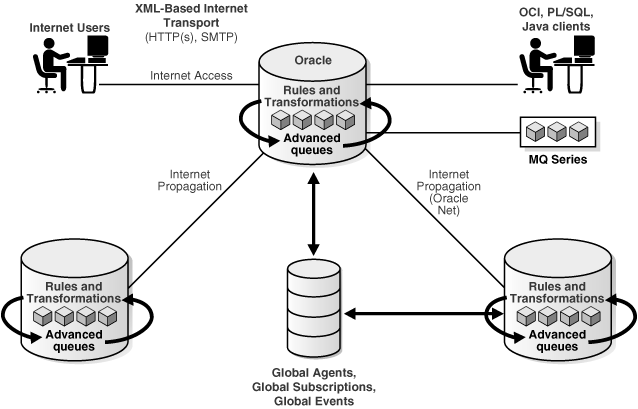
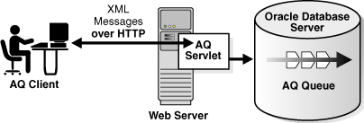

You can exchange XML data using Oracle Database Advanced Queuing (AQ), which provides database-integrated message-queuing. AQ enables and manages asynchronous communication between applications, using messages. It supports point-to-point and publish/subscribe communication models.

Integration of message queuing with Oracle Database brings the integrity, reliability, recoverability, scalability, performance, and security features of Oracle Database to message queuing. It also facilitates the extraction of intelligence from message flows.

- XML and Oracle Database Advanced Queuing
  Oracle Database Advanced Queuing (AQ) supports native XML messages. AQ operations can be defined using the XML-based Internet-Data-Access-Presentation (iDAP) format. iDAP is an extensible message invocation protocol. It is built on Internet standards, using HTTP(S) and e-mail protocols as the transport mechanism. XML is the data representation language for iDAP.
- Oracle Database Advanced Queuing
  Oracle Database Advanced Queuing (AQ) lets you share data and events in a queue. It can propagate information within a database or from one database to another, routing information to specified destinations. It provides functionality and flexibility for capturing and managing events, and for sharing events with other databases and applications.
- XMLType Attributes in Object Types
  You can create queues that use Oracle object types containing `XMLType` attributes. These queues can be used to transmit and store messages that are XML documents.
- Internet Data Access Presentation (iDAP): SOAP for AQ
  You can access Oracle Database Advanced Queuing (AQ) over the Internet using Simple Object Access Protocol (SOAP). Internet Data Access Presentation (iDAP) is the SOAP specification for AQ operations. iDAP defines XML message structure for a SOAP request body.
- iDAP Architecture
  Oracle Database Advanced Queuing (AQ) operations that use HTTP(S) require an iDAP HTTP client, a Web server, and an Oracle server.
- Guidelines for Using XML and Oracle Database Advanced Queuing
  Guidelines are presented for using XML data with Oracle Database Advanced Queuing.

**Parent topic:** [Oracle Tools that Support Oracle XML DB](oracle-tools-that-support-XML-DB.md)

### 37.1 XML and Oracle Database Advanced Queuing

Oracle Database Advanced Queuing (AQ) supports native XML messages. AQ operations can be defined using the XML-based Internet-Data-Access-Presentation (iDAP) format. iDAP is an extensible message invocation protocol. It is built on Internet standards, using HTTP(S) and e-mail protocols as the transport mechanism. XML is the data representation language for iDAP.

- Oracle Database Advanced Queuing and XML Message Payloads
  XML messages can be passed asynchronously among applications using Oracle Database Advanced Queuing (AQ).
- Advantages of Using Oracle Database Advanced Queuing
  Oracle Database Advanced Queuing (AQ) provides flexibility in configuring communication between applications. It makes an integrated solution easy to manage, easy to configure, and easy to modify, to meet changing business needs. It enables applications to cooperate, coordinate, and synchronize, to carry out complex business transactions.

**Parent topic:** XML Data Exchange Using Oracle Database Advanced Queuing

#### 37.1.1 Oracle Database Advanced Queuing and XML Message Payloads

XML messages can be passed asynchronously among applications using Oracle Database Advanced Queuing (AQ).

Figure 37-1 shows an Oracle database using AQ to communicate with three applications. The message payload is XML data. The general tasks performed by AQ in this scenario are:

- Message flow using subscription rules

- Message management

- Extraction of business intelligence from messages

- Message transformation

Use cases of passing XML messages asynchronously among applications using AQ:

- Intra-business. Typical examples include sales order fulfillment and supply-chain management.

- Inter-business. Multiple integration hubs can communicate over the Internet. Examples include travel reservations, coordination between manufacturers and suppliers, transfer of funds between banks, and insurance claims settlements.

  Oracle uses this approach in its enterprise application integration products. XML messages are sent from applications to an Oracle AQ hub. The hub serves as a message server for any application that wants the message. Through this hub-and-spoke architecture, XML messages can be communicated asynchronously to multiple loosely coupled applications.

Figure 37-1 shows XML payload messages transported using AQ in the following ways:

- A Web-based application uses an AQ operation over an HTTP(S) connection using iDAP

- An application uses AQ to propagate an XML message over a Net\* connection

- An application uses AQ to propagate an Internet or XML message directly to the database using HTTP(S) or SMTP

Figure 37-1 also shows that AQ clients can access data using OCI, Java, or PL/SQL.

Figure 37-1 Oracle Database Advanced Queuing and XML Message Payloads

[Description of "Figure 37-1 Oracle Database Advanced Queuing and XML Message Payloads"](img_text/adque437.md)

**Parent topic:** XML and Oracle Database Advanced Queuing

#### 37.1.2 Advantages of Using Oracle Database Advanced Queuing

Oracle Database Advanced Queuing (AQ) provides flexibility in configuring communication between applications. It makes an integrated solution easy to manage, easy to configure, and easy to modify, to meet changing business needs. It enables applications to cooperate, coordinate, and synchronize, to carry out complex business transactions.

Message management provided by AQ manages the flow of messages between different applications. AQ can also retain messages for auditing and tracking purposes, and for extracting business intelligence.

AQ provides SQL views to access messages. You can use these views to analyze trends.

**Parent topic:** XML and Oracle Database Advanced Queuing

### 37.2 Oracle Database Advanced Queuing

Oracle Database Advanced Queuing (AQ) lets you share data and events in a queue. It can propagate information within a database or from one database to another, routing information to specified destinations. It provides functionality and flexibility for capturing and managing events, and for sharing events with other databases and applications.

AQ lets you break the cycle of trading off one solution for another. You can build and operate distributed enterprises and applications, data warehouses, and high availability solutions.

You can use AQ to do all of the following:

- Capture changes at a database. You can configure a background capture process to capture changes made to tables, database schemas, or the entire database. A capture process captures changes from the redo log and formats each captured change into a logical change record (LCR). The database where changes are generated in the redo log is called the source database.

- Enqueue events into a queue. Two types of events may be staged in a queue: LCRs and user messages. A capture process enqueues LCR events into a queue that you specify. The queue can then share the LCR events within the same database or with other databases. You can also enqueue user events explicitly with a user application. These explicitly enqueued events can be LCRs or user messages.

- Propagate events from one queue to another. These queues may be in the same database or in different databases.

- Dequeue events. A background apply process can dequeue events. You can also dequeue events explicitly with a user application.

- Apply events at a database. You can configure an apply process to apply all of the events in a queue or only the events that you specify. You can also configure an apply process to call your own PL/SQL subprograms to process events.

  The database where LCR events are applied and other types of events are processed is called the destination database. In some configurations, the source database and the destination database may be the same.

<!-- -->

- Message Queuing
  Oracle Database Advanced Queuing (AQ) lets your applications enqueue, propagate, and dequeue messages.

**Parent topic:** XML Data Exchange Using Oracle Database Advanced Queuing

#### 37.2.1 Message Queuing

Oracle Database Advanced Queuing (AQ) lets your applications enqueue, propagate, and dequeue messages.

AQ stages messages of type `SYS.AnyData`. Messages of almost any type can be wrapped in a `SYS.AnyData` wrapper and staged in `SYS.AnyData` queues. AQ supports all of the standard features of message queuing systems, including multi-consumer queues, publishing and subscribing, content-based routing, internet propagation, transformations, and gateways to other messaging subsystems.

**Parent topic:** Oracle Database Advanced Queuing

### 37.3 XMLType Attributes in Object Types

You can create queues that use Oracle object types containing `XMLType` attributes. These queues can be used to transmit and store messages that are XML documents.

Using `XMLType`, you can do the following:

- Store any type of message in a queue

- Store documents internally as `CLOB` instances

- Store `m`ore than one type of payload in a queue

- Query `XMLType` columns using SQL/XML functions such as `XMLExists`

- Specify the operators in subscriber rules or dequeue selectors

**Parent topic:** XML Data Exchange Using Oracle Database Advanced Queuing

### 37.4 Internet Data Access Presentation (iDAP): SOAP for AQ

You can access Oracle Database Advanced Queuing (AQ) over the Internet using Simple Object Access Protocol (SOAP). Internet Data Access Presentation (iDAP) is the SOAP specification for AQ operations. iDAP defines XML message structure for a SOAP request body.

An iDAP-structured message is transmitted over the Internet using transport protocols such as HTTP(S) and SMTP.

iDAP uses the `text/xml` content type to specify the body of the SOAP request. XML provides the presentation for iDAP request and response messages, as follows:

- All request and response tags are scoped in the SOAP namespace.

- AQ operations are scoped in the iDAP namespace.

- The sender includes namespaces in iDAP elements and attributes in the SOAP body.

- The receiver processes iDAP messages that have correct namespaces. For the requests with incorrect namespaces, the receiver returns an invalid request error.

- The SOAP namespace has this value: `http://schemas.xmlsoap.org/soap/envelope/`

- The iDAP namespace has this value: `http://ns.oracle.com/AQ/schemas/access`

  **See Also:**

  [Oracle Database Advanced Queuing User's Guide](../adque/aq-internet-access.md)

**Parent topic:** XML Data Exchange Using Oracle Database Advanced Queuing

### 37.5 iDAP Architecture

Oracle Database Advanced Queuing (AQ) operations that use HTTP(S) require an iDAP HTTP client, a Web server, and an Oracle server.

Figure 37-2 shows the relationships among these components.

- A client program sends XML messages that conform to iDAP format, to the AQ Servlet. This can be any HTTP client, such as a Web browser.

- The Web server or `ServletRunner` hosts the AQ servlet that can interpret the incoming XML messages, for example, Apache/Jserv or Tomcat.

- Oracle AQ servlet connects to Oracle Database to perform queue operations.

Figure 37-2 iDAP Architecture for Performing AQ Operations Using HTTP(S)

[Description of "Figure 37-2 iDAP Architecture for Performing AQ Operations Using HTTP(S)"](img_text/adxdb052.md)

- XMLType Queue Payloads
  You can create queues with payloads that contain `XMLType` attributes. These can be used for transmitting and storing messages that contain XML documents.

**Parent topic:** XML Data Exchange Using Oracle Database Advanced Queuing

#### 37.5.1 XMLType Queue Payloads

You can create queues with payloads that contain `XMLType` attributes. These can be used for transmitting and storing messages that contain XML documents.

By defining Oracle objects with `XMLType` attributes, you can do the following:

- Store more than one type of XML document in the same queue. The documents are stored internally as `CLOB` instances.

- Selectively dequeue messages with `XMLType` attributes using SQL/XML functions such as `XMLExists` and `XMLQuery`.

- Define transformations to convert Oracle objects to `XMLType`.

- Define rule-based subscribers that query message content using SQL/XML functions such as `XMLExists` and `XMLQuery`.

In the application sketched in the examples here, assume that an overseas shipping site represents an order using `SYS.XMLType`. An order-entry site represents an order as an Oracle object, `ORDER_TYP`.

Example 37-1 creates the queue table and queue for overseas shipping.

Because the representation of orders at the overseas shipping site is different from the representation of orders at the order-entry site, messages need to be transformed before sending them from the order-entry site to the overseas shipping site. Example 37-2 creates the transformation, and Example 37-3 applies it.

For more information about defining transformations that convert the type used by the order entry application to the type used by overseas shipping, see [Oracle Database Advanced Queuing User's Guide](../adque/aq-administrative-interface.md).

Example 37-4 shows how an application that processes orders for customers in another country, in this case Canada, can dequeue messages.

Example 37-1 Creating a Queue Table and Queue

    BEGIN
       DBMS_AQADM.create_queue_table(
         queue_table        => 'OS_orders_pr_mqtab',
         comment            => 'Overseas Shipping MultiConsumer Orders queue table',
         multiple_consumers => TRUE,
         queue_payload_type => 'SYS.XMLtype',
         compatible         => '8.1');
    END;
    /

    BEGIN
       DBMS_AQADM.create_queue(queue_name   => 'OS_bookedorders_que',
                               queue_table  => 'OS_orders_pr_mqtab');
    END;
    /

Example 37-2 Creating a Transformation to Convert Message Data to XML

    CREATE OR REPLACE FUNCTION convert_to_order_xml(input_order ORDER_TYP)
      RETURN XMLType AS
        new_order XMLType;
    BEGIN
      SELECT XMLElement("Row", input_order) INTO new_order FROM DUAL;
      RETURN new_order;
    END convert_to_order_xml;
    /

    BEGIN
      SYS.DBMS_TRANSFORM.create_transformation(
        schema =>         'OE',
        name   =>         'OE2XML',
        from_schema =>    'OE',
        from_type =>      'ORDER_TYP',
        to_schema =>      'SYS',
        to_type =>        'XMLTYPE',
        transformation => 'convert_to_order_xml(source.user_data)');
    END;
    /

Example 37-3 Applying a Transformation before Sending Messages Overseas

    -- Add a rule-based subscriber for overseas shipping to the booked-orders
    -- queues with transformation.
    DECLARE
       subscriber SYS.AQ$_AGENT;
    BEGIN
       subscriber := SYS.AQ$_AGENT('Overseas_Shipping',
                                   'OS.OS_bookedorders_que',
                                   NULL);
       DBMS_AQADM.add_subscriber(
         queue_name     => 'OS_bookedorders_que',
         subscriber     => subscriber,
         rule           => 'XMLSerialize(CONTENT XMLQuery(''//orderregion''' ||
                           'PASSING tab.user_data RETURNING CONTENT)' ||
                           ' AS VARCHAR2(1000)) = ''INTERNATIONAL''',
         transformation => 'OE.OE2XML');
    END;
    /

Example 37-4 XMLType and AQ: Dequeuing Messages

    -- Create procedure to enqueue into single-consumer queues.
    CREATE OR REPLACE PROCEDURE get_canada_orders AS
       deq_msgid             RAW(16);
       dopt                  DBMS_AQ.dequeue_options_t;
       mprop                 DBMS_AQ.message_properties_t;
       deq_order_data        SYS.XMLType;
       deq_order_data_text   CLOB;
       no_messages           EXCEPTION;
       PRAGMA EXCEPTION_INIT (no_messages, -25228);
       new_orders            BOOLEAN := TRUE;
    BEGIN
       dopt.wait := 1;
       -- Specify dequeue condition to select orders for Canada.
       dopt.deq_condition := 'XMLSerialize(CONTENT ' ||
                             'XMLQuery(''/ORDER_TYP/CUSTOMER/COUNTRY/text()''' ||
                             ' PASSING tab.user_data RETURNING CONTENT)' ||
                             ' AS VARCHAR2(1000))=''CANADA''';
       dopt.consumer_name := 'Overseas_Shipping';
       WHILE (new_orders) LOOP
         BEGIN
           DBMS_AQ.dequeue(queue_name         => 'OS.OS_bookedorders_que',
                           dequeue_options    => dopt,
                           message_properties => mprop,
                           payload            => deq_order_data,
                           msgid              => deq_msgid);
           COMMIT;
           SELECT XMLSerialize(DOCUMENT deq_order_data AS CLOB)
             INTO deq_order_data_text FROM DUAL;
           DBMS_OUTPUT.put_line('Order for Canada - Order: ' || deq_order_data_text);
         EXCEPTION
           WHEN no_messages THEN
             DBMS_OUTPUT.put_line (' ---- NO MORE ORDERS  ---- ');
             new_orders := FALSE;
         END;
       END LOOP;
    END;
    /

**Parent topic:** iDAP Architecture

### 37.6 Guidelines for Using XML and Oracle Database Advanced Queuing

Guidelines are presented for using XML data with Oracle Database Advanced Queuing.

- Store AQ XML Messages with Many PDFs as One Record
  You can exchange XML documents between businesses using Oracle Database Advanced Queuing (AQ), where each message includes an XML header, an XML attachment (XML data stream), DTDs, and PDF files. The data can be stored in a database table, such as a queue table.
- Add New Recipients After Messages Are Enqueued
  You can use a queue table to support message assignments.
- Enqueue and Dequeue XML Messages
  Oracle Database Advanced Queuing (AQ) supports enqueuing and dequeuing objects. The objects can have an attribute of type `XMLType` that contains an XML document, in addition to having metadata attributes.
- Parse Messages with XML Content from AQ Queues
  You can parse messages with XML content from an Oracle Database Advanced Queuing (AQ) queue and then update tables and fields in an Operational Data Store (ODS).
- Prevent the Listener from Stopping Until an XML Document Is Processed
  After receiving a message, you can submit a job using PL/SQL package `DBMS_JOB`. The job is invoked asynchronously in a different database session. This can prevent messages accumulating in the queue because the listener must wait until a received XML message is processed.
- HTTPS with AQ
  You can use Oracle Database Advanced Queuing (AQ) Internet access to send XML messages to suppliers using HTTPS and receive a response. You can enqueue and dequeue XML messages over HTTP(S) securely and transactionally.
- Store XML in Oracle AQ Message Payloads
  You can store XML data in Oracle Database Advanced Queuing (AQ) message payloads natively other than having an ADT as the payload with `SYS.XMLType` as part of the ADT. You can create queues with payloads and attributes as `XMLType`.
- iDAP and SOAP
  iDAP is the SOAP specification for Oracle Database Advanced Queuing (AQ) operations. SOAP defines a generic mechanism to invoke a service. iDAP defines these mechanisms to perform AQ operations.

**Parent topic:** XML Data Exchange Using Oracle Database Advanced Queuing

#### 37.6.1 Store AQ XML Messages with Many PDFs as One Record

You can exchange XML documents between businesses using Oracle Database Advanced Queuing (AQ), where each message includes an XML header, an XML attachment (XML data stream), DTDs, and PDF files. The data can be stored in a database table, such as a queue table.

You can enqueue the messages into Oracle queue tables as one record or piece. Or you can enqueue the messages as multiple records, for example, one record for XML data streams as `CLOB` type, one record for PDF files as `RAW` type, and so on. You can also then dequeue the messages.

You can achieve this in the following ways:

- By defining an object type with (`CLOB`, `RAW`,...) attributes, and storing it as a single message.

- By using the AQ message grouping feature and storing it in multiple messages. Here the message properties are associated with a group. To use the message grouping feature, all messages must be the same payload type.

To specify the payload, first create an object type, for example:

    CREATE TYPE mypayload_type as OBJECT (xmlDataStream CLOB, dtd CLOB, pdf BLOB);

Then store it as a single message.

**Parent topic:** Guidelines for Using XML and Oracle Database Advanced Queuing

#### 37.6.2 Add New Recipients After Messages Are Enqueued

You can use a queue table to support message assignments.

For example, when other businesses send messages to a specific company, they do not know who should be assigned to process the messages, but they know the messages are for department Human Resources (HR). Hence all messages go to the HR supervisor. At this point, the message is enqueued in the queue table. The HR supervisor is the only recipient of this message, and the entire HR staff have been predefined as subscribers for this queue.

You cannot change the recipient list after a message is enqueued. If you do not specify a recipient list then subscribers can subscribe to the queue and dequeue the message. Here, new recipients must be subscribers to the queue. Otherwise, you must dequeue the message and enqueue it again with new recipients.

**Parent topic:** Guidelines for Using XML and Oracle Database Advanced Queuing

#### 37.6.3 Enqueue and Dequeue XML Messages

Oracle Database Advanced Queuing (AQ) supports enqueuing and dequeuing objects. The objects can have an attribute of type `XMLType` that contains an XML document, in addition to having metadata attributes.

Refer to [Oracle Database Advanced Queuing User's Guide](../adque/aq-operations-using-pl-sql.md) for specific details and more examples.

**Parent topic:** Guidelines for Using XML and Oracle Database Advanced Queuing

#### 37.6.4 Parse Messages with XML Content from AQ Queues

You can parse messages with XML content from an Oracle Database Advanced Queuing (AQ) queue and then update tables and fields in an Operational Data Store (ODS).

You can use Oracle XML Parser for Java and Java Stored Procedures together with AQ to obtain metadata such as AQ enqueue or dequeue times and JMS header information, based on queries that target certain XML data. You can combine this with using Oracle Text XML search.

**Parent topic:** Guidelines for Using XML and Oracle Database Advanced Queuing

#### 37.6.5 Prevent the Listener from Stopping Until an XML Document Is Processed

After receiving a message, you can submit a job using PL/SQL package `DBMS_JOB`. The job is invoked asynchronously in a different database session. This can prevent messages accumulating in the queue because the listener must wait until a received XML message is processed.

When receiving XML messages from clients you might need to process them as soon as they arrive. But each XML document might take several seconds to process. For PL/SQL, one procedure starts the listener, dequeues the message, and calls another procedure to process the XML document. The listener could be held up until the XML document is processed, and messages would accumulate in the queue.

After receiving a message, you can instead submit a job using PL/SQL package `DBMS_JOB`. The job is invoked asynchronously in a different database session.

You can register a PL/SQL callback, which is invoked asynchronously when a message shows up in a queue. PL/SQL callbacks are part of the Oracle Database Advanced Queuing notification framework.

**Parent topic:** Guidelines for Using XML and Oracle Database Advanced Queuing

#### 37.6.6 HTTPS with AQ

You can use Oracle Database Advanced Queuing (AQ) Internet access to send XML messages to suppliers using HTTPS and receive a response. You can enqueue and dequeue XML messages over HTTP(S) securely and transactionally.

**See Also:**

[Oracle Database Advanced Queuing User's Guide](../adque/aq-internet-access.md)

**Parent topic:** Guidelines for Using XML and Oracle Database Advanced Queuing

#### 37.6.7 Store XML in Oracle AQ Message Payloads

You can store XML data in Oracle Database Advanced Queuing (AQ) message payloads natively other than having an ADT as the payload with `SYS.XMLType` as part of the ADT. You can create queues with payloads and attributes as `XMLType`.

**Parent topic:** Guidelines for Using XML and Oracle Database Advanced Queuing

#### 37.6.8 iDAP and SOAP

iDAP is the SOAP specification for Oracle Database Advanced Queuing (AQ) operations. SOAP defines a generic mechanism to invoke a service. iDAP defines these mechanisms to perform AQ operations.

iDAP has the following key properties not defined by SOAP:

- Transactional behavior. You can perform AQ operations in a transactional manner. A transaction can span multiple iDAP requests.

- Security. iDAP operations can be carried out only by authorized and authenticated users.

**Parent topic:** Guidelines for Using XML and Oracle Database Advanced Queuing
