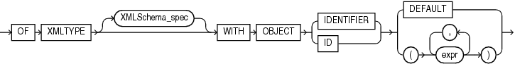

You can create `XMLType` views over relational and object-relational data.

- What Are XMLType Views?
  `XMLType` views wrap existing relational and object-relational data in XML formats. This lets you use existing data in contexts that expect XML data and exploit XML features, including XML Schema.
- CREATE VIEW for XMLType Views: Syntax
  The syntax for the `CREATE VIEW` clause for creating `XMLType` views is presented.
- Creating Non-Schema-Based XMLType Views
  The XML data in a non XML Schema-based `XMLType` view is not constrained to conform to a registered XML schema. You can create a non-schema-based `XMLType` view using SQL/XML publishing functions.
- Creating XML Schema-Based XMLType Views
  The XML data in an XML Schema-based `XMLType` view is constrained to conform to an XML schema. You can create a schema-based `XMLType` view using SQL/XML publishing functions or using object types or views.
- Creating XMLType Views from XMLType Tables
  An `XMLType` view can be created on an `XMLType` table, for example, to transform the XML data or to restrict the rows returned.
- Referencing XMLType View Objects Using SQL Function REF
  You can reference an `XMLType` view object using SQL function `ref`.
- Using DML (Data Manipulation Language) on XMLType Views
  A given `XMLType` view might not be implicitly updatable. In that case, you must write instead-of triggers to handle all DML. To determine whether an `XMLType` view is implicitly updatable, query it to see whether it is based on an object view or constructor that is itself inherently updatable.

**Parent topic:** [Relational Data To and From XML Data](relational-data-to-and-from-XML-data.md)

### 10.1 What Are XMLType Views?

`XMLType` views wrap existing relational and object-relational data in XML formats. This lets you use existing data in contexts that expect XML data and exploit XML features, including XML Schema.

The major advantages of using `XMLType` views are:

- You can exploit Oracle XML DB XML features that use XML Schema functionality without having to migrate your base legacy data.

- With `XMLType` views, you can experiment with various forms of storage for your data. You need not decide immediately whether to store it as `XMLType` or which `XMLType` storage model to use.

`XMLType` views are similar to object views. Each row of an `XMLType` view corresponds to an `XMLType` instance. The object identifier for uniquely identifying each row in the view can be created using SQL/XML functions `XMLCast` and `XMLQuery`.

There are two types of `XMLType` views:

- **Non-schema-based XMLType views.** These views do not confirm to a particular XML schema.

- **XML schema-based XMLType views.** As with `XMLType` tables, `XMLType` views that conform to a particular XML schema are called XML schema-based `XMLType` views. These provide stronger typing than non-schema-based `XMLType` views.

XPath rewrite of queries over `XMLType` views is enabled for both XML schema-based and non-schema-based `XMLType` views. XPath rewrite is described in [XPath Rewrite for Object-Relational Storage](XPath-rewrite-for-object-relational-storage.md).

To create an XML schema-based `XMLType` view, first register your XML schema. If the view is an object view, that is, if it is constructed using an object type, then the XML schema should have annotations that represent the bidirectional mapping from XML to SQL object types. `XMLType` views conforming to this registered XML schema can then be created by providing an underlying query that constructs instances of the appropriate SQL object type.

You can create `XMLType` views in any of the following ways:

- Based on SQL/XML publishing functions, such as `XMLElement`, `XMLForest`, `XMLConcat`, and `XMLAgg`. SQL/XML publishing functions can be used to construct both non-schema-based `XMLType` views and XML schema-based `XMLType` views. This enables construction of `XMLType` view from the underlying relational tables directly without physically migrating those relational legacy data into XML. However, to construct XML schema-based `XMLType` view, the XML schema must be registered and the XML value generated by SQL/XML publishing functions must be constrained to the XML schema.

- Based on object types or object views. This enables the construction of the `XMLType` view from underlying relational or object relational tables directly without physically migrating the relational or object relational legacy data into XML. Creating an XML-schema-based `XMLType` view requires that you annotate the XML schema with a mapping to existing object types or that you generate the XML schema from the existing object types.

- Directly from an `XMLType` table.

**Related Topics**

- [XML Schema Storage and Query: Basic](XML-Schema-and-query-basic.md)
- [Relational Views over XML Data](relational-views-over-XML-data.md)
- [Choice of XMLType Storage and Indexing](choice-of-XMLType-storage-and-indexing.md)

**Parent topic:** XMLType Views

### 10.2 CREATE VIEW for XMLType Views: Syntax

The syntax for the `CREATE VIEW` clause for creating `XMLType` views is presented.

Figure 10-1 shows this syntax. See [Oracle Database SQL Language Reference](../sqlrf/CREATE-VIEW.md) for details on the `CREATE VIEW` syntax.

Figure 10-1 Creating XMLType Views Clause: Syntax

[Description of "Figure 10-1 Creating XMLType Views Clause: Syntax"](img_text/xmltype_view_clause.md)

**Parent topic:** XMLType Views

### 10.3 Creating Non-Schema-Based XMLType Views

The XML data in a non XML Schema-based `XMLType` view is not constrained to conform to a registered XML schema. You can create a non-schema-based `XMLType` view using SQL/XML publishing functions.

Example 10-1 shows how to create an `XMLType` view using SQL/XML function `XMLELement`.

Existing data in relational tables or views can be exposed as XML data this way. If a view is generated using a SQL/XML publishing function then queries that access that view using XQuery expressions can often be rewritten. These optimized queries can then directly access the underlying relational columns. See [XPath Rewrite for Object-Relational Storage](XPath-rewrite-for-object-relational-storage.md) for details.

You can perform a DML operation on an `XMLType` view, but, in general, you must write instead-of triggers to handle the DML operation.

**See Also:**

[Generation of XML Data from Relational Data](generation-of-XML-data-from-relational-data.md), for details on SQL/XML publishing functions

Example 10-1 Creating an XMLType View Using XMLELEMENT

    CREATE OR REPLACE VIEW emp_view OF XMLType
      WITH OBJECT ID (XMLCast(XMLQuery('/Emp/@empno'
                                       PASSING OBJECT_VALUE RETURNING CONTENT)
                              AS BINARY_DOUBLE)) AS
      SELECT XMLElement("Emp",
                        XMLAttributes(employee_id AS "empno"),
                        XMLForest(e.first_name ||' '|| e.last_name AS "name",
                                  e.hire_date AS "hiredate"))
        AS "result" FROM employees e WHERE salary > 15000;

    SELECT * FROM emp_view;

    SYS_NC_ROWINFO$
    -------------------------------------------------------------------------------------
    <Emp empno="100"><name>Steven King</name><hiredate>2003-06-17</hiredate></Emp>
    <Emp empno="101"><name>Neena Kochhar</name><hiredate>2005-09-21</hiredate></Emp>
    <Emp empno="102"><name>Lex De Haan</name><hiredate>2001-01-13</hiredate></Emp>

**Parent topic:** XMLType Views

### 10.4 Creating XML Schema-Based XMLType Views

The XML data in an XML Schema-based `XMLType` view is constrained to conform to an XML schema. You can create a schema-based `XMLType` view using SQL/XML publishing functions or using object types or views.

Create a schema-based view in either of these ways:

- Using SQL/XML publishing functions.

- Using object types or object views. This is convenient when you already have object types, views, and tables that you want to map to XML data.

<!-- -->

- Creating XML Schema-Based XMLType Views Using SQL/XML Publishing Functions
  You can use SQL/XML publishing functions to create an XML Schema-based `XMLType` view.
- Creating XML Schema-Based XMLType Views Using Object Types or Object Views
  You can create an XML Schema-based `XMLType` view from object types or views by annotating the XML schema to define a mapping between XML types and SQL object types and object attributes.

**Parent topic:** XMLType Views

#### 10.4.1 Creating XML Schema-Based XMLType Views Using SQL/XML Publishing Functions

You can use SQL/XML publishing functions to create an XML Schema-based `XMLType` view.

1.  Create and register the XML schema document that contains the necessary XML structures. You do not need to annotate the XML schema to define the mapping between XML types and SQL object types.

2.  Use SQL/XML publishing functions to create an `XMLType` view that conforms to the XML schema.

These two steps are illustrated in Example 10-2 and Example 10-3, respectively.

Example 10-4 illustrates querying an `XMLType` view.

Example 10-2 assumes that you have an XML schema `emp_simple.xsd` that contains XML structures defining an employee. It registers the XML schema with the target location `http://www.oracle.com/emp_simple.xsd`.

When using SQL/XML publishing functions to generate XML schema-based content, you must specify the appropriate namespace information for all of the elements and also indicate the location of the schema using attribute `xsi:schemaLocation`. These can be specified using the `XMLAttributes` clause. Example 10-3 illustrates this.

**Note:**

Whenever you use SQL/XML function `XMLAttributes` with an XML schema reference to create an `XMLType` view, register the XML schema before creating the view, if possible. Otherwise, you must recompile the view after registering the XML schema, in order for the generated documents to be based on the XML schema.

In Example 10-3, function `XMLElement` creates XML element `Employee`. Function `XMLForest` creates the children of element `Employee`. The `XMLAttributes` clause inside `XMLElement` constructs the required XML `namespace` and schema `location` attributes, so that the XML data that is generated conforms to the XML schema of the view. The innermost call to `XMLForest` creates the children of element `department`, which is a child of element `Employee`.

By default, the XML generation functions create a non-schema-based XML instance. However, when the schema location is specified, using attribute `xsi:schemaLocation` or `xsi:noNamespaceSchemaLocation`, Oracle XML DB generates XML schema-based XML data. For `XMLType` views, as long as the names of the elements and attributes match those in the XML schema, the XML data is converted implicitly into a valid XML schema-based document. Any errors in the generated XML data are caught later, when operations such as validation or extraction operations are performed on the XML instance.

Example 10-4 queries the `XMLType` view, returning an XML result from tables `employees` and `departments`. The result of the query is shown pretty-printed, for clarity.

Example 10-2 Registering XML Schema emp_simple.xsd

    BEGIN
      DBMS_XMLSCHEMA.registerSchema(
       SCHEMAURL => 'http://www.oracle.com/emp_simple.xsd',
       SCHEMADOC => '<schema xmlns="http://www.w3.org/2001/XMLSchema"
                             targetNamespace="http://www.oracle.com/emp_simple.xsd"
                             version="1.0"
                             xmlns:xdb="http://xmlns.oracle.com/xdb"
                             elementFormDefault="qualified">
                       <element name = "Employee">
                         <complexType>
                           <sequence>
                             <element name = "EmployeeId"
                                      type = "positiveInteger" minOccurs = "0"/>
                             <element name = "Name"
                                      type = "string" minOccurs = "0"/>
                             <element name = "Job"
                                      type = "string" minOccurs = "0"/>
                             <element name = "Manager"
                                      type = "positiveInteger" minOccurs = "0"/>
                             <element name = "HireDate"
                                      type = "date" minOccurs = "0"/>
                             <element name = "Salary"
                                      type = "positiveInteger" minOccurs = "0"/>
                             <element name = "Commission"
                                      type = "positiveInteger" minOccurs = "0"/>
                             <element name = "Dept">
                               <complexType>
                                 <sequence>
                                   <element name = "DeptNo"
                                            type = "positiveInteger" minOccurs = "0"/>
                                   <element name = "DeptName"
                                            type = "string" minOccurs = "0"/>
                                   <element name = "Location"
                                            type = "positiveInteger" minOccurs = "0"/>
                                 </sequence>
                               </complexType>
                             </element>
                           </sequence>
                         </complexType>
                       </element>
                     </schema>',
       LOCAL     => TRUE,
       GENTYPES  => TRUE);
    END;

Example 10-3 Creating an XMLType View Using SQL/XML Publishing Functions

    CREATE OR REPLACE VIEW emp_simple_xml OF XMLType
      XMLSCHEMA "http://www.oracle.com/emp_simple.xsd" ELEMENT "Employee"
       WITH OBJECT ID (XMLCast(XMLQuery('/Employee/EmployeeId/text()'
                                        PASSING OBJECT_VALUE
                                        RETURNING CONTENT)
                               AS BINARY_DOUBLE)) AS
       SELECT
         XMLElement("Employee",
                    XMLAttributes(
                      'http://www.oracle.com/emp_simple.xsd' AS "xmlns" ,
                      'http://www.w3.org/2001/XMLSchema-instance' AS "xmlns:xsi",
                      'http://www.oracle.com/emp_simple.xsd
                       http://www.oracle.com/emp_simple.xsd'
                      AS "xsi:schemaLocation"),
                    XMLForest(e.employee_id    AS "EmployeeId",
                              e.last_name      AS "Name",
                              e.job_id         AS "Job",
                              e.manager_id     AS "Manager",
                              e.hire_date      AS "HireDate",
                              e.salary         AS "Salary",
                              e.commission_pct AS "Commission",
                              XMLForest(
                                d.department_id   AS "DeptNo",
                                d.department_name AS "DeptName",
                                d.location_id     AS "Location") AS "Dept"))
         FROM employees e, departments d
         WHERE e.department_id = d.department_id;

Example 10-4 Querying an XMLType View

    SELECT OBJECT_VALUE AS RESULT FROM emp_simple_xml WHERE ROWNUM < 2;

    RESULT
    ---------------------------------------------------------------------
    <Employee xmlns="http://www.oracle.com/emp_simple.xsd"
              xmlns:xsi="http://www.w3.org/2001/XMLSchema-instance"
              xsi:schemaLocation="http://www.oracle.com/emp_simple.xsd
                                  http://www.oracle.com/emp_simple.xsd">
      <EmployeeId>200</EmployeeId>
      <Name>Whalen</Name>
      <Job>AD_ASST</Job>
      <Manager>101</Manager>
      <HireDate>2003-09-17</HireDate>
      <Salary>4400</Salary>
      <Dept>
        <DeptNo>10</Deptno>
        <DeptName>Administration</DeptName>
        <Location>1700</Location>
      </Dept>
    </Employee>

- Using Namespaces with SQL/XML Publishing Functions
  If you have complex XML schemas involving namespaces, you must use the partially escaped mapping provided by the SQL/XML publishing functions and create elements with appropriate namespaces and prefixes.

**Parent topic:** Creating XML Schema-Based XMLType Views

##### 10.4.1.1 Using Namespaces with SQL/XML Publishing Functions

If you have complex XML schemas involving namespaces, you must use the partially escaped mapping provided by the SQL/XML publishing functions and create elements with appropriate namespaces and prefixes.

The query in Example 10-5 creates XML instances that have the correct namespace, prefixes, and target schema location. It can be used as the query in the definition of view `emp_simple_xml`.

If the XML schema had no target namespace, then you could use attribute `xsi:noNamespaceSchemaLocation` to indicate that. Example 10-6 shows such an XML schema.

Example 10-7 creates a view that conforms to the XML schema in Example 10-6. The `XMLAttributes` clause creates an XML element that contains the `noNamespace` schema location attribute.

Example 10-8 creates view `dept_xml`, which conforms to XML schema `dept.xsd`.

Example 10-5 Using Namespace Prefixes with SQL/XML Publishing Functions

    SELECT XMLElement("ipo:Employee",
              XMLAttributes('http://www.oracle.com/emp_simple.xsd' AS "xmlns:ipo",
                            'http://www.oracle.com/emp_simple.xsd
                             http://www.oracle.com/emp_simple.xsd' AS "xmlns:xsi"),
                XMLForest(e.employee_id                     AS "ipo:EmployeeId",
                          e.last_name                       AS "ipo:Name",
                          e.job_id                          AS "ipo:Job",
                          e.manager_id                      AS "ipo:Manager",
                          TO_CHAR(e.hire_date,'YYYY-MM-DD') AS "ipo:HireDate",
                          e.salary                          AS "ipo:Salary",
                          e.commission_pct                  AS "ipo:Commission",
                     XMLForest(d.department_id   AS "ipo:DeptNo",
                               d.department_name AS "ipo:DeptName", d.location_id
           AS "ipo:Location") AS "ipo:Dept"))
           FROM employees e, departments d
           WHERE e.department_id = d.department_id AND d.department_id = 20;
    BEGIN
      -- Delete schema if it already exists (else error)
      DBMS_XMLSCHEMA.deleteSchema('emp-noname.xsd', 4);
    END;

    XMLELEMENT("IPO:EMPLOYEE",XMLATTRIBUTES('HTTP://WWW.ORACLE.COM/EMP_SIMPLE.XSD'AS
    --------------------------------------------------------------------------------
    <ipo:Employee
    xmlns:ipo="http://www.oracle.com/emp_simple.xsd"
     xmlns:xsi="http://www.oracle.com/emp_simple.xsd
     http://www.oracle.com/emp_simple.xsd">
    <ipo:EmployeeId>201</ipo:EmployeeId><ipo:Name>Hartstein</ipo:Name>
    <ipo:Job>MK_MAN</ipo:Job><ipo:Manager>100</ipo:Manager>
    <ipo:HireDate>2004-02-17</ipo:HireDate><ipo:Salary>13000</ipo:Salary>
    <ipo:Dept><ipo:DeptNo>20</ipo:DeptNo><ipo:DeptName>Marketing</ipo:DeptName>
    <ipo:Location>1800</ipo:Location></ipo:Dept></ipo:Employee>
    <ipo:Employee xmlns:ipo="http://www.oracle.com/emp_simple.xsd"
     xmlns:xsi="http://www.oracle.com/emp_simple.xsd
     http://www.oracle.com/emp_simple.xsd"><ipo:EmployeeId>202</ipo:EmployeeId>
    <ipo:Name>Fay</ipo:Name><ipo:Job>MK_REP</ipo:Job><ipo:Manager>201</ipo:Manager>
    <ipo:HireDate>2005-08-17</ipo:HireDate><ipo:Salary>6000</ipo:Salary>
    <ipo:Dept><ipo:DeptNo>20</ipo:Dept
    No><ipo:DeptName>Marketing</ipo:DeptName><ipo:Location>1800</ipo:Location>
    </ipo:Dept>
    </ipo:Employee>

Example 10-6 XML Schema with No Target Namespace

    BEGIN
      DBMS_XMLSCHEMA.registerSchema(
        SCHEMAURL => 'emp-noname.xsd',
        SCHEMADOC => '<schema xmlns="http://www.w3.org/2001/XMLSchema"
                              xmlns:xdb="http://xmlns.oracle.com/xdb">
                        <element name = "Employee">
                          <complexType>
                            <sequence>
                              <element name = "EmployeeId" type = "positiveInteger"/>
                              <element name = "Name" type = "string"/>
                              <element name = "Job" type = "string"/>
                              <element name = "Manager" type = "positiveInteger"/>
                              <element name = "HireDate" type = "date"/>
                              <element name = "Salary" type = "positiveInteger"/>
                              <element name = "Commission" type = "positiveInteger"/>
                              <element name = "Dept">
                                <complexType>
                                  <sequence>
                                    <element name = "DeptNo" type = "positiveInteger" />
                                    <element name = "DeptName" type = "string"/>
                                    <element name = "Location" type = "positiveInteger"/>
                                  </sequence>
                                </complexType>
                              </element>
                            </sequence>
                          </complexType>
                        </element>
                      </schema>',
        LOCAL     => TRUE,
        GENTYPES  => TRUE);
    END;

Example 10-7 Creating a View for an XML Schema with No Target Namespace

    CREATE OR REPLACE VIEW emp_xml OF XMLType
         XMLSCHEMA "emp-noname.xsd" ELEMENT "Employee"
         WITH OBJECT ID (XMLCast(XMLQuery('/Employee/EmployeeId/text()'
                                          PASSING OBJECT_VALUE
                                          RETURNING CONTENT)
                                 AS BINARY_DOUBLE)) AS
         SELECT XMLElement(
           "Employee",
           XMLAttributes('http://www.w3.org/2001/XMLSchema-instance' AS "xmlns:xsi",
                         'emp-noname.xsd' AS "xsi:noNamespaceSchemaLocation"),
           XMLForest(e.employee_id    AS "EmployeeId",
                     e.last_name      AS "Name",
                     e.job_id         AS "Job",
                     e.manager_id     AS "Manager",
                     e.hire_date      AS "HireDate",
                     e.salary         AS "Salary",
                     e.commission_pct AS "Commission",
                     XMLForest(d.department_id   AS "DeptNo",
                               d.department_name AS "DeptName",
                               d.location_id     AS "Location") AS "Dept"))
           FROM employees e, departments d
           WHERE e.department_id = d.department_id;

Example 10-8 Using SQL/XML Functions in XML Schema-Based XMLType Views

    BEGIN
      -- Delete schema if it already exists (else error)
      DBMS_XMLSCHEMA.deleteSchema('http://www.oracle.com/dept.xsd', 4);
    END;
    /

    BEGIN
      DBMS_XMLSCHEMA.registerSchema(
        SCHEMAURL => 'http://www.oracle.com/dept.xsd',
        SCHEMADOC => '<schema xmlns="http://www.w3.org/2001/XMLSchema"
                              targetNamespace="http://www.oracle.com/dept.xsd"
                              version="1.0"
                              xmlns:xdb="http://xmlns.oracle.com/xdb"
                              elementFormDefault="qualified">
                        <element name = "Department">
                          <complexType>
                            <sequence>
                              <element name = "DeptNo" type = "positiveInteger"/>
                              <element name = "DeptName" type = "string"/>
                              <element name = "Location" type = "positiveInteger"/>
                              <element name = "Employee" maxOccurs = "unbounded">
                                <complexType>
                                  <sequence>
                                    <element name = "EmployeeId" type = "positiveInteger"/>
                                    <element name = "Name" type = "string"/>
                                    <element name = "Job" type = "string"/>
                                    <element name = "Manager" type = "positiveInteger"/>
                                    <element name = "HireDate" type = "date"/>
                                    <element name = "Salary" type = "positiveInteger"/>
                                    <element name = "Commission" type = "positiveInteger"/>
                                 </sequence>
                                </complexType>
                              </element>
                            </sequence>
                          </complexType>
                        </element>
                      </schema>',
        LOCAL     => TRUE,
        GENTYPES  => FALSE);
      END;
    /

    CREATE OR REPLACE VIEW dept_xml OF XMLType
      XMLSCHEMA "http://www.oracle.com/dept.xsd" ELEMENT "Department"
      WITH OBJECT ID (XMLCast(XMLQuery('/Department/DeptNo'
                                       PASSING OBJECT_VALUE RETURNING CONTENT)
                              AS BINARY_DOUBLE)) AS
      SELECT XMLElement(
        "Department",
        XMLAttributes(
          'http://www.oracle.com/emp.xsd' AS "xmlns" ,
          'http://www.w3.org/2001/XMLSchema-instance' AS "xmlns:xsi",
          'http://www.oracle.com/dept.xsd
           http://www.oracle.com/dept.xsd' AS "xsi:schemaLocation"),
        XMLForest(d.department_id AS "DeptNo",
                  d.department_name AS "DeptName",
                  d.location_id AS "Location"),
        (SELECT XMLagg(
                  XMLElement("Employee",
                             XMLForest(
                               e.employee_id AS "EmployeeId",
                               e.last_name AS "Name",
                               e.job_id AS "Job",
                               e.manager_id AS "Manager",
                               to_char(e.hire_date,'YYYY-MM-DD') AS "Hiredate",
                               e.salary AS "Salary",
                               e.commission_pct AS "Commission")))
           FROM employees e
           WHERE e.department_id = d.department_id))
         FROM departments d;

This is the `XMLType` instance that results:

    SELECT OBJECT_VALUE AS result FROM dept_xml WHERE ROWNUM < 2;

    RESULT
    ----------------------------------------------------------------
    <Department
        xmlns="http://www.oracle.com/emp.xsd"
        xmlns:xsi="http://www.w3.org/2001/XMLSchema-instance"
        xsi:schemaLocation="http://www.oracle.com/dept.xsd
                            http://www.oracle.com/dept.xsd">
      <DeptNo>10</DeptNo>
      <DeptName>Administration</DeptName>
      <Location>1700</Location>
      <Employee>
        <EmployeeId>200</EmployeeId>
        <Name>Whalen</Name>
        <Job>AD_ASST</Job>
        <Manager>101</Manager>
        <Hiredate>2003-09-17</Hiredate>
        <Salary>4400</Salary>
      </Employee>
    </Department>

**Parent topic:** Creating XML Schema-Based XMLType Views Using SQL/XML Publishing Functions

#### 10.4.2 Creating XML Schema-Based XMLType Views Using Object Types or Object Views

You can create an XML Schema-based `XMLType` view from object types or views by annotating the XML schema to define a mapping between XML types and SQL object types and object attributes.

To create an XML Schema-based `XMLType` view from object types or object views, do the following:

1.  Create the object types, if they do not yet exist.

2.  Create and then register the XML schema, annotating it to define the mapping between XML types and SQL object types and attributes.

    Annotate the XML schema before registering it. You typically do this when you wrap existing data to create an `XMLType` view.

    When such an XML schema document is registered, the following validation can occur:

    - `SQLType` for attributes or elements based on `simpleType`. The SQL type must be compatible with the XML type of the corresponding `XMLType` data. For example, an XML `string` data type can be mapped only to a `VARCHAR2` or a Large Object (LOB) data type.

    - `SQLType` specified for elements based on `complexType`. This is either a LOB or an object type whose structure must be compatible with the declaration of the `complexType`, that is, the object type must have the correct number of attributes with the correct data types.

3.  Create the `XMLType` view, specifying the XML schema URL and the root element name. The query defining the view first constructs the object instances and then converts them to XML.

    1.  Create an object view.

    2.  Create an `XMLType` view over the object view.

The topics in this section present examples of creating XML schema-based `XMLType` views using object types or object views. They are based on relational tables that contain employee and department data.

The same relational data is used to create each of two `XMLType` views. In the employee view, `emp_xml`, the XML document describes an employee, with the employee's department as nested information. In the department view, `dept_xml`, the XML data describes a department, with the department's employees as nested information.

- Creating XMLType Employee View, with Nested Department Information
  Examples here create `XMLType` view `emp_xml` based on object views.
- Creating XMLType Department View, with Nested Employee Information
  `XMLType` view `dept_xml` is created so that each department in the view contains nested employee information.

**Related Topics**

- [XML Schema Storage and Query: Basic](XML-Schema-and-query-basic.md)

**Parent topic:** Creating XML Schema-Based XMLType Views

##### 10.4.2.1 Creating XMLType Employee View, with Nested Department Information

Examples here create `XMLType` view `emp_xml` based on object views.

For the last step of the view creation, there are two alternatives:

- Step 3a. Create XMLType View emp_xml Using Object Type emp_t – create `XMLType` view `emp_xml` using object type `emp_t`

- Step 3b. Create XMLType View emp_xml Using Object View emp_v – create `XMLType` view `emp_xml` using object view `emp_v`

<!-- -->

- Step 1. Create Object Types for XMLType Employee View
  Create an object type for an XML Schema-based view.
- Step 2. Create and Register XML Schema emp_complex.xsd
  Create and register an XML schema, `emp_complex.xsd`. The schema maps XML elements and attributes to corresponding object-relational object attributes.
- Step 3a. Create XMLType View emp_xml Using Object Type emp_t
  Create an `XMLType` view using an object type.
- Step 3b. Create XMLType View emp_xml Using Object View emp_v
  Create an `XMLType` view using an object view.

**Parent topic:** Creating XML Schema-Based XMLType Views Using Object Types or Object Views

###### 10.4.2.1.1 Step 1. Create Object Types for XMLType Employee View

Create an object type for an XML Schema-based view.

Example 10-9 creates the object types used in the other steps.

Example 10-9 Creating Object Types for Schema-Based XMLType Views

    CREATE TYPE dept_t AS OBJECT
          (deptno NUMBER(4),
           dname  VARCHAR2(30),
           loc    NUMBER(4));
    /

    CREATE TYPE emp_t AS OBJECT
          (empno     NUMBER(6),
           ename     VARCHAR2(25),
           job       VARCHAR2(10),
           mgr       NUMBER(6),
           hiredate  DATE,
           sal       NUMBER(8,2),
           comm      NUMBER(2,2),
           dept      dept_t);
    /

**Parent topic:** Creating XMLType Employee View, with Nested Department Information

###### 10.4.2.1.2 Step 2. Create and Register XML Schema emp_complex.xsd

Create and register an XML schema, `emp_complex.xsd`. The schema maps XML elements and attributes to corresponding object-relational object attributes.

Create XML schema `emp_complex.xsd`, which specifies how XML elements and attributes are mapped to corresponding object attributes in the object types (the `xdb:SQLType` annotations), then register it. Example 10-10 registers it.

Example 10-10 creates and registers the XML schema using the target location `http://www.oracle.com/emp_complex.xsd`.

Example 10-10 Creating and Registering XML Schema emp_complex.xsd

    BEGIN
      -- Delete schema if it already exists (else error)
      DBMS_XMLSCHEMA.deleteSchema('http://www.oracle.com/emp_complex.xsd', 4);
    END;
    /

    COMMIT;

    BEGIN
      DBMS_XMLSCHEMA.registerSchema(
        SCHEMAURL => 'http://www.oracle.com/emp_complex.xsd',
        SCHEMADOC => '<?xml version="1.0"?>
                      <xsd:schema xmlns:xsd="http://www.w3.org/2001/XMLSchema"
                                  xmlns:xsi="http://www.w3.org/2001/XMLSchema-instance"
                                  xmlns:xdb="http://xmlns.oracle.com/xdb"
                                  xsi:schemaLocation="http://xmlns.oracle.com/xdb
                                                      http://xmlns.oracle.com/xdb/XDBSchema.xsd">
                        <xsd:element name="Employee" type="EMP_TType" xdb:SQLType="EMP_T"/>
                        <xsd:complexType name="EMP_TType" xdb:SQLType="EMP_T" xdb:maintainDOM="false">
                          <xsd:sequence>
                            <xsd:element name="EMPNO" type="xsd:double" xdb:SQLName="EMPNO"
                                         xdb:SQLType="NUMBER"/>
                            <xsd:element name="ENAME" xdb:SQLName="ENAME" xdb:SQLType="VARCHAR2">
                              <xsd:simpleType>
                                <xsd:restriction base="xsd:string">
                                  <xsd:maxLength value="25"/>
                                </xsd:restriction>
                              </xsd:simpleType>
                            </xsd:element>
                            <xsd:element name="JOB" xdb:SQLName="JOB" xdb:SQLType="VARCHAR2">
                              <xsd:simpleType>
                                <xsd:restriction base="xsd:string">
                                  <xsd:maxLength value="10"/>
                                </xsd:restriction>
                              </xsd:simpleType>
                            </xsd:element>
                            <xsd:element name="MGR" type="xsd:double" xdb:SQLName="MGR"
                                         xdb:SQLType="NUMBER"/>
                            <xsd:element name="HIREDATE" type="xsd:date" xdb:SQLName="HIREDATE"
                                         xdb:SQLType="DATE"/>
                            <xsd:element name="SAL" type="xsd:double" xdb:SQLName="SAL"
                                         xdb:SQLType="NUMBER"/>
                            <xsd:element name="COMM" type="xsd:double" xdb:SQLName="COMM"
                                         xdb:SQLType="NUMBER"/>
                            <xsd:element name="DEPT" type="DEPT_TType" xdb:SQLName="DEPT"
                                         xdb:SQLType="DEPT_T"/>
                          </xsd:sequence>
                        </xsd:complexType>
                        <xsd:complexType name="DEPT_TType" xdb:SQLType="DEPT_T"
                                         xdb:maintainDOM="false">
                          <xsd:sequence>
                            <xsd:element name="DEPTNO" type="xsd:double" xdb:SQLName="DEPTNO"
                                         xdb:SQLType="NUMBER"/>
                            <xsd:element name="DNAME" xdb:SQLName="DNAME" xdb:SQLType="VARCHAR2">
                              <xsd:simpleType>
                                <xsd:restriction base="xsd:string">
                                  <xsd:maxLength value="30"/>
                                </xsd:restriction>
                              </xsd:simpleType>
                            </xsd:element>
                           <xsd:element name="LOC" type="xsd:double" xdb:SQLName="LOC"
                                        xdb:SQLType="NUMBER"/>
                          </xsd:sequence>
                        </xsd:complexType>
                      </xsd:schema>',
        LOCAL     => TRUE,
        GENTYPES  => FALSE);
    END;
    /

**Parent topic:** Creating XMLType Employee View, with Nested Department Information

###### 10.4.2.1.3 Step 3a. Create XMLType View emp_xml Using Object Type emp_t

Create an `XMLType` view using an object type.

Example 10-11 creates an `XMLType` view using object type `emp_t`.

Example 10-11 uses SQL/XML function `XMLCast` in the `OBJECT ID` clause to convert the XML employee number to SQL data type `BINARY_DOUBLE`.

**See Also:**

Step 3b. Create XMLType View emp_xml Using Object View emp_v for an alternative way to create view `emp_xml`, which uses object view `emp_v`

Example 10-11 Creating XMLType View emp_xml Using Object Type emp_t

    CREATE OR REPLACE VIEW emp_xml OF XMLType
      XMLSCHEMA "http://www.oracle.com/emp_complex.xsd"
      ELEMENT "Employee"
        WITH OBJECT ID (XMLCast(XMLQuery('/Employee/EMPNO'
                                         PASSING OBJECT_VALUE RETURNING CONTENT)
                                AS BINARY_DOUBLE)) AS
      SELECT emp_t(e.employee_id, e.last_name, e.job_id, e.manager_id, e.hire_date,
                   e.salary, e.commission_pct,
                   dept_t(d.department_id, d.department_name, d.location_id))
        FROM employees e, departments d
        WHERE e.department_id = d.department_id;

**Parent topic:** Creating XMLType Employee View, with Nested Department Information

###### 10.4.2.1.4 Step 3b. Create XMLType View emp_xml Using Object View emp_v

Create an `XMLType` view using an object view.

Example 10-12 creates object view `emp_v` and then creates `XMLType` view `emp_xml` based on that object view.

**See Also:**

Step 3a. Create XMLType View emp_xml Using Object Type emp_t for an alternative way to create view `emp_xml`, which uses object type `emp_t`

Example 10-12 Creating an Object View and an XMLType View Based on the Object View

    CREATE OR REPLACE VIEW emp_v OF emp_t WITH OBJECT ID (empno) AS
      SELECT emp_t(e.employee_id, e.last_name, e.job_id, e.manager_id, e.hire_date,
                   e.salary, e.commission_pct,
                   dept_t(d.department_id, d.department_name, d.location_id))
        FROM employees e, departments d
        WHERE e.department_id = d.department_id;

    CREATE OR REPLACE VIEW emp_xml OF XMLType
      XMLSCHEMA "http://www.oracle.com/emp_complex.xsd" ELEMENT "Employee"
      WITH OBJECT ID DEFAULT AS
      SELECT VALUE(p) FROM emp_v p;

**Parent topic:** Creating XMLType Employee View, with Nested Department Information

##### 10.4.2.2 Creating XMLType Department View, with Nested Employee Information

`XMLType` view `dept_xml` is created so that each department in the view contains nested employee information.

For the last step of the view creation, there are two alternatives:

- Step 3a. Create XMLType View dept_xml Using Object Type dept_t – create `XMLType` view `dept_xml` using the object type for a department, `dept_t`

- Step 3b. Create XMLType View dept_xml Using Relational Data Directly – create `XMLType` view `dept_xml` using relational data directly

<!-- -->

- Step 1. Create Object Types for XMLType Department View
  Create an object type for an XML Schema-based view.
- Step 2. Register XML Schema dept_complex.xsd
  Register XML schema `dept_complex.xsd`.
- Step 3a. Create XMLType View dept_xml Using Object Type dept_t
  Create `XMLType` view `dept_xml` using object type `dept_t`.
- Step 3b. Create XMLType View dept_xml Using Relational Data Directly
  You can use SQL/XML publishing functions to create `XMLType` view `dept_xml` from the relational tables without using object type `dept_t`.

**Parent topic:** Creating XML Schema-Based XMLType Views Using Object Types or Object Views

###### 10.4.2.2.1 Step 1. Create Object Types for XMLType Department View

Create an object type for an XML Schema-based view.

Example 10-13 creates the object types used in the other steps.

Example 10-13 Creating Object Types

    CREATE TYPE emp_t AS OBJECT (empno    NUMBER(6),
                                 ename    VARCHAR2(25),
                                 job      VARCHAR2(10),
                                 mgr      NUMBER(6),
                                 hiredate DATE,
                                 sal      NUMBER(8,2),
                                 comm     NUMBER(2,2)); /

    CREATE OR REPLACE TYPE emplist_t AS TABLE OF emp_t;
    /

    CREATE TYPE dept_t AS OBJECT (deptno NUMBER(4),
                                  dname  VARCHAR2(30),
                                  loc    NUMBER(4),
                                  emps   emplist_t);
    /

**Parent topic:** Creating XMLType Department View, with Nested Employee Information

###### 10.4.2.2.2 Step 2. Register XML Schema dept_complex.xsd

Register XML schema `dept_complex.xsd`.

Example 10-14 illustrates this.

Example 10-14 Registering XML Schema dept_complex.xsd

    BEGIN
      -- Delete schema if it already exists (else error)
      DBMS_XMLSCHEMA.deleteSchema('http://www.oracle.com/dept_complex.xsd', 4);
    END;
    /

    BEGIN
      DBMS_XMLSCHEMA.registerSchema(
        SCHEMAURL => 'http://www.oracle.com/dept_complex.xsd',
        SCHEMADOC => '<?xml version="1.0"?>
                      <xsd:schema xmlns:xsd="http://www.w3.org/2001/XMLSchema"
                                  xmlns:xsi="http://www.w3.org/2001/XMLSchema-instance"
                                  xmlns:xdb="http://xmlns.oracle.com/xdb"
                                  xsi:schemaLocation="http://xmlns.oracle.com/xdb
                                                      http://xmlns.oracle.com/xdb/XDBSchema.xsd">
                        <xsd:element name="Department" type="DEPT_TType" xdb:SQLType="DEPT_T"/>
                        <xsd:complexType name="DEPT_TType" xdb:SQLType="DEPT_T"
                                         xdb:maintainDOM="false">
                          <xsd:sequence>
                            <xsd:element name="DEPTNO" type="xsd:double" xdb:SQLName="DEPTNO"
                                         xdb:SQLType="NUMBER"/>
                            <xsd:element name="DNAME" xdb:SQLName="DNAME" xdb:SQLType="VARCHAR2">
                              <xsd:simpleType>
                                <xsd:restriction base="xsd:string">
                                  <xsd:maxLength value="30"/>
                                </xsd:restriction>
                              </xsd:simpleType>
                            </xsd:element>
                            <xsd:element name="LOC" type="xsd:double" xdb:SQLName="LOC"
                                         xdb:SQLType="NUMBER"/>
                            <xsd:element name="EMPS" type="EMP_TType" maxOccurs="unbounded"
                                         minOccurs="0" xdb:SQLName="EMPS"
                                         xdb:SQLCollType="EMPLIST_T" xdb:SQLType="EMP_T"
                                         xdb:SQLCollSchema="HR"/>
                          </xsd:sequence>
                        </xsd:complexType>
                        <xsd:complexType name="EMP_TType" xdb:SQLType="EMP_T" xdb:maintainDOM="false">
                          <xsd:sequence>
                            <xsd:element name="EMPNO" type="xsd:double" xdb:SQLName="EMPNO"
                                         xdb:SQLType="NUMBER"/>
                            <xsd:element name="ENAME" xdb:SQLName="ENAME" xdb:SQLType="VARCHAR2">
                              <xsd:simpleType>
                                <xsd:restriction base="xsd:string">
                                  <xsd:maxLength value="25"/>
                                </xsd:restriction>
                              </xsd:simpleType>
                            </xsd:element>
                            <xsd:element name="JOB" xdb:SQLName="JOB" xdb:SQLType="VARCHAR2">
                              <xsd:simpleType>
                                <xsd:restriction base="xsd:string">
                                  <xsd:maxLength value="10"/>
                                </xsd:restriction>
                              </xsd:simpleType>
                            </xsd:element>
                            <xsd:element name="MGR" type="xsd:double" xdb:SQLName="MGR"
                                         xdb:SQLType="NUMBER"/>
                            <xsd:element name="HIREDATE" type="xsd:date" xdb:SQLName="HIREDATE"
                                         xdb:SQLType="DATE"/>
                            <xsd:element name="SAL" type="xsd:double" xdb:SQLName="SAL"
                                         xdb:SQLType="NUMBER"/>
                            <xsd:element name="COMM" type="xsd:double" xdb:SQLName="COMM"
                                         xdb:SQLType="NUMBER"/>
                          </xsd:sequence>
                        </xsd:complexType>
                      </xsd:schema>',
        LOCAL     => TRUE,
        GENTYPES  => FALSE);
    END;
    /

**Parent topic:** Creating XMLType Department View, with Nested Employee Information

###### 10.4.2.2.3 Step 3a. Create XMLType View dept_xml Using Object Type dept_t

Create `XMLType` view `dept_xml` using object type `dept_t`.

Example 10-15 illustrates this.

Example 10-15 Creating XMLType View dept_xml Using Object Type dept_t

    CREATE OR REPLACE VIEW dept_xml OF XMLType
      XMLSCHEMA "http://www.oracle.com/dept_complex.xsd" ELEMENT "Department"
      WITH OBJECT ID (XMLCast(XMLQuery('/Department/DEPTNO'
                                       PASSING OBJECT_VALUE RETURNING CONTENT)
                              AS BINARY_DOUBLE)) AS
      SELECT dept_t(d.department_id, d.department_name, d.location_id,
                    cast(MULTISET
                         (SELECT emp_t(e.employee_id, e.last_name, e.job_id,
                                       e.manager_id, e.hire_date,
                                       e.salary, e.commission_pct)
                            FROM employees e WHERE e.department_id = d.department_id)
                         AS emplist_t))
        FROM departments d;

**Parent topic:** Creating XMLType Department View, with Nested Employee Information

###### 10.4.2.2.4 Step 3b. Create XMLType View dept_xml Using Relational Data Directly

You can use SQL/XML publishing functions to create `XMLType` view `dept_xml` from the relational tables without using object type `dept_t`.

Example 10-16 illustrates this.

**Note:**

XML schema and element information must be specified at the view level, because the `SELECT` list could arbitrarily construct XML of a different XML schema from the underlying table.

Example 10-16 Creating XMLType View dept_xml Using Relational Data Directly

    CREATE OR REPLACE VIEW dept_xml OF XMLType
      XMLSCHEMA "http://www.oracle.com/dept_complex.xsd" ELEMENT "Department"
      WITH OBJECT ID (XMLCast(XMLQuery('/Department/DEPTNO'
                                       PASSING OBJECT_VALUE RETURNING CONTENT)
                              AS BINARY_DOUBLE)) AS
      SELECT
        XMLElement(
          "Department",
          XMLAttributes('http://www.oracle.com/dept_complex.xsd' AS "xmlns",
                        'http://www.w3.org/2001/XMLSchema-instance' AS "xmlns:xsi",
                        'http://www.oracle.com/dept_complex.xsd
                         http://www.oracle.com/dept_complex.xsd'
                          AS "xsi:schemaLocation"),
          XMLForest(d.department_id "DeptNo", d.department_name "DeptName",
                    d.location_id "Location"),
          (SELECT XMLAgg(XMLElement("Employee",
                                    XMLForest(e.employee_id "EmployeeId",
                                              e.last_name "Name",
                                              e.job_id "Job",
                                              e.manager_id "Manager",
                                              e.hire_date "Hiredate",
                                              e.salary "Salary",
                                              e.commission_pct "Commission")))
                          FROM employees e WHERE e.department_id = d.department_id))
        FROM departments d;

**Parent topic:** Creating XMLType Department View, with Nested Employee Information

### 10.5 Creating XMLType Views from XMLType Tables

An `XMLType` view can be created on an `XMLType` table, for example, to transform the XML data or to restrict the rows returned.

Example 10-17 creates an `XMLType` view by restricting the rows included from an underlying `XMLType` table. It uses XML schema `dept_complex.xsd` to create the underlying table — see Creating XMLType Department View, with Nested Employee Information.

Example 10-18 shows how you can create an `XMLType` view by transforming XML data using an XSL stylesheet.

Example 10-17 Creating an XMLType View by Restricting Rows from an XMLType Table

    CREATE TABLE dept_xml_tab OF XMLType
        XMLSchema "http://www.oracle.com/dept_complex.xsd" ELEMENT "Department"
        NESTED TABLE XMLDATA."EMPS" STORE AS dept_xml_tab_tab1;

    CREATE OR REPLACE VIEW dallas_dept_view OF XMLType
        XMLSchema "http://www.oracle.com/dept.xsd" ELEMENT "Department"
            AS SELECT OBJECT_VALUE FROM dept_xml_tab
               WHERE XMLCast(XMLQuery('/Department/LOC'
                                      PASSING OBJECT_VALUE RETURNING CONTENT)
                             AS VARCHAR2(20))
                     = 'DALLAS';

Here, `dallas_dept_view` restricts the `XMLType` table rows to those departments whose location is Dallas.

Example 10-18 Creating an XMLType View by Transforming an XMLType Table

    CREATE OR REPLACE VIEW hr_po_tab OF XMLType
      ELEMENT "PurchaseOrder" WITH OBJECT ID DEFAULT AS
      SELECT XMLtransform(OBJECT_VALUE, x.col1)
        FROM purchaseorder p, xsl_tab x;

**Related Topics**

- [SQL Function XMLTRANSFORM and XMLType Method TRANSFORM()](transformation-and-validation-of-XMLType-data.md)

**Parent topic:** XMLType Views

### 10.6 Referencing XMLType View Objects Using SQL Function REF

You can reference an `XMLType` view object using SQL function `ref`.

    SELECT ref(d) FROM dept_xml_tab d;

An `XMLType` view reference is based on one of the following object IDs:

- System-generated OID — for views on `XMLType` tables or object views

- Primary key based OID -- for views with `OBJECT ID` expressions

These `REF`s can be used to fetch `OCIXMLType` instances in the OCI Object cache, or they can be used in SQL queries. These `REF`s act the same as `REF`s to object views.

**Parent topic:** XMLType Views

### 10.7 Using DML (Data Manipulation Language) on XMLType Views

A given `XMLType` view might not be implicitly updatable. In that case, you must write instead-of triggers to handle all DML. To determine whether an `XMLType` view is implicitly updatable, query it to see whether it is based on an object view or constructor that is itself inherently updatable.

Example 10-19 illustrates this.

Example 10-19 Determining Whether an XMLType View Is Implicitly Updatable, and Updating It

    CREATE TYPE dept_t AS OBJECT
          (deptno NUMBER(4),
           dname  VARCHAR2(30),
           loc    NUMBER(4));
    /

    BEGIN
      -- Delete schema if it already exists (else error)
      DBMS_XMLSCHEMA.deleteSchema('http://www.oracle.com/dept_t.xsd', 4);
    END;
    /
    COMMIT;

    BEGIN
      DBMS_XMLSCHEMA.registerSchema(
        SCHEMAURL => 'http://www.oracle.com/dept_t.xsd',
        SCHEMADOC => '<?xml version="1.0"?>
                      <xsd:schema xmlns:xsd="http://www.w3.org/2001/XMLSchema"
                                  xmlns:xsi="http://www.w3.org/2001/XMLSchema-instance"
                                  xmlns:xdb="http://xmlns.oracle.com/xdb"
                                  xsi:schemaLocation="http://xmlns.oracle.com/xdb
                                                      http://xmlns.oracle.com/xdb/XDBSchema.xsd">
                        <xsd:element name="Department" type="DEPT_TType" xdb:SQLType="DEPT_T"/>
                        <xsd:complexType name="DEPT_TType" xdb:SQLType="DEPT_T"
                                         xdb:maintainDOM="false">
                          <xsd:sequence>
                            <xsd:element name="DEPTNO" type="xsd:double" xdb:SQLName="DEPTNO"
                                         xdb:SQLType="NUMBER"/>
                            <xsd:element name="DNAME" xdb:SQLName="DNAME" xdb:SQLType="VARCHAR2">
                              <xsd:simpleType>
                                <xsd:restriction base="xsd:string">
                                  <xsd:maxLength value="30"/>
                                </xsd:restriction>
                              </xsd:simpleType>
                            </xsd:element>
                            <xsd:element name="LOC" type="xsd:double" xdb:SQLName="LOC"
                                         xdb:SQLType="NUMBER"/>
                          </xsd:sequence>
                        </xsd:complexType>
                      </xsd:schema>',
        LOCAL     => TRUE,
        GENTYPES  => FALSE);
    END;
    /

    CREATE OR REPLACE VIEW dept_xml of XMLType
      XMLSchema "http://www.oracle.com/dept_t.xsd" element "Department"
      WITH OBJECT ID (XMLCast(XMLQuery('/Department/DEPTNO'
                                       PASSING OBJECT_VALUE RETURNING CONTENT)
                              AS BINARY_DOUBLE)) AS
      SELECT dept_t(d.department_id, d.department_name, d.location_id)
        FROM departments d;

    INSERT INTO dept_xml
      VALUES (
        XMLType.createXML(
          '<Department
             xmlns:xsi="http://www.w3.org/2001/XMLSchema-instance"
             xsi:noNamespaceSchemaLocation="http://www.oracle.com/dept_t.xsd" >
             <DEPTNO>300</DEPTNO>
             <DNAME>Processing</DNAME>
             <LOC>1700</LOC>
           </Department>'));

    UPDATE dept_xml d
      SET d.OBJECT_VALUE =
        XMLQuery('copy $i := $p1 modify
                    (for $j in $i/Department/DNAME
                     return replace value of node $j with $p2)
                  return $i'
                 PASSING d.OBJECT_VALUE AS "p1", 'Shipping' AS "p2" RETURNING CONTENT)
        WHERE XMLExists('/Department[DEPTNO=300]' PASSING OBJECT_VALUE);

**Parent topic:** XMLType Views
