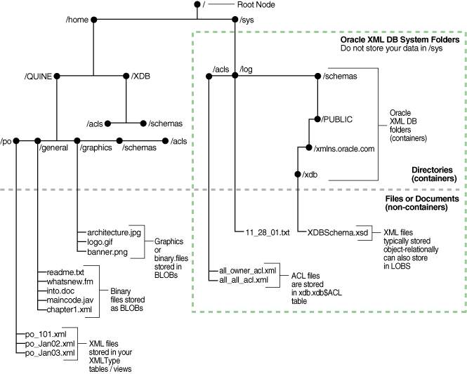
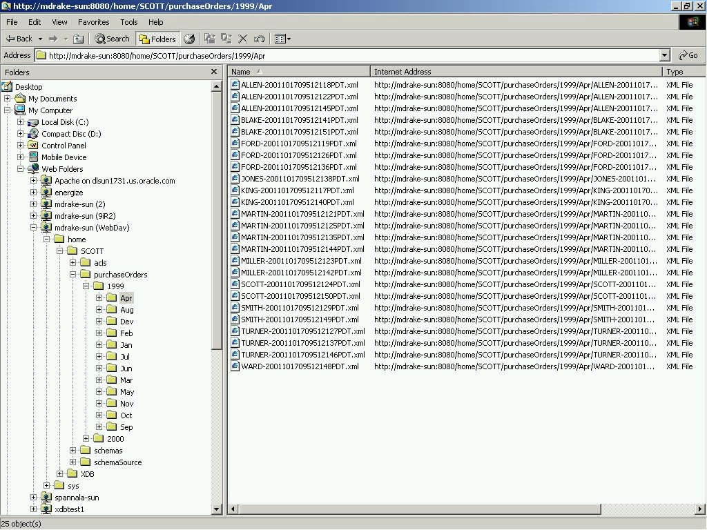
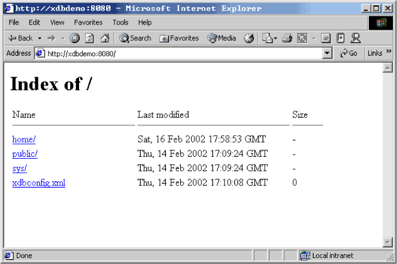
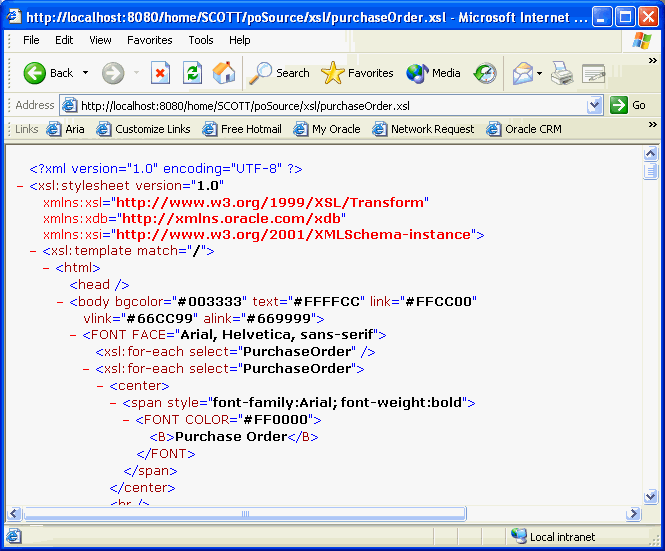
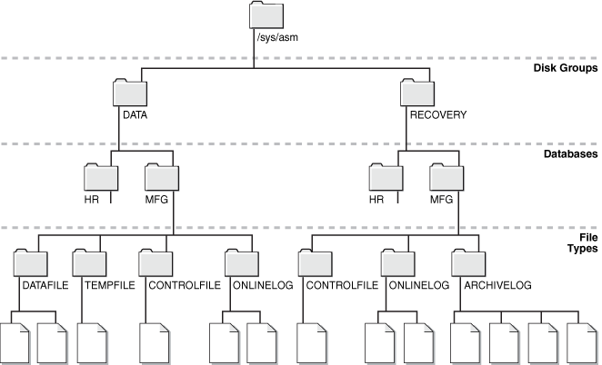
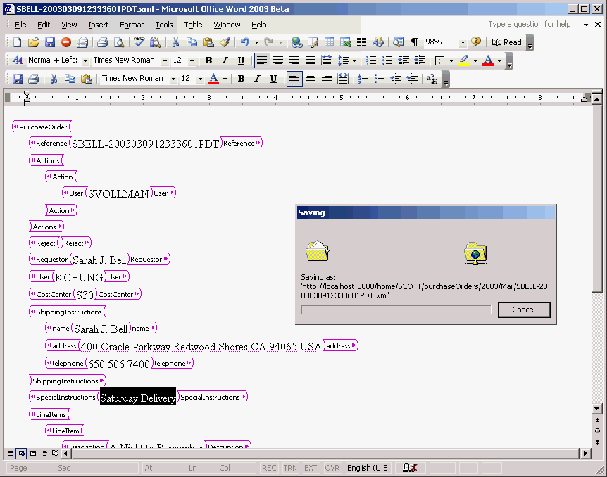

There are several ways to access and manipulate data in Oracle XML DB Repository, including using standard protocols such as FTP and HTTP(S)/WebDAV; Oracle XML DB resource Application Program Interfaces (APIs); and the repository views `RESOURCE_VIEW` and `PATH_VIEW`.

- Overview of Oracle XML DB Repository
  Using Oracle XML DB Repository you can store content in the database in hierarchical structures, as opposed to traditional relational database structures. Although the repository can manage any kind of content, it provides specialized capabilities and optimizations related to managing resources with XML content.
- Repository Terminology and Supplied Resources
  Oracle XML DB Repository can be thought of as a file system of database objects rather than files. It is a hierarchical set of database objects, across all XML and database schemas, that are mapped to path names.
- Oracle XML DB Repository Resources
  Oracle XML DB Repository resources conform to the Oracle XML DB XML schema `XDBResource.xsd`. The elements in a resource include those needed to persistently store WebDAV-defined properties, such as creation date, modification date, WebDAV locks, owner, ACL, language, and character set.
- Navigational or Path Access to Repository Resources
  Oracle XML DB Repository folders support the same protocol standards used by many operating systems. This lets a repository folder act like a native folder (directory) in supported operating-system environments.
- Query-Based Access to Repository Resources
  PL/SQL package `DBMS_XDB_REPOS` provides subprograms that act on Oracle XML DB Repository resources. This API is based on the public views `RESOURCE_VIEW` and `PATH_VIEW`, which enable SQL access to repository data through protocols such as FTP and HTTP(S)/WebDAV.
- Servlet Access to Repository Resources
  Oracle XML DB implements Java Servlet API, version 2.2.
- Operations on Repository Resources
  You can operate on data stored in Oracle XML DB Repository resources using Java, PL/SQL, Internet protocols, and Oracle XML DB Content Connector (deprecated). The most common operations are described, along with the required database permissions to use them.
- Accessing the Content of Repository Resources Using SQL
  In SQL you can access the content of a document in Oracle XML DB Repository using PL/SQL constructor `XDBURIType` or using `RESOURCE_VIEW` and the corresponding resource document.
- Access to the Content of XML Schema-Based Documents
  You can access the content of an XML Schema-based document in the same way as for a non-schema-based document: use the corresponding resource document. Or you can access it as a row in the default table that was defined when the XML schema was registered with Oracle XML DB.
- Update of the Content of Repository Documents
  You can update the content of documents stored in Oracle XML DB Repository using Internet protocols or SQL.
- Querying Resources in RESOURCE_VIEW and PATH_VIEW
  Examples here illustrate folder-restricted queries of the repository using `RESOURCE_VIEW` and `PATH_VIEW` together with Oracle SQL functions `equals_path` and `under_path`.
- Oracle XML DB Hierarchical Repository Index
  Oracle XML DB uses a hierarchical index for Oracle XML DB Repository, to optimize the performance of path-based and folder-restricted queries of the repository. It is implemented as an Oracle domain index.

**Parent topic:** [Oracle XML DB Repository](XML-DB-repository.md)

### 21.1 Overview of Oracle XML DB Repository

Using Oracle XML DB Repository you can store content in the database in hierarchical structures, as opposed to traditional relational database structures. Although the repository can manage any kind of content, it provides specialized capabilities and optimizations related to managing resources with XML content.

Relational databases are traditionally poor at managing hierarchical structures and traversing a path or a URL. Oracle XML DB Repository provides you with a hierarchical organization of XML content in the database. You can query and manage it as if it were organized using files and folders.

The relational table-row-column metaphor is an effective model for managing highly structured data. It can be less effective for managing semi-structured and unstructured data, such as document-oriented XML data.

For example, a book is not easily represented as a set of rows in a table. It might be more natural to represent a book as a hierarchy, book — chapter — section — paragraph, and to represent the hierarchy as a set of folders and subfolders.

A hierarchical repository index speeds up folder and path traversals. Oracle XML DB includes a patented hierarchical index that speeds up folder and path traversals in Oracle XML DB Repository. The hierarchical repository index is transparent to end users, and lets Oracle XML DB perform folder and path traversals at speeds comparable to or faster than conventional file systems.

Figure 21-1 is an example of a hierarchical structure that shows a typical tree of folders and files in Oracle XML DB Repository. The top of the tree shows `/`, the root folder.

Figure 21-1 A Folder Tree, Showing Hierarchical Structures in the Repository

[Description of "Figure 21-1 A Folder Tree, Showing Hierarchical Structures in the Repository"](img_text/adxdb004.md)

**Caution:**

Folder `/sys` is used by Oracle XML DB to maintain system-defined XML schemas, access control lists (ACLs), and so on. Do not add or modify any data in folder `/sys`.

Your applications can access content in Oracle XML DB Repository using standard connect-access protocols such as FTP, HTTP(S), and WebDAV, in addition to languages SQL, PL/SQL, Java, and C. Oracle XML DB adds native support to Oracle Database for these protocols, which were designed for document-centric operations. By providing support for these protocols, Oracle XML DB lets Microsoft Windows Explorer, Microsoft Office, and products from vendors such as Altova and Adobe work directly with XML content stored in the repository.

The repository gives you direct access to XML content stored in Oracle Database, as if it were stored in a file system. You can set access control privileges on repository files and folders.

These features are available because the repository is modeled on **WebDAV**, an IETF standard that defines a set of extensions to the HTTP protocol. WebDAV lets an HTTP server act as a file server for a DAV-enabled client. For example, a WebDAV-enabled editor can interact with an HTTP/WebDAV server as if it were a file system.

The WebDAV standard uses the term **resource** to describe a file or a folder. Each resource managed by a WebDAV server is identified by a URL. A resource has not only content but also associated metadata.

The following topics cover how to access data in Oracle XML DB Repository folders using the standard protocols. They discuss APIs that you can use to access the repository object hierarchy using Java, SQL, and PL/SQL.

- Oracle XML DB Provides Name-Level Locking
  One key advantage of Oracle XML DB Repository is the ability to use SQL for repository operations in the context of a logical transaction. Applications can create long-running transactions that include updates to multiple folders. To provide high levels of concurrency, the repository uses name-level locking rather than folder-level locking
- Two Ways to Access Oracle XML DB Repository Resources
  You can access and manipulate Oracle XML DB Repository resources using SQL with special views or by navigating paths using a hierarchical index.
- Database Schema (User Account) XDB and Oracle XML DB Repository
  Database schema (user account) `XDB` owns `XMLType` table `XDB$RESOURCE`, which contains all of the resources (files and folders) in Oracle XML DB Repository. It also contains all of the metadata for managing the repository.

**Related Topics**

- [Repository Access Using RESOURCE_VIEW and PATH_VIEW](repository-access-using-RESOURCE_VIEW-and-PATH_VIEW.md)
- [PL/SQL Access to Oracle XML DB Repository](PLSQL-access-to-XML-DB-repository.md)
- [Repository Access Control](repository-access-control.md)
- [Repository Access Using Protocols](repository-access-using-protocols.md)

**Parent topic:** Access to Oracle XML DB Repository Data

#### 21.1.1 Oracle XML DB Provides Name-Level Locking

One key advantage of Oracle XML DB Repository is the ability to use SQL for repository operations in the context of a logical transaction. Applications can create long-running transactions that include updates to multiple folders. To provide high levels of concurrency, the repository uses name-level locking rather than folder-level locking

When using a relational database to maintain hierarchical folder structures, ensuring a high degree of concurrency when adding and removing items in a folder is a challenge. In conventional file systems there is no concept of a transaction. Each operation (add a file, create a subfolder, rename a file, delete a file, and so on) is treated as an atomic transaction. Once the operation has completed the change is immediately available to all other users of the file system.

In this situation, a conventional locking strategy that takes an exclusive lock on each updated folder or directory tree would quickly result in significant concurrency problems. Oracle XML DB solves this by providing for name-level locking rather than folder-level locking. Repository operations such as creating, renaming, moving, or deleting a sub-folder or file do not require that your operation be granted an exclusive write lock on the target folder. The repository manages concurrent folder operations by locking the name within the folder rather than the folder itself. The name and the modification type are put on a queue.

Only when the transaction is committed is the folder locked and its contents modified. Hence Oracle XML DB lets multiple applications perform concurrent updates on the contents of a folder. The queue is also used to manage folder concurrency by preventing two applications from creating objects with the same name.

Queuing folder modifications until commit time also minimizes I/O when a number of changes are made to a single folder in the same transaction. This is useful when several applications generate files quickly in the same directory, for example when generating trace or log files, or when maintaining a spool directory for printing or e-mail delivery.

**Note:**

As a consequence of transactional semantics enforced by the database, folders created using SQL statements are not visible to other database users until the transaction is committed. Concurrent access to Oracle XML DB Repository is controlled by the same mechanism used to control concurrency in Oracle Database. The integration of the repository with Oracle Database provides strong management options for XML content.

**Parent topic:** Overview of Oracle XML DB Repository

#### 21.1.2 Two Ways to Access Oracle XML DB Repository Resources

You can access and manipulate Oracle XML DB Repository resources using SQL with special views or by navigating paths using a hierarchical index.

- SQL access. This is done using special views that expose resource properties and path names, and map hierarchical access operators onto the Oracle XML DB schema. See Query-Based Access to Repository Resources.

- Navigational or path-based access. This uses a hierarchical index of resources. Each resource has one or more unique path names that reflect its location in the hierarchy. You can navigate, using XPath expressions, to any repository resource.

  A repository resource can be created as a reference to an existing `XMLType` object in the database. You can navigate to any such database object using XPath. See Navigational or Path Access to Repository Resources.

**See Also:**

- [Oracle XML DB Repository Access](getting-started-with-XML-DB.md) for guidance on selecting an access method

- Table 21-3 for a summary comparison of the access methods

A Uniform Resource Locator (URL) is used to access an Oracle XML DB resource. A URL includes the host name, protocol information, path name, and resource name of the object.

**Parent topic:** Overview of Oracle XML DB Repository

#### 21.1.3 Database Schema (User Account) XDB and Oracle XML DB Repository

Database schema (user account) `XDB` owns `XMLType` table `XDB$RESOURCE`, which contains all of the resources (files and folders) in Oracle XML DB Repository. It also contains all of the metadata for managing the repository.

Database schema `XDB` is created during Oracle XML DB installation. The primary table in this schema is an `XMLType` table called `XDB$RESOURCE`, which contains one row for each resource (file or folder) in Oracle XML DB Repository. Documents in this table are referred to as **resource documents**. The XML schema that defines the structure of an Oracle XML DB resource document is registered under URL `"http://xmlns.oracle.com/xdb/XDBResource.xsd`.

The tables owned by database schema (user) `XDB` are internal. Oracle recommends the following:

- Create a dedicated tablespace for use only by user `XDB`, which means also for Oracle XML DB Repository. Ensure that the tablespace is not read-only.

- Do not directly manipulate any tables or data owned by user `XDB`. For example, do not compress or uncompress them.

  Use only the PL/SQL subprograms and database views provided by Oracle XML DB to carry out operations on any tables or data owned by user `XDB`.

- Never unlock user `XDB`, under any circumstance.

**See Also:**

- [Package DBMS_XDB_ADMIN](administration-of-XML-DB.md), for information about creating a dedicated tablespace for user `XDB` and the repository

- [Oracle Database Security Guide](../dbseg/managing-security-for-oracle-database-users.md)

**Parent topic:** Overview of Oracle XML DB Repository

### 21.2 Repository Terminology and Supplied Resources

Oracle XML DB Repository can be thought of as a file system of database objects rather than files. It is a hierarchical set of database objects, across all XML and database schemas, that are mapped to path names.

The repository is a connected, directed, acyclicFoot 1 graph of resources, with a single root node (`/`). Each resource in the graph has one or more associated path names: the repository supports multiple links to a given resource.

- Repository Terminology
  Some terms that apply to Oracle XML DB Repository include resource, resource name, resource content, folder or directory, path name, path components, link name, access control list (ACL), and XDBBinary element. Some of these terms have common synonyms in other contexts.
- Predefined Repository Files and Folders
  Certain files and folders are predefined for Oracle XML DB Repository. You can create additional ones for your own use.

**Parent topic:** Access to Oracle XML DB Repository Data

#### 21.2.1 Repository Terminology

Some terms that apply to Oracle XML DB Repository include resource, resource name, resource content, folder or directory, path name, path components, link name, access control list (ACL), and XDBBinary element. Some of these terms have common synonyms in other contexts.

- **resource** – Any object or node in the repository hierarchy. A resource is identified by a Uniform Resource Locator (URL), which includes the path name and resource name of the object.

  **See Also:**

  - [Oracle XML DB Repository: Overview](intro-to-XML-DB.md)

  - Oracle XML DB Repository Resources

- **folder** – A resource that can contain other resources. Sometimes called a **directory**.

- **path name** – A hierarchical name representing an absolute path to a resource. It is composed of a slash (`/`) representing the repository root, followed by zero or more **path components** separated by slashes. A path component cannot be only `.` or `..`, but a period (`.`) can otherwise be used in a path component. A path component is composed of any characters in the database character set except slash (`/`), backslash (`\`), and those characters specified in the Oracle XML DB configuration file, `xdbconfig.xml`, by configuration parameter `/xdbconfig/sysconfig/invalid-pathname-chars`.

- **resource name** (or **link name**) – The name of a resource within its parent folder. This is the rightmost path component of a path name. Resource names must be unique within their immediately containing folder, and they are case-sensitive.

- **resource content** – The body, or data, of a resource. This is what you get when you treat the resource as a file and ask for its content. This is always of type `XMLType`.

- **access control list** (ACL) – An ordered list of rules that specify access privileges for principals (users or roles) to one or more repository resources.

  **See Also:**

  [Repository Access Control](repository-access-control.md)

- **XDBBinary element** – An XML element that contains binary data. It is defined by the Oracle XML DB XML schema. `XDBBinary` elements are stored in the repository whenever unstructured binary data is uploaded into Oracle XML DB.

Many terms used by Oracle XML DB have common synonyms in other contexts, as shown in Table 21-1.

Table 21-1 Synonyms for Oracle XML DB Repository Terms

| Synonym       | Repository Term | Usage             |
|:--------------|:----------------|:------------------|
| collection    | folder          | WebDAV            |
| directory     | folder          | operating systems |
| privilege     | privilege       | permission        |
| right         | privilege       | various           |
| WebDAV folder | folder          | Web folder        |
| role          | group           | access control    |
| revision      | version         | RCS, CVS          |
| file system   | repository      | operating systems |
| hierarchy     | repository      | various           |
| file          | resource        | operating systems |
| binding       | link            | WebDAV            |

**Parent topic:** Repository Terminology and Supplied Resources

#### 21.2.2 Predefined Repository Files and Folders

Certain files and folders are predefined for Oracle XML DB Repository. You can create additional ones for your own use.

These are the predefined Oracle XML DB Repository files and folders:

    /dbfsFoot 2
    /public
    /sys
    /sys/acls
    /sys/acls/all_all_acl.xml
    /sys/acls/all_owner_acl.xml
    /sys/acls/bootstrap_acl.xml
    /sys/acls/ro_all_acl.xml
    /sys/apps
    /sys/asm
    /sys/log
    /sys/schemas
    /sys/schemas/PUBLIC
    /sys/schemas/PUBLIC/www.w3.org
    /sys/schemas/PUBLIC/www.w3.org/2001
    /sys/schemas/PUBLIC/www.w3.org/2001/xml.xsd
    /sys/schemas/PUBLIC/xmlns.oracle.com
    /sys/schemas/PUBLIC/xmlns.oracle.com/xdb
    /sys/schemas/PUBLIC/xmlns.oracle.com/xdb/XDBResource.xsd
    /sys/schemas/PUBLIC/xmlns.oracle.com/xdb/XDBSchema.xsd
    /sys/schemas/PUBLIC/xmlns.oracle.com/xdb/XDBStandard.xsd
    /sys/schemas/PUBLIC/xmlns.oracle.com/xdb/acl.xsd
    /sys/schemas/PUBLIC/xmlns.oracle.com/xdb/dav.xsd
    /sys/schemas/PUBLIC/xmlns.oracle.com/xdb/log
    /sys/schemas/PUBLIC/xmlns.oracle.com/xdb/stats.xsd
    /sys/schemas/PUBLIC/xmlns.oracle.com/xdb/xdbconfig.xsd
    /xdbconfig.xml

**Parent topic:** Repository Terminology and Supplied Resources

### 21.3 Oracle XML DB Repository Resources

Oracle XML DB Repository resources conform to the Oracle XML DB XML schema `XDBResource.xsd`. The elements in a resource include those needed to persistently store WebDAV-defined properties, such as creation date, modification date, WebDAV locks, owner, ACL, language, and character set.

A resource index has a special element called `Contents` that contains the contents of the resource.

The XML schema for a resource also defines an `any` element, with `maxOccurs` attribute unbounded. An `any` element can contain any element outside of the Oracle XML DB XML namespace. Arbitrary instance-defined properties can be associated with the resource.

- Where Is Repository Data Stored?
  Oracle XML DB stores Oracle XML DB Repository data in a set of tables and indexes to which you have access.
- How Documents are Stored in Oracle XML DB Repository
  When an XML document that is based on a registered XML schema is loaded into the repository, the document is parsed and decomposed according to the schema into a set of SQL objects; and a corresponding resource document is created to provide repository access for the source XML document.
- Repository Data Access Control
  You can control access to the resources in Oracle XML DB Repository by using access control lists (ACLs), which are composed of access control entries (ACEs). An ACE grants or denies a set of privileges to a specific principal.
- Repository Path-Name Resolution
  The data relating a folder to its contents is managed by the Oracle XML DB hierarchical repository index. This provides a fast mechanism for evaluating path names which is similar to the directory mechanisms that are used by operating-system file systems. You need certain privileges to resolve a path name.
- Link Types
  Links in Oracle XML DB can be repository links or document links. Repository links can be hard links or weak links. Document links can also be hard links or weak links, when their targets are repository resources.

**Related Topics**

- [XDBResource.xsd: XML Schema for Oracle XML DB Resources](oracle-supplied-XML-schemas-and-examples.md)

**Parent topic:** Access to Oracle XML DB Repository Data

#### 21.3.1 Where Is Repository Data Stored?

Oracle XML DB stores Oracle XML DB Repository data in a set of tables and indexes to which you have access.

If you register an XML schema and request that the tables be generated by Oracle XML DB, then the tables are created in your database schema. You are then able to see or modify them. Other users cannot see your tables unless you grant them permission to do so.

- Names of Generated Tables
  The names of generated tables are assigned by Oracle XML DB. They can be obtained by finding the `xdb:defaultTable` attribute in your XML schema document (or in the default XML schema document).
- How Object-Relational Storage Is Defined for Repository Resources
  You can define object-relational storage for repository resources by subclassing or by storing data that conforms to a registered XML schema.
- Oracle ASM Virtual Folder
  The contents of the Oracle Automatic Storage Management (Oracle ASM) virtual folder, `/sys/asm` are Oracle ASM files and folders that are managed automatically by Oracle ASM.

**Parent topic:** Oracle XML DB Repository Resources

##### 21.3.1.1 Names of Generated Tables

The names of generated tables are assigned by Oracle XML DB. They can be obtained by finding the `xdb:defaultTable` attribute in your XML schema document (or in the default XML schema document).

When you register an XML schema, you can alternatively provide your own table name, instead of using the default name supplied by Oracle XML DB. If the table specifies binary XML storage, then a document is encoded in binary XML format before storing it in the table.

**Related Topics**

- [Default Tables Created during XML Schema Registration](XML-Schema-and-query-object-relational-storage.md)

**Parent topic:** Where Is Repository Data Stored?

##### 21.3.1.2 How Object-Relational Storage Is Defined for Repository Resources

You can define object-relational storage for repository resources by subclassing or by storing data that conforms to a registered XML schema.

Applications that need to define object-relational storage for repository resources can do so in either of these ways:

- Subclass the Oracle XML DB resource type. Subclassing Oracle XML DB resources requires privileges on the table `XDB$RESOURCE`.

- Store data that conforms to a visible, registered XML schema.

**Related Topics**

- [XML Schema Storage and Query: Basic](XML-Schema-and-query-basic.md)

**Parent topic:** Where Is Repository Data Stored?

##### 21.3.1.3 Oracle ASM Virtual Folder

The contents of the Oracle Automatic Storage Management (Oracle ASM) virtual folder, `/sys/asm` are Oracle ASM files and folders that are managed automatically by Oracle ASM.

**Related Topics**

- Access to Oracle ASM Files Using Protocols and Resource APIs – For DBAs

**See Also:**

[Oracle Automatic Storage Management Administrator's Guide](../ostmg/asm-files-directories-templates.md)

**Parent topic:** Where Is Repository Data Stored?

#### 21.3.2 How Documents are Stored in Oracle XML DB Repository

When an XML document that is based on a registered XML schema is loaded into the repository, the document is parsed and decomposed according to the schema into a set of SQL objects; and a corresponding resource document is created to provide repository access for the source XML document.

Oracle XML DB provides special handling for XML documents. The rules for storing the contents of an XML Schema-based XML document are defined by its XML schema. The content of the document is stored in the default table associated with the global element definition.

Oracle XML DB Repository also stores files that do not contain XML data, such as JPEG images or Word documents. The XML schema for each resource defines which elements are allowed, and specifies whether the content of these files is to be stored as `BLOB` or `CLOB` instances. The content of a non-schema-based XML document is stored as a `CLOB` instance in the repository.

There is one resource and one link-properties document for each file or folder in the repository. If there are multiple access paths to a given document then there is a link-properties document for each possible link. Both the resource document and the link-properties are stored as XML documents. All these documents are stored in tables in the repository.

When an XML file is loaded into the repository, the following sequence of events takes place:

1.  Oracle XML DB examines the root element of the XML document to see if it is associated with a known (registered) XML schema. This involves looking to see if the document includes a namespace declaration for the `XMLSchema-instance` namespace, and then looking for a `schemaLocation` or `noNamespaceSchemaLocation` attribute that identifies which XML schema the document is associated with.

2.  If the document is based on a known XML schema, then the metadata for the XML schema is loaded from the XML schema cache.

3.  The XML document is parsed and decomposed into a set of SQL objects derived from the XML schema.

4.  The SQL objects created from the XML file are stored in the default table defined when the XML schema was registered with the database.

5.  A resource document is created for each document processed. This lets the content of the document be accessed using the repository. The resource document for an XML Schema-based `XMLType` instance includes an `XMLRef` element. This element contains a `REF` of `XMLType` that can be used to locate the row in the default table containing the content associated with the resource.

**Parent topic:** Oracle XML DB Repository Resources

#### 21.3.3 Repository Data Access Control

You can control access to the resources in Oracle XML DB Repository by using access control lists (ACLs), which are composed of access control entries (ACEs). An ACE grants or denies a set of privileges to a specific principal.

A principal can be a database user, a database role, an LDAP user, an LDAP group or the special principal `DAV::owner`, which refers to the owner of the resource. Each resource in the repository is protected by an ACL. The ACL determines which privileges, such as `read-properties` and `update`, a user has on the resource. Each repository operation includes a check of the ACL to determine if the current user is allowed to perform the operation.

By default, a new resource inherits the ACL of its parent folder. But you can set the ACL of a resource using PL/SQL procedure `DBMS_XDB_REPOS.setACL`. For more details on Oracle XML DB resource security, see [Repository Access Control](repository-access-control.md).

In the following example, the current user is `QUINE`. The query gives the number of resources in the folder `/public`. Assume that there are only two resources in this folder: `f1` and `f2`. Also assume that the ACL on `f1` grants the `read-properties` privilege to `QUINE` while the ACL on `f2` does not grant `QUINE` any privileges. A user needs the `read-properties` privilege on a resource for it to be visible to the user. The result of the query is `1`, because only `f1` is visible to `QUINE`.

    SELECT count(*) FROM RESOURCE_VIEW r WHERE under_path(r.res, '/public') = 1;

    COUNT(*)
    --------
           1

**Parent topic:** Oracle XML DB Repository Resources

#### 21.3.4 Repository Path-Name Resolution

The data relating a folder to its contents is managed by the Oracle XML DB hierarchical repository index. This provides a fast mechanism for evaluating path names which is similar to the directory mechanisms that are used by operating-system file systems. You need certain privileges to resolve a path name.

Resources that are folders have the `Container` attribute of element `Resource` set to `true`.

To resolve a resource name in a folder, the current user must have the following privileges:

- `resolve` privilege on the folder

- `read-properties` on the resource in that folder

If the user does not have these privileges, then the user receives an `access denied` error. Folder listings and other queries do not return a row when the `read-properties` privilege is denied on its resource.

**Caution:**

Error handling in path-name resolution differentiates between invalid resource names and resources that are not folders, for compatibility with file systems. Because Oracle XML DB resources are accessible from outside Oracle XML DB Repository (using SQL), denying read access on a folder that contains a resource does not prevent read access to that resource.

**See Also:**

[XDBResource.xsd: XML Schema for Oracle XML DB Resources](oracle-supplied-XML-schemas-and-examples.md) for the definition of element `Resource` and its attribute `Container`

**Parent topic:** Oracle XML DB Repository Resources

#### 21.3.5 Link Types

Links in Oracle XML DB can be repository links or document links. Repository links can be hard links or weak links. Document links can also be hard links or weak links, when their targets are repository resources.

- Repository Links and Document Links
  In addition to containing resources, a folder resource can contain links to other resources (files or folders). These repository links represent hierarchical repository relationships. By contrast, document links are arbitrary links among XML documents that are not necessarily repository resources.
- Hard Links and Weak Links
  Links that target repository resources can be hard or weak. Hard and weak links have different dependencies with respect to the resources that they target. Hard links cannot target ancestor folders; weak links can. You can query the repository path view, `PATH_VIEW`, to determine the type of a repository link.
- Creating a Weak Link with No Knowledge of Folder Hierarchy
  Weak links represent a mapping on top of the repository structure, which is determined by hard links. You can create a weak link to a resource using its OID rather than its path. You can use weak links to access a resource without having access to the folders containing it.
- How and When to Prevent Multiple Hard Links
  You can restrict the creation of hard links, disallowing multiple hard links to folders or files (or both). Allowing multiple hard links to file resources, but disallowing multiple hard links to folder resources, provides behavior that is similar to that for some file systems, including UNIX and Linux.

**Parent topic:** Oracle XML DB Repository Resources

##### 21.3.5.1 Repository Links and Document Links

In addition to containing resources, a folder resource can contain links to other resources (files or folders). These repository links represent hierarchical repository relationships. By contrast, document links are arbitrary links among XML documents that are not necessarily repository resources.

**Repository links** are sometimes called **folder links**. They are not to be confused with **document links**, which correspond to the links provided by the XLink and XInclude standards, and which are also supported by Oracle XML DB (but XLink support is deprecated). Repository links are navigational, folder–child links among repository resources. Document links are arbitrary links among documents that are not necessarily repository resources.

Repository links represent repository hierarchical relationships. Document links represent arbitrary relationships whose semantics derives from the applications that use them. Because they represent repository hierarchical relationships, repository links can be navigated using file system-related protocols. This is not true of document links. Because document links can represent arbitrary relationships, they can also represent repository relationships. When document links thus target resources, they can also be hard or weak.

**See Also:**

[Use of XLink and XInclude with Oracle XML DB](use-of-XLink-and-XInclude-with-XML-DB.md) for information about document links

**Parent topic:** Link Types

##### 21.3.5.2 Hard Links and Weak Links

Links that target repository resources can be hard or weak. Hard and weak links have different dependencies with respect to the resources that they target. Hard links cannot target ancestor folders; weak links can. You can query the repository path view, `PATH_VIEW`, to determine the type of a repository link.

Both **hard links** and **weak links** are references, or pointers, to physical data — (internal) repository resource identifiers. They do not point to symbolic names or paths to other links. Their targets are resolved at the time of link creation. Because they point directly to resource identifiers, hard and weak links cannot dangle: they remain valid even when their targets are renamed or moved. You need the same privileges to create or delete hard and weak links.

The difference between hard and weak links lies in their relationship to target resource deletion. A target resource is dependent on its hard links, in the sense that it cannot be deleted as long as it remains the target of a hard link. Deletion of a hard link also deletes the resource targeted by the link, if the following are both true:

- The resource is not versioned.

- The hard link that was deleted was the last (that is, the only) hard link to the resource.

A weak link has no such hold on a resource: you can delete a resource, even if it is the target of a weak link (as long as it is not the target of a hard link). Because of this, weak links can be used as shortcuts to frequently accessed resources, without impacting deletion of those resources.

There is a dependency in the other direction, however: If you delete a resource that is the target of one or more weak links, then those links are automatically deleted, as well. In this sense, too, weak links cannot dangle. Both hard and weak links provide referential integrity: if a link exists, then so does its target.

Another difference between hard and weak links is this: Hard links to ancestor folders are not permitted, because they introduce cycles. There is no such restriction for weak links: a weak link can target any folder, possibly creating a cycle. It is the set of hard links that define the (acyclic) structure of Oracle XML DB Repository. Weak links represent an additional mapping on top of that basic structure.

You can query the repository path view, `PATH_VIEW`, to determine the type of a repository link: the link information contains the link type. `XMLType` column `LINK` of `PATH_VIEW` contains this information in element `LinkType`, which is a child of the root element, `LINK`. Example 21-1 illustrates this. You can also determine the type of a repository link by using the `getLink()` callback function on an event handler (`LinkIn`, `LinkTo`, `UnlinkIn`, or `UnlinkFrom`).

**See Also:**

[Oracle Database PL/SQL Packages and Types Reference](../arpls/DBMS_XEVENT.md) for information on PL/SQL function `getLink`

Example 21-1 Querying PATH_VIEW to Determine Link Type

    SELECT RESID, XMLCast(XMLQuery('/LINK/LinkType' PASSING LINK RETURNING CONTENT)
                          AS VARCHAR2(24)) link_type
      FROM PATH_VIEW WHERE equals_path(RES, '/home/QUINE/purchaseOrder.xml') = 1;

    RESID                              LINK_TYPE
    --------------------------------   ---------
    DF9856CF2FE0829EE030578CCE0639C5   Weak

**Related Topics**

- [Deleting Repository Resources: Examples](repository-access-using-RESOURCE_VIEW-and-PATH_VIEW.md)
- Query-Based Access to Repository Resources

**Parent topic:** Link Types

##### 21.3.5.3 Creating a Weak Link with No Knowledge of Folder Hierarchy

Weak links represent a mapping on top of the repository structure, which is determined by hard links. You can create a weak link to a resource using its OID rather than its path. You can use weak links to access a resource without having access to the folders containing it.

Suppose that you want to read a file resource that belongs to one of your colleagues. You cannot create a hard link to that resource, to make it accessible for your use, unless you have the privilege `<xdb:resolve>` on all of the ancestor folders of that file. Having that privilege would mean that you could see all of your colleague's folder names and the structure of the hierarchy down to the target resource.

However, because weak links essentially represent a mapping on top of the real repository structure, which structure is determined by the set of hard links, you can create a weak link to a resource using just its OID rather than its full, named path (URL). Your colleague can determine the OID path to the file, send you that instead of the named path, and you can create a weak link to the document using that OID path. Example 21-2 and Example 21-3 illustrate this.

Example 21-2 prints the OID path for the file resource `/home/QUINE/purchaseOrder.xml`. User `quine` can use this to obtain the OID path to the resource, and then send that path to user `curry`, who can create a weak link to the resource (Example 21-3).

In Example 21-3, user `curry` creates a weak link named `quinePurchaseOrder.xml` in folder `/home/CURRY`. The target of the link is the OID path that corresponds to the URL `/home/QUINE/purchaseOrder.xml`. User `curry` need not be aware of the repository structure that is visible to user `quine`.

Example 21-2 Obtaining the OID Path of a Resource

    DECLARE
      resoid  RAW(16);
      oidpath VARCHAR2(100);
    BEGIN
      SELECT RESID INTO resoid FROM RESOURCE_VIEW
        WHERE equals_path(RES, '/home/QUINE/purchaseOrder.xml') = 1;
        oidpath := DBMS_XDB_REPOS.createOIDPath(resoid);
      DBMS_OUTPUT.put_line(oidpath);
    END;

Example 21-3 Creating a Weak Link Using an OID Path

    CALL DBMS_XDB_REPOS.link(/sys/oid/1BDCB46477B59C20E040578CCE0623D3
                             '/home/CURRY', 'quinePurchaseOrder.xml',
                             DBMS_XDB_REPOS.LINK_TYPE_WEAK);

**Parent topic:** Link Types

##### 21.3.5.4 How and When to Prevent Multiple Hard Links

You can restrict the creation of hard links, disallowing multiple hard links to folders or files (or both). Allowing multiple hard links to file resources, but disallowing multiple hard links to folder resources, provides behavior that is similar to that for some file systems, including UNIX and Linux.

This can simplify application design, by, in effect, ensuring that each file resource has a unique, canonical hard-link path to it. In addition, preventing multiple hard links to a resource can lead to query performance improvements.

You can configure the prevention of multiple hard links using the following Boolean parameters in configuration file `xdbconfig.xml`. The default value of each parameter is `true`, meaning that multiple hard links can be created.

- `folder-hard-links` – Prevent the creation of multiple hard links to a folder resource, if `false`.

- `non-folder-hard-links` – Prevent the creation of multiple hard links to a file resource, if `false`.

**Related Topics**

- [Configuration of Oracle XML DB Using xdbconfig.xml](administration-of-XML-DB.md)

**Parent topic:** Link Types

### 21.4 Navigational or Path Access to Repository Resources

Oracle XML DB Repository folders support the same protocol standards used by many operating systems. This lets a repository folder act like a native folder (directory) in supported operating-system environments.

For example:

- You can use Windows Explorer to open and access repository files and folders (resources) the same way you access other files and folders in the file system, as shown in Figure 21-2.

- You can access repository data using HTTP(S)/WebDAV from a Web browser, as shown in Figure 21-3 and Figure 21-4.

  Figure 21-3 shows a browser visiting URL `http://xdbdemo:8080/`. The server it is connected to is `xdbdemo`, and its HTTP port number is `8080`.

  Figure 21-4 shows a browser using HTTP to visit an XML document (an XSL stylesheet) stored in the database. The URL is `http://localhost:8080/home/SCOTT/poSource/xsl/purchaseOrder.xsl`.

Figure 21-2 Oracle XML DB Folders in Windows Explorer

[Description of "Figure 21-2 Oracle XML DB Folders in Windows Explorer"](img_text/po_folders.md)

Figure 21-3 Accessing Repository Data Using HTTP(S)/WebDAV and a Web Browser

[Description of "Figure 21-3 Accessing Repository Data Using HTTP(S)/WebDAV and a Web Browser"](img_text/adxdb_vm_058.md)

Figure 21-4 Path-Based Access Using HTTP and a URL

[Description of "Figure 21-4 Path-Based Access Using HTTP and a URL"](img_text/path_based.md)

- Access to Oracle XML DB Resources Using Internet Protocols
  Oracle Net Services provides one way of accessing database resources. Oracle XML DB support for Internet protocols provides another way of accessing database resources.
- Access to Oracle ASM Files Using Protocols and Resource APIs – For DBAs
  Oracle Automatic Storage Management (Oracle ASM) organizes database files into disk groups for simplified management, database mirroring, and I/O balancing. Repository access extends to Oracle ASM files, in the virtual repository folder `/sys/asm`. This access is reserved for database administrators (DBAs). It is not intended for developers.

**Parent topic:** Access to Oracle XML DB Repository Data

#### 21.4.1 Access to Oracle XML DB Resources Using Internet Protocols

Oracle Net Services provides one way of accessing database resources. Oracle XML DB support for Internet protocols provides another way of accessing database resources.

- Where You Can Use Oracle XML DB Protocol Access
  Oracle Net Services is optimized for record-oriented data. Internet protocols are designed for stream-oriented data, such as binary files or XML text documents. Oracle XML DB protocol access is a valuable alternative to Net Services in certain scenarios.
- Overview of Protocol Access to Oracle XML DB
  Protocol access to Oracle XML DB involves connecting, authenticating a user, parsing the request, and perhaps invoking a Java servlet.
- Retrieval of Oracle XML DB Resources
  When a protocol indicates that a resource is to be retrieved, the path name to the resource is resolved and the resource is fetched, by streaming it as either XML data or in `RAW` form.
- Storage of Oracle XML DB Resources
  When a protocol indicates that a resource that is an XML document is to be stored, its associated XML schema, if any, is consulted to determine the default table in which to store the document.
- Internet Protocols and XMLType: XMLType Direct Stream Write
  Oracle XML DB supports Internet protocols at the `XMLType` level by using Java `XMLType` method `writeToStream()`. This method is implemented natively and writes `XMLType` data directly to the protocol request stream.

**Parent topic:** Navigational or Path Access to Repository Resources

##### 21.4.1.1 Where You Can Use Oracle XML DB Protocol Access

Oracle Net Services is optimized for record-oriented data. Internet protocols are designed for stream-oriented data, such as binary files or XML text documents. Oracle XML DB protocol access is a valuable alternative to Net Services in certain scenarios.

- Direct database access from file-oriented applications using the database like a file system

- Heterogeneous application server environments that require a uniform data access method (such as XML over HTTP, which is supported by most data servers, including MS SQL Server, Exchange, Notes, many XML databases, stock quote services and news feeds)

- Application server environments that require data in the form of XML text

- Web applications that use client-side XSL to format datagrams that do not need much application processing

- Web applications that use Java servlets that run inside the database

- Web access to XML-oriented stored procedures

**Parent topic:** Access to Oracle XML DB Resources Using Internet Protocols

##### 21.4.1.2 Overview of Protocol Access to Oracle XML DB

Protocol access to Oracle XML DB involves connecting, authenticating a user, parsing the request, and perhaps invoking a Java servlet.

Accessing Oracle XML DB using a protocol proceeds as follows:

1.  A connection object is established, and the protocol might read part of the request.

2.  The protocol decides whether the user is already authenticated and wants to reuse an existing session or the connection must be re-authenticated (the latter is more common).

3.  An existing session is pulled from the session pool, or else a new one is created.

4.  If authentication has not been provided, and the request is HTTP `get` or `head`, then the session is run as the `ANONYMOUS` user. If the session has already been authenticated as the `ANONYMOUS` user, then there is no cost to reuse the existing session. If authentication has been provided, then the database re-authentication routines are used to authenticate the connection.

5.  The request is parsed.

6.  (HTTP only) If the requested path name maps to a servlet, then the servlet is invoked using Java Virtual Machine (JVM). The servlet code writes the response to a response stream or asks `XMLType` instances to do so.

**Parent topic:** Access to Oracle XML DB Resources Using Internet Protocols

##### 21.4.1.3 Retrieval of Oracle XML DB Resources

When a protocol indicates that a resource is to be retrieved, the path name to the resource is resolved and the resource is fetched, by streaming it as either XML data or in `RAW` form.

Resources being fetched are streamed as XML data, except for those containing element `XDBBinary`, which is the XML binary data type, which have their contents streamed out in `RAW` form.

**Parent topic:** Access to Oracle XML DB Resources Using Internet Protocols

##### 21.4.1.4 Storage of Oracle XML DB Resources

When a protocol indicates that a resource that is an XML document is to be stored, its associated XML schema, if any, is consulted to determine the default table in which to store the document.

Oracle XML DB checks the document file name extension for `.xml`, `.xsl`, `.xsd`, and so on. If the document is XML then a pre-parse step is done, whereby enough of the resource is read to determine the XML `schemaLocation` and `namespace` of the root element in the document. If a registered schema is located at the `schemaLocation` URL, and it has a definition for the root element of the current document, then the default table specified for that root element is used to store the contents of the resource.

**Parent topic:** Access to Oracle XML DB Resources Using Internet Protocols

##### 21.4.1.5 Internet Protocols and XMLType: XMLType Direct Stream Write

Oracle XML DB supports Internet protocols at the `XMLType` level by using Java `XMLType` method `writeToStream()`. This method is implemented natively and writes `XMLType` data directly to the protocol request stream.

This avoids Java VM execution costs and the overhead of converting database data through Java data types and creating Java objects, resulting in significantly higher performance. Performance is further enhanced if the Java code deals only with XML element trees that are close to the root, and does not traverse too many of the leaf elements, so that relatively few Java objects are created.

**Related Topics**

- [Repository Access Using Protocols](repository-access-using-protocols.md)

**Parent topic:** Access to Oracle XML DB Resources Using Internet Protocols

#### 21.4.2 Access to Oracle ASM Files Using Protocols and Resource APIs – For DBAs

Oracle Automatic Storage Management (Oracle ASM) organizes database files into disk groups for simplified management, database mirroring, and I/O balancing. Repository access extends to Oracle ASM files, in the virtual repository folder `/sys/asm`. This access is reserved for database administrators (DBAs). It is not intended for developers.

A typical use of such access is to copy Oracle ASM files from one database instance to another. For example, a DBA can view folder `/sys/asm` in a graphical user interface using the WebDAV protocol, and then drag-and-drop a copy of a data-pump dump set from an Oracle ASM disk group to an operating-system file system.

Virtual folder `/sys/asm` is created by default during Oracle XML DB installation. If the database is not configured to use Oracle ASM, the folder is empty and no operations are permitted on it.

Folder `/sys/asm` contains folders and subfolders that follow the hierarchy defined by the structure of an Oracle ASM fully qualified filename:

- It contains a subfolder for each mounted disk group.

- A disk-group folder contains a subfolder for each database that uses that disk group. In addition, a disk-group folder may contain files and folders corresponding to Oracle ASM aliases created by the administrator.

- A database folder contains file-type folders.

- A file-type folder contains Oracle ASM files, which are binary.

This hierarchy is shown in Figure 21-5, which omits directories created for aliases, for simplicity.

Figure 21-5 Oracle ASM Virtual Folder Hierarchy

[Description of "Figure 21-5 Oracle ASM Virtual Folder Hierarchy"](img_text/admin075.md)

The following usage restrictions apply to virtual folder `/sys/asm`. You cannot:

- query `/sys/asm` using SQL

- put regular files under `/sys/asm` (you can put only Oracle ASM files there)

- move (rename) an Oracle ASM file to a different Oracle ASM disk group or to a folder outside Oracle ASM

- create hard links to existing Oracle ASM files or directories

In addition:

- You must have the privileges of role `DBA` to view folder `/sys/asm`.

- To access `/sys/asm` using Oracle XML DB protocols, you must log in as a user other than `SYS`.

Again, Oracle ASM virtual-folder operations are intended only for database administrators, not developers.

**See Also:**

- [Using FTP with Oracle ASM Files](repository-access-using-protocols.md) for an example of using protocol FTP with `/sys/asm`

- [Oracle Automatic Storage Management Administrator's Guide](../ostmg/about-asmcmd.md) for information about the syntax of a fully qualified Oracle ASM filename and details on the virtual folder structure

**Parent topic:** Navigational or Path Access to Repository Resources

### 21.5 Query-Based Access to Repository Resources

PL/SQL package `DBMS_XDB_REPOS` provides subprograms that act on Oracle XML DB Repository resources. This API is based on the public views `RESOURCE_VIEW` and `PATH_VIEW`, which enable SQL access to repository data through protocols such as FTP and HTTP(S)/WebDAV.

- `PATH_VIEW` – Has one row for each unique repository path

- `RESOURCE_VIEW` – Has one row for each resource

Through these views, you can access and update both the metadata and the content of documents stored in the repository. Operations on the views use underlying repository tables such as `XDB$RESOURCE`.

Each view contains virtual column `RES`. You use column `RES` to access and update resource documents using SQL statements that accept a repository path notation.

View `RESOURCE_VIEW` contains column `ANY_PATH`. Column `ANY_PATH` contains a valid URL that the current user can pass to PL/SQL constructor `XDBURIType` to access the resource content. If this content is not binary data, then the resource itself also contains the content.

Table 21-2 summarizes the differences between the views.

Table 21-2 Differences Between PATH_VIEW and RESOURCE_VIEW

| PATH_VIEW                                      | RESOURCE_VIEW                               |
|:-----------------------------------------------|:--------------------------------------------|
| Contains link properties                       | No link properties                          |
| Has one row for each unique path in repository | Has one row for each resource in repository |

Rows in these views are of data type `XMLType`. In the `RESOURCE_VIEW`, the single path associated with a resource is arbitrarily chosen from among the possible paths that refer to the resource. Oracle XML DB provides SQL functions, such as `under_path`, that let applications search for the resources contained within a particular folder (recursively), obtain the resource depth, and so on.

DML code can be used on the repository views to insert, rename, delete, and update resource properties and contents. Programmatic APIs must be used for other operations, such as creating links to existing resources.

Oracle XML DB supports the concept of **linking**. Linking makes it possible to define multiple paths to a given document. A separate XML document, called the **link-properties document**, maintains metadata properties that are specific to the path, rather than to the resource. Whenever a resource is created, an initial link is also created.

`PATH_VIEW` exposes the link-properties documents. There is one entry in `PATH_VIEW` for each possible path to a document. Column `RES` of `PATH_VIEW` contains the resource document pointed to by this link. Column `PATH` contains the path that the link lets you use to access the resource. Column `LINK` contains the link-properties document (metadata) for this `PATH`.

**Related Topics**

- Link Types
- [Repository Access Using RESOURCE_VIEW and PATH_VIEW](repository-access-using-RESOURCE_VIEW-and-PATH_VIEW.md)

**See Also:**

- [Repository Access Control](repository-access-control.md)

- [Oracle Database Reference to learn about `BPT`](../refrn/PATH_VIEW.md) for more information about view `PATH_VIEW`

- [Oracle Database Reference to learn about `BPT`](../refrn/RESOURCE_VIEW.md) for more information about view `RESOURCE_VIEW`

**Parent topic:** Access to Oracle XML DB Repository Data

### 21.6 Servlet Access to Repository Resources

Oracle XML DB implements Java Servlet API, version 2.2.

Support is limited by these restrictions:

- All servlets must be distributable. They must expect to run in different virtual machines.

- WAR and `web.xml` files are not supported. Oracle XML DB supports a subset of the XML configurations in this file. An XSLT stylesheet can be applied to the `web.xml` to generate servlet definitions. An external tool must be used to create database roles for those defined in the `web.xml` file.

- JSP (Java Server Pages) support can be installed as a servlet and configured manually.

- `HTTPSession` and related classes are not supported.

- Only one servlet context (that is, one Web application) is supported.

**Related Topics**

- [Guidelines for Oracle XML DB Applications in Java](how-to-write-XML-DB-applications-in-Java.md)

**Parent topic:** Access to Oracle XML DB Repository Data

### 21.7 Operations on Repository Resources

You can operate on data stored in Oracle XML DB Repository resources using Java, PL/SQL, Internet protocols, and Oracle XML DB Content Connector (deprecated). The most common operations are described, along with the required database permissions to use them.

You can access repository data in any of these ways:

- Oracle XML DB resource APIs for Java

- A combination of Oracle XML DB resource views API and Oracle XML DB resource API for PL/SQL

- Internet protocols (HTTP(S)/WebDAV and FTP) and Oracle XML DB protocol server

- Oracle XML DB Content Connector (deprecated) and, through it, the standard Content Repository API for Java (JCR).

These access methods can be used equivalently. It does not matter how you add content to the repository or retrieve it from there. For example, you can add content to the repository using SQL or PL/SQL and then retrieve it using an Internet protocol, or the other way around.

Table 21-3 lists common Oracle XML DB Repository operations, and describes how these operations can be accomplished using each of several access methods. The table shows functionality common to the different methods, but not all of the methods are equally suited to any particular task. Unless mentioned otherwise, "resource" in this table can be either a file resource or a folder resource.

Table 21-3 also shows the resource privileges that are required for each operation.

Table 21-3 Accessing Oracle XML DB Repository: API Options

| Data Access                                            | SQL and PL/SQL                                                                                                                                                                                                                                                                                                                                                                                                                                    | Protocols                                   | Resource Privileges Required                                                                                                                                                                                                 | JCR Support |
|:-------------------------------------------------------|:--------------------------------------------------------------------------------------------------------------------------------------------------------------------------------------------------------------------------------------------------------------------------------------------------------------------------------------------------------------------------------------------------------------------------------------------------|:--------------------------------------------|:-----------------------------------------------------------------------------------------------------------------------------------------------------------------------------------------------------------------------------|:------------|
| Create resource                                        | `DBMS_XDB_REPOS.createResource(` `  '/public/T1/testcase.txt',` `  'ORIGINAL text');` `INSERT INTO RESOURCE_VIEW (ANY_PATH, RES)` `SELECT '/public/T1/copy1.txt', RES` `  FROM RESOURCE_VIEW` `  WHERE equals_path(RES, ` `                    '/public/T1/testcase.txt')` `        = 1;`                                                                                                                                 | HTTP:`PUT;` FTP: `PUT`                   | `DAV::bind` on parent folder                                                                                                                                                                                                 | Yes         |
| Update resource contents                               | `UPDATE RESOURCE_VIEW` `SET RES =` `XMLQuery(` `  'declare default element namespace` `   "http://xmlns.oracle.com/xdb/XDBResource.xsd"; (: :)` `   copy $i := $p1 modify` `     (for $j in $i/Resource/Contents/text` `      return replace value of node $j with $p2)` `   return $i'` `  PASSING RES AS "p1", 'NEW text' AS "p2"` `  RETURNING CONTENT)` `WHERE equals_path(RES, '/public/T1/copy1.txt') = 1` | HTTP: `PUT;` FTP: `PUT`                  | `xdb:write-content` on resource                                                                                                                                                                                              | Yes         |
| Update resource properties                             | `UPDATE RESOURCE_VIEW` `SET RES =` `XMLQuery(` `  'declare default element namespace` `"http://xmlns.oracle.com/xdb/XDBResource.xsd"; (: :)` `   copy $i := $p1 modify` `     (for $j in $i/Resource/DisplayName` `      return replace value of node $j with $p2)` `   return $i'` `  PASSING RES AS "p1", 'NewName1.txt' AS "p2" RETURNING CONTENT)` `WHERE equals_path(RES, '/public/T1/copy1.txt') = 1;`        | WebDAV: `PROPPATCH;`                     | `DAV::write-properties` on resource                                                                                                                                                                                          | Yes         |
| Update resource ACL                                    | `EXEC DBMS_XDB_REPOS.setACL(` `  '/public/T1/copy1.txt',` `  '/sys/acls/all_owner_acl.xml');`                                                                                                                                                                                                                                                                                                                                               | not applicable                              | `DAV::write-acl` on resource                                                                                                                                                                                                 | No          |
| Unlink resource (delete if last link)                  | `EXEC DBMS_XDB_REPOS.deleteResource()` or `DELETE FROM RESOURCE_VIEW` `  WHERE equals_path(RES, path) > 0`                                                                                                                                                                                                                                                                                                                               | HTTP: `DELETE;` FTP: `delete`         | `DAV::unbind` on parent folder `xdb:unlink-from` on resource                                                                                                                                                              | Yes         |
| Forcibly remove all links to resource                  | `DBMS_XDB_REPOS.deleteResource()` or `DELETE FROM PATH_VIEW` `WHERE` `XMLCast(` `XMLQuery(` `  'declare namespace n1=` `"http://xmlns.oracle.com/xdb/XDBResource.xsd"; (: :)` `   //n1:DisplayName'` `  PASSING RES RETURNING CONTENT)` `AS VARCHAR2(256))` `= 'My resource'`                                                                                                                                    | FTP: `quote` `rm_rf` `resource`    | `DAV::unbind` on all parent folders `xdb:unlink-from` on resource                                                                                                                                                         | Yes         |
| Move resource                                          | `UPDATE PATH_VIEW` `  SET path = '/public/T1/copy2.txt'` `  WHERE equals_path(RES,` `                    '/public/T1/copy1.txt')` `        = 1;`                                                                                                                                                                                                                                                                                      | WebDAV: `MOVE;` FTP: `rename`         | `DAV::unbind` on source parent folder `DAV::bind` on target parent folder `xdb:unlink-from` and `xdb:link-to` on resource                                                                                              | Yes         |
| Copy resource                                          | `INSERT INTO PATH_VIEW (path, RES, link)` `  SELECT '/public/T1/copy3.txt', RES, link` `    FROM PATH_VIEW` `    WHERE equals_path(RES,` `                      '/public/T1/copy2.txt')` `          = 1;`                                                                                                                                                                                                                          | WebDAV: `COPY;`                          | Copy to new: `DAV::bind` on target parent folder `DAV::read` on resource Copy to existing (replacement): `DAV::read` on resource `DAV::write-properties` and `DAV::write-content` on existing target resource | Yes         |
| Create hard link to existing resource                  | `EXEC DBMS_XDB_REPOS.link('/public/T1/copy3.txt', ` `                         '/public/T1',` `                         'myhardlink');`                                                                                                                                                                                                                                                                                                      | not applicable                              | `DAV::bind` on parent folder `xdb:link-to` on resource                                                                                                                                                                    | No          |
| Create weak link to existing resource                  | `EXEC DBMS_XDB_REPOS.link(` `  '/public/T1/copy3.txt', ` `  '/public/T1',` `  'myweaklink',` `  DBMS_XDB_REPOS.LINK_TYPE_WEAK);`                                                                                                                                                                                                                                                                                                      | not applicable                              | `DAV::bind` on parent folder `xdb:link-to` on resource                                                                                                                                                                    | No          |
| Change owner of resource                               | `UPDATE RESOURCE_VIEW` `SET RES =` `XMLQuery(` `  'copy $i := $p1 modify` `     (for $j in $i/Resource/Owner` `      return replace value of node $j with $p2)` `   return $i'` `  PASSING RES AS "p1", 'U2' AS "p2" RETURNING CONTENT)` `WHERE equals_path(RES, '/public/T1/copy3.txt') = 1;`                                                                                                                            | not applicable                              | `DAV::take-ownership` on resource                                                                                                                                                                                            | Yes         |
| Get binary or text representation of resource contents | `SELECT XDBURIType(path).getBLOB()` `  FROM DUAL;` `SELECT` `XMLQuery(` `'declare default element namespace` `"http://xmlns.oracle.com/xdb/XDBResource.xsd";(: :)` ` $r/Resource/Contents'` `PASSING RES AS "r" RETURNING CONTENT)` `FROM RESOURCE_VIEW` `WHERE equals_path(RES, '/public/T1/copy2.text') = 1;`                                                                                                        | HTTP: `GET;` FTP: `get`                  | `xdb:read-contents` on resource                                                                                                                                                                                              | Yes         |
| Get `XMLType` representation of resource contents      | `SELECT XDBURIType('/public/T1/res.xml').getXML` `  FROM DUAL;` `SELECT ` `XMLQuery(` `'declare default element namespace` `"http://xmlns.oracle.com/xdb/XDBResource.xsd";(: :)` ` $r/Resource/Contents/*'` `PASSING RES AS "r" RETURNING CONTENT)` `FROM RESOURCE_VIEW ` `WHERE equals_path(RES, '/public/T1/res.xml') = 1;`                                                                                          | not applicable                              | `xdb:read-contents` on resource                                                                                                                                                                                              | No          |
| Get resource properties                                | `SELECT` `XMLCast(` `XMLQuery(` `'declare default element namespace` `"http://xmlns.oracle.com/xdb/XDBResource.xsd";(: :)` `$r/Resource/LastModifier'` `PASSING RES AS "r" RETURNING CONTENT)` `AS VARCHAR2(128))` `FROM RESOURCE_VIEW` `WHERE equals_path(RES, '/public/T1/res.xml') = 1;`                                                                                                                            | WebDAV: `PROPFIND` `(depth = 0);`     | `xdb:read-properties` on resource                                                                                                                                                                                            | Yes         |
| List resources in folder                               | `SELECT PATH FROM PATH_VIEW` `  WHERE under_path(res, '/public/T1') = 1;`                                                                                                                                                                                                                                                                                                                                                                      | WebDAV: `PROPFIND` `(depth = 0);`     | `xdb:read-contents` on folder                                                                                                                                                                                                | Yes         |
| Create folder                                          | `Call DBMS_XDB_REPOS.createFolder('/public/T2');`                                                                                                                                                                                                                                                                                                                                                                                                 | WebDAV: `MKCOL;` FTP: `mkdir`         | `DAV::bind` on parent folder                                                                                                                                                                                                 | Yes         |
| Unlink empty folder                                    | `DBMS_XDB_REPOS.deleteResource('/public/T2')`                                                                                                                                                                                                                                                                                                                                                                                                     | HTTP: `DELETE;` FTP: `rmdir`          | `DAV::unbind` on parent folder `xdb:unlink-from` on resource                                                                                                                                                              | Yes         |
| Forcibly delete folder and all links to it             | `DBMS_XDB_REPOS.deleteResource(` `  '/public/T2',` `  DBMS_XDB.DELETE_RECURSIVE_FORCE);`                                                                                                                                                                                                                                                                                                                                                    | not applicable                              | `DAV::unbind` on all parent folders `xdb:unlink-from` on folder resource                                                                                                                                                  | Yes         |
| Get resource with a row lock                           | `SELECT ... ` `  FROM RESOURCE_VIEW` `  FOR UPDATE ...;`                                                                                                                                                                                                                                                                                                                                                                                    | not applicable                              | `xdb:read-properties` and `xdb:read-contents` on resource                                                                                                                                                                    | No          |
| Add WebDAV lock on resource                            | `EXEC DBMS_XDB_REPOS.LockResource(` `  '/public/T1/res.xml',` `  TRUE,` `  TRUE);`                                                                                                                                                                                                                                                                                                                                                       | WebDAV: `LOCK;` FTP: `quote lock`  | `DAV::write-properties` on resource                                                                                                                                                                                          | No          |
| Remove WebDAV lock                                     | `DECLARE...` `BEGIN ` `  DBMS_XDB_REPOS.GetLockToken('/public/T1/res.xml', ` `                              locktoken); ` `  DBMS_XDB_REPOS.UnlockResource(` `    '/public/T1/res.xml',` `    locktoken);` `END; `                                                                                                                                                                                                           | WebDAV: `UNLOCK;` FTP: `quote unlock` | `DAV::write-properties` and `DAV::unlock` on resource                                                                                                                                                                        | No          |
| Check out file resource                                | `EXEC DBMS_XDB_VERSION.checkOut(` `  '/public/T1/res.xml');`                                                                                                                                                                                                                                                                                                                                                                                   | not applicable                              | `DAV::write-properties` on resource                                                                                                                                                                                          | No          |
| Check in file resource                                 | `EXEC DBMS_XDB_VERSION.checkIn(` `  '/public/T1/res.xml');`                                                                                                                                                                                                                                                                                                                                                                                    | not applicable                              | `DAV::write-properties` on resource                                                                                                                                                                                          | No          |
| Uncheck out file resource                              | `EXEC DBMS_XDB_VERSION.unCheckOut(` `  '/public/T1/res.xml');`                                                                                                                                                                                                                                                                                                                                                                                 | not applicable                              | `DAV::write-properties` on resource                                                                                                                                                                                          | No          |
| Make file resource versioned                           | `EXEC DBMS_XDB_VERSION.makeVersioned(` `  '/public/T1/res.xml');`                                                                                                                                                                                                                                                                                                                                                                              | not applicable                              | `DAV::write-properties` on resource                                                                                                                                                                                          | No          |
| Remove an event handler                                | `DBMS_XEVENT.remove`                                                                                                                                                                                                                                                                                                                                                                                                                              | not applicable                              | `xdb:write-config` on resource or parent folder (depending on the context)                                                                                                                                                   | No          |
| Commit changes                                         | `COMMIT;`                                                                                                                                                                                                                                                                                                                                                                                                                                         | Automatic commit after each request         | not applicable                                                                                                                                                                                                               | Yes         |
| Rollback changes                                       | `ROLLBACK;`                                                                                                                                                                                                                                                                                                                                                                                                                                       | not applicable                              | not applicable                                                                                                                                                                                                               | Yes         |

In addition to the privileges listed in Table 21-3, privilege `xdb:read-properties` is required on each resource affected by an operation. Operations that affect the parent folder of a resource, in addition to the resource targeted by the operation, also require privilege `xdb:read-properties` on that parent folder. For example, deleting a resource affects both the resource to delete and its parent folder, so you need privilege `xdb:read-properties` on both the resource and its parent folder.

**Related Topics**

- [Repository Access Using RESOURCE_VIEW and PATH_VIEW](repository-access-using-RESOURCE_VIEW-and-PATH_VIEW.md)
- [PL/SQL Access to Oracle XML DB Repository](PLSQL-access-to-XML-DB-repository.md)
- [Repository Access Using Protocols](repository-access-using-protocols.md)
- [Deprecated Content Repository API for Java](deprecated-content-repository-API-for-java.md)

**See Also:**

- [Oracle Database PL/SQL Packages and Types Reference](../arpls/DBMS_XDB_REPOS.md) for information about PL/SQL package `DBMS_XDB_REPOS`

- [Oracle Database PL/SQL Packages and Types Reference](../arpls/DBMS_XDB_VERSION.md) for information about PL/SQL package `DBMS_XDB_VERSION`

- [Oracle Database PL/SQL Packages and Types Reference](../arpls/DBMS_XEVENT.md) for information about PL/SQL package `DBMS_XEVENT`

**Parent topic:** Access to Oracle XML DB Repository Data

### 21.8 Accessing the Content of Repository Resources Using SQL

In SQL you can access the content of a document in Oracle XML DB Repository using PL/SQL constructor `XDBURIType` or using `RESOURCE_VIEW` and the corresponding resource document.

The easiest way is to use `XDBURIType`. You pass a URL to this constructor to specify which resource to access. The URL is assumed to start at the root of the repository. Object type `XDBURIType` provides methods `getBLOB()`, `getCLOB()`, and `getXML()`, to access the different kinds of content that can be associated with a resource.

Example 21-4 uses constructor `XDBURIType` to access the content of a text document.

The content of a document can also be accessed using `RESOURCE_VIEW` and the corresponding resource document. Example 21-5 does this to access the content of a text document.

The content of XML documents (XML Schema-based or non-schema-based) can also be accessed this way. Example 21-6 uses an XPath expression that includes nodes from an XML document and nodes from the corresponding resource document to access the contents of a `PurchaseOrder` document.

In Example 21-6, the namespace prefix, `r` identifies which nodes in the XPath expression are members of the resource namespace. Namespace prefix `r` is defined using the `XMLNAMESPACES` clause of SQL/XML function `XMLTable`. The namespace declaration is needed here because the purchase-order XML schema does not define a namespace, and it is not possible to apply a namespace prefix to nodes in the `PurchaseOrder` document.

**See Also:**

[XQuery and Oracle XML DB](xquery-and-XML-DB.md) for more information about the `XMLNAMESPACES` clause of `XMLTable`

Example 21-4 Accessing a Text Document in the Repository Using XDBURITYPE

    SELECT XDBURIType('/home/QUINE/NurseryRhyme.txt').getCLOB() FROM DUAL;

    XDBURITYPE('/HOME/QUINE/NURSERYRHYME.TXT').GETCLOB()
    ----------------------------------------------------
    Mary had a little lamb
    Its fleece was white as snow
    and everywhere that Mary went
    that lamb was sure to go

    1 row selected.

Example 21-5 Accessing Resource Content Using RESOURCE_VIEW

    SELECT CONTENT
      FROM RESOURCE_VIEW,
           XMLTable(XMLNAMESPACES (default 'http://xmlns.oracle.com/xdb/XDBResource.xsd'),
                    '/Resource/Contents' PASSING RES
                    COLUMNS content CLOB PATH 'text')
      WHERE equals_path(RES, '/home/QUINE/NurseryRhyme.txt') = 1;

    CONTENT
    -------
    Mary had a little lamb
    Its fleece was white as snow
    and everywhere that Mary went
    that lamb was sure to go

    1 row selected.

Example 21-6 Accessing XML Documents Using Resource and Namespace Prefixes

    SELECT des.description
      FROM RESOURCE_VIEW rv,
           XMLTable(XMLNAMESPACES ('http://xmlns.oracle.com/xdb/XDBResource.xsd' AS "r"),
                    '/r:Resource/r:Contents/PurchaseOrder/LineItems/LineItem'
                    PASSING rv.RES
                    COLUMNS description VARCHAR2(256) PATH 'Description') des
      WHERE
        equals_path(rv.RES, '/home/QUINE/PurchaseOrders/2002/Mar/SBELL-2002100912333601PDT.xml') = 1;

    DES.DESCRIPTION
    ---------------------------------
    A Night to Remember
    The Unbearable Lightness Of Being
    The Wizard of Oz

    3 rows selected.

**Parent topic:** Access to Oracle XML DB Repository Data

### 21.9 Access to the Content of XML Schema-Based Documents

You can access the content of an XML Schema-based document in the same way as for a non-schema-based document: use the corresponding resource document. Or you can access it as a row in the default table that was defined when the XML schema was registered with Oracle XML DB.

In the first case, you can use `RESOURCE_VIEW` to query different types of XML Schema-based documents with a single SQL statement.

- Accessing Resource Content Using Element XMLRef in Joins
  Element `XMLRef` in a resource document provides the join key required when a SQL statement needs to access or update metadata and content as part of a single operation.

**Parent topic:** Access to Oracle XML DB Repository Data

#### 21.9.1 Accessing Resource Content Using Element XMLRef in Joins

Element `XMLRef` in a resource document provides the join key required when a SQL statement needs to access or update metadata and content as part of a single operation.

Examples here show queries that access resource content using joins based on the value of element `XMLRef`.

Example 21-7 locates a row in the `defaultTable` based on a path in Oracle XML DB Repository. SQL function `ref` locates the target row in the default table, based on the value of the `XMLRef` element in the resource document, `RES`.

Example 21-8 shows how to select fragments from XML documents based on metadata, path, and content. The query returns the value of element `Reference` for documents under `/home/QUINE/PurchaseOrders/2002/Mar` that contain orders for part number 715515009058.

In general, when accessing the content of schema-based XML documents, joining `RESOURCE_VIEW` or `PATH_VIEW` with the default table is more efficient than using `RESOURCE_VIEW` or `PATH_VIEW` on its own. An explicit join between the resource document and the default table tells Oracle XML DB that the SQL statement works on only one type of XML document. XPath rewrite can thus be used to optimize operations on the default table and the resource.

Example 21-7 Querying Repository Resource Data Using SQL Function REF and Element XMLRef

    SELECT des.description
      FROM RESOURCE_VIEW rv,
           purchaseorder p,
           XMLTable('$p/PurchaseOrder/LineItems/LineItem' PASSING p.OBJECT_VALUE AS "p"
                    COLUMNS description VARCHAR2(256) PATH 'Description') des
      WHERE equals_path(rv.RES, '/home/QUINE/PurchaseOrders/2002/Mar/SBELL-2002100912333601PDT.xml')
            = 1
        AND ref(p) = XMLCast(XMLQuery('declare default element namespace
                                      "http://xmlns.oracle.com/xdb/XDBResource.xsd"; (: :)
                                      fn:data(/Resource/XMLRef)' PASSING rv.RES RETURNING CONTENT)
                             AS REF XMLType);

    DES.DESCRIPTION
    ---------------------------------
    A Night to Remember
    The Unbearable Lightness Of Being
    The Wizard of Oz

    3 rows selected.

Example 21-8 Selecting XML Document Fragments Based on Metadata, Path, and Content

    SELECT XMLCast(XMLQuery('$p/PurchaseOrder/Reference'
                            PASSING po.OBJECT_VALUE AS "p" RETURNING CONTENT)
                   AS VARCHAR2(30))
      FROM RESOURCE_VIEW rv, purchaseorder po
      WHERE under_path(rv.RES, '/home/QUINE/PurchaseOrders/2002/Mar') = 1
        AND ref(po) = XMLCast(
                        XMLQuery('declare default element namespace
                                  "http://xmlns.oracle.com/xdb/XDBResource.xsd"; (: :)
                                  fn:data(/Resource/XMLRef)'
                                 PASSING rv.RES RETURNING CONTENT)
                              AS REF XMLType)
        AND XMLExists('$p/PurchaseOrder/LineItems/LineItem/Part[@Id="715515009058"]'
                      PASSING po.OBJECT_VALUE AS "p");

    XMLCAST(XMLQUERY('$P/PURCHASEO
    ------------------------------
    CJOHNSON-20021009123335851PDT
    LSMITH-2002100912333661PDT
    SBELL-2002100912333601PDT

    3 rows selected.

**Parent topic:** Access to the Content of XML Schema-Based Documents

### 21.10 Update of the Content of Repository Documents

You can update the content of documents stored in Oracle XML DB Repository using Internet protocols or SQL.

- Update of Repository Content Using Internet Protocols
  The most popular content authoring tools support HTTP, FTP, and WebDAV protocols. Given appropriate access permissions, a simple URL targeting a document to update is all you need, to access and edit content stored in Oracle XML DB Repository.
- Update of Repository Content Using SQL
  You can use XQuery Update to update the content of any document stored in Oracle XML DB Repository. The content of the document can be modified by updating the resource document or by updating the default table that holds the content of the document.

**Parent topic:** Access to Oracle XML DB Repository Data

#### 21.10.1 Update of Repository Content Using Internet Protocols

The most popular content authoring tools support HTTP, FTP, and WebDAV protocols. Given appropriate access permissions, a simple URL targeting a document to update is all you need, to access and edit content stored in Oracle XML DB Repository.

Popular content authoring tools can use HTTP verb `get` to access the content of a document, given a URL to it, and they can use HTTP verb `put` to save the updated content.

Figure 21-6 shows how, with the WebDAV support included in Microsoft Word, you can use Microsoft Word to update and edit a document stored in Oracle XML DB Repository.

Figure 21-6 Updating and Editing Content Stored in Oracle XML DB Using Microsoft Word

[Description of "Figure 21-6 Updating and Editing Content Stored in Oracle XML DB Using Microsoft Word"](img_text/word_po_update.md)

When an editing application such as Microsoft Word updates an XML document that is stored in Oracle XML DB, the database receives an input stream containing the new content of the document. Unfortunately, applications such as Word do not provide Oracle XML DB with any way of identifying which changes have taken place in the document. Partial updates are thus impossible. It is necessary to parse the entire document again, replacing all of the objects derived from the original document with objects derived from the new content.

**Parent topic:** Update of the Content of Repository Documents

#### 21.10.2 Update of Repository Content Using SQL

You can use XQuery Update to update the content of any document stored in Oracle XML DB Repository. The content of the document can be modified by updating the resource document or by updating the default table that holds the content of the document.

- Updating a Document in the Repository by Updating Its Resource Document
  You can update the content of a document using a SQL `UPDATE` statement and SQL function `XMLQuery` with XQuery Update. An XQuery expression is passed to `XMLQuery` as the target of the update operation.
- Updating an XML Schema-Based Document in the Repository by Updating the Default Table
  You can update XML Schema-based documents by performing an update operation directly on the default table that is used to manage the content of the document.

**Parent topic:** Update of the Content of Repository Documents

##### 21.10.2.1 Updating a Document in the Repository by Updating Its Resource Document

You can update the content of a document using a SQL `UPDATE` statement and SQL function `XMLQuery` with XQuery Update. An XQuery expression is passed to `XMLQuery` as the target of the update operation.

Example 21-9 updates the content of a simple text document. The XQuery expression passed to `XMLQuery` as the target of the update operation identifies the text node as belonging to element `/Resource/Contents/text`.

This technique for updating the content of a document by updating the associated resource has the advantage that it can be used to update any kind of document stored in Oracle XML DB Repository.

Example 21-10 updates a node in an XML document by performing a SQL `UPDATE` operation on the corresponding resource document. Here, XQuery Update is used to change the value of the text node associated with element `User`.

Example 21-9 Updating a Text Document Using UPDATE and XQuery Update on the Resource

    DECLARE
      file         BFILE;
      contents     CLOB;
      dest_offset  NUMBER := 1;
      src_offset   NUMBER := 1;
      lang_context NUMBER := 0;
      conv_warning NUMBER := 0;
    BEGIN
      file := bfilename('XMLDIR', 'tdadxdb-03-02.txt');
      DBMS_LOB.createTemporary(contents, true, DBMS_LOB.SESSION);
      DBMS_LOB.fileopen(file, DBMS_LOB.file_readonly);
      DBMS_LOB.loadClobfromFile(contents,
                                file,
                                DBMS_LOB.getLength(file),
                                dest_offset,
                                src_offset,
                                nls_charset_id('AL32UTF8'),
                                lang_context,
                                conv_warning);
      DBMS_LOB.fileclose(file);
      UPDATE RESOURCE_VIEW
        SET RES =
          XMLQuery('declare default element namespace
                      "http://xmlns.oracle.com/xdb/XDBResource.xsd"; (: :)
                    copy $i := $p1 modify
                      (for $j in $i/Resource/Contents/text
                       return replace value of node $j with $p2)
                    return $i'
                   PASSING RES AS "p1", contents AS "p2" RETURNING CONTENT)
        WHERE equals_path(res, '/home/QUINE/NurseryRhyme.txt') = 1;
      DBMS_LOB.freeTemporary(contents);
    END;
    /

Example 21-10 Updating an XML Node Using UPDATE and XQuery Update on the Resource

    UPDATE RESOURCE_VIEW
      SET RES =
        XMLQuery('declare namespace r="http://xmlns.oracle.com/xdb/XDBResource.xsd";
                  copy $i := $p1 modify
                    (for $j in $i/r:Resource/r:Contents/PurchaseOrder/User
                     return replace value of node $j with $p2)
                  return $i'
                 PASSING RES AS "p1", 'SKING' AS "p2" RETURNING CONTENT)
        WHERE equals_path(res, '/home/QUINE/PurchaseOrders/2002/Mar/SBELL-2002100912333601PDT.xml')
              = 1;

    1 row updated.

    SELECT XMLCast(XMLQuery(
                     'declare namespace ns="http://xmlns.oracle.com/xdb/XDBResource.xsd"; (: :)
                      $r/ns:Resource/ns:Contents/PurchaseOrder/User/text()'
                     PASSING RES AS "r" RETURNING CONTENT)
                   AS VARCHAR2(32))
      FROM RESOURCE_VIEW
      WHERE equals_path(RES,
                        '/home/QUINE/PurchaseOrders/2002/Mar/SBELL-2002100912333601PDT.xml')
            = 1;

    XMLCAST(XMLQUERY('DECLARENAMESPA
    --------------------------------
    SKING

    1 row selected.

**Parent topic:** Update of Repository Content Using SQL

##### 21.10.2.2 Updating an XML Schema-Based Document in the Repository by Updating the Default Table

You can update XML Schema-based documents by performing an update operation directly on the default table that is used to manage the content of the document.

If the document must be located by a `WHERE` clause that includes a path or conditions based on metadata, then the SQL `UPDATE` statement must use a join between the resource and the default table.

In general, when updating the content of XML Schema-based documents, joining the `RESOURCE_VIEW` or `PATH_VIEW` with the default table is more efficient than using the `RESOURCE_VIEW` or `PATH_VIEW` on its own. The explicit join between the resource document and the default table tells Oracle XML DB that the SQL statement works on only one type of XML document. This lets a partial update be used on the default table and resource.

In Example 21-11, XQuery Update is used on the default table, with the target row identified by a path. The row to be updated is identified by a `REF`. The `REF` is identified by a repository path using Oracle SQL function `equals_path`. This limits the update to the row corresponding to the resource identified by the specified path.

Example 21-11 Updating XML Schema-Based Documents in the Repository

    UPDATE purchaseorder p
      SET p.OBJECT_VALUE =
        XMLQuery('copy $i := $p1 modify
                    (for $j in $i/PurchaseOrder/User
                     return replace value of node $j with $p2)
                  return $i'
                 PASSING p.OBJECT_VALUE AS "p1", 'SBELL' AS "p2" RETURNING CONTENT)
        WHERE ref(p) =
          (SELECT XMLCast(XMLQuery('declare default element namespace
                                      "http://xmlns.oracle.com/xdb/XDBResource.xsd"; (: :)
                                    fn:data(/Resource/XMLRef)'
                                   PASSING rv.RES RETURNING CONTENT) AS REF XMLType)
             FROM RESOURCE_VIEW rv
             WHERE equals_path(rv.RES,
                               '/home/QUINE/PurchaseOrders/2002/Mar/SBELL-2002100912333601PDT.xml')
                   = 1);

    SELECT XMLCast(XMLQuery('$p/PurchaseOrder/User/text()'
                            PASSING p.OBJECT_VALUE AS "p" RETURNING CONTENT)
                   AS VARCHAR2(32))
      FROM purchaseorder p, RESOURCE_VIEW rv
      WHERE ref(p) = XMLCast(XMLQuery('declare default element namespace
                                    "http://xmlns.oracle.com/xdb/XDBResource.xsd"; (: :)
                                    fn:data(/Resource/XMLRef)' PASSING rv.RES RETURNING CONTENT)
                          AS REF XMLType)
        AND equals_path(rv.RES, '/home/QUINE/PurchaseOrders/2002/Mar/SBELL-2002100912333601PDT.xml')
            = 1;

    XMLCAST(XMLQUERY('$P/PURCHASEO
    ------------------------------
    SBELL

**Parent topic:** Update of Repository Content Using SQL

### 21.11 Querying Resources in RESOURCE_VIEW and PATH_VIEW

Examples here illustrate folder-restricted queries of the repository using `RESOURCE_VIEW` and `PATH_VIEW` together with Oracle SQL functions `equals_path` and `under_path`.

Oracle XML DB provides two Oracle SQL functions, `equals_path` and `under_path`, that you can use to perform **folder-restricted queries**. Such queries limit SQL statements that operate on the `RESOURCE_VIEW` or `PATH_VIEW` to documents that are at a particular location in Oracle XML DB folder hierarchy.

Function `equals_path` restricts the statement to a single document identified by the specified path. Function `under_path` restricts the statement to those documents that exist beneath a certain point in the hierarchy.

Examples here demonstrate simple folder-restricted queries against resource documents stored in `RESOURCE_VIEW` and `PATH_VIEW`.

The query in Example 21-12 uses SQL function `equals_path` and `RESOURCE_VIEW` to access a resource. The resource queried is that which results from the update operation of Example 21-9: the original resource text shown in Example 21-4 and Example 21-5 has been replaced by a different nursery rhyme, "Hickory Dickory Dock..."

As Example 21-12 shows, a resource document is an XML document that captures the set of metadata defined by the DAV standard. The metadata includes information such as `CreationDate`, `Creator`, `Owner`, `ModificationDate`, and `DisplayName`. The content of the resource document can be queried and updated just like any other XML document, using SQL/XML access and query functions.

The query in Example 21-13 finds a path to each of the XSL stylesheets stored in Oracle XML DB Repository. It performs a search based on the `DisplayName` ending in `.xsl`.

The query in Example 21-14 counts the number of resources (files and folders) under the path `/home/QUINE/PurchaseOrders`. Using `RESOURCE_VIEW` rather than `PATH_VIEW` ensures that any resources that are the target of multiple links are only counted once. SQL function `under_path `restricts the result set to documents that can be accessed using a path that starts from `/home/QUINE/PurchaseOrders`.

The query in Example 21-15 lists the contents of the folder identified by path `/home/QUINE/PurchaseOrders/2002/Apr`. This is effectively a directory listing of the folder.

The query in Example 21-16 lists the set of links contained in the folder identified by the path `/home/QUINE/PurchaseOrders/2002/Apr` where the `DisplayName` element in the associated resource starts with `S`.

The query in Example 21-17 finds a path to each resource in Oracle XML DB Repository that contains a `PurchaseOrder` document. The documents are identified based on the metadata property `SchemaElement` that identifies the XML schema URL and global element for schema-based XML data stored in the repository.

Example 21-12 Accessing Resources Using EQUALS_PATH and RESOURCE_VIEW

    SELECT XMLSerialize(DOCUMENT r.res AS CLOB)
      FROM RESOURCE_VIEW r
      WHERE equals_path(res, '/home/QUINE/NurseryRhyme.txt') = 1;

    XMLSERIALIZE(DOCUMENTR.RESASCLOB)
    --------------------------------------------------------------------------------
    <Resource xmlns="http://xmlns.oracle.com/xdb/XDBResource.xsd"
              Hidden="false"
              Invalid="false"
              Container="false"
              CustomRslv="false"
              VersionHistory="false"
              StickyRef="true">
      <CreationDate>2005-06-13T13:19:20.566623</CreationDate>
      <ModificationDate>2005-06-13T13:19:22.997831</ModificationDate>
      <DisplayName>NurseryRhyme.txt</DisplayName>
      <Language>en-US</Language>
      <CharacterSet>UTF-8</CharacterSet>
      <ContentType>text/plain</ContentType>
      <RefCount>1</RefCount>
      <ACL>
        <acl description=
             "Private:All privileges to OWNER only and not accessible to others"
             xmlns="http://xmlns.oracle.com/xdb/acl.xsd" xmlns:dav="DAV:"
             xmlns:xsi="http://www.w3.org/2001/XMLSchema-instance"
             xsi:schemaLocation="http://xmlns.oracle.com/xdb/acl.xsd
             http://xmlns.oracle.com/xdb/acl.xsd"
             shared="true">
          <ace>
            <grant>true</grant>
            <principal>dav:owner</principal>
            <privilege>
              <all/>
            </privilege>
          </ace>
        </acl>
      </ACL>
      <Owner>QUINE</Owner>
      <Creator>QUINE</Creator>
      <LastModifier>QUINE</LastModifier>
      <SchemaElement>http://xmlns.oracle.com/xdb/XDBSchema.xsd#text</SchemaElement>
      <Contents>
        <text>Hickory Dickory Dock
    The Mouse ran up the clock
    The clock struck one
    The Mouse ran down
    Hickory Dickory Dock
        </text>
      </Contents>
    </Resource>

    1 row selected.

Example 21-13 Determining the Path to XSLT Stylesheets Stored in the Repository

    SELECT ANY_PATH FROM RESOURCE_VIEW
      WHERE XMLCast(XMLQuery(
                      'declare namespace ns="http://xmlns.oracle.com/xdb/XDBResource.xsd"; (: :)
                       $r/ns:Resource/ns:DisplayName'
                      PASSING RES AS "r" RETURNING CONTENT)
                    AS VARCHAR2(100))
            LIKE '%.xsl';

    ANY_PATH
    -------------------------------------------
    /home/MDSYS/epsg/sdoepsggrid2nadcon.xsl
    /home/MDSYS/epsg/sdoepsggrid2ntv2/xsl
    /source/schemas/poSource/xsl/empdept.xsl
    /source/schemas/poSource/xsl/purchaseOrder.xsl

    4 rows selected.

Example 21-14 Counting Resources Under a Path

    SELECT count(*)
       FROM RESOURCE_VIEW
       WHERE under_path(RES, '/home/QUINE/PurchaseOrders') = 1;

      COUNT(*)
    ----------
           145

    1 row selected.

Example 21-15 Listing the Folder Contents in a Path

    SELECT PATH
      FROM PATH_VIEW
      WHERE under_path(RES, '/home/QUINE/PurchaseOrders/2002/Apr') = 1;

    PATH
    ----------------------------------------------------------------------
    /home/QUINE/PurchaseOrders/2002/Apr/AMCEWEN-20021009123336171PDT.xml
    /home/QUINE/PurchaseOrders/2002/Apr/AMCEWEN-20021009123336271PDT.xml
    /home/QUINE/PurchaseOrders/2002/Apr/EABEL-20021009123336251PDT.xml
    /home/QUINE/PurchaseOrders/2002/Apr/PTUCKER-20021009123336191PDT.xml
    /home/QUINE/PurchaseOrders/2002/Apr/PTUCKER-20021009123336291PDT.xml
    /home/QUINE/PurchaseOrders/2002/Apr/SBELL-20021009123336231PDT.xml
    /home/QUINE/PurchaseOrders/2002/Apr/SBELL-20021009123336331PDT.xml
    /home/QUINE/PurchaseOrders/2002/Apr/SKING-20021009123336321PDT.xml
    /home/QUINE/PurchaseOrders/2002/Apr/SMCCAIN-20021009123336151PDT.xml
    /home/QUINE/PurchaseOrders/2002/Apr/SMCCAIN-20021009123336341PDT.xml
    /home/QUINE/PurchaseOrders/2002/Apr/VJONES-20021009123336301PDT.xml

    11 rows selected.

Example 21-16 Listing the Links Contained in a Folder

    SELECT PATH
      FROM PATH_VIEW
      WHERE XMLCast(XMLQuery(
                      'declare namespace ns="http://xmlns.oracle.com/xdb/XDBResource.xsd"; (: :)
                       $r/ns:Resource/ns:DisplayName'
                      PASSING RES AS "r" RETURNING CONTENT)
                    AS VARCHAR2(100))
            LIKE 'S%'
        AND under_path(RES, '/home/QUINE/PurchaseOrders/2002/Apr') = 1;

    PATH
    ----------------------------------------------------------------------
    /home/QUINE/PurchaseOrders/2002/Apr/SBELL-20021009123336231PDT.xml
    /home/QUINE/PurchaseOrders/2002/Apr/SBELL-20021009123336331PDT.xml
    /home/QUINE/PurchaseOrders/2002/Apr/SKING-20021009123336321PDT.xml
    /home/QUINE/PurchaseOrders/2002/Apr/SMCCAIN-20021009123336151PDT.xml
    /home/QUINE/PurchaseOrders/2002/Apr/SMCCAIN-20021009123336341PDT.xml

    5 rows selected.

Example 21-17 Finding Paths to Resources that Contain Purchase-Order XML Documents

    SELECT ANY_PATH
      FROM RESOURCE_VIEW
     WHERE XMLExists(
             'declare namespace ns="http://xmlns.oracle.com/xdb/XDBResource.xsd"; (: :)
              $r/ns:Resource[ns:SchemaElement=
              "http://localhost:8080/source/schemas/poSource/xsd/purchaseOrder.xsd#PurchaseOrder"]'
             PASSING RES AS "r");

The query returns the following paths, each of which contains a `PurchaseOrder` document:

    ANY_PATH
    -----------------------------------------------------------------------
    /home/QUINE/PurchaseOrders/2002/Apr/AMCEWEN-20021009123336171PDT.xml
    /home/QUINE/PurchaseOrders/2002/Apr/AMCEWEN-20021009123336271PDT.xml
    /home/QUINE/PurchaseOrders/2002/Apr/EABEL-20021009123336251PDT.xml
    /home/QUINE/PurchaseOrders/2002/Apr/PTUCKER-20021009123336191PDT.xml

    ...

    132 rows selected.

**Parent topic:** Access to Oracle XML DB Repository Data

### 21.12 Oracle XML DB Hierarchical Repository Index

Oracle XML DB uses a hierarchical index for Oracle XML DB Repository, to optimize the performance of path-based and folder-restricted queries of the repository. It is implemented as an Oracle domain index.

In a conventional relational database, path-based access and folder-restricted queries are implemented using `CONNECT BY` operations. Such queries are expensive, so path-based access and folder-restricted queries can become inefficient as the number of documents and depth of the folder hierarchy increases.

To address this issue, Oracle XML DB introduces a new index type, the **hierarchical repository index**. This lets the database resolve folder-restricted queries without relying on a `CONNECT BY` operation. Because of this, Oracle XML DB can execute path-based and folder-restricted queries efficiently. The hierarchical repository index is implemented as an Oracle domain index. This is the same technique used to add Oracle Text indexing support and many other advanced index types to the database.

Example 21-18 shows the execution plan output generated for a folder-restricted query. As shown, the hierarchical repository index `XDBHI_IDX` is used to resolve the query.

Example 21-18 Execution Plan Output for a Folder-Restricted Query

    SELECT PATH
      FROM PATH_VIEW
      WHERE XMLCast(
              XMLQuery(
                'declare namespace ns="http://xmlns.oracle.com/xdb/XDBResource.xsd"; (: :)
                 $r/ns:Resource/ns:DisplayName'
                PASSING RES AS "r" RETURNING CONTENT)
              AS VARCHAR2(100))
            LIKE 'S%'
        AND under_path(RES, '/home/QUINE/PurchaseOrders/2002/Apr') = 1;

    PLAN_TABLE_OUTPUT
    ------------------------------------------------------------------------------------------------------
    Plan hash value: 2568289845

    ------------------------------------------------------------------------------------------------------
    | Id  | Operation                            | Name          | Rows  | Bytes | Cost (%CPU)| Time     |
    ------------------------------------------------------------------------------------------------------
    |   0 | SELECT STATEMENT                     |               |    17 |  3111 |    34   (6)| 00:00:01 |
    |   1 |  NESTED LOOPS                        |               |    17 |  3111 |    34   (6)| 00:00:01 |
    |   2 |   NESTED LOOPS                       |               |    17 |  2822 |    34   (6)| 00:00:01 |
    |   3 |    NESTED LOOPS                      |               |   466 | 63842 |    34   (6)| 00:00:01 |
    |*  4 |     TABLE ACCESS BY INDEX ROWID      | XDB$RESOURCE  |     1 |   135 |     3   (0)| 00:00:01 |
    |*  5 |      DOMAIN INDEX                    | XDBHI_IDX     |       |       |            |          |
    |   6 |     COLLECTION ITERATOR PICKLER FETCH|               |       |       |            |          |
    |*  7 |    INDEX UNIQUE SCAN                 | XDB_PK_H_LINK |     1 |    28 |     0   (0)| 00:00:01 |
    |*  8 |   INDEX UNIQUE SCAN                  | SYS_C003900   |     1 |    17 |     0   (0)| 00:00:01 |
    ------------------------------------------------------------------------------------------------------

    Predicate Information (identified by operation id):
    ---------------------------------------------------

       4 - filter(CAST("P"."SYS_NC00011$" AS VARCHAR2(100)) LIKE 'S%')
       5 - access("XDB"."UNDER_PATH"(SYS_MAKEXML('8758D485E6004793E034080020B242C6',734,"XMLEXTRA"
                  ,"XMLDATA"),'/home/QUINE/PurchaseOrders/2002/Apr',9999)=1)
       7 - access("H"."PARENT_OID"=SYS_OP_ATG(VALUE(KOKBF$),3,4,2) AND
                  "H"."NAME"=SYS_OP_ATG(VALUE(KOKBF$),2,3,2))
       8 - access("R2"."SYS_NC_OID$"=SYS_OP_ATG(VALUE(KOKBF$),3,4,2))

    25 rows selected.

**Parent topic:** Access to Oracle XML DB Repository Data

------------------------------------------------------------------------

Footnote Legend

Footnote 1:

The graph is established by the hard links that define the repository structure, and cycles are not permitted using hard links. You can, however, introduce cycles using weak links. See Hard Links and Weak Links.

Footnote 2:

Repository folder `/dbfs` gives you protocol access to your DBFS content. See [Oracle Database SecureFiles and Large Objects Developer's Guide](../adlob/using-DBFS.md) for information about DBFS.
