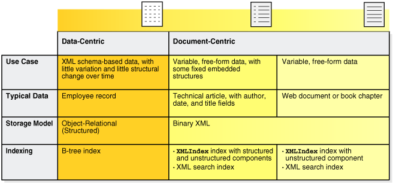

Important design choices for your application include what `XMLType` storage model to use and which indexing approaches to use.

- Introduction to Choosing an XMLType Storage Model and Indexing Approaches
  `XMLType` is an abstract SQL data type that provides different storage and indexing models to best fit your XML data and your use of it. Because it is an abstract data type, your applications and database queries gain in flexibility: the same interface is available for all `XMLType` operations.
- XMLType Use Case Spectrum: Data-Centric to Document-Centric
  When choosing an `XMLType` storage model, consider the nature of your XML data and the ways you use it. There is a spectrum of use cases, ranging from most data-centric to most document-centric.
- Common Use Cases for XML Data Stored as XMLType
  Recommendations are provided for application use cases that correspond to common use cases for XML data stored as `XMLType`.
- XMLType Storage Model Considerations
  For most use cases, Oracle recommends that you use binary XML storage of `XMLType`. Object-relational storage is appropriate in special cases.
- XMLType Indexing Considerations
  For `XMLType` data stored object-relationally, create B-tree and bitmap indexes just as you would for relational data. Use `XMLIndex` indexing with `XMLType` data that is stored as binary XML.
- XMLType Storage Options: Relative Advantages
  Each `XMLType` storage model has particular advantages and disadvantages.

**Parent topic:** [XML Schema and Object-Relational XMLType](XML-Schema-and-object-relational-XMLType.md)

### 16.1 Introduction to Choosing an XMLType Storage Model and Indexing Approaches

`XMLType` is an abstract SQL data type that provides different storage and indexing models to best fit your XML data and your use of it. Because it is an abstract data type, your applications and database queries gain in flexibility: the same interface is available for all `XMLType` operations.

Different applications use XML data in different ways. Sometimes it is constructed from relational data sources, so it is relatively structured. Sometimes it is used for extraction, transformation, and loading (ETL) operations, in which case it is also quite structured. Sometimes it is used for free-form documents (unstructured or semi-structured) such as books and articles.

Retrieval approaches can also be different for different kinds of data. Data-centric use cases often involve a fixed set of queries, whereas document-centric use cases often involve arbitrary (ad-hoc) queries.

Because there is a broad spectrum of XML usage, there is no one-size-fits-all storage model that offers optimal performance and flexibility for every use case. Oracle XML DB offers two storage models for `XMLType`, and several indexing methods appropriate to these different storage models. You can tailor performance and functionality to best fit the kind of XML data you have and the ways you use it.

Therefore, one key decision to make is which `XMLType` storage model to use for which XML data. This chapter helps you choose the best storage option for a given use case.

`XMLType` tables and columns can be stored in the following ways:

- Binary XML storage – This is also referred to as **post-parse persistence**. It is the default storage model for Oracle XML DB. It is a post-parse, binary format designed specifically for XML data. Binary XML is compact and XML schema-aware. The biggest advantage of Binary XML storage is flexibility: you can use it for XML schema-based documents or for documents that are not based on an XML schema. You can use it with an XML schema that allows for high data variability or that evolves considerably or unexpectedly. This storage model also provides efficient partial updating and streamable query evaluation.

- Object-relational storage – This is also referred to as **structured** storage and **object-based persistence**. This storage model represents an entity-relationship (ER) decomposition of the XML data. It provides the best performance for highly structured data with a known and more or less fixed set of queries. Query performance matches that of relational data, and updates can be performed in place.

**Note:**

Starting with Oracle Database 12c Release 1 (12.1.0.1), the unstructured (`CLOB`) storage model for `XMLType` is deprecated. Use binary XML storage instead.

If you have exising `XMLType` data that is stored as `CLOB` data then consider moving it to binary XML storage format using Oracle GoldenGate. If document fidelity is important for a particular XML document then store a copy of it in a relational `CLOB` column.

Oracle XML DB supports the following kinds of indexes on `XMLType` data.

- B-tree functional indexes on object-relational storage

- XML search index on binary XML storage

- `XMLIndex` with structured and unstructured components on binary XML storage

- B-tree indexes on the secondary tables created automatically for `XMLIndex` (both structured and unstructured components) on binary XML storage

Different use cases call for different combinations of `XMLType` storage model and indexes.

**Related Topics**

- [Indexes for XMLType Data](indexes-for-XMLType-data.md)
- XMLType Storage Options: Relative Advantages

**Parent topic:** Choice of XMLType Storage and Indexing

### 16.2 XMLType Use Case Spectrum: Data-Centric to Document-Centric

When choosing an `XMLType` storage model, consider the nature of your XML data and the ways you use it. There is a spectrum of use cases, ranging from most data-centric to most document-centric.

This is illustrated in Figure 16-1 , which shows the most data-centric cases at the left and the most document-centric cases at the right.

Figure 16-1 XML Use Cases and XMLType Storage Models

[Description of "Figure 16-1 XML Use Cases and XMLType Storage Models"](img_text/adxdb057.md)

**Data-centric** data is highly structured, with relatively static and predictable structure, and your applications take advantage of this structure. The data conforms to an XML schema.

**Document-centric** data can be divided into two cases:

- The data is generally without structure or is of variable structure. This includes the case of documents that have both structured and unstructured parts. Document structure can vary over time (evolution), and the content can be **mixed** (**semi-structured**), with many elements containing both text nodes and child elements. Many XML elements can be absent or can appear in different orders. Documents might or might not conform to an XML schema.

- The data is relatively structured, but your applications do not take advantage of that structure: they treat the data as if it were without structure.

**Parent topic:** Choice of XMLType Storage and Indexing

### 16.3 Common Use Cases for XML Data Stored as XMLType

Recommendations are provided for application use cases that correspond to common use cases for XML data stored as `XMLType`.

If your use case is not a common one, so that it is not covered here, then refer to the rest of this chapter for information about special cases.

**Note:**

This section is about the use of XML data that is persisted as `XMLType`. One common use case for XML data involves the generation of XML data from relational data. That case is not covered here, as it involves relational storage and the generated XML data is not necessarily persisted.

(For cases where generated XML data is persisted as `XMLType`, see XMLType Use Case: Staged XML Data for ETL.)

- XMLType Use Case: No XML Fragment Updating or Querying
  In this use case there is no requirement to update or query fragments of XML data that is stored in the database.
- XMLType Use Case: Data Integration from Diverse Sources with Different XML Schemas
  If your XML data comes from multiple data sources that use different XML schemas then use binary XML storage.
- XMLType Use Case: Staged XML Data for ETL
  In this use case, data is extracted from outside sources, transformed to fit operational needs (typically relational), and then loaded into the database: extract, transform, load (ETL). In particular, transformation distinguishes this use case.
- XMLType Use Case: Semi-Structured XML Data
  In this use case, either your XML data is of variable form or large portions of it are not well defined. There might not be an associated XML schema, or the XML schema might allow for high data variability or evolve considerably or in unexpected ways.
- XMLType Use Case: Business Intelligence Queries
  To enable business-intelligence (BI) queries over XML data, you can use SQL/XML function `XMLTable` to project values contained in the data as columns of a virtual table. Then use analytic-function windows, together with SQL `ORDER BY`and `GROUP BY`, to operate on columns of the virtual table.
- XMLType Use Case: XML Queries Involving Full-Text Search
  If your application needs to perform full-text searches on XML data then use binary XML storage and create XML search indexes that correspond to your queries.

**Related Topics**

- XMLType Indexing Considerations
- XMLType Storage Options: Relative Advantages

**Parent topic:** Choice of XMLType Storage and Indexing

#### 16.3.1 XMLType Use Case: No XML Fragment Updating or Querying

In this use case there is no requirement to update or query fragments of XML data that is stored in the database.

You have these options for this use case:

- Store it as `XMLType` using binary XML storage.

- Store it in a relational `BLOB` or `CLOB` column, preferably a SecureFiles LOB.

If you store the XML data in a relational LOB column, not as `XMLType`, Oracle Database does not parse the data and it cannot guarantee its validity. (And you cannot perform `XMLType` operations on the data.)

**Parent topic:** Common Use Cases for XML Data Stored as XMLType

#### 16.3.2 XMLType Use Case: Data Integration from Diverse Sources with Different XML Schemas

If your XML data comes from multiple data sources that use different XML schemas then use binary XML storage.

This use case has three subcases:

- If the XML data contains islands of structured, predictable data, and your queries are known, then use `XMLIndex` with a structured component to index the structured islands (even if the data surrounding these islands is unstructured). A structured index component reflects the queries you use. An RSS news aggregator is an example of such a use case.

- If there are no such structured islands or your queries are unknown ahead of time (ad hoc) then use `XMLIndex` with an unstructured component.

- If you use queries that involve full-text search then use an XML search index, together with XQuery pragma `ora:no_schema`.

**Related Topics**

- [XMLIndex Structured Component](indexes-for-XMLType-data.md)
- [XMLIndex Unstructured Component](indexes-for-XMLType-data.md)
- [Indexing XML Data for Full-Text Queries](indexes-for-XMLType-data.md)
- [Oracle XQuery Extension-Expression Pragmas](xquery-and-XML-DB.md)

**Parent topic:** Common Use Cases for XML Data Stored as XMLType

#### 16.3.3 XMLType Use Case: Staged XML Data for ETL

In this use case, data is extracted from outside sources, transformed to fit operational needs (typically relational), and then loaded into the database: extract, transform, load (ETL). In particular, transformation distinguishes this use case.

ETL use cases often integrate data from multiple applications that are maintained or hosted by multiple parties using different software and hardware systems. The data that is extracted is often the responsibility of parties other than those who transform it or use it after transformation.

The XML data involved is typically highly structured and conforms to an XML schema. This use case covers both producing relational data from XML data and generating XML data from relational data.

A subset of ETL use cases involve the need to efficiently update the XML data. Updating can involve replacement of an entire XML document or changes to only fragments of a document (partial updating).

Object-relational storage of `XMLType` data is generally appropriate for this use case.

**Related Topics**

- [Relational Views over XML Data](relational-views-over-XML-data.md)
- [Generation of XML Data from Relational Data](generation-of-XML-data-from-relational-data.md)

**Parent topic:** Common Use Cases for XML Data Stored as XMLType

#### 16.3.4 XMLType Use Case: Semi-Structured XML Data

In this use case, either your XML data is of variable form or large portions of it are not well defined. There might not be an associated XML schema, or the XML schema might allow for high data variability or evolve considerably or in unexpected ways.

Binary XML storage of `XMLType` data is generally appropriate for this use case.

Use structured-component `XMLIndex` indexing when query paths are known, and use path-subsetted unstructured-component `XMLIndex` indexing when paths are not known beforehand (ad hoc queries). Use an XML search index for XQuery Full-Text queries.

**Related Topics**

- [XMLIndex Structured Component](indexes-for-XMLType-data.md)
- [XMLIndex Unstructured Component](indexes-for-XMLType-data.md)
- [Indexing XML Data for Full-Text Queries](indexes-for-XMLType-data.md)

**Parent topic:** Common Use Cases for XML Data Stored as XMLType

#### 16.3.5 XMLType Use Case: Business Intelligence Queries

To enable business-intelligence (BI) queries over XML data, you can use SQL/XML function `XMLTable` to project values contained in the data as columns of a virtual table. Then use analytic-function windows, together with SQL `ORDER BY`and `GROUP BY`, to operate on columns of the virtual table.

For business-intelligence queries, you will generally do all of the following:

- Store your `XMLType` data as binary XML.

- Use an `XMLIndex` index with a structured component.

- Create relational views over the data using SQL/XML function `XMLTable`, where the views project all columns of interest to the BI application.

- Write your application queries against these relational views.

If the `XMLIndex` index is created in one-to-one correspondence to these views, Oracle Database automatically translates queries over the views to queries over the relational tables of the structured `XMLIndex` component, providing relational performance.

When you use analytic-function windows, `ORDER BY`, or `GROUP BY` on a column of the virtual table, these operations are translated to windows, `ORDER BY`, and `GROUP BY` operations on the corresponding physical columns of the structured-component `XMLIndex` tables.

**Related Topics**

- [XMLIndex Structured Component](indexes-for-XMLType-data.md)
- [Relational Views over XML Data](relational-views-over-XML-data.md)

**Parent topic:** Common Use Cases for XML Data Stored as XMLType

#### 16.3.6 XMLType Use Case: XML Queries Involving Full-Text Search

If your application needs to perform full-text searches on XML data then use binary XML storage and create XML search indexes that correspond to your queries.

**Related Topics**

- [Indexing XML Data for Full-Text Queries](indexes-for-XMLType-data.md)

**Parent topic:** Common Use Cases for XML Data Stored as XMLType

### 16.4 XMLType Storage Model Considerations

For most use cases, Oracle recommends that you use binary XML storage of `XMLType`. Object-relational storage is appropriate in special cases.

Object-relational storage is not appropriate unless all of the following are true:

- You have an XML schema that rigorously specifies the detailed data format of all XML documents that you intend to store in a given `XMLType` column or table. Your applications are data-centric.

- You do not expect your XML schema to evolve frequently in ways that do not allow in-place schema evolution.

- Your data is not especially sparse (does not include many elements that are empty or missing).

- You do not necessarily insert and select whole XML documents at a time. Partial updates and selections are common.

- You do not need document fidelity (DOM fidelity is sufficient).

Table 16-1 provides more detail about this. The guidelines it presents for choosing an `XMLType` storage model are not independent: follow them in the order presented, row by row, until a requirement in column If... is satisfied.

Table 16-1 XMLType Storage Model Considerations

| If...                                                                                                                                                                                                                                                                                                                                                     | Then...                                                                                                                                                                                                                                    |
|:----------------------------------------------------------------------------------------------------------------------------------------------------------------------------------------------------------------------------------------------------------------------------------------------------------------------------------------------------------|:-------------------------------------------------------------------------------------------------------------------------------------------------------------------------------------------------------------------------------------------|
| 1\. You need the property of document fidelity, preserving all original whitespace.                                                                                                                                                                                                                                                                       | Use binary XML storage for database use and XML processing. But also store a copy of the original documents in a `CLOB` (relational) column. (It is your responsibility to keep the two versions synchronized, if you update the data.) |
| 2\. You rarely need to select or update only a portion of your XML data. Instead, you typically insert and select whole XML documents at a time.                                                                                                                                                                                                          | Use binary XML storage.                                                                                                                                                                                                                    |
| 3\. You need to store `XMLType` instances that conform to different XML schemas in the same `XMLType` table or column. (Oracle does not recommend this practice in general, because it prohibits Oracle XML DB from using the XML schemas to optimize XML queries and other operations.)                                                               | Use binary XML storage.                                                                                                                                                                                                                    |
| 4\. You do not have an XML schema for your data.                                                                                                                                                                                                                                                                                                          | Use binary XML storage. If you think that your data could benefit from XML schema validation, then consider also whether you can generate an XML schema for it using a schema-generation tool.                                          |
| 5\. You expect your XML schema to evolve frequently or in unexpected ways, and you cannot take advantage of in-place XML schema evolution. In-place evolution is generally permitted only if the changes do not invalidate existing documents and they do not involve changing the storage model. See [XML Schema Evolution](XML-Schema-evolution.md). | Use binary XML storage. Use PL/SQL procedure `DBMS_XMLSCHEMA.copyEvolve` to update the XML schema.                                                                                                                                      |
| 6\. Your XML data is very sparse.                                                                                                                                                                                                                                                                                                                         | Use binary XML storage.                                                                                                                                                                                                                    |
| 7\. Your XML schema does not make use of constructs such as elements `any` and `choice`, which do not provide a detailed specification of the data format. (XML schema generators often include such constructs in the generated schemas.)                                                                                                             | Use object-relational storage.                                                                                                                                                                                                             |
| 8\. You can modify your XML schema to remove constructs such as `any` and `choice` that prevent a rigorous definition of the structure of your XML data.                                                                                                                                                                                                  | Remove such constructs, then use object-relational storage.                                                                                                                                                                                |
| 9\. You cannot remove such constructs.                                                                                                                                                                                                                                                                                                                    | Use binary XML storage.                                                                                                                                                                                                                    |

**Parent topic:** Choice of XMLType Storage and Indexing

### 16.5 XMLType Indexing Considerations

For `XMLType` data stored object-relationally, create B-tree and bitmap indexes just as you would for relational data. Use `XMLIndex` indexing with `XMLType` data that is stored as binary XML.

For general indexing of document-centric XML data, use `XMLIndex` with an unstructured component. This is appropriate for queries that are ad hoc (arbitrary).

For data that contains predictable, fixed parts that you query frequently, use `XMLIndex` with structured components for those parts. An example of this use case is a specification that is generally free-form but that has fixed fields for the author, date, and title.

To handle islands of structure within generally unstructured content, create an `XMLIndex` index that has both structured and unstructured components. A use case where you might use both components would be to support queries that extract an XML fragment from a document whenever some structured data is present. The structured component of the index would be used for a query `WHERE` clause condition that checks for the structured data. The unstructured component would be used for the fragment extraction.

Table 16-2 provides simple guidelines for indexing `XMLType` data that is stored as binary XML. These guidelines are independent: you can use a combination of indexing approaches if their If... conditions are satisfied.

Table 16-2 XMLType Indexing Considerations

| If...                                                        | Then...                                                                         |
|:-------------------------------------------------------------|:--------------------------------------------------------------------------------|
| Your data contains predictable islands of structured data.   | Use `XMLIndex`, with a structured component for each of the structured islands. |
| You need to support full-text queries.                       | Use XML search indexes.                                                         |
| You need to support ad-hoc XML queries involving predicates. | Use `XMLIndex`, with an unstructured component.                                 |

**Parent topic:** Choice of XMLType Storage and Indexing

### 16.6 XMLType Storage Options: Relative Advantages

Each `XMLType` storage model has particular advantages and disadvantages.

Table 16-3 summarizes the advantages and disadvantages of each `XMLType` storage model. Symbols + and – provide a rough indication of strength and weakness, respectively.

Table 16-3 XMLType Storage Models: Relative Advantages

| Quality                    | Binary XML Storage                                                                                                                                                                              | Object-Relational Storage                                                                                                  |
|:---------------------------|:------------------------------------------------------------------------------------------------------------------------------------------------------------------------------------------------|:---------------------------------------------------------------------------------------------------------------------------|
| Throughput                 | (+) High throughput. Fast DOM loading. There is a slight overhead from the binary encoder/decoder.                                                                                              | (–) XML decomposition can result in reduced throughput when ingesting or retrieving the entire content of an XML document. |
| Indexing support           | `XMLIndex` and XML search indexes.                                                                                                                                                              | B-tree, bitmap, and Oracle Text indexes on specific elements or attributes.                                                |
| Queries                    | (+) Fast when using `XMLIndex`. Queries that cannot use an index use streaming XPath evaluation, which can also be fast.                                                                        | (++) Relational query performance. You can create B-tree indexes on the underlying object-relational columns.              |
| Update operations (DML)    | (+) In-place, piecewise update for SecureFiles LOB storage.                                                                                                                                     | (++) Relational update performance. Columns are updated in place.                                                          |
| Data flexibility           | (+) Flexibility in the structure of the XML documents that can be stored in an `XMLType` column or table.                                                                                       | (–) Limited flexibility. Only documents that conform to the XML schema can be stored.                                      |
| XML schema flexibility     | (++) Both XML schema-based and non-schema-based documents can be stored. Documents conforming to any XML schemas that have been registered can be stored in the same `XMLType` table or column. | (–) Only documents that conform to the same XML schema can be stored in a given `XMLType` table or column.                 |
| Validation upon insert     | (++) XML schema-based data can be fully validated when it is inserted, but this takes time.                                                                                                     | (+) XML data is partially validated when it is inserted.                                                                   |
| Compression and Encryption | (+) Binary XML with SecureFiles LOB storage can be compressed/encrypted.                                                                                                                        | (++) Each XML element/attribute can be compressed/encrypted individually.                                                  |

**Parent topic:** Choice of XMLType Storage and Indexing
