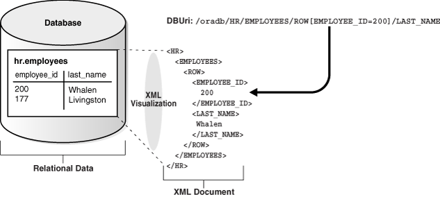
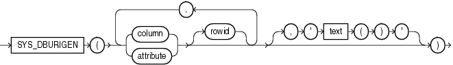

You can generate and store URIs in the database and use them to retrieve the database data they target. There are three kinds of URIs you can use this way: DBUris, XDBUris, and HTTPUris.

- Overview of Oracle XML DB URI Features
  You can use a URI as an indirection mechanism to access database data, and you can use a URI that targets database data to produce XML documents.
- URIs and URLs
  In developing Web-based XML applications, you often refer to data located on a network using **Uniform Resource Identifiers**, or **URI**s. A **URL**, or **Uniform Resource Locator**, is a URI that accesses an object using an Internet protocol.
- URIType and its Subtypes
  You can represent paths of various kinds as database objects. These provide unified access to data stored inside and outside the server, and they can be used to map URIs in XML documents to database columns, letting documents reference data stored in relational columns and expose it externally.
- Accessing Data Using URIType Instances
  To use instances of `URIType` subtypes for indirection, you store such instances in the database and then query to retrieve the targeted data with a PL/SQL method such as `getCLOB()`.
- XDBUris: Pointers to Repository Resources
  `XDBURIType` is a subtype of `URIType` that exposes resources in Oracle XML DB Repository using URIs. Instances of object type `XDBURIType` are called **XDBUris**.
- DBUris: Pointers to Database Data
  A DBUri is a URI that targets database data. As for all instances of `URIType` subtypes, a DBUri provides indirect access to data. `DBURIType` also lets you address database data using XPath and construct XML documents containing database data that is targeted by a DBUri that reflects the database structure.
- Create New Subtypes of URIType Using Package URIFACTORY
  You can define your own subtypes of `URIType` that correspond to particular protocols. You can use PL/SQL package `URIFACTORY` to obtain the URI of a `URIType` instance, escape characters in a URI string or remove such escaping, and register or unregister a type name for handling a given URL.
- SYS_DBURIGEN SQL Function
  You can create a DBUri by providing an XPath expression to constructor `DBURIType` or to appropriate `URIFACTORY` PL/SQL methods. With Oracle SQL function `sys_DburiGen`, you can alternatively create a DBUri using an XPath that is composed from database columns and their values.
- DBUriServlet
  You can retrieve repository resources using the Oracle XML DB HTTP server. Oracle Database also includes a servlet, **DBUriServlet**, that makes any kind of database data available through HTTP(S) URLs. The data can be returned as plain text, HTML, or XML.

**Parent topic:** [Oracle XML DB Repository](XML-DB-repository.md)

### 32.1 Overview of Oracle XML DB URI Features

You can use a URI as an indirection mechanism to access database data, and you can use a URI that targets database data to produce XML documents.

- Using paths as an indirection mechanism – You can store a path in the database and then access its target indirectly by referring to the path. The paths in question are various kinds of Uniform Resource Identifier (URI).

- Using paths that target database data to produce XML documents – One kind of URI that you can use for indirection in particular, a DBUri, provides a convenient XPath notation for addressing database data. You can use a DBUri to construct an XML document that contains database data and whose structure reflects the database structure.

**Parent topic:** Data Access Using URIs

### 32.2 URIs and URLs

In developing Web-based XML applications, you often refer to data located on a network using **Uniform Resource Identifiers**, or **URI**s. A **URL**, or **Uniform Resource Locator**, is a URI that accesses an object using an Internet protocol.

A URI has two parts, separated by a number sign (`#`):

- A URL part, that identifies a document.

- A fragment part, that identifies a fragment within the document. The notation for the fragment depends on the document type. For HTML documents, it is an anchor name. For XML documents, it is an XPath expression.

These are typical URIs:

- For HTML – `http://www.example.com/document1#some_anchor`, where `some_anchor` is a named anchor in the HTML document.

- For XML – `http://www.example.com/xml_doc#/po/cust/custname`, where:

  - `http://www.example.com/xml_doc` identifies the location of the XML document.

  - `/po/cust/custname` identifies a fragment within the document. This portion is defined by the W3C XPointer recommendation.

**See Also:**

- [Web Services Activity Statement](https://www.oracle.com/pls/topic/lookup?ctx=en/database/oracle/oracle-database/19/adxdb&id=w3_org_ws_activity) for an explanation of HTTP(S) URL notation

- [XML Path Language (XPath)](https://www.oracle.com/pls/topic/lookup?ctx=en/database/oracle/oracle-database/19/adxdb&id=w3_org_tr_xpath)

- [XML Pointer Language (XPointer)](https://www.oracle.com/pls/topic/lookup?ctx=en/database/oracle/oracle-database/19/adxdb&id=w3_org_tr_xpointer)

- [XML and MIME Media-Types](https://www.oracle.com/pls/topic/lookup?ctx=en/database/oracle/oracle-database/19/adxdb&id=xml_coverpages_mime_types)

**Parent topic:** Data Access Using URIs

### 32.3 URIType and its Subtypes

You can represent paths of various kinds as database objects. These provide unified access to data stored inside and outside the server, and they can be used to map URIs in XML documents to database columns, letting documents reference data stored in relational columns and expose it externally.

The available path object types are `HTTPURIType`, `DBURIType`, and `XDBURIType`, all of which are derived from abstract object type `URIType`.

- `HTTPURIType` – An object of this type is called an **HTTPUri** and represents a URL that begins with `http://`. With `HTTPURIType`, you can create objects that represent links to remote Web pages (or files) and retrieve those Web pages by calling object methods. Applications using `HTTPUriType` must have the proper access privileges. `HTTPUriType` implements the Hyper Text Transfer Protocol (HTTP(S)) for accessing remote Web pages. `HTTPURIType` uses package `UTL_HTTP` to fetch data, so session settings and access control for this package can also be used to influence HTTP fetches.

  **See Also:**

  [Oracle Database Security Guide](../dbseg/managing-fine-grained-access-in-pl-sql-packages-and-types.md) for information about managing fine-grained access to external network services

- `DBURIType` – An object of this type is called a **DBUri** and represents a URI that targets database data – a table, one or more rows, or a single column. With `DBURIType`, you can create objects that represent links to database data, and retrieve such data as XML by calling object methods. A DBUri uses a simple form of XPath expression as its URI syntax – for example, the following XPath expression is a DBUri reference to the row of table `HR.employees` where column `first_name` has value `Jack`:

      /HR/EMPLOYEES/ROW[FIRST_NAME="Jack"]

- `XDBURIType` – An object of this type is called an **XDBUri**, and represents a URI that targets a resource in Oracle XML DB Repository. With PL/SQL constructor `XDBURIType` you can create objects that represent links to repository resources. You can then retrieve all or part of any resource by calling methods on those objects. The URI syntax for an XDBUri is a repository resource address, optionally followed by an XPath expression. For example, `/public/hr/doc1.xml#/purchaseOrder/lineItem` is an XDBUri reference to the `lineItem` child element of the root element `purchaseOrder` in repository file `doc1.xml` in folder `/public/hr`.

Each of these object types is derived from an abstract object type, `URIType`. As an abstract type, it has no instances (objects). Only its subtypes have instances.

Type `URIType` provides the following features:

- Unified access to data stored inside and outside the server. Because you can use `URIType` values to store pointers to HTTP(S) and DBUris, you can create queries and indexes without worrying about where the data resides.

- Mapping of URIs in XML Documents to Database Columns. When an XML document is broken up and stored in object-relational tables and columns, any URIs contained in the document are mapped to database columns of the appropriate `URIType` subtype.

You can reference data stored in relational columns and expose it to the external world using URIs. Oracle Database provides a standard servlet, DBUriServlet, that interprets DBUris. It also provides PL/SQL package `UTL_HTTP` and Java class `java.net.URL`, which you can use to fetch URL references.

`URIType` columns can be indexed natively in Oracle Database using Oracle Text – no special data store is needed.

- Overview of DBUris and XDBUris
  Important uses of DBUris and XDBUris include referencing XSLT stylesheets from Web pages, referencing data in database tables or in repository folders without using SQL, and improving performance by bypassing the Web server.
- URIType PL/SQL Methods
  Abstract object type `URIType` includes PL/SQL methods that can be used with each of its subtypes. Each of these methods can be overridden by any of the subtypes.

**Related Topics**

- HTTPURIType PL/SQL Method GETCONTENTTYPE()
- DBUris: Pointers to Database Data
- XDBUris: Pointers to Repository Resources
- [Indexes for XMLType Data](indexes-for-XMLType-data.md)

**See Also:**

Create New Subtypes of URIType Using Package URIFACTORY for information about defining new `URIType` subtypes

**Parent topic:** Data Access Using URIs

#### 32.3.1 Overview of DBUris and XDBUris

Important uses of DBUris and XDBUris include referencing XSLT stylesheets from Web pages, referencing data in database tables or in repository folders without using SQL, and improving performance by bypassing the Web server.

- You can reference XSLT stylesheets from within database-generated Web pages. PL/SQL package `DBMS_METADATA` uses DBUris to reference XSLT stylesheets. An XDBUri can be used to reference XSLT stylesheets stored in Oracle XML DB Repository.

- You can reference HTML text, images and other data stored in the database. URLs can be used to point to data stored in database tables or in repository folders.

- You can improve performance by bypassing the Web server. Replace a global URL in your XML document with a reference to the database, and use a servlet, a DBUri, or an XDBUri to retrieve the targeted content. Using a DBUri or an XDBUri generally provides better performance than using a servlet, because you interact directly with the database rather than through a Web server.

- With a DBUri, you can access an XML document in the database without using SQL.

- Whenever a repository resource is stored in a database table to which you have access, you can use either an XDBUri or a DBUri to access its content.

**See Also:**

[Oracle Database PL/SQL Packages and Types Reference](../arpls/DBMS_METADATA.md), "DBMS_METADATA package"

**Parent topic:** URIType and its Subtypes

#### 32.3.2 URIType PL/SQL Methods

Abstract object type `URIType` includes PL/SQL methods that can be used with each of its subtypes. Each of these methods can be overridden by any of the subtypes.

Table 32-1 lists the `URIType` PL/SQL methods. In addition, each of the subtypes has a constructor with the same name as the subtype.

Table 32-1 URIType PL/SQL Methods

| URIType Method     | Description                                                                                                                                                                                                                                                                                                                                                                                                                                             |
|:-------------------|:--------------------------------------------------------------------------------------------------------------------------------------------------------------------------------------------------------------------------------------------------------------------------------------------------------------------------------------------------------------------------------------------------------------------------------------------------------|
| `getURL()`         | Returns the URL of the `URIType` instance. Use this method instead of referencing a URL directly. `URIType` subtypes override this method to provide the correct URL. For example, `HTTPURIType` stores a URL without prefix `http://`. Method `getURL()` then prepends the prefix and returns the entire URL.                                                                                                                                       |
| `getExternalURL()` | Similar to `getURL()`, but `getExternalURL()` escapes characters in the URL, to conform with the URL specification. For example, spaces are converted to the escaped value `%20`.                                                                                                                                                                                                                                                                       |
| `getContentType()` | Returns the MIME content type for the URI. HTTPUri: To return the content type, the URL is followed and the MIME header examined. DBUri: The returned content type is either `text/plain` (for a scalar value) or `text/xml` (otherwise). XDBUri: The value of the `ContentType` metadata property of the repository resource is returned.                                                                                                     |
| `getCLOB()`        | Returns the target of the URI as a `CLOB` instance. The database character set is used for encoding the data. DBUri: XML data is returned (unless node-test `text()` is used, in which case the targeted data is returned as is). When a `BLOB` column is targeted, the binary data in the column is translated as hexadecimal character data.                                                                                                       |
| `getBLOB()`        | Returns the target of the URI as a `BLOB` value. No character conversion is performed, and the character encoding is that of the URI target. This method can also be used to fetch binary data. DBUri: When applied to a DBUri that targets a `BLOB` column, `getBLOB()` returns the binary data translated as hexadecimal character data. When applied to a DBUri that targets non-binary data, the data is returned in the database character set. |
| `getXML()`         | Returns the target of the URI as an `XMLType` instance. Using this, an application that performs operations other than `getCLOB()` and `getBLOB()` can use `XMLType` methods to do those operations. This throws an exception if the URI does not target a well-formed XML document.                                                                                                                                                                    |
| `createURI()`      | Constructs an instance of one of the `URIType` subtypes.                                                                                                                                                                                                                                                                                                                                                                                                |

- HTTPURIType PL/SQL Method GETCONTENTTYPE()
  `HTTPURIType` PL/SQL method `getContentType()` returns the MIME information for its targeted document. You can use this information to decide whether to retrieve the document as a `BLOB` instance or a `CLOB` instance.
- DBURIType PL/SQL Method GETCONTENTTYPE()
  PL/SQL method `getContentType()` returns the MIME information for a URL. If a DBUri targets a scalar value, then the MIME content type returned is `text/plain`. Otherwise, the type returned is `text/xml`.
- DBURIType PL/SQL Method GETCLOB()
  When PL/SQL method `getCLOB()` is applied to a DBUri, the targeted data is returned as XML data, using the targeted column or table name as an XML element name. If the target XPath uses node-test `text()` then the data is returned as text without an enclosing XML tag.
- DBURIType PL/SQL Method GETBLOB()
  When applied to a DBUri that targets a `BLOB` column, PL/SQL method `getBLOB()` returns the binary data translated as hexadecimal character data. When applied to a DBUri that targets non-binary data, method `getBLOB()` returns the data (as a `BLOB` value) in the database character set.

**See Also:**

[Oracle Database PL/SQL Packages and Types Reference](../arpls/Database-URI-TYPEs.md)

**Parent topic:** URIType and its Subtypes

##### 32.3.2.1 HTTPURIType PL/SQL Method GETCONTENTTYPE()

`HTTPURIType` PL/SQL method `getContentType()` returns the MIME information for its targeted document. You can use this information to decide whether to retrieve the document as a `BLOB` instance or a `CLOB` instance.

For example, you might treat a Web page with a MIME type of `x/jpeg `as a `BLOB` instance, and one with a MIME type of `text/plain` or `text/html` as a `CLOB` instance.

Example 32-1 tests the HTTP content type to determine whether to retrieve data as a `CLOB` or `BLOB` instance. The content-type data is the HTTP header, for `HTTPURIType`, or the metadata of the database column, for `DBURIType`.

Example 32-1 Using HTTPURIType PL/SQL Method GETCONTENTTYPE()

    DECLARE
      httpuri HTTPURIType;
      y CLOB;
      x BLOB;
    BEGIN
      httpuri := HTTPURIType('http://www.oracle.com/index.html');
      DBMS_OUTPUT.put_line(httpuri.getContentType());
      IF httpuri.getContentType() = 'text/html'
      THEN
         y := httpuri.getCLOB();
      END IF;
      IF httpuri.getContentType() = 'application-x/bin'
      THEN
         x := httpuri.getBLOB();
      END IF;
    END;
    /
    text/html

**Parent topic:** URIType PL/SQL Methods

##### 32.3.2.2 DBURIType PL/SQL Method GETCONTENTTYPE()

PL/SQL method `getContentType()` returns the MIME information for a URL. If a DBUri targets a scalar value, then the MIME content type returned is `text/plain`. Otherwise, the type returned is `text/xml`.

    CREATE TABLE dbtab (a VARCHAR2(20), b BLOB);

DBUris corresponding to the following XPath expressions have content type `text/xml`, because each targets a complete column of XML data.

- `/HR/DBTAB/ROW/A`

- `/HR/DBTAB/ROW/B`

DBUris corresponding to the following XPath expressions have content type `text/plain`, because each targets a scalar value.

- `/HR/DBTAB/ROW/A/text()`

- `/HR/DBTAB/ROW/B/text()`

**Parent topic:** URIType PL/SQL Methods

##### 32.3.2.3 DBURIType PL/SQL Method GETCLOB()

When PL/SQL method `getCLOB()` is applied to a DBUri, the targeted data is returned as XML data, using the targeted column or table name as an XML element name. If the target XPath uses node-test `text()` then the data is returned as text without an enclosing XML tag.

In both cases, the returned data is in the database character set.

For example: If applied to a DBUri with XPath `/HR/DBTAB/ROW/A/text(),` where `A` is a non-binary column, the data in column `A` is returned as is. Without XPath node-test `text()`, the result is the data wrapped in XML:

    
<DBTAB><ROW><A>...data_in_column_A...</A></ROW></DBTAB>

When applied to a DBUri that targets a binary (`BLOB`) column, the binary data in the column is translated as hexadecimal character data.

For example: If applied to a DBUri with XPath `/HR/DBTAB/ROW/B/text(),` where `B` is a `BLOB` column, the targeted binary data is translated to hexadecimal character data and returned. Without XPath node-test `text()`, the result is the translated data wrapped in XML:

    
<DBTAB><ROW><B>...data_translated_to_hex...</B></ROW></DBTAB>

**Parent topic:** URIType PL/SQL Methods

##### 32.3.2.4 DBURIType PL/SQL Method GETBLOB()

When applied to a DBUri that targets a `BLOB` column, PL/SQL method `getBLOB()` returns the binary data translated as hexadecimal character data. When applied to a DBUri that targets non-binary data, method `getBLOB()` returns the data (as a `BLOB` value) in the database character set.

For example, consider table `dbtab`:

    CREATE TABLE dbtab (a VARCHAR2(20), b BLOB);

When `getBLOB()` is applied to a DBUri corresponding to XPath expression `/HR/DBTAB/ROW/B`, it returns a `BLOB` value containing an XML document with root element `B` whose content is the hexadecimal-character translation of the binary data of column `B`.

When `getBLOB()` is applied to a DBUri corresponding to XPath expression `/HR/DBTAB/ROW/B/text()`, it returns a `BLOB` value containing only the hexadecimal-character translation of the binary data of column `B`.

When `getBLOB()` is applied to a DBUri corresponding to XPath expression `/HR/DBTAB/ROW/``A``/text()`, which targets non-binary data, it returns a `BLOB` value containing the data of column `A`, in the database character set.

**Parent topic:** URIType PL/SQL Methods

### 32.4 Accessing Data Using URIType Instances

To use instances of `URIType` subtypes for indirection, you store such instances in the database and then query to retrieve the targeted data with a PL/SQL method such as `getCLOB()`.

You can create database columns using `URIType` or any of its subtypes, or you can store just the text of each URI as a string and then create the needed `URIType` instances on demand, when the URIs are accessed. You can store objects of different `URIType` subtypes in the same `URIType` database column.

You can also define your own object types that inherit from the `URIType` subtypes. Deriving new types lets you use custom techniques to retrieve, transform, or filter data.

Example 32-2 stores an HTTPUri and a DBUri (instances of `URIType` subtypes `HTTPURIType` and `DBURIType`) in the same database column of type `URIType`. A query retrieves the data addressed by each of the URIs. The first URI is a Web-page URL. The second URI references data in table `employees` of standard database schema `HR`. (For brevity, only the beginning of the Web page is shown.)

To use `URIType` PL/SQL method `createURI()`, you must know the particular `URIType` subtype to use. PL/SQL method `getURI()` of package `URIFACTORY` lets you instead use the flexibility of late binding, determining the particular type information at run time.

PL/SQL factory method `URIFACTORY.getURI()` takes as argument a URI string. It returns a `URIType` instance of the appropriate subtype (`HTTPURIType, DBURIType,` or `XDBURIType`), based on the form of the URI string:

- If the URI starts with `http://`, then `getURI()` creates and returns an HTTPUri.

- If the URI starts with either `/oradb/` or `/dburi/`, then `getURI()` creates and returns a DBUri.

- Otherwise, `getURI()` creates and returns an XDBUri.

Example 32-3 is similar to Example 32-2, but it uses two different ways to obtain documents targeted by URIs:

- PL/SQL method `SYS.URIFACTORY.getURI()` with absolute URIs:

  - an HTTPUri that targets HTTP address `http://www.oracle.com`

  - a DBUri that targets database address `/oradb/HR/EMPLOYEES/ROW[EMPLOYEE_ID=200]`

- Constructor `SYS.HTTPURIType()` with a relative URL (no `http://`). The same HTTPUri is used as for the absolute URI: the Oracle home page.

In Example 32-3, the URI strings passed to `getURI()` are hard-coded, but they could just as easily be string values that are obtained by an application at run time.

Example 32-2 Creating and Querying a URI Column

    CREATE TABLE uri_tab (url URIType);
    Table created.

    INSERT INTO uri_tab VALUES (HTTPURIType.createURI('http://www.oracle.com'));
    1 row created.

    INSERT INTO uri_tab VALUES (DBURIType.createURI(
                                  '/HR/EMPLOYEES/ROW[FIRST_NAME="Jack"]'));
    1 row created.

    SELECT e.url.getCLOB() FROM uri_tab e;

    E.URL.GETCLOB()
    -------------------------------------------------------------------
    <!DOCTYPE HTML PUBLIC "-//W3C//DTD HTML 4.0 Transitional//EN">
    <html>
    <head>
    . . .

    <?xml version="1.0"?>
     <ROW>
      <EMPLOYEE_ID>177</EMPLOYEE_ID>
      <FIRST_NAME>Jack</FIRST_NAME>
      <LAST_NAME>Livingston</LAST_NAME>
      <EMAIL>JLIVINGS</EMAIL>
      <PHONE_NUMBER>011.44.1644.429264</PHONE_NUMBER>
      <HIRE_DATE>23-APR-06</HIRE_DATE>
      <JOB_ID>SA_REP</JOB_ID>
      <SALARY>8400</SALARY>
      <COMMISSION_PCT>.2</COMMISSION_PCT>
      <MANAGER_ID>149</MANAGER_ID>
      <DEPARTMENT_ID>80</DEPARTMENT_ID>
     </ROW>

    2 rows selected.

Example 32-3 Using Different Kinds of URI, Created in Different Ways

    CREATE TABLE uri_tab (docUrl SYS.URIType, docName VARCHAR2(200));
    Table created.

    -- Insert an HTTPUri with absolute URL into SYS.URIType using URIFACTORY.
    -- The target is Oracle home page.
    INSERT INTO uri_tab VALUES
      (SYS.URIFACTORY.getURI('http://www.oracle.com'), 'AbsURL');
    1 row created.

    -- Insert an HTTPUri with relative URL using constructor SYS.HTTPURIType.
    -- Note the absence of prefix http://. The target is the same.
    INSERT INTO uri_tab VALUES (SYS.HTTPURIType('www.oracle.com'), 'RelURL');
    1 row created.

    -- Insert a DBUri that targets employee data from table HR.employees.
    INSERT INTO uri_tab VALUES
      (SYS.URIFACTORY.getURI('/oradb/HR/EMPLOYEES/ROW[EMPLOYEE_ID=200]'), 'Emp200');
    1 row created.

    -- Extract all of the documents.
    SELECT e.docUrl.getCLOB(), docName FROM uri_tab e;

    E.DOCURL.GETCLOB()
    -----------------
    DOCNAME
    ------------------------------------
    <!DOCTYPE HTML PUBLIC "-//W3C//DTD HTML 4.0 Transitional//EN">
    <html>
    <head>
    . . .
    AbsURL

    <!DOCTYPE HTML PUBLIC "-//W3C//DTD HTML 4.01 Transitional//EN">
    <html>
    <head>
    . . .
    RelURL

    <?xml version="1.0"?>
     <ROW>
      <EMPLOYEE_ID>200</EMPLOYEE_ID>
      <FIRST_NAME>Jennifer</FIRST_NAME>
      <LAST_NAME>Whalen</LAST_NAME>
      <EMAIL>JWHALEN</EMAIL>
      <PHONE_NUMBER>515.123.4444</PHONE_NUMBER>
      <HIRE_DATE>17-SEP-03</HIRE_DATE>
      <JOB_ID>AD_ASST</JOB_ID>
      <SALARY>4400</SALARY>
      <MANAGER_ID>101</MANAGER_ID>
      <DEPARTMENT_ID>10</DEPARTMENT_ID>
     </ROW>
    Emp200

    3 rows selected.

    -- In PL/SQL
    CREATE OR REPLACE FUNCTION returnclob
      RETURN CLOB
      IS a SYS.URIType;
    BEGIN
      SELECT docUrl INTO a FROM uri_Tab WHERE docName LIKE 'Emp200%';
      RETURN a.getCLOB;
    END;
    /
    Function created.

    SELECT returnclob() FROM DUAL;

    RETURNCLOB()
    ---------------------------------------------------------------
    <?xml version="1.0"?>
     <ROW>
      <EMPLOYEE_ID>200</EMPLOYEE_ID>
      <FIRST_NAME>Jennifer</FIRST_NAME>
      <LAST_NAME>Whalen</LAST_NAME>
      <EMAIL>JWHALEN</EMAIL>
      <PHONE_NUMBER>515.123.4444</PHONE_NUMBER>
      <HIRE_DATE>17-SEP-03</HIRE_DATE>
      <JOB_ID>AD_ASST</JOB_ID>
      <SALARY>4400</SALARY>
      <MANAGER_ID>101</MANAGER_ID>
      <DEPARTMENT_ID>10</DEPARTMENT_ID>
     </ROW>

    1 row selected.

**Related Topics**

- Create New Subtypes of URIType Using Package URIFACTORY
- [XSL Transformation and Oracle XML DB](transformation-and-validation-of-XMLType-data.md)

**Parent topic:** Data Access Using URIs

### 32.5 XDBUris: Pointers to Repository Resources

`XDBURIType` is a subtype of `URIType` that exposes resources in Oracle XML DB Repository using URIs. Instances of object type `XDBURIType` are called **XDBUris**.

- XDBUri URI Syntax
  The URL portion of an XDBUri URI is the hierarchical address of the targeted repository resource – it is a repository path (not an XPath expression). An optional fragment portion of the URI, after the number-sign (`#`), uses XPath syntax to target parts of an XML document.
- Using XDBUri: Examples
  XDBUri examples here use URIs in a table to access a repository resource and, together with PL/SQL method `getXML`, to query and retrieve XML documents.

**Parent topic:** Data Access Using URIs

#### 32.5.1 XDBUri URI Syntax

The URL portion of an XDBUri URI is the hierarchical address of the targeted repository resource – it is a repository path (not an XPath expression). An optional fragment portion of the URI, after the number-sign (`#`), uses XPath syntax to target parts of an XML document.

The optional fragment portion of the URI is appropriate only if the targeted resource is an XML document, in which case the fragment portion targets one or more its parts. If the targeted resource is not an XML document, then omit the fragment and number-sign.

The following are examples of XDBUri URIs:

- `/public/hr/image27.jpg`

- `/public/hr/doc1.xml#/PurchaseOrder/LineItem`

Based on the form of these URIs:

- `/public/hr` is a folder resource in Oracle XML DB Repository.

- `image27.jpg` and `doc1.xml` are resources in folder `/public/hr`.

- Resource `doc1.xml` is a file resource, and it contains an XML document.

- The XPath expression /`PurchaseOrder/LineItem` refers to the `LineItem` child element in element `PurchaseOrder` of XML document `doc1.xml`.

You can create an XDBUri using PL/SQL method `getURI()` of package `URIFACTORY`.

`XDBURIType` is the default `URIType` used when generating instances using `URIFACTORY` PL/SQL method `getURI()`, unless the URI has one of the recognized prefixes `http://`, `/dburi`, or `/oradb`.

For example, if resource `doc1.xml` is present in repository folder `/public/hr`, then the following query returns an XDBUri that targets that resource.

    SELECT SYS.URIFACTORY.getURI('/public/hr/doc1.xml') FROM DUAL;

It is the lack of a special prefix that determines that the object type is `XDBURIType`, not any particular resource file extension or the presence of `#` followed by an XPath expression. Even if the resource were named `foo.bar` instead of `doc1.xml`, the returned `URIType` instance would still be an XDBUri.

**Parent topic:** XDBUris: Pointers to Repository Resources

#### 32.5.2 Using XDBUri: Examples

XDBUri examples here use URIs in a table to access a repository resource and, together with PL/SQL method `getXML`, to query and retrieve XML documents.

Example 32-4 creates an XDBUri, inserts values into a purchase-order table, and then selects all of the purchase orders. Because there is no special prefix used in the URI passed to `URIFACTORY.getURI()`, the created `URIType` instance is an XDBUri.

Because PL/SQL method `getXML()` returns an `XMLType` instance, you can use it with SQL/XML functions such as `XMLQuery`. The query in Example 32-5 illustrates this. The query retrieves all purchase orders numbered 999.

Example 32-4 Access a Repository Resource by URI Using an XDBUri

    DECLARE
    res BOOLEAN;
    postring VARCHAR2(100):= '<?xml version="1.0"?>
    <ROW>
    <PO>999</PO>
    </ROW>';
    BEGIN
    res:=DBMS_XDB_REPOS.createFolder('/public/orders/');
    res:=DBMS_XDB_REPOS.createResource('/public/orders/po1.xml', postring);
    END;
    /
    PL/SQL procedure successfully completed.

    CREATE TABLE uri_tab (poUrl SYS.URIType, poName VARCHAR2(1000));
    Table created.

    -- Create an abstract type column so any type of URI can be used
    -- Insert an absolute URL into poUrl.
    -- The factory will create an XDBURIType because there is no prefix.
    -- Here, po1.xml is an XML file that is stored in /public/orders/
    -- of the XML repository.
    INSERT INTO uri_tab VALUES
      (URIFACTORY.getURI('/public/orders/po1.xml'), 'SomePurchaseOrder');
    1 row created.

    -- Get all the purchase orders
    SELECT e.poUrl.getCLOB(), poName FROM uri_tab e;

    E.POURL.GETCLOB()
    -----------------
    PONAME
    ------
    <?xml version="1.0"?>
    <ROW>
    <PO>999</PO>
    </ROW>
    SomePurchaseOrder

    1 row selected.

    -- Using PL/SQL, you can access table uri_tab as follows:
    CREATE OR REPLACE FUNCTION returnclob
      RETURN CLOB
      IS a URIType;
    BEGIN
      -- Get absolute URL for purchase order named like 'Some%'
       SELECT poUrl INTO a FROM uri_tab WHERE poName LIKE 'Some%';
       RETURN a.getCLOB();
    END;
    /
    Function created.

    SELECT returnclob() FROM DUAL;

    RETURNCLOB()
    ---------------------
    <?xml version="1.0"?>
    <ROW>
    <PO>999</PO>
    </ROW>

    1 row selected.

Example 32-5 Using PL/SQL Method GETXML with XMLCAST and XMLQUERY

    SELECT e.poUrl.getCLOB() FROM uri_tab e
      WHERE XMLCast(XMLQuery('$po/ROW/PO'
                             PASSING e.poUrl.getXML() AS "po"
                             RETURNING CONTENT)
                    AS VARCHAR2(24))
            = '999';

    E.POURL.GETCLOB()
    ---------------------
    <?xml version="1.0"?>
    <ROW>
    <PO>999</PO>
    </ROW>

    1 row selected.

**Parent topic:** XDBUris: Pointers to Repository Resources

### 32.6 DBUris: Pointers to Database Data

A DBUri is a URI that targets database data. As for all instances of `URIType` subtypes, a DBUri provides indirect access to data. `DBURIType` also lets you address database data using XPath and construct XML documents containing database data that is targeted by a DBUri that reflects the database structure.

- Address database data using XPath notation. This, in effect, lets you visualize and access the database as if it were XML data.

  For example, a DBUri can use an expression such as `/HR/EMPLOYEES/ROW[FIRST_NAME="Jack"]` to target the row of table `HR.employees` where column `first_name` has value `Jack`.

- Construct an XML document that contains database data targeted by a DBUri and whose structure reflects the database structure.

  For example: A DBUri with XPath `/HR/DBTAB/ROW/A` can be used to construct an XML document that wraps the data of column `A` in XML elements that reflect the database structure and are named accordingly:

      
<DBTAB><ROW><A>...data_in_column_A...</A></ROW></DBTAB>

A DBUri does not reference a global location as does an HTTPUri. You can, however, also access objects addressed by a DBUri in a global manner, by appending the DBUri to an HTTPUri that identifies a servlet that handles DBUris – see DBUriServlet .

- View the Database as XML Data
  Using `DBURIType`, you can have what amounts to XML views of the portions of the database to which you have access, presented in the form of XML data. When visualized this way, the database data is effectively wrapped in XML elements, resulting in one or more XML documents.
- DBUri URI Syntax
  An XPath expression is a path into XML data that addresses one or more nodes. A DBUri exploits virtual XML visualization of the database to use a simple form of XPath expression as a URI to address database data. This is so, whether or not the data is XML.
- DBUris are Scoped to a Database and Session
  A DBUri is scoped to a given database session, so the same DBUri can give different results in the same query, depending on the session context (which user is connected and what privileges the user has).
- Using DBUris —Examples
  A DBUri can identify a table, a row, a column in a row, or an attribute of an object column. Examples here show how to target different object types.

**Parent topic:** Data Access Using URIs

#### 32.6.1 View the Database as XML Data

Using `DBURIType`, you can have what amounts to XML views of the portions of the database to which you have access, presented in the form of XML data. When visualized this way, the database data is effectively wrapped in XML elements, resulting in one or more XML documents.

You can access only those database schemas to which you have been granted access privileges. This portion of the database is, in effect, your own view of the database. This applies to all kinds database data, not just data that is stored as XML.

Such "XML views" are not database views, in the technical sense of the term. "View" here means only an abstract perspective that can be useful for understanding `DBURIType`. You can think of `DBURIType` as providing a way to visualize and access the database as if it were XML data.

However, `DBURIType` does not just provide an exercise in visualization and an additional means to access database data. Each "XML view" can be realized as an XML document – that is, you can use `DBURIType` to generate XML documents using database data.

All of this is another way of saying that `DBURIType` lets you use XPath notation to 1) address and access any database data to which you have access and 2) construct XML representations of that data.

Figure 32-1 illustrates the relation between a relational table, `HR.employees`, a corresponding XML view of a portion of that table, and the corresponding DBUri URI (a simple XPath expression). In this case, the portion of the data exposed as XML is the row where `employee_id` is `200`. The URI can be used to access the data and construct an XML document that reflects the "XML view".

Figure 32-1 A DBUri Corresponds to an XML Visualization of Relational Data

[Description of "Figure 32-1 A DBUri Corresponds to an XML Visualization of Relational Data"](img_text/adxdb053.md)

The XML elements in the "XML view" and the steps in the URI XPath expression both reflect the database table and column names. Note the use of `ROW` to indicate a row in the database table – both in the "XML view" and in the URI XPath expression.

Note also that the XPath expression contains a root-element step, `oradb`. This is used to indicate that the URI corresponds to a DBUri, not an HTTPUri or an XDBUri. Whenever this correspondence is understood from context, this XPath step can be skipped. For example, if it is known that the path in question is a path to database data, the following URIs are equivalent:

- `/oradb``/HR/EMPLOYEES/ROW[EMPLOYEE_ID=200]/LAST_NAME`

- `/HR/EMPLOYEES/ROW[EMPLOYEE_ID=200]/LAST_NAME`

Whenever the URI context is not clear, however, you must use the prefix `/oradb` to distinguish a URI as corresponding to a DBUri. In particular, you must supply the prefix to `URIFACTORY` PL/SQL methods and to DBUriServlet.

**Related Topics**

- Create New Subtypes of URIType Using Package URIFACTORY
- DBUriServlet

**See Also:**

[Generation of XML Data from Relational Data](generation-of-XML-data-from-relational-data.md) for other ways to generate XML from database data

**Parent topic:** DBUris: Pointers to Database Data

#### 32.6.2 DBUri URI Syntax

An XPath expression is a path into XML data that addresses one or more nodes. A DBUri exploits virtual XML visualization of the database to use a simple form of XPath expression as a URI to address database data. This is so, whether or not the data is XML.

Thus, for `DBURIType`, Oracle Database supports only a subset of the full XPath or XPointer syntax. There are no syntax restrictions for XDBUri XPath expressions. There is also an exception in the DBUri case: data in `XMLType` tables. For an `XMLType` table, the simple XPath form is used to address the table itself within the database. Then, to address particular XML data in the table, the remainder of the XPath expression can use the full XPath syntax. This exception applies only to `XMLType` tables, not to `XMLType` columns.

In any case, unlike an XDBUri, a DBUri URI does not use a number-sign (`#`) to separate the URL portion of a URI from a fragment (XPath) portion. `DBURIType` does not use URI fragments. Instead, the entire URI is treated as a (simple) XPath expression.

You can create DBUris to any database data to which you have access. XPath expressions such as the following are allowed:

- `/``database_schema``/``table`

- `/``database_schema``/``table``/ROW[``predicate_expression``]/``column`

- `/``database_schema``/``table``/ROW[``predicate_expression``]/``object_column``/``attribute`

- `/``database_schema``/``XMLType_table``/ROW/``XPath_expression`

In the last case, `XMLType_table` is an `XMLType` table, and `XPath_expression` is any XPath expression. For tables that are not `XMLType`, a DBUri XPath expression must end at a column (it cannot address specific data inside a column). This restriction includes `XMLType` columns, LOB columns, and `VARCHAR2` columns that contain XML data.

A DBUri XPath expression can do any of the following:

- Target an entire table.

  For example, `/HR/EMPLOYEES` targets table `employees` of database schema `HR`.

- Include XPath predicates at any step in the path, except the database schema and table steps.

  For example, `/HR/EMPLOYEES/ROW[EMPLOYEE_ID=200]/EMAIL` targets column `email` of table `HR.employees`, where `employee_id` is `200`.

- Use the `text()` XPath node test on data with scalar content. This is the only node test that can be used, and it cannot be used with the table or row step.

The following can be used in DBUri (XPath) predicate expressions:

- Boolean operators `and`, `or`, and `not`

- Relational operators `<`, `>`, `<=`, `!=`, `>=`, `=`, `mod`, `div`, `*` (multiply)

A DBUri XPath expression must do all of the following:

- Use only the child XPath axis – other axes, such as parent, are not allowed.

- Either specify a database schema or specify `PUBLIC` to resolve the table name without a specific schema.

- Specify a database view or table name.

- Include a `ROW` step, if a database column is targeted.

- Identify a single data value, which can be an object-type instance or a collection.

- Result in well-formed XML when it is used to generate XML data using database data.

  An example of a DBUri that does not result in well-formed XML is `/HR/EMPLOYEES/ROW/LAST_NAME`. It returns more than one `<LAST_NAME>` element fragment, with no single root element.

- Use none of the following:

  - `*` (wildcard)

  - `.` (self)

  - `..` (parent)

  - `//` (descendant or self)

  - XPath functions, such as `count`

A DBUri XPath expression can optionally be prefixed by `/oradb` or `/dburi` (the two are equivalent) to distinguish it. This prefix is case-insensitive. However, the rest of the DBUri XPath expression is case-sensitive, as are XPath expressions generally. Thus, for example, to specify table `HR.employees` as a DBUri XPath expression, you must use `HR/EMPLOYEES`, not `hr/employees` (or a mixed-case combination), because table and column names are uppercase, by default.

**See Also:**

[XML Path Language (XPath)](https://www.oracle.com/pls/topic/lookup?ctx=en/database/oracle/oracle-database/19/adxdb&id=w3_org_tr_xpath) on XPath notation

**Parent topic:** DBUris: Pointers to Database Data

#### 32.6.3 DBUris are Scoped to a Database and Session

A DBUri is scoped to a given database session, so the same DBUri can give different results in the same query, depending on the session context (which user is connected and what privileges the user has).

The content of the XML “views” you have of the database, and hence of the XML documents that you can construct, reflects the permissions you have for accessing particular database data at a given time.

To complicate things a bit, there is also an XML element `PUBLIC`, under which database data is accessible without any database-schema qualification. This is a convenience feature, but it can also lead to some confusion if you forget that the XML views of the database for a given user depend on the specific access the user has to the database at a given time.

XML element `PUBLIC` corresponds to the use of a public synonym. For example, when queried by user `quine`, the following query tries to match table `foo` under database schema `quine`, but if no such table exists, it tries to match a public synonym named `foo`.

    SELECT * FROM foo;

In the same way, XML element `PUBLIC` contains all of the database data visible to a given user and all of the data visible to that user through public synonyms. So, the same DBUri URI `/PUBLIC/FOO` can resolve to `quine.foo` when user `quine` is connected, and resolve to `curry.foo` when user `curry` is connected.

**Parent topic:** DBUris: Pointers to Database Data

#### 32.6.4 Using DBUris —Examples

A DBUri can identify a table, a row, a column in a row, or an attribute of an object column. Examples here show how to target different object types.

- Targeting a Table Using a DBUri
  An example uses a DBUri that targets a complete table. An XML document is returned that corresponds to the table contents. The top-level XML element is named for the table. The values of each row are enclosed in a `ROW` element.
- Targeting a Row in a Table Using a DBUri
  An example uses a DBUri that targets a single table row. The XPath predicate expression identifies the single table row that corresponds to employee number 200. The result is an XML document with `ROW` as the top-level element.
- Targeting a Column Using a DBUri
  You can target a given column, a given attribute of an object column, or an object column whose attributes have given values. Examples illustrate these possibilities.
- Retrieving the Text Value of a Column Using a DBUri
  In many cases, it can be useful to retrieve only the text values of a column and not the enclosing tags. For example, if XSLT stylesheets are stored in a `CLOB` column, you can retrieve the document text without having any enclosing column-name tags. An example illustrates this.
- Targeting a Collection Using a DBUri
  You can target a database collection, such as an ordered collection table (OCT). You must, however, target the entire collection – you cannot target individual members.

**Parent topic:** DBUris: Pointers to Database Data

##### 32.6.4.1 Targeting a Table Using a DBUri

An example uses a DBUri that targets a complete table. An XML document is returned that corresponds to the table contents. The top-level XML element is named for the table. The values of each row are enclosed in a `ROW` element.

This is shown in Example 32-6. You target a complete database table using this syntax:

    /database_schema/table

Example 32-6 Targeting a Complete Table Using a DBUri

    CREATE TABLE uri_tab (url URIType);
    Table created.

    INSERT INTO uri_tab VALUES
           (DBURIType.createURI('/HR/EMPLOYEES'));
    1 row created.

    SELECT e.url.getCLOB() FROM uri_tab e;

    E.URL.GETCLOB()
    ---------------
    <?xml version="1.0"?>
    <EMPLOYEES>
     <ROW>
      <EMPLOYEE_ID>100</EMPLOYEE_ID>
      <FIRST_NAME>Steven</FIRST_NAME>
      <LAST_NAME>King</LAST_NAME>
      <EMAIL>SKING</EMAIL>
      <PHONE_NUMBER>515.123.4567</PHONE_NUMBER>
      <HIRE_DATE>17-JUN-03</HIRE_DATE>
      <JOB_ID>AD_PRES</JOB_ID>
      <SALARY>24000</SALARY>
      <DEPARTMENT_ID>90</DEPARTMENT_ID>
     </ROW>
     <ROW>
      <EMPLOYEE_ID>101</EMPLOYEE_ID>
      <FIRST_NAME>Neena</FIRST_NAME>
      <LAST_NAME>Kochhar</LAST_NAME>
      <EMAIL>NKOCHHAR</EMAIL>
      <PHONE_NUMBER>515.123.4568</PHONE_NUMBER>
      <HIRE_DATE>21-SEP-05</HIRE_DATE>
      <JOB_ID>AD_VP</JOB_ID>
      <SALARY>17000</SALARY>
      <MANAGER_ID>100</MANAGER_ID>
      <DEPARTMENT_ID>90</DEPARTMENT_ID>
     </ROW>
     . . .

    1 row selected.

**Parent topic:** Using DBUris —Examples

##### 32.6.4.2 Targeting a Row in a Table Using a DBUri

An example uses a DBUri that targets a single table row. The XPath predicate expression identifies the single table row that corresponds to employee number 200. The result is an XML document with `ROW` as the top-level element.

This is shown in Example 32-7. You target one or more specific rows of a table using this syntax:

    /database_schema/table/ROW[predicate_expression]

Example 32-7 Targeting a Particular Row in a Table Using a DBUri

    CREATE TABLE uri_tab (url URIType);
    Table created.

    INSERT INTO uri_tab VALUES
           (DBURIType.createURI('/HR/EMPLOYEES/ROW[EMPLOYEE_ID=200]'));
    1 row created.

    SELECT e.url.getCLOB() FROM uri_tab e;

    E.URL.GETCLOB()
    -------------------------------------------------------
    <?xml version="1.0"?>
     <ROW>
      <EMPLOYEE_ID>200</EMPLOYEE_ID>
      <FIRST_NAME>Jennifer</FIRST_NAME>
      <LAST_NAME>Whalen</LAST_NAME>
      <EMAIL>JWHALEN</EMAIL>
      <PHONE_NUMBER>515.123.4444</PHONE_NUMBER>
      <HIRE_DATE>17-SEP-03</HIRE_DATE>
      <JOB_ID>AD_ASST</JOB_ID>
      <SALARY>4400</SALARY>
      <MANAGER_ID>101</MANAGER_ID>
      <DEPARTMENT_ID>10</DEPARTMENT_ID>
     </ROW>

    1 row selected.

**Parent topic:** Using DBUris —Examples

##### 32.6.4.3 Targeting a Column Using a DBUri

You can target a given column, a given attribute of an object column, or an object column whose attributes have given values. Examples illustrate these possibilities.

You can target a specific column, using this syntax:

    /database_schema/table/ROW[predicate_expression]/column

You can target a specific attribute of an object column, using this syntax:

    /database_schema/table/ROW[predicate_expression]/object_column/attribute

You can target a specific object column whose attributes have specific values, using this syntax:

    /database_schema/table/ROW[predicate_expression_with_attributes]/object_column

Example 32-8 uses a DBUri that targets column `last_name` for the same employee as in Example 32-7. The top-level XML element is named for the targeted column.

Example 32-9 uses a DBUri that targets a `CUST_ADDRESS` object column containing city and postal code attributes with certain values. The top-level XML element is named for the column, and it contains child elements for each of the object attributes.

Example 32-8 Targeting a Specific Column Using a DBUri

    CREATE TABLE uri_tab (url URIType);
    Table created.

    INSERT INTO uri_tab VALUES
           (DBURIType.createURI('/HR/EMPLOYEES/ROW[EMPLOYEE_ID=200]/LAST_NAME'));
    1 row created.

    SELECT e.url.getCLOB() FROM uri_tab e;

    E.URL.GETCLOB()
    ------------------------------
    <?xml version="1.0"?>
     <LAST_NAME>Whalen</LAST_NAME>

    1 row selected.

Example 32-9 Targeting an Object Column with Specific Attribute Values Using a DBUri

    CREATE TABLE uri_tab (url URIType);
    Table created.

    INSERT INTO uri_tab VALUES
      (DBURIType.createURI(
         '/OE/CUSTOMERS/ROW[CUST_ADDRESS/CITY="Poughkeepsie" and
                            CUST_ADDRESS/POSTAL_CODE=12601]/CUST_ADDRESS'));
    1 row created.

    SELECT e.url.getCLOB() FROM uri_tab e;

    E.URL.GETCLOB()
    ---------------
    <?xml version="1.0"?>
     <CUST_ADDRESS>
      <STREET_ADDRESS>33 Fulton St</STREET_ADDRESS>
      <POSTAL_CODE>12601</POSTAL_CODE>
      <CITY>Poughkeepsie</CITY>
      <STATE_PROVINCE>NY</STATE_PROVINCE>
      <COUNTRY_ID>US</COUNTRY_ID>
     </CUST_ADDRESS>

    1 row selected.

The DBUri here identifies the object that has a `CITY` attribute with `Poughkeepsie` as value and a `POSTAL_CODE` attribute with `12601` as value.

**Parent topic:** Using DBUris —Examples

##### 32.6.4.4 Retrieving the Text Value of a Column Using a DBUri

In many cases, it can be useful to retrieve only the text values of a column and not the enclosing tags. For example, if XSLT stylesheets are stored in a `CLOB` column, you can retrieve the document text without having any enclosing column-name tags. An example illustrates this.

You can use the `text()` XPath node test for this. It specifies that you want only the text value of the node. Use the following syntax:

    /oradb/database_schema/table/ROW[predicate_expression]/column/text()

Example 32-10 retrieves the text value of the employee `last_name` column for employee number 200, without the XML tags.

Example 32-10 Retrieve Only the Text Value of a Node Using a DBUri

    CREATE TABLE uri_tab (url URIType);
    Table created.

    INSERT INTO uri_tab VALUES
           (DBURIType.createURI(
              '/HR/EMPLOYEES/ROW[EMPLOYEE_ID=200]/LAST_NAME/text()'));

    1 row created.

    SELECT e.url.getCLOB() FROM uri_tab e;

    E.URL.GETCLOB()
    ---------------
    Whalen

    1 row selected.

**Parent topic:** Using DBUris —Examples

##### 32.6.4.5 Targeting a Collection Using a DBUri

You can target a database collection, such as an ordered collection table (OCT). You must, however, target the entire collection – you cannot target individual members.

When a collection is targeted, the XML document produced by the DBUri contains each collection member as an XML element, with all such elements enclosed in a element named for the type of the collection.

Example 32-11 uses a DBUri that targets a collection of numbers. The top-level XML element is named for the collection, and its children are named for the collection type (`NUMBER`).

Example 32-11 Targeting a Collection Using a DBUri

    CREATE TYPE num_collection AS VARRAY(10) OF NUMBER;
    /
    Type created.

    CREATE TABLE orders (item VARCHAR2(10), quantities num_collection);
    Table created.

    INSERT INTO orders VALUES ('boxes', num_collection(3, 7, 4, 9));
    1 row created.

    SELECT * FROM orders;

    ITEM
    ----
    QUANTITIES
    ----------
    boxes
    NUM_COLLECTION(3, 7, 4, 9)

    1 row selected.

    SELECT DBURIType('/HR/ORDERS/ROW[ITEM="boxes"]/QUANTITIES').getCLOB() FROM DUAL;

    DBURITYPE('/HR/ORDERS/ROW[ITEM="BOXES"]/QUANTITIES').GETCLOB()
    --------------------------------------------------------------
    <?xml version="1.0"?>
     <QUANTITIES>
      <NUMBER>3</NUMBER>
      <NUMBER>7</NUMBER>
      <NUMBER>4</NUMBER>
      <NUMBER>9</NUMBER>
     </QUANTITIES>

    1 row selected.

**Parent topic:** Using DBUris —Examples

### 32.7 Create New Subtypes of URIType Using Package URIFACTORY

You can define your own subtypes of `URIType` that correspond to particular protocols. You can use PL/SQL package `URIFACTORY` to obtain the URI of a `URIType` instance, escape characters in a URI string or remove such escaping, and register or unregister a type name for handling a given URL.

Additional PL/SQL methods are listed in Table 32-2.

Table 32-2 URIFACTORY PL/SQL Methods

| PL/SQL Method            | Description                                                                                                                                                                                                                                                           |
|:-------------------------|:----------------------------------------------------------------------------------------------------------------------------------------------------------------------------------------------------------------------------------------------------------------------|
| `getURI()`               | Returns the URI of the `URIType` instance.                                                                                                                                                                                                                            |
| `escapeURI()`            | Escapes the URI string by replacing characters that are not permitted in URIs by their equivalent escape sequence.                                                                                                                                                    |
| `unescapeURI()`          | Removes escaping from a given URI.                                                                                                                                                                                                                                    |
| `registerURLHandler()`   | Registers a particular type name for handling a particular URL. This is called by `getURI()` to generate an instance of the type. A Boolean argument can be used to indicate that the prefix must be stripped off before calling the appropriate type constructor. |
| `unregisterURLHandler()` | Unregisters a URL handler.                                                                                                                                                                                                                                            |

Of particular note is that you can use package `URIFACTORY` to define new subtypes of type `URIType`. You can then use those subtypes to provide specialized processing of URIs. In particular, you can define `URIType` subtypes that correspond to particular protocols – `URIFACTORY` then recognizes and processes instances of those subtypes accordingly.

Defining new types and creating database columns specific to the new types has these advantages:

- It provides an implicit constraint on the columns to contain only instances of those types. This can be useful for implementing specialized indexes on a column for specific protocols. For a DBUri, for instance, you can implement specialized indexes that fetch data directly from disk blocks, rather than executing SQL queries.

- You can have different constraints on different columns, based on the type. For a HTTPUri, for instance, you can define proxy and firewall constraints on a column, so that any access through the HTTP uses the proxy server.

<!-- -->

- Registering New URIType Subtypes with Package URIFACTORY
  To provide specialized processing of URIs, you define and register a new URIType subtype.

**Parent topic:** Data Access Using URIs

#### 32.7.1 Registering New URIType Subtypes with Package URIFACTORY

To provide specialized processing of URIs, you define and register a new URIType subtype.

1.  Create the new type using SQL statement `CREATE TYPE`. The type must implement PL/SQL method `createURI()`.

2.  Optionally override the default methods, to perform specialized processing when retrieving data or to transform the XML data before displaying it.

3.  Choose a new URI prefix, to identify URIs that use this specialized processing.

4.  Register the new prefix using PL/SQL method `registerURLHandler()`, so that package `URIFACTORY` can create an instance of your new subtype when it receives a URI starting with the new prefix you defined.

After the new subtype is defined, a URI with the new prefix is recognized by `URIFACTORY` methods, and you can create and use instances of the new type.

For example, suppose that you define a new protocol prefix, `ecom://`, and define a subtype of `URIType` to handle it. Perhaps the new subtype implements some special logic for PL/SQL method `getCLOB()`, or perhaps it makes some changes to XML tags or data in method `getXML()`. After you register prefix `ecom://` with `URIFACTORY`, a call to `getURI()` generates an instance of the new `URIType` subtype for a URI with that prefix.

Example 32-12 creates a new type, `ECOMURIType`, to handle a new protocol, `ecom://`. The example stores three different kinds of URIs in a single table: an HTTPUri, a DBUri, and an instance of the new type, `ECOMURIType`. To run this example, you would need to define each of the `ECOMURIType` member functions.

Example 32-12 URIFACTORY: Registering the ECOM Protocol

    CREATE TABLE url_tab (urlcol varchar2(80));
    Table created.

    -- Insert an HTTP URL reference
    INSERT INTO url_tab VALUES ('http://www.oracle.com/');
    1 row created.

    -- Insert a DBUri
    INSERT INTO url_tab VALUES ('/oradb/HR/EMPLOYEES/ROW[FIRST_NAME="Jack"]');
    1 row created.

    -- Create a new type to handle a new protocol called ecom://
    -- This is just an example template. For this to run, the implementations
    -- of these functions must be specified.
    CREATE OR REPLACE TYPE ECOMURIType UNDER SYS.URIType (
      OVERRIDING MEMBER FUNCTION getCLOB RETURN CLOB,
      OVERRIDING MEMBER FUNCTION getBLOB RETURN BLOB,
      OVERRIDING MEMBER FUNCTION getExternalURL RETURN VARCHAR2,
      OVERRIDING MEMBER FUNCTION getURI RETURN VARCHAR2,
      -- Must have this for registering with the URL handler
      STATIC FUNCTION createURI(url IN VARCHAR2) RETURN ECOMURIType);
    /
    -- Register a new handler for the ecom:// prefixes
    BEGIN
      -- The handler type name is ECOMURIType; schema is HR
      -- Ignore the prefix case, so that URIFACTORY creates the same subtype
      -- for URIs beginning with ECOM://, ecom://, eCom://, and so on.
      -- Strip the prefix before calling PL/SQL method createURI(),
      -- so that the string 'ecom://' is not stored inside the
      -- ECOMURIType object. It is added back automatically when
      -- you call ECOMURIType.getURI().
      URIFACTORY.registerURLHandler (prefix => 'ecom://',
                                     schemaname => 'HR',
                                     typename => 'ECOMURITYPE',
                                     ignoreprefixcase => TRUE,
                                     stripprefix => TRUE);
    END;
    /
    PL/SQL procedure successfully completed.

    -- Insert this new type of URI into the table
    INSERT INTO url_tab VALUES ('ECOM://company1/company2=22/comp');
    1 row created.

    -- Use the factory to generate an instance of the appropriate
    -- subtype for each URI in the table.

    -- You would need to define the member functions for this to work:
    SELECT urifactory.getURI(urlcol) FROM url_tab;

    -- This would generate:
    HTTPURIType('www.oracle.com'); -- an HTTPUri
    DBURIType('/oradb/HR/EMPLOYEES/ROW[FIRST_NAME="Jack"]', null); -- a DBUri
    ECOMURIType('company1/company2=22/comp'); -- an ECOMURIType instance

**Parent topic:** Create New Subtypes of URIType Using Package URIFACTORY

### 32.8 SYS_DBURIGEN SQL Function

You can create a DBUri by providing an XPath expression to constructor `DBURIType` or to appropriate `URIFACTORY` PL/SQL methods. With Oracle SQL function `sys_DburiGen`, you can alternatively create a DBUri using an XPath that is composed from database columns and their values.

Oracle SQL function `sys_DburiGen` takes as its argument one or more database columns or attributes, and optionally a rowid, and generates a DBUri that targets a particular column or row object. Function `sys_DburiGen` takes an additional parameter that indicates whether the text value of the node is needed. See Figure 32-2.

Figure 32-2 SYS_DBURIGEN Syntax

[Description of "Figure 32-2 SYS_DBURIGEN Syntax"](img_text/sys_dburigen.md)

All columns or attributes referenced must reside in the same table. They must each reference a unique value. If you specify multiple columns, then the initial columns identify the row, and the last column identifies the column within that row. If you do not specify a database schema, then the table name is interpreted as a public synonym.

**See Also:**

[Oracle Database SQL Language Reference](../sqlrf/SYS_DBURIGEN.md)

Example 32-13 uses Oracle SQL function `sys_DburiGen` to generate a DBUri that targets column `email` of table `HR.employees` where `employee_id` is `206`:

Example 32-13 SYS_DBURIGEN: Generating a DBUri that Targets a Column

    SELECT sys_DburiGen(employee_id, email)
      FROM employees
      WHERE employee_id = 206;

    SYS_DBURIGEN(EMPLOYEE_ID,EMAIL)(URL, SPARE)
    -------------------------------------------------------------------
    DBURITYPE('/PUBLIC/EMPLOYEES/ROW[EMPLOYEE_ID = "206"]/EMAIL', NULL)

    1 row selected.

- Rules for Passing Columns or Object Attributes to SYS_DBURIGEN
  A column or attribute passed to Oracle SQL function `sys_DburiGen` must obey certain rules.
- Using SQL Function SYS_DBURIGEN: Examples
  Examples are presented that use SQL function `sys_DburiGen` to insert database references, return partial results from a large column, and return URLs to inserted objects.

**Parent topic:** Data Access Using URIs

#### 32.8.1 Rules for Passing Columns or Object Attributes to SYS_DBURIGEN

A column or attribute passed to Oracle SQL function `sys_DburiGen` must obey certain rules.

- Same table: All columns referenced in function `sys_DburiGen` must come from the same table or view.

- Unique mapping: The column or object attribute must be uniquely mappable back to the table or view from which it came. The only virtual columns allowed are those produced with `value` or `ref`. The column can come from a subquery with a SQL `TABLE` collection expression, that is, `TABLE(...)`, or from an inline view (as long as the inline view does not rename the columns).

  See [Oracle Database SQL Language Reference](../sqlrf/SELECT.md) for information about the SQL `TABLE` collection expression.

- Key columns: Either the rowid or a set of key columns must be specified. The list of key columns is not required to be declared as a unique or primary key, as long as the columns uniquely identify a particular row in the result.

- `PUBLIC` element: If the table or view targeted by the rowid or key columns does not specify a database schema, then the `PUBLIC` keyword is used. When a DBUri is accessed, the table name resolves to the same table, synonym, or database view that was visible by that name when the DBUri was created.

- Optional `text()` argument: By default, `DBURIType` constructs an XML document. Use `text()` as the third argument to `sys_DburiGen` to create a DBUri that targets a text node (no XML elements). For example:

      SELECT sys_DburiGen(employee_id, last_name, 'text()') FROM hr.employees,
        WHERE employee_id=200;

  This constructs a DBUri with the following URI:

      /HR/EMPLOYEES/ROW[EMPLOYEE_ID=200]/LAST_NAME/text()

- Single-column argument: If there is a single-column argument, then the column is used as both the key column to identify the row and the referenced column.

The query in Example 32-14 uses `employee_id` as both the key column and the referenced column. It generates a DBUri that targets the row with `employee_id` 200.

Example 32-14 Passing Columns with Single Arguments to SYS_DBURIGEN

    SELECT sys_DburiGen(employee_id) FROM employees
      WHERE employee_id=200;

    SYS_DBURIGEN(EMPLOYEE_ID)(URL, SPARE)
    -------------------------------------
    DBURITYPE('/PUBLIC/EMPLOYEES/ROW[EMPLOYEE_ID=''200'']/EMPLOYEE_ID', NULL)

    1 row selected.

**Parent topic:** SYS_DBURIGEN SQL Function

#### 32.8.2 Using SQL Function SYS_DBURIGEN: Examples

Examples are presented that use SQL function `sys_DburiGen` to insert database references, return partial results from a large column, and return URLs to inserted objects.

- Inserting Database References Using SYS\_\_DBURIGEN
  You can use SQL function `sys_DburiGen` to insert DBUris that reference specific database data. An example illustrates this.
- Returning Partial Results Using SYS\_\_DBURIGEN
  When selecting data from a large column, you might sometimes want to retrieve only a portion of the result, and create a URL that provides access to the full column.
- Returning URLs to Inserted Objects Using SYS_DBURIGEN
  You can use Oracle SQL function `sys_DburiGen` in the `RETURNING` clause of DML statements to retrieve the URL of an object as it is inserted.

**Parent topic:** SYS_DBURIGEN SQL Function

##### 32.8.2.1 Inserting Database References Using SYS\_\_DBURIGEN

You can use SQL function `sys_DburiGen` to insert DBUris that reference specific database data. An example illustrates this.

Example 32-15 Inserting Database References Using SYS_DBURIGEN

    CREATE TABLE doc_list_tab (docno NUMBER PRIMARY KEY, doc_ref SYS.DBURIType);
    Table created.

    -- Insert a DBUri that targets the row with employee_id=177
    INSERT INTO doc_list_tab VALUES(1001, (SELECT sys_DburiGen(rowid, employee_id)
                                             FROM employees WHERE employee_id=177));
    1 row created.

    -- Insert a DBUri that targets the last_name column of table employees
    INSERT INTO doc_list_tab VALUES(1002,
                                    (SELECT sys_DburiGen(employee_id, last_name)
                                       FROM employees WHERE employee_id=177));
    1 row created.

    SELECT * FROM doc_list_tab;

         DOCNO
    ----------
    DOC_REF(URL, SPARE)
    -----------------------------------------------------
          1001
    DBURITYPE('/PUBLIC/EMPLOYEES/ROW[ROWID=''AAAQCcAAFAAAABSABN'']/EMPLOYEE_ID', NULL)

          1002
    DBURITYPE('/PUBLIC/EMPLOYEES/ROW[EMPLOYEE_ID=''177'']/LAST_NAME', NULL)

    2 rows selected.

**Parent topic:** Using SQL Function SYS_DBURIGEN: Examples

##### 32.8.2.2 Returning Partial Results Using SYS\_\_DBURIGEN

When selecting data from a large column, you might sometimes want to retrieve only a portion of the result, and create a URL that provides access to the full column.

For example, consider the case of a travel story website. If travel stories are stored in a table and users search for a set of relevant stories, you do not want to list each entire story in the search-result page. Instead, you might show just the first 20 characters of each story, to represent the gist, and then return a URL to the full story. This can be done as follows:

Example 32-16 creates the travel story table.

Example 32-17 creates a function that returns only the first 20 characters from the story.

Example 32-18 creates a view that selects only the first twenty characters from the travel story, and returns a DBUri to the story column.

Example 32-16 Creating the Travel Story Table

    CREATE TABLE travel_story (story_name VARCHAR2(100), story CLOB);
    Table created.

    INSERT INTO travel_story
      VALUES ('Egypt', 'This is the story of my time in Egypt....');
    1 row created.

Example 32-17 A Function that Returns the First 20 Characters

    CREATE OR REPLACE FUNCTION charfunc(clobval IN CLOB) RETURN VARCHAR2 IS
      res VARCHAR2(20);
      amount NUMBER := 20;
    BEGIN
      DBMS_LOB.read(clobval, amount, 1, res);
      RETURN res;
    END;
    /
    Function created.

Example 32-18 Creating a Travel View for Use with SYS_DBURIGEN

    CREATE OR REPLACE VIEW travel_view AS
      SELECT story_name, charfunc(story) short_story,
             sys_DburiGen(story_name, story, 'text()') story_link
      FROM travel_story;
    View created.

    SELECT * FROM travel_view;

    STORY_NAME
    ----------
    SHORT_STORY
    -----------
    STORY_LINK(URL, SPARE)
    ----------------------
    Egypt
    This is the story of
    DBURITYPE('/PUBLIC/TRAVEL_STORY/ROW[STORY_NAME=''Egypt'']/STORY/text()', NULL)

    1 row selected.

**Parent topic:** Using SQL Function SYS_DBURIGEN: Examples

##### 32.8.2.3 Returning URLs to Inserted Objects Using SYS_DBURIGEN

You can use Oracle SQL function `sys_DburiGen` in the `RETURNING` clause of DML statements to retrieve the URL of an object as it is inserted.

In Example 32-19, whenever a document is inserted into table `clob_tab`, its URL is inserted into table `uri_tab`. This is done using Oracle SQL function `sys_DburiGen` in the `RETURNING` clause of the `INSERT` statement.

Example 32-19 Retrieving a URL Using SYS_DBURIGEN in RETURNING Clause

    CREATE TABLE clob_tab (docid NUMBER, doc CLOB);
    Table created.

    CREATE TABLE uri_tab (docs SYS.DBURIType);
    Table created.

In PL/SQL, specify the storage of the URL of the inserted document as part of the insertion operation, using the `RETURNING` clause and `EXECUTE IMMEDIATE`:

    DECLARE
      ret SYS.DBURIType;
    BEGIN
      -- execute the insert operation and get the URL
      EXECUTE IMMEDIATE
        'INSERT INTO clob_tab VALUES (1, ''TEMP CLOB TEST'')
           RETURNING sys_DburiGen(docid, doc, ''text()'') INTO :1'
        RETURNING INTO ret;
      -- Insert the URL into uri_tab
      INSERT INTO uri_tab VALUES (ret);
    END;
    /

    SELECT e.docs.getURL() FROM hr.uri_tab e;
    E.DOCS.GETURL()
    ------------------------------------------------
    /ORADB/PUBLIC/CLOB_TAB/ROW[DOCID='1']/DOC/text()

    1 row selected.

**Parent topic:** Using SQL Function SYS_DBURIGEN: Examples

### 32.9 DBUriServlet

You can retrieve repository resources using the Oracle XML DB HTTP server. Oracle Database also includes a servlet, **DBUriServlet**, that makes any kind of database data available through HTTP(S) URLs. The data can be returned as plain text, HTML, or XML.

A Web client or application can access such data without using SQL or a specialized database API. You can retrieve the data by linking to it on a Web page or by requesting it through HTTP-aware APIs of Java, PL/SQL, and Perl. You can display or process the data using an application such as a Web browser or an XML-aware spreadsheet. DBUriServlet can generate content that is XML data or not, and it can transform the result using XSLT stylesheets.

You make database data Web-accessible by using a URI that is composed of a servlet address (URL) plus a DBUri URI that specifies which database data to retrieve. This is the syntax, where `http://``server:port` is the URL of the servlet (server and port), and `/oradb/``database_schema``/``table` is the DBUri URI (any DBUri URI can be used):

    http://server:port/oradb/database_schema/table

When using XPath notation in a URL for the servlet, you might need to escape certain characters. You can use `URIType` PL/SQL method `getExternalURL()` to do this.

You can either use `DBUriServlet`, which is pre-installed as part of Oracle XML DB, or write your own servlet that runs on a servlet engine. The servlet reads the URI portion of the invoking URL, creates a DBUri using that URI, calls `URIType` PL/SQL methods to retrieve the data, and returns the values in a form such as a Web page, an XML document, or a plain-text document.

The MIME type to use is specified to the servlet through the URI:

- By default, the servlet produces MIME types `text/xml` and `text/plain`. If the DBUri path ends in `text()`, then `text/plain` is used. Otherwise, an XML document is generated with MIME type `text/xml`.

- You can override the default MIME type, setting it to `binary/x-jpeg` or some other value, by using the `contenttype` argument to the servlet.

**See Also:**

[Guidelines for Oracle XML DB Applications in Java](how-to-write-XML-DB-applications-in-Java.md), for information about Oracle XML DB servlets

Table 32-3 describes each of the optional URL parameters you can pass to DBUriServlet to customize its output.

Table 32-3 DBUriServlet: Optional Arguments

| Argument      | Description                                                                                                                                                                                                                                                                                             |
|:--------------|:--------------------------------------------------------------------------------------------------------------------------------------------------------------------------------------------------------------------------------------------------------------------------------------------------------|
| `rowsettag`   | Changes the default root tag name for the XML document. For example: `http://server:8080/oradb/HR/EMPLOYEES?rowsettag=OracleEmployees`                                                                                                                                                               |
| `contenttype` | Specifies the MIME type of the generated document. For example: `http://server:8080/oradb/HR/EMPLOYEES?contenttype=text/plain`                                                                                                                                                                       |
| `transform`   | Passes a URL to `URIFACTORY`, which retrieves the XSLT stylesheet at that location. This stylesheet is then applied to the XML document being returned by the servlet. For example: `http://server:8080/oradb/HR/EMPLOYEES?transform=` `/oradb/QUINE/XSLS/DOC/text()&contenttype=text/htmlFoot 1` |

Footnote 1

This URL is split across two lines for the purpose of documentation.

- Overriding the MIME Type Using a URL
  You can override MIME content type by using a URL that passes a different MIME type to the servlet as the `contenttype` parameter.
- Customizing DBUriServlet
  To customize DBUriServlet you modify the Oracle XML DB configuration file, `xdbconfig.xml`.
- Using Roles for DBUriServlet Security
  Servlet security is handled by Oracle Database using roles. When users log in to the servlet, they use their database user name and password. The servlet checks to ensure that the user logging has one of the roles specified in the configuration file using parameter `security-role-ref`).
- Configuring Package URIFACTORY to Handle DBUris
  To improve efficiency, you can teach `URIFACTORY` that a URI of a given form represents database access and so should be realized as a DBUri, not an HTTPUri. You do this by registering a handler for the URI as a prefix, specifying `DBURIType` as the type of instance to generate.
- Table or View Access from a Web Browser Using DBUri Servlet
  Oracle XML DB includes the DBUri servlet, which lets you access the content of any table or view directly from a web browser. It uses `DBURIType` to generate a simple XML document from the table contents. The servlet is C language-based and installed in the Oracle XML DB HTTP server.

**Parent topic:** Data Access Using URIs

#### 32.9.1 Overriding the MIME Type Using a URL

You can override MIME content type by using a URL that passes a different MIME type to the servlet as the `contenttype` parameter.

To retrieve column `employee_id` of table `employee`, you can use a URL such as one of the following, where computer `server.oracle.com` is running Oracle Database with a Web service listening to requests on port 8080. Step `oradb` is the virtual path that maps to the servlet.

- http://server.oracle.com:8080/oradb/QUINE/A/ROW[B=200]/C/text()

  Produces a content type of text/plain

- http://server.oracle.com:8080/oradb/QUINE/A/ROW[B=200]/C

  Produces a content type of text/xml

To override the content type, you can use a URL that passes `text/html` to the servlet as the `contenttype` parameter:

- http://server.oracle.com:8080/oradb/QUINE/A/ROW[B=200]/C?contenttype=text/html

  Produces a content type of text/html

**Parent topic:** DBUriServlet

#### 32.9.2 Customizing DBUriServlet

To customize DBUriServlet you modify the Oracle XML DB configuration file, `xdbconfig.xml`.

You can edit the Oracle XML DB configuration file, `xdbconfig.xml`, using database schema (user account) `XDB` with WebDAV, FTP, Oracle Enterprise Manager, or PL/SQL. To update the file using FTP or WebDAV, download the document, edit it, and save it back into the database. PL/SQL package `DBMS_XDB_CONFIG` provides a particularly convenient way to access the file, and it provides subprograms that perform specific configuration modifications. For example, you can use `DBMS_XDB_CONFIG.deleteservletmapping` to remove a servlet mapping.

DBUriServlet is installed at `/oradb/*`, which is the address specified in the `servlet-pattern` tag of `xdbconfig.xml`. The asterisk (`*`) is necessary to indicate that any path following `oradb` is to be mapped to the same servlet. `oradb` is published as the virtual path. You can change the path that is used to access the servlet.

In Example 32-20, the configuration file is modified to install DBUriServlet under `/dburi/*`. (The long XPath expression has been split here for documentation purposes. It actually needs to be on a single line.)

Security parameters, the servlet display-name, and the description can also be customized in configuration file `xdbconfig.xml`. The servlet can be removed by deleting its servlet-pattern. This can also be done using XQuery Update to update the servlet-mapping element to `NULL`.

**See Also:**

[Oracle Database Security Guide](../dbseg/managing-security-for-oracle-database-users.md)

Example 32-20 Changing the Installation Location of DBUriServlet

    DECLARE
      doc XMLType;
      doc2 XMLType;
    BEGIN
      doc := DBMS_XDB_CONFIG.cfg_get();
      SELECT XMLQuery('declare default element namespace
                       "http://xmlns.oracle.com/xdb/xdbconfig.xsd";
                       copy $i := $doc modify
                       for $j in
    $i/xdbconfig/sysconfig/protocolconfig/httpconfig/webappconfig/servletconfig/servlet-mappingsFoot 2
    /servlet-mapping[servlet-name="DBUriServlet"]/servlet-pattern
                       return replace value of node $j with $i/dburi/*
                       return $i'
                      PASSING DBMS_XDB_CONFIG.cfg_get() AS "doc"
                      RETURNING CONTENT) INTO doc2 FROM DUAL;
      DBMS_XDB_CONFIG.cfg_update(doc2);
      COMMIT;
    END;
    /

**Related Topics**

- [Guidelines for Oracle XML DB Applications in Java](how-to-write-XML-DB-applications-in-Java.md)
- [Administration of Oracle XML DB](administration-of-XML-DB.md)
- [Oracle XML DB Configuration API](administration-of-XML-DB.md)

**Parent topic:** DBUriServlet

#### 32.9.3 Using Roles for DBUriServlet Security

Servlet security is handled by Oracle Database using roles. When users log in to the servlet, they use their database user name and password. The servlet checks to ensure that the user logging has one of the roles specified in the configuration file using parameter `security-role-ref`).

By default, the servlet is available to role `authenticatedUser`, and any user who logs into the servlet with a valid database password has this role.

The role parameter can be changed to restrict access to any specific database roles. To change from the default `authenticatedUser` role to a role that you have created, you modify the Oracle XML DB configuration file.

Example 32-21 changes the default role `authenticatedUser` to role `servlet-users` (which you must have created).

Example 32-21 Restricting Servlet Access to a Database Role

    DECLARE
      doc  XMLType;
      doc2 XMLType;
      doc3 XMLType;
    BEGIN
      doc := DBMS_XDB_CONFIG.cfg_get();
      SELECT XMLQuery('copy $i := $p1 modify
                         (for $j in $i/xdbconfig/sysconfig/protocolconfig/httpconfig/webappconfig/servletconfig/Foot 3
    servlet-list/servlet[servlet-name="DBUriServlet"]/security-role-ref/role-name
                          return replace value of node $j with $p2)
                      return $i'
                     PASSING DOC AS "p1", 'servlet-users' AS "p2" RETURNING CONTENT)
        INTO doc2 FROM DUAL;
      SELECT XMLQuery('copy $i := $p1 modify
                          (for $j in $i/xdbconfig/sysconfig/protocolconfig/httpconfig/webappconfig/servletconfig/
    servlet-list/servlet[servlet-name="DBUriServlet"]/security-role-ref/role-link
                        return replace value of node $j with $p2)
                       return $i'
                      PASSING DOC2 AS "p1", 'servlet-users' AS "p2" RETURNING CONTENT)
        INTO doc3 FROM DUAL;
      DBMS_XDB_CONFIG.cfg_update(doc3);
      COMMIT;
    END;
    /

**Parent topic:** DBUriServlet

#### 32.9.4 Configuring Package URIFACTORY to Handle DBUris

To improve efficiency, you can teach `URIFACTORY` that a URI of a given form represents database access and so should be realized as a DBUri, not an HTTPUri. You do this by registering a handler for the URI as a prefix, specifying `DBURIType` as the type of instance to generate.

A URL such as `http://``server``/``servlets``/``oradb` is handled by DBUriServlet (or by a custom servlet). When a URL such as this is stored as a `URIType` instance, it is generally desirable to use subtype `DBURIType`, since this URI targets database data.

However, if a `URIType` instance is created using the methods of PL/SQL package `URIFACTORY` then, by default, the subtype used is `HTTPURIType`, not `DBURIType`. This is because `URIFACTORY` looks only at the URI prefix, sees `http://`, and assumes that the URI targets a Web page. This results in unnecessary layers of communication and perhaps extra character conversions.

To teach `URIFACTORY` that URIs of the given form represent database accesses and so should be realized as DBUris, not HTTPUris, you register a handler for the URIs as a prefix, specifying `DBURIType` as the type of instance to generate.

Example 32-22 effectively tells `URIFACTORY` that any URI string starting with `http://``server``/``servlets``/oradb` corresponds to a database access.

After you execute this code, all `getURI()` calls in the same session automatically create DBUris for any URI strings with prefix `http://``server``/``servlets``/oradb`.

**See Also:**

[Oracle Database PL/SQL Packages and Types Reference](../arpls/Database-URI-TYPEs.md)for information about `URIFACTORY` functions

Example 32-22 Registering a Handler for a DBUri Prefix

    BEGIN
      URIFACTORY.registerURLHandler('http://server/servlets/oradb',
                                 'SYS', 'DBURIType', true, true);
    END;
    /

**Parent topic:** DBUriServlet

#### 32.9.5 Table or View Access from a Web Browser Using DBUri Servlet

Oracle XML DB includes the DBUri servlet, which lets you access the content of any table or view directly from a web browser. It uses `DBURIType` to generate a simple XML document from the table contents. The servlet is C language-based and installed in the Oracle XML DB HTTP server.

By default, the servlet is installed under the virtual directory `/oradb`.

The URL passed to the `DBUri` Servlet is an extension of the URL passed to the `DBURIType`. The URL is extended with the address and port number of the Oracle XML DB HTTP server and the virtual root that directs HTTP(S) requests to the `DBUri` servlet. The default configuration for this is `/oradb`.

The URL `http://localhost:8080/oradb/HR/DEPARTMENTS` would thus return an XML document containing the contents of the `DEPARTMENTS` table in the `HR` database schema. This assumes that the Oracle XML DB HTTP server is running on port 8080, the virtual root for the DBUri servlet is `/oradb`, and that the user making the request has access to the `HR` database schema.

`DBUri` servlet accepts parameters that allow you to specify the name of the `ROW` tag and MIME-type of the document that is returned to the client.

Content in `XMLType` table or view can also be accessed through the DBUri servlet. When the URL passed to the DBUri servlet references an `XMLType` table or `XMLType` view the URL can be extended with an XPath expression that can determine which documents in the table or row are returned. The XPath expression appended to the URL can reference any node in the document.

XML generated by DBUri servlet can be transformed using the XSLT processor built into Oracle XML DB. This lets XML that is generated by DBUri servlet be presented in a more legible format such as HTML.

XSLT stylesheet processing is initiated by specifying a transform parameter as part of the URL passed to DBUri servlet. The stylesheet is specified using a URI that references the location of the stylesheet within database. The URI can either be a `DBURIType` value that identifies a `XMLType` column in a table or view, or a path to a document stored in Oracle XML DB Repository. The stylesheet is applied directly to the generated XML before it is returned to the client. When using DBUri servlet for XSLT processing, it is good practice to use the `contenttype` parameter to explicitly specify the MIME type of the generated output.

If the XML document being transformed is stored as an XML schema-based `XMLType` instance, then Oracle XML DB can reduce the overhead associated with XSL transformation by leveraging the capabilities of the lazily loaded virtual DOM.

The root of the URL is `/oradb`, so the URL is passed to the DBUri servlet that accesses the `purchaseorder` table in the `SCOTT` database schema, rather than as a resource in Oracle XML DB Repository. The URL includes an XPath expression that restricts the result set to those documents where node `/PurchaseOrder/Reference/text()` contains the value specified in the predicate. The `contenttype` parameter sets the MIME type of the generated document to `text/xml`.

**Related Topics**

- DBUriServlet

**Parent topic:** DBUriServlet

------------------------------------------------------------------------

Footnote Legend

Footnote 2:

This XQuery expression is split across two lines only for the purpose of documentation.

Footnote 3:

This XQuery expression is split across two lines only for the purpose of documentation.
