Oracle XML DB provides features for generating (constructing) XML data from relational data in the database. There are both SQL/XML standard functions and Oracle-specific functions and packages for generating XML data from relational content.

- Overview of Generating XML Data
  You can generate XML data using Oracle XML DB using standard SQL/XML functions, Oracle-specific SQL functions, PL/SQL subprograms from package `DBMS_XMLGEN`, or `DBURIType`.
- Generation of XML Data Using SQL Functions
  Oracle XML DB provides SQL functions that you can use to construct XML data. Most of these belong to the SQL/XML standard.
- Generation of XML Data Using DBMS_XMLGEN
  PL/SQL package `DBMS_XMLGEN` creates XML documents from SQL query results. It retrieves an XML document as a `CLOB` or `XMLType` value.
- SYS_XMLAGG Oracle SQL Function
  Oracle SQL function `sys_XMLAgg` aggregates all XML documents or fragments represented by an expression, producing a single XML document from them. It wraps the results of the expression in a new element named `ROWSET` (by default).
- Ordering Query Results Before Aggregating, Using XMLAGG ORDER BY Clause
  To use the `XMLAgg ORDER BY` clause before aggregation, specify the `ORDER BY` clause following the first `XMLAGG` argument.
- Returning a Rowset Using XMLTABLE
  You can use standard SQL/XML function `XMLTable` to return a rowset with relevant portions of a document extracted as multiple rows.

**See Also:**

[XQuery and Oracle XML DB](xquery-and-XML-DB.md) for information about constructing XML data using SQL/XML functions `XMLQuery` and `XMLTable`

**Parent topic:** [Relational Data To and From XML Data](relational-data-to-and-from-XML-data.md)

### 8.1 Overview of Generating XML Data

You can generate XML data using Oracle XML DB using standard SQL/XML functions, Oracle-specific SQL functions, PL/SQL subprograms from package `DBMS_XMLGEN`, or `DBURIType`.

- Use standard SQL/XML functions. See Generation of XML Data Using SQL Functions.

- Use Oracle SQL functions . See the following sections:

  - XMLCOLATTVAL Oracle SQL Function

  - XMLCDATA Oracle SQL Function

  - SYS_XMLAGG Oracle SQL Function. This operates on groups of rows, aggregating several XML documents into one.

- Use PL/SQL package `DBMS_XMLGEN`. See Generation of XML Data Using DBMS_XMLGEN.

- Use a `DBURIType` instance to construct XML documents from database data. See [Data Access Using URIs](data-access-using-URIs.md).

**See Also:**

- [Overview of How To Use Oracle XML DB](how-to-use-XML-DB.md)

- [Transformation and Validation of XMLType Data](transformation-and-validation-of-XMLType-data.md)

- [PL/SQL APIs for XMLType](PLSQL-APIs-for-XMLType.md)

- [Java DOM API for XMLType](Java-DOM-API-for-XMLType.md)

**Parent topic:** Generation of XML Data from Relational Data

### 8.2 Generation of XML Data Using SQL Functions

Oracle XML DB provides SQL functions that you can use to construct XML data. Most of these belong to the SQL/XML standard.

The standard XML-generation functions are also known as SQL/XML **publishing** or **generation** functions.

The use of SQL/XML function `XMLQuery` is not limited to generating (publishing) XML data. Function `XMLQuery` is very general and is referred to in this book as a SQL/XML **query and update** function.

The following XML-generating SQL functions are Oracle-specific (not part of the SQL/XML standard):

- XMLCOLATTVAL Oracle SQL Function.

- XMLCDATA Oracle SQL Function.

- SYS_XMLAGG Oracle SQL Function. This operates on groups of relational rows, aggregating several XML documents into one.

All of the XML-generation SQL functions convert scalars and user-defined data-type instances to their canonical XML format. In this canonical mapping, user-defined data-type attributes are mapped to XML elements.

- XMLELEMENT and XMLATTRIBUTES SQL/XML Functions
  SQL/XML standard function `XMLElement` constructs XML elements from relational data. SQL/XML standard function `XMLAttributes` can be used together with `XMLElement`, to specify attributes for the generated elements.
- XMLFOREST SQL/XML Function
  You use SQL/XML standard function `XMLForest` to construct a forest of XML elements.
- XMLCONCAT SQL/XML Function
  You use SQL/XML standard function `XMLConcat` to construct an XML fragment by concatenating multiple `XMLType` instances.
- XMLAGG SQL/XML Function
  You use SQL/XML standard function `XMLAgg` to construct a forest of XML elements from a collection of XML elements — it is an aggregate function.
- XMLPI SQL/XML Function
  You use SQL/XML standard function `XMLPI` to construct an XML processing instruction (PI).
- XMLCOMMENT SQL/XML Function
  You use SQL/XML standard function `XMLComment` to construct an XML comment.
- XMLSERIALIZE SQL/XML Function
  You use SQL/XML standard function `XMLSerialize` to obtain a string or LOB representation of XML data.
- XMLPARSE SQL/XML Function
  You use SQL/XML standard function `XMLParse` to parse a string containing XML data and construct a corresponding `XMLType` instance.
- XMLCOLATTVAL Oracle SQL Function
  Oracle SQL function `XMLColAttVal` generates a forest of XML `column` elements containing the values of the arguments passed in. This function is an Oracle extension to the SQL/XML ANSI-ISO standard functions.
- XMLCDATA Oracle SQL Function
  You use Oracle SQL function `XMLCDATA` to generate an XML `CDATA` section.

**See Also:**

- [XQuery and Oracle XML DB](xquery-and-XML-DB.md) for information about constructing XML data using SQL/XML function `XMLQuery`

- [Oracle Database SQL Language Reference](../sqlrf/Oracle-Compliance-with-SQLXML2011.md) for information about Oracle support for the SQL/XML standard

**Parent topic:** Generation of XML Data from Relational Data

#### 8.2.1 XMLELEMENT and XMLATTRIBUTES SQL/XML Functions

SQL/XML standard function `XMLElement` constructs XML elements from relational data. SQL/XML standard function `XMLAttributes` can be used together with `XMLElement`, to specify attributes for the generated elements.

SQL/XML standard function `XMLElement` takes as arguments an XML element name, an optional collection of attributes for the element, and zero or more additional arguments that make up the element content. It returns an `XMLType` instance.

Figure 8-1 XMLELEMENT Syntax

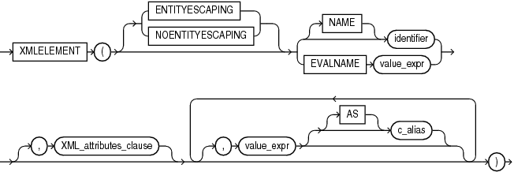
[Description of "Figure 8-1 XMLELEMENT Syntax"](img_text/xmlelement.md)

For an explanation of keywords `ENTITYESCAPING` and `NOENTITYESCAPING`, see Escape of Characters in Generated XML Data. These keywords are Oracle extensions to standard SQL/XML functions `XMLElement` and `XMLAttributes`.

The first argument to function `XMLElement` defines an identifier that names the root XML element to be created. The root-element identifier argument can be defined using a literal identifier (`identifier`, in Figure 8-1) or by `EVALNAME` followed by an expression (`value_expr`) that evaluates to an identifier. However it is defined, the identifier must not be `NULL` or else an error is raised. The possibility of using `EVALNAME` is an Oracle extension to standard SQL/XML function `XMLElement`.

The optional `XML-attributes-clause` argument of function `XMLElement` specifies the attributes of the root element to be generated. Figure 8-2 shows the syntax of this argument.

In addition to the optional `XML-attributes-clause` argument, function `XMLElement` accepts zero or more `value_expr` arguments that make up the content of the root element (child elements and text content). If an `XML-attributes-clause` argument is also present then these content arguments must follow the `XML-attributes-clause` argument. Each of the content-argument expressions is evaluated, and the result is converted to XML format. If a value argument evaluates to `NULL`, then no content is created for that argument.

**Note:**

The `AS` preceding an alias (`c_alias`) is required by the SQL/XML standard, but is optional for Oracle.

The optional `XML-attributes-clause` argument uses SQL/XML standard function `XMLAttributes` to specify the attributes of the root element. Function `XMLAttributes` can be used only in a call to function `XMLElement`. It cannot be used on its own.

Figure 8-2 XMLAttributes Clause Syntax (XMLATTRIBUTES)

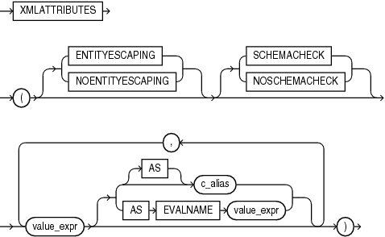
[Description of "Figure 8-2 XMLAttributes Clause Syntax (XMLATTRIBUTES)"](img_text/xml_attributes_clause.md)

For an explanation of keywords `ENTITYESCAPING` and `NOENTITYESCAPING`, see Escape of Characters in Generated XML Data. These keywords are Oracle extensions to standard SQL/XML functions `XMLElement` and `XMLAttributes`.

Keywords `SCHEMACHECK` and `NOSCHEMACHECK` determine whether or not a run-time check is made of the generated attributes, to see if any of them specify a schema location that corresponds to an XML schema that is registered with Oracle XML DB, and, if so, to try to generate XML schema-based XML data accordingly. The default behavior is that provided by `NOSCHEMACHECK`: no check is made. In releases prior to 12c Release 1 (12.1), the default behavior is to perform the check. Keyword `SCHEMACHECK` can be used to obtain backward compatibility.

A similar check is always made at compile time, regardless of the presence or absence of `NOSCHEMACHECK`. This means, in particular, that if you use a string literal to specify an XML schema location attribute value, then a (compile-time) check is made, and, if appropriate, XML schema-based data is generated accordingly.

Keywords `SCHEMACHECK` and `NOSCHEMACHECK` are Oracle extensions to standard SQL/XML function `XMLAttributes`.

**Note:**

If a view is created to generate XML data, function `XMLAttributes` is used to add XML-schema location references, and the target XML schema has not yet been registered with Oracle XML DB, then the XML data that is generated is not XML schema-based. If the XML schema is subsequently registered, then XML data that is generated thereafter is also not XML-schema-based. To create XML schema-based data, you must recompile the view.

Argument `XML-attributes-clause` itself contains one or more `value_expr` expressions as arguments to function `XMLAttributes`. These are evaluated to obtain the values for the attributes of the root element. (Do not confuse these `value_expr` arguments to function `XMLAttributes` with the `value_expr` arguments to function `XMLElement`, which specify the content of the root element.) The optional `AS` `c_alias` clause for each `value_expr` specifies that the attribute name is `c_alias`, which can be either a string literal or `EVALNAME` followed by an expression that evaluates to a string literal.

**Note:**

The following are Oracle extensions to the standard SQL/XML syntax:

- The possibility of using `EVALNAME`.

- The fact that `AS` preceding an alias (`c_alias`) is optional.

If an attribute value expression evaluates to `NULL`, then no corresponding attribute is created. The data type of an attribute value expression cannot be an object type or a collection.

- Escape of Characters in Generated XML Data
  As specified by the SQL/XML standard, characters in explicit identifiers are not escaped in any way – it is up to you to ensure that valid XML names are used. This applies to all SQL/XML functions.
- Formatting of XML Dates and Timestamps
  The XML Schema standard specifies that dates and timestamps in XML data be in standard formats. XML generation functions in Oracle XML DB produce XML dates and timestamps according to this standard.
- XMLElement Examples
  Examples here illustrate the use SQL/XML function `XMLElement`.

**Parent topic:** Generation of XML Data Using SQL Functions

##### 8.2.1.1 Escape of Characters in Generated XML Data

As specified by the SQL/XML standard, characters in explicit identifiers are not escaped in any way – it is up to you to ensure that valid XML names are used. This applies to all SQL/XML functions.

In particular, it applies to the root-element identifier of `XMLElement` (`identifier`, in Figure 8-1) and to attribute identifier aliases named with `AS` clauses of `XMLAttributes` (see Figure 8-2).

However, other XML data that is generated is escaped, by default, to ensure that only valid XML `NameChar` characters are generated. As part of generating a valid XML element or attribute name from a SQL identifier, each character that is disallowed in an XML name is replaced with an underscore character (`_`), followed by the hexadecimal Unicode representation of the original character, followed by a second underscore character. For example, the colon character (`:`) is escaped by replacing it with `_003A_`, where 003A is the hexadecimal Unicode representation.

Escaping applies to characters in the evaluated `value_expr` arguments to all SQL/XML functions, including `XMLElement` and `XMLAttributes`. It applies also to the characters of an attribute identifier that is defined implicitly from an `XMLAttributes` attribute value expression that is not followed by an `AS` clause: the escaped form of the SQL column name is used as the name of the attribute.

In some cases, you might not need or want character escaping. If you know, for example, that the XML data being generated is well-formed, then you can save some processing time by inhibiting escaping. You can do that by specifying the keyword `NOENTITYESCAPING` for SQL/XML functions `XMLElement` and `XMLAttributes`. Keyword `ENTITYESCAPING` imposes escaping, which is the default behavior. Keywords `NOENTITYESCAPING` and `ENTITYESCAPING` are Oracle extensions to standard SQL/XML functions `XMLElement` and `XMLAttributes`.

**Parent topic:** XMLELEMENT and XMLATTRIBUTES SQL/XML Functions

##### 8.2.1.2 Formatting of XML Dates and Timestamps

The XML Schema standard specifies that dates and timestamps in XML data be in standard formats. XML generation functions in Oracle XML DB produce XML dates and timestamps according to this standard.

In releases prior to Oracle Database 10g Release 2, the database settings for date and timestamp formats, not the XML Schema standard formats, were used for XML. You can reproduce this previous behavior by setting the database event 19119, level 0x8, as follows:

    ALTER SESSION SET EVENTS '19119 TRACE NAME CONTEXT FOREVER, LEVEL 0x8';

If you must otherwise produce a non-standard XML date or timestamp, use SQL function `to_char` – see Example 8-1.

**See Also:**

[XML Schema Part 2: Datatypes, D. ISO 8601 Date and Time Formats](https://www.oracle.com/pls/topic/lookup?ctx=en/database/oracle/oracle-database/19/adxdb&id=w3_org_xschema_isoformats) for the XML Schema specification of XML date and timestamp formats

**Parent topic:** XMLELEMENT and XMLATTRIBUTES SQL/XML Functions

##### 8.2.1.3 XMLElement Examples

Examples here illustrate the use SQL/XML function `XMLElement`.

Example 8-1 uses `XMLElement` to generate an XML date with a format that is different from the XML Schema standard date format.

Example 8-2 uses `XMLElement` to generate an `Emp` element for each employee, with the employee name as the content.

Example 8-3 uses `XMLElement` to generate an `Emp` element for each employee, with child elements that provide the employee name and hire date.

Example 8-4 uses `XMLElement` to generate an `Emp` element for each employee, with attributes `id` and `name`.

As mentioned in Escape of Characters in Generated XML Data, characters in the root-element name and the names of any attributes defined by `AS` clauses are not escaped. Characters in an identifier name are escaped only if the name is created from an evaluated expression (such as a column reference).

Example 8-5 shows that, with XML data constructed using `XMLElement`, the root-element name and the attribute name are not escaped. Invalid XML is produced because greater-than sign (`>`) and a comma (`,`) are not allowed in XML element and attribute names.

A full description of character escaping is included in the SQL/XML standard.

Example 8-6 illustrates the use of namespaces to create an XML schema-based document. Assuming that an XML schema "`http://www.oracle.com/Employee.xsd`" exists and has no target namespace, the query in Example 8-6 creates an `XMLType` instance conforming to that schema:

Example 8-7 uses `XMLElement` to generate an XML document with employee and department information, using data from sample database schema table `hr.departments`.

Example 8-1 XMLELEMENT: Formatting a Date

    -- With standard XML date format:
    SELECT XMLElement("Date", hire_date)
      FROM hr.employees
      WHERE employee_id = 203;

    XMLELEMENT("DATE",HIRE_DATE)
    ----------------------------
    <Date>2002-06-07</Date>

    1 row selected.

    -- With an alternative date format:
    SELECT XMLElement("Date", to_char(hire_date))
      FROM hr.employees
      WHERE employee_id = 203;

    XMLELEMENT("DATE",TO_CHAR(HIRE_DATE))
    -------------------------------------
    <Date>07-JUN-02</Date>

    1 row selected.

Example 8-2 XMLELEMENT: Generating an Element for Each Employee

    SELECT e.employee_id,
           XMLELEMENT ("Emp", e.first_name ||' '|| e.last_name) AS "RESULT"
       FROM hr.employees e
       WHERE employee_id > 200;

This query produces the following typical result:

    EMPLOYEE_ID RESULT
    ----------- -----------------------------------
            201 <Emp>Michael Hartstein</Emp>
            202 <Emp>Pat Fay</Emp>
            203 <Emp>Susan Mavris</Emp>
            204 <Emp>Hermann Baer</Emp>
            205 <Emp>Shelley Higgins</Emp>
            206 <Emp>William Gietz</Emp>

    6 rows selected.

SQL/XML function `XMLElement` can also be nested, to produce XML data with a nested structure.

Example 8-3 XMLELEMENT: Generating Nested XML

    SELECT XMLElement("Emp",
                       XMLElement("name", e.first_name ||' '|| e.last_name),
                       XMLElement("hiredate", e.hire_date)) AS "RESULT"
    FROM hr.employees e
    WHERE employee_id > 200;

This query produces the following typical XML result:

    RESULT
    -----------------------------------------------------------------------
    <Emp><name>Michael Hartstein</name><hiredate>2004-02-17</hiredate></Emp>
    <Emp><name>Pat Fay</name><hiredate>2005-08-17</hiredate></Emp>
    <Emp><name>Susan Mavris</name><hiredate>2002-06-07</hiredate></Emp>
    <Emp><name>Hermann Baer</name><hiredate>2002-06-07</hiredate></Emp>
    <Emp><name>Shelley Higgins</name><hiredate>2002-06-07</hiredate></Emp>
    <Emp><name>William Gietz</name><hiredate>2002-06-07</hiredate></Emp>

    6 rows selected.

Example 8-4 XMLELEMENT: Generating Employee Elements with Attributes ID and Name

    SELECT XMLElement("Emp", XMLAttributes(
                               e.employee_id as "ID",
                               e.first_name ||' ' || e.last_name AS "name"))
      AS "RESULT"
      FROM hr.employees e
      WHERE employee_id > 200;

This query produces the following typical XML result fragment:

    RESULT
    -----------------------------------------------
    <Emp ID="201" name="Michael Hartstein"></Emp>
    <Emp ID="202" name="Pat Fay"></Emp>
    <Emp ID="203" name="Susan Mavris"></Emp>
    <Emp ID="204" name="Hermann Baer"></Emp>
    <Emp ID="205" name="Shelley Higgins"></Emp>
    <Emp ID="206" name="William Gietz"></Emp>

    6 rows selected.

Example 8-5 XMLELEMENT: Characters in Generated XML Data Are Not Escaped

    SELECT XMLElement("Emp->Special",
                      XMLAttributes(e.last_name || ', ' || e.first_name
                                    AS "Last,First"))
       AS "RESULT"
       FROM hr.employees e
       WHERE employee_id = 201;

This query produces the following result, which is not well-formed XML:

    RESULT
    --------------------------------------------------------------------
    <Emp->Special Last,First="Hartstein, Michael"></Emp->Special>

    1 row selected.

Example 8-6 Creating a Schema-Based XML Document Using XMLELEMENT with Namespaces

    SELECT XMLElement("Employee",
                      XMLAttributes('http://www.w3.org/2001/XMLSchema' AS
                                      "xmlns:xsi",
                                    'http://www.oracle.com/Employee.xsd' AS
                                      "xsi:nonamespaceSchemaLocation"),
                      XMLForest(employee_id, last_name, salary)) AS "RESULT"
       FROM hr.employees
       WHERE department_id = 10;

This creates the following XML document that conforms to XML schema `Employee.xsd`. (The result is shown here pretty-printed, for clarity.)

    RESULT
    -----------------------------------------------------------------------------
    <Employee xmlns:xsi="http://www.w3.org/2001/XMLSchema"
              xsi:nonamespaceSchemaLocation="http://www.oracle.com/Employee.xsd">
       <EMPLOYEE_ID>200</EMPLOYEE_ID>
       <LAST_NAME>Whalen</LAST_NAME>
       <SALARY>4400</SALARY>
    </Employee>

    1 row selected.

Example 8-7 XMLELEMENT: Generating an Element from a User-Defined Data-Type Instance

    CREATE OR REPLACE TYPE emp_t AS OBJECT ("@EMPNO" NUMBER(4),
                                             ENAME VARCHAR2(10));

    CREATE OR REPLACE TYPE emplist_t AS TABLE OF emp_t;

    CREATE OR REPLACE TYPE dept_t AS OBJECT ("@DEPTNO" NUMBER(2),
                                             DNAME VARCHAR2(14),
                                             EMP_LIST emplist_t);

    SELECT XMLElement("Department",
                      dept_t(department_id,
                             department_name,
                             cast(MULTISET
                                  (SELECT employee_id, last_name
                                     FROM hr.employees e
                                     WHERE e.department_id = d.department_id)
                                  AS emplist_t)))
      AS deptxml
      FROM hr.departments d
      WHERE d.department_id = 10;

This produces an XML document which contains the `Department` element and the canonical mapping of type `dept_t`.

    DEPTXML
    -------------
    <Department>
      <DEPT_T DEPTNO="10">
        <DNAME>ACCOUNTING</DNAME>
        <EMPLIST>
          <EMP_T EMPNO="7782">
            <ENAME>CLARK</ENAME>
          </EMP_T>
          <EMP_T EMPNO="7839">
            <ENAME>KING</ENAME>
          </EMP_T>
          <EMP_T EMPNO="7934">
            <ENAME>MILLER</ENAME>
          </EMP_T>
        </EMPLIST>
      </DEPT_T>
    </Department>

    1 row selected.

**Parent topic:** XMLELEMENT and XMLATTRIBUTES SQL/XML Functions

#### 8.2.2 XMLFOREST SQL/XML Function

You use SQL/XML standard function `XMLForest` to construct a forest of XML elements.

Its arguments are expressions to be evaluated, with optional aliases. Figure 8-3 describes the `XMLForest` syntax.

Figure 8-3 XMLFOREST Syntax

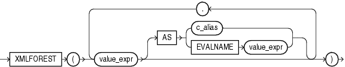
[Description of "Figure 8-3 XMLFOREST Syntax"](img_text/xmlforest.md)

Each of the value expressions (`value_expr` in Figure 8-3) is converted to XML format, and, optionally, identifier `c_alias` is used as the attribute identifier (`c_alias` can be a string literal or `EVALNAME` followed by an expression that evaluates to a string literal). The possibility of using `EVALNAME` is an Oracle extension to standard SQL/XML function `XMLForest`.

For an object type or collection, the `AS` clause is required. For other types, the `AS` clause is optional. For a given expression, if the `AS` clause is omitted, then characters in the evaluated value expression are escaped to form the name of the enclosing tag of the element. The escaping is as defined in Escape of Characters in Generated XML Data. If the value expression evaluates to `NULL`, then no element is created for that expression.

Example 8-8 uses `XMLElement` and `XMLForest` to generate an `Emp` element for each employee, with a `name` attribute and with child elements containing the employee hire date and department as the content.

Example 8-8 XMLFOREST: Generating Elements with Attribute and Child Elements

    SELECT XMLElement("Emp",
                      XMLAttributes(e.first_name ||' '|| e.last_name AS "name"),
                      XMLForest(e.hire_date, e.department AS "department"))
    AS "RESULT"
    FROM employees e WHERE e.department_id = 20;

(The `WHERE` clause is used here to keep the example brief.) This query produces the following XML result:

    RESULT
    -------------------------------------
    <Emp name="Michael Hartstein">
      <HIRE_DATE>2004-02-17</HIRE_DATE>
      <department>20</department>
    </Emp>
    <Emp name="Pat Fay">
      <HIRE_DATE>2005-08-17</HIRE_DATE>
      <department>20</department>
    </Emp>

    2 rows selected.

**See Also:**

Example 8-19

Example 8-9 uses `XMLForest` to generate hierarchical XML data from user-defined data-type instances.

Example 8-9 XMLFOREST: Generating an Element from a User-Defined Data-Type Instance

    SELECT XMLForest(
      dept_t(department_id,
             department_name,
             cast(MULTISET
                  (SELECT employee_id, last_name
                     FROM hr.employees e WHERE e.department_id = d.department_id)
                  AS emplist_t))
             AS "Department")
      AS deptxml
      FROM hr.departments d
      WHERE department_id=10;

This produces an XML document with element `Department` containing attribute `DEPTNO` and child element `DNAME`.

    DEPTXML
    ---------------------------------
    <Department DEPTNO="10">
      <DNAME>Administration</DNAME>
        <EMP_LIST>
          <EMP_T EMPNO="200">
            <ENAME>Whalen</ENAME>
          </EMP_T>
        </EMP_LIST>
    </Department>

    1 row selected.

You might want to compare this example with Example 8-7 and Example 8-24.

**Parent topic:** Generation of XML Data Using SQL Functions

#### 8.2.3 XMLCONCAT SQL/XML Function

You use SQL/XML standard function `XMLConcat` to construct an XML fragment by concatenating multiple `XMLType` instances.

Figure 8-4 shows the `XMLConcat` syntax. Function `XMLConcat` has two forms:

- The first form takes as argument an `XMLSequenceType` value, which is a varray of `XMLType` instances, and returns a single `XMLType` instance that is the concatenation of all of the elements of the varray. This form is useful to collapse lists of `XMLType` instances into a single instance.

- The second form takes an arbitrary number of `XMLType` instances and concatenates them together. If one of the values is `NULL`, then it is ignored in the result. If all the values are `NULL`, then the result is `NULL`. This form is used to concatenate arbitrary number of `XMLType` instances in the same row. Function `XMLAgg` can be used to concatenate `XMLType` instances across rows.

Figure 8-4 XMLCONCAT Syntax

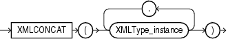
[Description of "Figure 8-4 XMLCONCAT Syntax"](img_text/xmlconcat.md)

Example 8-10 uses SQL/XML function `XMLConcat` to return a concatenation of `XMLType` instances from an `XMLSequenceType` value (a varray of `XMLType` instances).

Example 8-10 XMLCONCAT: Concatenating XMLType Instances from a Sequence

    SELECT XMLSerialize(
             CONTENT
             XMLConcat(XMLSequenceType(
                       XMLType('<PartNo>1236</PartNo>'),
                       XMLType('<PartName>Widget</PartName>'),
                       XMLType('<PartPrice>29.99</PartPrice>')))
             AS CLOB)
      AS "RESULT"
      FROM DUAL;

This query returns a single XML fragment. (The result is shown here pretty-printed, for clarity.)

    RESULT
    ---------------
    <PartNo>1236</PartNo>
    <PartName>Widget</PartName>
    <PartPrice>29.99</PartPrice>

    1 row selected.

Example 8-11 uses `XMLConcat` to create and concatenate XML elements for employee first and the last names.

Example 8-11 XMLCONCAT: Concatenating XML Elements

    SELECT XMLConcat(XMLElement("first", e.first_name),
                     XMLElement("last", e.last_name))
      AS "RESULT"
      FROM employees e;

This query produces the following XML fragment:

    RESULT
    --------------------------------------------
    <first>Den</first><last>Raphaely</last>
    <first>Alexander</first><last>Khoo</last>
    <first>Shelli</first><last>Baida</last>
    <first>Sigal</first><last>Tobias</last>
    <first>Guy</first><last>Himuro</last>
    <first>Karen</first><last>Colmenares</last>

    6 rows selected.

**Parent topic:** Generation of XML Data Using SQL Functions

#### 8.2.4 XMLAGG SQL/XML Function

You use SQL/XML standard function `XMLAgg` to construct a forest of XML elements from a collection of XML elements — it is an aggregate function.

Figure 8-5 describes the `XMLAgg` syntax.

Figure 8-5 XMLAGG Syntax

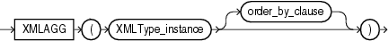
[Description of "Figure 8-5 XMLAGG Syntax"](img_text/xmlagg.md)

The `order_by_clause` is the following:

    ORDER BY [list of: expr [ASC|DESC] [NULLS {FIRST|LAST}]]

Numeric literals are not interpreted as column positions. For example, `ORDER BY 1` does not mean order by the first column. Instead, numeric literals are interpreted as any other literals.

As with SQL/XML function `XMLConcat`, any arguments whose value is `NULL` are dropped from the result. SQL/XML function `XMLAgg` is similar to Oracle SQL function `sys_XMLAgg`, but `XMLAgg` returns a forest of nodes and it does not accept an `XMLFormat` parameter.

SQL/XML function `XMLAgg` can be used to concatenate `XMLType` instances across multiple rows. It also accepts an optional` ORDER BY` clause, to order the XML values being aggregated. Function `XMLAgg` produces one aggregated XML result for each group. If there is no group by specified in the query, then it returns a single aggregated XML result for all the rows of the query.

Example 8-12 uses SQL/XML functions `XMLAgg` and `XMLElement` to construct a `Department` element that contains `Employee` elements that have employee job ID and last name as their contents. It also orders the `Employee` elements in the department by employee last name. (The result is shown pretty-printed, for clarity.)

Example 8-12 XMLAGG: Generating a Department Element with Child Employee Elements

    SELECT XMLElement("Department", XMLAgg(XMLElement("Employee",
                                                      e.job_id||' '||e.last_name)
                                           ORDER BY e.last_name))
      AS "Dept_list"
      FROM hr.employees e
      WHERE e.department_id = 30 OR e.department_id = 40;

    Dept_list
    ------------------
    <Department>
      <Employee>PU_CLERK Baida</Employee>
      <Employee>PU_CLERK Colmenares</Employee>
      <Employee>PU_CLERK Himuro</Employee>
      <Employee>PU_CLERK Khoo</Employee>
      <Employee>HR_REP Mavris</Employee>
      <Employee>PU_MAN Raphaely</Employee>
      <Employee>PU_CLERK Tobias</Employee>
    </Department>

    1 row selected.

The result is a single row, because `XMLAgg` aggregates the employee rows.

Example 8-13 shows how to use the `GROUP` `BY` clause to group the returned set of rows into multiple groups, forming multiple `Department` elements. (The result is shown here pretty-printed, for clarity.)

Example 8-13 XMLAGG: Using GROUP BY to Generate Multiple Department Elements

    SELECT XMLElement("Department", XMLAttributes(department_id AS "deptno"),
                      XMLAgg(XMLElement("Employee", e.job_id||' '||e.last_name)))
       AS "Dept_list"
       FROM hr.employees e
       GROUP BY e.department_id;

    Dept_list
    ------------------
    <Department deptno="30">
      <Employee>PU_MAN Raphaely</Employee>
      <Employee>PU_CLERK Colmenares</Employee>
      <Employee>PU_CLERK Himuro</Employee>
      <Employee>PU_CLERK Tobias</Employee>
      <Employee>PU_CLERK Baida</Employee>
      <Employee>PU_CLERK Khoo</Employee></Department>

    <Department deptno="40">
      <Employee>HR_REP Mavris</Employee>
    </Department>

    2 rows selected.

You can order the employees within each department by using the `ORDER BY` clause inside the `XMLAgg` expression.

**Note:**

Within the `ORDER BY` clause, Oracle Database does not interpret number literals as column positions, as it does in other uses of this clause.

Function `XMLAgg` can be used to reflect the hierarchical nature of some relationships that exist in tables. Example 8-14 generates a department element for department 30. Within this element is a child element `emp` for each employee of the department. Within each employee element is a `dependent` element for each dependent of that employee.

Example 8-14 XMLAGG: Generating Nested Elements

    SELECT last_name, employee_id FROM employees WHERE department_id = 30;

    LAST_NAME                 EMPLOYEE_ID
    ------------------------- -----------
    Raphaely                          114
    Khoo                              115
    Baida                             116
    Tobias                            117
    Himuro                            118
    Colmenares                        119

    6 rows selected.

A `dependents` table holds the dependents of each employee.

    CREATE TABLE hr.dependents (id NUMBER(4) PRIMARY KEY,
                                employee_id NUMBER(4),
                                name VARCHAR2(10));
    Table created.
    INSERT INTO dependents VALUES (1, 114, 'MARK');
    1 row created.
    INSERT INTO dependents VALUES (2, 114, 'JACK');
    1 row created.
    INSERT INTO dependents VALUES (3, 115, 'JANE');
    1 row created.
    INSERT INTO dependents VALUES (4, 116, 'HELEN');
    1 row created.
    INSERT INTO dependents VALUES (5, 116, 'FRANK');
    1 row created.
    COMMIT;
    Commit complete.

The following query generates the XML data for a department that contains the information about dependents. (The result is shown here pretty-printed, for clarity.)

    SELECT
      XMLElement(
        "Department",
        XMLAttributes(d.department_name AS "name"),
        (SELECT
           XMLAgg(XMLElement("emp",
                             XMLAttributes(e.last_name AS name),
                             (SELECT XMLAgg(XMLElement("dependent",
                                            XMLAttributes(de.name AS "name")))
                                FROM dependents de
                                WHERE de.employee_id = e.employee_id)))
           FROM employees e
           WHERE e.department_id = d.department_id)) AS "dept_list"
      FROM departments d
      WHERE department_id = 30;

    dept_list
    --------------------------------------------------------------------------------
    <Department name="Purchasing">
      <emp NAME="Raphaely">
        <dependent name="MARK"></dependent>
        <dependent name="JACK"></dependent>
      </emp><emp NAME="Khoo">
        <dependent name="JANE"></dependent>
      </emp>
      <emp NAME="Baida">
        <dependent name="HELEN"></dependent>
        <dependent name="FRANK"></dependent>
      </emp><emp NAME="Tobias"></emp>
      <emp NAME="Himuro"></emp>
      <emp NAME="Colmenares"></emp>
    </Department>

    1 row selected.

**Parent topic:** Generation of XML Data Using SQL Functions

#### 8.2.5 XMLPI SQL/XML Function

You use SQL/XML standard function `XMLPI` to construct an XML processing instruction (PI).

Figure 8-6 shows the syntax:

Figure 8-6 XMLPI Syntax

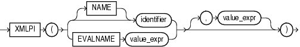
[Description of "Figure 8-6 XMLPI Syntax"](img_text/xmlpi.md)

Argument `value_expr` is evaluated, and the string result is appended to the optional identifier (`identifier`), separated by a space. This concatenation is then enclosed between `"<?"` and `"?>`" to create the processing instruction. That is, if `string-result` is the result of evaluating `value_expr`, then the generated processing instruction is `<?``identifier`` string-result?>`. If `string-result` is the empty string, `''`, then the function returns `<?``identifier``?>`.

As an alternative to using keyword `NAME` followed by a literal string `identifier`, you can use keyword `EVALNAME` followed by an expression that evaluates to a string to be used as the identifier. The possibility of using `EVALNAME` is an Oracle extension to standard SQL/XML function `XMLPI`.

An error is raised if the constructed XML is not a legal XML processing instruction. In particular:

- `identifier` must not be the word "`xml`" (uppercase, lowercase, or mixed case).

- `string-result` must not contain the character sequence "`?>`".

Function `XMLPI` returns an instance of `XMLType`. If `string-result` is `NULL`, then it returns `NULL`.

Example 8-15 uses `XMLPI` to generate a simple processing instruction.

Example 8-15 Using SQL/XML Function XMLPI

    SELECT XMLPI(NAME "OrderAnalysisComp", 'imported, reconfigured, disassembled')
      AS pi FROM DUAL;

This results in the following output:

    PI
    ----------------------------------------------------------
    <?OrderAnalysisComp imported, reconfigured, disassembled?>

    1 row selected.

**Parent topic:** Generation of XML Data Using SQL Functions

#### 8.2.6 XMLCOMMENT SQL/XML Function

You use SQL/XML standard function `XMLComment` to construct an XML comment.

Figure 8-7 shows the syntax:

Figure 8-7 XMLComment Syntax

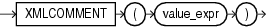
[Description of "Figure 8-7 XMLComment Syntax"](img_text/xmlcomment.md)

Argument `value_expr` is evaluated to a string, and the result is used as the body of the generated XML comment. The result is thus `<!--``string-result``-->`, where `string-result` is the string result of evaluating `value_expr`. If` string-result` is the empty string, then the comment is empty: `<!---->`.

An error is raised if the constructed XML is not a legal XML comment. In particular,` string-result` must not contain two consecutive hyphens (`-`): "`--`".

Function `XMLComment` returns an instance of `XMLType`. If `string-result` is `NULL`, then the function returns `NULL`.

Example 8-16 uses `XMLComment` to generate a simple XML comment.

Example 8-16 Using SQL/XML Function XMLCOMMENT

    SELECT XMLComment('This is a comment') AS cmnt FROM DUAL;

This query results in the following output:

    CMNT
    --------------------------
    <!--This is a comment-->

**Parent topic:** Generation of XML Data Using SQL Functions

#### 8.2.7 XMLSERIALIZE SQL/XML Function

You use SQL/XML standard function `XMLSerialize` to obtain a string or LOB representation of XML data.

Figure 8-8 shows the syntax of `XMLSerialize`:

Figure 8-8 XMLSerialize Syntax

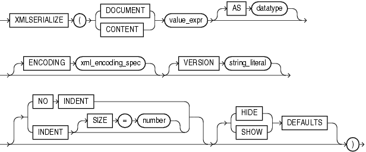
[Description of "Figure 8-8 XMLSerialize Syntax"](img_text/xmlserialize.md)

Argument `value_expr` is evaluated, and the resulting `XMLType` instance is serialized to produce the content of the created string or LOB. If presentFoot 1, the specified `datatype` must be one of the following (the default data type is `CLOB`):

- `VARCHAR2(``N``)`, where `N` is the size in bytesFoot 2

- `CLOB`

- `BLOB`

If you specify `DOCUMENT`, then the result of evaluating `value_expr` must be a well-formed document. In particular, it must have a single root. If the result is not a well-formed document, then an error is raised. If you specify `CONTENT`, however, then the result of `value_expr` is not checked for being well-formed.

If `value_expr` evaluates to `NULL` or to the empty string (`''`), then function `XMLSerialize` returns `NULL`.

The `ENCODING` clause specifies the character encoding for XML data that is serialized as a `BLOB` instance. `xml_encoding_spec` is an XML encoding declaration (`encoding="..."`). If `datatype` is `BLOB` and you specify an `ENCODING` clause, then the output is encoded as specified, and `xml_encoding_spec` is added to the prolog to indicate the `BLOB` encoding. If you specify an `ENCODING` clause with a `datatype` other than `BLOB`, then an error is raised. For UTF-16 characters, `xml_encoding_spec` must be one of the following:

- `encoding=UTF-16BE` – Big-endian UTF-16 encoding

- `encoding=UTF-16LE` – Little-endian UTF-16 encoding

If you specify `VERSION` then the specified version is used in the XML declaration (`<?xml version="..." ...?>`).

If you specify `NO INDENT`, then all insignificant whitespace is stripped, so that it does not appear in the output. If you specify `INDENT SIZE = ``N`, where `N` is a whole number, then the output is pretty-printed using a relative indentation of `N` spaces. If `N` is `0`, then pretty-printing inserts a newline character after each element, placing each element on a line by itself, but there is no other insignificant whitespace in the output. If you specify `INDENT` without a `SIZE` specification, then 2-space indenting is used. If you specify neither `NO INDENT` nor `INDENT`, then the behavior (pretty-printing or not) is indeterminate.

`HIDE DEFAULTS` and `SHOW DEFAULTS` apply only to XML schema-based data. If you specify `SHOW DEFAULTS` and the input data is missing any optional elements or attributes for which the XML schema defines default values, then those elements or attributes are included in the output with their default values. If you specify `HIDE DEFAULTS`, then no such elements or attributes are included in the output. `HIDE DEFAULTS` is the default behavior.

Example 8-17 uses `XMLSerialize` to produce a `CLOB` instance containing serialized XML data.

Example 8-17 Using SQL/XML Function XMLSERIALIZE

    SELECT XMLSerialize(DOCUMENT XMLType('<poid>143598</poid>') AS CLOB)
      AS xmlserialize_doc FROM DUAL;

This results in the following output:

    XMLSERIALIZE_DOC
    -------------------
    <poid>143598</poid>

**Parent topic:** Generation of XML Data Using SQL Functions

#### 8.2.8 XMLPARSE SQL/XML Function

You use SQL/XML standard function `XMLParse` to parse a string containing XML data and construct a corresponding `XMLType` instance.

Figure 8-9 shows the syntax:

Figure 8-9 XMLParse Syntax

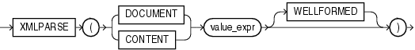
[Description of "Figure 8-9 XMLParse Syntax"](img_text/xmlparse.md)

Argument `value_expr` is evaluated to produce the string that is parsed. If you specify `DOCUMENT`, then `value_expr` must correspond to a singly rooted, well-formed XML document. If you specify `CONTENT`, then `value_expr` need only correspond to a well-formed XML fragment (it need not be singly rooted).

Keyword `WELLFORMED` is an Oracle XML DB extension to the SQL/XML standard. When you specify `WELLFORMED`, you are informing the parser that argument `value_expr` is well-formed, so Oracle XML DB does not check to ensure that it is well-formed.

Function `XMLParse` returns an instance of `XMLType`. If `value_expr` evaluates to `NULL`, then the function returns `NULL`.

Example 8-18 uses `XMLParse` to parse a string of XML code and produce an `XMLType` instance.

Example 8-18 Using SQL/XML Function XMLPARSE

    SELECT XMLParse(CONTENT
                    '124 <purchaseOrder poNo="12435">
                           <customerName> Acme Enterprises</customerName>
                           <itemNo>32987457</itemNo>
                         </purchaseOrder>'
                    WELLFORMED)
      AS po FROM DUAL d;

This results in the following output:

    PO
    -----------------------------------------------
    124 <purchaseOrder poNo="12435">
    <customerName>Acme Enterprises</customerName>
    <itemNo>32987457</itemNo>
    </purchaseOrder>

**See Also:**

[Extensible Markup Language (XML) 1.0](https://www.oracle.com/pls/topic/lookup?ctx=en/database/oracle/oracle-database/19/adxdb&id=w3_org_tr_rec_xml) for the definition of well-formed XML documents and fragments

**Parent topic:** Generation of XML Data Using SQL Functions

#### 8.2.9 XMLCOLATTVAL Oracle SQL Function

Oracle SQL function `XMLColAttVal` generates a forest of XML `column` elements containing the values of the arguments passed in. This function is an Oracle extension to the SQL/XML ANSI-ISO standard functions.

Figure 8-10 shows the `XMLColAttVal` syntax.

Figure 8-10 XMLCOLATTVAL Syntax

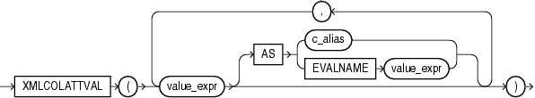
[Description of "Figure 8-10 XMLCOLATTVAL Syntax"](img_text/xmlcolattval.md)

The arguments are used as the values of the `name` attribute of the `column` element. The `c_alias` values are used as the attribute identifiers.

As an alternative to using keyword `AS` followed by a literal string `c_alias`, you can use `AS EVALNAME` followed by an expression that evaluates to a string to be used as the attribute identifier.

Because argument values `value_expr` are used only as attribute values, they need not be escaped in any way. This is in contrast to function `XMLForest`. It means that you can use `XMLColAttVal` to transport SQL columns and values without escaping.

Example 8-19 uses `XMLColAttVal` to generate an `Emp` element for each employee, with a `name` attribute, and with `column` elements that have the employee hire date and department as the content.

Example 8-19 XMLCOLATTVAL: Generating Elements with Attribute and Child Elements

    SELECT XMLElement("Emp",
                      XMLAttributes(e.first_name ||' '||e.last_name AS "fullname" ),
                      XMLColAttVal(e.hire_date, e.department_id AS "department"))
      AS "RESULT"
      FROM hr.employees e
      WHERE e.department_id = 30;

This query produces the following XML result. (The result is shown here pretty-printed, for clarity.)

    RESULT
    -----------------------------------------------------------
    <Emp fullname="Den Raphaely">
      <column name = "HIRE_DATE">2002-12-07</column>
      <column name = "department">30</column>
    </Emp>
    <Emp fullname="Alexander Khoo">
      <column name = "HIRE_DATE">2003-05-18</column>
      <column name = "department">30</column>
    </Emp>
    <Emp fullname="Shelli Baida">
      <column name = "HIRE_DATE">2005-12-24</column>
      <column name = "department">30</column>
    </Emp>
    <Emp fullname="Sigal Tobias">
      <column name = "HIRE_DATE">2005-07-24</column>
      <column name = "department">30</column>
    </Emp>
    <Emp fullname="Guy Himuro">
      <column name = "HIRE_DATE">2006-11-15</column>
      <column name = "department">30</column>
    </Emp>
    <Emp fullname="Karen Colmenares">
      <column name = "HIRE_DATE">2007-08-10</column>
      <column name = "department">30</column>
    </Emp>

    6 rows selected.

**See Also:**

Example 8-8

**Parent topic:** Generation of XML Data Using SQL Functions

#### 8.2.10 XMLCDATA Oracle SQL Function

You use Oracle SQL function `XMLCDATA` to generate an XML `CDATA` section.

Figure 8-11 shows the syntax:

Figure 8-11 XMLCDATA Syntax

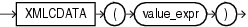
[Description of "Figure 8-11 XMLCDATA Syntax"](img_text/xmlcdata.md)

Argument `value_expr` is evaluated to a string, and the result is used as the body of the generated XML `CDATA` section, `<![CDATA[``string-result``]]>`, where `string-result` is the result of evaluating `value_expr`. If` string-result` is the empty string, then the `CDATA` section is empty: `<![CDATA[]]>`.

An error is raised if the constructed XML is not a legal XML `CDATA` section. In particular, `string-result` must not contain two consecutive right brackets (`]`): "`]]`".

Function `XMLCDATA` returns an instance of `XMLType`. If `string-result` is `NULL`, then the function returns `NULL`.

Example 8-20 uses `XMLCDATA` to generate an XML `CDATA` section.

Example 8-20 Using Oracle SQL Function XMLCDATA

    SELECT XMLElement("PurchaseOrder",
                      XMLElement("Address",
                                 XMLCDATA('100 Pennsylvania Ave.'),
                                 XMLElement("City", 'Washington, D.C.')))
      AS RESULT FROM DUAL;

This results in the following output. (The result is shown here pretty-printed, for clarity.)

    RESULT
    --------------------------
    <PurchaseOrder>
      <Address>
        <![CDATA[100 Pennsylvania Ave.]]>
        <City>Washington, D.C.</City>
      </Address>
    </PurchaseOrder>

**Parent topic:** Generation of XML Data Using SQL Functions

### 8.3 Generation of XML Data Using DBMS_XMLGEN

PL/SQL package `DBMS_XMLGEN` creates XML documents from SQL query results. It retrieves an XML document as a `CLOB` or `XMLType` value.

It provides a fetch interface, whereby you can specify the maximum number of rows to retrieve and the number of rows to skip. For example, the first fetch could retrieve a maximum of ten rows, skipping the first four. This is especially useful for pagination requirements in Web applications.

Package `DBMS_XMLGEN` also provides options for changing tag names for `ROW`, `ROWSET`, and so on. The parameters of the package can restrict the number of rows retrieved and the enclosing tag names.

- Using PL/SQL Package DBMS_XMLGEN
  You can use package `DBMS_XMLGEN` to generate XML data from relational data.
- Functions and Procedures of Package DBMS_XMLGEN
  PL/SQL package `DBMS_XMLGEN` provides functions and procedures for generating XML data from relational data.
- DBMS_XMLGEN Examples
  Examples here illustrate the use of PL/SQL package `DBMS_XMLGEN`.

**See Also:**

- [Oracle Database PL/SQL Packages and Types Reference](../arpls/DBMS_XMLGEN.md)

- [Oracle XML Developer's Kit Programmer's Guide](../adxdk/using-XML-SQL-utility.md) (compare `OracleXMLQuery` with `DBMS_XMLGEN`)

**Parent topic:** Generation of XML Data from Relational Data

#### 8.3.1 Using PL/SQL Package DBMS_XMLGEN

You can use package `DBMS_XMLGEN` to generate XML data from relational data.

Figure 8-12 illustrates how to use package `DBMS_XMLGEN`. The steps are as follows:

1.  Get the context from the package by supplying a SQL query and calling PL/SQL function `newContext`.
2.  Pass the context to all procedures or functions in the package to set the various options. For example, to set the `ROW` element name, use `setRowTag(ctx)`, where `ctx` is the context got from the previous `newContext` call.
3.  Get the XML result, using PL/SQL function `getXML` or `getXMLType`. By setting the maximum number of rows to be retrieved for each fetch using PL/SQL procedure `setMaxRows`, you can call either of these functions repeatedly, retrieving up to the maximum number of rows for each call. These functions return XML data (as a `CLOB` value and as an instance of `XMLType`, respectively), unless there are no rows retrieved. In that case, these functions return `NULL`. To determine how many rows were retrieved, use PL/SQL function `getNumRowsProcessed`.
4.  You can reset the query to start again and repeat step 3.
5.  Call PL/SQL procedure `closeContext` to free up any previously allocated resources.

Figure 8-12 Using PL/SQL Package DBMS_XMLGEN

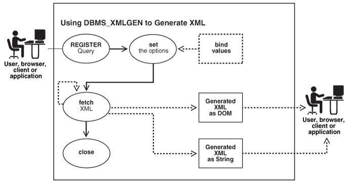
[Description of "Figure 8-12 Using PL/SQL Package DBMS_XMLGEN"](img_text/adxdb054.md)

In conjunction with a SQL query, PL/SQL method `DBMS_XMLGEN.getXML()` typically returns a result similar to the following, as a `CLOB` value:

    <?xml version="1.0"?>
    <ROWSET>
     <ROW>
      <EMPLOYEE_ID>100</EMPLOYEE_ID>
      <FIRST_NAME>Steven</FIRST_NAME>
      <LAST_NAME>King</LAST_NAME>
      <EMAIL>SKING</EMAIL>
      <PHONE_NUMBER>515.123.4567</PHONE_NUMBER>
      <HIRE_DATE>17-JUN-87</HIRE_DATE>
      <JOB_ID>AD_PRES</JOB_ID>
      <SALARY>24000</SALARY>
      <DEPARTMENT_ID>90</DEPARTMENT_ID>
     </ROW>
     <ROW>
      <EMPLOYEE_ID>101</EMPLOYEE_ID>
      <FIRST_NAME>Neena</FIRST_NAME>
      <LAST_NAME>Kochhar</LAST_NAME>
      <EMAIL>NKOCHHAR</EMAIL>
      <PHONE_NUMBER>515.123.4568</PHONE_NUMBER>
      <HIRE_DATE>21-SEP-89</HIRE_DATE>
      <JOB_ID>AD_VP</JOB_ID>
      <SALARY>17000</SALARY>
      <MANAGER_ID>100</MANAGER_ID>
      <DEPARTMENT_ID>90</DEPARTMENT_ID>
     </ROW>
    </ROWSET>

The default mapping between relational data and XML data is as follows:

- Each row returned by the SQL query maps to an XML element with the default element name `ROW`.

- Each column returned by the SQL query maps to a child element of the `ROW` element.

- The entire result is wrapped in a `ROWSET` element.

- Binary data is transformed to its hexadecimal representation.

Element names `ROW` and `ROWSET` can be replaced with names you choose, using `DBMS_XMLGEN` procedures `setRowTagName` and `setRowSetTagName`, respectively.

The `CLOB` value returned by `getXML` has the same encoding as the database character set. If the database character set is SHIFTJIS, then the XML document returned is also SHIFTJIS.

**Parent topic:** Generation of XML Data Using DBMS_XMLGEN

#### 8.3.2 Functions and Procedures of Package DBMS_XMLGEN

PL/SQL package `DBMS_XMLGEN` provides functions and procedures for generating XML data from relational data.

Table 8-1 describes the functions and procedures of package `DBMS_XMLGEN`.

Table 8-1 DBMS_XMLGEN Functions and Procedures

| Function or Procedure                                                                                                               | Description                                                                                                                                                                                                                                                                                                                                                                                                                                                                                                                                                                                                                                                                                                                                                                                                                                                                                      |
|:------------------------------------------------------------------------------------------------------------------------------------|:-------------------------------------------------------------------------------------------------------------------------------------------------------------------------------------------------------------------------------------------------------------------------------------------------------------------------------------------------------------------------------------------------------------------------------------------------------------------------------------------------------------------------------------------------------------------------------------------------------------------------------------------------------------------------------------------------------------------------------------------------------------------------------------------------------------------------------------------------------------------------------------------------|
| `SUBTYPE ctxHandle IS NUMBER`                                                                                                       | The context handle used by all functions. Document Type Definition (DTD) or schema specifications: `NONE CONSTANT NUMBER:= 0;` `DTD CONSTANT NUMBER:= 1;` `SCHEMA CONSTANT NUMBER:= 2;` Can be used in function `getXML` to specify whether to generate a DTD or XML schema or neither (`NONE`). Only the `NONE` specification is supported.                                                                                                                                                                                                                                                                                                                                                                                                                                                                                                                                      |
| `newContext()`                                                                                                                      | Given a query string, generate a new context handle to be used in subsequent functions.                                                                                                                                                                                                                                                                                                                                                                                                                                                                                                                                                                                                                                                                                                                                                                                                          |
| `newContext(` `  queryString IN VARCHAR2)`                                                                                       | Returns a new context Parameter: `queryString` `(IN)`- the query string, the result of which must be converted to XML Returns: Context handle. Call this function first to obtain a handle that you can use in the `getXML` and other functions to get the XML back from the result.                                                                                                                                                                                                                                                                                                                                                                                                                                                                                                                                                                                                       |
| `newContext(` `  queryString IN SYS_REFCURSOR)` `  RETURN ctxHandle;`                                                         | Creates a new context handle from a PL/SQL cursor variable. The context handle can be used for the rest of the functions.                                                                                                                                                                                                                                                                                                                                                                                                                                                                                                                                                                                                                                                                                                                                                                        |
| `newContextFromHierarchy(` `  queryString IN VARCHAR2)` `  RETURN ctxHandle;`                                                 | Parameter: `queryString (IN)` - the query string, the result of which must be converted to XML. The query is a hierarchical query typically formed using a `CONNECT BY` clause, and the result must have the same property as the result set generated by a `CONNECT BY` query. The result set must have only two columns, the level number and an XML value. The level number is used to determine the hierarchical position of the XML value within the result XML document. Returns: Context handle. Call this function first to obtain a handle that you can use in the `getXML` and other functions to get a hierarchical XML with recursive elements back from the result.                                                                                                                                                                                                              |
| `setRowTag()`                                                                                                                       | Sets the name of the element separating all the rows. The default name is `ROW`.                                                                                                                                                                                                                                                                                                                                                                                                                                                                                                                                                                                                                                                                                                                                                                                                                 |
| `setRowTag(ctx IN ctxHandle,` `          rowTag IN VARCHAR2);`                                                                   | Parameters: `ctx(IN)` - the context handle obtained from the `newContext` call. `rowTag(IN)` - the name of the `ROW` element. A `NULL` value for `rowTag` indicates that you do not want the `ROW` element to be present. Call this procedure to set the name of the `ROW` element, if you do not want the default `ROW` name to show up. You can also set `rowTag` to `NULL` to suppress the `ROW` element itself. However, since function `getXML` returns complete XML documents, not XML fragments, there must be a (single) root element. Therefore, an error is raised if both the `rowTag` value and the `rowSetTag` value (see `setRowSetTag`, next) are `NULL` and there is more than one column or row in the output.                                                                                                                                                      |
| `setRowSetTag()`                                                                                                                    | Sets the name of the document root element. The default name is `ROWSET`                                                                                                                                                                                                                                                                                                                                                                                                                                                                                                                                                                                                                                                                                                                                                                                                                         |
| `setRowSetTag(ctx IN ctxHandle, ` `             rowSetTag IN VARCHAR2);`                                                         | Parameters: `ctx(IN)` – the context handle obtained from the `newContext` call. `rowSetTag(IN)` – the name of the document root element to be used in the output. A `NULL` value for `rowSetTag` indicates that you do not want the `ROWSET` element to be present. Call this procedure to set the name of the document root element, if you do not want the default name `ROWSET` to be used. You can set `rowSetTag` to `NULL` to suppress printing of the document root element. However, since function `getXML` returns complete XML documents, not XML fragments, there must be a (single) root element. Therefore, an error is raised if both the `rowTag` value and the `rowSetTag` value (see `setRowTag`, previous) are `NULL` and there is more than one column or row in the output, or if the `rowSetTag` value is `NULL` and there is more than one row in the output. |
| `getXML()`                                                                                                                          | Gets the XML document by fetching the maximum number of rows specified. It appends the XML document to the `CLOB` passed in.                                                                                                                                                                                                                                                                                                                                                                                                                                                                                                                                                                                                                                                                                                                                                                     |
| `getXML(ctx IN ctxHandle, ` `       clobval IN OUT NCOPY clob, ` `       dtdOrSchema IN number:= NONE);`                      | Parameters: `ctx(IN)` - The context handle obtained from calling `newContext`. `clobval(IN/OUT)` - the `CLOB` to which the XML document is to be appended, `dtdOrSchema(IN)` - whether you should generate the DTD or Schema. This parameter is NOT supported. Use this version of function `getXML`, to avoid any extra `CLOB` copies and if you want to reuse the same `CLOB` for subsequent calls. This `getXML` call is more efficient than the next flavor, though this involves that you create the LOB locator. When generating the XML, the number of rows indicated by the `setSkipRows` call are skipped, then the maximum number of rows as specified by the `setMaxRows` call (or the entire result if not specified) is fetched and converted to XML. Use the `getNumRowsProcessed` function to check if any rows were retrieved or not.                                |
| `getXML()`                                                                                                                          | Generates the XML document and returns it as a `CLOB`.                                                                                                                                                                                                                                                                                                                                                                                                                                                                                                                                                                                                                                                                                                                                                                                                                                           |
| `getXML(ctx IN ctxHandle, ` `       dtdOrSchema IN number:= NONE) ` `  RETURN clob;`                                          | Parameters: `ctx(IN)` - The context handle obtained from calling `newContext`. `dtdOrSchema(IN)` - whether to generate a DTD or XML schema. This parameter is not supported. Returns: A temporary `CLOB` containing the document. Free the temporary `CLOB` obtained from this function using the `DBMS_LOB.freeTemporary` call.                                                                                                                                                                                                                                                                                                                                                                                                                                                                                                                                                        |
| `getXMLType(` `  ctx IN ctxHandle, ` `  dtdOrSchema IN number:= NONE)` `  RETURN XMLType;`                                 | Parameters: `ctx(IN)` - The context handle obtained from calling `newContext`. `dtdOrSchema(IN)` - whether to generate a DTD or XML schema. This parameter is not supported. Returns: An `XMLType` instance containing the document.                                                                                                                                                                                                                                                                                                                                                                                                                                                                                                                                                                                                                                                    |
| `getXML(` `  sqlQuery IN VARCHAR2, ` `  dtdOrSchema IN NUMBER := NONE)` `  RETURN CLOB;`                                   | Converts the query results from the SQL query string `sqlQuery` to XML format. Returns: A `CLOB` instance.                                                                                                                                                                                                                                                                                                                                                                                                                                                                                                                                                                                                                                                                                                                                                                                    |
| `getXMLType(` `  sqlQuery IN VARCHAR2, ` `  dtdOrSchema IN NUMBER := NONE)   ` `  RETURN XMLType;`                         | Converts the query results from the SQL query string `sqlQuery` to XML format. Returns: An `XMLType` instance.                                                                                                                                                                                                                                                                                                                                                                                                                                                                                                                                                                                                                                                                                                                                                                                |
| `getNumRowsProcessed()`                                                                                                             | Gets the number of SQL rows processed when generating XML data using function `getXML`. This count does not include the number of rows skipped before generating XML data.                                                                                                                                                                                                                                                                                                                                                                                                                                                                                                                                                                                                                                                                                                                       |
| `getNumRowsProcessed(ctx IN ctxHandle) ` `  RETURN number;`                                                                      | Parameter: `queryString(IN)`- the query string, the result of which must be converted to XML Returns: The number of SQL rows that were processed in the last call to `getXML`. You can call this to find out if the end of the result set has been reached. This does not include the number of rows skipped before generating XML data. Use this function to determine the terminating condition if you are calling `getXML` in a loop. `getXML` always generates an XML document even if there are no rows present.                                                                                                                                                                                                                                                                                                                                                                      |
| `setMaxRows()`                                                                                                                      | Sets the maximum number of rows to fetch from the SQL query result for every invocation of the `getXML` call. It is an error to call this function on a context handle created by function `newContextFromHierarchy`.                                                                                                                                                                                                                                                                                                                                                                                                                                                                                                                                                                                                                                                                            |
| `setMaxRows(ctx IN ctxHandle, ` `           maxRows IN NUMBER);`                                                                 | Parameters: `ctx(IN)` - the context handle corresponding to the query executed, `maxRows(IN)` - the maximum number of rows to get for each call to `getXML`. The `maxRows` parameter can be used when generating paginated results using this utility. For instance when generating a page of XML or HTML data, you can restrict the number of rows converted to XML and then in subsequent calls, you can get the next set of rows and so on. This also can provide for faster response times. It is an error to call this procedure on a context handle created by function `newContextFromHierarchy`.                                                                                                                                                                                                                                                                                |
| `setSkipRows()`                                                                                                                     | Skips a given number of rows before generating the XML output for every call to `getXML`. It is an error to call this function on a context handle created by function `newContextFromHierarchy`.                                                                                                                                                                                                                                                                                                                                                                                                                                                                                                                                                                                                                                                                                                |
| `setSkipRows(ctx IN ctxHandle, ` `            skipRows IN NUMBER);`                                                              | Parameters: `ctx(IN)` - the context handle corresponding to the query executed, `skipRows(IN)` - the number of rows to skip for each call to `getXML`. The `skipRows` parameter can be used when generating paginated results for stateless Web pages using this utility. For instance when generating the first page of XML or HTML data, you can set `skipRows` to zero. For the next set, you can set the `skipRows` to the number of rows that you got in the first case. It is an error to call this function on a context handle created by function `newContextFromHierarchy`.                                                                                                                                                                                                                                                                                                   |
| `setConvertSpecialChars()`                                                                                                          | Determines whether or not special characters in the XML data must be converted into their escaped XML equivalent. For example, the `<` sign is converted to `&lt;`. The default behavior is to perform escape conversions.                                                                                                                                                                                                                                                                                                                                                                                                                                                                                                                                                                                                                                                                       |
| `setConvertSpecialChars(` `  ctx IN ctxHandle, ` `  conv IN BOOLEAN);`                                                        | Parameters: `ctx(IN)` - the context handle to use, `conv(IN)` - true indicates that conversion is needed. You can use this function to speed up the XML processing whenever you are sure that the input data cannot contain any special characters such as `<`, `>`, `"`, `'`, and so on, which must be preceded by an escape character. It is expensive to scan the character data to replace the special characters, particularly if it involves a lot of data. So, in cases when the data is XML-safe, this function can be called to improve performance.                                                                                                                                                                                                                                                                                                                           |
| `useItemTagsForColl()`                                                                                                              | Sets the name of the collection elements. The default name for collection elements is the type name itself. You can override that to use the name of the column with the `_ITEM` tag appended to it using this function.                                                                                                                                                                                                                                                                                                                                                                                                                                                                                                                                                                                                                                                                         |
| `useItemTagsForColl(ctx IN ctxHandle);`                                                                                             | Parameter: `ctx(IN)` - the context handle. If you have a collection of `NUMBER`, say, the default tag name for the collection elements is `NUMBER`. You can override this action and generate the collection column name with the `_ITEM` tag appended to it, by calling this procedure.                                                                                                                                                                                                                                                                                                                                                                                                                                                                                                                                                                                                      |
| `restartQuery()`                                                                                                                    | Restarts the query and generate the XML from the first row again.                                                                                                                                                                                                                                                                                                                                                                                                                                                                                                                                                                                                                                                                                                                                                                                                                                |
| `restartQuery(ctx IN ctxHandle);`                                                                                                   | Parameter: `ctx(IN)` - the context handle corresponding to the current query. You can call this to start executing the query again, without having to create a new context.                                                                                                                                                                                                                                                                                                                                                                                                                                                                                                                                                                                                                                                                                                                      |
| `closeContext()`                                                                                                                    | Closes a given context and releases all resources associated with that context, including the SQL cursor and bind and define buffers, and so on.                                                                                                                                                                                                                                                                                                                                                                                                                                                                                                                                                                                                                                                                                                                                                 |
| `closeContext(ctx IN ctxHandle);`                                                                                                   | Parameter: `ctx(IN)` - the context handle to close. Closes all resources associated with this handle. After this you cannot use the handle for any other `DBMS_XMLGEN` function call.                                                                                                                                                                                                                                                                                                                                                                                                                                                                                                                                                                                                                                                                                                            |
| Conversion Functions `convert(` `  xmlData IN varchar2, ` `  flag IN NUMBER := ENTITY_ENCODE)    ` `  RETURN VARCHAR2;` | Encodes or decodes the XML data string argument. • Encoding refers to replacing entity references such as `<` to their escaped equivalent, such as `&lt;`. • Decoding refers to the reverse conversion.                                                                                                                                                                                                                                                                                                                                                                                                                                                                                                                                                                                                                                                                                    |
| `convert(` `  xmlData IN CLOB, ` `  flag IN NUMBER := ENTITY_ENCODE) ` `  RETURN CLOB;`                                    | Encodes or decodes the passed in XML `CLOB` data. • Encoding refers to replacing entity references such as `<` to their escaped equivalent, such as `&lt;`. • Decoding refers to the reverse conversion.                                                                                                                                                                                                                                                                                                                                                                                                                                                                                                                                                                                                                                                                                   |
| NULL Handling `setNullHandling(ctx IN ctxHandle, ` `                flag IN NUMBER);`                                         | The `setNullHandling` flag values are: • `DROP_NULLS CONSTANT NUMBER := 0;` • This is the default setting and leaves out the tag for `NULL` elements. • `NULL_ATTR CONSTANT NUMBER := 1;` • This sets `xsi:nil = "true"`. • `EMPTY_TAG CONSTANT NUMBER := 2;` • This sets, for example, `<foo/>`.                                                                                                                                                                                                                                                                                                                                                                                                                                                                                                                                                                              |
| `useNullAttributeIndicator(` `  ctx IN ctxHandle, ` `  attrind IN BOOLEAN := TRUE);`                                          | `useNullAttributeIndicator` is a shortcut for `setNullHandling(ctx, NULL_ATTR)`.                                                                                                                                                                                                                                                                                                                                                                                                                                                                                                                                                                                                                                                                                                                                                                                                                 |
| `setBindValue(` `  ctx IN ctxHandle, ` `  bindVariableName IN VARCHAR2, ` `  bindValue IN VARCHAR2);`                      | Sets bind value for the bind variable appearing in the query string associated with the context handle. The query string with bind variables cannot be executed until all of the bind variables are set values using `setBindValue`.                                                                                                                                                                                                                                                                                                                                                                                                                                                                                                                                                                                                                                                             |
| `clearBindValue(ctx IN ctxHandle);`                                                                                                 | Clears all the bind values for all the bind variables appearing in the query string associated with the context handle. Afterward, all of the bind variables must rebind new values using `setBindValue`.                                                                                                                                                                                                                                                                                                                                                                                                                                                                                                                                                                                                                                                                                        |

**Parent topic:** Generation of XML Data Using DBMS_XMLGEN

#### 8.3.3 DBMS_XMLGEN Examples

Examples here illustrate the use of PL/SQL package `DBMS_XMLGEN`.

Example 8-21 uses `DBMS_XMLGEN` to create an XML document by selecting employee data from an object-relational table and putting the resulting `CLOB` value into a table.

Instead of generating all of the XML data for all rows, you can use the fetch interface of package `DBMS_XMLGEN` to retrieve a fixed number of rows each time. This speeds up response time and can help in scaling applications that need a Document Object Model (DOM) Application Program Interface (API) on the resulting XML, particularly if the number of rows is large.

Example 8-22 uses `DBMS_XMLGEN` to retrieve results from table `HR.employees`:

Example 8-23 uses `DBMS_XMLGEN` with object types to represent nested structures.

With relational data, the result is an XML document without nested elements. To obtain nested XML structures, you can use object-relational data, where the mapping is as follows:

- Object types map to XML elements – see [XML Schema Storage and Query: Basic](XML-Schema-and-query-basic.md).

- Attributes of the type map to sub-elements of the parent element

  **Note:**

  Complex structures can be obtained by using object types and creating object views or object tables. A canonical mapping is used to map object instances to XML.

  When used in column names or attribute names, the at-sign (`@`) is translated into an attribute of the enclosing XML element in the mapping.

When you provide a user-defined data-type instance to `DBMS_XMLGEN` functions, the user-defined data-type instance is mapped to an XML document using a canonical mapping: the attributes of the user-defined data type are mapped to XML elements. Attributes with names starting with an at-sign character (`@`) are mapped to attributes of the preceding element.

User-defined data-type instances can be used for nesting in the resulting XML document.

For example, consider the tables `emp` and `dept` defined in Example 8-24. To generate a hierarchical view of the data, that is, departments with their employees, Example 8-24 defines suitable object types to create the structure inside the database.

The default name `ROW` is not present because it was set to `NULL`. The `deptno` and `empno` have become attributes of the enclosing element.

Example 8-25 uses `DBMS_XMLGEN.getXMLType` to generate a purchase order document in XML format using object views.

Example 8-26 shows how to open a cursor variable for a query and use that cursor variable to create a new context handle for `DBMS_XMLGEN`.

**See Also:**

[Oracle Database PL/SQL Language Reference](../lnpls/cursor-variable-declaration.md) for more information about cursor variables (`REF CURSOR`)

Example 8-27 shows how to specify `NULL` handling when using `DBMS_XMLGEN`.

Function `DBMS_XMLGEN.newContextFromHierarchy` takes as argument a hierarchical query string, which is typically formulated with a `CONNECT BY` clause. It returns a context that can be used to generate a hierarchical XML document with recursive elements.

The hierarchical query returns two columns, the level number (a pseudocolumn generated by `CONNECT BY` query) and an `XMLType` instance. The level is used to determine the position of the `XMLType` value within the hierarchy of the result XML document.

It is an error to set the skip number of rows or the maximum number of rows for a context created using `newContextFromHierarchy`.

Example 8-28 uses `DBMS_ XMLGEN.newContextFromHierarchy` to generate a manager–employee hierarchy.

If the query string used to create a context contains host variables, you can use PL/SQL method `setBindValue()` to give the variables values before query execution. Example 8-29 illustrates this.

Example 8-21 DBMS_XMLGEN: Generating Simple XML

    CREATE TABLE temp_clob_tab (result CLOB);

    DECLARE
      qryCtx DBMS_XMLGEN.ctxHandle;
      result CLOB;
    BEGIN
      qryCtx := DBMS_XMLGEN.newContext(
                  'SELECT * FROM hr.employees WHERE employee_id = 101');
      -- Set the row header to be EMPLOYEE
      DBMS_XMLGEN.setRowTag(qryCtx, 'EMPLOYEE');
      -- Get the result
      result := DBMS_XMLGEN.getXML(qryCtx);
      INSERT INTO temp_clob_tab VALUES(result);
      --Close context
      DBMS_XMLGEN.closeContext(qryCtx);
    END;
    /

That generates the following XML document:

    SELECT * FROM temp_clob_tab;

    RESULT
    -------------------------------------------------------
    <?xml version="1.0"?>
    <ROWSET>
     <EMPLOYEE>
      <EMPLOYEE_ID>101</EMPLOYEE_ID>
      <FIRST_NAME>Neena</FIRST_NAME>
      <LAST_NAME>Kochhar</LAST_NAME>
      <EMAIL>NKOCHHAR</EMAIL>
      <PHONE_NUMBER>515.123.4568</PHONE_NUMBER>
      <HIRE_DATE>21-SEP-05</HIRE_DATE>
      <JOB_ID>AD_VP</JOB_ID>
      <SALARY>17000</SALARY>
      <MANAGER_ID>100</MANAGER_ID>
      <DEPARTMENT_ID>90</DEPARTMENT_ID>
     </EMPLOYEE>
    </ROWSET>

    1 row selected.

Example 8-22 DBMS_XMLGEN: Generating Simple XML with Pagination (Fetch)

    -- Create a table to hold the results
    CREATE TABLE temp_clob_tab (result clob);
    DECLARE
      qryCtx DBMS_XMLGEN.ctxHandle;
      result CLOB;
    BEGIN
      -- Get the query context;
      qryCtx := DBMS_XMLGEN.newContext('SELECT * FROM hr.employees');
      -- Set the maximum number of rows to be 2
      DBMS_XMLGEN.setMaxRows(qryCtx, 2);
      LOOP
        -- Get the result
        result := DBMS_XMLGEN.getXML(qryCtx);
        -- If no rows were processed, then quit
        EXIT WHEN DBMS_XMLGEN.getNumRowsProcessed(qryCtx) = 0;

        -- Do some processing with the lob data
        --   Insert the results into a table.
        --   You can print the lob out, output it to a stream,
        --   put it in a queue, or do any other processing.
        INSERT INTO temp_clob_tab VALUES(result);
      END LOOP;
      --close context
      DBMS_XMLGEN.closeContext(qryCtx);
    END;
    /

    SELECT * FROM temp_clob_tab WHERE rownum < 3;

    RESULT
    ----------------------------------------------------------
    <?xml version="1.0"?>
    <ROWSET>
     <ROW>
      <EMPLOYEE_ID>100</EMPLOYEE_ID>
      <FIRST_NAME>Steven</FIRST_NAME>
      <LAST_NAME>King</LAST_NAME>
      <EMAIL>SKING</EMAIL>
      <PHONE_NUMBER>515.123.4567</PHONE_NUMBER>
      <HIRE_DATE>17-JUN-03</HIRE_DATE>
      <JOB_ID>AD_PRES</JOB_ID>
      <SALARY>24000</SALARY>
      <DEPARTMENT_ID>90</DEPARTMENT_ID>
     </ROW>
     <ROW>
      <EMPLOYEE_ID>101</EMPLOYEE_ID>
      <FIRST_NAME>Neena</FIRST_NAME>
      <LAST_NAME>Kochhar</LAST_NAME>
      <EMAIL>NKOCHHAR</EMAIL>
      <PHONE_NUMBER>515.123.4568</PHONE_NUMBER>
      <HIRE_DATE>21-SEP-05</HIRE_DATE>
      <JOB_ID>AD_VP</JOB_ID>
      <SALARY>17000</SALARY>
      <MANAGER_ID>100</MANAGER_ID>
      <DEPARTMENT_ID>90</DEPARTMENT_ID>
     </ROW>
    </ROWSET>

    <?xml version="1.0"?>
    <ROWSET>
     <ROW>
      <EMPLOYEE_ID>102</EMPLOYEE_ID>
      <FIRST_NAME>Lex</FIRST_NAME>
      <LAST_NAME>De Haan</LAST_NAME>
      <EMAIL>LDEHAAN</EMAIL>
      <PHONE_NUMBER>515.123.4569</PHONE_NUMBER>
      <HIRE_DATE>13-JAN-01</HIRE_DATE>
      <JOB_ID>AD_VP</JOB_ID>
      <SALARY>17000</SALARY>
      <MANAGER_ID>100</MANAGER_ID>
      <DEPARTMENT_ID>90</DEPARTMENT_ID>
     </ROW>
     <ROW>
      <EMPLOYEE_ID>103</EMPLOYEE_ID>
      <FIRST_NAME>Alexander</FIRST_NAME>
      <LAST_NAME>Hunold</LAST_NAME>
      <EMAIL>AHUNOLD</EMAIL>
      <PHONE_NUMBER>590.423.4567</PHONE_NUMBER>
      <HIRE_DATE>03-JAN-06</HIRE_DATE>
      <JOB_ID>IT_PROG</JOB_ID>
      <SALARY>9000</SALARY>
      <MANAGER_ID>102</MANAGER_ID>
      <DEPARTMENT_ID>60</DEPARTMENT_ID>
     </ROW>
    </ROWSET>

    2 rows selected.

Example 8-23 DBMS_XMLGEN: Generating XML Using Object Types

    CREATE TABLE new_departments (department_id   NUMBER PRIMARY KEY,
                                  department_name VARCHAR2(20));
    CREATE TABLE new_employees (employee_id       NUMBER PRIMARY KEY,
                                last_name         VARCHAR2(20),
                                department_id     NUMBER REFERENCES new_departments);
    CREATE TYPE emp_t AS OBJECT ("@employee_id"   NUMBER,
                                 last_name        VARCHAR2(20));
    /
    INSERT INTO new_departments VALUES (10, 'SALES');
    INSERT INTO new_departments VALUES (20, 'ACCOUNTING');
    INSERT INTO new_employees   VALUES (30, 'Scott', 10);
    INSERT INTO new_employees   VALUES (31, 'Mary',  10);
    INSERT INTO new_employees   VALUES (40, 'John',  20);
    INSERT INTO new_employees   VALUES (41, 'Jerry', 20);
    COMMIT;
    CREATE TYPE emplist_t AS TABLE OF emp_t;
    /
    CREATE TYPE dept_t AS OBJECT ("@department_id" NUMBER,
                                  department_name  VARCHAR2(20),
                                  emplist          emplist_t);
    /
    CREATE TABLE temp_clob_tab (result CLOB);
    DECLARE
      qryCtx DBMS_XMLGEN.ctxHandle;
      result CLOB;
    BEGIN
      DBMS_XMLGEN.setRowTag(qryCtx, NULL);
      qryCtx := DBMS_XMLGEN.newContext
        ('SELECT dept_t(department_id,
                        department_name,
                        cast(MULTISET
                             (SELECT e.employee_id, e.last_name
                                FROM new_employees e
                                WHERE e.department_id = d.department_id)
                             AS emplist_t))
            AS deptxml
            FROM new_departments d');
      -- now get the result
      result := DBMS_XMLGEN.getXML(qryCtx);
      INSERT INTO temp_clob_tab VALUES (result);
      -- close context
      DBMS_XMLGEN.closeContext(qryCtx);
    END;
    /
    SELECT * FROM temp_clob_tab;

Here is the resulting XML:

    RESULT
    --------------------------------------------
    <?xml version="1.0"?>
    <ROWSET>
     <ROW>
      <DEPTXML department_id="10">
       <DEPARTMENT_NAME>SALES</DEPARTMENT_NAME>
       <EMPLIST>
        <EMP_T employee_id="30">
         <LAST_NAME>Scott</LAST_NAME>
        </EMP_T>
        <EMP_T employee_id="31">
         <LAST_NAME>Mary</LAST_NAME>
        </EMP_T>
       </EMPLIST>
      </DEPTXML>
     </ROW>
     <ROW>
      <DEPTXML department_id="20">
       <DEPARTMENT_NAME>ACCOUNTING</DEPARTMENT_NAME>
       <EMPLIST>
        <EMP_T employee_id="40">
         <LAST_NAME>John</LAST_NAME>
        </EMP_T>
        <EMP_T employee_id="41">
         <LAST_NAME>Jerry</LAST_NAME>
        </EMP_T>
       </EMPLIST>
      </DEPTXML>
     </ROW>
    </ROWSET>

    1 row selected.

Example 8-24 DBMS_XMLGEN: Generating XML Using User-Defined Data-Type Instances

    CREATE TABLE dept (deptno NUMBER PRIMARY KEY, dname VARCHAR2(20));
    CREATE TABLE emp (empno   NUMBER PRIMARY KEY, ename VARCHAR2(20),
                      deptno  NUMBER REFERENCES dept);

    -- empno is preceded by an at-sign (@) to indicate that it must
    -- be mapped as an attribute of the enclosing Employee element.
    CREATE TYPE emp_t AS OBJECT ("@empno" NUMBER,  -- empno defined as attribute
                                  ename   VARCHAR2(20));
    /
    INSERT INTO DEPT VALUES (10, 'Sports');
    INSERT INTO DEPT VALUES(20, 'Accounting');
    INSERT INTO EMP VALUES(200, 'John',  10);
    INSERT INTO EMP VALUES(300, 'Jack',  10);
    INSERT INTO EMP VALUES(400, 'Mary',  20);
    INSERT INTO EMP VALUES(500, 'Jerry', 20);
    COMMIT;
    CREATE TYPE emplist_t AS TABLE OF emp_t;
    /
    CREATE TYPE dept_t AS OBJECT("@deptno" NUMBER,
                                 dname     VARCHAR2(20),
                                 emplist   emplist_t);
    /
    -- Department type dept_t contains a list of employees.
    -- You can now query the employee and department tables and get
    -- the result as an XML document, as follows:
    CREATE TABLE temp_clob_tab (result CLOB);
    DECLARE
      qryCtx DBMS_XMLGEN.ctxHandle;
      RESULT CLOB;
    BEGIN
      -- get query context
      qryCtx := DBMS_XMLGEN.newContext(
        'SELECT dept_t(deptno,
                       dname,
                       cast(MULTISET
                            (SELECT empno, ename FROM emp e WHERE e.deptno = d.deptno)
                            AS emplist_t))
           AS deptxml
           FROM dept d');
      -- set maximum number of rows to 5
      DBMS_XMLGEN.setMaxRows(qryCtx, 5);
      -- set no row tag for this result, since there is a single ADT column
      DBMS_XMLGEN.setRowTag(qryCtx, NULL);
      LOOP
        -- get result
        result := DBMS_XMLGEN.getXML(qryCtx);
        -- if there were no rows processed, then quit
        EXIT WHEN DBMS_XMLGEN.getNumRowsProcessed(qryCtx) = 0;
        -- do something with the result
        INSERT INTO temp_clob_tab VALUES (result);
      END LOOP;
    END;
    /

The `MULTISET` keyword for Oracle SQL function `cast` treats the employees working in the department as a list, which `cast` assigns to the appropriate collection type. A department instance is created using constructor `dept_t`, and `DBMS_XMLGEN` routines create the XML data for the object instance.

    SELECT * FROM temp_clob_tab;

    RESULT
    ---------------------------------
    <?xml version="1.0"?>
    <ROWSET>
     <DEPTXML deptno="10">
      <DNAME>Sports</DNAME>
      <EMPLIST>
       <EMP_T empno="200">
        <ENAME>John</ENAME>
       </EMP_T>
       <EMP_T empno="300">
        <ENAME>Jack</ENAME>
       </EMP_T>
      </EMPLIST>
     </DEPTXML>
     <DEPTXML deptno="20">
      <DNAME>Accounting</DNAME>
      <EMPLIST>
       <EMP_T empno="400">
        <ENAME>Mary</ENAME>
       </EMP_T>
       <EMP_T empno="500">
        <ENAME>Jerry</ENAME>
       </EMP_T>
      </EMPLIST>
     </DEPTXML>
    </ROWSET>

    1 row selected.

Example 8-25 DBMS_XMLGEN: Generating an XML Purchase Order

    -- Create relational schema and define object views
    -- DBMS_XMLGEN maps user-defined data-type attribute names that start
    --    with an at-sign (@) to XML attributes

    -- Purchase Order Object View Model

    -- PhoneList varray object type
    CREATE TYPE phonelist_vartyp AS VARRAY(10) OF VARCHAR2(20)
    /
    -- Address object type
    CREATE TYPE address_typ AS OBJECT(Street VARCHAR2(200),
                                      City   VARCHAR2(200),
                                      State  CHAR(2),
                                      Zip    VARCHAR2(20))
    /
    -- Customer object type
    CREATE TYPE customer_typ AS OBJECT(CustNo    NUMBER,
                                       CustName  VARCHAR2(200),
                                       Address   address_typ,
                                       PhoneList phonelist_vartyp)
    /
    -- StockItem object type
    CREATE TYPE stockitem_typ AS OBJECT("@StockNo" NUMBER,
                                        Price      NUMBER,
                                        TaxRate    NUMBER)
    /
    -- LineItems object type
    CREATE TYPE lineitem_typ AS OBJECT("@LineItemNo" NUMBER,
                                       Item          stockitem_typ,
                                       Quantity      NUMBER,
                                       Discount      NUMBER)
    /
    -- LineItems ordered collection table
    CREATE TYPE lineitems_ntabtyp AS TABLE OF lineitem_typ
    /
    -- Purchase Order object type
    CREATE TYPE po_typ AUTHID CURRENT_USER
      AS OBJECT(PONO            NUMBER,
                Cust_ref        REF customer_typ,
                OrderDate       DATE,
                ShipDate        TIMESTAMP,
                LineItems_ntab  lineitems_ntabtyp,
                ShipToAddr      address_typ)
    /
    -- Create Purchase Order relational model tables
    -- Customer table
    CREATE TABLE customer_tab (CustNo     NUMBER NOT NULL,
                               CustName   VARCHAR2(200),
                               Street     VARCHAR2(200),
                               City       VARCHAR2(200),
                               State      CHAR(2),
                               Zip        VARCHAR2(20),
                               Phone1     VARCHAR2(20),
                               Phone2     VARCHAR2(20),
                               Phone3     VARCHAR2(20),
                               CONSTRAINT cust_pk PRIMARY KEY (CustNo));
    -- Purchase Order table
    CREATE TABLE po_tab (PONo       NUMBER,        /* purchase order number */
                         Custno     NUMBER     /*  foreign KEY referencing customer */
                                    CONSTRAINT po_cust_fk REFERENCES customer_tab,
                         OrderDate  DATE,          /*  date of order */
                         ShipDate   TIMESTAMP,     /* date to be shipped */
                         ToStreet   VARCHAR2(200), /* shipto address */
                         ToCity     VARCHAR2(200),
                         ToState    CHAR(2),
                         ToZip      VARCHAR2(20),
                         CONSTRAINT po_pk PRIMARY KEY(PONo));
    --Stock Table
    CREATE TABLE stock_tab (StockNo NUMBER CONSTRAINT stock_uk UNIQUE,
                            Price   NUMBER,
                            TaxRate NUMBER);
    --Line Items table
    CREATE TABLE lineitems_tab (LineItemNo NUMBER,
                                PONo       NUMBER
                                           CONSTRAINT li_po_fk REFERENCES po_tab,
                                StockNo    NUMBER,
                                Quantity   NUMBER,
                                Discount   NUMBER,
                                CONSTRAINT li_pk PRIMARY KEY (PONo, LineItemNo));
    -- Create Object views
    -- Customer Object View
    CREATE OR REPLACE VIEW customer OF customer_typ
      WITH OBJECT IDENTIFIER(CustNo)
      AS SELECT c.custno, c.custname,
                address_typ(c.street, c.city, c.state, c.zip),
                phonelist_vartyp(phone1, phone2, phone3)
           FROM customer_tab c;
    --Purchase order view
    CREATE OR REPLACE VIEW po OF po_typ
      WITH OBJECT IDENTIFIER (PONo)
      AS SELECT p.pono, make_ref(Customer, P.Custno), p.orderdate, p.shipdate,
                cast(MULTISET
                     (SELECT lineitem_typ(l.lineitemno,
                                          stockitem_typ(l.stockno, s.price,
                                                        s.taxrate),
                                          l.quantity, l.discount)
                        FROM lineitems_tab l, stock_tab s
                        WHERE l.pono = p.pono AND s.stockno=l.stockno)
                     AS lineitems_ntabtyp),
                address_typ(p.tostreet,p.tocity, p.tostate, p.tozip)
           FROM po_tab p;
    -- Create table with XMLType column to store purchase order in XML format
    CREATE TABLE po_xml_tab (poid  NUMBER, podoc XMLType)
    /
    -- Populate data
    -------------------
    -- Establish Inventory
    INSERT INTO stock_tab VALUES(1004, 6750.00, 2);
    INSERT INTO stock_tab VALUES(1011, 4500.23, 2);
    INSERT INTO stock_tab VALUES(1534, 2234.00, 2);
    INSERT INTO stock_tab VALUES(1535, 3456.23, 2);
    -- Register Customers
    INSERT INTO customer_tab
      VALUES (1, 'Jean Nance', '2 Avocet Drive',
              'Redwood Shores', 'CA', '95054',
              '415-555-1212', NULL, NULL);
    INSERT INTO customer_tab
      VALUES (2, 'John Nike', '323 College Drive',
              'Edison', 'NJ', '08820',
              '609-555-1212', '201-555-1212', NULL);
    -- Place orders
    INSERT INTO po_tab
      VALUES (1001, 1, '10-APR-1997', '10-MAY-1997',
              NULL, NULL, NULL, NULL);
    INSERT INTO po_tab
      VALUES (2001, 2, '20-APR-1997', '20-MAY-1997',
              '55 Madison Ave', 'Madison', 'WI', '53715');
    -- Detail line items
    INSERT INTO lineitems_tab VALUES(01, 1001, 1534, 12,  0);
    INSERT INTO lineitems_tab VALUES(02, 1001, 1535, 10, 10);
    INSERT INTO lineitems_tab VALUES(01, 2001, 1004,  1,  0);
    INSERT INTO lineitems_tab VALUES(02, 2001, 1011,  2,  1);

    -- Use package DBMS_XMLGEN to generate purchase order in XML format
    --   and store XMLType in table po_xml
    DECLARE
      qryCtx DBMS_XMLGEN.ctxHandle;
      pxml XMLType;
      cxml CLOB;
    BEGIN
      -- get query context;
      qryCtx := DBMS_XMLGEN.newContext('SELECT pono,deref(cust_ref) customer,
                                               p.orderdate,
                                               p.shipdate,
                                               lineitems_ntab lineitems,
                                               shiptoaddr
                                          FROM po p');
      -- set maximum number of rows to be 1,
      DBMS_XMLGEN.setMaxRows(qryCtx, 1);
      -- set ROWSET tag to NULL and ROW tag to PurchaseOrder
      DBMS_XMLGEN.setRowSetTag(qryCtx, NULL);
      DBMS_XMLGEN.setRowTag(qryCtx, 'PurchaseOrder');
      LOOP
        -- get purchase order in XML format
        pxml := DBMS_XMLGEN.getXMLType(qryCtx);
        -- if there were no rows processed, then quit
        EXIT WHEN DBMS_XMLGEN.getNumRowsProcessed(qryCtx) = 0;
        -- Store XMLType po in po_xml table (get the pono out)
        INSERT INTO po_xml_tab(poid, poDoc)
          VALUES(XMLCast(XMLQuery('//PONO/text()' PASSING pxml RETURNING CONTENT)
                         AS NUMBER),
                 pxml);
      END LOOP;
    END;
    /

This query then produces two XML purchase-order documents:

    SELECT XMLSerialize(DOCUMENT x.podoc AS CLOB) xpo FROM po_xml_tab x;

    XPO
    ---------------------------------------------------
     <PurchaseOrder>
      <PONO>1001</PONO>
      <CUSTOMER>
       <CUSTNO>1</CUSTNO>
       <CUSTNAME>Jean Nance</CUSTNAME>
       <ADDRESS>
        <STREET>2 Avocet Drive</STREET>
        <CITY>Redwood Shores</CITY>
        <STATE>CA</STATE>
        <ZIP>95054</ZIP>
       </ADDRESS>
       <PHONELIST>
        <VARCHAR2>415-555-1212</VARCHAR2>
       </PHONELIST>
      </CUSTOMER>
      <ORDERDATE>10-APR-97</ORDERDATE>
      <SHIPDATE>10-MAY-97 12.00.00.000000 AM</SHIPDATE>
      <LINEITEMS>
       <LINEITEM_TYP LineItemNo="1">
        <ITEM StockNo="1534">
         <PRICE>2234</PRICE>
         <TAXRATE>2</TAXRATE>
        </ITEM>
        <QUANTITY>12</QUANTITY>
        <DISCOUNT>0</DISCOUNT>
       </LINEITEM_TYP>
       <LINEITEM_TYP LineItemNo="2">
        <ITEM StockNo="1535">
         <PRICE>3456.23</PRICE>
         <TAXRATE>2</TAXRATE>
        </ITEM>
        <QUANTITY>10</QUANTITY>
        <DISCOUNT>10</DISCOUNT>
       </LINEITEM_TYP>
      </LINEITEMS>
      <SHIPTOADDR/>
     </PurchaseOrder>

     <PurchaseOrder>
      <PONO>2001</PONO>
      <CUSTOMER>
       <CUSTNO>2</CUSTNO>
       <CUSTNAME>John Nike</CUSTNAME>
       <ADDRESS>
        <STREET>323 College Drive</STREET>
        <CITY>Edison</CITY>
        <STATE>NJ</STATE>
        <ZIP>08820</ZIP>
       </ADDRESS>
       <PHONELIST>
        <VARCHAR2>609-555-1212</VARCHAR2>
        <VARCHAR2>201-555-1212</VARCHAR2>
       </PHONELIST>
      </CUSTOMER>
      <ORDERDATE>20-APR-97</ORDERDATE>
      <SHIPDATE>20-MAY-97 12.00.00.000000 AM</SHIPDATE>
      <LINEITEMS>
       <LINEITEM_TYP LineItemNo="1">
        <ITEM StockNo="1004">
         <PRICE>6750</PRICE>
         <TAXRATE>2</TAXRATE>
        </ITEM>
        <QUANTITY>1</QUANTITY>
        <DISCOUNT>0</DISCOUNT>
       </LINEITEM_TYP>
       <LINEITEM_TYP LineItemNo="2">
        <ITEM StockNo="1011">
         <PRICE>4500.23</PRICE>
         <TAXRATE>2</TAXRATE>
        </ITEM>
        <QUANTITY>2</QUANTITY>
        <DISCOUNT>1</DISCOUNT>
       </LINEITEM_TYP>
      </LINEITEMS>
      <SHIPTOADDR>
       <STREET>55 Madison Ave</STREET>
       <CITY>Madison</CITY>
       <STATE>WI</STATE>
       <ZIP>53715</ZIP>
      </SHIPTOADDR>
     </PurchaseOrder>

    2 rows selected.

Example 8-26 DBMS_XMLGEN: Generating a New Context Handle from a REF Cursor

    CREATE TABLE emp_tab (emp_id       NUMBER PRIMARY KEY,
                          name         VARCHAR2(20),
                          dept_id      NUMBER);
    Table created.
    INSERT INTO emp_tab VALUES (122, 'Scott',  301);
    1 row created.
    INSERT INTO emp_tab VALUES (123, 'Mary',   472);
    1 row created.
    INSERT INTO emp_tab VALUES (124, 'John',   93);
    1 row created.
    INSERT INTO emp_tab VALUES (125, 'Howard', 488);
    1 row created.
    INSERT INTO emp_tab VALUES (126, 'Sue',    16);
    1 row created.
    COMMIT;

    DECLARE
      ctx     NUMBER;
      maxrow  NUMBER;
      xmldoc  CLOB;
      refcur  SYS_REFCURSOR;
    BEGIN
      DBMS_LOB.createtemporary(xmldoc, TRUE);
      maxrow := 3;
      OPEN refcur FOR 'SELECT * FROM emp_tab WHERE ROWNUM <= :1' USING maxrow;
      ctx := DBMS_XMLGEN.newContext(refcur);
       -- xmldoc will have 3 rows
      DBMS_XMLGEN.getXML(ctx, xmldoc, DBMS_XMLGEN.NONE);
      DBMS_OUTPUT.put_line(xmldoc);
      DBMS_LOB.freetemporary(xmldoc);
      CLOSE refcur;
      DBMS_XMLGEN.closeContext(ctx);
    END;
    /
    <?xml version="1.0"?>
    <ROWSET>
     <ROW>
      <EMP_ID>122</EMP_ID>
      <NAME>Scott</NAME>
      <DEPT_ID>301</DEPT_ID>
     </ROW>
     <ROW>
      <EMP_ID>123</EMP_ID>
      <NAME>Mary</NAME>
      <DEPT_ID>472</DEPT_ID>
     </ROW>
     <ROW>
      <EMP_ID>124</EMP_ID>
      <NAME>John</NAME>
      <DEPT_ID>93</DEPT_ID>
     </ROW>
    </ROWSET>

    PL/SQL procedure successfully completed.

Example 8-27 DBMS_XMLGEN: Specifying NULL Handling

    CREATE TABLE emp_tab (emp_id       NUMBER PRIMARY KEY,
                          name         VARCHAR2(20),
                          dept_id      NUMBER);
    Table created.
    INSERT INTO emp_tab VALUES (30, 'Scott', NULL);
    1 row created.
    INSERT INTO emp_tab VALUES (31, 'Mary', NULL);
    1 row created.
    INSERT INTO emp_tab VALUES (40, 'John', NULL);
    1 row created.
    COMMIT;
    CREATE TABLE temp_clob_tab (result CLOB);
    Table created.

    DECLARE
      qryCtx DBMS_XMLGEN.ctxHandle;
      result CLOB;
    BEGIN
      qryCtx := DBMS_XMLGEN.newContext('SELECT * FROM emp_tab where name = :NAME');
      -- Set the row header to be EMPLOYEE
      DBMS_XMLGEN.setRowTag(qryCtx, 'EMPLOYEE');
      -- Drop nulls
      DBMS_XMLGEN.setBindValue(qryCtx, 'NAME', 'Scott');
      DBMS_XMLGEN.setNullHandling(qryCtx, DBMS_XMLGEN.DROP_NULLS);
      result := DBMS_XMLGEN.getXML(qryCtx);
      INSERT INTO temp_clob_tab VALUES(result);
      -- Null attribute
      DBMS_XMLGEN.setBindValue(qryCtx, 'NAME', 'Mary');
      DBMS_XMLGEN.setNullHandling(qryCtx, DBMS_XMLGEN.NULL_ATTR);
      result := DBMS_XMLGEN.getXML(qryCtx);
      INSERT INTO temp_clob_tab VALUES(result);
      -- Empty tag
      DBMS_XMLGEN.setBindValue(qryCtx, 'NAME', 'John');
      DBMS_XMLGEN.setNullHandling(qryCtx, DBMS_XMLGEN.EMPTY_TAG);
      result := DBMS_XMLGEN.getXML(qryCtx);
      INSERT INTO temp_clob_tab VALUES(result);
      --Close context
      DBMS_XMLGEN.closeContext(qryCtx);
    END;
    /

    PL/SQL procedure successfully completed.

    SELECT * FROM temp_clob_tab;

    RESULT
    -------------------------------------------
    <?xml version="1.0"?>
    <ROWSET>
     <EMPLOYEE>
      <EMP_ID>30</EMP_ID>
      <NAME>Scott</NAME>
     </EMPLOYEE>
    </ROWSET>

    <?xml version="1.0"?>
    <ROWSET xmlns:xsi = "http://www.w3.org/2001/XMLSchema-instance">
     <EMPLOYEE>
      <EMP_ID>31</EMP_ID>
      <NAME>Mary</NAME>
      <DEPT_ID xsi:nil = "true"/>
     </EMPLOYEE>
    </ROWSET>

    <?xml version="1.0"?>
    <ROWSET>
     <EMPLOYEE>
      <EMP_ID>40</EMP_ID>
      <NAME>John</NAME>
      <DEPT_ID/>
     </EMPLOYEE>
    </ROWSET>

    3 rows selected.

Example 8-28 DBMS_XMLGEN: Generating Recursive XML with a Hierarchical Query

    CREATE TABLE sqlx_display (id NUMBER, xmldoc XMLType);
    Table created.

    DECLARE
      qryctx DBMS_XMLGEN.ctxhandle;
      result XMLType;
    BEGIN
      qryctx :=
        DBMS_XMLGEN.newContextFromHierarchy(
          'SELECT level,
                  XMLElement("employees",
                             XMLElement("enumber", employee_id),
                             XMLElement("name", last_name),
                             XMLElement("Salary", salary),
                             XMLElement("Hiredate", hire_date))
             FROM hr.employees
             START WITH last_name=''De Haan'' CONNECT BY PRIOR employee_id=manager_id
             ORDER SIBLINGS BY hire_date');
      result := DBMS_XMLGEN.getxmltype(qryctx);
      DBMS_OUTPUT.put_line('<result num rows>');
      DBMS_OUTPUT.put_line(to_char(DBMS_XMLGEN.getNumRowsProcessed(qryctx)));
      DBMS_OUTPUT.put_line('</result num rows>');
      INSERT INTO sqlx_display VALUES (2, result);
      COMMIT;
      DBMS_XMLGEN.closecontext(qryctx);
    END;
    /
    <result num rows>
    6
    </result num rows>
    PL/SQL procedure successfully completed.

    SELECT xmldoc FROM sqlx_display WHERE id = 2;

    XMLDOC
    -----------------------------------------------------
    <?xml version="1.0"?>
    <employees>
      <enumber>102</enumber>
      <name>De Haan</name>
      <Salary>17000</Salary>
      <Hiredate>2001-01-13</Hiredate>
      <employees>
        <enumber>103</enumber>
        <name>Hunold</name>
        <Salary>9000</Salary>
        <Hiredate>2006-01-03</Hiredate>
        <employees>
          <enumber>105</enumber>
          <name>Austin</name>
          <Salary>4800</Salary>
          <Hiredate>2005-06-25</Hiredate>
        </employees>
        <employees>
          <enumber>106</enumber>
          <name>Pataballa</name>
          <Salary>4800</Salary>
          <Hiredate>2006-02-05</Hiredate>
        </employees>
        <employees>
          <enumber>107</enumber>
          <name>Lorentz</name>
          <Salary>4200</Salary>
          <Hiredate>2007-02-07</Hiredate>
        </employees>
        <employees>
          <enumber>104</enumber>
          <name>Ernst</name>
          <Salary>6000</Salary>
          <Hiredate>2007-05-21</Hiredate>
        </employees>
      </employees>
    </employees>

    1 row selected.

By default, the `ROWSET` tag is `NULL`: there is no default `ROWSET` tag used to enclose the XML result. However, you can explicitly set the `ROWSET` tag by using procedure `setRowSetTag`, as follows:

    CREATE TABLE gg (x XMLType);
    Table created.

    DECLARE
      qryctx DBMS_XMLGEN.ctxhandle;
      result CLOB;
    BEGIN
      qryctx := DBMS_XMLGEN.newContextFromHierarchy(
                  'SELECT level,
                          XMLElement("NAME", last_name) AS myname FROM hr.employees
                   CONNECT BY PRIOR employee_id=manager_id
                   START WITH employee_id = 102');
      DBMS_XMLGEN.setRowSetTag(qryctx, 'mynum_hierarchy');
      result:=DBMS_XMLGEN.getxml(qryctx);
      DBMS_OUTPUT.put_line('<result num rows>');
      DBMS_OUTPUT.put_line(to_char(DBMS_XMLGEN.getNumRowsProcessed(qryctx)));
      DBMS_OUTPUT.put_line('</result num rows>');
      INSERT INTO gg VALUES(XMLType(result));
      COMMIT;
      DBMS_XMLGEN.closecontext(qryctx);
    END;
    /
    <result num rows>
    6
    </result num rows>
    PL/SQL procedure successfully completed.

    SELECT * FROM gg;

    X
    ----------------------------------------------------------
    <?xml version="1.0"?>
    <mynum_hierarchy>
      <NAME>De Haan
        <NAME>Hunold
          <NAME>Ernst</NAME>
          <NAME>Austin</NAME>
          <NAME>Pataballa</NAME>
          <NAME>Lorentz</NAME>
        </NAME>
      </NAME>
    </mynum_hierarchy>

    1 row selected.

Example 8-29 DBMS_XMLGEN: Binding Query Variables Using SETBINDVALUE()

    -- Bind one variable
    DECLARE
      ctx NUMBER;
      xmldoc CLOB;
    BEGIN
      ctx := DBMS_XMLGEN.newContext(
               'SELECT * FROM employees WHERE employee_id = :NO');
      DBMS_XMLGEN.setBindValue(ctx, 'NO', '145');
      xmldoc := DBMS_XMLGEN.getXML(ctx);
      DBMS_OUTPUT.put_line(xmldoc);
      DBMS_XMLGEN.closeContext(ctx);
    EXCEPTION
      WHEN OTHERS THEN DBMS_XMLGEN.closeContext(ctx);
      RAISE;
    END;
    /
    <?xml version="1.0"?>
    <ROWSET>
     <ROW>
      <EMPLOYEE_ID>145</EMPLOYEE_ID>
      <FIRST_NAME>John</FIRST_NAME>
      <LAST_NAME>Russell</LAST_NAME>
      <EMAIL>JRUSSEL</EMAIL>
      <PHONE_NUMBER>011.44.1344.429268</PHONE_NUMBER>
      <HIRE_DATE>01-OCT-04</HIRE_DATE>
      <JOB_ID>SA_MAN</JOB_ID>
      <SALARY>14000</SALARY>
      <COMMISSION_PCT>.4</COMMISSION_PCT>
      <MANAGER_ID>100</MANAGER_ID>
      <DEPARTMENT_ID>80</DEPARTMENT_ID>
     </ROW>
    </ROWSET>

    PL/SQL procedure successfully completed.

    -- Bind one variable twice with different values
    DECLARE
      ctx NUMBER;
      xmldoc CLOB;
    BEGIN
      ctx := DBMS_XMLGEN.newContext('SELECT * FROM employees
                                       WHERE hire_date = :MDATE');
      DBMS_XMLGEN.setBindValue(ctx, 'MDATE', '01-OCT-04');
      xmldoc := DBMS_XMLGEN.getXML(ctx);
      DBMS_OUTPUT.put_line(xmldoc);
      DBMS_XMLGEN.setBindValue(ctx, 'MDATE', '10-MAR-05');
      xmldoc := DBMS_XMLGEN.getXML(ctx);
      DBMS_OUTPUT.put_line(xmldoc);
      DBMS_XMLGEN.closeContext(ctx);
    EXCEPTION
      WHEN OTHERS THEN DBMS_XMLGEN.closeContext(ctx);
      RAISE;
    END;
    /
    <?xml version="1.0"?>
    <ROWSET>
     <ROW>
      <EMPLOYEE_ID>145</EMPLOYEE_ID>
      <FIRST_NAME>John</FIRST_NAME>
      <LAST_NAME>Russell</LAST_NAME>
      <EMAIL>JRUSSEL</EMAIL>
      <PHONE_NUMBER>011.44.1344.429268</PHONE_NUMBER>
      <HIRE_DATE>01-OCT-04</HIRE_DATE>
      <JOB_ID>SA_MAN</JOB_ID>
      <SALARY>14000</SALARY>
      <COMMISSION_PCT>.4</COMMISSION_PCT>
      <MANAGER_ID>100</MANAGER_ID>
      <DEPARTMENT_ID>80</DEPARTMENT_ID>
     </ROW>
    </ROWSET>

    <?xml version="1.0"?>
    <ROWSET>
     <ROW>
      <EMPLOYEE_ID>147</EMPLOYEE_ID>
      <FIRST_NAME>Alberto</FIRST_NAME>
      <LAST_NAME>Errazuriz</LAST_NAME>
      <EMAIL>AERRAZUR</EMAIL>
      <PHONE_NUMBER>011.44.1344.429278</PHONE_NUMBER>
      <HIRE_DATE>10-MAR-05</HIRE_DATE>
      <JOB_ID>SA_MAN</JOB_ID>
      <SALARY>12000</SALARY>
      <COMMISSION_PCT>.3</COMMISSION_PCT>
      <MANAGER_ID>100</MANAGER_ID>
      <DEPARTMENT_ID>80</DEPARTMENT_ID>
     </ROW>
     <ROW>
      <EMPLOYEE_ID>159</EMPLOYEE_ID>
      <FIRST_NAME>Lindsey</FIRST_NAME>
      <LAST_NAME>Smith</LAST_NAME>
      <EMAIL>LSMITH</EMAIL>
      <PHONE_NUMBER>011.44.1345.729268</PHONE_NUMBER>
      <HIRE_DATE>10-MAR-97</HIRE_DATE>
      <JOB_ID>SA_REP</JOB_ID>
      <SALARY>8000</SALARY>
      <COMMISSION_PCT>.3</COMMISSION_PCT>
      <MANAGER_ID>146</MANAGER_ID>
      <DEPARTMENT_ID>80</DEPARTMENT_ID>
     </ROW>
    </ROWSET>
    PL/SQL procedure successfully completed.

    -- Bind two variables
    DECLARE
      ctx NUMBER;
      xmldoc CLOB;
    BEGIN
      ctx := DBMS_XMLGEN.newContext('SELECT * FROM employees
                                       WHERE employee_id = :NO
                                         AND hire_date = :MDATE');
      DBMS_XMLGEN.setBindValue(ctx, 'NO', '145');
      DBMS_XMLGEN.setBindValue(ctx, 'MDATE', '01-OCT-04');
      xmldoc := DBMS_XMLGEN.getXML(ctx);
      DBMS_OUTPUT.put_line(xmldoc);
      DBMS_XMLGEN.closeContext(ctx);
    EXCEPTION
      WHEN OTHERS THEN DBMS_XMLGEN.closeContext(ctx);
      RAISE;
    END;
    /
    <?xml version="1.0"?>
    <ROWSET>
     <ROW>
      <EMPLOYEE_ID>145</EMPLOYEE_ID>
      <FIRST_NAME>John</FIRST_NAME>
      <LAST_NAME>Russell</LAST_NAME>
      <EMAIL>JRUSSEL</EMAIL>
      <PHONE_NUMBER>011.44.1344.429268</PHONE_NUMBER>
      <HIRE_DATE>01-OCT-04</HIRE_DATE>
      <JOB_ID>SA_MAN</JOB_ID>
      <SALARY>14000</SALARY>
      <COMMISSION_PCT>.4</COMMISSION_PCT>
      <MANAGER_ID>100</MANAGER_ID>
      <DEPARTMENT_ID>80</DEPARTMENT_ID>
     </ROW>
    </ROWSET>
    PL/SQL procedure successfully completed.

**Parent topic:** Generation of XML Data Using DBMS_XMLGEN

### 8.4 SYS_XMLAGG Oracle SQL Function

Oracle SQL function `sys_XMLAgg` aggregates all XML documents or fragments represented by an expression, producing a single XML document from them. It wraps the results of the expression in a new element named `ROWSET` (by default).

Oracle function `sys_XMLAgg` is similar to standard SQL/XML function `XMLAgg`, but `sys_XMLAgg` returns a single node and it accepts an `XMLFormat` parameter. You can use that parameter to format the resulting XML document in various ways.

Figure 8-13 SYS_XMLAGG Syntax

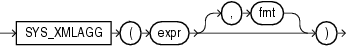
[Description of "Figure 8-13 SYS_XMLAGG Syntax"](img_text/sys_xmlagg.md)

**See Also:**

- [Oracle Database SQL Language Reference](../sqlrf/SYS_XMLAGG.md) for information about `sys_XMLAgg`

- [Oracle Database SQL Language Reference](../sqlrf/Format-Models.md) for information about an `XMLFormat` parameter

**Parent topic:** Generation of XML Data from Relational Data

### 8.5 Ordering Query Results Before Aggregating, Using XMLAGG ORDER BY Clause

To use the `XMLAgg ORDER BY` clause before aggregation, specify the `ORDER BY` clause following the first `XMLAGG` argument.

This is illustrated in Example 8-30.

Example 8-30 Using XMLAGG ORDER BY Clause

    CREATE TABLE dev_tab (dev         NUMBER,
                          dev_total   NUMBER,
                          devname     VARCHAR2(20));
    Table created.
    INSERT INTO dev_tab VALUES (16, 5,  'Alexis');
    1 row created.
    INSERT INTO dev_tab VALUES (2,  14, 'Han');
    1 row created.
    INSERT INTO dev_tab VALUES (1,  2,  'Jess');
    1 row created.
    INSERT INTO dev_tab VALUES (9,  88, 'Kurt');
    1 row created.
    COMMIT;

The result of the following query is aggregated according to the order of the `dev` column. (The result is shown here pretty-printed, for clarity.)

    SELECT XMLAgg(XMLElement("Dev",
                             XMLAttributes(dev AS "id", dev_total AS "total"),
                             devname)
                  ORDER BY dev)
      FROM dev_tab dev_total;

    XMLAGG(XMLELEMENT("DEV",XMLATTRIBUTES(DEVAS"ID",DEV_TOTALAS"TOTAL"),DEVNAME)ORDE
    --------------------------------------------------------------------------------
    <Dev id="1" total="2">Jess</Dev>
    <Dev id="2" total="14">Han</Dev>
    <Dev id="9" total="88">Kurt</Dev>
    <Dev id="16" total="5">Alexis</Dev>

    1 row selected.

**Parent topic:** Generation of XML Data from Relational Data

### 8.6 Returning a Rowset Using XMLTABLE

You can use standard SQL/XML function `XMLTable` to return a rowset with relevant portions of a document extracted as multiple rows.

This is shown in Example 8-31.

Example 8-31 Returning a Rowset Using XMLTABLE

    CONNECT oe
    Enter password: password

    Connected.

    SELECT item.descr, item.partid
      FROM purchaseorder,
           XMLTable('$p/PurchaseOrder/LineItems/LineItem' PASSING OBJECT_VALUE
                    COLUMNS descr  VARCHAR2(256) PATH 'Description',
                            partid VARCHAR2(14)  PATH 'Part/@Id') item
      WHERE item.partid = '715515012027'
         OR item.partid = '715515011921'
      ORDER BY partid;

This returns a rowset with just the descriptions and part IDs, ordered by part ID.

    DESCR
    --------------
    PARTID
    --------------
    My Man Godfrey
    715515011921

    My Man Godfrey
    715515011921

    My Man Godfrey
    715515011921

    My Man Godfrey
    715515011921

    My Man Godfrey
    715515011921

    My Man Godfrey
    715515011921

    My Man Godfrey
    715515011921

    Mona Lisa
    715515012027

    Mona Lisa
    715515012027

    Mona Lisa
    715515012027

    Mona Lisa
    715515012027

    Mona Lisa
    715515012027

    Mona Lisa
    715515012027

    Mona Lisa
    715515012027

    Mona Lisa
    715515012027

    Mona Lisa
    715515012027

    16 rows selected.

**Parent topic:** Generation of XML Data from Relational Data

------------------------------------------------------------------------

Footnote Legend

Footnote 1:

The SQL/XML standard requires argument `data-type` to be present, but it is optional in the Oracle XML DB implementation of the standard, for ease of use.

Footnote 2:

The limit is 32767 or 4000 bytes, depending on the value of initialization parameter `MAX_STRING_SIZE`.  See [Oracle Database PL/SQL Packages and Types Reference](../sqlrf/Data-Types.md).
