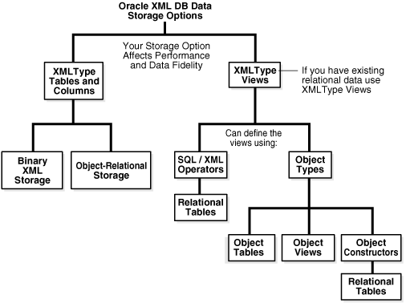

Some preliminary design criteria are presented for consideration when planning your Oracle XML DB solution.

- Oracle XML DB Installation
  Oracle XML DB is installed automatically if Database Configuration Assistant (DBCA) is used to build Oracle Database using the general-purpose template.
- Oracle XML DB Use Cases
  Oracle XML DB is suited for any application where some or all of the data processed is represented using XML.
- Application Design Considerations for Oracle XML DB
  When planning an Oracle XML DB application it can be worthwhile to consider some preliminary design criteria.

**Parent topic:** [Oracle XML DB Basics](XML-DB-basics.md)

### 2.1 Oracle XML DB Installation

Oracle XML DB is installed automatically if Database Configuration Assistant (DBCA) is used to build Oracle Database using the general-purpose template.

You can determine whether or not Oracle XML DB is already installed. If it is installed, then the following are true:

- Database schema (user account) `XDB` exists. To check that, run this query:

      SELECT * FROM ALL_USERS;

- View `RESOURCE_VIEW` exists. To check that, use this command:

      DESCRIBE RESOURCE_VIEW

**See Also:**

- [Administration of Oracle XML DB](administration-of-XML-DB.md) for information about installing Oracle XML DB manually

- [Oracle Database Security Guide](../dbseg/managing-security-for-oracle-database-users.md)

**Parent topic:** Getting Started with Oracle XML DB

### 2.2 Oracle XML DB Use Cases

Oracle XML DB is suited for any application where some or all of the data processed is represented using XML.

Oracle XML DB provides for high-performance database ingestion, storage, processing and retrieval of XML data. It also lets you quickly and easily generate XML from existing relational data. Applications for which Oracle XML DB is particularly suited include the following:

- Business-to-business (B2B) and application-to-application (A2A) integration

- Internet

- Content-management

- Messaging

- Web Services

A typical Oracle XML DB application has at least one of the following characteristics:

- Large numbers of XML documents must be ingested or generated

- Large XML documents must be processed or generated

- High-performance searching is needed, both within a document and across large collections of documents

- High levels of security are needed

- Fine-grained security is needed

- Data processing must use XML documents, and data must be stored in relational tables

- Programming must support open standards such as SQL, XML, XQuery, XPath, and XSL

- Information must be accessed using standard Internet protocols such as FTP, HTTP(S)/WebDAV, and Java Database Connectivity (JDBC)

- XML data must be queried from SQL

- Analytic capabilities must be applied to XML data

- XML documents must be validated against an XML schema

**Parent topic:** Getting Started with Oracle XML DB

### 2.3 Application Design Considerations for Oracle XML DB

When planning an Oracle XML DB application it can be worthwhile to consider some preliminary design criteria.

These include the following:

- The ways that you intend to store your XML data

- The structure of your XML data

- The languages used to implement your application

- The ways you intend to process your XML data

However, in general Oracle recommends that you start with the following Oracle XML DB features. For most use cases they are all that you need to consider.

- Storage model – binary XML

- Indexing – XML search index, `XMLIndex` with structured component

- Database language – SQL, with SQL/XML functions

- XML languages – XQuery and XSLT

- Client APIs – OCI, thin JDBC, SQL .NET

<!-- -->

- XML Data Storage
  There are several ways to store XML data in Oracle Database.
- The Structure of Your XML Data
  How structured your XML data is, and whether it is based on an XML schema, can influence how you store it.
- Languages Used to Implement Your Application
  You can program your Oracle XML DB applications in Java (JDBC, Java Servlets) or PL/SQL.
- XML Processing Options
  Oracle XML DB offers a full range of XML processing options.
- Oracle XML DB Repository Access
  Design considerations for applications that use Oracle XML DB Repository include access method, security needs, and whether you need versioning.
- Oracle XML DB Cooperates with Other Database Options and Features
  Oracle XML DB is an integrated part of Oracle Database, and works well with other database options and features.

**Related Topics**

- [Choice of XMLType Storage and Indexing](choice-of-XMLType-storage-and-indexing.md)
- [SQL/XML Standard Functions](intro-to-XML-DB.md)
- [XQuery and Oracle XML DB](xquery-and-XML-DB.md)
- [Transformation and Validation of XMLType Data](transformation-and-validation-of-XMLType-data.md)
- [C DOM API for XMLType](C-API-for-XMLType.md)
- [Java DOM API for XMLType](Java-DOM-API-for-XMLType.md)
- [Oracle XML DB and Oracle Data Provider for .NET](XML-DB-and-ODP-for-dot-NET.md)

**Parent topic:** Getting Started with Oracle XML DB

#### 2.3.1 XML Data Storage

There are several ways to store XML data in Oracle Database.

Storage of `XMLType` tables and views is outlined in Figure 2-1.

Figure 2-1 Oracle XML DB Storage Options for XML Data

[Description of "Figure 2-1 Oracle XML DB Storage Options for XML Data"](img_text/adxdb035.md)

If you have existing relational data, you can access it as XML data by creating `XMLType` views over it. You can use the following to define the `XMLType` views:

- SQL/XML functions. See [Generation of XML Data from Relational Data](generation-of-XML-data-from-relational-data.md) and [XQuery and Oracle XML DB](xquery-and-XML-DB.md).

- Object types: object tables, object constructors, and object views.

Regardless of which storage options you choose for your application, Oracle XML DB provides the same functionality. Though the storage model you use can affect your application performance and XML data fidelity, it is totally independent of how frequently you query or update your data and what APIs your application uses.

**Related Topics**

- [XMLType Storage Models](intro-to-XML-DB.md)

**Parent topic:** Application Design Considerations for Oracle XML DB

#### 2.3.2 The Structure of Your XML Data

How structured your XML data is, and whether it is based on an XML schema, can influence how you store it.

If your XML data is not XML Schema-based, then, regardless of how structured it is, you can store it in an `XMLType` table or view as binary XML, or you can store it as a file in an Oracle XML DB Repository folder. You cannot store it object-relationally.

If your XML data is XML Schema-based then you must store it as binary XML or object-relationally.

**Related Topics**

- [Choice of XMLType Storage and Indexing](choice-of-XMLType-storage-and-indexing.md)

**Parent topic:** Application Design Considerations for Oracle XML DB

#### 2.3.3 Languages Used to Implement Your Application

You can program your Oracle XML DB applications in Java (JDBC, Java Servlets) or PL/SQL.

**Related Topics**

- [Java DOM API for XMLType](Java-DOM-API-for-XMLType.md)
- [Guidelines for Oracle XML DB Applications in Java](how-to-write-XML-DB-applications-in-Java.md)
- [PL/SQL APIs for XMLType](PLSQL-APIs-for-XMLType.md)
- [PL/SQL Access to Oracle XML DB Repository](PLSQL-access-to-XML-DB-repository.md)

**Parent topic:** Application Design Considerations for Oracle XML DB

#### 2.3.4 XML Processing Options

Oracle XML DB offers a full range of XML processing options.

The following are available and should be considered when designing your Oracle XML DB application:

- XML Generation and `XMLType` views. Whether you need to generate (or regenerate) XML data. See [Generation of XML Data from Relational Data](generation-of-XML-data-from-relational-data.md).

- Whether your application is data-centric or document-centric, or both. See [Overview of How To Use Oracle XML DB](how-to-use-XML-DB.md).

- DOM fidelity, document fidelity. `XMLType` storage, whether object-relational or binary XML, preserves DOM fidelity. That is, A DOM created from an XML document stored as `XMLType` is identical to a DOM created from the original document. However, there could be differences in insignificant whitespace. See [DOM Fidelity](XML-Schema-and-query-basic.md), [SYS_XDBPD\$ and DOM Fidelity for Object-Relational Storage](XML-Schema-and-query-object-relational-storage.md), and [PL/SQL APIs for XMLType](PLSQL-APIs-for-XMLType.md).

  If you need to preserve document fidelity (insignificant whitespace) in addition to DOM fidelity, then store two copies of your original document: one as an `XMLType` instance for database use and XML processing, the other as a `CLOB` instance to provide document fidelity.

- XPath searching. You can use XPath syntax embedded in a SQL statement to query XML content in the database. See [Query and Update of XML Data](query-and-update-XML.md), [Access to Oracle XML DB Repository Data](accessing-XML-DB-repository-data.md), and[Repository Access Using RESOURCE_VIEW and PATH_VIEW](repository-access-using-RESOURCE_VIEW-and-PATH_VIEW.md).

- How often XML documents are accessed, updated, and manipulated. See [Query and Update of XML Data](query-and-update-XML.md).

- Whether you need to update fragments or whole documents. You can use XPath expressions to specify individual elements and attributes of your document during updates, without rewriting the entire document. This is more efficient, especially for large XML documents. See [Updating XML Data](query-and-update-XML.md).

- Which kinds of indexing best suit your application and data. See [Indexes for XMLType Data](indexes-for-XMLType-data.md).

- XSLT. Whether you need to transform the XML data to HTML, WML, or other languages, and, if so, how your application does this. While storing XML documents in Oracle XML DB, you can optionally ensure that their structure complies with (validates against) specific XML schemas. See [Transformation and Validation of XMLType Data](transformation-and-validation-of-XMLType-data.md).

**Parent topic:** Application Design Considerations for Oracle XML DB

#### 2.3.5 Oracle XML DB Repository Access

Design considerations for applications that use Oracle XML DB Repository include access method, security needs, and whether you need versioning.

There are two main repository access methods:

- Navigation-based access or path-based access. This is suitable for both content/document and data oriented applications. Oracle XML DB provides the following languages and access APIs:

  - SQL access through resource and path views. See [Repository Access Using RESOURCE_VIEW and PATH_VIEW](repository-access-using-RESOURCE_VIEW-and-PATH_VIEW.md).

  - PL/SQL access using package `DBMS_XDB` or packages `DBMS_XDB_ADMIN`, `DBMS_XDB_CONFIG` and `DBMS_XDB_REPOS`. See [PL/SQL Access to Oracle XML DB Repository](PLSQL-access-to-XML-DB-repository.md).

  - Protocol-based access using HTTP(S)/WebDAV or FTP, most suited to content-oriented applications. See [Repository Access Using Protocols](repository-access-using-protocols.md).

- Query-based access. This can be most suited to data oriented applications. Oracle XML DB provides access using SQL queries through the following APIs:

  - Java access (through JDBC). See [Java DOM API for XMLType](Java-DOM-API-for-XMLType.md).

  - PL/SQL access. See [PL/SQL APIs for XMLType](PLSQL-APIs-for-XMLType.md).

These options for accessing repository data are also discussed in [Access to Oracle XML DB Repository Data](accessing-XML-DB-repository-data.md).

You can also consider the following access criteria:

- What levels of security you need. See [Repository Access Control](repository-access-control.md).

- Whether you need to version the data. See [Resource Versions](resource-versions.md).

**Parent topic:** Application Design Considerations for Oracle XML DB

#### 2.3.6 Oracle XML DB Cooperates with Other Database Options and Features

Oracle XML DB is an integrated part of Oracle Database, and works well with other database options and features.

- Oracle Database Advanced Queuing (AQ) – merge XML payloads. See [XML Data Exchange Using Oracle Database Advanced Queuing](XML-data-exchange-using-streams-AQ.md) and [Oracle Database Advanced Queuing User's Guide](../adque/index.md)

- Oracle GoldenGate and Oracle Active Data Guard – replicate and safeguard XML data, or perform a rolling upgrade. See [Oracle GoldenGate](https://www.oracle.com/pls/topic/lookup?ctx=en/database/oracle/oracle-database/19/adxdb&id=ogg) and [Oracle Data Guard Concepts and Administration](../sbydb/index.md)

- Oracle Exadata Storage Server Software – high-performance, scalable, and highly available use of XML data. See [Oracle Exadata Storage Server Software User's Guide](https://www.oracle.com/pls/topic/lookup?ctx=en/database/oracle/oracle-database/19/adxdb&id=SAGUG20795).

- Oracle Real Application Clusters (Oracle RAC) – Use XML data with clusters of database instances. See [Oracle Real Application Clusters Administration and Deployment Guide](../racad/index.md)

- Oracle Multitenant option – Use XML data with a multitenant architecture, where each pluggable database has its own Oracle XML DB Repository. See [Oracle Multitenant Administrator's Guide](../multi/introduction-to-the-multitenant-architecture.md)

- Compression and Encryption – You can compress or encrypt binary XML data that uses SecureFiles LOB storage. For XML data stored object-relationally, you can compress or encrypt XML elements and attributes individually.

- Parallel Execution – Execution of the following operations can be carried out in parallel:

  - A query of `XMLType` data

  - DML for `XMLType` data stored as binary XML using SecureFiles LOBs

  - A direct load for an `XMLType` table on which an Oracle Text `CONTEXT` index is defined

  **See Also:**

  [Oracle Database Concepts](../cncpt/memory-architecture.md)

**Parent topic:** Application Design Considerations for Oracle XML DB
