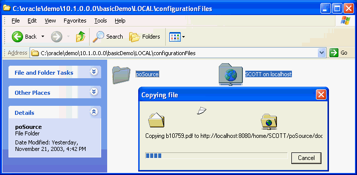

An overview of the various ways of using Oracle XML DB is presented.

This overview illustrates how to do the following: create and partition `XMLType` tables and columns; enforce data integrity, load, query, and update database XML content; and generate XML data from relational data. It also explains how Oracle XML DB determines which character sets are used for XML documents.

### Purchase Order Documents Illustrate Key XML Schema Features

Many of the examples presented in this chapter illustrate techniques for accessing and managing XML content in purchase-order documents. Purchase orders are highly structured documents, but you can also use the techniques shown here to work with XML documents that have little structure.

The purchase-order documents used for the examples here conform to a purchase-order XML schema that demonstrates some key features of a typical XML document:

- Global element `PurchaseOrder` is an instance of the `complexType` `PurchaseOrderType`

- `PurchaseOrderType` defines the set of nodes that make up a `PurchaseOrder` element

- `LineItems` element consists of a collection of `LineItem` elements

- Each `LineItem` element consists of two elements: `Description` and `Part`

- `Part` element has attributes `Id`, `Quantity`, and `UnitPrice`

<!-- -->

- Creating XMLType Tables and Columns
  Creating a table or column of `XMLType` is straightforward because it is an abstract data type.
- Creating Virtual Columns on XMLType Data Stored as Binary XML
  You can create virtual columns only for `XMLType` data that is stored as binary XML. Such columns are useful for partitioning or constraining the data.
- Partitioning Tables That Contain XMLType Data Stored as Binary XML
  You can partition a table that contains `XMLType` data stored as binary XML.
- Enforcing XML Data Integrity Using the Database
  You can combine the power of SQL and XML with the ability of the database to enforce rules.
- Loading XML Content into Oracle XML DB
  There are several ways to load XML content into Oracle XML DB.
- Querying XML Content Stored in Oracle XML DB
  There are many ways to query XML content in Oracle XML DB and retrieve it.
- Updating XML Content Stored in Oracle XML DB
  You can update XML content, replacing either the entire contents of a document or only particular parts of a document.
- Generating XML Data from Relational Data
  You can use Oracle XML DB to generate XML data from relational data.
- Character Sets of XML Documents
  There are a few ways in which Oracle XML DB determines which character sets are used for XML documents

**See Also:**

- [Application Design Considerations for Oracle XML DB](getting-started-with-XML-DB.md) for recommended Oracle XML DB features for most uses

- [XMLType APIs](XMLType-APIs.md), [XML Schema and Object-Relational XMLType](XML-Schema-and-object-relational-XMLType.md), and [Oracle XML DB Repository](XML-DB-repository.md) for information about more advanced Oracle XML DB features

- [Purchase-Order XML Schemas](oracle-supplied-XML-schemas-and-examples.md) for the purchase-order XML schemas used for examples in this chapter

**Parent topic:** [Oracle XML DB Basics](XML-DB-basics.md)

### 3.1 Creating XMLType Tables and Columns

Creating a table or column of `XMLType` is straightforward because it is an abstract data type.

The basic `CREATE TABLE` statement, specifying no storage options and no XML schema, stores `XMLType` data as binary XML.Foot 1

Example 3-1 creates an `XMLType` column, and Example 3-2 creates an `XMLType` table.

Example 3-1 Creating a Table with an XMLType Column

    CREATE TABLE mytable1 (key_column VARCHAR2(10) PRIMARY KEY, xml_column XMLType);

Example 3-2 Creating a Table of XMLType

    CREATE TABLE mytable2 OF XMLType;

**Related Topics**

- [Creation of XMLType Tables and Columns Based on XML Schemas](XML-Schema-and-query-basic.md)

**Parent topic:** Overview of How To Use Oracle XML DB

### 3.2 Creating Virtual Columns on XMLType Data Stored as Binary XML

You can create virtual columns only for `XMLType` data that is stored as binary XML. Such columns are useful for partitioning or constraining the data.

You create virtual columns for XML data the same way you create them for other data types, but you use a slightly different syntax. (In particular, you cannot specify constraints in association with the column definition.)

You create a virtual column based on an XML element or attribute by defining it in terms of a SQL expression that involves that element or attribute. The column is thus function-based.

You use SQL/XML functions `XMLCast` and `XMLQuery` to do this, as shown in Example 3-3 and Example 3-4. The XQuery expression argument to function `XMLQuery` must be a simple XPath expression that uses only the child and attribute axes.

Example 3-3 creates `XMLType` table `po_binaryxml`, stored as binary XML. It creates virtual column `date_col`, which represents the XML data in attribute `/PurchaseOrder/@orderDate`.

Example 3-4 creates relational table `rel_tab`, which has two columns: `VARCHAR2` column `key_col` for the primary key, and `XMLType` column `xml_col` for the XML data.

Because `XMLType` is an abstract data type, if you create virtual columns on an `XMLType` table or column then those columns are hidden. They do not show up in `DESCRIBE` statements, for example. This hiding enables tools that use operations such as `DESCRIBE` to function normally and not be misled by the virtual columns.

**Note:**

If you use a virtual column for interval partitioning then it must have data type `NUMBER` or `DATE`, otherwise an error is raised. Use SQL/XML functions `XMLCast` and `XMLQuery` to cast to the proper data type.

**See Also:**

[Oracle Database SQL Language Reference](../sqlrf/CREATE-TABLE.md) for information about creating tables with virtual columns

Example 3-3 Creating a Virtual Column for an XML Attribute in an XMLType Table

    CREATE TABLE po_binaryxml OF XMLType
      XMLTYPE STORE AS BINARY XML
      VIRTUAL COLUMNS
        (date_col AS (XMLCast(XMLQuery('/PurchaseOrder/@orderDate'
                                       PASSING OBJECT_VALUE RETURNING CONTENT)
                              AS DATE)));

Example 3-4 Creating a Virtual Column for an XML Attribute in an XMLType Column

    CREATE TABLE reltab (key_col VARCHAR2(10) PRIMARY KEY,
                         xml_col XMLType)
      XMLTYPE xml_col STORE AS BINARY XML
      VIRTUAL COLUMNS
        (date_col AS (XMLCast(XMLQuery('/PurchaseOrder/@orderDate'
                                       PASSING xml_col RETURNING CONTENT)
                              AS DATE)));

**Related Topics**

- Partitioning Tables That Contain XMLType Data Stored as Binary XML
- Enforcing Referential Integrity Using SQL Constraints

**Parent topic:** Overview of How To Use Oracle XML DB

### 3.3 Partitioning Tables That Contain XMLType Data Stored as Binary XML

You can partition a table that contains `XMLType` data stored as binary XML.

There are two possibilities:

- The table is relational, with an `XMLType` column and a non-`XMLType` column.

- The table is of data type `XMLType`.

In the case of an `XMLType` column, you use the non-`XMLType` column as the partitioning key. This is illustrated in Example 3-5.

This case presents nothing new or specific with respect to XML data. The fact that one of the columns contains `XMLType` data is irrelevant. Things are different for the other case: partitioning an `XMLType` table.

XML data has its own structure, which (except for object-relational storage of `XMLType`) is not reflected directly in database data structure. For `XMLType` data stored as binary XML, individual XML elements and attributes are not mapped to individual database columns or tables.

Therefore, to partition binary XML data according to the values of individual elements or attributes, the standard approach for relational data does not apply. Instead, you must create virtual columns that represent the XML data of interest, and then use those virtual columns to define the constraints or partitions that you need.

The technique is as follows:

1.  Define virtual columns that correspond to the XML elements or attributes that you are interested in.

2.  Use those columns to partition the `XMLType` data as a whole.

This is illustrated in Example 3-6: virtual column `date_col` targets the `orderDate` attribute of element `PurchaseOrder` in a purchase-order document. This column is used as the partitioning key.

For best performance using a partitioned table containing XML data, Oracle recommends that you use an `XMLType` column rather than an `XMLType` table, and you therefore partition using a non-`XMLType` column.

**Note:**

- You can partition an `XMLType` table using a virtual column only if the storage model is binary XML. Range, hash, and list partitioning are supported.

- Partitioning of `XMLType` tables stored as XML is supported starting with 11g Release 2 (11.2). It is supported only if the database compatibility (parameter `compatible` in file `init.ora`) is 11.2 or higher.

- If a relational table has an `XMLType` column, you cannot partition the table using that column to define virtual columns of XML data.

Example 3-5 Partitioning a Relational Table That Has an XMLType Column

    CREATE TABLE reltab (key_col VARCHAR2(10) PRIMARY KEY,
                         xml_col XMLType)
      XMLTYPE xml_col STORE AS BINARY XML
      PARTITION BY RANGE (key_col)
        (PARTITION P1 VALUES LESS THAN ('abc'),
         PARTITION P2 VALUES LESS THAN (MAXVALUE));

Example 3-6 Partitioning an XMLType Table

    CREATE TABLE po_binaryxml OF XMLType
      XMLTYPE STORE AS BINARY XML
      VIRTUAL COLUMNS
        (date_col AS (XMLCast(XMLQuery('/PurchaseOrder/@orderDate'
                                       PASSING OBJECT_VALUE RETURNING CONTENT)
                              AS DATE)))
      PARTITION BY RANGE (date_col)
        (PARTITION orders2001 VALUES LESS THAN (to_date('01-JAN-2002')),
         PARTITION orders2002 VALUES LESS THAN (MAXVALUE));

**Related Topics**

- [XMLIndex Partitioning and Parallelism](indexes-for-XMLType-data.md)
- [Overview of Partitioning XMLType Tables and Columns Stored Object-Relationally](XML-Schema-and-query-object-relational-storage.md)

**Parent topic:** Overview of How To Use Oracle XML DB

### 3.4 Enforcing XML Data Integrity Using the Database

You can combine the power of SQL and XML with the ability of the database to enforce rules.

You can use SQL to supplement the functionality provided by XML schema. Only well-formed XML documents can be stored in `XMLType` tables or columns. A **well-formed** XML document is one that conforms to the syntax of the XML version declared in its XML declaration. This includes having a single root element, properly nested tags, and so forth. Additionally, if the `XMLType` table or column is constrained to an XML schema then only documents that conform to that XML schema can be stored in that table or column. Any attempt to store or insert any other kind of XML document in an XML schema-based `XMLType` raises an error. Example 3-7 illustrates this.

Such an error occurs only when content is inserted directly into an `XMLType` table. It indicates that Oracle XML DB did not recognize the document as a member of the class defined by the XML schema. For a document to be recognized as a member of the class defined by the schema, the following conditions must be true:

- The name of the XML document root element must match the name of global element used to define the `XMLType` table or column.

- The XML document must include the appropriate attributes from the `XMLSchema-instance` namespace, or the XML document must be explicitly associated with the XML schema using the `XMLType` constructor or `XMLType` method `createSchemaBasedXML()`.

If the constraining XML schema declares a `targetNamespace`, then the instance documents must contain the appropriate namespace declarations to place the root element of the document in the `targetNamespace` defined by the XML schema.

**Note:**

XML constraints are enforced only within individual XML documents. Database (SQL) constraints are enforced across sets of XML documents.

Example 3-7 Error From Attempting to Insert an Incorrect XML Document

    INSERT INTO purchaseorder
      VALUES (XMLType(bfilename('XMLDIR', 'Invoice.xml'), nls_charset_id('AL32UTF8')))
      VALUES (XMLType(bfilename('XMLDIR', 'Invoice.xml'), nls_charset_id('AL32UTF8')))
              *
    ERROR at line 2:
    ORA-19007: Schema - does not match expected
    http://localhost:8080/source/schemas/poSource/xsd/purchaseOrder.xsd.

- Enforcing Referential Integrity Using SQL Constraints
  You can use SQL constraints and database triggers to ensure data-integrity properties such as uniqueness and foreign-key relations.

**Related Topics**

- [Partial and Full XML Schema Validation](transformation-and-validation-of-XMLType-data.md)

**Parent topic:** Overview of How To Use Oracle XML DB

#### 3.4.1 Enforcing Referential Integrity Using SQL Constraints

You can use SQL constraints and database triggers to ensure data-integrity properties such as uniqueness and foreign-key relations.

The W3C XML Schema Recommendation defines a powerful language for defining the contents of an XML document. However, there are some simple data management concepts that are not currently addressed by the W3C XML Schema Recommendation. These include the ability to ensure that the value of an element or attribute has either of these properties:

- It is unique across a set of XML documents (a `UNIQUE` constraint).

- It exists in a particular data source that is outside of the current document (`FOREIGN KEY` constraint).

With Oracle XML DB, however, you can enforce such constraints. The mechanisms that you use to enforce integrity on XML data are the same as those you use to enforce integrity on relational data. Simple rules, such as uniqueness and foreign-key relationships, can be enforced by specifying SQL constraints. More complex rules can be enforced by specifying database triggers.

Oracle XML DB lets you use the database to enforce business rules on XML content, in addition to enforcing rules that can be specified using XML Schema constructs. The database enforces these business rules regardless of whether XML is inserted directly into a table or uploaded using one of the protocols supported by Oracle XML DB Repository.

XML data has its own structure, which (except for object-relational storage of `XMLType`) is not reflected directly in database data structure. For `XMLType` data stored as binary XML, individual XML elements and attributes are not mapped to individual database columns or tables.

Therefore, to constrain binary XML data according to the values of individual elements or attributes, the standard approach for relational data does not apply. Instead, you must create virtual columns that represent the XML data of interest, and then use those virtual columns to define the constraints that you need.

The technique is as follows:

1.  Define virtual columns that correspond to the XML elements or attributes that you are interested in.

2.  Use those columns to constrain the `XMLType` data as a whole.

The binary XML data can be in an `XMLType` table or an `XMLType` column of a relational table. In the former case, you can include creation of the constraint as part of the `CREATE TABLE` statement, if you like. For the latter case, you must create the constraint using an `ALTER TABLE` statement, after the relational table has been created.

**See also:**

[Oracle Database Error Messages Reference](../errmg/index.md)

Example 3-8 Constraining a Binary XML Table Using a Virtual Column

This example illustrates the technique for an `XMLType` table. It defines virtual column `c_xtabref` using the `Reference` element in a purchase-order document. It defines uniqueness constraint `reference_is_unique` on that column, which ensures that the value of node `/PurchaseOrder/Reference/text()` is unique across all documents that are stored in the table. It fills the table with the data from `OE.purchaseorder`. It then tries to insert a duplicate document, `DuplicateReference.xml`, which violates the uniqueness constraint, raising an error.

    CREATE TABLE po_binaryxml OF XMLType
      (CONSTRAINT reference_is_unique UNIQUE (c_xtabref))
      XMLTYPE STORE AS BINARY XML
      VIRTUAL COLUMNS
        (c_xtabref AS (XMLCast(XMLQuery('/PurchaseOrder/Reference'
                                          PASSING OBJECT_VALUE RETURNING CONTENT)
                                 AS VARCHAR2(32))));

    INSERT INTO po_binaryxml SELECT OBJECT_VALUE FROM OE.purchaseorder;

    132 rows created.

    INSERT INTO po_binaryxml
      VALUES (XMLType(bfilename('XMLDIR', 'DuplicateReference.xml'),
                      nls_charset_id('AL32UTF8')));
    INSERT INTO po_binaryxml
    *
    ERROR at line 1:
    ORA-00001: unique constraint (OE.REFERENCE_IS_UNIQUE) violated

Example 3-9 Constraining a Binary XML Column Using a Virtual Column: Uniqueness

This example illustrates the technique for an `XMLType` column of a relational table. It defines virtual column `c_xcolref` and uniqueness constraint `fk_ref`, which references the uniqueness constraint defined in Example 3-8. As in Example 3-8, this ensures that the value of node `/PurchaseOrder/Reference/text()` is unique across all documents that are stored in `XMLType` column `po_binxml_col`.

The example fills the `XMLType` column with the same data from `OE.purchaseorder`. It then tries to insert duplicate document, `DuplicateReference.xml`, which violates the uniqueness constraint, raising an error.

    CREATE TABLE po_reltab (po_binxml_col XMLType)
      XMLTYPE po_binxml_col STORE AS BINARY XML
      VIRTUAL COLUMNS
        (c_xcolref AS (XMLCast (XMLQuery('/PurchaseOrder/Reference'
                                        PASSING po_binxml_col RETURNING CONTENT)
                               AS VARCHAR2(32))));

    ALTER TABLE po_reltab ADD CONSTRAINT reference_is_unique UNIQUE (c_xcolref));

    INSERT INTO po_reltab SELECT OBJECT_VALUE FROM OE.purchaseorder;
    INSERT INTO po_reltab
      VALUES (XMLType(bfilename('XMLDIR', 'DuplicateReference.xml'),
                      nls_charset_id('AL32UTF8')));
    INSERT INTO po_reltab
    *
    ERROR at line 1:
    ORA-00001: unique constraint (OE.REFERENCE_IS_UNIQUE) violated

Example 3-10 Constraining a Binary XML Column Using a Virtual Column: Foreign Key

This example is similar to Example 3-9, but it uses a foreign-key constraint, `fk_ref`, which references the column with the uniqueness constraint defined in Example 3-8. Insertion of the document in file `DuplicateReference.xml` succeeds here, since that document is in (virtual) column `c_tabref` of table `po_binaryxml`. Insertion of a document that does not match any document in table `po_binaryxml`.

    CREATE TABLE po_reltab (po_binxml_col XMLType)
      XMLTYPE po_binxml_col STORE AS BINARY XML
      VIRTUAL COLUMNS
        (c_xcolref AS (XMLCast (XMLQuery('/PurchaseOrder/Reference'
                                        PASSING po_binxml_col RETURNING CONTENT)
                               AS VARCHAR2(32))));

    ALTER TABLE po_reltab ADD CONSTRAINT fk_ref FOREIGN KEY (c_xcolref)
                                                REFERENCES po_binaryxml(c_xtabref);

    INSERT INTO po_reltab
      VALUES (XMLType(bfilename('XMLDIR', 'DuplicateReference.xml'),
                      nls_charset_id('AL32UTF8')));

    INSERT INTO po_reltab
      VALUES ('<PurchaseOrder><Reference>Not Compliant</Reference></PurchaseOrder>');
    INSERT INTO po_reltab VALUES ('<PurchaseOrder><Reference>Not Compliant
    </Reference></PurchaseOrder>')
    *
    ERROR at line 1:
    ORA-02291: integrity constraint (OE.FK_REF) violated - parent key not found

Example 3-11 Enforcing Database Integrity When Loading XML Using FTP

Integrity rules defined using constraints and triggers are also enforced when XML schema-based XML content is loaded into Oracle XML DB Repository. This example shows that database integrity is also enforced when a protocol, such as FTP, is used to upload XML schema-based XML content into Oracle XML DB Repository. In this case, additional constraints, besides uniqueness, were also violated.

    $ ftp localhost 2100
    Connected to localhost.
    220 mdrake-sun FTP Server (Oracle XML DB/Oracle Database 10g Enterprise Edition
    Release 10.1.0.0.0 - Beta) ready.
    Name (localhost:oracle10): QUINE
    331 Password required for QUINE
    Password: password
    230 QUINE logged in
    ftp> cd /source/schemas
    250 CWD Command successful
    ftp> put InvalidReference.xml
    200 PORT Command successful
    150 ASCII Data Connection
    550- Error Response
    ORA-00604: error occurred at recursive SQL level 1
    ORA-31154: invalid XML document
    ORA-19202: Error occurred in XML processing
    LSX-00221: "SBELL-20021009" is too short (minimum length is 18)
    ORA-06512: at "SYS.XMLTYPE", line 333
    ORA-06512: at "QUINE.VALIDATE_PURCHASEORDER", line 3
    ORA-04088: error during execution of trigger 'QUINE.VALIDATE_PURCHASEORDER'
    550 End Error Response
    ftp> put InvalidElement.xml
    200 PORT Command successful
    150 ASCII Data Connection
    550- Error Response
    ORA-30937: No schema definition for 'UserName' (namespace '##local') in parent
    'PurchaseOrder'
    550 End Error Response
    ftp> put DuplicateReference.xml
    200 PORT Command successful
    150 ASCII Data Connection
    550- Error Response
    ORA-00604: error occurred at recursive SQL level 1
    ORA-00001: unique constraint (QUINE.REFERENCE_IS_UNIQUE) violated
    550 End Error Response
    ftp> put InvalidUser.xml
    200 PORT Command successful
    150 ASCII Data Connection
    550- Error Response
    ORA-00604: error occurred at recursive SQL level 1
    ORA-02291: integrity constraint (QUINE.USER_IS_VALID) violated - parent key not
     found
    550 End Error Response

When an error occurs while a document is being uploaded using a protocol, Oracle XML DB provides the client with the full SQL error trace. How the error is interpreted and reported to you is determined by the error-handling built into the client application. Some clients, such as a command line FTP tool, report the error returned by Oracle XML DB, while others, such as Microsoft Windows Explorer, report a generic error message.

**Related Topics**

- [Specification of Relational Constraints on XMLType Tables and Columns](XML-Schema-and-query-object-relational-storage.md)
- Creating Virtual Columns on XMLType Data Stored as Binary XML

**Parent topic:** Enforcing XML Data Integrity Using the Database

### 3.5 Loading XML Content into Oracle XML DB

There are several ways to load XML content into Oracle XML DB.

- Loading XML Content Using SQL or PL/SQL
- Loading XML Content Using Java
  With a DOM you can use Java to load a `SQLXML` instance.
- Loading XML Content Using C
  With a DOM you can use C code to load an `XMLType` instance.
- Loading Large XML Files that Contain Small XML Documents
  When loading large XML files consisting of a collection of smaller XML documents, it is often more efficient to use Simple API for XML (SAX) parsing to break the file into a set of smaller documents, and then insert those documents.
- Loading Large XML Files Using SQL\*Loader
  You can use SQL\*Loader to load large amounts of XML data into Oracle Database.
- Loading XML Documents into the Repository Using DBMS_XDB_REPOS
  You can use PL/SQL package `DBMS_XDB_REPOS` to load XML documents into Oracle XML DB Repository. You can access repository documents (resources) using path-based rather than table-based techniques.
- Loading Documents into the Repository Using Protocols
  You can load documents, including XML documents, from a local file system into Oracle XML DB Repository using popular protocols.

**Parent topic:** Overview of How To Use Oracle XML DB

#### 3.5.1 Loading XML Content Using SQL or PL/SQL

You can use a simple `INSERT` operation in SQL or PL/SQL to load an XML document into the database.

Before the document can be stored as an `XMLType` column or table, you must convert it into an `XMLType` instance using one of the `XMLType` constructors.

`XMLType` **constructors** allow an `XMLType` instance to be created from different sources, including `VARCHAR`, `CLOB`, and `BFILE` values. The constructors accept additional arguments that reduce the amount of processing associated with `XMLType` creation. For example, if you are sure that a given source XML document is valid, you can provide an argument to the constructor that disables the type-checking that is otherwise performed.

In addition, if the source data is not encoded in the database character set, an `XMLType` instance can be constructed using a `BFILE` or `BLOB` value. The encoding of the source data is specified through the character set id (`csid`) argument of the constructor.

When you use SQL `INSERT` to insert a large document containing collections into `XMLType` tables (but not into `XMLType` columns), Oracle XML DB optimizes load time and memory usage.

Example 3-13 shows how to insert XML content into an `XMLType` table. Before making this insertion, you must create a database directory object that points to the directory containing the file to be processed. To do this, you must have the `CREATE ANY DIRECTORY` privilege.

**See Also:**

- [Oracle Database PL/SQL Packages and Types Reference](../arpls/XMLTYPE.md) for a description of the `XMLType` constructors

- [Oracle Database SQL Language Reference](../sqlrf/GRANT.md), under `GRANT`

Example 3-12 Creating a Database Directory

    CREATE DIRECTORY xmldir AS path_to_folder_containing_XML_file;

Example 3-13 Inserting XML Content into an XMLType Table

    INSERT INTO mytable2 VALUES (XMLType(bfilename('XMLDIR', 'purchaseOrder.xml'),
                                         nls_charset_id('AL32UTF8')));

The value passed to `nls_charset_id` indicates that the encoding for the file to be read is UTF-8.

**Related Topics**

- [Query and Update of XML Data](query-and-update-XML.md)
- [PL/SQL APIs for XMLType: References](PLSQL-APIs-for-XMLType.md)
- [Considerations for Loading and Retrieving Large Documents with Collections](XML-Schema-and-query-object-relational-storage.md)

**Parent topic:** Loading XML Content into Oracle XML DB

#### 3.5.2 Loading XML Content Using Java

With a DOM you can use Java to load a `SQLXML` instance.

Example 3-14 shows how to load XML content into Oracle XML DB by first creating a `SQLXML` instance in Java, given a Document Object Model ([DOM](../adxdk/glossary.md)).

A simple bulk loader application is available at [Oracle XML DB on OTN](https://www.oracle.com/pls/topic/lookup?ctx=en/database/oracle/oracle-database/19/adxdb&id=otn_db_xmldb_overview). It shows how to load a directory of XML files into Oracle XML DB using Java Database Connectivity (JDBC). JDBC is a set of Java interfaces to Oracle Database.

Example 3-14 Inserting Content into an XMLType Table Using Java

    public void doInsert(Connection conn, Document doc)
    throws Exception
    {
      String query = "INSERT INTO purchaseorder VALUES (?)";
      SQLXML sx = conn.createSQLXML();
      DOMResult dom = sx.setResult(DOMResult.class);
      dom.setNode(doc);
      PreparedStatement statement = conn.prepareStatement(query);
      statement.setSQLXML(1, sx);
      statement.execute();
    }

**Parent topic:** Loading XML Content into Oracle XML DB

#### 3.5.3 Loading XML Content Using C

With a DOM you can use C code to load an `XMLType` instance.

Example 3-15 shows how to insert XML content into an `XMLType` table using C code, by creating an `XMLType` instance given a DOM (see [Oracle XML Developer's Kit Programmer's Guide](../adxdk/glossary.md)). See [Loading XML Data Using C (OCI)](oracle-supplied-XML-schemas-and-examples.md) for a complete listing of this example.

**Note:**

For simplicity in demonstrating this feature, this example does not perform the password management techniques that a deployed system normally uses. In a production environment, follow the Oracle Database password management guidelines, and disable any sample accounts. See [Oracle Database Security Guide](../dbseg/managing-security-for-application-developers.md) for password management guidelines and other security recommendations.

Example 3-15 Inserting Content into an XMLType Table Using C

    . . .
    void main()
    {
      OCIType *xmltdo;
      xmldocnode  *doc;
      ocixmldbparam params[1];
      xmlerr       err;
      xmlctx  *xctx;
      oratext *ins_stmt;
      sword    status;
      xmlnode *root;
      oratext buf[10000];

      /* Initialize envhp, svchp, errhp, dur, stmthp */
      init_oci_connect();

      /* Get an XML context */
      params[0].name_ocixmldbparam = XCTXINIT_OCIDUR;
      params[0].value_ocixmldbparam = &dur;
      xctx = OCIXmlDbInitXmlCtx(envhp, svchp, errhp, params, 1);
      if (!(doc = XmlLoadDom(xctx, &err, "file", filename,
                             "schema_location", schemaloc, NULL)))
        {
          printf("Parse failed.\n");
          return;
        }
      else
        printf("Parse succeeded.\n");
      root = XmlDomGetDocElem(xctx, doc);
      printf("The xml document is :\n");
      XmlSaveDom(xctx, &err, (xmlnode *)doc, "buffer", buf, "buffer_length", 10000, NULL);
      printf("%s\n", buf);

      /* Insert the document into my_table */
      ins_stmt = (oratext *)"insert into purchaseorder values (:1)";
      status = OCITypeByName(envhp, errhp, svchp, (const text *) "SYS",
                             (ub4) strlen((const char *)"SYS"), (const text *) "XMLTYPE",
                             (ub4) strlen((const char *)"XMLTYPE"), (CONST text *) 0,
                             (ub4) 0, OCI_DURATION_SESSION, OCI_TYPEGET_HEADER,
                             (OCIType **) &xmltdo);
      if (status == OCI_SUCCESS)
        {
          status = exec_bind_xml(svchp, errhp, stmthp, (void *)doc,
                                 xmltdo, ins_stmt);
        }
      if (status == OCI_SUCCESS)
        printf ("Insert successful\n");
      else
        printf ("Insert failed\n");

      /* Free XML instances */
      if (doc)
        XmlFreeDocument((xmlctx *)xctx, (xmldocnode *)doc);
      /* Free XML CTX */
      OCIXmlDbFreeXmlCtx(xctx);
      free_oci();
    }

**Parent topic:** Loading XML Content into Oracle XML DB

#### 3.5.4 Loading Large XML Files that Contain Small XML Documents

When loading large XML files consisting of a collection of smaller XML documents, it is often more efficient to use Simple API for XML (SAX) parsing to break the file into a set of smaller documents, and then insert those documents.

SAX is an XML standard interface provided by XML parsers for event-based applications. You can use SAX to load a database table from very large XML files in the order of 30 MB or larger, by creating individual documents from a collection of nodes. You can also bulk load XML files.

**See Also:**

- [SAX Project](https://www.oracle.com/pls/topic/lookup?ctx=en/database/oracle/oracle-database/19/adxdb&id=sax_project_org) for information about SAX

- [Oracle XML DB on OTN](https://www.oracle.com/pls/topic/lookup?ctx=en/database/oracle/oracle-database/19/adxdb&id=otn_db_xmldb_overview), for an application example that loads large files using SAX

**Parent topic:** Loading XML Content into Oracle XML DB

#### 3.5.5 Loading Large XML Files Using SQL\*Loader

You can use SQL\*Loader to load large amounts of XML data into Oracle Database.

SQL\*Loader loads in one of two modes, conventional or direct path. Table 3-1 compares these modes.

Table 3-1 SQL\*Loader – Conventional and Direct-Path Load Modes

| Conventional Load Mode                                                                        | Direct-Path Load Mode                                                                                          |
|:----------------------------------------------------------------------------------------------|:---------------------------------------------------------------------------------------------------------------|
| Uses SQL to load data into Oracle Database. This is the default mode.                         | Bypasses SQL and streams the data directly into Oracle Database.                                               |
| Advantage: Follows SQL semantics. For example triggers are fired and constraints are checked. | Advantage: This loads data much faster than the conventional load mode.                                        |
| Disadvantage: This loads data slower than with the direct load mode.                          | Disadvantage: SQL semantics is not obeyed. For example triggers are not fired and constraints are not checked. |

When loading LOBs with SQL\*Loader direct-path load, much memory can be used. If the message `SQL*Loader 700 (out of memory)` appears, then it is likely that more rows are being included in each load call than can be handled by your operating system and process memory. Workaround: use the `ROWS` option to read a smaller number of rows in each data save.

**Related Topics**

- [How to Load XML Data](how-to-load-XML-data.md)

**Parent topic:** Loading XML Content into Oracle XML DB

#### 3.5.6 Loading XML Documents into the Repository Using DBMS_XDB_REPOS

You can use PL/SQL package `DBMS_XDB_REPOS` to load XML documents into Oracle XML DB Repository. You can access repository documents (resources) using path-based rather than table-based techniques.

To load an XML document into the repository under a given path, use PL/SQL function `DBMS_XDB_REPOS.createResource`. Example 3-16 illustrates this.

Many operations for configuring and using Oracle XML DB are based on processing one or more XML documents. Examples include registering an XML schema and performing an XSL transformation. The easiest way to make these XML documents available to Oracle Database is to load them into Oracle XML DB Repository.

Example 3-16 Inserting XML Content into the Repository Using CREATERESOURCE

    DECLARE
      res BOOLEAN;
    BEGIN
      res := DBMS_XDB_REPOS.createResource('/home/QUINE/purchaseOrder.xml',
                                           bfilename('XMLDIR', 'purchaseOrder.xml'),
                                           nls_charset_id('AL32UTF8'));
    END;/

**Parent topic:** Loading XML Content into Oracle XML DB

#### 3.5.7 Loading Documents into the Repository Using Protocols

You can load documents, including XML documents, from a local file system into Oracle XML DB Repository using popular protocols.

Oracle XML DB Repository can store XML documents that are either XML schema-based or non-schema-based. It can also store content that is not XML data, such as HTML files, image files, and Microsoft Word documents.

You can load XML documents from a local file system into Oracle XML DB Repository using protocols such as WebDAV, from Windows Explorer or other tools that support WebDAV. Figure 3-1 shows a simple drag and drop operation for copying the contents of the `SCOTT` folder from the local hard drive to folder `poSource` in Oracle XML DB Repository.

Figure 3-1 Loading Content into the Repository Using Windows Explorer

[Description of "Figure 3-1 Loading Content into the Repository Using Windows Explorer"](img_text/repo_load.md)

The copied folder might contain, for example, an XML schema document, an HTML page, and some XSLT stylesheets.

**Parent topic:** Loading XML Content into Oracle XML DB

### 3.6 Querying XML Content Stored in Oracle XML DB

There are many ways to query XML content in Oracle XML DB and retrieve it.

**Note:**

For efficient query performance you typically need to create indexes. For information about indexing XML data, see [Indexes for XMLType Data](indexes-for-XMLType-data.md).

- PurchaseOrder XML Document Used in Examples
  An XML schema defines the purchase-order documents used in examples.
- Retrieving the Content of an XML Document Using Pseudocolumn OBJECT_VALUE
  Pseudocolumn `OBJECT_VALUE` can be used as an alias for the value of an object table.
- Accessing Fragments or Nodes of an XML Document Using XMLQUERY
  You can use SQL/XML function `XMLQuery` to extract the nodes that match an XQuery expression. The result is returned as an instance of `XMLType`.
- Accessing Text Nodes and Attribute Values Using XMLCAST and XMLQUERY
  You can access text node and attribute values using SQL/XML standard functions `XMLQuery` and `XMLCast`.
- Searching an XML Document Using XMLEXISTS, XMLCAST, and XMLQUERY
  You can use SQL/XML standard functions `XMLExists`, `XMLCast`, and `XMLQuery` in a SQL `WHERE` clause to limit query results.
- Performing SQL Operations on XMLType Fragments Using XMLTABLE
  You can use SQL/XML function `XMLTable` to perform SQL operations on a set of nodes that match an XQuery expression.

**Parent topic:** Overview of How To Use Oracle XML DB

#### 3.6.1 PurchaseOrder XML Document Used in Examples

An XML schema defines the purchase-order documents used in examples.

Examples presented here are based on the `PurchaseOrder` XML document shown in Example 3-17.

Example 3-17 PurchaseOrder XML Instance Document

    <PurchaseOrder
      xmlns:xsi="http://www.w3.org/2001/XMLSchema-instance"
      xsi:noNamespaceSchemaLocation=
        "http://localhost:8080/source/schemas/poSource/xsd/purchaseOrder.xsd">
      <Reference>SBELL-2002100912333601PDT</Reference>
      <Actions>
        <Action>
          <User>SVOLLMAN</User>
        </Action>
      </Actions>
      <Reject/>
      <Requestor>Sarah J. Bell</Requestor>
      <User>SBELL</User>
      <CostCenter>S30</CostCenter>
      <ShippingInstructions>
        <name>Sarah J. Bell</name>
        <address>400 Oracle Parkway
          Redwood Shores
          CA
          94065
          USA</address>
        <telephone>650 506 7400</telephone>
      </ShippingInstructions>
      <SpecialInstructions>Air Mail</SpecialInstructions>
      <LineItems>
        <LineItem ItemNumber="1">
          <Description>A Night to Remember</Description>
          <Part Id="715515009058" UnitPrice="39.95" Quantity="2"/>
        </LineItem>
        <LineItem ItemNumber="2">
          <Description>The Unbearable Lightness Of Being</Description>
          <Part Id="37429140222" UnitPrice="29.95" Quantity="2"/>
        </LineItem>
        <LineItem ItemNumber="3">
          <Description>Sisters</Description>
          <Part Id="715515011020" UnitPrice="29.95" Quantity="4"/>
        </LineItem>
      </LineItems>
    </PurchaseOrder>

**Parent topic:** Querying XML Content Stored in Oracle XML DB

#### 3.6.2 Retrieving the Content of an XML Document Using Pseudocolumn OBJECT_VALUE

Pseudocolumn `OBJECT_VALUE` can be used as an alias for the value of an object table.

For an `XMLType` table that consists of a single column of `XMLType`, the entire XML document is retrieved. (`OBJECT_VALUE` replaces the `value(x)` and `SYS_NC_ROWINFO$` aliases used in releases prior to Oracle Database 10g Release 1.)

In Example 3-18, the SQL\*Plus settings `PAGESIZE` and `LONG` are used to ensure that the entire document is printed correctly, without line breaks. (The output has been formatted for readability.)

Example 3-18 Retrieving an Entire XML Document Using OBJECT_VALUE

    SELECT OBJECT_VALUE FROM purchaseorder;

    OBJECT_VALUE
    -----------------------------------------------------------------------
    <PurchaseOrder xmlns:xsi="http://www.w3.org/2001/XMLSchema-instance"
     xsi:noNamespaceSchemaLocation="http://localhost:8080/source/schemas
    /poSource/xsd/purchaseOrder.xsd">
      <Reference>SBELL-2002100912333601PDT</Reference>
      <Actions>
        <Action>
          <User>SVOLLMAN</User>
        </Action>
      </Actions>
      <Reject/>
      <Requestor>Sarah J. Bell</Requestor>
      <User>SBELL</User>
      <CostCenter>S30</CostCenter>
      <ShippingInstructions>
        <name>Sarah J. Bell</name>
        <address>400 Oracle Parkway
    Redwood Shores
    CA
    94065
    USA</address>
        <telephone>650 506 7400</telephone>
      </ShippingInstructions>
      <SpecialInstructions>Air Mail</SpecialInstructions>
      <LineItems>
        <LineItem ItemNumber="1">
          <Description>A Night to Remember</Description>
          <Part Id="715515009058" UnitPrice="39.95" Quantity="2"/>
        </LineItem>
        <LineItem ItemNumber="2">
          <Description>The Unbearable Lightness Of Being</Description>
          <Part Id="37429140222" UnitPrice="29.95" Quantity="2"/>
        </LineItem>
        <LineItem ItemNumber="3">
          <Description>Sisters</Description>
          <Part Id="715515011020" UnitPrice="29.95" Quantity="4"/>
        </LineItem>
      </LineItems>
    </PurchaseOrder>

    1 row selected.

**Parent topic:** Querying XML Content Stored in Oracle XML DB

#### 3.6.3 Accessing Fragments or Nodes of an XML Document Using XMLQUERY

You can use SQL/XML function `XMLQuery` to extract the nodes that match an XQuery expression. The result is returned as an instance of `XMLType`.

Example 3-19 illustrates this with several queries.

Example 3-19 Accessing XML Fragments Using XMLQUERY

The following query returns an `XMLType` instance containing the `Reference` element that matches the XPath expression.

    SELECT XMLQuery('/PurchaseOrder/Reference' PASSING OBJECT_VALUE RETURNING CONTENT)
      FROM purchaseorder;

    XMLQUERY('/PURCHASEORDER/REFERENCE'PASSINGOBJECT_
    -------------------------------------------------
    <Reference>SBELL-2002100912333601PDT</Reference>

    1 row selected.

The following query returns an `XMLType` instance containing the first `LineItem` element in the `LineItems` collection:

    SELECT XMLQuery('/PurchaseOrder/LineItems/LineItem[1]'
                    PASSING OBJECT_VALUE RETURNING CONTENT)
      FROM purchaseorder;

    XMLQUERY('/PURCHASEORDER/LINEITEMS/LINEITEM[1]'PASSINGOBJECT_
    -------------------------------------------------------------
    <LineItem ItemNumber="1">
      <Description>A Night to Remember</Description>
      <Part Id="715515009058" UnitPrice="39.95" Quantity="2"/>
    </LineItem>

    1 row selected.

The following query returns an `XMLType` instance that contains the three `Description` elements that match the XPath expression. These elements are returned as nodes in a single `XMLType` instance. The `XMLType` instance does not have a single root node; it is an XML fragment.

    SELECT XMLQuery('/PurchaseOrder/LineItems/LineItem/Description'
                    PASSING OBJECT_VALUE RETURNING CONTENT)
      FROM purchaseorder;

    XMLQUERY('/PURCHASEORDER/LINEITEMS/LINEITEM/DESCRIPTION'PASSINGOBJECT_
    ----------------------------------------------------------------------
    <Description>A Night to Remember</Description>
    <Description>The Unbearable Lightness Of Being</Description>
    <Description>Sisters</Description>

    1 row selected.

**Related Topics**

- Performing SQL Operations on XMLType Fragments Using XMLTABLE

**Parent topic:** Querying XML Content Stored in Oracle XML DB

#### 3.6.4 Accessing Text Nodes and Attribute Values Using XMLCAST and XMLQUERY

You can access text node and attribute values using SQL/XML standard functions `XMLQuery` and `XMLCast`.

To do this, the XQuery expression passed to `XMLQuery` must uniquely identify a single text node or attribute value within the document – that is, a leaf node. Example 3-20 illustrates this using several queries.

**See Also:**

[XQuery and Oracle XML DB](xquery-and-XML-DB.md) for information on SQL/XML functions `XMLQuery` and `XMLCast`

Example 3-20 Accessing a Text Node Value Using XMLCAST and XMLQuery

The following query returns the value of the text node associated with the `Reference` element that matches the target XPath expression. The value is returned as a `VARCHAR2` value.

    SELECT  XMLCast(XMLQuery('$p/PurchaseOrder/Reference/text()'
                             PASSING OBJECT_VALUE AS "p" RETURNING CONTENT)
                    AS VARCHAR2(30))
      FROM purchaseorder;

    XMLCAST(XMLQUERY('$P/PURCHASEO
    ------------------------------
    SBELL-2002100912333601PDT

    1 row selected.

The following query returns the value of the text node associated with a `Description` element contained in a `LineItem` element. The particular `LineItem` element is specified by its `Id` attribute value. The predicate that identifies the `LineItem` element is `[Part/@Id="715515011020"]`. The at-sign character (`@`) specifies that `Id` is an attribute rather than an element. The value is returned as a `VARCHAR2` value.

    SELECT XMLCast(
             XMLQuery('$p/PurchaseOrder/LineItems/LineItem[Part/@Id="715515011020"]/Description/text()'
                      PASSING OBJECT_VALUE AS "p" RETURNING CONTENT)
                   AS VARCHAR2(30))
      FROM purchaseorder;

    XMLCAST(XMLQUERY('$P/PURCHASEO
    ------------------------------
    Sisters

    1 row selected.

The following query returns the value of the text node associated with the `Description` element contained in the first `LineItem` element. The first `LineItem` element is indicated by the position predicate`[1]`.

    SELECT XMLCast(XMLQuery('$p/PurchaseOrder/LineItems/LineItem[1]/Description'
                            PASSING OBJECT_VALUE AS "p" RETURNING CONTENT)
                   AS VARCHAR2(4000))
      FROM purchaseorder;

    XMLCAST(XMLQUERY('$P/PURCHASEORDER/LINEITEMS/LINEITEM[1]/DESCRIPTION'PASSINGOBJECT_VALUEAS"P"
    ---------------------------------------------------------------------------------------------
    A Night to Remember

    1 row selected.

**Parent topic:** Querying XML Content Stored in Oracle XML DB

#### 3.6.5 Searching an XML Document Using XMLEXISTS, XMLCAST, and XMLQUERY

You can use SQL/XML standard functions `XMLExists`, `XMLCast`, and `XMLQuery` in a SQL `WHERE` clause to limit query results.

SQL/XML standard function `XMLExists` evaluates whether or not a given document contains a node that matches a W3C XPath expression. It returns a Boolean value of `true` if the document contains the node specified by the XPath expression supplied to the function and a value of `false` if it does not. Since XPath expressions can contain predicates, `XMLExists` can determine whether or not a given node exists in the document, and whether or not a node with the specified value exists in the document.

Similarly, functions `XMLCast` and `XMLQuery` let you limit query results to documents that satisfy some property. Example 3-21 illustrates the use of `XMLExists`, `XMLCast`, and `XMLQuery` to search for documents.

Example 3-22 performs a join based on the values of a node in an XML document and data in another, relational table.

**See Also:**

[XQuery and Oracle XML DB](xquery-and-XML-DB.md) for information about SQL/XML functions `XMLQuery`, `XMLExists`, and `XMLCast`

Example 3-21 Searching XML Content Using XMLExists, XMLCast, and XMLQuery

The following query uses `XMLExists` to check if the XML document contains an element named `Reference` that is a child of the root element `PurchaseOrder`:

    SELECT count(*) FROM purchaseorder
      WHERE XMLExists('$p/PurchaseOrder/Reference' PASSING OBJECT_VALUE AS "p");

      COUNT(*)
    ----------
           132

    1 row selected.

The following query checks if the value of the text node associated with the `Reference` element is `SBELL-2002100912333601PDT`:

    SELECT count(*) FROM purchaseorder
      WHERE XMLExists('$p/PurchaseOrder[Reference="SBELL-2002100912333601PDT"]'
                      PASSING OBJECT_VALUE AS "p");

      COUNT(*)
    ----------
             1
    1 row selected.

This query checks whether the XML document contains a root element `PurchaseOrder` that contains a `LineItems` element that contains a `LineItem` element that contains a `Part` element with an `Id` attribute.

    SELECT count(*) FROM purchaseorder
      WHERE XMLExists('$p/PurchaseOrder/LineItems/LineItem/Part/@Id'
                      PASSING OBJECT_VALUE AS "p");

      COUNT(*)
    ----------
           132

    1 row selected.

The following query checks whether the XML document contains a root element `PurchaseOrder` that contains a `LineItems` element that contains a `LineItem` element that contains a `Part` element with `Id` attribute value `715515009058`.

    SELECT count(*) FROM purchaseorder
      WHERE XMLExists('$p/PurchaseOrder/LineItems/LineItem/Part[@Id="715515009058"]'
                      PASSING OBJECT_VALUE AS "p");

      COUNT(*)
    ----------
            21

The following query checks whether the XML document contains a root element `PurchaseOrder` that contains a `LineItems` element whose third `LineItem` element contains a `Part` element with `Id` attribute value `715515009058`.

    SELECT count(*) FROM purchaseorder
      WHERE XMLExists(
              '$p/PurchaseOrder/LineItems/LineItem[3]/Part[@Id="715515009058"]'
              PASSING OBJECT_VALUE AS "p");

      COUNT(*)
    ----------
             1
    1 row selected.

The following query limits the results of the `SELECT` statement to rows where the text node associated with element `User` starts with the letter `S`. XQuery does not include support for `LIKE`-based queries.

    SELECT XMLCast(XMLQuery('$p/PurchaseOrder/Reference' PASSING OBJECT_VALUE AS "p"
                            RETURNING CONTENT)
                   AS VARCHAR2(30))
      FROM purchaseorder
      WHERE XMLCast(XMLQuery('$p/PurchaseOrder/User' PASSING OBJECT_VALUE AS "p"
                             RETURNING CONTENT)
                    AS VARCHAR2(30))
            LIKE 'S%';

    XMLCAST(XMLQUERY('$P/PURCHASEORDER
    ----------------------------------
    SBELL-20021009123336231PDT
    SBELL-20021009123336331PDT
    SKING-20021009123336321PDT
    ...
    36 rows selected.

The following query uses `XMLExists` to limit the results of a `SELECT` statement to rows where the text node of element `User` contains the value `SBELL`.

    SELECT XMLCast(XMLQuery('$p/PurchaseOrder/Reference' PASSING OBJECT_VALUE AS "p"
                            RETURNING CONTENT)
                   AS VARCHAR2(30)) "Reference"
      FROM purchaseorder
      WHERE XMLExists('$p/PurchaseOrder[User="SBELL"]' PASSING OBJECT_VALUE AS "p");

    Reference
    ------------------------------
    SBELL-20021009123336231PDT
    SBELL-20021009123336331PDT
    SBELL-20021009123337353PDT
    SBELL-20021009123338304PDT
    SBELL-20021009123338505PDT
    SBELL-20021009123335771PDT
    SBELL-20021009123335280PDT
    SBELL-2002100912333763PDT
    SBELL-2002100912333601PDT
    SBELL-20021009123336362PDT
    SBELL-20021009123336532PDT
    SBELL-20021009123338204PDT
    SBELL-20021009123337673PDT

    13 rows selected.

The following query uses SQL/XML functions `XMLQuery` and `XMLExists` to find the `Reference` element for any `PurchaseOrder` element whose first `LineItem` element contains an order for the item with `Id` `715515009058`. Function `XMLExists` is used in the `WHERE` clause to determine which rows are selected, and `XMLQuery` is used in the `SELECT` list to control which part of the selected documents appears in the result.

    SELECT XMLCast(XMLQuery('$p/PurchaseOrder/Reference' PASSING OBJECT_VALUE AS "p"
                            RETURNING CONTENT)
                   AS VARCHAR2(30)) "Reference"
      FROM purchaseorder
      WHERE XMLExists('$p/PurchaseOrder/LineItems/LineItem[1]/Part[@Id="715515009058"]'
                      PASSING OBJECT_VALUE AS "p");

    Reference
    -------------------------
    SBELL-2002100912333601PDT

    1 row selected.

Example 3-22 Joining Data from an XMLType Table and a Relational Table

    SELECT XMLCast(XMLQuery('$p/PurchaseOrder/Reference' PASSING OBJECT_VALUE AS "p"
                            RETURNING CONTENT)
                   AS VARCHAR2(30))
      FROM purchaseorder p, hr.employees e
      WHERE XMLCast(XMLQuery('$p/PurchaseOrder/User' PASSING OBJECT_VALUE AS "p"
                             RETURNING CONTENT)
                    AS VARCHAR2(30)) = e.email
        AND e.employee_id = 100;

    XMLCAST(XMLQUERY('$P/PURCHASEOREDER
    -----------------------------------
    SKING-20021009123336321PDT
    SKING-20021009123337153PDT
    SKING-20021009123335560PDT
    SKING-20021009123336952PDT
    SKING-20021009123336622PDT
    SKING-20021009123336822PDT
    SKING-20021009123336131PDT
    SKING-20021009123336392PDT
    SKING-20021009123337974PDT
    SKING-20021009123338294PDT
    SKING-20021009123337703PDT
    SKING-20021009123337383PDT
    SKING-20021009123337503PDT

    13 rows selected.

**Parent topic:** Querying XML Content Stored in Oracle XML DB

#### 3.6.6 Performing SQL Operations on XMLType Fragments Using XMLTABLE

You can use SQL/XML function `XMLTable` to perform SQL operations on a set of nodes that match an XQuery expression.

Example 3-19 demonstrates how to extract an `XMLType` instance that contains the node or nodes that match an XPath expression. When the document contains multiple nodes that match the supplied XPath expression, such a query returns an XML fragment that contains all of the matching nodes. Unlike an XML document, an XML **fragment** has no single element that is the root element.

This kind of result is common in these cases:

- When you retrieve the set of elements contained in a collection, in which case all nodes in the fragment are of the same type – see Example 3-23

- When the target XPath expression ends in a wildcard, in which case the nodes in the fragment can be of different types – see Example 3-25

You can use SQL/XML function `XMLTable` to break up an XML fragment contained in an `XMLType` instance, inserting the collection-element data into a new, virtual table, which you can then query using SQL — in a join expression, for example. In particular, converting an XML fragment into a virtual table makes it easier to process the result of evaluating an `XMLQuery` expression that returns multiple nodes.

**See Also:**

[XQuery and Oracle XML DB](xquery-and-XML-DB.md) for more information about SQL/XML function `XMLTable`

Example 3-23 shows how to access the text nodes for each `Description` element in the `PurchaseOrder` document. It breaks up the single XML Fragment output from Example 3-19 into multiple text nodes.

Example 3-24 counts the number of elements in a collection. It also shows how SQL keywords such as `ORDER BY` and `GROUP BY` can be applied to the virtual table data created by SQL/XML function `XMLTable`.

Example 3-25 shows how to use SQL/XML function `XMLTable` to count the number of child elements of a given element. The XPath expression passed to `XMLTable` contains a wildcard (`*`) that matches all elements that are direct descendants of a `PurchaseOrder` element. Each row of the virtual table created by `XMLTable` contains a node that matches the XPath expression. Counting the number of rows in the virtual table provides the number of element children of element `PurchaseOrder`.

Example 3-23 Accessing Description Nodes Using XMLTABLE

    SELECT des.COLUMN_VALUE
      FROM purchaseorder p,
           XMLTable('/PurchaseOrder/LineItems/LineItem/Description'
                    PASSING p.OBJECT_VALUE) des
      WHERE XMLExists('$p/PurchaseOrder[Reference="SBELL-2002100912333601PDT"]'
                      PASSING OBJECT_VALUE AS "p");

    COLUMN_VALUE
    ------------
    <Description>A Night to Remember</Description>
    <Description>The Unbearable Lightness Of Being</Description>
    <Description>Sisters</Description>

    3 rows selected.

To use SQL to process the contents of the text nodes, the example converts the collection of `Description` nodes into a virtual table, using SQL/XML function `XMLTable`. The virtual table has three rows, each of which contains a single `XMLType` instance with a single `Description` element.

The XPath expression targets the `Description` elements. The `PASSING` clause says to use the contents (`OBJECT_VALUE`) of `XMLType` table `purchaseorder` as the context for evaluating the XPath expression.

The `XMLTable` expression thus depends on the `purchaseorder` table. This is a left lateral join. This correlated join ensures a one-to-many (1:N) relationship between the `purchaseorder` row accessed and the rows generated from it by `XMLTable`. Because of this correlated join, the `purchaseorder` table must appear before the `XMLTable` expression in the `FROM` list. This is a general requirement in any situation where the `PASSING` clause refers to a column of the table.

Each `XMLType` instance in the virtual table contains a single `Description` element. You can use the `COLUMNS` clause of `XMLTable` to break up the data targeted by the XPath expression `'Description'` into a column named `description` of SQL data type `VARCHAR2(256)`. The `'Description'` expression that defines this column is relative to the context XPath expression, `'/PurchaseOrder/LineItems/LineItem'`.

    SELECT des.description
      FROM purchaseorder p,
           XMLTable('/PurchaseOrder/LineItems/LineItem' PASSING p.OBJECT_VALUE
                    COLUMNS description VARCHAR2(256) PATH 'Description') des
      WHERE XMLExists('$p/PurchaseOrder[Reference="SBELL-2002100912333601PDT"]'
                      PASSING OBJECT_VALUE AS "p");

    DESCRIPTION
    ---------------------------------
    A Night to Remember
    The Unbearable Lightness Of Being
    Sisters

    3 rows selected.

The `COLUMNS` clause lets you specify precise SQL data types, which can make static type-checking more helpful. This example uses only a single column (`description`). To expose data that is contained at multiple levels in an `XMLType` table as individual rows in a relational view, apply `XMLTable` to each document level to be broken up and stored in relational columns. See [Example 9-2](relational-views-over-XML-data.md) for an example.

Example 3-24 Counting the Number of Elements in a Collection Using XMLTABLE

    SELECT reference, count(*)
      FROM purchaseorder,
           XMLTable('/PurchaseOrder' PASSING OBJECT_VALUE
                    COLUMNS reference VARCHAR2(32) PATH 'Reference',
                            lineitem  XMLType      PATH 'LineItems/LineItem'),
           XMLTable('LineItem' PASSING lineitem)
      WHERE XMLExists('$p/PurchaseOrder[User="SBELL"]'
                      PASSING OBJECT_VALUE AS "p")
      GROUP BY reference
      ORDER BY reference;

    REFERENCE                    COUNT(*)
    --------------------------   --------
    SBELL-20021009123335280PDT         20
    SBELL-20021009123335771PDT         21
    SBELL-2002100912333601PDT           3
    SBELL-20021009123336231PDT         25
    SBELL-20021009123336331PDT         10
    SBELL-20021009123336362PDT         15
    SBELL-20021009123336532PDT         14
    SBELL-20021009123337353PDT         10
    SBELL-2002100912333763PDT          21
    SBELL-20021009123337673PDT         10
    SBELL-20021009123338204PDT         14
    SBELL-20021009123338304PDT         24
    SBELL-20021009123338505PDT         20

    13 rows selected.

The query in this example locates the set of XML documents that match the XPath expression to SQL/XML function `XMLExists`. It generates a virtual table with two columns:

- `reference`, containing the `Reference` node for each document selected

- `lineitem`, containing the set of `LineItem` nodes for each document selected

It counts the number of `LineItem` nodes for each document. A correlated join ensures that the `GROUP BY` correctly determines which `LineItem` elements belong to which `PurchaseOrder` element.

Example 3-25 Counting the Number of Child Elements in an Element Using XMLTABLE

    SELECT count(*)
      FROM purchaseorder p, XMLTable('/PurchaseOrder/*' PASSING p.OBJECT_VALUE)
      WHERE XMLExists('$p/PurchaseOrder[Reference="SBELL-2002100912333601PDT"]'
                      PASSING OBJECT_VALUE AS "p");

      COUNT(*)
    ----------
             9

    1 row selected.

**Parent topic:** Querying XML Content Stored in Oracle XML DB

### 3.7 Updating XML Content Stored in Oracle XML DB

You can update XML content, replacing either the entire contents of a document or only particular parts of a document.

The ability to perform partial updates on XML documents is very powerful, particularly when you make small changes to large documents, as it can significantly reduce the amount of network traffic and disk input-output required to perform the update.

You can make multiple changes to a document in a single operation. Each change uses an XQuery expression to identify a node to be updated, and specifies the new value for that node.

Example 3-26 updates the text node associated with element `User`.

Example 3-27 replaces an entire element within an XML document. The XQuery expression references the element, and the replacement value is passed as an `XMLType` object.

You can make multiple changes to a document in one statement. Example 3-28 changes the values of text nodes belonging to elements `CostCenter` and `SpecialInstructions` in a single SQL `UPDATE` statement.

Example 3-26 Updating a Text Node

    SELECT XMLCast(XMLQuery('$p/PurchaseOrder/User' PASSING OBJECT_VALUE AS "p"
                                                    RETURNING CONTENT)
                   AS VARCHAR2(60))
      FROM purchaseorder
      WHERE XMLExists('$p/PurchaseOrder[Reference="SBELL-2002100912333601PDT"]'
                      PASSING OBJECT_VALUE AS "p");

    XMLCAST(XMLQUERY('$P/PURCHAS
    ----------------------------
    SBELL

    1 row selected.

    UPDATE purchaseorder
    SET OBJECT_VALUE =
        XMLQuery('copy $i := $p1 modify
                    (for $j in $i/PurchaseOrder/User
                     return replace value of node $j with $p2)
                  return $i'
                 PASSING OBJECT_VALUE AS "p1", 'SKING' AS "p2" RETURNING CONTENT)
        WHERE XMLExists('$p/PurchaseOrder[Reference="SBELL-2002100912333601PDT"]'
                        PASSING OBJECT_VALUE AS "p");

    1 row updated.

    SELECT XMLCast(XMLQuery('$p/PurchaseOrder/User' PASSING OBJECT_VALUE AS "p"
                                                    RETURNING CONTENT)
                   AS VARCHAR2(60))
      FROM purchaseorder
      WHERE XMLExists('$p/PurchaseOrder[Reference="SBELL-2002100912333601PDT"]'
                      PASSING OBJECT_VALUE AS "p");

    XMLCAST(XMLQUERY('$P/PURCHAS
    ----------------------------
    SKING

    1 row selected.

Example 3-27 Replacing an Entire Element Using XQuery Update

    SELECT XMLQuery('$p/PurchaseOrder/LineItems/LineItem[1]'
                    PASSING OBJECT_VALUE AS "p" RETURNING CONTENT)
      FROM purchaseorder
      WHERE XMLExists('$p/PurchaseOrder[Reference="SBELL-2002100912333601PDT"]'
                      PASSING OBJECT_VALUE AS "p");

    XMLQUERY('$P/PURCHAS
    --------------------
    <LineItem ItemNumber="1">
      <Description>A Night to Remember</Description>
      <Part Id="715515009058" UnitPrice="39.95" Quantity="2"/>
    </LineItem>

    1 row selected.

    UPDATE purchaseorder
      SET OBJECT_VALUE =
            XMLQuery('copy $i := $p1 modify
                        (for $j in $i/PurchaseOrder/LineItems/LineItem[1]
                         return replace node $j with $p2)
                      return $i'
                     PASSING OBJECT_VALUE AS "p1",
                             XMLType('<LineItem ItemNumber="1">
                                        <Description>The Lady Vanishes</Description>
                                        <Part Id="37429122129" UnitPrice="39.95"
                                              Quantity="1"/>
                                      </LineItem>') AS "p2"
                     RETURNING CONTENT)
            WHERE XMLExists('$p/PurchaseOrder[Reference="SBELL-2002100912333601PDT"]'
                            PASSING OBJECT_VALUE AS "p");

    1 row updated.

    SELECT XMLQuery('$p/PurchaseOrder/LineItems/LineItem[1]'
                    PASSING OBJECT_VALUE AS "p" RETURNING CONTENT)
      FROM purchaseorder
      WHERE XMLExists('$p/PurchaseOrder[Reference="SBELL-2002100912333601PDT"]'
                      PASSING OBJECT_VALUE AS "p");

    XMLQUERY('$P/PURCHAS
    --------------------
    <LineItem ItemNumber="1">
      <Description>The Lady Vanishes</Description>
      <Part Id="37429122129" UnitPrice="39.95" Quantity="1"/>
    </LineItem>

    1 row selected.

Example 3-28 Changing Text Node Values Using XQuery Update

    SELECT XMLCast(XMLQuery('$p/PurchaseOrder/CostCenter'
                            PASSING OBJECT_VALUE AS "p" RETURNING CONTENT)
                   AS VARCHAR2(4)) "Cost Center",
           XMLCast(XMLQuery('$p/PurchaseOrder/SpecialInstructions'
                            PASSING OBJECT_VALUE AS "p" RETURNING CONTENT)
                   AS VARCHAR2(2048)) "Instructions"
      FROM purchaseorder
      WHERE XMLExists('$p/PurchaseOrder[Reference="SBELL-2002100912333601PDT"]'
                      PASSING OBJECT_VALUE AS "p");

    Cost Center  Instructions
    ------------ ------------
    S30          Air Mail

    1 row selected.

    UPDATE purchaseorder
      SET OBJECT_VALUE =
            XMLQuery('copy $i := $p1 modify
                        ((for $j in $i/PurchaseOrder/CostCenter
                          return replace value of node $j with $p2),
                         (for $j in $i/PurchaseOrder/SpecialInstructions
                          return replace value of node $j with $p3))
                     return $i'
                     PASSING OBJECT_VALUE AS "p1",
                             'B40' AS "p2",
                             'Priority Overnight Service' AS "p3"
                     RETURNING CONTENT)
            WHERE XMLExists('$p/PurchaseOrder[Reference="SBELL-2002100912333601PDT"]'
                            PASSING OBJECT_VALUE AS "p");

    1 row updated.

    SELECT XMLCast(XMLQuery('$p/PurchaseOrder/CostCenter'
                            PASSING OBJECT_VALUE AS "p" RETURNING CONTENT)
                   AS VARCHAR2(4)) "Cost Center",
           XMLCast(XMLQuery('$p/PurchaseOrder/SpecialInstructions'
                            PASSING OBJECT_VALUE AS "p" RETURNING CONTENT)
                   AS VARCHAR2(2048)) "Instructions"
      FROM purchaseorder
      WHERE XMLExists('$p/PurchaseOrder[Reference="SBELL-2002100912333601PDT"]'
                      PASSING OBJECT_VALUE AS "p");

    Cost Center  Instructions
    ------------ --------------------------
    B40          Priority Overnight Service

    1 row selected.

**Parent topic:** Overview of How To Use Oracle XML DB

### 3.8 Generating XML Data from Relational Data

You can use Oracle XML DB to generate XML data from relational data.

- Generating XML Data from Relational Data Using SQL/XML Functions
  You can use standard SQL/XML functions to generate one or more XML documents.
- Generating XML Data from Relational Data Using DBURITYPE
  You can generate XML data from relational data using SQL function `DBURIType`.

**Related Topics**

- [XQuery and Oracle XML DB](xquery-and-XML-DB.md)
- [Generation of XML Data from Relational Data](generation-of-XML-data-from-relational-data.md)

**Parent topic:** Overview of How To Use Oracle XML DB

#### 3.8.1 Generating XML Data from Relational Data Using SQL/XML Functions

You can use standard SQL/XML functions to generate one or more XML documents.

SQL/XML function `XMLQuery` is the most general way to do this. Other SQL/XML functions that you can use for this are the following:

- `XMLElement` creates a element

- `XMLAttributes` adds attributes to an element

- `XMLForest` creates forest of elements

- `XMLAgg` creates a single element from a collection of elements

The query in Example 3-29 uses these functions to generate an XML document that contains information from the tables `departments`, `locations`, `countries`, `employees`, and `jobs`.

This query generates element `Department` for each row in the `departments` table.

- Each `Department` element contains attribute `DepartmentID`. The value of `DepartmentID` comes from the `department_id` column. The `Department` element contains sub-elements `Name`, `Location`, and `EmployeeList`.

- The text node associated with the `Name` element comes from the `name` column in the `departments` table.

- The `Location` element has child elements `Address`, `City`, `State`, `Zip`, and `Country`. These elements are constructed by creating a forest of named elements from columns in the `locations` and `countries` tables. The values in the columns become the text node for the named element.

- The `EmployeeList` element contains an aggregation of `Employee` Elements. The content of the `EmployeeList` element is created by a subquery that returns the set of rows in the `employees` table that correspond to the current department. Each `Employee` element contains information about the employee. The contents of the elements and attributes for each `Employee` element is taken from tables `employees` and `jobs`.

The output generated by SQL/XML functions is generally not pretty-printed. The only exception is function `XMLSerialize` — use `XMLSerialize` to pretty-print. This lets the other SQL/XML functions (1) avoid creating a full DOM when generating the required output, and (2) reduce the size of the generated document. This lack of pretty-printing by most SQL/XML functions does not matter to most applications. However, it makes verifying the generated output manually more difficult.

You can also create and query an `XMLType` view that is built using the SQL/XML generation functions. Example 3-30 and Example 3-31 illustrate this. Such an `XMLType` view has the effect of persisting relational data as XML content. Rows in `XMLType` views can also be persisted as documents in Oracle XML DB Repository.

In Example 3-31, the XPath expression passed to SQL/XML function `XMLExists` restricts the query result set to the node that contains the `Executive` department information. The result is shown pretty-printed here for clarity.

**Note:**

XPath rewrite on XML expressions that operate on `XMLType` views is only supported when nodes referenced in the XPath expression are not descendants of an element created using SQL function `XMLAgg`.

Example 3-29 Generating XML Data Using SQL/XML Functions

    SELECT XMLElement(
             "Department",
             XMLAttributes(d.Department_id AS "DepartmentId"),
             XMLForest(d.department_name AS "Name"),
             XMLElement(
               "Location",
               XMLForest(street_address AS "Address",
                         city AS "City",
                         state_province AS "State",
                         postal_code AS "Zip",
                         country_name AS "Country")),
               XMLElement(
                 "EmployeeList",
                 (SELECT XMLAgg(
                           XMLElement(
                             "Employee",
                             XMLAttributes(e.employee_id AS "employeeNumber"),
                             XMLForest(
                               e.first_name AS "FirstName",
                               e.last_name AS "LastName",
                               e.email AS "EmailAddress",
                               e.phone_number AS "PHONE_NUMBER",
                               e.hire_date AS "StartDate",
                               j.job_title AS "JobTitle",
                               e.salary AS "Salary",
                               m.first_name || ' ' || m.last_name AS "Manager"),
                             XMLElement("Commission", e.commission_pct)))
                    FROM hr.employees e, hr.employees m, hr.jobs j
                    WHERE e.department_id = d.department_id
                      AND j.job_id = e.job_id
                      AND m.employee_id = e.manager_id)))
      AS XML
      FROM hr.departments d, hr.countries c, hr.locations l
      WHERE department_name = 'Executive'
        AND d.location_id = l.location_id
        AND l.country_id  = c.country_id;

The query returns the following XML:

    XML
    --------------------------------------------------------------------------------
    <Department DepartmentId="90"><Name>Executive</Name><Location><Address>2004
     Charade Rd</Address><City>Seattle</City><State>Washingto
    n</State><Zip>98199</Zip><Country>United States of
     America</Country></Location><EmployeeList><Employee
     employeeNumber="101"><FirstNa
    me>Neena</FirstName><LastName>Kochhar</LastName><EmailAddress>NKOCHHAR</EmailAdd
    ess><PHONE_NUMBER>515.123.4568</PHONE_NUMBER><Start
    Date>2005-09-21</StartDate><JobTitle>Administration Vice
     President</JobTitle><Salary>17000</Salary><Manager>Steven King</Manager><Com
    mission></Commission></Employee><Employee
     employeeNumber="102"><FirstName>Lex</FirstName><LastName>De
     Haan</LastName><EmailAddress>L
    DEHAAN</EmailAddress><PHONE_NUMBER>515.123.4569</PHONE
    NUMBER><StartDate>2001-01-13</StartDate><JobTitle>Administration Vice Presiden
    t</JobTitle><Salary>17000</Salary><Manager>Steven
     King</Manager><Commission></Commission></Employee></EmployeeList></Department>

Example 3-30 Creating XMLType Views Over Conventional Relational Tables

    CREATE OR REPLACE VIEW department_xml OF XMLType
      WITH OBJECT ID (substr(
                        XMLCast(
                          XMLQuery('$p/Department/Name'
                                   PASSING OBJECT_VALUE AS "p" RETURNING CONTENT)
                          AS VARCHAR2(30)),
                        1,
                        128))
      AS
      SELECT XMLElement(
               "Department",
               XMLAttributes(d.department_id AS "DepartmentId"),
               XMLForest(d.department_name AS "Name"),
               XMLElement("Location", XMLForest(street_address AS "Address",
                                                city AS "City",
                                                state_province AS "State",
                                                postal_code AS "Zip",
                                                country_name AS "Country")),
               XMLElement(
                 "EmployeeList",
                 (SELECT XMLAgg(
                           XMLElement(
                              "Employee",
                              XMLAttributes(e.employee_id AS "employeeNumber"),
                              XMLForest(e.first_name AS "FirstName",
                                        e.last_name AS "LastName",
                                        e.email AS "EmailAddress",
                                        e.phone_number AS "PHONE_NUMBER",
                                        e.hire_date AS "StartDate",
                                        j.job_title AS "JobTitle",
                                        e.salary AS "Salary",
                                        m.first_name || ' ' ||
                                        m.last_name AS "Manager"),
                              XMLElement("Commission", e.commission_pct)))
                    FROM hr.employees e, hr.employees m, hr.jobs j
                    WHERE e.department_id = d.department_id
                      AND j.job_id = e.job_id
                      AND m.employee_id = e.manager_id))).extract('/*')
        AS XML
        FROM hr.departments d, hr.countries c, hr.locations l
        WHERE d.location_id = l.location_id
          AND l.country_id  = c.country_id;

Example 3-31 Querying XMLType Views

    SELECT OBJECT_VALUE FROM department_xml
      WHERE XMLExists('$p/Department[Name="Executive"]' PASSING OBJECT_VALUE AS "p");

    OBJECT_VALUE
    ------------------------------------------------
    <Department DepartmentId="90">
      <Name>Executive</Name>
      <Location>
        <Address>2004 Charade Rd</Address>
        <City>Seattle</City>
        <State>Washington</State>
        <Zip>98199</Zip>
        <Country>United States of America</Country>
      </Location>
      <EmployeeList>
        <Employee employeeNumber="101">
          <FirstName>Neena</FirstName>
          <LastName>Kochhar</LastName>
          <EmailAddress>NKOCHHAR</EmailAddress>
          <PHONE_NUMBER>515.123.4568</PHONE_NUMBER>
          <StartDate>2005-09-21</StartDate>
          <JobTitle>Administration Vice President</JobTitle>
          <Salary>17000</Salary>
          <Manager>Steven King</Manager>
          <Commission/>
        </Employee>
        <Employee employeeNumber="102">
          <FirstName>Lex</FirstName>
          <LastName>De Haan</LastName>
          <EmailAddress>LDEHAAN</EmailAddress>
          <PHONE_NUMBER>515.123.4569</PHONE_NUMBER>
          <StartDate>2001-01-13</StartDate>
          <JobTitle>Administration Vice President</JobTitle>
          <Salary>17000</Salary>
          <Manager>Steven King</Manager>
          <Commission/>
        </Employee>
      </EmployeeList>
    </Department>

    1 row selected.

As can be seen from the following execution plan output, Oracle XML DB is able to correctly rewrite the XPath-expression argument in the `XMLExists` expression into a `SELECT` statement on the underlying relational tables.

    SELECT OBJECT_VALUE FROM department_xml
      WHERE XMLExists('$p/Department[Name="Executive"]' PASSING OBJECT_VALUE AS "p");

    PLAN_TABLE_OUTPUT
    ------------------------------------------------------------------------------------------------------------
    Plan hash value: 2414180351

    ------------------------------------------------------------------------------------------------------------
    | Id  | Operation                              | Name              | Rows  | Bytes | Cost (%CPU)| Time     |
    ------------------------------------------------------------------------------------------------------------
    |   0 | SELECT STATEMENT                       |                   |     1 |    80 |     3   (0)| 00:00:01 |
    |   1 |  SORT AGGREGATE                        |                   |     1 |   115 |            |          |
    |*  2 |   HASH JOIN                            |                   |    10 |  1150 |     7  (15)| 00:00:01 |
    |*  3 |    HASH JOIN                           |                   |    10 |   960 |     5  (20)| 00:00:01 |
    |   4 |     TABLE ACCESS BY INDEX ROWID BATCHED| EMPLOYEES         |    10 |   690 |     2   (0)| 00:00:01 |
    |*  5 |      INDEX RANGE SCAN                  | EMP_DEPARTMENT_IX |    10 |       |     1   (0)| 00:00:01 |
    |   6 |     TABLE ACCESS FULL                  | JOBS              |    19 |   513 |     2   (0)| 00:00:01 |
    |   7 |    TABLE ACCESS FULL                   | EMPLOYEES         |   107 |  2033 |     2   (0)| 00:00:01 |
    |   8 |  NESTED LOOPS                          |                   |     1 |    80 |     3   (0)| 00:00:01 |
    |   9 |   NESTED LOOPS                         |                   |     1 |    68 |     3   (0)| 00:00:01 |
    |* 10 |    TABLE ACCESS FULL                   | DEPARTMENTS       |     1 |    19 |     2   (0)| 00:00:01 |
    |  11 |    TABLE ACCESS BY INDEX ROWID         | LOCATIONS         |     1 |    49 |     1   (0)| 00:00:01 |
    |* 12 |     INDEX UNIQUE SCAN                  | LOC_ID_PK         |     1 |       |     0   (0)| 00:00:01 |
    |* 13 |   INDEX UNIQUE SCAN                    | COUNTRY_C_ID_PK   |     1 |    12 |     0   (0)| 00:00:01 |
    ------------------------------------------------------------------------------------------------------------

    Predicate Information (identified by operation id):
    ---------------------------------------------------

       2 - access("M"."EMPLOYEE_ID"="E"."MANAGER_ID")
       3 - access("J"."JOB_ID"="E"."JOB_ID")
       5 - access("E"."DEPARTMENT_ID"=:B1)
      10 - filter("D"."DEPARTMENT_NAME"='Executive')
      12 - access("D"."LOCATION_ID"="L"."LOCATION_ID")
      13 - access("L"."COUNTRY_ID"="C"."COUNTRY_ID")

    30 rows selected.

**Parent topic:** Generating XML Data from Relational Data

#### 3.8.2 Generating XML Data from Relational Data Using DBURITYPE

You can generate XML data from relational data using SQL function `DBURIType`.

Function `DBURIType` exposes one or more rows in a given table or view as a single XML document. The name of the root element is derived from the name of the table or view. The root element contains a set of `ROW` elements. There is one `ROW` element for each row in the table or view. The children of each `ROW` element are derived from the columns in the table or view. Each child element contains a text node with the value of the column for the given row.

Example 3-32 shows how to use SQL function `DBURIType` to access the contents of table `departments` in database schema `HR`. It uses method `getXML()` to return the resulting document as an `XMLType` instance.

Example 3-33 shows how to use an XPath predicate to restrict the rows that are included in an XML document generated using `DBURIType`. The XPath expression in the example restricts the XML document to `DEPARTMENT_ID` columns with value `10`.

SQL function `DBURIType` provides a simple way to expose some or all rows in a relational table as one or more XML documents. The URL passed to function `DBURIType` can be extended to return a single column from the view or table, but in that case the URL must also include predicates that identify a single row in the target table or view.

Example 3-34 illustrates this. The predicate `[DEPARTMENT_ID="10"]` causes the query to return the value of column `department_name` for the `departments` row where column `department_id` has the value `10`.

SQL function `DBURIType` is less flexible than the SQL/XML functions:

- It provides no way to control the shape of the generated document.

- The data can come only from a single table or view.

- The generated document consists of one or more `ROW` elements. Each `ROW` element contains a child for each column in the target table.

- The names of the child elements are derived from the column names.

To control the names of the XML elements, to include columns from more than one table, or to control which columns from a table appear in the generated document, create a relational view that exposes the desired set of columns as a single row, and then use function `DBURIType` to generate an XML document from the contents of that view.

Example 3-32 Generating XML Data from a Relational Table Using DBURIType and getXML()

    SELECT DBURIType('/HR/DEPARTMENTS').getXML() FROM DUAL;

    DBURITYPE('/HR/DEPARTMENTS').GETXML()
    ------------------------------------------------------
    <?xml version="1.0"?>
    <DEPARTMENTS>
     <ROW>
      <DEPARTMENT_ID>10</DEPARTMENT_ID>
      <DEPARTMENT_NAME>Administration</DEPARTMENT_NAME>
      <MANAGER_ID>200</MANAGER_ID>
      <LOCATION_ID>1700</LOCATION_ID>
     </ROW>
    ...
     <ROW>
      <DEPARTMENT_ID>20</DEPARTMENT_ID>
      <DEPARTMENT_NAME>Marketing</DEPARTMENT_NAME>
      <MANAGER_ID>201</MANAGER_ID>
      <LOCATION_ID>1800</LOCATION_ID>
     </ROW>
    </DEPARTMENTS>

Example 3-33 Restricting Rows Using an XPath Predicate

    SELECT DBURIType('/HR/DEPARTMENTS/ROW[DEPARTMENT_ID="10"]').getXML()
      FROM DUAL;

    DBURITYPE('/HR/DEPARTMENTS/ROW[DEPARTMENT_ID="10"]').GETXML()
    ------------------------------------------------------------------
    <?xml version="1.0"?>
     <ROW>
      <DEPARTMENT_ID>10</DEPARTMENT_ID>
      <DEPARTMENT_NAME>Administration</DEPARTMENT_NAME>
      <MANAGER_ID>200</MANAGER_ID>
      <LOCATION_ID>1700</LOCATION_ID>
     </ROW>

    1 row selected.

Example 3-34 Restricting Rows and Columns Using an XPath Predicate

    SELECT DBURIType(
             '/HR/DEPARTMENTS/ROW[DEPARTMENT_ID="10"]/DEPARTMENT_NAME').getXML()
      FROM DUAL;

    DBURITYPE('/HR/DEPARTMENTS/ROW[DEPARTMENT_ID="10"]/DEPARTMENT_NAME').GETXML()
    -----------------------------------------------------------------------------
    <?xml version="1.0"?>
     <DEPARTMENT_NAME>Administration</DEPARTMENT_NAME>

    1 row selected.

**Parent topic:** Generating XML Data from Relational Data

### 3.9 Character Sets of XML Documents

There are a few ways in which Oracle XML DB determines which character sets are used for XML documents

**Caution:**

AL32UTF8 is the Oracle Database character set that is appropriate for `XMLType` data. It is equivalent to the IANA registered standard UTF-8 encoding, which supports all valid XML characters.

Do not confuse Oracle Database database character set UTF8 (no hyphen) with database character set AL32UTF8 or with character encoding UTF-8. Database character set UTF8 has been superseded by AL32UTF8. Do not use UTF8 for XML data. Character set UTF8 supports only Unicode version 3.1 and earlier. It does not support all valid XML characters. AL32UTF8 has no such limitation.

Using database character set UTF8 for XML data could potentially stop a system or affect security negatively. If a character that is not supported by the database character set appears in an input-document element name, a replacement character (usually "`?`") is substituted for it. This terminates parsing and raises an exception. It can cause an irrecoverable error.

- XML Encoding Declaration
  You can use an XML encoding declaration to explicitly specify the character encoding to use for a given XML entity.
- Character-Set Determination When Loading XML Documents into the Database
  Except for XML data obtained from a `CLOB` or `VARCHAR` value, character encoding is determined by an encoding declaration when a document is loaded into the database.
- Character-Set Determination When Retrieving XML Documents from the Database
  Except for XML data stored in a `CLOB` or `VARCHAR` value, you can specify the encoding to be used when it is retrieved from Oracle XML DB using a SQL client, programmatic APIs, or transfer protocols.

**Parent topic:** Overview of How To Use Oracle XML DB

#### 3.9.1 XML Encoding Declaration

You can use an XML encoding declaration to explicitly specify the character encoding to use for a given XML entity.

Each XML document is composed of units called entities. Each entity in an XML document can use a different encoding for its characters. Entities that are stored in an encoding other than UTF-8 or UTF-16 must begin with an XML declaration containing an encoding specification indicating the character encoding in use. For example:

    <?xml version='1.0' encoding='EUC-JP' ?>

Entities encoded in UTF-16 must begin with the Byte Order Mark (BOM), as described in Appendix F of the XML 1.0 Reference. For example, on big-endian platforms, the BOM required of a UTF-16 data stream is `#xFEFF`.

In the absence of both the encoding declaration and the BOM, the XML entity is assumed to be encoded in UTF-8. Because ASCII is a subset of UTF-8, ASCII entities do not require an encoding declaration.

In many cases, external sources of information are available, besides the XML data, to provide the character encoding in use. For example, the encoding of the data can be obtained from the `charset` parameter of the `Content-Type` field in an HTTP(S) request as follows:

    Content-Type: text/xml; charset=ISO-8859-4

**Parent topic:** Character Sets of XML Documents

#### 3.9.2 Character-Set Determination When Loading XML Documents into the Database

Except for XML data obtained from a `CLOB` or `VARCHAR` value, character encoding is determined by an encoding declaration when a document is loaded into the database.

For XML data obtained from a `CLOB` or `VARCHAR` value, any encoding declaration present is ignored,, because these two data types are always encoded in the database character set.

In addition, when loading data into Oracle XML DB, either through programmatic APIs or transfer protocols, you can provide external encoding to override the document encoding declaration. An error is raised if you try to load a schema-based XML document that contains characters that are not legal in the determined encoding.

The following examples show different ways to specify external encoding:

- Using PL/SQL function `DBMS_XDB_REPOS.createResource` to create a file resource from a `BFILE`, you can specify the file encoding with the `CSID` argument. If a zero `CSID` is specified then the file encoding is auto-detected from the document encoding declaration.

      CREATE DIRECTORY xmldir AS '/private/xmldir';
      CREATE OR REPLACE PROCEDURE loadXML(filename VARCHAR2, file_csid NUMBER) IS
        xbfile  BFILE;
        RET     BOOLEAN;
      BEGIN
        xbfile := bfilename('XMLDIR', filename);
        ret := DBMS_XDB_REPOS.createResource('/public/mypurchaseorder.xml',
                                             xbfile,
                                             file_csid);
      END;/

- Use the FTP protocol to load documents into Oracle XML DB. Use the `quote set_charset` FTP command to indicate the encoding of the files to be loaded.

      ftp> quote set_charset Shift_JIS
      ftp> put mypurchaseorder.xml

- Use the HTTP(S) protocol to load documents into Oracle XML DB. Specify the encoding of the data to be transmitted to Oracle XML DB in the request header.

      Content-Type: text/xml; charset= EUC-JP

**Parent topic:** Character Sets of XML Documents

#### 3.9.3 Character-Set Determination When Retrieving XML Documents from the Database

Except for XML data stored in a `CLOB` or `VARCHAR` value, you can specify the encoding to be used when it is retrieved from Oracle XML DB using a SQL client, programmatic APIs, or transfer protocols.

When XML data is stored as a `CLOB` or `VARCHAR2` value, the encoding declaration, if present, is always ignored for retrieval, just as for storage. The encoding of a retrieved document can thus be different from the encoding explicitly declared in that document.

The character set for an XML document retrieved from the database is determined in the following ways:

- SQL client – If a SQL client (such as SQL\*Plus) is used to retrieve XML data, then the character set is determined by the client-side environment variable `NLS_LANG`. In particular, this setting overrides any explicit character-set declarations in the XML data itself.

  For example, if you set the client side `NLS_LANG` variable to `AMERICAN_AMERICA.AL32UTF8` and then retrieve an XML document with encoding `EUC_JP` provided by declaration `<?xml version="1.0" encoding="EUC-JP"?>`, the character set of the retrieved document is `AL32UTF8`, not `EUC_JP`.

- PL/SQL and APIs – Using PL/SQL or programmatic APIs, you can retrieve XML data into `VARCHAR`, `CLOB`, or `XMLType` data types. As for SQL clients, you can control the encoding of the retrieved data by setting `NLS_LANG`.

  You can also retrieve XML data into a `BLOB` value using `XMLType` and `URIType` methods. These let you specify the character set of the returned `BLOB` value. Here is an example:

      CREATE OR REPLACE FUNCTION getXML(pathname VARCHAR2, charset VARCHAR2)
        RETURN BLOB IS
        xblob BLOB;
      BEGIN
        SELECT XMLSERIALIZE(DOCUMENT e.RES AS BLOB ENCODING charset) INTO xblob
          FROM RESOURCE_VIEW e WHERE equals_path(e.RES, pathname) = 1;
        RETURN xblob;
      END;
      /

- FTP – You can use the FTP `quote set_nls_locale` command to set the character set:

      ftp> quote set_nls_locale EUC-JP
      ftp> get mypurchaseorder.xml

- HTTP(S) – You can use the `Accept-Charset` parameter in an HTTP(S) request:

      /httptest/mypurchaseorder.xml  1.1 HTTP/Host: localhost:2345
      Accept: text/*
      Accept-Charset:  iso-8859-1, utf-8

**Related Topics**

- [FTP Quote Methods](repository-access-using-protocols.md)
- [Character Sets for HTTP(S)](repository-access-using-protocols.md)

**See Also:**

[Oracle Database Globalization Support Guide](../nlspg/setting-up-globalization-support-environment.md) for information about `NLS_LANG`

**Parent topic:** Character Sets of XML Documents

------------------------------------------------------------------------

Footnote Legend

Footnote 1:

The `XMLType` storage model for XML schema-based data is whatever was specified during registration of the referenced XML schema. If no storage model was specified during registration, then object-relational storage is used.
