You can create indexes on your XML data, to focus on particular parts of it that you query often and thus improve performance. There are various ways that you can index `XMLType` data, whether it is XML schema-based or non-schema-based, and regardless of the `XMLType` storage model you use.

**Note:**

The execution plans shown here are for illustration only. If you run the examples presented here in your environment then your execution plans might not be identical.

- Oracle XML DB Tasks Involving Indexes
  Common tasks involving indexes for XML data are described.
- Overview of Indexing XMLType Data
  Database indexes improve performance by providing faster access to table data. The use of indexes is particularly recommended for online transaction processing (OLTP) environments involving few updates.
- XMLIndex
- Indexing XML Data for Full-Text Queries
  When you need full-text search over XML data, Oracle recommends that you store your `XMLType` data as binary XML and you use XQuery Full Text (XQFT). You use an XML search index for this. This is the topic of this section.
- Indexing XMLType Data Stored Object-Relationally
  You can effectively index `XMLType` data that is stored object-relationally by creating B-tree indexes on the underlying database columns that correspond to XML nodes.

**See Also:**

- [Oracle Database Concepts](../cncpt/indexes-and-index-organized-tables.md) for an overview of indexing

- [Oracle Database Development Guide](../adfns/indexes.md) for information about using indexes in application development

**Parent topic:** [Manipulation of XML Data in Oracle XML DB](manipulation-of-XML-in-XML-DB.md)

### 6.1 Oracle XML DB Tasks Involving Indexes

Common tasks involving indexes for XML data are described.

Table 6-1 identifies the documentation for some basic user tasks involving indexes for XML data.

Table 6-1 Basic XML Indexing Tasks

| For information about how to...                                          | See...                                                                                                                                                     |
|:-------------------------------------------------------------------------|:-----------------------------------------------------------------------------------------------------------------------------------------------------------|
| Choose an indexing approach                                              | Overview of Indexing XMLType Data                                                                                                                          |
| Index `XMLType` data stored object-relationally                          | Indexing XMLType Data Stored Object-Relationally, [Guideline: Create indexes on ordered collection tables](XPath-rewrite-for-object-relational-storage.md) |
| Create, drop, or rename an `XMLIndex` index                              | Example 6-7, Example 6-9                                                                                                                                   |
| Obtain the name of an `XMLIndex` index for a given table or column       | Example 6-8                                                                                                                                                |
| Determine whether a given `XMLIndex` index is used in evaluating a query | How to Tell Whether XMLIndex is Used                                                                                                                       |
| Turn off use of an `XMLIndex` index                                      | Turning Off Use of XMLIndex                                                                                                                                |

Table 6-2 identifies the documentation for some user tasks involving `XMLIndex` indexes that have a structured component.

Table 6-2 Tasks Involving XMLIndex Indexes with a Structured Component

| For information about how to...                                                                     | See...                                                     |
|:----------------------------------------------------------------------------------------------------|:-----------------------------------------------------------|
| Create an `XMLIndex` index with a structured component                                              | Example 6-23, Example 6-21                                 |
| Drop the structured component of an `XMLIndex` index (drop all structure groups)                    | Example 6-25                                               |
| Ensure data type correspondence between a query and an `XMLIndex` index with a structured component | Data Type Considerations for XMLIndex Structured Component |
| Create a B-tree index on a content table of an `XMLIndex` structured component                      | Example 6-26                                               |
| Create an Oracle Text `CONTEXT` index on a content table of an `XMLIndex` structured component      | Example 6-46                                               |

Table 6-3 identifies the documentation for some user tasks involving `XMLIndex` indexes that have an unstructured component.

Table 6-3 Tasks Involving XMLIndex Indexes with an Unstructured Component

| For information about how to...                                                             | See...                                                                                           |
|:--------------------------------------------------------------------------------------------|:-------------------------------------------------------------------------------------------------|
| Create an `XMLIndex` index with an unstructured component                                   | Example 6-10, Example 6-12, Example 6-33, Example 6-35, Example 6-36, Example 6-37, Example 6-38 |
| Drop the unstructured component of an `XMLIndex` index (drop the path table)                | Example 6-13                                                                                     |
| Name the path table when creating an `XMLIndex` index                                       | Example 6-10                                                                                     |
| Specify storage options when creating an `XMLIndex` index                                   | Example 6-12                                                                                     |
| Show all existing secondary indexes on an `XMLIndex` path table                             | Example 6-14, Example 6-20                                                                       |
| Obtain the name of a path table for an `XMLIndex` index                                     | Example 6-11                                                                                     |
| Obtain the name of an `XMLIndex` index with an unstructured component, given its path table | Example 6-28                                                                                     |
| Create a secondary index on an `XMLIndex` path table                                        | Using XMLIndex with an Unstructured Component                                                    |
| Obtain information about all of the secondary indexes on an `XMLIndex` path table           | Example 6-20                                                                                     |
| Create a function-based index on a path-table `VALUE` column                                | Example 6-15                                                                                     |
| Create a numeric index on a path-table `VALUE` column                                       | Example 6-17                                                                                     |
| Create a date index on a path-table `VALUE` column                                          | Example 6-18                                                                                     |
| Create an Oracle Text `CONTEXT` index on a path-table `VALUE` column                        | Example 6-19                                                                                     |
| Exclude or include particular XPath expressions from use by an `XMLIndex` index             | XMLIndex Path Subsetting: Specifying the Paths You Want to Index                                 |
| Specify namespace prefixes for XPath expressions used for `XMLIndex`                        | XMLIndex Path Subsetting: Specifying the Paths You Want to Index                                 |
| Exclude or include particular XPath expressions from use by an `XMLIndex` index             | XMLIndex Path Subsetting: Specifying the Paths You Want to Index                                 |
| Specify namespace prefixes for XPath expressions used for `XMLIndex`                        | XMLIndex Path Subsetting: Specifying the Paths You Want to Index                                 |

Table 6-4 identifies the documentation for some other user tasks involving `XMLIndex` indexes.

Table 6-4 Miscellaneous Tasks Involving XMLIndex Indexes

| For information about how to...                                                                | See...                                                  |
|:-----------------------------------------------------------------------------------------------|:--------------------------------------------------------|
| Specify that an `XMLIndex` index should be created and maintained using parallel processes     | XMLIndex Partitioning and Parallelism                   |
| Change the parallelism of an `XMLIndex` path table to tune index performance                   | XMLIndex Partitioning and Parallelism                   |
| Schedule maintenance for an `XMLIndex` index                                                   | Asynchronous (Deferred) Maintenance of XMLIndex Indexes |
| Manually synchronize an `XMLIndex` index and its base table                                    | Asynchronous (Deferred) Maintenance of XMLIndex Indexes |
| Collect statistics on a table or index for the cost-based optimizer                            | Example 6-40                                            |
| Create an XML search index                                                                     | Example 6-41                                            |
| Use an XML search index for full-text search of XML data stored as binary XML                  | Example 6-42                                            |
| Show whether an XML search index is used in a query                                            | Example 6-43                                            |
| Create an Oracle Text `CONTEXT` index on a content table of an `XMLIndex` structured component | Example 6-46                                            |

**Parent topic:** Indexes for XMLType Data

### 6.2 Overview of Indexing XMLType Data

Database indexes improve performance by providing faster access to table data. The use of indexes is particularly recommended for online transaction processing (OLTP) environments involving few updates.

The principle way you index XML data is using `XMLIndex`. You can also use Oracle Text `CONTEXT` indexes to supplement the use of `XMLIndex`.

Here is a summary decision tree, as the place to start when choosing ways to index `XMLType` data stored as binary XML:Foot 1

#### If your XML data contains islands of structured, predictable data, and your queries are known

Use `XMLIndex` with a structured component to index the structured islands (even if the data surrounding these islands is unstructured).

A structured index component reflects the queries you use. You can change this set of known queries over time, provided you update the index definition accordingly. See XMLIndex Structured Component.

#### If you need to query full-text content within your XML data

Use an XML search index. See Oracle Text Indexes for XML Data.

#### If you need to support ad-hoc XML queries that involve predicates

Use `XMLIndex` with an unstructured component – see XMLIndex Unstructured Component.

Does your XML data contain islands of data that is highly structured and predictable (even if the surrounding data might be unstructured)?

- Yes. Use `XMLIndex` with a structured component to index the islands. See "XMLIndex Structured Component" on page 6‐12.

- No. Do you need to query full-text content within your XML data?

  - Yes. Use an XML search index. See "Oracle Text Indexes for XML Data" on page 6‐5.

  - No. Do you need to support ad-hoc XML queries that involve predicates? If so, use XMLIndex with an unstructured component – see "XMLIndex Unstructured Component" on page 6‐16. If not, do not bother to index your XML data.

<!-- -->

- XMLIndex Addresses the Fine-Grained Structure of XML Data
  You can create indexes on one or more relational columns, or on a functional expression. XML data, however, has its own, fine-grained structure, which is not necessarily reflected in the structure of the database tables used to store it. For this reason, effectively indexing XML data can be a bit different from indexing most database data.
- Oracle Text Indexes for XML Data
  Besides accessing XML nodes such as elements and attributes, it is sometimes important to provide fast access to particular passages within XML text nodes. To query such content within XML data, you can use XQuery Full Text (XQFT) or Oracle-specific full-text constructs.
- Optimization Chooses the Right Indexes to Use
  Which indexes are used when more than one might apply in a given case? Cost-based optimization determines the index or indexes to use, so that performance is maximized.
- Function-Based Indexes Are Deprecated for XMLType
  In releases prior to Oracle Database 11g Release 2 (11.2), function-based indexes were sometimes appropriate for use with `XMLType` data when an XPath expression targeted a singleton node. Oracle recommends that you use the structured component of `XMLIndex` instead.

**Parent topic:** Indexes for XMLType Data

#### 6.2.1 XMLIndex Addresses the Fine-Grained Structure of XML Data

You can create indexes on one or more relational columns, or on a functional expression. XML data, however, has its own, fine-grained structure, which is not necessarily reflected in the structure of the database tables used to store it. For this reason, effectively indexing XML data can be a bit different from indexing most database data.

For object-relational `XMLType` storage, XML objects such as elements and attributes correspond to object-relational columns and tables. Creating B-tree indexes on those columns and tables thus provides an excellent way to effectively index the corresponding XML objects. Here, the storage model directly reflects the fine-grained structure of the XML data, so there is no special problem for indexing structured XML data. See Indexing XMLType Data Stored Object-Relationally.

In object-relational `XMLType` storage, an XML document is broken up and stored object-relationally, but you can choose to store one or more of its XML fragments as embedded `CLOB` instances. A typical use case for this is mapping an XML-schema `complexType` or a complex element to `CLOB` storage, because you generally access the entire fragment as a unit.

But such an embedded `CLOB` fragment also acts as an opaque unit when it comes to indexing; its parts are not indexed individually.

Similarly, standard indexing is not helpful for binary XML storage. In both of these cases, indexing a database column using the standard sorts of index (B-tree, bitmap) is generally not helpful for accessing particular parts of an XML document.

`XMLIndex` provides a general, XML-specific index that indexes the internal structure of XML data. One of its main purposes is to overcome the indexing limitation presented by binary XML storage.

- An `XMLIndex` index with an unstructured component indexes the XML tags of your document and identifies document fragments based on XPath expressions that target them. It can also index scalar node values, to provide quick lookup based on individual values or ranges of values. It also records document hierarchy information for each node it indexes: relations parent–child, ancestor–descendant, and sibling. This index component is particularly useful for queries that extract XML fragments from documents that have little or variable structure.

- An `XMLIndex` index with a structured component indexes highly structured and predictable parts of XML data that is nevertheless for the most part unstructured. This index component is particularly useful for queries that project and use such islands of structured content.

**Related Topics**

- XMLIndex

**Parent topic:** Overview of Indexing XMLType Data

#### 6.2.2 Oracle Text Indexes for XML Data

Besides accessing XML nodes such as elements and attributes, it is sometimes important to provide fast access to particular passages within XML text nodes. To query such content within XML data, you can use XQuery Full Text (XQFT) or Oracle-specific full-text constructs.

In either case, you create an appropriate Oracle Text (full-text) index. In the case of XQFT, the index is an XML search index, which is designed specifically for use with `XMLType` data stored as binary XML.

Full-text indexing is particularly useful for document-centric applications, which often contain a mix of XML elements and text-node content. Full-text searching can often be made more powerful, more focused, by combining it with structural XML searching, that is, by restricting it to certain parts of an XML document, which are identified by using XPath expressions.

**Related Topics**

- Indexing XML Data for Full-Text Queries

**Parent topic:** Overview of Indexing XMLType Data

#### 6.2.3 Optimization Chooses the Right Indexes to Use

Which indexes are used when more than one might apply in a given case? Cost-based optimization determines the index or indexes to use, so that performance is maximized.

Oracle Text indexes apply only to text, which for XML data means text nodes. Whenever text nodes are targeted and a corresponding Oracle Text index is defined, it is used. If other indexes are also appropriate in a particular context, then they can be used as well. However, just because an index is defined and it might appear applicable in a given situation does not mean that it will be used. It will not be used if the cost-based optimizer deems that its use is not cost-effective.

**Parent topic:** Overview of Indexing XMLType Data

#### 6.2.4 Function-Based Indexes Are Deprecated for XMLType

In releases prior to Oracle Database 11g Release 2 (11.2), function-based indexes were sometimes appropriate for use with `XMLType` data when an XPath expression targeted a singleton node. Oracle recommends that you use the structured component of `XMLIndex` instead.

Doing so obviates the overhead associated with maintenance operations on function-based indexes, and it increases the number of situations in which the optimizer can correctly select the index. No changes to existing DML statements are required as a result of this.

It continues to be the case that, for object-relational storage of `XMLType`, defining an index for (deprecated) Oracle SQL function `extractValue` often leads, by XPath rewrite, to automatic creation of B-tree indexes on the underlying objects (instead of a function-based index on `extractValue`). The XPath target here must be a singleton element or attribute. A similar shortcut exists for `XMLCast` applied to `XMLQuery`.

**Related Topics**

- Indexing XMLType Data Stored Object-Relationally
- XMLIndex Structured Component

**Parent topic:** Overview of Indexing XMLType Data

### 6.3 XMLIndex

- Advantages of XMLIndex
  B-tree indexes can be used advantageously with object-relational `XMLType` storage — they provide sharp focus by targeting the underlying objects directly. They are generally ineffective, however, in addressing the detailed structure (elements and attributes) of an XML document stored using binary XML. That is the special domain of `XMLIndex`.
- Structured and Unstructured XMLIndex Components
  `XMLIndex` is used to index XML data that is unstructured or semi-structured, that is, data that generally has little or no fixed structure. It applies to `XMLType` data that is stored as binary XML.
- XMLIndex Structured Component
  You create and use the structured component of an `XMLIndex` index for queries that project fixed, structured islands of XML content, even if the surrounding data is relatively unstructured.
- XMLIndex Unstructured Component
  Unlike a B-tree index, which you define for a specific database column that represents an individual XML element or attribute, or the `XMLIndex` structured component, which applies to specific, structured document parts, the unstructured component of an `XMLIndex` index is, by default, very general.
- Creating, Dropping, Altering, and Examining an XMLIndex Index
  Basic operations on an `XMLIndex` index include creating it, dropping it, altering it, and examining it. Examples are presented.
- Using XMLIndex with an Unstructured Component
  You can perform various operations on an `XMLIndex` index that has an unstructured component, including manipulating the path table and the secondary indexes of that component.
- Use of XMLIndex with a Structured Component
  An `XMLIndex` structured component indexes specific islands of structure in your XML data.
- How to Tell Whether XMLIndex is Used
  To know whether a particular `XMLIndex` index has been used in resolving a query, you can examine an execution plan for the query.
- Turning Off Use of XMLIndex
  You can turn off the use of `XMLIndex` by using optimizer hint: `/*+ NO_XML_QUERY_REWRITE */` or optimizer hint `/*+ NO_XMLINDEX_REWRITE */`.
- XMLIndex Path Subsetting: Specifying the Paths You Want to Index
  If you know which XPath expressions you are most likely to query then you can narrow the focus of `XMLIndex` indexing and thus improve performance.
- Guidelines for Using XMLIndex with an Unstructured Component
  There are several guidelines that can help you use `XMLIndex` with an unstructured component.
- Guidelines for Using XMLIndex with a Structured Component
  There are several guidelines that can help you use `XMLIndex` with a structured component.
- XMLIndex Partitioning and Parallelism
  If you partition an `XMLType` table, or a table with an `XMLType` column, using range, list, or hash partitioning, you can also create an `XMLIndex` index on the table. You can optionally ensure that index creation and maintenance are carried out in parallel.
- Asynchronous (Deferred) Maintenance of XMLIndex Indexes
  You can defer the cost of maintaining an `XMLIndex` index that has only an unstructured component, performing maintenance only at commit time or when database load is reduced. This can improve DML performance, and it can enable bulk loading of unsynchronized index rows when an index is synchronized.
- Collecting Statistics on XMLIndex Objects for the Cost-Based Optimizer
  The Oracle Database cost-based optimizer determines how to most cost-effectively evaluate a given query, including which indexes, if any, to use. For it to be able to do this accurately, you must collect statistics on various database objects.
- Data Dictionary Static Public Views Related to XMLIndex
  Information about the standard database indexes is available in static public views `USER_INDEXES`, `ALL_INDEXES`, and `DBA_INDEXES`. Similar information about `XMLIndex` indexes is available in static public views `USER_XML_INDEXES`, `ALL_XML_INDEXES`, and `DBA_XML_INDEXES`.
- PARAMETERS Clause for CREATE INDEX and ALTER INDEX
  Creation or modification of an `XMLIndex` index often involves the use of a `PARAMETERS` clause with SQL statement `CREATE INDEX` or `ALTER INDEX`. You can use it to specify index characteristics in detail.

**Parent topic:** Indexes for XMLType Data

#### 6.3.1 Advantages of XMLIndex

B-tree indexes can be used advantageously with object-relational `XMLType` storage — they provide sharp focus by targeting the underlying objects directly. They are generally ineffective, however, in addressing the detailed structure (elements and attributes) of an XML document stored using binary XML. That is the special domain of `XMLIndex`.

`XMLIndex` is a domain index; it is designed specifically for the domain of XML data. It is a logical index. An `XMLIndex` index can be used for SQL/XML functions `XMLQuery`, `XMLTable`, `XMLExists`, and `XMLCast`.

XMLIndex presents the following advantages over other indexing methods:

- An `XMLIndex` index is effective in any part of a query;  it is not limited to use in a `WHERE` clause. This is not the case for any of the other kinds of indexes you might use with XML data.

- An `XMLIndex` index with an unstructured component can speed access to both `SELECT` list data and `FROM` list data, making it useful for XML fragment extraction, in particular. Function-based indexes, which are deprecated, cannot be used to extract document fragments.

- You can use an `XMLIndex` index with either XML schema-based or non-schema-based XMLType data stored as binary XML. B-tree indexing is appropriate only for XML schema-based data that is stored object-relationally.

- You can use an `XMLIndex` index for searches with XPath expressions that target collections, that is, nodes that occur multiple times within a document. This is not the case for function-based indexes.

- You need no prior knowledge of the XPath expressions that might be used in queries. The unstructured component of an `XMLIndex` index can be completely general. This is not the case for function-based indexes.

- If you have prior knowledge of the XPath expressions to be used in queries, then you can improve performance either by using a structured `XMLIndex` component that targets fixed, structured islands of data that are queried often.

- `XMLIndex` indexing — both index creation and index maintenance — can be carried out in parallel, using multiple database processes. This is not the case for function-based indexes, which are deprecated.

**Parent topic:** XMLIndex

#### 6.3.2 Structured and Unstructured XMLIndex Components

`XMLIndex` is used to index XML data that is unstructured or semi-structured, that is, data that generally has little or no fixed structure. It applies to `XMLType` data that is stored as binary XML.

Semi-structured XML data can sometimes nevertheless contain islands of predictable, structured data. An `XMLIndex` index can therefore have two components: a **structured component**, used to index such islands, and an **unstructured component**, used to index data that has little or variable structure.

A structured component can help with queries that project and use islands of structured content. A typical example is a free-form specification with fixed fields author, date, and title. An unstructured component can help with queries that extract XML fragments. Either component can be omitted from a given `XMLIndex` index.

Unlike a structured component, an unstructured component is general and relatively untargeted. It is appropriate for general indexing of document-centric XML data. A typical example is an XML web document or a book chapter.

You can create an `XMLIndex` index with both structured and unstructured components. A typical use case is supporting queries that extract an XML fragment from a document whenever some structured data is also present. The unstructured component is used for the fragment extraction. The structured component is used for a query predicate that checks for the structured data (for example, in the SQL `WHERE` clause).

Though you can restrict an unstructured component to apply only to certain XPath subsets, its path table indexes node content that can be of different scalar types, which can require you to create multiple secondary indexes on the `VALUE` column to deal with the different data types — see Secondary Indexes on Column VALUE. Using an unstructured component alone can also lead to inefficiencies involving multiple probes and self-joins of its path table, for queries that project structured islands.

On the other hand, a structured component is not suited for queries that involve little structure or queries that extract XML fragments. Use a structured component to index structured islands of data; use an unstructured component to index data that has little structure.

The last row indicates the applicability of `XMLIndex` for different XML data use cases. It shows that `XMLIndex` is appropriate for semi-structured XML data, however it is stored (last three columns). And an `XMLIndex` index with a structured component is useful for document-centric data that contains structured islands (fourth column).

Figure 6-1 XML Use Cases and XML Indexing

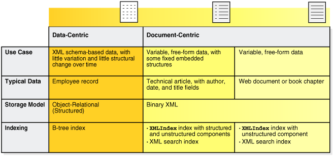
[Description of "Figure 6-1 XML Use Cases and XML Indexing"](img_text/adxdb057.md)

**Related Topics**

- XMLIndex Structured Component
- XMLIndex Unstructured Component

**See Also:**

Advantages of XMLIndex for a summary of the advantages provided by each `XMLIndex` component type

**Parent topic:** XMLIndex

#### 6.3.3 XMLIndex Structured Component

You create and use the structured component of an `XMLIndex` index for queries that project fixed, structured islands of XML content, even if the surrounding data is relatively unstructured.

A structured `XMLIndex` component organizes such islands in a relational format. In this it is similar to SQL/XML function `XMLTable`, and the syntax you use to define the structured component reflects this similarity. The relational tables used to store the indexing data are data-type aware, and each column can be of a different scalar data type.

You can thus think of the act of creating the structured component of an `XMLIndex` index as decomposing a structured portion of your XML data into relational format. This differs from the object-relational storage model of `XMLType` in these ways:

- A structured index component explicitly decomposes particular portions of your data, which you specify — portions that you commonly query. Object-relational `XMLType` storage involves automatic decomposition of an entire `XMLType` table or column.

- The structured component of an `XMLIndex` index applies to both XML schema-based and non-schema-based data. Object-relational `XMLType` storage applies only to data that is based on an XML schema.

- The decomposed data for a structured `XMLIndex` component is stored in addition to the `XMLType` data, as an index, rather than being the storage model for the `XMLType` data itself.

- For a structured `XMLIndex` component, the same data can be projected multiple times, as columns of different data type.

The index content tables used for the structured component of an `XMLIndex` index are part of the index, but because they are normal relational tables you can, in turn, index them using any standard relational indexes, including indexes that satisfy primary-key and foreign-key constraints. You can also index them using domain indexes, such as an Oracle Text `CONTEXT` index.

Another way to look at the structured component of an `XMLIndex` index sees that it acts as a generalized function-based index. A function-based index is similar to a structured `XMLIndex` component that has only one relational column.

If you find that for a particular application you are creating multiple function-based indexes, then consider using an `XMLIndex` index with a structured component instead. Create also B-tree indexes on the columns of the structured index component.

**Note:**

- Queries that use SQL/XML function `XMLTable` can typically be automatically rewritten to use the relational indexing tables of an `XMLIndex` structured component. In particular, SQL `ORDER BY`, `GROUP BY`, and window constructs operating on columns of an `XMLTable` virtual table are rewritten to the same constructs operating on the real columns of the relational indexing tables of the structured `XMLIndex` component.

  The relational tables used for `XMLIndex` structured indexing also contain some internal, system-defined columns. These internal columns might change in the future, so do not write code that depends on any assumptions about their existence or contents.

- Queries that use Oracle SQL function `XMLSequence` within a SQL `TABLE` collection expression, that is, `TABLE (XMLSequence(...))`, are not rewritten to use the indexing tables of an `XMLIndex` structured component. Oracle SQL function `XMLSequence` is deprecated in Oracle Database 11g Release 2; use standard SQL/XML function `XMLTable` instead.

  See [Oracle Database SQL Language Reference](../sqlrf/SELECT.md) for information about the SQL `TABLE` collection expression.

<!-- -->

- Ignore the Index Content Tables; They Are Transparent
  Although the index content tables of an `XMLIndex` structured component are normal relational tables, they are also read-only: you cannot add or drop their columns or modify (insert, update, or delete) their rows.
- Data Type Considerations for XMLIndex Structured Component
  The relational tables that are used for an `XMLIndex` structured component use SQL data types. XQuery expressions that are used in queries use XML data types (XML Schema data types and XQuery data types).
- Exchange Partitioning and XMLIndex
  In exchange partitioning, you exchange a table with a partition of another table. The first table must have the same structure as the partition of the second table, with which it is to be exchanged. The two tables must also be similar with respect to indexing with an `XMLIndex` index.

**Related Topics**

- Use of XMLIndex with a Structured Component
- [SQL/XML Functions XMLQUERY, XMLTABLE, XMLExists, and XMLCast](xquery-and-XML-DB.md)
- Function-Based Indexes Are Deprecated for XMLType

**Parent topic:** XMLIndex

##### 6.3.3.1 Ignore the Index Content Tables; They Are Transparent

Although the index content tables of an `XMLIndex` structured component are normal relational tables, they are also read-only: you cannot add or drop their columns or modify (insert, update, or delete) their rows.

You can thus generally ignore the relational index content tables. You cannot access them, other than to `DESCRIBE` them and create (secondary) indexes on them. You need never explicitly gather statistics on them. You need only collect statistics on the `XMLIndex` index itself or the base table on which the `XMLIndex` index is defined; statistics are collected and maintained on the index content tables transparently.

**Related Topics**

- Collecting Statistics on XMLIndex Objects for the Cost-Based Optimizer

**Parent topic:** XMLIndex Structured Component

##### 6.3.3.2 Data Type Considerations for XMLIndex Structured Component

The relational tables that are used for an `XMLIndex` structured component use SQL data types. XQuery expressions that are used in queries use XML data types (XML Schema data types and XQuery data types).

XQuery typing rules can automatically change the data type of a subexpression, to ensure coherence and type-checking. For example, if a document that is queried using XPath expression `/PurchaseOrder/LineItem[@ItemNumber = 25]` is not XML schema-based, then the subexpression `@ItemNumber` is untyped, and it is then automatically cast to `xs:double` by the XQuery `=` comparison operator. To index this data using an `XMLIndex` structured component you must use `BINARY_DOUBLE` as the SQL data type.

This is a general rule. For an `XMLIndex` index with structured component to apply to a query, the data types must correspond. Table 6-5 shows the data-type correspondences.

Table 6-5 XML and SQL Data Type Correspondence for XMLIndex

| XML Data Type          | SQL Data Type                          |
|:-----------------------|:---------------------------------------|
| `xs:decimal`           | `INTEGER` or `NUMBER`                  |
| `xs:double`            | `BINARY_DOUBLE`                        |
| `xs:float`             | `BINARY_FLOAT`                         |
| `xs:date`              | `DATE`, `TIMESTAMP WITH TIMEZONE`      |
| `xs:dateTime`          | `TIMESTAMP`, `TIMESTAMP WITH TIMEZONE` |
| `xs:dayTimeDuration`   | `INTERVAL DAY TO SECOND`               |
| `xs:yearMonthDuration` | `INTERVAL YEAR TO MONTH`               |

**Note:**

If the XML data type is `xs:date` or `xs:dateTime`, and if you know that the data that you will query and for which you are creating an index will not contain a time-zone component, then you can increase performance by using SQL data type `DATE` or `TIMESTAMP`. If the data might contain a time-zone component, then you must use SQL data type `TIMESTAMP WITH TIMEZONE`.

If the XML and SQL data types involved do not have a built-in one-to-one correspondence, then you must make them correspond (according to Table 6-5), in order for the index to be picked up for your query. There are two ways you can do this:

- Make the index correspond to the query – Define (or redefine) the column in the structured index component, so that it corresponds to the XML data type. For example, if a query that you want to index uses the XML data type `xs:double`, then define the index to use the corresponding SQL data type, `BINARY_DOUBLE`.

- Make the query correspond to the index – In your query, explicitly cast the relevant parts of an XQuery expression to data types that correspond to the SQL data types used in the index content table.

Example 6-1 and Example 6-2 show how you can cast an XQuery expression in your query to match the SQL data type used in the index content table.

Notice that the number `25` plays a different role in these two examples, even though in both cases it is the purchase-order item number. In Example 6-1, `25` is a SQL number of data type `INTEGER`; in Example 6-2, `25` is an XQuery number of data type `xs:decimal`.

In Example 6-1, the `XMLQuery` result is cast to SQL type `INTEGER`, which is compared with the SQL value 25. In Example 6-2, the value of attribute `ItemNumber` is cast (in XQuery) to the XML data type `xs:decimal`, which is compared with the XQuery value 25 and which corresponds to the SQL data type (`INTEGER`) used for the index. There are thus two different kinds of data-type conversion in these examples, but they both convert query data to make it type-compatible with the index content table.

**See Also:**

[Use DBMS_XMLSCHEMA to Map XML Schema Data Types to SQL Data Types](XML-Schema-and-query-object-relational-storage.md) for information about the built-in correspondence between XML Schema data types and SQL data types

Example 6-1 Making Query Data Compatible with Index Data – SQL Cast

    SELECT count(*) FROM purchaseorder
      WHERE XMLCast(XMLQuery('$p/PurchaseOrder/LineItem/@ItemNumber'
                             PASSING OBJECT_VALUE AS "p" RETURNING CONTENT)
                    AS INTEGER)
            = 25;

Example 6-2 Making Query Data Compatible with Index Data – XQuery Cast

    SELECT count(*) FROM purchaseorder
      WHERE XMLExists('$p/PurchaseOrder/LineItem[xs:decimal(@ItemNumber) = 25]'
                      PASSING OBJECT_VALUE AS "p");

**Parent topic:** XMLIndex Structured Component

##### 6.3.3.3 Exchange Partitioning and XMLIndex

In exchange partitioning, you exchange a table with a partition of another table. The first table must have the same structure as the partition of the second table, with which it is to be exchanged. The two tables must also be similar with respect to indexing with an `XMLIndex` index.

One of the following must be true:

- Neither table has an `XMLIndex` index.

- Both have an `XMLIndex` index, and one of the following is true:

  - Neither index has a structured component.

  - Both indexes have a structured component.

If none of those conditions holds then you cannot perform exchange partitioning.

If both tables have an `XMLIndex` index with a structured component then in the general case you must perform some preprocessing before invoking `ALTER TABLE EXCHANGE PARTITION`, and you must perform some postprocessing after invoking it. Otherwise, the exchange-partition operation raises an error.

You use PL/SQL procedures `exchangePreProc` and `exchangePostProc` in package `DBMS_XMLSTORAGE_MANAGE` to perform this preprocessing and postprocessing, as illustrated in Example 6-3. Each of the `XMLType` tables there, `table` and `exchange_table`, has an `XMLIndex` index that has a structured component.

In the special case of reference-partitioned tables there are foreign-key constraints involved, so things are a bit more complex. In this case, you use PL/SQL procedure `refPartitionExchangeIn` or `refPartitionExchangeOut`, to load data into (exchange-in) or out of (exchange-out) the partitioned tables, respectively.

Example 6-4 illustrates this, loading data from exchange tables `parent_ex` and `child_ex` into base tables `parent` and `child`. Example 6-5 shows the table and index definitions.

**See Also:**

- [Oracle Database SQL Language Reference](../sqlrf/ALTER-TABLE.md)

- [Oracle Database Data Cartridge Developer's Guide](../addci/building-domain-indexes.md) for general information about using `ALTER TABLE EXCHANGE PARTITION` with tables that have domain indexes (`XMLIndex` is a domain index)

- [Oracle Database PL/SQL Packages and Types Reference](../arpls/DBMS_XMLSTORAGE_MANAGE.md) for information about procedures `exchangePreProc`, `exchangePostProc`, `refPartitionExchangeIn`, and `refPartitionExchangeIOut` in package `DBMS_XMLSTORAGE_MANAGE`.

Example 6-3 Exchange-Partitioning Tables That Have an XMLIndex Structured Component

    EXEC DBMS_XMLSTORAGE_MANAGE.exchangePreProc(USER, 'table');
    EXEC DBMS_XMLSTORAGE_MANAGE.exchangePreProc(USER, 'exchange_table');

    ALTER TABLE table EXCHANGE PARTITION partition WITH TABLE exchange_table
      WITH VALIDATION UPDATE INDEXES;

    EXEC DBMS_XMLSTORAGE_MANAGE.exchangePostProc(USER, 'table');
    EXEC DBMS_XMLSTORAGE_MANAGE.exchangePostProc(USER, 'exchange_table');

Example 6-4 Exchange-Partitioning Reference-Partitioned Tables That Use XMLIndex

In this example:

- `parent` is the partitioned base table.

- `child` is a reference-partitioned child table with `XMLType` column `xcol`.

- `child_xidx` is an `XMLIndex` index with a structured component, defined on column `xcol` of table `child`. This is a local index, which is partitioned.

- `parent_ex` is the exchange table for base table `parent`.

- `child_ex` is the exchange table for child table `child`.

- `child_xidx_ex` is an `XMLIndex` index with a structured component, defined on column `xcol` of table `child_ex`. This is not a local index (unlike the case for index `child_xidx`).

- `USER` is the owner (database schema) of the tables.

This example performs an exchange-in operation, loading data from the exchange tables into the partitioned tables. An exchange-out operations, which loads data out of the partitioned tables into the exchange tables, would look the same, except that it would use procedure `refPartitionExchangeOut` instead. The procedure is passed the relevant tables and the necessary `ALTER TABLE` ... `EXCHANGE` statements.

    EXEC DBMS_XMLSTORAGE_MANAGE.refPartitionExchangeIn(
           USER, 'parent', 'child', 'parent_ex', 'child_ex',
           'ALTER TABLE parent EXCHANGE PARTITION part_all WITH TABLE parent_ex
              INCLUDING INDEXES WITH VALIDATION UPDATE INDEXES',
           'ALTER TABLE child  EXCHANGE PARTITION part_all WITH TABLE child_ex
              INCLUDING INDEXES WITH VALIDATION UPDATE INDEXES');

Example 6-5 Data Used in Example of Exchange-Partitioning for Reference-Partitioned Tables

This example shows the creation operations for the tables and indexes used in Example 6-4.

    CREATE TABLE parent (id      NUMBER PRIMARY KEY,
                         created DATE)
      PARTITION BY RANGE (created)
        (PARTITION part_2014 VALUES LESS THAN (to_date('01-jan-2015', 'dd-mon-yyyy')),
         PARTITION part_all  VALUES LESS THAN (maxvalue));

    CREATE TABLE child (parent_id NUMBER NOT NULL,
                        xcol      XMLType,
                        CONSTRAINT child_tab_fk FOREIGN KEY (parent_id)
                                                REFERENCES parent (id)
                        ENABLE VALIDATE)
      XMLType COLUMN xcol STORE AS BINARY XML PARTITION BY REFERENCE (child_tab_fk);

    CREATE INDEX child_xidx ON child p (xcol) INDEXTYPE IS XDB.XMLIndex
      PARAMETERS ('XMLTable po_index_tab ''purchaseorder''
                   COLUMNS pid NUMBER(4) PATH ''@id''') LOCAL ;

    CREATE TABLE parent_ex (id      NUMBER PRIMARY KEY,
                            created DATE);

    CREATE TABLE child_ex (parent_id NUMBER NOT NULL,
                           xcol      XMLType,
                           CONSTRAINT child_tab_fk1 FOREIGN KEY (parent_id)
                                                    REFERENCES parent_ex(id)
                          ENABLE VALIDATE)
      XMLType COLUMN xcol STORE AS BINARY XML;

    CREATE INDEX child_ex_xidx ON child_ex p (xcol) INDEXTYPE IS XDB.XMLIndex
      PARAMETERS ('XMLTable po_index_tab_ex ''purchaseorder''
                   COLUMNS pid NUMBER(4) PATH ''@id''');

**Parent topic:** XMLIndex Structured Component

#### 6.3.4 XMLIndex Unstructured Component

Unlike a B-tree index, which you define for a specific database column that represents an individual XML element or attribute, or the `XMLIndex` structured component, which applies to specific, structured document parts, the unstructured component of an `XMLIndex` index is, by default, very general.

Unless you specify a more narrow focus by detailing specific XPath expressions to use or not to use in indexing, an unstructured `XMLIndex` component applies to all possible XPath expressions for your XML data.

The unstructured component of an `XMLIndex` index has three logical parts:

- A **path index** – This indexes the XML tags of a document and identifies its various document fragments.

- An **order index** – This indexes the hierarchical positions of the nodes in an XML document. It keeps track of parent–child, ancestor–descendant, and sibling relations.

- A **value index** – This indexes the values of an XML document. It provides lookup by either value equality or value range. A value index is used for values in query predicates (`WHERE` clause).

The unstructured component of an `XMLIndex` index uses a path table and a set of (local) secondary indexes on the path table, which implement the logical parts described above. Two secondary indexes are created automatically:

- A **pikey index**, which implements the logical indexes for both path and order.

- A real **value index**, which implements the logical value index.

You can modify these two indexes or create additional secondary indexes. The path table and its secondary indexes are all owned by the owner of the base table upon which the `XMLIndex` index is created.

The pikey index handles paths and order relationships together, which gives the best performance in most cases. If you find in some particular case that the value index is not picked up when think it should be, you can replace the pikey index with separate indexes for the paths and order relationships. Such (optional) indexes are called **path id** and **order key** indexes, respectively. For best results, contact Oracle Support if you find that the pikey index is not sufficient for your needs in some case.

The path table contains one row for each indexed node in the XML document. For each indexed node, the **path table** stores:

- The corresponding rowid of the table that stores the document.

- A locator, which provides fast access to the corresponding document fragment. For binary XML storage of XML schema-based data, it also stores data-type information.

- An order key, to record the hierarchical position of the node in the document. You can think of this as a Dewey decimal key like that used in library cataloging and Internet protocol SNMP. In such a system, the key `3.21.5` represents the node position of the fifth child of the twenty-first child of the third child of the document root node.

- An identifier that represents an XPath path to the node.

- The effective text value of the node.

Table 6-6 shows the main informationFoot 2 that is in the path table.

Table 6-6 XMLIndex Path Table

| Column      | Data Type        | Description                                                                                                                                              |
|:------------|:-----------------|:---------------------------------------------------------------------------------------------------------------------------------------------------------|
| `PATHID`    | `RAW(8)`         | Unique identifier for the XPath path to the node.                                                                                                        |
| `RID`       | `ROWID`          | Rowid of the table used to store the XML data.                                                                                                           |
| `ORDER_KEY` | `RAW(1000)`      | Decimal order key that identifies the hierarchical position of the node. (Document ordering is preserved.)                                               |
| `LOCATOR`   | `RAW(2000)`      | Fragment-location information. Used for fragment extraction. For binary XML storage of XML schema-based data, data-type information is also stored here. |
| `VALUE`     | `VARCHAR2(4000)` | Effective text value the node.                                                                                                                           |

The pikey index uses path table columns `PATHID`, `RID`, and `ORDER_KEY` to represent the path and order indexes. An optional path id index uses columns `PATHID` and `RID` to represent the path index. A value index is an index on the `VALUE` column.

Example 6-6 explores the contents of the path table for two purchase-order documents.

Example 6-6 Path Table Contents for Two Purchase Orders

    <PurchaseOrder>
     <Reference>SBELL-2002100912333601PDT</Reference>
     <Actions>
      <Action>
       <User>SVOLLMAN</User>
      </Action>
     </Actions>
     . . .
    </PurchaseOrder>

    <PurchaseOrder>
     <Reference>ABEL-20021127121040897PST</Reference>
     <Actions>
      <Action>
       <User>ZLOTKEY</User>
      </Action>
      <Action>
       <User>KING</User>
      </Action>
     </Actions>
     . . .
    </PurchaseOrder>

An `XMLIndex` index on an `XMLType` table or column storing these purchase orders includes a path table that has one row for each indexed node in the XML documents. Suppose that the system assigns the following `PATHID`s when indexing the nodes according to their XPath expressions:

| PATHID | Indexed XPath                        |
|:-------|:-------------------------------------|
| `1`    | `/PurchaseOrder`                     |
| `2`    | `/PurchaseOrder/Reference`           |
| `3`    | `/PurchaseOrder/Actions`             |
| `4`    | `/PurchaseOrder/Actions/Action`      |
| `5`    | `/PurchaseOrder/Actions/Action/User` |

The resulting path table would then be something like this (column `LOCATOR` is not shown):

| PATHID | RID  | ORDER_KEY | VALUE                                  |
|:-------|:-----|:----------|:---------------------------------------|
| `1`    | `R1` | `1`       | `SBELL-2002100912333601PDTSVOLLMAN`    |
| `2`    | `R1` | `1.1`     | `SBELL-2002100912333601PDT`            |
| `3`    | `R1` | `1.2`     | `SVOLLMAN`                             |
| `4`    | `R1` | `1.2.1`   | `SVOLLMAN`                             |
| `5`    | `R1` | `1.2.1.1` | `SVOLLMAN`                             |
| `1`    | `R2` | `1`       | `ABEL-20021127121040897PSTZLOTKEYKING` |
| `2`    | `R2` | `1.1`     | `ABEL-20021127121040897PST`            |
| `3`    | `R2` | `1.2`     | `ZLOTKEYKING`                          |
| `4`    | `R2` | `1.2.1`   | `ZLOTKEY`                              |
| `5`    | `R2` | `1.2.1.1` | `ZLOTKEY`                              |
| `4`    | `R2` | `1.2.2`   | `KING`                                 |
| `5`    | `R2` | `1.2.2.1` | `KING`                                 |

- Ignore the Path Table – It Is Transparent
  Though you can create secondary indexes on path-table columns, you can generally ignore the path table itself.
- Column VALUE of an XMLIndex Path Table
  A secondary index on column `VALUE` is used with XPath expressions in a `WHERE` clause that have predicates involving string matches. For example:
- Secondary Indexes on Column VALUE
  Even if you do not specify a secondary index for column `VALUE` when you create an `XMLIndex` index, a default secondary index is created on column `VALUE`. This default index has the default properties — in particular, it is an index for text (string-valued) data only.
- XPath Expressions That Are Not Indexed by an XMLIndex Unstructured Component
  A few types of XPath expressions are not indexed by `XMLIndex`.

**Parent topic:** XMLIndex

##### 6.3.4.1 Ignore the Path Table – It Is Transparent

Though you can create secondary indexes on path-table columns, you can generally ignore the path table itself.

You cannot access the path table, other than to `DESCRIBE` it and create (secondary) indexes on it. You need never explicitly gather statistics on the path table. You need only collect statistics on the `XMLIndex` index or the base table on which the `XMLIndex` index is defined; statistics are collected and maintained on the path table and its secondary indexes transparently.

**Related Topics**

- Collecting Statistics on XMLIndex Objects for the Cost-Based Optimizer

**Parent topic:** XMLIndex Unstructured Component

##### 6.3.4.2 Column VALUE of an XMLIndex Path Table

A secondary index on column `VALUE` is used with XPath expressions in a `WHERE` clause that have predicates involving string matches. For example:

    /PurchaseOrder[Reference/text() = "SBELL-2002100912333601PDT"]

Column `VALUE` stores the **effective text value** of an element or an attribute node — comments and processing instructions are ignored during indexing.

- For an attribute, the effective text value is the attribute value.

- For a simple element (an element that has no children), the effective text value is the concatenation of all of the text nodes of the element.

- For a complex element (an element that has children), the effective text value is the concatenation of (1) the text nodes of the element itself and (2) the effective text values of all of its simple-element descendants. (This is a recursive definition.)

The effective text value is limited (truncated), however, to 4000 bytes for a simple element or attribute and to 80 bytes for a complex element.

Column `VALUE` is a fixed size, `VARCHAR2(4000)`. Any overflow (beyond 4000 bytes) during index creation or update is truncated.

In addition to the 4000-byte limit for column `VALUE`, there is a limit on the size of a key for the secondary index created on this column. This is the case for B-tree and function-based indexes as well; it is not an `XMLIndex` limitation. The index-key size limit is a function of the block size for your database. It is this limit that determines how much of `VALUE` is indexed.

Thus, only the first 4000 bytes of the effective text value are stored in column `VALUE`, and only the first N bytes of column `VALUE` are indexed, where N is the index-key size limit (N \< 4000). Because of the index-key size limit, the index on column `VALUE` acts only as a preliminary filter for the effective text value.

For example, suppose that your database block size requires that the `VALUE` index be no larger than 800 bytes, so that only the first 800 bytes of the effective text value is indexed. The first 800 bytes of the effective text value is first tested, using `XMLIndex`, and only if that text prefix matches the query value is the rest of the effective text value tested.

The secondary index on column `VALUE` is an index on SQL function `substr` (substring equality), because that function is used to test the text prefix. This function-based index is created automatically as part of the implementation of `XMLIndex` for column `VALUE`.

For example, the XPath expression `/PurchaseOrder[Reference/text() = :1]` in a query `WHERE` clause might, in effect, be rewritten to a test something like this:

    substr(VALUE, 1 800) = substr(:1, 1, 800) AND VALUE = :1;

This conjunction contains two parts, which are processed from left to right. The first test uses the index on function `substr` as a preliminary filter, to eliminate text whose first 800 bytes do not match the first 800 bytes of the value of bind variable `:1`.

Only the first test uses an index — the full value of column `VALUE` is not indexed. After preliminary filtering by the first test, the second test checks the entire effective text value — that is, the full value of column `VALUE` — for full equality with the value of `:1`. This check does not use an index.

Even if only the first 800 bytes of text is indexed, it is important for query performance that up to 4000 bytes be stored in column `VALUE`, because that provides quick, direct access to the data, instead of requiring, for example, extracting it from deep within a `CLOB`-instance XML document. If the effective text value is greater than 4000 bytes, then the second test in the `WHERE`-clause conjunction requires accessing the base-table data.

Neither the `VALUE` column 4000-byte limit nor the index-key size affect query results in any way; they can affect only performance.

**Note:**

Because of the possibility of the `VALUE` column being truncated, an Oracle Text `CONTEXT` index created on the `VALUE` column might return incorrect results.

As mentioned, `XMLIndex` can be used with XML schema-based data. If an XML schema specifies a `defaultValue` value for a given element or attribute, and a particular document does not specify a value for that element or attribute, then the `defaultValue` value is used for the `VALUE` column.

**Parent topic:** XMLIndex Unstructured Component

##### 6.3.4.3 Secondary Indexes on Column VALUE

Even if you do not specify a secondary index for column `VALUE` when you create an `XMLIndex` index, a default secondary index is created on column `VALUE`. This default index has the default properties — in particular, it is an index for text (string-valued) data only.

You can, however, create a `VALUE` index of a different type. For example, you can create a number-valued index if that is appropriate for many of your queries. You can create multiple secondary indexes on the `VALUE` column. An index of a particular type is used only when it is appropriate. For example, a number-valued index is used only when the `VALUE` column is a number; it is ignored for other values. Secondary indexes on path-table columns are treated like any other secondary indexes — you can alter them, drop them, mark them unusable, and so on.

**See Also:**

- Using XMLIndex with an Unstructured Component for examples of creating secondary indexes on column `VALUE`

- PARAMETERS Clause for CREATE INDEX and ALTER INDEX for the syntax of the `PARAMETERS` clause

**Parent topic:** XMLIndex Unstructured Component

##### 6.3.4.4 XPath Expressions That Are Not Indexed by an XMLIndex Unstructured Component

A few types of XPath expressions are not indexed by `XMLIndex`.

- Applications of XPath functions, except `ora:contains` (which is deprecated). In particular, user-defined XPath functions are not indexed.

- Axes other than `child`, `descendant`, and `attribute`, that is, axes `parent`, `ancestor`, `following-sibling`, `preceding-sibling`, `following`, `preceding`, and `ancestor-or-self`.

- Expressions using the union operator, `|` (vertical bar).

**Parent topic:** XMLIndex Unstructured Component

#### 6.3.5 Creating, Dropping, Altering, and Examining an XMLIndex Index

Basic operations on an `XMLIndex` index include creating it, dropping it, altering it, and examining it. Examples are presented.

You create an `XMLIndex` index by declaring the index type to be `XDB.XMLIndex`, as illustrated in Example 6-7.

This creates an `XMLIndex` index named `po_xmlindex_ix` on `XMLType` table `po_binxml`. The index has only an unstructured component, no structured component.

You specify inclusion of a structured component in an `XMLIndex` index by including a `structured_clause` in the `PARAMETERS` clause. You specify inclusion of an unstructured component by including a `path_table_clause` in the `PARAMETERS` clause.

You can do this when you create the `XMLIndex` index or when you modify it. If, as in Example 6-7, you specify neither a `structured_clause` nor a `path_table_clause`, then only an unstructured component is included.

If an `XMLIndex` index has both an unstructured and a structured component, then you can drop either of these components using `ALTER INDEX`.

You can obtain the name of an `XMLIndex` index on a particular `XMLType` table (or column), as shown in Example 6-8. You can also select `INDEX_NAME` from `DBA_INDEXES` or `ALL_INDEXES`, as appropriate.

You rename or drop an `XMLIndex` index just as you would any other index, as illustrated in Example 6-9. This renaming changes the name of the `XMLIndex` index only. It does not change the name of the path table — you can rename the path table separately.

Similarly, you can change other index properties using other `ALTER INDEX` options, such as `REBUILD`. `XMLIndex` is no different from other index types in this respect.

The `RENAME` clause of an `ALTER INDEX` statement for `XMLIndex` applies only to the `XMLIndex` index itself. To rename the path table and secondary indexes, you must determine the names of these objects and use appropriate `ALTER TABLE` or `ALTER INDEX` statements on them directly. Similarly, to retrieve the physical properties of the secondary indexes or alter them in any other way, you must obtain their names, as in Example 6-14.

**See Also:**

- structured_clause ::=

- path_table_clause ::=

- drop_path_table_clause ::=

- alter_index_group_clause ::=

Example 6-7 Creating an XMLIndex Index

    CREATE INDEX po_xmlindex_ix ON po_binxml (OBJECT_VALUE) INDEXTYPE IS XDB.XMLIndex;

Example 6-8 Obtaining the Name of an XMLIndex Index on a Particular Table

    SELECT INDEX_NAME FROM USER_INDEXES
      WHERE TABLE_NAME = 'PO_BINXML' AND ITYP_NAME = 'XMLINDEX';

    INDEX_NAME
    ---------------
    PO_XMLINDEX_IX

    1 row selected.

Example 6-9 Renaming and Dropping an XMLIndex Index

    ALTER INDEX po_xmlindex_ix RENAME TO new_name_ix;

    DROP INDEX new_name_ix;

**Related Topics**

- PARAMETERS Clause Syntax for CREATE INDEX and ALTER INDEX

**Parent topic:** XMLIndex

#### 6.3.6 Using XMLIndex with an Unstructured Component

You can perform various operations on an `XMLIndex` index that has an unstructured component, including manipulating the path table and the secondary indexes of that component.

To include an unstructured component in an `XMLIndex` index, you can use a `path_table_clause` in the `PARAMETERS` clause when you create or modify the `XMLIndex` index — see path_table_clause ::=.

If you do not specify a structured component, then the index will have an unstructured component, even if you do not specify the path table. It is however generally a good idea to specify the path table, so that it has a recognizable, user-oriented name that you can refer to in other `XMLIndex` operations.

Example 6-10 shows how to name the path table ("my_path_table") when creating an `XMLIndex` index with an unstructured component.

If you do not name the path table then its name is generated by the system, using the index name you provide to `CREATE INDEX` as a base. Example 6-11 shows this for the `XMLIndex` index created in Example 6-7.

By default, the storage options of a path table and its secondary indexes are derived from the storage properties of the base table on which the `XMLIndex` index is created. You can specify different storage options by using a `PARAMETERS` clause when you create the index, as shown in Example 6-12. The `PARAMETERS` clause of `CREATE INDEX` (and `ALTER INDEX`) must be between single quotation marks (`'`).

Because `XMLIndex` is a logical domain index, not a physical index, all physical attributes are either zero (`0`) or `NULL`.

If an `XMLIndex` index has both an unstructured and a structured component, then you can use `ALTER INDEX` to drop the unstructured component. To do this, you drop the path table. Example 6-13 illustrates this. (This assumes that you also have a structured component — Example 6-23 results in an index with both structured and unstructured components.)

In addition to specifying storage options for the path table, Example 6-12 names the secondary indexes on the path table.

Like the name of the path table, the names of the secondary indexes on the path-table columns are generated automatically using the index name as a base, unless you specify them in the `PARAMETERS` clause. Example 6-14 illustrates this, and shows how you can determine these names using public view `USER_IND_COLUMNS`. It also shows that the pikey index uses three columns.

**See Also:**

Example 6-20 for a similar, but more complex example

Example 6-10 Naming the Path Table of an XMLIndex Index

    CREATE INDEX po_xmlindex_ix ON po_binxml (OBJECT_VALUE) INDEXTYPE IS XDB.XMLIndex
      PARAMETERS ('PATH TABLE my_path_table');

Example 6-11 Determining the System-Generated Name of an XMLIndex Path Table

    SELECT PATH_TABLE_NAME FROM USER_XML_INDEXES
      WHERE TABLE_NAME = 'PO_BINXML' AND INDEX_NAME = 'PO_XMLINDEX_IX';

    PATH_TABLE_NAME
    ------------------------------
    SYS67567_PO_XMLINDE_PATH_TABLE

    1 row selected.

Example 6-12 Specifying Storage Options When Creating an XMLIndex Index

    CREATE INDEX po_xmlindex_ix ON po_binxml (OBJECT_VALUE) INDEXTYPE IS XDB.XMLIndex
      PARAMETERS
        ('PATH TABLE po_path_table
          (PCTFREE 5 PCTUSED 90 INITRANS 5
           STORAGE (INITIAL 1k NEXT 2k MINEXTENTS 3 BUFFER_POOL KEEP)
           NOLOGGING ENABLE ROW MOVEMENT PARALLEL 3)
          PIKEY INDEX po_pikey_ix (LOGGING PCTFREE 1 INITRANS 3)
          VALUE INDEX po_value_ix (LOGGING PCTFREE 1 INITRANS 3)');

Example 6-13 Dropping an XMLIndex Unstructured Component

    ALTER INDEX po_xmlindex_ix PARAMETERS('DROP PATH TABLE');

Example 6-14 Determining the Names of the Secondary Indexes of an XMLIndex Index

    SELECT INDEX_NAME, COLUMN_NAME, COLUMN_POSITION FROM USER_IND_COLUMNS
      WHERE TABLE_NAME IN (SELECT PATH_TABLE_NAME FROM USER_XML_INDEXES
                             WHERE INDEX_NAME = 'PO_XMLINDEX_IX')
      ORDER BY INDEX_NAME, COLUMN_NAME;

    INDEX_NAME                     COLUMN_NAME  COLUMN_POSITION
    ------------------------------ ------------ ---------------
    SYS67563_PO_XMLINDE_PIKEY_IX   ORDER_KEY                  3
    SYS67563_PO_XMLINDE_PIKEY_IX   PATHID                     2
    SYS67563_PO_XMLINDE_PIKEY_IX   RID                        1
    SYS67563_PO_XMLINDE_VALUE_IX   SYS_NC00006$               1

    4 rows selected.

- Creating Additional Secondary Indexes on an XMLIndex Path Table
  You can add extra secondary indexes to an `XMLIndex` unstructured component.

**Related Topics**

- PARAMETERS Clause Syntax for CREATE INDEX and ALTER INDEX

**Parent topic:** XMLIndex

##### 6.3.6.1 Creating Additional Secondary Indexes on an XMLIndex Path Table

You can add extra secondary indexes to an `XMLIndex` unstructured component.

Examples Example 6-15, Example 6-17, Example 6-18, and Example 6-19 add extra secondary indexes to the `XMLIndex` index created in Example 6-12.

You can create any number of additional secondary indexes on the `VALUE` column of the path table of an `XMLIndex` index. These can be of different types, including function-based indexes and Oracle Text indexes.

Whether or not a given index is used for a given element occurrence when processing a query is determined by whether it is of the appropriate type for that value and whether it is cost-effective to use it.

Example 6-15 creates a function-based index on column `VALUE` of the path table using SQL function `substr`. This might be useful if your queries often use `substr` applied to the text nodes of XML elements.

If you have many elements whose text nodes represent numeric values, then it can make sense to create a numeric index on the column `VALUE`. However, doing so directly, in a manner analogous to Example 6-15, raises an ORA-01722 error (invalid number) if some of the element values are not numbers. This is illustrated in Example 6-16.

What is needed is an index that is used for numeric-valued elements but is ignored for element occurrences that do not have numeric values. Procedure `createNumberIndex` of package `DBMS_XMLINDEX` exists specifically for this purpose. You pass it the names of the database schema, the `XMLIndex` index, and the numeric index to be created. Creation of a numeric index is illustrated in Example 6-17.

Because such an index is specifically designed to ignore elements that do not have numeric values, its use does not detect their presence. If there are non-numeric elements and, for whatever reason, the `XMLIndex` index is not used in some query, then an `ORA-01722` error is raised. However, if the index is used, no such error is raised, because the index ignores non-numeric data. As always, the use of an index never changes the result set — it never gives you different results, but use of an index can prevent you from detecting erroneous data.

Creating a date-valued index is similar to creating a numeric index; you use procedure `DBMS_XMLINDEX.createDateIndex`. Example 6-18 shows this.

Example 6-19 creates an Oracle Text `CONTEXT` index on column `VALUE`. This is useful for full-text queries on text values of XML elements. XPath predicates that use XPath function `ora:contains` (deprecated) are rewritten to applications of Oracle SQL function `contains` on column `VALUE`. If a `CONTEXT` index is defined on column `VALUE`, then it is used during predicate evaluation. An Oracle Text index is independent of all other `VALUE`-column indexes.

The query in Example 6-20 shows all of the secondary indexes created on the path table of an `XMLIndex` index. The indexes created explicitly are in bold. Note in particular that some indexes, such as the function-based index created on column `VALUE`, do not appear as such; the column name listed for such an index is a system-generated name such as `SYS_NC00007$`. You cannot see these columns by executing a query with `COLUMN_NAME = 'VALUE'` in the `WHERE` clause.

**See Also:**

- Column VALUE of an XMLIndex Path Table for information about the possibility of an Oracle Text `CONTEXT` index created on the `VALUE` column returning incorrect results

- [Oracle Text Reference](../ccref/oracle-text-SQL-statements-and-operators.md) for information about `CREATE INDEX` parameter `TRANSACTIONAL`

- [Oracle Database PL/SQL Packages and Types Reference](../arpls/DBMS_XMLINDEX.md) for information on PL/SQL procedures `createNumberIndex` and `createDateIndex` in package `DBMS_XMLINDEX`

Example 6-15 Creating a Function-Based Index on Path-Table Column VALUE

    CREATE INDEX fn_based_ix ON po_path_table (substr(VALUE, 1, 100));

Example 6-16 Trying to Create a Numeric Index on Path-Table Column VALUE Directly

    CREATE INDEX direct_num_ix ON po_path_table (to_binary_double(VALUE));
    CREATE INDEX direct_num_ix ON po_path_table (to_binary_double(VALUE))
                                                 *
    ERROR at line 1:
    ORA-01722: invalid number

Example 6-17 Creating a Numeric Index on Column VALUE with Procedure createNumberIndex

    CALL DBMS_XMLINDEX.createNumberIndex('OE', 'PO_XMLINDEX_IX', 'API_NUM_IX');

Example 6-18 Creating a Date Index on Column VALUE with Procedure createDateIndex

    CALL DBMS_XMLINDEX.createDateIndex('OE', 'PO_XMLINDEX_IX', 'API_DATE_IX',
                                       'dateTime');

Example 6-19 Creating an Oracle Text CONTEXT Index on Path-Table Column VALUE

    CREATE INDEX po_otext_ix ON po_path_table (VALUE)
      INDEXTYPE IS CTXSYS.CONTEXT PARAMETERS('TRANSACTIONAL');

Example 6-20 Showing All Secondary Indexes on an XMLIndex Path Table

    SELECT c.INDEX_NAME, c.COLUMN_NAME, c.COLUMN_POSITION, e.COLUMN_EXPRESSION
      FROM USER_IND_COLUMNS c LEFT OUTER JOIN USER_IND_EXPRESSIONS e
        ON (c.INDEX_NAME = e.INDEX_NAME)
      WHERE c.TABLE_NAME IN (SELECT PATH_TABLE_NAME FROM USER_XML_INDEXES
                               WHERE INDEX_NAME = 'PO_XMLINDEX_IX')
      ORDER BY c.INDEX_NAME, c.COLUMN_NAME;

    INDEX_NAME           COLUMN_NAME  COLUMN_POSITION COLUMN_EXPRESSION
    -------------------- ------------ --------------- ----------------------
    API_DATE_IX          SYS_NC00009$               1 SYS_EXTRACT_UTC(SYS_XMLCONV("V
                                                      ALUE",3,8,0,0,181))
    API_NUM_IX           SYS_NC00008$               1 TO_BINARY_DOUBLE("VALUE")
    FN_BASED_IX          SYS_NC00007$               1 SUBSTR("VALUE",1,100)
    PO_OTEXT_IX          VALUE                      1
    PO_PIKEY_IX          ORDER_KEY                  3
    PO_PIKEY_IX          PATHID                     2
    PO_PIKEY_IX          RID                        1
    PO_VALUE_IX          SYS_NC00006$               1 SUBSTRB("VALUE",1,1599)

    8 rows selected.

**Related Topics**

- Indexing XML Data for Full-Text Queries

**Parent topic:** Using XMLIndex with an Unstructured Component

#### 6.3.7 Use of XMLIndex with a Structured Component

An `XMLIndex` structured component indexes specific islands of structure in your XML data.

To include a structured component in an `XMLIndex` index, you use a `structured_clause` in the `PARAMETERS` clause when you create or modify the `XMLIndex` index — see structured_clause ::=.

A `structured_clause` specifies the structured islands that you want to index. You use the keyword `GROUP` to specify each structured island: an island thus corresponds syntactically to a structure **group**. If you specify no group explicitly, then the predefined group `DEFAULT_GROUP` is used. For `ALTER INDEX`, you precede the `GROUP` keyword with the modification operation keyword: `ADD_GROUP` specifies a new group (island); `DROP_GROUP` deletes a group.

Why have multiple groups within a single index, instead of simply using multiple `XMLIndex` indexes? The reason is that `XMLIndex` is a domain index, and you can create only one domain index of a given type on a given database column.

The syntax for defining a structure group, that is, indexing a structured island, is similar to the syntax for invoking SQL/XML function `XMLTable`: you use keywords `XMLTable` and `COLUMNS` to define relational columns, and you use multilevel chaining of `XMLTable` to handle collections. To simplify the creation of such an index, you can use PL/SQL function `DBMS_XMLSTORAGE_MANAGE.getSIDXDefFromView` to provide exactly the `XMLTable` expression needed for creating the index.

- Using Namespaces and Storage Clauses with an XMLIndex Structured Component
  When you create an `XMLIndex` index that has a structured component you can specify XML namespaces and storage options to use.
- Adding a Structured Component to an XMLIndex Index
  You can use `ALTER INDEX` to add a structured component to an existing `XMLIndex` index.
- Using Non-Blocking ALTER INDEX with an XMLIndex Structured Component
  You can prevent `ALTER INDEX` from blocking when you add a group or column for the structured component of an `XMLIndex` index, so that queries that use the index do not need to wait.
- Modifying the Data Type of a Structured XMLIndex Component
  If an error is raised because some of your data does not match the data type used for the corresponding column of the structured `XMLIndex` component, you can in some cases simply modify the index by passing keyword `MODIFY_COLUMN_TYPE` to `ALTER INDEX`.
- Dropping an XMLIndex Structured Component
  If an `XMLIndex` index has both an unstructured and a structured component, then you can use `ALTER INDEX` to drop the structured component. You do this by dropping all of the structure groups that compose the structured component.
- Indexing the Relational Tables of a Structured XMLIndex Component
  Because the tables used for the structured component of an `XMLIndex` index are normal relational tables, you can index them using any standard relational indexes.

**Related Topics**

- Using a Registered PARAMETERS Clause for XMLIndex
- Data Type Considerations for XMLIndex Structured Component

**See Also:**

- [Indexing Binary XML Data Exposed Using a Relational View](relational-views-over-XML-data.md) for information about using `DBMS_XMLSTORAGE_MANAGE.getSIDXDefFromView`

- Example 6-30

- Indexing XML Data for Full-Text Queries

- structured_clause ::=

- Usage of XMLIndex_xmltable_clause for information about an `XMLType` column in an `XMLTable` clause

- Usage of column_clause for information about keywords `COLUMNS` and `VIRTUAL`

**Parent topic:** XMLIndex

##### 6.3.7.1 Using Namespaces and Storage Clauses with an XMLIndex Structured Component

When you create an `XMLIndex` index that has a structured component you can specify XML namespaces and storage options to use.

Example 6-21 shows the creation of an `XMLIndex` index that has only a structured component (no path-table clause) and that uses the `XMLNAMESPACES` clause to specify namespaces. It specifies that the index data be compressed and use tablespace `USERTBS1`. The example assumes a binary XML table `po_binxml` with non XML schema-based data.

Each of the (identical) `TABLESPACE` clauses in Example 6-21 applies at the table level (tables `po_ptab` and `li_tab`).

In general you can specify storage options at both the table level and the partition level. A specification at the partition level overrides one at the table level. A `TABLESPACE` clause can also be specified at the index level, that is, so that it applies to all of the partitions and tables used for the index. If `TABLESPACE` is specified at more than one level, the partition level overrides the table level, which overrides the index level.

Example 6-22 specifies the same `TABLESPACE` for each of the tables used in the index. This commonality can be factored out by specifying the `TABLESPACE` at the index level, as shown in Example 6-22.

Example 6-21 XMLIndex with a Structured Component, Using Namespaces and Storage Options

    CREATE INDEX po_struct ON po_binxml (OBJECT_VALUE) INDEXTYPE IS XDB.XMLIndex
      PARAMETERS ('XMLTable po_ptab
                     (TABLESPACE "USERTBS1" COMPRESS FOR OLTP)
                      XMLNAMESPACES (DEFAULT ''http://www.example.com/po''),
                     ''/purchaseOrder''
                     COLUMNS orderdate   DATE          PATH ''@orderDate'',
                             id          BINARY_DOUBLE PATH ''@id'',
                             items       XMLType       PATH ''items/item'' VIRTUAL
                   XMLTable li_tab
                     (TABLESPACE "USERTBS1" COMPRESS FOR OLTP)
                      XMLNAMESPACES (DEFAULT ''http://www.example.com/po''),
                     ''/item'' PASSING items
                     COLUMNS partnum     VARCHAR2(15)  PATH ''@partNum'',
                             description CLOB          PATH ''productName'',
                             usprice     BINARY_DOUBLE PATH ''USPrice'',
                             shipdat     DATE          PATH ''shipDate''');

Example 6-22 XMLIndex with a Structured Component, Specifying TABLESPACE at the Index Level

    CREATE INDEX po_struct ON po_binxml (OBJECT_VALUE) INDEXTYPE IS XDB.XMLIndex
      PARAMETERS ('XMLTable po_ptab,
                      XMLNAMESPACES (DEFAULT ''http://www.example.com/po''),
                     ''/purchaseOrder''
                     COLUMNS orderdate   DATE          PATH ''@orderDate'',
                             id          BINARY_DOUBLE PATH ''@id'',
                             items       XMLType       PATH ''items/item'' VIRTUAL
                   XMLTable li_tab,
                      XMLNAMESPACES (DEFAULT ''http://www.example.com/po''),
                     ''/item'' PASSING items
                     COLUMNS partnum     VARCHAR2(15)  PATH ''@partNum'',
                             description CLOB          PATH ''productName'',
                             usprice     BINARY_DOUBLE PATH ''USPrice'',
                             shipdat     DATE          PATH ''shipDate''
                   TABLESPACE "USERTBS1" COMPRESS FOR OLTP)');

**Parent topic:** Use of XMLIndex with a Structured Component

##### 6.3.7.2 Adding a Structured Component to an XMLIndex Index

You can use `ALTER INDEX` to add a structured component to an existing `XMLIndex` index.

Example 6-23 shows the creation of an `XMLIndex` index with only an unstructured component. An unstructured component is created because the `PARAMETERS` clause explicitly names the path table.

Example 6-23 then uses `ALTER INDEX` to add a structured component (group) named `po_item`. This structure group includes two relational tables, each specified with keyword `XMLTable`.

The top-level table, `po_idx_tab`, has columns `reference`, `requestor`, `username`, and `lineitem`. Column `lineitem` is of type `XMLType`. It represents a collection, so it is passed to the second `XMLTable` construct to form the second-level relational table, `po_index_lineitem`, which has columns `itemno`, `description`, `partno`, `quantity`, and `unitprice`.

The keyword `VIRTUAL` is required for an `XMLType` column. It specifies that the `XMLType` column itself is not materialized: its data is stored in the `XMLIndex` index only in the form of the relational columns specified by its corresponding `XMLTable` table.

You cannot create more than one `XMLType` column in a given `XMLTable` clause. To achieve that effect, you must instead define an additional group.

Example 6-23 also illustrates the use of a registered parameter string in the `PARAMETERS` clause. It uses PL/SQL procedure `DBMS_XMLINDEX.registerParameter` to register the parameters string named `myparam`. Then it uses `ALTER INDEX` to update the index parameters to include those in the string `myparam`.

Example 6-23 XMLIndex Index: Adding a Structured Component

    CREATE INDEX po_xmlindex_ix ON po_binxml (OBJECT_VALUE)
      INDEXTYPE IS XDB.XMLIndex PARAMETERS ('PATH TABLE path_tab');

    BEGIN
      DBMS_XMLINDEX.registerParameter(
        'myparam',
        'ADD_GROUP GROUP po_item
           XMLTable po_idx_tab ''/PurchaseOrder''
             COLUMNS reference   VARCHAR2(30)  PATH ''Reference'',
                     requestor   VARCHAR2(30)  PATH ''Requestor'',
                     username    VARCHAR2(30)  PATH ''User'',
                     lineitem    XMLType       PATH ''LineItems/LineItem'' VIRTUAL
           XMLTable po_index_lineitem ''/LineItem'' PASSING lineitem
             COLUMNS itemno      BINARY_DOUBLE PATH ''@ItemNumber'',
                     description VARCHAR2(256) PATH ''Description'',
                     partno      VARCHAR2(14)  PATH ''Part/@Id'',
                     quantity    BINARY_DOUBLE PATH ''Part/@Quantity'',
                     unitprice   BINARY_DOUBLE PATH ''Part/@UnitPrice''');
    END;
    /

    ALTER INDEX po_xmlindex_ix PARAMETERS('PARAM myparam');

**Parent topic:** Use of XMLIndex with a Structured Component

##### 6.3.7.3 Using Non-Blocking ALTER INDEX with an XMLIndex Structured Component

You can prevent `ALTER INDEX` from blocking when you add a group or column for the structured component of an `XMLIndex` index, so that queries that use the index do not need to wait.

When you use `ALTER INDEX` to add a group or a column for the structured component of an `XMLIndex` index, this index-maintenance operation obtains an exclusive DDL lock on the base table and the index.

The base table is locked to DML operations, and the index cannot be used for queries until the `ALTER INDEX` operation is finished. This means that during this index maintenance the index cannot be used by other sessions that query or perform DML operations on the base table. The duration of the `ALTER INDEX` operation and the attendant locking depends on the volume of data in the base `XMLType` column.

You can avoid or work around this problem as follows:

1.  Use keyword `NONBLOCKING` before `ADD_GROUP` or `ADD_COLUMN` in the `PARAMETERS` clause of the `ALTER INDEX` statement that creates the structured-component group or column.

    This updates the index as needed, but it does not index any base-table data. Because it does not depend on the base-table data it is quick regardless of the base-table size.

2.  Invoke PL/SQL procedure `DBMS_XMLINDEX.``process_pending`.

    This procedure indexes rows of the base table and populates tables of the index, just as if keyword `NONBLOCKING` were absent. However, in this case only a few rows are locked at a time while they are processed and the changes committed. Rows that have already been locked for some other purpose are skipped. This can significantly reduce lock contention and allow indexing of some rows to proceed at the same time as querying or DML on other rows.

    When procedure `process_pending` finishes it returns, as `OUT` parameters:

    - The number of rows that it could not index. This is either because they were locked for another purpose or because an error was raised (this number includes the number returned as the other `OUT` parameter).

      After you think those locks have been removed, invoke procedure `process_pending` again to try to process those pending rows.

    - The number of rows that it could not index because an error was raised. (This should be rare.)

      Check table `SYS_AIXSXI_``index_number``_ERRORTAB` for information about those errors, then take action to fix the underlying problems. `index_number` is the object number of the index.

3.  Repeat step 2 as many times as necessary until procedure `process_pending` indicates that all rows have been successfully indexed or you encounter an insurmountable problem and decide to cancel the indexing operation altogether.

    You can cancel the indexing at any time (before step 2) by using keywords `NONBLOCKING ABORT` in the `PARAMETERS` clause of a separate `ALTER INDEX` statement for the same `XMLIndex` index.

4.  If all rows have been successfully indexed then use keywords `NONBLOCKING COMPLETE` in the `PARAMETERS` clause of a separate `ALTER INDEX` statement for the same `XMLIndex` index.

Example 6-24 illustrates this.

Just as table `SYS_AIXSXI_``index_number``_``ERRORTAB` reports errors, so table `SYS_AIXSXI_``index_number``_``PENDINGTAB` records the current status of each base-table row: whether or not it has been indexed. A row might not yet be indexed because it is locked by for some other purpose or because trying to index it raised an error. In the latter case, consult `SYS_AIXSXI_``index_number``_ERRORTAB` for specific information about the error.

**See Also:**

alter_index_group_clause ::=

Example 6-24 Using DBMS_XMLINDEX.PROCESS_PENDING To Index XML Data

    CREATE INDEX po_struct ON po_binxml (OBJECT_VALUE) INDEXTYPE IS XDB.XMLIndex
      PARAMETERS ('XMLTable po_idx_tab
                     ''/PurchaseOrder''
                     COLUMNS reference   VARCHAR2(30)  PATH ''Reference'',
                             requestor   VARCHAR2(30)  PATH ''Requestor'',
                             username    VARCHAR2(30)  PATH ''User'',
                             lineitem    XMLType       PATH ''LineItems/LineItem'' VIRTUAL
                   XMLTable po_index_lineitem
                     ''/LineItem'' PASSING lineitem
                     COLUMNS itemno      BINARY_DOUBLE PATH ''@ItemNumber'',
                             description VARCHAR2(256) PATH ''Description'',
                             partno      VARCHAR2(14)  PATH ''Part/@Id'',
                             quantity    BINARY_DOUBLE PATH ''Part/@Quantity'',
                             unitprice   BINARY_DOUBLE PATH ''Part/@UnitPrice''');

    ALTER INDEX po_struct
      PARAMETERS('NONBLOCKING ADD_GROUP GROUP po_action_group
                  XMLTABLE po_idx_tab
                    ''/PurchaseOrder''
                    COLUMNS actions       XMLType       PATH  ''Actions/Action'' VIRTUAL
                  XMLTABLE po_idx_action
                    ''/Action'' PASSING actions
                    COLUMNS actioned_by   VARCHAR2(10)  PATH  ''User'',
                            date_actioned TIMESTAMP     PATH  ''Date''');

    DECLARE
      num_pending NUMBER := 0;
      num_errored NUMBER := 0;
    BEGIN
     DBMS_XMLINDEX.process_pending('oe', 'po_struct', num_pending, num_errored);
     DBMS_OUTPUT.put_line('Number of rows still pending = ' || num_pending);
     DBMS_OUTPUT.put_line('Number of rows with errors   = ' || num_errored);
    END;
    /
    Number of rows still pending = 0
    Number of rows with errors   = 0

    PL/SQL procedure successfully completed.

    ALTER INDEX po_struct PARAMETERS('NONBLOCKING COMPLETE');

**Parent topic:** Use of XMLIndex with a Structured Component

##### 6.3.7.4 Modifying the Data Type of a Structured XMLIndex Component

If an error is raised because some of your data does not match the data type used for the corresponding column of the structured `XMLIndex` component, you can in some cases simply modify the index by passing keyword `MODIFY_COLUMN_TYPE` to `ALTER INDEX`.

You can, for example, expand a `VARCHAR2(30)` column to, say, `VARCHAR2(40)` if it needs to accommodate data that is up to 40 characters. This is simpler and more efficient than dropping the column and then adding a new column. The new data type must be compatible with the old one: the same restrictions apply as apply for `ALTER TABLE MODIFY COLUMN`.

**See Also:**

- [Oracle Database SQL Language Reference](../sqlrf/ALTER-TABLE.md) for information about `ALTER TABLE MODIFY COLUMN`

- modify_column_type_clause :==

**Parent topic:** Use of XMLIndex with a Structured Component

##### 6.3.7.5 Dropping an XMLIndex Structured Component

If an `XMLIndex` index has both an unstructured and a structured component, then you can use `ALTER INDEX` to drop the structured component. You do this by dropping all of the structure groups that compose the structured component.

Example 6-25 shows how to drop the structured component that was added in Example 6-23, by dropping its only structure group, `po_item`.

Example 6-25 Dropping an XMLIndex Structured Component

    ALTER INDEX po_xmlindex_ix PARAMETERS('DROP_GROUP GROUP po_item');

**Parent topic:** Use of XMLIndex with a Structured Component

##### 6.3.7.6 Indexing the Relational Tables of a Structured XMLIndex Component

Because the tables used for the structured component of an `XMLIndex` index are normal relational tables, you can index them using any standard relational indexes.

This is explained in section XMLIndex Structured Component. It is illustrated by Example 6-26, which creates a B-tree index on the `reference` column of the index content table (structured fragment) for the `XMLIndex` index of Example 6-23.

Example 6-26 Creating a B-tree Index on an XMLIndex Index Content Table

    CREATE INDEX idx_tab_ref_ix ON po_idx_tab (reference);

**Parent topic:** Use of XMLIndex with a Structured Component

#### 6.3.8 How to Tell Whether XMLIndex is Used

To know whether a particular `XMLIndex` index has been used in resolving a query, you can examine an execution plan for the query.

It is at query compile time that Oracle Database determines whether or not a given `XMLIndex` index can be used, that is, whether the query can be rewritten into a query against the index.

For an unstructured `XMLIndex` component, if it cannot be determined at compile time that an XPath expression in the query is a subset of the paths you specified to be used for `XMLIndex` indexing, then the unstructured component of the  index  is not used.

For example, if the path `/PurchaseOrder/LineItems//*` is included for indexing, then a query with `/PurchaseOrder/LineItems/LineItem/Description` can use the index, but a query with `//Description` cannot. The latter also matches potential `Description` elements that are not children of `/PurchaseOrder/LineItems`, and it is not possible at compile time to know if such additional `Description` elements are present in the data.

You can examine the execution plan for a query to see whether a particular `XMLIndex` index has been used in resolving the query.

- If the unstructured component of the index is used, then its path table, order key, or path id is referenced in the execution plan. The execution plan does not directly indicate that a domain index was used; it does not refer to the `XMLIndex` index by name. See Example 6-27 and Example 6-29.

- If the structured component of the index is used, then one or more of its index content tables is called out in the execution plan. See Example 6-30 and Example 6-31.

**See Also:**

[Oracle Database SQL Tuning Guide](../tgsql/query-execution-plans.md)

Example 6-27 shows that the `XMLIndex` index created in Example 6-10 is used in a particular query. The reference to `MY_PATH_TABLE` in the execution plan here indicates that the `XMLIndex` index (created in Example 6-10) is used in this query. Similarly, reference to columns `LOCATOR`, `ORDER_KEY`, and `PATHID` indicates the same thing.

Given the name of a path table from an execution plan such as this, you can obtain the name of its `XMLIndex` index as shown in Example 6-28. (This is more or less opposite to the query in Example 6-11.)

`XMLIndex` can be used for XPath expressions in the `SELECT` list, the `FROM` list, and the `WHERE` clause of a query, and it is useful for SQL/XML functions `XMLQuery`, `XMLTable`, `XMLExists`, and `XMLCast`. Unlike function-based indexes, which are deprecated for `XMLType`, `XMLIndex` indexes can be used when you extract data from an XML fragment in a document.

Example 6-29 illustrates this.

The execution plan for the query in Example 6-29 shows, by referring to the path table, that `XMLIndex` is used. It also shows the use of Oracle internal SQL function `sys_orderkey_depth` — see Guidelines for Using XMLIndex with an Unstructured Component.

Example 6-30 shows an execution plan that indicates that the `XMLIndex` index created in Example 6-23 is picked up for a query that uses two `WHERE` clause predicates. It is the same query as in Example 6-46, and the same XML search index is in effect, as is also shown in the execution plan.

With only the unstructured `XMLIndex` component, the query would have involved a join of the path table to itself, because of the two different paths in the `WHERE` clause.

The presence in Example 6-30 of the path table name, `path_tab`, indicates that the unstructured component of the index is used. The presence of the index content table `po_idx_tab` indicates that the structured index component is used. The presence of the XML search index, `po_ctx_idx`, indicates that it too is used.

Example 6-31 shows an execution plan that indicates that the same `XMLIndex` index is also picked up for a query that uses multilevel `XMLTable` chaining. With only the unstructured `XMLIndex` component, this query too would involve a join of the path table to itself, because of the different paths in the two `XMLTable` function calls.

The execution plan shows direct access to the relational index content tables, `po_idx_tab` and `po_index_lineitem`. There is no access at all to the path table, `path_tab`.

Example 6-27 Checking Whether an XMLIndex Unstructured Component Is Used

    SET AUTOTRACE ON EXPLAIN

    SELECT XMLQuery('/PurchaseOrder/Requestor' PASSING OBJECT_VALUE RETURNING CONTENT) FROM po_binxml
      WHERE XMLExists('/PurchaseOrder[Reference="SBELL-2002100912333601PDT"]' PASSING OBJECT_VALUE);

    XMLQUERY('/PURCHASEORDER/REQUESTOR'PASSINGOBJECT_VALUERETURNINGCONTENT)
    -----------------------------------------------------------------------
    <Requestor>Sarah J. Bell</Requestor>

    1 row selected.

    Execution Plan
    . . .
    ----------------------------------------------------------------------------------------------------------------
    | Id  | Operation                       | Name                         | Rows  | Bytes | Cost (%CPU)| Time     |
    ----------------------------------------------------------------------------------------------------------------
    |   0 | SELECT STATEMENT                |                              |     1 |    24 |    28   (4)| 00:00:01 |
    |   1 |  SORT GROUP BY                  |                              |     1 |  3524 |            |          |
    |*  2 |   TABLE ACCESS BY INDEX ROWID   | MY_PATH_TABLE                |     2 |  7048 |     3   (0)| 00:00:01 |
    |*  3 |    INDEX RANGE SCAN             | SYS67616_PO_XMLINDE_PIKEY_IX |     1 |       |     2   (0)| 00:00:01 |
    |   4 |  NESTED LOOPS                   |                              |     1 |    24 |    28   (4)| 00:00:01 |
    |   5 |   VIEW                          | VW_SQ_1                      |     1 |    12 |    26   (0)| 00:00:01 |
    |   6 |    HASH UNIQUE                  |                              |     1 |  5046 |            |          |
    |   7 |     NESTED LOOPS                |                              |     1 |  5046 |    26   (0)| 00:00:01 |
    |*  8 |      TABLE ACCESS BY INDEX ROWID| MY_PATH_TABLE                |     1 |  3524 |    24   (0)| 00:00:01 |
    |*  9 |       INDEX RANGE SCAN          | SYS67616_PO_XMLINDE_VALUE_IX |    73 |       |     1   (0)| 00:00:01 |
    |* 10 |      TABLE ACCESS BY INDEX ROWID| MY_PATH_TABLE                |     1 |  1522 |     2   (0)| 00:00:01 |
    |* 11 |       INDEX RANGE SCAN          | SYS67616_PO_XMLINDE_PIKEY_IX |     1 |       |     1   (0)| 00:00:01 |
    |  12 |   TABLE ACCESS BY USER ROWID    | PO_BINXML                    |     1 |    12 |     1   (0)| 00:00:01 |
    ----------------------------------------------------------------------------------------------------------------

    Predicate Information (identified by operation id):
    ---------------------------------------------------

       2 - filter(SYS_XMLI_LOC_ISNODE("SYS_P0"."LOCATOR")=1)
       3 - access("SYS_P0"."RID"=:B1 AND "SYS_P0"."PATHID"=HEXTORAW('76E2') )
       8 - filter("SYS_P4"."VALUE"='SBELL-2002100912333601PDT' AND "SYS_P4"."PATHID"=HEXTORAW('4F8C')  AND
                  SYS_XMLI_LOC_ISNODE("SYS_P4"."LOCATOR")=1)
       9 - access(SUBSTRB("VALUE",1,1599)='SBELL-2002100912333601PDT')
      10 - filter(SYS_XMLI_LOC_ISNODE("SYS_P2"."LOCATOR")=1)
      11 - access("SYS_P4"."RID"="SYS_P2"."RID" AND "SYS_P2"."PATHID"=HEXTORAW('4E36')  AND
                  "SYS_P2"."ORDER_KEY"<"SYS_P4"."ORDER_KEY")
           filter("SYS_P4"."ORDER_KEY"<SYS_ORDERKEY_MAXCHILD("SYS_P2"."ORDER_KEY") AND
                  SYS_ORDERKEY_DEPTH("SYS_P2"."ORDER_KEY")+1=SYS_ORDERKEY_DEPTH("SYS_P4"."ORDER_KEY"))
    . . .

Example 6-28 Obtaining the Name of an XMLIndex Index from Its Path-Table Name

    SELECT INDEX_NAME FROM USER_XML_INDEXES WHERE PATH_TABLE_NAME = 'MY_PATH_TABLE';

    INDEX_NAME
    ------------------------------
    PO_XMLINDEX_IX

    1 row selected.

Example 6-29 Extracting Data from an XML Fragment Using XMLIndex

    SET AUTOTRACE ON EXPLAIN

    SELECT li.description, li.itemno
      FROM po_binxml, XMLTable('/PurchaseOrder/LineItems/LineItem'
                               PASSING OBJECT_VALUE
                               COLUMNS "DESCRIPTION" VARCHAR(40) PATH 'Description',
                                       "ITEMNO"      INTEGER     PATH '@ItemNumber') li
      WHERE XMLExists('/PurchaseOrder[Reference="SBELL-2002100912333601PDT"]'
                      PASSING OBJECT_VALUE);

    DESCRIPTION                                  ITEMNO
    ---------------------------------------- ----------
    A Night to Remember                               1
    The Unbearable Lightness Of Being                 2
    Sisters                                           3

    3 rows selected.

    Execution Plan

    ----------------------------------------------------------------------------------------------------------------
    | Id  | Operation                         | Name                         | Rows  | Bytes |Cost (%CPU)| Time    |
    ----------------------------------------------------------------------------------------------------------------
    |   0 | SELECT STATEMENT                  |                              |     1 |  1546 |   30   (4)|00:00:01 |
    |*  1 |  FILTER                           |                              |       |       |           |          |
    |*  2 |   TABLE ACCESS BY INDEX ROWID     | MY_PATH_TABLE                |     1 |  3524 |    3   (0)|00:00:01 |
    |*  3 |    INDEX RANGE SCAN               | SYS67616_PO_XMLINDE_PIKEY_IX |     1 |       |    2   (0)|00:00:01 |
    |*  4 |  FILTER                           |                              |       |       |           |         |
    |*  5 |   TABLE ACCESS BY INDEX ROWID     | MY_PATH_TABLE                |     1 |  3524 |    3   (0)|00:00:01 |
    |*  6 |    INDEX RANGE SCAN               | SYS67616_PO_XMLINDE_PIKEY_IX |     1 |       |    2   (0)|00:00:01 |
    |   7 |  NESTED LOOPS                     |                              |       |       |           |         |
    |   8 |   NESTED LOOPS                    |                              |     1 |  1546 |   30   (4)|00:00:01 |
    |   9 |    NESTED LOOPS                   |                              |     1 |    24 |   28   (4)|00:00:01 |
    |  10 |     VIEW                          | VW_SQ_1                      |     1 |    12 |   26   (0)|00:00:01 |
    |  11 |      HASH UNIQUE                  |                              |     1 |  5046 |           |         |
    |  12 |       NESTED LOOPS                |                              |     1 |  5046 |   26   (0)|00:00:01 |
    |* 13 |        TABLE ACCESS BY INDEX ROWID| MY_PATH_TABLE                |     1 |  3524 |   24   (0)|00:00:01 |
    |* 14 |         INDEX RANGE SCAN          | SYS67616_PO_XMLINDE_VALUE_IX |    73 |       |    1   (0)|00:00:01 |
    |* 15 |        TABLE ACCESS BY INDEX ROWID| MY_PATH_TABLE                |     1 |  1522 |    2   (0)|00:00:01 |
    |* 16 |         INDEX RANGE SCAN          | SYS67616_PO_XMLINDE_PIKEY_IX |     1 |       |    1   (0)|00:00:01 |
    |  17 |     TABLE ACCESS BY USER ROWID    | PO_BINXML                    |     1 |    12 |    1   (0)|00:00:01 |
    |* 18 |    INDEX RANGE SCAN               | SYS67616_PO_XMLINDE_PIKEY_IX |     1 |       |    1   (0)|00:00:01 |
    |* 19 |   TABLE ACCESS BY INDEX ROWID     | MY_PATH_TABLE                |     1 |  1522 |    2   (0)|00:00:01 |
    ----------------------------------------------------------------------------------------------------------------

    Predicate Information (identified by operation id):
    ---------------------------------------------------

       1 - filter(:B1<SYS_ORDERKEY_MAXCHILD(:B2))
       2 - filter(SYS_XMLI_LOC_ISNODE("SYS_P2"."LOCATOR")=1)
       3 - access("SYS_P2"."RID"=:B1 AND "SYS_P2"."PATHID"=HEXTORAW('28EC')  AND "SYS_P2"."ORDER_KEY">:B2 AND
                  "SYS_P2"."ORDER_KEY"<SYS_ORDERKEY_MAXCHILD(:B3))
           filter(SYS_ORDERKEY_DEPTH("SYS_P2"."ORDER_KEY")=SYS_ORDERKEY_DEPTH(:B1)+1)
       4 - filter(:B1<SYS_ORDERKEY_MAXCHILD(:B2))
       5 - filter(SYS_XMLI_LOC_ISNODE("SYS_P5"."LOCATOR")=1)
       6 - access("SYS_P5"."RID"=:B1 AND "SYS_P5"."PATHID"=HEXTORAW('60E0')  AND "SYS_P5"."ORDER_KEY">:B2 AND
                  "SYS_P5"."ORDER_KEY"<SYS_ORDERKEY_MAXCHILD(:B3))
           filter(SYS_ORDERKEY_DEPTH("SYS_P5"."ORDER_KEY")=SYS_ORDERKEY_DEPTH(:B1)+1)
      13 - filter("SYS_P10"."VALUE"='SBELL-2002100912333601PDT' AND "SYS_P10"."PATHID"=HEXTORAW('4F8C')  AND
                  SYS_XMLI_LOC_ISNODE("SYS_P10"."LOCATOR")=1)
      14 - access(SUBSTRB("VALUE",1,1599)='SBELL-2002100912333601PDT')
      15 - filter(SYS_XMLI_LOC_ISNODE("SYS_P8"."LOCATOR")=1)
      16 - access("SYS_P10"."RID"="SYS_P8"."RID" AND "SYS_P8"."PATHID"=HEXTORAW('4E36')  AND
                  "SYS_P8"."ORDER_KEY"<"SYS_P10"."ORDER_KEY")
           filter("SYS_P10"."ORDER_KEY"<SYS_ORDERKEY_MAXCHILD("SYS_P8"."ORDER_KEY") AND
                  SYS_ORDERKEY_DEPTH("SYS_P8"."ORDER_KEY")+1=SYS_ORDERKEY_DEPTH("SYS_P10"."ORDER_KEY"))
      18 - access("PO_BINXML".ROWID="SYS_ALIAS_4"."RID" AND "SYS_ALIAS_4"."PATHID"=HEXTORAW('3748') )
      19 - filter(SYS_XMLI_LOC_ISNODE("SYS_ALIAS_4"."LOCATOR")=1)

    Note
    -----
       - dynamic sampling used for this statement (level=2)

Example 6-30 Using a Structured XMLIndex Component for a Query with Two Predicates

    EXPLAIN PLAN FOR
      SELECT XMLQuery('/PurchaseOrder/LineItems/LineItem'
                      PASSING OBJECT_VALUE RETURNING CONTENT)
        FROM po_binxml
        WHERE XMLExists('/PurchaseOrder/LineItems/LineItem
                         [Description contains text "Picnic"]'
                        PASSING OBJECT_VALUE)
          AND XMLExists('/PurchaseOrder[User="SBELL"]' PASSING OBJECT_VALUE);

    Explained.

    ----------------------------------------------------------------------------------------------------------------
    | Id  | Operation                            | Name                         |Rows|Bytes| Cost (%CPU)| Time     |
    ----------------------------------------------------------------------------------------------------------------
    |   0 | SELECT STATEMENT                     |                              |   1| 2051|     9   (0)| 00:00:01 |
    |   1 |  SORT GROUP BY                       |                              |   1| 3524|            |          |
    |*  2 |   TABLE ACCESS BY INDEX ROWID BATCHED| PATH_TAB                     |   2| 7048|     3   (0)| 00:00:01 |
    |*  3 |    INDEX RANGE SCAN                  | SYS86751_PO_XMLINDE_PIKEY_IX |   1|     |     2   (0)| 00:00:01 |
    |   4 |  NESTED LOOPS SEMI                   |                              |   1| 2051|     6   (0)| 00:00:01 |
    |   5 |   TABLE ACCESS BY INDEX ROWID        | PO_BINXML                    |   1| 2024|     4   (0)| 00:00:01 |
    |*  6 |    DOMAIN INDEX                      | PO_CTX_IDX                   |    |     |     4   (0)| 00:00:01 |
    |*  7 |   TABLE ACCESS BY INDEX ROWID BATCHED| PO_IDX_TAB                   |  13|  351|     2   (0)| 00:00:01 |
    |*  8 |    INDEX RANGE SCAN                  | SYS86751_86755_OID_IDX       |   1|     |     1   (0)| 00:00:01 |
    ----------------------------------------------------------------------------------------------------------------

    Predicate Information (identified by operation id):
    ---------------------------------------------------

       2 - filter(SYS_XMLI_LOC_ISNODE("SYS_P1"."LOCATOR")=1)
       3 - access("SYS_P1"."RID"=:B1 AND "SYS_P1"."PATHID"=HEXTORAW('3748') )
       6 - access("CTXSYS"."CONTAINS"(SYS_MAKEXML(0,"XMLDATA"),'<query><textquery grammar="CONTEXT"
                  lang="english">{Picnic} INPATH
                  (/PurchaseOrder/LineItems/LineItem/Description)</textquery><xquery><offset>0</
                  offset></xquery></query>')>0)
       7 - filter("SYS_SXI_0"."USERNAME"='SBELL')
       8 - access("PO_BINXML"."SYS_NC_OID$"="SYS_SXI_0"."OID")

    Note
    -----
       - dynamic sampling used for this statement (level=2)

    30 rows selected.

Example 6-31 Using a Structured XMLIndex Component for a Query with Multilevel Chaining

    EXPLAIN PLAN FOR
      SELECT po.reference, li.*
        FROM po_binxml p,
             XMLTable('/PurchaseOrder' PASSING p.OBJECT_VALUE
                      COLUMNS reference   VARCHAR2(30)  PATH 'Reference',
                              lineitem    XMLType       PATH 'LineItems/LineItem') po,
             XMLTable('/LineItem' PASSING po.lineitem
                      COLUMNS itemno      BINARY_DOUBLE PATH '@ItemNumber',
                              description VARCHAR2(256) PATH 'Description',
                              partno      VARCHAR2(14)  PATH 'Part/@Id',
                              quantity    BINARY_DOUBLE PATH 'Part/@Quantity',
                              unitprice   BINARY_DOUBLE PATH 'Part/@UnitPrice') li
        WHERE po.reference = 'SBELL-20021009123335280PDT';

    -------------------------------------------------------------------------------------------------------
    | Id  | Operation                    | Name                   | Rows  | Bytes | Cost (%CPU)| Time     |
    -------------------------------------------------------------------------------------------------------
    |   0 | SELECT STATEMENT             |                        |    17 | 20366 |     8   (0)| 00:00:01 |
    |   1 |  NESTED LOOPS                |                        |       |       |            |          |
    |   2 |   NESTED LOOPS               |                        |    17 | 20366 |     8   (0)| 00:00:01 |
    |   3 |    NESTED LOOPS              |                        |     1 |   539 |     3   (0)| 00:00:01 |
    |*  4 |     TABLE ACCESS FULL        | PO_IDX_TAB             |     1 |   529 |     3   (0)| 00:00:01 |
    |*  5 |     INDEX UNIQUE SCAN        | SYS_C007442            |     1 |    10 |     0   (0)| 00:00:01 |
    |*  6 |    INDEX RANGE SCAN          | SYS86751_86759_PKY_IDX |    17 |       |     1   (0)| 00:00:01 |
    |   7 |   TABLE ACCESS BY INDEX ROWID| PO_INDEX_LINEITEM      |    17 | 11203 |     5   (0)| 00:00:01 |
    -------------------------------------------------------------------------------------------------------

    Predicate Information (identified by operation id):
    ---------------------------------------------------

       4 - filter("SYS_SXI_2"."REFERENCE"='SBELL-20021009123335280PDT')
       5 - access("P"."SYS_NC_OID$"="SYS_SXI_2"."OID")
       6 - access("SYS_SXI_2"."KEY"="SYS_SXI_3"."PKEY")

    Note
    -----
       - dynamic sampling used for this statement

    25 rows selected.

**Related Topics**

- Collecting Statistics on XMLIndex Objects for the Cost-Based Optimizer

**Parent topic:** XMLIndex

#### 6.3.9 Turning Off Use of XMLIndex

You can turn off the use of `XMLIndex` by using optimizer hint: `/*+ NO_XML_QUERY_REWRITE */` or optimizer hint `/*+ NO_XMLINDEX_REWRITE */`.

Each of these hints turns off the use of all `XMLIndex` indexes. In addition to turning off the use of `XMLIndex`, `NO_XML_QUERY_REWRITE` turns off all XQuery optimization (`XMLIndex` is part of XPath rewrite).

Example 6-32 shows the use of these optimizer hints.

**Note:**

The `NO_INDEX` optimizer hint does not apply to `XMLIndex`.

**See Also:**

[XQuery Optional Features](xquery-and-XML-DB.md) for information about XQuery pragmas `ora:no_xmlquery_rewrite` and `ora:xmlquery_rewrite`, which you can use for fine-grained control of XQuery optimization

Example 6-32 Turning Off XMLIndex Using Optimizer Hints

    SELECT /*+ NO_XMLINDEX_REWRITE */
      count(*) FROM po_binxml WHERE XMLExists('$p/*' PASSING OBJECT_VALUE AS "p");

    SELECT /*+ NO_XML_QUERY_REWRITE */
      count(*) FROM po_binxml WHERE XMLExists('$p/*' PASSING OBJECT_VALUE AS "p");

**Parent topic:** XMLIndex

#### 6.3.10 XMLIndex Path Subsetting: Specifying the Paths You Want to Index

If you know which XPath expressions you are most likely to query then you can narrow the focus of `XMLIndex` indexing and thus improve performance.

One of the advantages of an `XMLIndex` index with an unstructured component is that it is very general: you need not specify which XPath locations to index; you need no prior knowledge of the XPath expressions that will be queried. By default, an unstructured `XMLIndex` component indexes all possible XPath locations in your XML data.

However, if you are aware of the XPath expressions that you are most likely to query, then you can narrow the focus of `XMLIndex` indexing and thus improve performance. Having fewer indexed nodes means less space is required for indexing, which improves index maintenance during DML operations. Having fewer indexed nodes improves DDL performance, and having a smaller path table improves query performance.

You narrow the focus of indexing by pruning the set of XPath expressions (paths) corresponding to XML fragments to be indexed, specifying a subset of all possible paths. You can do this in two alternative ways:

- Exclusion – Start with the default behavior of including all possible XPath expressions, and exclude some of them from indexing.

- Inclusion – Start with an empty set of XPath expressions to be used in indexing, and add paths to this inclusion set.

You can specify path subsetting either when you create an `XMLIndex` index using `CREATE INDEX` or when you modify it using `ALTER INDEX`. In both cases, you provide the subsetting information in the `PATHS` parameter of the statement's `PARAMETERS` clause. For exclusion, you use keyword `EXCLUDE`. For inclusion, you use keyword `INCLUDE` for `ALTER INDEX` and no keyword for `CREATE INDEX` (list the paths to include). You can also specify namespace mappings for the nodes targeted by the `PATHS` parameter.

For `ALTER INDEX`, keyword `INCLUDE` or `EXCLUDE` is followed by keyword `ADD` or `REMOVE`, to indicate whether the list of paths that follows the keyword is to be added or removed from the inclusion or exclusion list. For example, this statement adds path `/PurchaseOrder/Reference` to the list of paths to be excluded from indexing:

    ALTER INDEX po_xmlindex_ix REBUILD
      PARAMETERS ('PATHS (EXCLUDE ADD (/PurchaseOrder/Reference))');

To alter an `XMLIndex` index so that it includes all possible paths, use keyword `INDEX_ALL_PATHS`. See alter_index_paths_clause ::=.

**Note:**

If you create an `XMLIndex` index that has both structured and unstructured components, then, by default, any nodes indexed in the structured component are also indexed in the unstructured component; that is, they are not automatically excluded from the unstructured component. If you do not want unstructured `XMLIndex` indexing to apply to them, then you must explicitly use path subsetting to exclude them.

- Examples of XMLIndex Path Subsetting
  Some examples are presented of defining `XMLIndex` indexes on subsets of XPath expressions.
- XMLIndex Path-Subsetting Rules
  Rules that apply to `XMLIndex` path subsetting are described.

**Related Topics**

- PARAMETERS Clause Syntax for CREATE INDEX and ALTER INDEX

**Parent topic:** XMLIndex

##### 6.3.10.1 Examples of XMLIndex Path Subsetting

Some examples are presented of defining `XMLIndex` indexes on subsets of XPath expressions.

Example 6-33 XMLIndex Path Subsetting with CREATE INDEX

    CREATE INDEX po_xmlindex_ix ON po_binxml (OBJECT_VALUE) INDEXTYPE IS XDB.XMLIndex
      PARAMETERS ('PATHS (INCLUDE (/PurchaseOrder/LineItems//*
                                   /PurchaseOrder/Reference))');

This statement creates an index that indexes only top-level element `PurchaseOrder` and some of its children, as follows:

- All `LineItems` elements and their descendants

- All `Reference` elements

It does that by including the specified paths, starting with an empty set of paths to be used for the index.

Example 6-34 XMLIndex Path Subsetting with ALTER INDEX

    ALTER INDEX po_xmlindex_ix REBUILD
      PARAMETERS ('PATHS (INCLUDE ADD (/PurchaseOrder/Requestor
                                       /PurchaseOrder/Actions/Action//*))');

This statement adds two more paths to those used for indexing. These paths index element `Requestor` and descendants of element `Action` (and their ancestors).

Example 6-35 XMLIndex Path Subsetting Using a Namespace Prefix

If an XPath expression to be used for `XMLIndex` indexing uses namespace prefixes, you can use a `NAMESPACE MAPPING` clause to the `PATHS` list, to specify those prefixes. Here is an example:

    CREATE INDEX po_xmlindex_ix ON po_binxml (OBJECT_VALUE) INDEXTYPE IS XDB.XMLIndex
      PARAMETERS ('PATHS (INCLUDE (/PurchaseOrder/LineItems//*   /PurchaseOrder/ipo:Reference)
                         NAMESPACE MAPPING (xmlns="http://xmlns.oracle.com"
                                            xmlns:ipo="http://xmlns.oracle.com/ipo"))');

**Parent topic:** XMLIndex Path Subsetting: Specifying the Paths You Want to Index

##### 6.3.10.2 XMLIndex Path-Subsetting Rules

Rules that apply to `XMLIndex` path subsetting are described.

- The paths must reference only child and descendant axes, and they must test only element and attribute nodes or their names (possibly using wildcards). In particular, the paths must not involve predicates.

- You cannot specify both path exclusion and path inclusion; choose one or the other.

- If an index was created using path exclusion (inclusion), then you can modify it using only path exclusion (inclusion) — index modification must either further restrict or further extend the path subset. For example, you cannot create an index that includes certain paths and subsequently modify it to exclude certain paths.

**Parent topic:** XMLIndex Path Subsetting: Specifying the Paths You Want to Index

#### 6.3.11 Guidelines for Using XMLIndex with an Unstructured Component

There are several guidelines that can help you use `XMLIndex` with an unstructured component.

These guidelines are applicable only when the two alternatives discussed return the same result set.

- Avoid prefixing `//` with ancestor elements. For example, use `//c`, not `/a/b``//c`, provided these return the same result set.

- Avoid prefixing `/*` with ancestor elements. For example, use `/*/*/*`, not `/a``/*/*`, provided these return the same result set.

- In a `WHERE` clause, use `XMLExists` rather than `XMLCast` of `XMLQuery`. This can allow optimization that, in effect, invokes a subquery against the path-table `VALUE` column. For example, use this:

      SELECT count(*) FROM purchaseorder p
        WHERE
          XMLExists('$p/PurchaseOrder/LineItems/LineItem/Part[@Id="715515011020"]'
                        PASSING OBJECT_VALUE AS "p");

  Do not use this:

      SELECT count(*) FROM purchaseorder p
        WHERE XMLCast(XMLQuery('$p/PurchaseOrder/LineItems/LineItem/Part/@Id'
                               PASSING OBJECT_VALUE AS "p" RETURNING CONTENT)
                      AS VARCHAR2(14))
              = "715515011020";

- When possible, use `count(*)`, not `count(XMLCast(XMLQuery(...))`, in a `SELECT` clause. For example, if you know that a `LineItem` element in a purchase-order document has only one `Description` child, use this:

      SELECT count(*) FROM po_binxml, XMLTable('//LineItem' PASSING OBJECT_VALUE);

  Do not use this:

      SELECT count(li.value)
       FROM po_binxml p, XMLTable('//LineItem' PASSING p.OBJECT_VALUE
                                  COLUMNS value VARCHAR2(30) PATH 'Description') li;

- Reduce the number of XPath expressions used in a query `FROM` list as much as possible. For example, use this:

      SELECT li.description
        FROM po_binxml p,
             XMLTable('PurchaseOrder/LineItems/LineItem' PASSING p.OBJECT_VALUE
                      COLUMNS description VARCHAR2(256) PATH 'Description') li;

  Do not use this:

      SELECT li.description
        FROM po_binxml p,
             XMLTable('PurchaseOrder/LineItems' PASSING p.OBJECT_VALUE) ls,
             XMLTable('LineItems/LineItem'      PASSING ls.OBJECT_VALUE
                      COLUMNS description VARCHAR2(256) PATH 'Description') li;

- If you use an XPath expression in a query to drill down inside a virtual table (created, for example, using SQL/XML function `XMLTable`), then create a secondary index on the order key of the path table using Oracle SQL function `sys_orderkey_depth`. Here is an example of such a query; the selection navigates to element `Description` inside virtual line-item table `li`.

      SELECT li.description
        FROM po_binxml p,
             XMLTable('PurchaseOrder/LineItems/LineItem' PASSING p.OBJECT_VALUE
                      COLUMNS description VARCHAR2(256) PATH 'Description') li;

  Such queries are evaluated using function `sys_orderkey_depth`, which returns the depth of the order-key value. Because the order index uses two columns, the index needed is a composite index over columns `ORDER_KEY` and `RID`, as well as over function `sys_orderkey_depth` applied to the `ORDER_KEY` value. For example:

      CREATE INDEX depth_ix ON my_path_table
        (RID, sys_orderkey_depth(ORDER_KEY), ORDER_KEY);

  **See Also:**

  Example 6-29 for an example that shows the use of `sys_orderkey_depth`

**Parent topic:** XMLIndex

#### 6.3.12 Guidelines for Using XMLIndex with a Structured Component

There are several guidelines that can help you use `XMLIndex` with a structured component.

- Use `XMLIndex` with a structured component to project and index XML data as relational columns. Do not use function-based indexes; they are deprecated for use with XML. See Function-Based Indexes Are Deprecated for XMLType.

- Ensure data type correspondence between a query and an `XMLIndex` index that has a structured component. See Data Type Considerations for XMLIndex Structured Component.

- If you create a relational view over `XMLType` data (for example, using SQL function `XMLTable`), then consider also creating an `XMLIndex` index with a structured component that targets the same relational columns. See [Relational Views over XML Data](relational-views-over-XML-data.md).

- Instead of using a single XQuery expression for both fragment extraction and value filtering (search), use SQL/XML function `XMLQuery` in the `SELECT` clause to extract fragments and `XMLExists` in the `WHERE` clause to filter values.

  This lets Oracle XML DB evaluate fragment extraction functionally or by using streaming evaluation. For value filtering, this lets Oracle XML DB pick up an `XMLIndex` index that has a relevant structured component.

- To order query results, use a SQL `ORDER BY` clause, together with SQL/XML function `XMLTable`. Avoid using the XQuery `order by` clause. This is particularly pertinent if you use an `XMLIndex` index with a structured component.

**Parent topic:** XMLIndex

#### 6.3.13 XMLIndex Partitioning and Parallelism

If you partition an `XMLType` table, or a table with an `XMLType` column, using range, list, or hash partitioning, you can also create an `XMLIndex` index on the table. You can optionally ensure that index creation and maintenance are carried out in parallel.

To ensure parallel index creation and maintenance, you use a `PARALLEL` clause (with optional degree) when creating or altering an `XMLIndex` index.

If you use the keyword `LOCAL` when you create the `XMLIndex` index, then the index and all of its storage tables are locally equipartitioned with respect to the base table.

If you do not use the keyword `LOCAL` then you cannot create an `XMLIndex` index on a partitioned table. Also, if you composite-partition a table, then you cannot create an `XMLIndex` index on it.

If you use a `PARALLEL` clause and the base table is partitioned or enabled for parallelism, then this can improve the performance for both DML operations (`INSERT`, `UPDATE`, `DELETE`) and index DDL operations (`CREATE`, `ALTER`, `REBUILD`).

Specifying parallelism for an index can also consume more storage, because storage parameters apply separately to each query server process. For example, an index created with an `INITIAL` value of 5M and a parallelism degree of 12 consumes at least 60M of storage during index creation.

The syntax for the parallelism clause for `CREATE INDEX` and `ALTER INDEX` is the same as for other domain indexes:

    { NOPARALLEL | PARALLEL [ integer ] }

Example 6-36 creates an `XMLIndex` index with a parallelism degree of 10. If the base table is partitioned, then this index is equipartitioned.

In Example 6-36, the path table and the secondary indexes are created with the same parallelism degree as the `XMLIndex` index itself, 10, by inheritance. You can specify different parallelism degrees for these by using separate `PARALLEL` clauses. Example 6-37 demonstrates this. Again, because of keyword `LOCAL`, if the base table is partitioned, then this index is equipartitioned.

In Example 6-37, the `XMLIndex` index itself is created serially, because of `NOPARALLEL`. The secondary index `po_pikey_ix` is also populated serially, because no parallelism is specified explicitly for it; it inherits the parallelism of the `XMLIndex` index. The path table itself is created with a parallelism degree of 10, and the secondary index value column, `po_value_ix`, is populated with a degree of 5, due to their explicit parallelism specifications.

Any parallelism you specify for an `XMLIndex` index, its path table, or its secondary indexes is exploited during subsequent DML operations and queries.

There are two places where you can specify parallelism for `XMLIndex`: within the `PARAMETERS` clause parenthetical expression and after it.

**See Also:**

[Oracle Database SQL Language Reference](../sqlrf/CREATE-INDEX.md) for information on the `CREATE INDEX` parallel clause

Example 6-36 Creating an XMLIndex Index in Parallel

    CREATE INDEX po_xmlindex_ix ON sale_info (sale_po_clob) INDEXTYPE IS XDB.XMLIndex
      LOCAL PARALLEL 10;

Example 6-37 Using Different PARALLEL Degrees for XMLIndex Internal Objects

    CREATE INDEX po_xmlindex_ix ON sale_info (sale_po_clob) INDEXTYPE IS XDB.XMLIndex
      LOCAL NOPARALLEL PARAMETERS ('PATH TABLE po_path_table (PARALLEL 10)
                                    PIKEY INDEX po_pikey_ix
                                    VALUE INDEX po_value_ix (PARALLEL 5)');

**Related Topics**

- PARAMETERS Clause Syntax for CREATE INDEX and ALTER INDEX
- Structured and Unstructured XMLIndex Components

**Parent topic:** XMLIndex

#### 6.3.14 Asynchronous (Deferred) Maintenance of XMLIndex Indexes

You can defer the cost of maintaining an `XMLIndex` index that has only an unstructured component, performing maintenance only at commit time or when database load is reduced. This can improve DML performance, and it can enable bulk loading of unsynchronized index rows when an index is synchronized.

This feature applies to an `XMLIndex` index that has only an unstructured component. If you specify asynchronous maintenance for an `XMLIndex` index that has a structured component (even if it also has an unstructured component), then an error is raised.

By default, `XMLIndex` indexing is updated (maintained) at each DML operation, so that it remains in sync with the base table. In some situations, you might not require this, and using possibly stale indexes might be acceptable. In that use case, you can decide to defer the cost of index maintenance, performing at commit time only or at some time when database load is reduced. This can improve DML performance. It can also improve index maintenance performance by enabling bulk loading of unsynchronized index rows when an index is synchronized.

Using a stale index has no effect, other than performance, on DML operations. It can have an effect on query results, however: If the index is not up-to-date at query time, then the query results might not be up-to-date either. Even if only one column of a base table is of data type `XMLType`, all queries on that table reflect the database data as of the last synchronization of the `XMLIndex` index on the `XMLType` column.

You can specify index maintenance deferment using the parameters clause of a `CREATE INDEX` or `ALTER INDEX` statement.

Be aware that even if you defer synchronization for an `XMLIndex` index, the following database operations automatically synchronize the index:

- Any DDL operation on the index – `ALTER INDEX` or creation of secondary indexes

- Any DDL operation on the base table – `ALTER TABLE` or creation of another index

Table 6-7 lists the synchronization options and the `ASYNC` clause syntax you use to specify them. The `ASYNC` clause is used in the `PARAMETERS` clause of a `CREATE INDEX` or `ALTER INDEX` statement for `XMLIndex`.

Table 6-7 Index Synchronization

| When to Synchronize | ASYNC Clause Syntax                                                                                                                                                                        |
|:--------------------|:-------------------------------------------------------------------------------------------------------------------------------------------------------------------------------------------|
| Always              | `ASYNC (SYNC ALWAYS)` This is the default behavior. You can specify it explicitly, to cancel a previous `ASYNC` specification.                                                          |
| Upon commit         | `ASYNC (SYNC ON COMMIT)`                                                                                                                                                                   |
| Periodically        | `ASYNC (SYNC EVERY "``repeat_interval``")` `repeat_interval` is the same as for the calendaring syntax of `DBMS_SCHEDULER` To use `EVERY`, you must have the `CREATE JOB` privilege. |
| Manually, on demand | `ASYNC (SYNC MANUAL)` You can manually synchronize the index using PL/SQL procedure `DBMS_XMLINDEX.syncIndex`.                                                                          |

Optional `ASYNC` syntax parameter `STALE` is intended for possible future use; you need never specify it explicitly. It has value `FALSE` whenever `ALWAYS` is used; otherwise it has value `TRUE`. Specifying an explicit `STALE` value that contradicts this rule raises an error.

Example 6-38 creates an XMLIndex index that is synchronized every Monday at 3:00 pm, starting tomorrow.

Example 6-39 manually synchronizes the index created in Example 6-38.

When `XMLIndex` index synchronization is deferred, all DML changes (inserts, updates, and deletions) made to the base table since the last index synchronization are recorded in a pending table, one row per DML operation. The name of this table is the value of column `PEND_TABLE_NAME` of static public views `USER_XML_INDEXES`, `ALL_XML_INDEXES`, and `DBA_XML_INDEXES`.

You can examine this table to determine when synchronization might be appropriate for a given `XMLIndex` index. The more rows there are in the pending table, the more the index is likely to be in need of synchronization.

If the pending table is large, then setting parameter `REINDEX` to `TRUE` when calling `syncIndex`, as in Example 6-39, can improve performance. When `REINDEX` is `TRUE`, all of the secondary indexes are dropped and then re-created after the pending table data is bulk-loaded.

**See Also:**

- [Oracle Database PL/SQL Packages and Types Reference](../arpls/DBMS_SCHEDULER.md), section "Calendaring Syntax", for the syntax of `repeat_interval`

- [Oracle Database PL/SQL Packages and Types Reference](../arpls/DBMS_XMLINDEX.md) for information on PL/SQL procedure `DBMS_XMLINDEX.syncIndex`

Example 6-38 Specifying Deferred Synchronization for XMLIndex

    CREATE INDEX po_xmlindex_ix ON po_binxml (OBJECT_VALUE) INDEXTYPE IS XDB.XMLIndex
      PARAMETERS ('ASYNC (SYNC EVERY "FREQ=HOURLY; INTERVAL = 1")');

Example 6-39 Manually Synchronizing an XMLIndex Index Using SYNCINDEX

    EXEC DBMS_XMLINDEX.syncIndex('OE', 'PO_XMLINDEX_IX', REINDEX => TRUE);

- Syncing an XMLIndex Index in Case of Error ORA-08181
  If a query raises error ORA-08181, check whether the base `XMLType` table of the query has an `XMLIndex` index with an unstructured component. If so, then manually synchronize the `XMLIndex` index using `DBMS_XMLINDEX.syncIndex`.

**Parent topic:** XMLIndex

##### 6.3.14.1 Syncing an XMLIndex Index in Case of Error ORA-08181

If a query raises error ORA-08181, check whether the base `XMLType` table of the query has an `XMLIndex` index with an unstructured component. If so, then manually synchronize the `XMLIndex` index using `DBMS_XMLINDEX.syncIndex`.

This applies only if error ORA-08181 is raised in the following situation:

1.  In a pluggable database, `PDB1`, you created an `XMLType` table or column `XTABCOL`, which you indexed using an `XMLIndex` index that has an unstructured component.
2.  You plugged `PDB1` into a container database.
3.  You cloned `PDB1` to a new pluggable database, `PDB2`.
4.  Error ORA-08181 is raised when you query `XTABCOL` in `PDB2`.

If the error is raised even after synchronizing then seek another cause. Error ORA-08181 is a general error that can be raised in various situations, of which this is only one.

**Related Topics**

- [Oracle XML DB and Database Consolidation](administration-of-XML-DB.md)

**Parent topic:** Asynchronous (Deferred) Maintenance of XMLIndex Indexes

#### 6.3.15 Collecting Statistics on XMLIndex Objects for the Cost-Based Optimizer

The Oracle Database cost-based optimizer determines how to most cost-effectively evaluate a given query, including which indexes, if any, to use. For it to be able to do this accurately, you must collect statistics on various database objects.

**Note:**

The following applies only to procedures in package `DBMS_STATS`; it does not apply to `ANALYZE INDEX`.

For `XMLIndex`, you normally need to collect statistics on only the base table on which the `XMLIndex` index is defined (using, for example, procedure `DBMS_STATS.gather_table_stats`). This automatically collects statistics for the `XMLIndex` index itself, as well as the path table, its secondary indexes, and any structured component content tables and their secondary indexes.

If you delete statistics on the base table (using procedure `DBMS_STATS.delete_table_stats`), then statistics on the other objects are also deleted. Similarly, if you collect statistics on the `XMLIndex` index (using procedure `DBMS_STATS.gather_index_stats`), then statistics are also collected on the path table, its secondary indexes, and any structured component content tables and their secondary indexes.

Example 6-40 collects statistics on the base table `po_binxml`. Statistics are automatically collected on the `XMLIndex` index, its path table, and the secondary path-table indexes.

**See Also:**

Data Dictionary Static Public Views Related to XMLIndex for information about database views that record statistics information for an `XMLIndex` index

Example 6-40 Automatic Collection of Statistics on XMLIndex Objects

    CALL DBMS_STATS.gather_table_stats(USER, 'PO_BINXML', ESTIMATE_PERCENT => NULL);

**Parent topic:** XMLIndex

#### 6.3.16 Data Dictionary Static Public Views Related to XMLIndex

Information about the standard database indexes is available in static public views `USER_INDEXES`, `ALL_INDEXES`, and `DBA_INDEXES`. Similar information about `XMLIndex` indexes is available in static public views `USER_XML_INDEXES`, `ALL_XML_INDEXES`, and `DBA_XML_INDEXES`.

Table 6-8 describes the columns in each of these views.

Table 6-8 XMLIndex Static Public Views

| Column Name       | Type       | Description                                                                                                                                                                                                                                                                                                                                                                                                                                                                                       |
|:------------------|:-----------|:--------------------------------------------------------------------------------------------------------------------------------------------------------------------------------------------------------------------------------------------------------------------------------------------------------------------------------------------------------------------------------------------------------------------------------------------------------------------------------------------------|
| `ASYNC`           | `VARCHAR2` | Asynchronous index updating specification. See Asynchronous (Deferred) Maintenance of XMLIndex Indexes.                                                                                                                                                                                                                                                                                                                                                                                           |
| `EX_OR_INCLUDE`   | `VARCHAR2` | Path subsetting: • `FULLY_IX` – The index uses no path subsetting. • `EXCLUDE` – The index uses only exclusion subsetting. • `INCLUDE` – The index uses only inclusion subsetting.                                                                                                                                                                                                                                                                                                       |
| `INDEX_NAME`      | `VARCHAR2` | Name of the `XMLIndex` index.                                                                                                                                                                                                                                                                                                                                                                                                                                                                     |
| `INDEX_OWNER`     | `VARCHAR2` | Owner of the index. Not available for `USER_XML_INDEXES`.                                                                                                                                                                                                                                                                                                                                                                                                                                         |
| `INDEX_TYPE`      | `VARCHAR2` | The types of components the index is composed of: `STRUCTURED`, `UNSTRUCTURED`, or `STRUCTURED AND UNSTRUCTURED`.                                                                                                                                                                                                                                                                                                                                                                                 |
| `PARAMETERS`      | `XMLType`  | Information from the `PARAMETERS` clause that was used to create the index. If an unstructured `XMLIndex` component is present, the `PARAMETERS` clause can include the set of XPath paths defining path-subsetting and the name of a scheduler job for synchronization. If a structured component is present, the `PARAMETERS` clause includes the name of the structure group and the table definitions provided by `XMLTable`, including the XQuery expressions that define the columns. |
| `PATH_TABLE_NAME` | `VARCHAR2` | Name of the `XMLIndex` path table.                                                                                                                                                                                                                                                                                                                                                                                                                                                                |
| `PEND_TABLE_NAME` | `VARCHAR2` | Name of the table that records base-table DML operations since the last index synchronization. See Asynchronous (Deferred) Maintenance of XMLIndex Indexes.                                                                                                                                                                                                                                                                                                                                       |
| `TABLE_NAME`      | `VARCHAR2` | Name of the base table on which the index is defined.                                                                                                                                                                                                                                                                                                                                                                                                                                             |
| `TABLE_OWNER`     | `VARCHAR2` | Owner of the base table on which the index is defined.                                                                                                                                                                                                                                                                                                                                                                                                                                            |

These views provide information about an `XMLIndex` index, but there is no single static data dictionary view that provides information about the statistics gathered for an `XMLIndex` index. This statistics information is distributed among the following views:

- `USER_INDEXES`, `ALL_INDEXES`, `DBA_INDEXES` – Column `LAST_ANALYZED` provides the date when the `XMLIndex` index was last analyzed.

- `USER_TAB_STATISTICS`, `ALL_TAB_STATISTICS`, `DBA_TAB_STATISTICS` – Column `TABLE_NAME` provides information about the structured and unstructured components of an `XMLIndex` index. For information about the structured or unstructured component, query using the name of the path table or the `XMLTable` table as `TABLE_NAME`, respectively.

- `USER_IND_STATISTICS`, `ALL_IND_STATISTICS`, `DBA_IND_STATISTICS` – Column `INDEX_NAME` provides information about each of the secondary indexes for an `XMLIndex` index. for information about a given secondary index, query using the name of that secondary index as `INDEX_NAME`.

**Parent topic:** XMLIndex

#### 6.3.17 PARAMETERS Clause for CREATE INDEX and ALTER INDEX

Creation or modification of an `XMLIndex` index often involves the use of a `PARAMETERS` clause with SQL statement `CREATE INDEX` or `ALTER INDEX`. You can use it to specify index characteristics in detail.

You can use PL/SQL procedures `registerParameter` and `modifyParameter` in package `DBMS_XMLINDEX` to bypass the 1000-character `PARAMETERS` clause limit.

- Using a Registered PARAMETERS Clause for XMLIndex
  The string value used for the `PARAMETERS` clause of a `CREATE INDEX` or `ALTER INDEX` statement has a 1000-character limit. To get around this limitation, you can use PL/SQL procedures `registerParameter` and `modifyParameter` in package `DBMS_XMLINDEX`.
- PARAMETERS Clause Syntax for CREATE INDEX and ALTER INDEX
  The syntax for the `PARAMETERS` clause for `CREATE INDEX` and `ALTER INDEX` is defined.
- Usage of XMLIndex_parameters_clause
  When you create an `XMLIndex` index, if there is no `XMLIndex_parameters_clause`, then the new index has only an unstructured component. If there is an `XMLIndex_parameters_clause`, but the `PARAMETERS` argument is empty (`''`), then the result is the same: an index with only an unstructured component.
- Usage of XMLIndex_parameters
  Certain considerations apply to using `XMLIndex_parameters`.
- Usage of PATHS Clause
  Certain considerations apply to using the `PATHS` clause.
- Usage of create_index_paths_clause and alter_index_paths_clause
  Certain considerations apply to using `create_index_paths_clause` and `alter_index_paths_clause`.
- Usage of pikey_clause, path_id_clause, and order_key_clause
  Syntactically, each of the clauses `pikey_clause`, `path_id_clause`, and `order_key_clause` is optional. A pikey index is created even if you do not specify a `pikey_clause`. To create a path id index or an order-key index, you must specify a `path_id_clause` or an `order_key_clause`, respectively.
- Usage of value_clause
  Certain considerations apply to using `value_clause`.
- Usage of async_clause
  Certain considerations apply to using the `ASYNC` clause.
- Usage of groups_clause and alter_index_group_clause
  Clause `groups_clause` is used only with `CREATE INDEX` (or following `ADD GROUP` in clause `alter_index_group_clause`). Clause `alter_index_group_clause` is used only with `ALTER INDEX`.
- Usage of XMLIndex_xmltable_clause
  Certain considerations apply to using `XMLIndex_xmltable_clause`.
- Usage of column_clause
  Certain considerations apply to using `column_clause`.

**See Also:**

- [Oracle Database SQL Language Reference](../sqlrf/CREATE-INDEX.md) for the syntax of `index_attributes`

- [Oracle Database SQL Language Reference](../sqlrf/CREATE-TABLE.md) for the syntax of `segment_attributes_clause`

- [Oracle Database SQL Language Reference](../sqlrf/CREATE-TABLE.md) for the syntax of `table_properties`

- [Oracle Database SQL Language Reference](../sqlrf/parallel_clause.md) for the syntax of `parallel_clause`

- [Oracle Database SQL Language Reference](../sqlrf/CREATE-INDEX.md) for additional information about the syntax and semantics of `CREATE INDEX`

- [Oracle Database SQL Language Reference](../sqlrf/ALTER-INDEX.md) for additional information about the syntax and semantics of `ALTER INDEX`

- [Oracle Database PL/SQL Packages and Types Reference](../arpls/DBMS_SCHEDULER.md), section "Calendaring Syntax", for the syntax of `repeat_interval`

**Parent topic:** XMLIndex

##### 6.3.17.1 Using a Registered PARAMETERS Clause for XMLIndex

The string value used for the `PARAMETERS` clause of a `CREATE INDEX` or `ALTER INDEX` statement has a 1000-character limit. To get around this limitation, you can use PL/SQL procedures `registerParameter` and `modifyParameter` in package `DBMS_XMLINDEX`.

For each of these procedures, you provide a string of parameters (unlimited in length) and an identifier under which the string is registered. Then, in the index `PARAMETERS` clause, you provide the identifier preceded by the keyword `PARAM`, instead of a literal string.

The identifier must already have been registered before you can use it in a `CREATE INDEX` or `ALTER INDEX` statement.

**See Also:**

Example 6-23

**Parent topic:** PARAMETERS Clause for CREATE INDEX and ALTER INDEX

##### 6.3.17.2 PARAMETERS Clause Syntax for CREATE INDEX and ALTER INDEX

The syntax for the `PARAMETERS` clause for `CREATE INDEX` and `ALTER INDEX` is defined.

##### XMLIndex_parameters_clause ::=

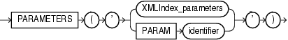
[Description of the illustration xmlindex_parameters_clause.eps](img_text/xmlindex_parameters_clause.md)

**See Also:**

Usage of XMLIndex_parameters_clause

##### XMLIndex_parameters ::=

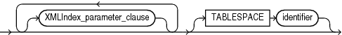
[Description of the illustration xmlindex_parameters.eps](img_text/xmlindex_parameters.md)

**See Also:**

Usage of XMLIndex_parameters

##### XMLIndex_parameter_clause ::=

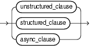
[Description of the illustration xmlindex_parameter_clause.eps](img_text/xmlindex_parameter_clause.md)

##### unstructured_clause ::=

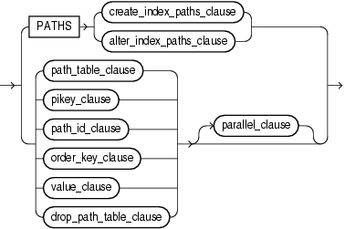
[Description of the illustration unstructured_clause.eps](img_text/unstructured_clause.md)

##### create_index_paths_clause ::=

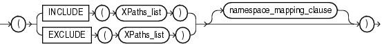
[Description of the illustration create_index_paths_clause.eps](img_text/create_index_paths_clause.md)

**See Also:**

- Usage of PATHS Clause

- Usage of create_index_paths_clause and alter_index_paths_clause

##### alter_index_paths_clause ::=

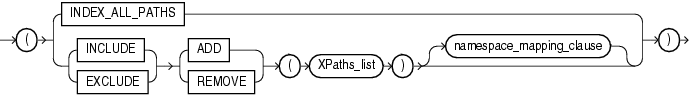
[Description of the illustration alter_index_paths_clause.eps](img_text/alter_index_paths_clause.md)

**See Also:**

- Usage of PATHS Clause

- Usage of create_index_paths_clause and alter_index_paths_clause

##### namespace_mapping_clause ::=

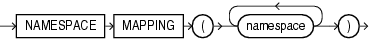
[Description of the illustration namespace_mapping_clause.eps](img_text/namespace_mapping_clause.md)

##### path_table_clause ::=

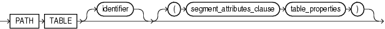
[Description of the illustration path_table_clause.eps](img_text/path_table_clause.md)

##### pikey_clause ::=

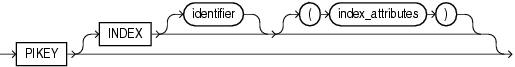
[Description of the illustration pikey_clause.eps](img_text/pikey_clause.md)

**See Also:**

Usage of pikey_clause, path_id_clause, and order_key_clause

##### path_id_clause ::=

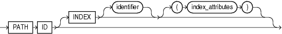
[Description of the illustration path_id_clause.eps](img_text/path_id_clause.md)

**See Also:**

Usage of pikey_clause, path_id_clause, and order_key_clause

##### order_key_clause ::=

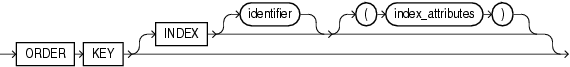
[Description of the illustration order_key_clause.eps](img_text/order_key_clause.md)

**See Also:**

Usage of pikey_clause, path_id_clause, and order_key_clause

##### value_clause ::=

[Description of the illustration value_clause.eps](img_text/value_clause.md)

**See Also:**

Usage of value_clause

##### drop_path_table_clause ::=

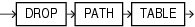
[Description of the illustration drop_path_table_clause.eps](img_text/drop_path_table_clause.md)

##### parallel_clause ::=

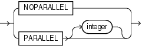
[Description of the illustration parallel_clause.eps](img_text/parallel_clause.md)

##### structured_clause ::=

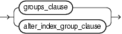
[Description of the illustration structured_clause.eps](img_text/structured_clause.md)

**See Also:**

Usage of groups_clause and alter_index_group_clause

##### async_clause ::=

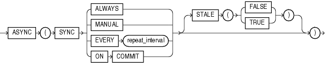
[Description of the illustration async_clause.eps](img_text/async_clause.md)

**See Also:**

Usage of async_clause

##### groups_clause ::=

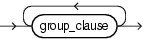
[Description of the illustration groups_clause.eps](img_text/groups_clause.md)

**See Also:**

Usage of groups_clause and alter_index_group_clause

##### group_clause ::=

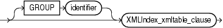
[Description of the illustration group_clause.eps](img_text/group_clause.md)

**See Also:**

Usage of groups_clause and alter_index_group_clause

##### XMLIndex_xmltable_clause ::=

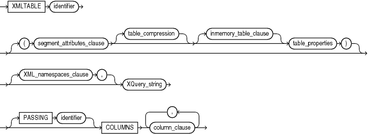
[Description of the illustration xmlindex_xmltable_clause.eps](img_text/xmlindex_xmltable_clause.md)

Syntax elements `XML_namespaces_clause` and `XQuery_string` are the same as for SQL/XML function `XMLTable`.

**See Also:**

- Usage of XMLIndex_xmltable_clause

- [XMLTABLE SQL/XML Function in Oracle XML DB](xquery-and-XML-DB.md)

##### column_clause ::=

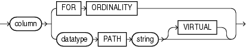
[Description of the illustration column_clause.eps](img_text/column_clause.md)

Syntax element `column_clause` is similar, but not identical, to `XML_table_column` in SQL/XML function `XMLTable`.

**See Also:**

- Usage of column_clause

- [XMLTABLE SQL/XML Function in Oracle XML DB](xquery-and-XML-DB.md)

##### alter_index_group_clause ::=

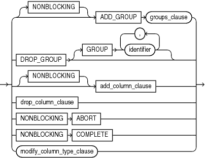
[Description of the illustration alter_index_group_clause.eps](img_text/alter_index_group_clause.md)

**See Also:**

Usage of groups_clause and alter_index_group_clause

##### add_column_clause :==

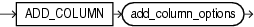
[Description of the illustration add_column_clause.eps](img_text/add_column_clause.md)

##### add_column_options :==

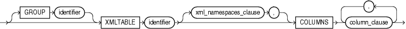
[Description of the illustration add_column_options.eps](img_text/add_column_options.md)

Syntax element `XML_namespaces_clause` is the same as for SQL/XML function `XMLTable`. See [XMLTABLE SQL/XML Function in Oracle XML DB](xquery-and-XML-DB.md).

##### drop_column_clause :==

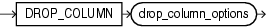
[Description of the illustration drop_column_clause.eps](img_text/drop_column_clause.md)

##### drop_column_options :==

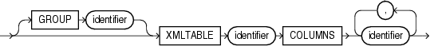
[Description of the illustration drop_column_options.eps](img_text/drop_column_options.md)

##### modify_column_type_clause :==

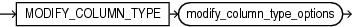
[Description of the illustration modify_column_type_clause.eps](img_text/modify_column_type_clause.md)

##### modify_column_type_options :==

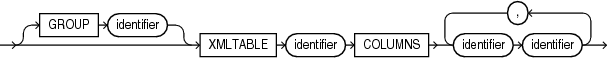
[Description of the illustration modify_column_type_options.eps](img_text/modify_column_type_options.md)

**Parent topic:** PARAMETERS Clause for CREATE INDEX and ALTER INDEX

##### 6.3.17.3 Usage of XMLIndex_parameters_clause

When you create an `XMLIndex` index, if there is no `XMLIndex_parameters_clause`, then the new index has only an unstructured component. If there is an `XMLIndex_parameters_clause`, but the `PARAMETERS` argument is empty (`''`), then the result is the same: an index with only an unstructured component.

**See Also:**

- [Oracle Database SQL Language Reference](../sqlrf/CREATE-INDEX.md) for information about the use context for `XMLIndex_parameters_clause` in `CREATE INDEX`

- [Oracle Database SQL Language Reference](../sqlrf/ALTER-INDEX.md) for information about the use context for `XMLIndex_parameters_clause` in `ALTER INDEX`

**Parent topic:** PARAMETERS Clause for CREATE INDEX and ALTER INDEX

##### 6.3.17.4 Usage of XMLIndex_parameters

Certain considerations apply to using `XMLIndex_parameters`.

- There can be at most one `XMLIndex_parameter_clause` of each type in `XMLIndex_parameters`. For example, there can be at most one `PATHS` clause, at most one `path_table_clause`, and so on.

- If there is no `structured_clause` when you create an `XMLIndex` index, then the new index has only an unstructured component. If there is only a `structured_clause`, then the new index has only a structured component.

**Parent topic:** PARAMETERS Clause for CREATE INDEX and ALTER INDEX

##### 6.3.17.5 Usage of PATHS Clause

Certain considerations apply to using the `PATHS` clause.

- There can be at most one `PATHS` clause in a `CREATE INDEX` statement. That is, there can be at most one occurrence of `PATHS` followed by `create_index_paths_clause`.

- Clause `create_index_paths_clause` is used only with `CREATE INDEX`; `alter_index_paths_clause` is used only with `ALTER INDEX`.

**Parent topic:** PARAMETERS Clause for CREATE INDEX and ALTER INDEX

##### 6.3.17.6 Usage of create_index_paths_clause and alter_index_paths_clause

Certain considerations apply to using `create_index_paths_clause` and `alter_index_paths_clause`.

- The `INDEX_ALL_PATHS` keyword rebuilds the index to include all paths. This keyword is available only for `alter_index_paths_clause`, not `create_index_paths_clause`.

- An explicit list of paths to index can include wildcards and `//`.

- `XPaths_list` is a list of one or more XPath expressions, each of which includes only child axis, descendant axis, name test, and wildcard (`*`) constructs.

- If `XPaths_list` is omitted from `create_index_paths_clause`, all paths are indexed.

- For each unique namespace prefix that is used in an XPath expression in `XPaths_list`, a standard XML `namespace` declaration is needed, to provide the corresponding namespace information.

- You can change an index in ways that are not reflected directly in the syntax by dropping it and then creating it again as needed. For example, to change an index that was defined by including paths to one that is defined by excluding paths, drop it and then create it using `EXCLUDE`.

**Parent topic:** PARAMETERS Clause for CREATE INDEX and ALTER INDEX

##### 6.3.17.7 Usage of pikey_clause, path_id_clause, and order_key_clause

Syntactically, each of the clauses `pikey_clause`, `path_id_clause`, and `order_key_clause` is optional. A pikey index is created even if you do not specify a `pikey_clause`. To create a path id index or an order-key index, you must specify a `path_id_clause` or an `order_key_clause`, respectively.

**Parent topic:** PARAMETERS Clause for CREATE INDEX and ALTER INDEX

##### 6.3.17.8 Usage of value_clause

Certain considerations apply to using `value_clause`.

- Column `VALUE` is created as `VARCHAR2(4000)`.

- If clause `value_clause` consists only of the keyword `VALUE`, then the value index is created with the usual default attributes.

- If clause `path_id_clause` consists only of the keywords `PATH ID`, then the path-id index is created with the usual default attributes.

- If clause `order_key_clause` consists only of the keywords `ORDER KEY`, then the order-key index is created with the usual default attributes.

**Parent topic:** PARAMETERS Clause for CREATE INDEX and ALTER INDEX

##### 6.3.17.9 Usage of async_clause

Certain considerations apply to using the `ASYNC` clause.

- Use this feature only with an `XMLIndex` index that has only an unstructured component. If you specify an `ASYNC` clause for an `XMLIndex` index that has a structured component, then an error is raised.

- `ALWAYS` means automatic synchronization occurs for each DML statement.

- `MANUAL` means no automatic synchronization occurs. You must manually synchronize the index using `DBMS_XMLINDEX.syncIndex`.

- `EVERY` `repeat_interval` means automatically synchronize the index at interval `repeat_interval`. The syntax of `repeat_interval` is the same as that for PL/SQL package `DBMS_SCHEDULER`, and it must be enclosed in double quotation marks (`"`). To use `EVERY` you must have the `CREATE JOB` privilege.

- `ON COMMIT` means synchronize the index immediately after a commit operation. The commit does not return until the synchronization is complete. Since the synchronization is performed as a separate transaction, there can be a short period when the data is committed but index changes are not yet committed.

- `STALE` is optional. A value of `TRUE` means that query results might be stale; a value of `FALSE` means that query results are always up-to-date. The default value, and the only permitted explicitly specified value, is as follows.

  - For `ALWAYS`, `STALE` is `FALSE`.

  - For any other `ASYNC` option besides `ALWAYS`, `STALE` is `TRUE`.

**Parent topic:** PARAMETERS Clause for CREATE INDEX and ALTER INDEX

##### 6.3.17.10 Usage of groups_clause and alter_index_group_clause

Clause `groups_clause` is used only with `CREATE INDEX` (or following `ADD GROUP` in clause `alter_index_group_clause`). Clause `alter_index_group_clause` is used only with `ALTER INDEX`.

**Parent topic:** PARAMETERS Clause for CREATE INDEX and ALTER INDEX

##### 6.3.17.11 Usage of XMLIndex_xmltable_clause

Certain considerations apply to using `XMLIndex_xmltable_clause`.

- The `XQuery_string` expression in `XMLIndex_xmltable_clause` must not use the XQuery functions `ora:view` (desupported), `fn:doc`, or `fn:collection`.

- Oracle XML DB raises an error if a given `XMLIndex_xmltable_clause` contains more than one `column_clause` of data type `XMLType`. To achieve the effect of defining two such virtual columns, you must instead add a separate `group_clause`.

- The `PASSING` clause in `XMLIndex_xmltable_clause` is optional. If not present, then an `XMLType` column is passed implicitly, as follows:

  - For the first `XMLIndex_xmltable_clause` in a parameters clause, the `XMLType` column being indexed is passed implicitly. (When indexing an `XMLType` table, pseudocolumn `OBJECT_VALUE` is passed.)

  - For each subsequent `XMLIndex_xmltable_clause`, the `VIRTUAL` `XMLType` column of the preceding `XMLIndex_xmltable_clause` is passed implicitly.

**Parent topic:** PARAMETERS Clause for CREATE INDEX and ALTER INDEX

##### 6.3.17.12 Usage of column_clause

Certain considerations apply to using `column_clause`.

When you use multilevel chaining of `XMLTable` in an `XMLIndex` index, the `XMLTable` table at one level corresponds to an `XMLType` column at the previous level. The syntax description shows keyword `VIRTUAL` as optional. In fact, it is used only for such an `XMLType` column, in which case it is required. It is an error to use it for a non-`XMLType` column. `VIRTUAL` specifies that the `XMLType` column itself is not materialized, meaning that its data is stored in the index only in the form of the relational columns specified by its corresponding `XMLTable` table.

**Parent topic:** PARAMETERS Clause for CREATE INDEX and ALTER INDEX

### 6.4 Indexing XML Data for Full-Text Queries

When you need full-text search over XML data, Oracle recommends that you store your `XMLType` data as binary XML and you use XQuery Full Text (XQFT). You use an XML search index for this. This is the topic of this section.

If portability and standardized code are not a concern, or if your `XMLType` data is stored object-relationally, then you can alternatively use the Oracle-specific full-text constructs and syntax provided by Oracle Text, specifically Oracle SQL function `contains` or Oracle XPath function `ora:contains` (deprecated).

You can perform XQuery Full Text (XQFT) queries on `XMLType` data that is stored as binary XML. If you use an XQFT full-text predicate in an `XMLExists` expression within a SQL `WHERE` clause, then you must create an **XML search index**. This section describes the creation and use of such an index.

- Creating and Using an XML Search Index
  An XQuery Full Text query can use an XML search index to improve performance.
- What To Do If an XML Search Index Is Not Picked Up
  You can modify your query to ensure that certain conditions are satisfied, so its evaluation picks up an XML search index.
- Pragma ora:no_schema: Using XML Schema-Based Data with XQuery Full Text
  Oracle recommends in general that you use non XML Schema-based `XMLType` data when you use XQuery Full Text and an XML search index. But you can in some circumstances use XML Schema-based `XMLType` data that is stored as binary XML. Oracle XQuery pragma `ora:no_schema` can be useful in this context.
- Pragma ora:use_xmltext_idx: Forcing the Use of an XML Search Index
  You can use XQuery pragma `ora:use_xmltext_idx` to force the use of an XML search index.
- Migrating from Using Oracle Text Index to XML Search Index
  If you have legacy queries for `XMLType` data stored as binary XML that use SQL function `CONTAINS` or deprecated XPath function `ora:contains` and an Oracle Text index that is not XML-enabled, then consider using XQuery Full Text constructs instead.

**Related Topics**

- [Support for XQuery Full Text](xquery-and-XML-DB.md)

**See Also:**

Example 6-46

**Parent topic:** Indexes for XMLType Data

#### 6.4.1 Creating and Using an XML Search Index

An XQuery Full Text query can use an XML search index to improve performance.

To create an XML search index you must be granted database role `CTXAPP`. More generally, this role is needed to create Oracle Text indexes, to set Oracle Text index preferences, or to use Oracle Text PL/SQL packages.

Before creating the index, you must create an Oracle Text path section group and set its `XML_ENABLE` attribute to `t`. This makes the path section group XML-aware.

For best performance, create an index preference of type `BASIC_STORAGE` in the Oracle Text data dictionary, specifying the following attributes:

- `D_TABLE_CLAUSE` – Specify `SECUREFILE` storage for column `DOC` of index data table `$D`, which contains information about the structure of your XML documents. Specify caching and medium compression.

- `I_TABLE_CLAUSE` – Specify `SECUREFILE` storage for column `TOKEN_INFO` of index data table `$I`, which contains information about full-text tokens and their occurrences in the indexed documents. Specify caching (but not compression).

This is illustrated in Example 6-41, which uses a non XML-schema-based `XMLType` table, `po_binxml` (which has the same data as table `purchaseorder` in standard database schema `OE`).

Index preference `BASIC_STORAGE` specifies the tablespace and creation parameters for the database tables and indexes that constitute an Oracle Text index.

**See Also:**

- [Oracle Text Reference](../ccref/oracle-text-indexing-elements.md) for information about section groups

- [Oracle Text Reference](../ccref/CTX_DDL-package.md) for information about procedure `CTX_DDL.set_sec_grp_attr`

- [Oracle Text Reference](../ccref/CTX_DDL-package.md) for information about procedure `CTX_DDL.create_preference`

- [Oracle Text Reference](../ccref/CTX_DDL-package.md) for information about procedure `CTX_DDL.set_attribute`

- [Oracle Text Reference](../ccref/oracle-text-indexing-elements.md) for information about preference `BASIC_STORAGE`, `D_TABLE_CLAUSE`, and `I_TABLE_CLAUSE`

Example 6-42 queries the data to retrieve the `Description` elements whose text contains both `Big` and `Street`, in that order.

Example 6-43 shows the execution plan for the query, which indicates that index `po_ctx_idx` is picked up.

Example 6-41 Creating an XML Search Index

    BEGIN
      CTX_DDL.create_section_group('mysecgroup', 'PATH_SECTION_GROUP');
      CTX_DDL.set_sec_grp_attr('mysecgroup', 'XML_ENABLE', 'T');

      CTX_DDL.create_preference('mypref', 'BASIC_STORAGE');
      CTX_DDL.set_attribute('mypref',
                            'D_TABLE_CLAUSE',
                            'TABLESPACE my_ts
                             LOB(DOC) STORE AS SECUREFILE
                             (TABLESPACE my_ts COMPRESS MEDIUM CACHE)');
      CTX_DDL.set_attribute('mypref',
                            'I_TABLE_CLAUSE',
                            'TABLESPACE my_ts
                             LOB(TOKEN_INFO) STORE AS SECUREFILE
                             (TABLESPACE my_ts NOCOMPRESS CACHE)');
    END;
    /

    CREATE INDEX po_ctx_idx ON po_binxml(OBJECT_VALUE)
      INDEXTYPE IS CTXSYS.CONTEXT
      PARAMETERS('storage mypref section group mysecgroup');

Example 6-42 XQuery Full Text Query

    SELECT XMLQuery('for $i in /PurchaseOrder/LineItems/LineItem/Description
                       where $i[. contains text "Big" ftand "Street"]
                   return <Title>{$i}</Title>'
                   PASSING OBJECT_VALUE RETURNING CONTENT)
      FROM po_binxml
      WHERE XMLExists('/PurchaseOrder/LineItems/LineItem/Description
                       [. contains text "Big" ftand "Street"]'
                      PASSING OBJECT_VALUE);

Example 6-43 Execution Plan for XQuery Full Text Query

    ------------------------------------------------------------------------------------------
    | Id  | Operation                   | Name       | Rows  | Bytes | Cost (%CPU)| Time     |
    ------------------------------------------------------------------------------------------
    |   0 | SELECT STATEMENT            |            |     1 |  2014 |     4   (0)| 00:00:01 |
    |   1 |  TABLE ACCESS BY INDEX ROWID| PO_BINXML  |     1 |  2014 |     4   (0)| 00:00:01 |
    |*  2 |   DOMAIN INDEX              | PO_CTX_IDX |       |       |     4   (0)| 00:00:01 |
    ------------------------------------------------------------------------------------------

    Predicate Information (identified by operation id):
    ---------------------------------------------------

       2 - access("CTXSYS"."CONTAINS"(SYS_MAKEXML(0,"XMLDATA"),'<query><textquery
                  grammar="CONTEXT" lang="english"> ( ( {Big} ) and ( {Street} ) )  INPATH
                  (/PurchaseOrder/LineItems/LineItem/Description)</textquery></query>')>0)

    Note
    -----
       - dynamic sampling used for this statement (level=2)
       - Unoptimized XML construct detected (enable XMLOptimizationCheck for more information)

    21 rows selected.

**Parent topic:** Indexing XML Data for Full-Text Queries

#### 6.4.2 What To Do If an XML Search Index Is Not Picked Up

You can modify your query to ensure that certain conditions are satisfied, so its evaluation picks up an XML search index.

If you use an XQuery full-text predicate in an `XMLExists` expression within a SQL `WHERE` clause, but you do not create an XML search index or the index cannot be used for some reason, then compile-time error ORA-18177 is raised.

If this error is raised then your execution plan does not indicate that the index is picked up. In the plan you do not see operation `DOMAIN INDEX` followed by the name of the index.

In that case, try to change your query to enable the index to be used. The following conditions must both apply for the index to be picked up:

- The expression that computes the XML nodes for the search context must be an XPath expression whose steps are only along forward and descendent axes.

- You can pass only one `XMLType` instance as a SQL expression in the `PASSING` clause of SQL/XML function `XMLExists`, and each of the other, non-`XMLType` SQL expressions in that clause must be either a compile-time constant of a SQL built-in data type or a bind variable that is bound to an instance of such a data type.

**Parent topic:** Indexing XML Data for Full-Text Queries

#### 6.4.3 Pragma ora:no_schema: Using XML Schema-Based Data with XQuery Full Text

Oracle recommends in general that you use non XML Schema-based `XMLType` data when you use XQuery Full Text and an XML search index. But you can in some circumstances use XML Schema-based `XMLType` data that is stored as binary XML. Oracle XQuery pragma `ora:no_schema` can be useful in this context.

By default, when an XML search index is used to evaluate XML Schema-based data, compile-time error ORA-18177 is raised. This is because the full-text indexing itself makes no use of the associated XML schema: it is not type-aware. It treats all of the text that it applies to as untyped. This error is raised even if you type-cast data appropriately and thus do not depend on the XML schema to cast types implicitly. Example 6-44 illustrates this.

The error raised draws this to your attention, in case you might be expecting a full-text condition in your query to depend on XML Schema types and typed operations.

In order to use a condition that depends on types you must explicitly cast the relevant XQuery expressions to the appropriate types. Do not expect Oracle XML DB to use the XML schema to perform implicit type casting. Failure to type-cast appropriately can lead to results that you might not expect.

Example 6-45 shows a query of XML Schema-based data that uses explicit type-casting to ensure that the proper condition is evaluated.

However, most uses of XQuery Full Text expressions, even with XML Schema-based data, do not involve data that is typed. Just remember that if you do use a condition that makes use of typed data then you must cast to the proper type.

In sum, if you are sure that your query does not involve typed data, or if you judge that it is all right to treat particular typed data as if it were untyped, or if you explicitly type-cast any data that needs to be typed, then you can use Oracle XQuery pragma `ora:no_schema` in your query to inhibit raising the error and allow evaluation of the query using an XML search index.

Example 6-44 XQuery Full Text Query with XML Schema-Based Data: Error ORA-18177

    SELECT XMLQuery('/PurchaseOrder/LineItems/LineItem'
                    PASSING OBJECT_VALUE RETURNING CONTENT)
      FROM oe.purchaseorder
      WHERE XMLExists('/PurchaseOrder
                       [LineItems/LineItem/@ItemNumber > xs:integer("20")
                        and Actions/Action/User contains text "KPARTNER"]'
                      PASSING OBJECT_VALUE);
      FROM oe.purchaseorder
              *
    ERROR at line 3:
    ORA-18177: XQuery full text expression '/PurchaseOrder
    [LineItems/LineItem/@ItemNumber > xs:integer("20")
    and Actions/Action/User contains text "KPARTNER"]'
    cannot be evaluated using XML text index

Example 6-45 Using XQuery Pragma ora:no_schema with XML Schema-Based Data

    SELECT XMLQuery('/PurchaseOrder/LineItems/LineItem'
                    PASSING OBJECT_VALUE RETURNING CONTENT)
      FROM oe.purchaseorder
      WHERE XMLExists('(# ora:no_schema #)
                       {/PurchaseOrder
                        [LineItems/LineItem/@ItemNumber > xs:integer("20")
                         and Actions/Action/User contains text "KPARTNER"]}'
                      PASSING OBJECT_VALUE);

**Parent topic:** Indexing XML Data for Full-Text Queries

#### 6.4.4 Pragma ora:use_xmltext_idx: Forcing the Use of an XML Search Index

You can use XQuery pragma `ora:use_xmltext_idx` to force the use of an XML search index.

A given query involving XML data can be evaluated in various ways, depending on the existence of different indexes and other factors. Sometimes the default evaluation method is not the most performant and it would be more efficient to force the use of an existing XML search index. You can use XQuery pragma `ora:use_xmltext_idx` to do this. (An XML search index applies only to `XMLType` data stored as binary XML.)

For example, a `WHERE` clause might include two `XMLExists` expressions, only one of which involves an XQuery full-text condition, and you might have an `XMLIndex` index that applies to the `XMLExists` expression that has no full-text condition. With such a query it is typically more efficient to use an XML search index to evaluate the entire `WHERE` clause.

Even in some cases where there is no full-text condition in the query, the use of an XML search index can provide the most efficient query evaluation.

The query in Example 6-46 illustrates the use of pragma `ora:use_xmltext_idx`. Only the first of the `XMLExists` clauses uses a full-text condition. Because of the pragma, the full-text index (`po_ctx_idx`, created in Example 6-41) is used for both `XMLExists` clauses.

Example 6-46 Full-Text Query with XQuery Pragma ora:use_xmltext_idx

    SELECT XMLQuery('/PurchaseOrder/LineItems/LineItem'
                    PASSING OBJECT_VALUE RETURNING CONTENT)
      FROM po_binxml
      WHERE XMLExists('/PurchaseOrder/LineItems/LineItem
                       [Description contains text "Picnic"]' PASSING OBJECT_VALUE)
        AND XMLExists('(# ora:use_xmltext_idx #) {/PurchaseOrder[User="SBELL"]}'
                      PASSING OBJECT_VALUE);

**Parent topic:** Indexing XML Data for Full-Text Queries

#### 6.4.5 Migrating from Using Oracle Text Index to XML Search Index

If you have legacy queries for `XMLType` data stored as binary XML that use SQL function `CONTAINS` or deprecated XPath function `ora:contains` and an Oracle Text index that is not XML-enabled, then consider using XQuery Full Text constructs instead.

The XQuery and XPath Full Text (XQFT) standard is supported by Oracle XML DB starting with Oracle Database 12c Release 1 (12.1). This support applies only to `XMLType` data stored as binary XML. Prior to that release, for full-text querying of XML data you could use only an Oracle Text index that was not XML-enabled (not an XML search index), and your full-text queries necessarily used Oracle-specific constructs: SQL function `CONTAINS` or XPath function `ora:contains` (deprecated).

If you have legacy code that does this, Oracle recommends that you migrate that code to use XQFT. This section provides information about which XQFT constructs you can use to replace the use of `CONTAINS` and `ora:contains` in queries.

This use of an Oracle Text index can also be replaced by the use of an XML search index. To replace a query that uses `HASPATH` by one that uses a simple XQuery expression, you use Oracle XQuery pragma `ora:use_xmltext_idx` to specify that the XML search index is to be picked up. This section also illustrates this.

Table 6-9 provides a mapping from typical queries that use Oracle-specific constructs to queries that use XQuery Full Text.

Table 6-9 Migrating Oracle-Specific XML Queries to XQuery Full Text

| Original Example                                                                                                                 | Replacement Example                                                                                                                                                                                                                                                                                                                            |
|:---------------------------------------------------------------------------------------------------------------------------------|:-----------------------------------------------------------------------------------------------------------------------------------------------------------------------------------------------------------------------------------------------------------------------------------------------------------------------------------------------|
| `CONTAINS(t.x, 'HASPATH (/P/LIs/LI/DescriptionFoot 3)') > 0`                                                                     | `XMLExists('(# ora:use_xmltext_idx #) ` `           {$d/P/LIs/LI/DescriptionFootref 3}'` `          PASSING t.x AS "d")` Or if the data is XML Schema-based: `XMLExists('(# ora:use_xmltext_idx #)` `           {(# ora:no_schema #) ` `            {$d/P/LIs/LI/DescriptionFootref 3}}'` `          PASSING t.x AS "d")` |
| `CONTAINS(t.x, 'Big INPATH` `               (/P/LIs/LI/Description)') > 0`                                                    | `XMLExists('$d/P/LIs/LI/Description` `           [. contains text "Big"]'` `          PASSING t.x AS "d")` Or if the data is XML Schema-based: `XMLExists('(# ora:no_schema #)` `           {$d/P/LIs/LI/Description` `           [. contains text "Big"]}'` `          PASSING t.x AS "d")`                              |
| `XMLExists('$d/P/LIs/LI/Description` `           [ora:contains(., "Big AND Street") > 0]'` `          PASSING t.x AS "d")` | `XMLExists('$d/P/LIs/LI/Description` `           [. contains text "Big" ftand "Street"]'` `          PASSING t.x AS "d")`                                                                                                                                                                                                                |
| `CONTAINS(t.x, '(Big) AND (Street) INPATH` `               (/P/LIs/LI/Description)') > 0`                                     | `XMLExists('$d/P/LIs/LI/Description` `           [. contains text "Big" ftand "Street"]'` `          PASSING t.x AS "d")`                                                                                                                                                                                                                |
| `CONTAINS(t.x, '(Big) OR (Street) INPATH` `               (/P/LIs/LI/Description)') > 0`                                      | `XMLExists('$d/P/LIs/LI/Description` `           [. contains text "Big" ftor "Street"]'` `          PASSING t.x AS "d")`                                                                                                                                                                                                                 |
| `CONTAINS(t.x, '({Big}) NOT ({Street}) INPATH` `               (/P/LIs/LI/Description)') > 0`                                 | `XMLExists('$d/P/LIs/LI/Description` `           [. contains text` `            "Big" ftand ftnot "Street"]'` `          PASSING t.x AS "d")`                                                                                                                                                                                         |
| `CONTAINS(t.x, '({Street}) MNOT ({Big Street}) INPATH` `               (/P/LIs/LI/Description)') > 0`                         | `XMLExists('$d/P/LIs/LI/Description` `           [. contains text` `            "Street" not in "Big Street"]'` `          PASSING t.x AS "d")`                                                                                                                                                                                       |
| `CONTAINS(t.x, '(NEAR (({Big}, {Street}), 3) INPATH` `               (/P/LIs/LI/Description)') > 0`                           | `XMLExists('$d/P/LIs/LI/Description` `           [. contains text` `            "Big" ftand "Street" window 3 words]'` `          PASSING t.x AS "d")`                                                                                                                                                                                |
| (Not applicable – Oracle Text queries are not XML namespace aware.)                                                              | `XMLExists('declare namespace` `           ipo="http://www.example.com/IPO";` `           /ipo:P/ipo:LIs/ipo:LI/ipo:Description` `           [. contains text "Big"]'` `          PASSING t.x AS "d")`                                                                                                                             |

Footnote 3

The path test can contain a predicate expression, which is the same for both the original query (with `HASPATH`) and its replacement. For example: `/PurchaseOrder/LineItems/LineItem/Part[@Id < "31415927"]`.

**Parent topic:** Indexing XML Data for Full-Text Queries

### 6.5 Indexing XMLType Data Stored Object-Relationally

You can effectively index `XMLType` data that is stored object-relationally by creating B-tree indexes on the underlying database columns that correspond to XML nodes.

If the data to be indexed is a singleton, that is, if it can occur only once in any XML instance document, then you can use a shortcut of ostensibly creating a function-based index, where the expression defining the index is a functional application, with an XPath-expression argument that targets the singleton data. A shortcut is defined for `XMLCast` applied to `XMLQuery`, and another shortcut is defined for (deprecated) Oracle SQL function `extractValue`.

In many cases, Oracle XML DB then automatically creates appropriate indexes on the underlying object-relational tables or columns; it does not create a function-based index on the targeted `XMLType` data as the `CREATE INDEX` statement would suggest.

In the case of the `extractValue` shortcut, the index created is a B-tree index. In the case of `XMLCast` applied to `XMLQuery`, the index created is a function-based index on the scalar value resulting from the functional expression.

If the data to be indexed is a collection, then you cannot use such a shortcut; you must create the B-tree indexes manually.

- Indexing Non-Repeating Text Nodes or Attribute Values
  Table `purchaseorder` in sample database schema `OE` is stored object-relationally. Each purchase-order document has a single `Reference` element; this element is a singleton. You can thus use a shortcut to create an index on the underlying object-relational data.
- Indexing Repeating (Collection) Elements
  In `XMLType` data stored object-relationally, a collection is stored as an ordered collection table (OCT) of an `XMLType` instance, which means that you can directly access its members. Because object-relational storage directly reflects the fine-grained structure of the XML data, you can create indexes that target individual collection members.

**Parent topic:** Indexes for XMLType Data

#### 6.5.1 Indexing Non-Repeating Text Nodes or Attribute Values

Table `purchaseorder` in sample database schema `OE` is stored object-relationally. Each purchase-order document has a single `Reference` element; this element is a singleton. You can thus use a shortcut to create an index on the underlying object-relational data.

Example 6-47 shows a `CREATE INDEX` statement that ostensibly tries to create a function-based index using `XMLCast` applied to `XMLQuery`, targeting the text content of element `Reference`. (The content of this element is only text, so targeting the element is the same as targeting its text node using XPath node test `text()`.)

Example 6-48 ostensibly tries to create a function-based index using (deprecated) Oracle SQL function `extractValue`, targeting the same data.

In reality, in both Example 6-47 and Example 6-48 no function-based index is created on the targeted `XMLType` data. Instead, Oracle XML DB rewrites the `CREATE INDEX` statements to create indexes on the underlying scalar data.

**See Also:**

[Example 19-7](XPath-rewrite-for-object-relational-storage.md) and [Example 19-8](XPath-rewrite-for-object-relational-storage.md) for information about XPath rewrite as it applies to such `CREATE INDEX` statements

In some cases when you use either of these shortcuts, the `CREATE INDEX` statement is not able to create an index on the underlying scalar data as described, and it instead actually does create a function-based index on the referenced `XMLType` data. (This is so, even if the value of the index might be a scalar.)

If this happens, drop the index, and create instead an `XMLIndex` index with a structured component that targets the same XPath. As a general rule, Oracle recommends against using a function-based index on `XMLType` data.

This is an instance of a general rule for `XMLType` data, regardless of the storage method used: Use an `XMLIndex` with a structured component instead of a function-based index. This rule applies starting with Oracle Database 11g Release 2 (11.2). Respecting this rule obviates the overhead associated with maintenance operations on function-based indexes, and it can increase the number of situations in which the optimizer can correctly select the index.

Example 6-47 CREATE INDEX Using XMLCAST and XMLQUERY on a Singleton Element

    CREATE INDEX po_reference_ix ON purchaseorder
      (XMLCast(XMLQuery ('$p/PurchaseOrder/Reference' PASSING po.OBJECT_VALUE AS "p"
                                                      RETURNING CONTENT)
                  AS VARCHAR2(128)));

Example 6-48 CREATE INDEX Using EXTRACTVALUE on a Singleton Element

    CREATE INDEX po_reference_ix ON purchaseorder
      (extractValue(OBJECT_VALUE, '/PurchaseOrder/Reference'));

**Related Topics**

- Function-Based Indexes Are Deprecated for XMLType

**Parent topic:** Indexing XMLType Data Stored Object-Relationally

#### 6.5.2 Indexing Repeating (Collection) Elements

In `XMLType` data stored object-relationally, a collection is stored as an ordered collection table (OCT) of an `XMLType` instance, which means that you can directly access its members. Because object-relational storage directly reflects the fine-grained structure of the XML data, you can create indexes that target individual collection members.

You must create such indexes manually. The special feature of automatically creating B-tree indexes when you ostensibly create a function-based index for (deprecated) Oracle SQL function `extractValue` does not apply to collections (the XPath expression passed to `extractValue` must target a singleton).

To create B-tree indexes for a collection, you must understand the structure of the SQL object that is used to manage the collection. Given this information, you can use conventional object-relational SQL code to created the indexes directly on the appropriate SQL-object attributes. Refer to [Guideline: Create indexes on ordered collection tables](XPath-rewrite-for-object-relational-storage.md) for an example of how to do this.

**Parent topic:** Indexing XMLType Data Stored Object-Relationally

------------------------------------------------------------------------

Footnote Legend

Footnote 1:

For `XMLType` data stored object-relationally, see Indexing XMLType Data Stored Object-Relationally. If your data is highly structured throughout, or your queries are not known at index creation time, then this approach might be appropriate.

Footnote 2:

The actual path table implementation may be slightly different.
