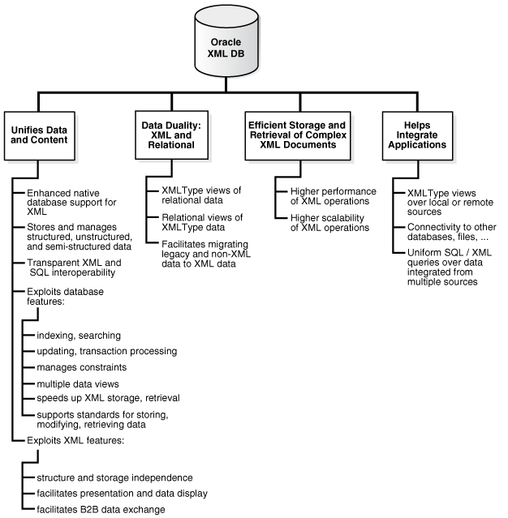
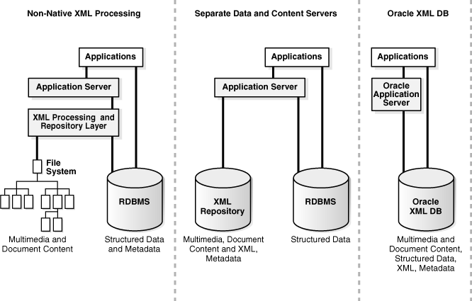
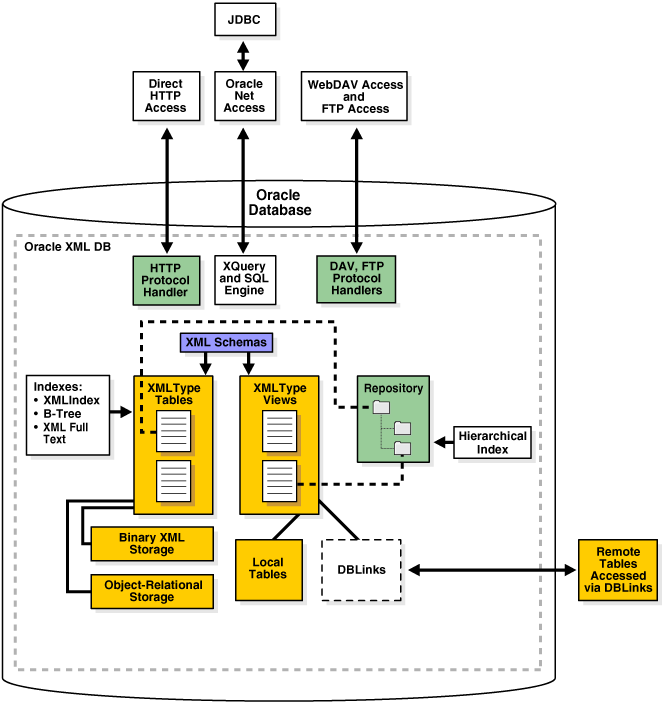
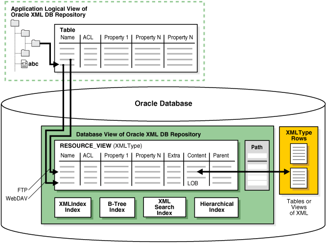

Oracle XML DB provides Oracle Database with native XML support by encompassing both the SQL and XML data models in an interoperable way.

- Overview of Oracle XML DB
  Oracle XML DB is a set of Oracle Database technologies related to high-performance handling of XML data: storing, generating, accessing, searching, validating, transforming, evolving, and indexing. It provides native XML support by encompassing both the SQL and XML data models in an interoperable way.
- Oracle XML DB Benefits
  Oracle XML DB supports all major XML, SQL, Java, and Internet standards. It provides high performance and scalability for XML operations. It brings database features such as transaction control, data integrity, replication, reliability, availability, security, and scalability to the world of XML.
- Oracle XML DB Architecture
  Oracle XML DB gives you protocol and programmatic access to XML data in the form of local and remote `XMLType` tables and views. It provides a WebDAV repository with resource versioning and access control.
- Oracle XML DB Features
  Oracle XML DB provides standard database features such as transaction control, data integrity, replication, reliability, availability, security, and scalability, while also allowing for efficient indexing, querying, updating, and searching of XML documents in an XML-centric manner.
- Standards Supported by Oracle XML DB
  Oracle XML DB supports all major XML, SQL, Java, and Internet standards.
- Oracle XML DB Technical Support
  Besides the regular channels of support through your customer representative or consultant, technical support for Oracle Database XML-enabled technologies is available free through the discussion forums Oracle Technology Network (OTN).
- Oracle XML DB Examples
  The examples that illustrate the use of Oracle XML DB and `XMLType` are based on various database schemas, sample XML documents, and sample XML schemas.
- Oracle XML DB Case Studies and Demonstrations on OTN
  Visit Oracle Technology Network (OTN) to view Oracle XML DB examples, white papers, case studies, and demonstrations.

**Parent topic:** [Oracle XML DB Basics](XML-DB-basics.md)

### 1.1 Overview of Oracle XML DB

Oracle XML DB is a set of Oracle Database technologies related to high-performance handling of XML data: storing, generating, accessing, searching, validating, transforming, evolving, and indexing. It provides native XML support by encompassing both the SQL and XML data models in an interoperable way.

Oracle XML DB is included as part of Oracle Database starting with Oracle9i Release 2 (9.2).

Oracle XML DB and the `XMLType` abstract data type make Oracle Database XML-aware. Storing XML data as an `XMLType` column or table lets the database perform XML-specific operations on the content. This includes XML validation and optimization. `XMLType` storage allows highly efficient processing of XML content in the database.

Oracle XML DB includes the following features:

- An abstract SQL data type, `XMLType`, for XML data.

- Enterprise-level Oracle Database features for XML content: reliability, availability, scalability, and security. XML-specific memory management and optimizations.

- Industry-standard ways to access and update XML data. You can use FTP, HTTP(S), and WebDAV to move XML content into and out of Oracle Database. Industry-standard APIs provide programmatic access and manipulation of XML content using Java, C, and PL/SQL.

- Ways to store, query, update, and transform XML data while accessing it using SQL and XQuery.

- Ways to perform XML operations on SQL data.

- Oracle XML DB Repository: a simple, lightweight repository where you can organize and manage database content, including XML content, using a file/folder/URL metaphor.

- Ways to access and combine data from disparate systems through gateways, using a single, common data model. This reduces the complexity of developing applications that must deal with data from different stores.

- Ways to use Oracle XML DB in conjunction with Oracle XML Developer's Kit (XDK) to build applications that run in the middle tier in either Oracle Fusion Middleware or Oracle Database.

Oracle XML DB functionality is partially based on the Oracle XML Developer's Kit C implementations of the relevant XML standards, such as XML Parser, XSLT Virtual Machine, XML DOM, and XML Schema Validator.

**Related Topics**

- XMLType Data Type

**See Also:**

- [Oracle XML DB on OTN](https://www.oracle.com/pls/topic/lookup?ctx=en/database/oracle/oracle-database/19/adxdb&id=otn_db_xmldb_overview) for the latest news and white papers about Oracle XML DB

- [Oracle XML Developer's Kit Programmer's Guide](../adxdk/index.md)

**Parent topic:** Introduction to Oracle XML DB

### 1.2 Oracle XML DB Benefits

Oracle XML DB supports all major XML, SQL, Java, and Internet standards. It provides high performance and scalability for XML operations. It brings database features such as transaction control, data integrity, replication, reliability, availability, security, and scalability to the world of XML.

Figure 1-1 presents an overview of the standards supported by Oracle XML DB.

Figure 1-1 Oracle XML DB Benefits

[Description of "Figure 1-1 Oracle XML DB Benefits"](img_text/adxdb031.md)

- Data and Content Unified
  With Oracle XML DB, you can store and manage data that is structured, unstructured, and semi-structured using a standard data model and standard SQL and XML. You can perform SQL operations on XML documents and XML operations on object-relational (such as table) data.
- Data Duality: XML and Relational
  Oracle XML DB presents a symmetric, dual view of data: as XML and as relational.
- Efficient Storage and Retrieval of Complex XML Documents
  Oracle XML DB provides high performance and scalability for XML operations, letting you manage the storage and retrieval of complex, large, or many XML documents.

**Parent topic:** Introduction to Oracle XML DB

#### 1.2.1 Data and Content Unified

With Oracle XML DB, you can store and manage data that is structured, unstructured, and semi-structured using a standard data model and standard SQL and XML. You can perform SQL operations on XML documents and XML operations on object-relational (such as table) data.

Most application data and Web content is stored in a relational database, a file system, or both. XML data is often used for data exchange, and it can be generated from a relational database or a file system. As the volume of XML data exchanged grows, the cost of regenerating this data grows, and these storage methods become less effective at accommodating XML content.

Figure 1-2 Unifying Data and Content: Some Common XML Architectures

[Description of "Figure 1-2 Unifying Data and Content: Some Common XML Architectures"](img_text/adxdb006.md)

Organizations often manage their structured data and unstructured data differently:

- Unstructured data, stored in tables, makes document access transparent and table access complex.

- Structured data, often stored in binary large objects (such as in `BLOB` instances), makes access more complex and table access transparent.

<!-- -->

- Database Capabilities for Working with XML
  Oracle Database provides database capabilities for working with XML: indexing and search; updates and transaction processing; managing relationships using constraints; multiple data views; high performance and scalability. It supports XML Schema, XQuery, XPath, and DOM.
- Advantages of Storing Data as XML in the Database
  Storing data as XML in the database provides these advantages: storage independence, ease of presentation, and ease of interchange.

**Parent topic:** Oracle XML DB Benefits

##### 1.2.1.1 Database Capabilities for Working with XML

Oracle Database provides database capabilities for working with XML: indexing and search; updates and transaction processing; managing relationships using constraints; multiple data views; high performance and scalability. It supports XML Schema, XQuery, XPath, and DOM.

- Indexing and search – Just as your database data can be more or less structured, so can your queries. One query can look for all product definitions created between March and April 2014. Another query can look for products whose descriptions contain the words "`wireless`" and "`router`" but not the term "`wireless router`".

  A query such as the former targets structured data, and it is typically supported by a B-tree index on a date column. A query such as the latter targets unstructured data, and for Oracle Database it is typically supported by an Oracle Text (full-text) index. Applications can of course combine structured and unstructured queries, and targeted data can be a mix of structured and unstructured data.

  For XML data the situation is similar. Oracle XML DB provides indexing features that let you target the gamut of XML possibilities, from data and queries that are highly structured to those that are highly unstructured.

  **See Also:**

  - [Query and Update of XML Data](query-and-update-XML.md)

  - [Generation of XML Data from Relational Data](generation-of-XML-data-from-relational-data.md)

  - [Indexing XML Data for Full-Text Queries](indexes-for-XMLType-data.md)

  - [Oracle Text Application Developer's Guide](../ccapp/index.md)

  - [Oracle Text Reference](../ccref/index.md)

- Updates and transaction processing – Commercial relational databases use fast updates of subparts of records, with minimal contention between users trying to update. As traditionally document-centric data participate in collaborative environments through XML, this requirement becomes more important. File or `CLOB` storage cannot provide the granular concurrency control that Oracle XML DB does.

  **See Also:**

  [Query and Update of XML Data](query-and-update-XML.md)

- Managing relationships – Data with any structure typically has foreign-key constraints. XML data stores generally lack this feature, so you must implement any constraints in application code. Oracle XML DB enables you to constrain XML data according to XML schema definitions, and hence achieve control over relationships that structured data has always enjoyed.

  **See Also:**

  - [XML Schema Storage and Query: Basic](XML-Schema-and-query-basic.md)

  - The purchase-order examples in [Query and Update of XML Data](query-and-update-XML.md)

- Multiple views of data – Most enterprise applications need to group data together in different ways for different modules. This is why relational views are necessary—to allow for these multiple ways to combine data. By allowing views on XML, Oracle XML DB creates different logical abstractions on XML for, say, consumption by different types of applications.

  **See Also:**

  [XMLType Views](XMLType-views.md)

- Performance and scalability – Users expect data storage, retrieval, and query to be fast. Loading a file or `CLOB` value, and parsing, are typically slower than relational data access. Oracle XML DB dramatically speeds up XML storage and retrieval.

  **See Also:**

  - [Getting Started with Oracle XML DB](getting-started-with-XML-DB.md)

  - [Overview of How To Use Oracle XML DB](how-to-use-XML-DB.md)

- Ease of development – Databases are foremost an application platform that provides standard, easy ways to manipulate, transform, and modify individual data elements. While typical XML parsers give standard read access to XML data they do not provide an easy way to modify and store individual XML elements. Oracle XML DB supports several standard ways to store, modify, and retrieve data. These include XML Schema, XQuery, XPath, DOM, and Java.

  **See Also:**

  - [XQuery and Oracle XML DB](xquery-and-XML-DB.md)

  - [Java DOM API for XMLType](Java-DOM-API-for-XMLType.md)

  - [Repository Access Using RESOURCE_VIEW and PATH_VIEW](repository-access-using-RESOURCE_VIEW-and-PATH_VIEW.md)

  - [PL/SQL Access to Oracle XML DB Repository](PLSQL-access-to-XML-DB-repository.md)

**Parent topic:** Data and Content Unified

##### 1.2.1.2 Advantages of Storing Data as XML in the Database

Storing data as XML in the database provides these advantages: storage independence, ease of presentation, and ease of interchange.

- Storage independence: When you use relational design, your client programs must know where your data is stored, in what format, what table, and what the relationships are among those tables. `XMLType` enables you to write applications without that knowledge and lets database administrators map structured data to physical table and column storage.

  **See Also:**

  [Access to Oracle XML DB Repository Data](accessing-XML-DB-repository-data.md)

- Ease of presentation: XML is understood natively by Web browsers, many popular desktop applications, and most Internet applications. Relational data is generally not accessible directly from applications. Additional programming is required to make relational data accessible to standard clients. Oracle XML DB stores data as XML and makes it available as XML outside the database. No extra programming is required to display database content.

  **See Also:**

  - [Transformation and Validation of XMLType Data](transformation-and-validation-of-XMLType-data.md).

  - [Generation of XML Data from Relational Data](generation-of-XML-data-from-relational-data.md).

  - [XMLType Views](XMLType-views.md).

- Ease of interchange – XML is the language of choice in business-to-business (B2B) data exchange. If you are forced to store XML in an arbitrary table structure, you are using some kind of proprietary translation. Whenever you translate a language, information is lost and interchange suffers. By natively understanding XML and providing DOM fidelity in the storage/retrieval process, Oracle XML DB enables a clean interchange.

  **See Also:**

  - [Transformation and Validation of XMLType Data](transformation-and-validation-of-XMLType-data.md)

  - [XMLType Views](XMLType-views.md)

**Parent topic:** Data and Content Unified

#### 1.2.2 Data Duality: XML and Relational

Oracle XML DB presents a symmetric, dual view of data: as XML and as relational.

A key feature of Oracle XML DB is that it lets you work with XML data as if it were relational data and relational data as if it were XML data. You can leverage the power of the relational model when working with XML content, and you can leverage the flexibility of XML when working with relational content. You can use the most appropriate tools for different aspects of a particular business problem.

This duality means that the same data can be exposed as rows in a table and manipulated using SQL or exposed as nodes in an XML document and manipulated using XQuery, the DOM, or XSL transformation. Access and processing techniques are independent of the underlying storage method.

These features can provide simple solutions to common business problems:

- You can generate XML data directly from a SQL query. You can transform the XML data into other formats, such as HTML, using the database-resident XSLT processor.

- You can access XML content without converting between different data formats, using SQL queries, on-line analytical processing (OLAP), and business-intelligence/data warehousing operations.

- You can perform text and spatial data operations on XML content.

<!-- -->

- Use XMLType Views If Your Data Is Not XML
  `XMLType` views provide a way for you to wrap existing relational or object-relational data in XML format.

**Parent topic:** Oracle XML DB Benefits

##### 1.2.2.1 Use XMLType Views If Your Data Is Not XML

`XMLType` views provide a way for you to wrap existing relational or object-relational data in XML format.

This can be especially useful if your legacy data is not in XML format but you must migrate it to XML format. Using `XMLType` views, you need not alter your application code or the stored data.

To use `XMLType` views, you must first register an XML schema with annotations that represent a bidirectional mapping between XML Schema data types and either SQL data types or binary XML encoding types. You can then create an `XMLType` view conforming to this mapping, by providing an underlying query that constructs instances of the appropriate types.

**Related Topics**

- [XMLType Views](XMLType-views.md)

**Parent topic:** Data Duality: XML and Relational

#### 1.2.3 Efficient Storage and Retrieval of Complex XML Documents

Oracle XML DB provides high performance and scalability for XML operations, letting you manage the storage and retrieval of complex, large, or many XML documents.

These are the major performance features of Oracle XML DB:

- Native `XMLType`. Abstract data type `XMLType` has two storage models, each optimized to work efficiently for a particular set of use cases. See [Query and Update of XML Data](query-and-update-XML.md) and [Choice of XMLType Storage and Indexing](choice-of-XMLType-storage-and-indexing.md)

- Optimized processing of XQuery, XPath, and XSLT. See [Performance Tuning for XQuery](query-and-update-XML.md) and [Transformation and Validation of XMLType Data](transformation-and-validation-of-XMLType-data.md).

- Indexing XML data for structured or full-text search. See [Indexes for XMLType Data](indexes-for-XMLType-data.md).

- A lazily evaluated virtual DOM. See [PL/SQL DOM API for XMLType (DBMS_XMLDOM)](PLSQL-APIs-for-XMLType.md).

- A hierarchical index over Oracle XML DB Repository. See [Performance Guidelines for Oracle XML DB Repository Operations](repository-access-using-RESOURCE_VIEW-and-PATH_VIEW.md).

- Parallelism and Oracle Exadata Smart Scan. Query and update of XML data can be carried out in parallel. Oracle Exadata Smart Scan is enabled automatically for XML data.

**Parent topic:** Oracle XML DB Benefits

### 1.3 Oracle XML DB Architecture

Oracle XML DB gives you protocol and programmatic access to XML data in the form of local and remote `XMLType` tables and views. It provides a WebDAV repository with resource versioning and access control.

Figure 1-3 shows the software architecture of Oracle XML DB. The main features are:

- Storage of `XMLType` tables and views.

  - You can index `XMLType` tables and views using `XMLIndex`, B-tree, and Oracle Text indexes.

  - You can store data that is in `XMLType` views in local or remote tables. You can access remote tables using database links.

- Support for XQuery, including XQuery Update and XQuery Full Text.

- Oracle XML DB Repository. You can store any kind of documents in the repository, including XML documents that are associated with an XML schema that is registered with Oracle XML DB. You can access documents in the repository in any of the following ways:

  - HTTP(S), through the HTTP protocol handler

  - WebDAV and FTP, through the WebDAV and FTP protocol handlers

  - SQL, through Oracle Net Services, including Java Database Connectivity (JDBC)

Figure 1-3 XMLType Storage

[Description of "Figure 1-3 XMLType Storage"](img_text/adxdb028.md)

**Parent topic:** Introduction to Oracle XML DB

### 1.4 Oracle XML DB Features

Oracle XML DB provides standard database features such as transaction control, data integrity, replication, reliability, availability, security, and scalability, while also allowing for efficient indexing, querying, updating, and searching of XML documents in an XML-centric manner.

The hierarchical nature of XML presents a traditional relational database with some challenges:

- In a relational database, the table-row metaphor locates content. Primary-Key Foreign-Key relationships help define the relationships between content. Content is accessed and updated using the table-row-column metaphor.

- XML, on the other hand, uses hierarchical techniques to achieve the same functionality. A URL is used to locate an XML document. URL-based standards such as XLink are used to define relationships between XML documents. W3C Recommendations such as XPath are used to access and update content contained within XML documents. Both URLs and XPath expressions are based on hierarchical metaphors. A URL uses a path through a folder hierarchy to identify a document, whereas XPath uses a path through the node hierarchy of an XML document to access part of an XML document.

Oracle XML DB addresses these challenges by introducing SQL functions and methods that allow the use of XML-centric metaphors, such as XQuery and XPath expressions for querying and updating XML Documents.

- XMLType Data Type
  Using `XMLType`, XML developers can leverage the power of XML standards while working in the context of a relational database, and SQL developers can leverage the power of a relational database while working with XML data.
- XMLType Storage Models
  `XMLType` is an abstract data type that provides different storage models to best fit your data and your use of it. As an abstract data type, your applications and database queries gain in flexibility: the same interface is available for all `XMLType` operations.
- XML Schema Support in Oracle XML DB
  Support for the World Wide Web Consortium (W3C) XML Schema Recommendation is a key feature in Oracle XML DB.
- DTD Support in Oracle XML DB
  An XML schema is in general a much more powerful way to define XML document structure than is a DTD. You can nevertheless use DTDs to some extent with Oracle XML DB.
- Static Data Dictionary Views Related to XML
  Several static data dictionary views are related to XML.
- SQL/XML Standard Functions
  Oracle XML DB provides the SQL functions that are defined in the SQL/XML standard.
- Programmatic Access to Oracle XML DB (Java, PL/SQL, and C)
  All Oracle XML DB functionality is accessible from C, PL/SQL, and Java.
- Oracle XML DB Repository: Overview
  Oracle XML DB Repository is a component of Oracle Database that lets you handle XML data using a file/folder/URL metaphor.

**Parent topic:** Introduction to Oracle XML DB

#### 1.4.1 XMLType Data Type

Using `XMLType`, XML developers can leverage the power of XML standards while working in the context of a relational database, and SQL developers can leverage the power of a relational database while working with XML data.

`XMLType` is an abstract native SQL data type for XML data. It provides PL/SQL and Java constructors for creating an `XMLType` instance from a `VARCHAR2`, `CLOB`, `BLOB`, or `BFILE` instance. And it provides PL/SQL methods for various XML operations.

You can use `XMLType` as you would any other SQL data type. For example, you can create an `XMLType` table or view, or an `XMLType` column in a relational table.

You can use `XMLType` in PL/SQL stored procedures for parameters, return values, and variables.

You can also manipulate `XMLType` data using application programming interfaces (APIs) for the Java and C languages, including Java Database Connectivity (JDBC), XQuery for Java (XQJ), and Oracle Data Provider for .NET (ODP.NET).

`XMLType` is an Oracle Database object type, so you can also create a table of `XMLType` object instances. By default, an `XMLType` table or column can contain any well-formed XML document.

You can constrain `XMLType` tables or columns to conform to an XML schema, in which case the database ensures that only XML data that validates against the XML schema is stored in the column or table. invalid documents are excluded.

**See Also:**

- [Oracle Database Object-Relational Developer's Guide](../adobj/index.md) for information about Oracle Database object types and object-relational storage

- [Oracle XML Developer's Kit Programmer's Guide](../adxdk/using-xquery-processor-for-Java.md) for information about using XQJ

- [Oracle Database PL/SQL Packages and Types Reference](../arpls/XMLTYPE.md) for information about `XMLType` constructors and methods

**Parent topic:** Oracle XML DB Features

#### 1.4.2 XMLType Storage Models

`XMLType` is an abstract data type that provides different storage models to best fit your data and your use of it. As an abstract data type, your applications and database queries gain in flexibility: the same interface is available for all `XMLType` operations.

`XMLType` tables and columns can be stored in these ways:

- **Binary XML** storage (the default) – `XMLType` data is stored in a post-parse, binary format designed specifically for XML data. Binary XML is compact, post-parse, XML schema-aware XML data. This is also referred to as **post-parse persistence**.

- **Object-relational** storage – `XMLType` data is stored as a set of objects. This is also referred to as **structured** storage and **object-based persistence**.

**Note:**

Starting with Oracle Database 12c Release 1 (12.1.0.1), the unstructured (`CLOB`) storage model for `XMLType` is deprecated. Use binary XML storage instead.

With the use of appropriate indexes, binary XML storage offers good performance for most use cases. However, some advanced use cases can benefit from using object-relational storage.

You can change `XMLType` storage from one model to another using database import/export. Your application code need not change. You can change XML storage options when tuning your application.

For binary XML storage, SecureFiles is the default storage option.Foot 1 However, if either of the following is true then it is not possible to use SecureFiles LOB storage. In that case, BasicFiles is the default option for binary XML data:

- The tablespace for the `XMLType` table does not use automatic segment space management.

- A setting in file `init.ora` prevents SecureFiles LOB storage. For example, see parameter `DB_SECUREFILE`.

**Related Topics**

- [Choice of XMLType Storage and Indexing](choice-of-XMLType-storage-and-indexing.md)
- [Export and Import of Oracle XML DB Data](export-and-import-of-XML-DB-data.md)

**See Also:**

- [Oracle Database SQL Language Reference](../sqlrf/CREATE-TABLE.md), section "CREATE TABLE", clause "LOB_storage_clause"

- [Oracle Database SecureFiles and Large Objects Developer's Guide](../adlob/using-oracle-LOBs-storage.md) for information about LOB storage options SecureFiles and BasicFiles

- [Oracle Database Administrator’s Guide](../admin/managing-tablespaces.md) for information about automatic segment space management

- [Oracle Database Reference](../refrn/DB_SECUREFILE.md) for information about parameter `DB_SECUREFILE`

**Parent topic:** Oracle XML DB Features

#### 1.4.3 XML Schema Support in Oracle XML DB

Support for the World Wide Web Consortium (W3C) XML Schema Recommendation is a key feature in Oracle XML DB.

XML Schema specifies the structure, content, and certain semantics of XML documents. It is described in detail at [`http://www.w3.org/TR/soap12-part0/`](https://www.oracle.com/pls/topic/lookup?ctx=en/database/oracle/oracle-database/19/adxdb&id=w3_org_tr_xschema0_primer).

The W3C Schema Working Group publishes a particular XML schema, often referred to as the **schema for schemas**, that provides the definition, or vocabulary, of the XML Schema language. An **XML schema definition** (**XSD**Foot 2), also called an **XML schema**, is an XML document that is compliant with the vocabulary defined by the schema for schemas.

An XML schema uses vocabulary defined by the schema for schemas to create a collection of XML Schema type definitions and element declarations that comprise a vocabulary for describing the contents and structure of a new class of XML documents, the **XML instance documents** that conform to that XML schema.

**Note:**

This manual uses the term "XML schema" (lower-case "s") to reference any XML schema that conforms to the W3C XML Schema (upper-case "S") Recommendation. Since an XML schema is used to define a class of XML documents, the term "instance document" is often used to describe an XML document that conforms to a particular XML schema.

The XML Schema language provides strong typing of elements and attributes. It defines numerous scalar data types. This base set of data types can be extended to define more complex types, using object-oriented techniques such as inheritance and extension. The XML Schema vocabulary also includes constructs that you can use to define complex types, substitution groups, repeating sets, nesting, ordering, and so on. Oracle XML DB supports all of the constructs defined by the XML Schema Recommendation, except for `redefines`.

XML schemas are commonly used as a mechanism for checking (validating) whether XML instance documents conform with their specifications. Oracle XML DB includes `XMLType` methods and SQL functions that you can use to validate XML documents against an XML schema.

In Oracle XML DB, you can use a standard data model for all of your data, regardless of how structured it is. You can use XML Schema to automatically create database tables for storing your XML data. XML schema-based data maintains DOM fidelity and allows for significant database optimizations.

XML schema-based data can be stored using either Oracle XML DB `XMLType` storage model: binary XML storage or object-relational storage. Non-schema-based XML data can be stored only using binary XML storage.

You can also wrap existing relational and object-relational data as `XMLType` views, which can optionally be XML schema-based. You can map from incoming XML documents to `XMLType` storage, specifying the mapping using a registered XML schema.

**Related Topics**

- [Choice of XMLType Storage and Indexing](choice-of-XMLType-storage-and-indexing.md)
- [XML Schema Storage and Query: Basic](XML-Schema-and-query-basic.md)

**Parent topic:** Oracle XML DB Features

#### 1.4.4 DTD Support in Oracle XML DB

An XML schema is in general a much more powerful way to define XML document structure than is a DTD. You can nevertheless use DTDs to some extent with Oracle XML DB.

Like an XML schema, A **DTD** is a set of rules that define the allowable structure of an XML document. DTDs are text files that derive their format from SGML. They can be associated with an XML document by using DTD element `DOCTYPE` or by using an external file through a `DOCTYPE` reference.

Oracle XML DB uses XML Schema, not DTDs, to define structured mappings to `XMLType` storage, but XML processors can still access and interpret your DTDs.

**Note:**

You can use a DTD to obtain the XML entities defined in it. The entities are the only information used from the DTD. The structural and type information in the DTD is not used by Oracle XML DB.

##### Inline DTD Definitions

When an XML instance document has an inline DTD definition, that definition is used during document parsing. Any DTD validations and entity declaration handling are done at this point. However, once parsed, the entity references are replaced with actual values and the original entity reference is lost.

##### External DTD Definitions

Oracle XML DB supports external DTD definitions if they are stored in Oracle XML DB Repository. Applications needing to process an XML document containing an external DTD definition such as `/public/flights.dtd` must first ensure that the DTD document is stored in Oracle XML DB at path `/public/flights.dtd`.

**Related Topics**

- [Access to Oracle XML DB Repository Data](accessing-XML-DB-repository-data.md)

**Parent topic:** Oracle XML DB Features

#### 1.4.5 Static Data Dictionary Views Related to XML

Several static data dictionary views are related to XML.

Table 1-1 lists these views. Information about a given view can be obtained by using SQL command `DESCRIBE`:

    DESCRIBE USER_XML_SCHEMAS

Table 1-1 Static Data Dictionary Views Related to XML

| Schema               | Description                                        |
|:---------------------|:---------------------------------------------------|
| `USER_XML_SCHEMAS`   | Registered XML schemas owned by the current user   |
| `ALL_XML_SCHEMAS`    | Registered XML schemas usable by the current user  |
| `DBA_XML_SCHEMAS`    | Registered XML schemas in Oracle XML DB            |
| `USER_XML_TABLES`    | `XMLType` tables owned by the current user         |
| `ALL_XML_TABLES`     | `XMLType` tables usable by the current user        |
| `DBA_XML_TABLES`     | `XMLType` tables in Oracle XML DB                  |
| `USER_XML_TAB_COLS`  | `XMLType` table columns owned by the current user  |
| `ALL_XML_TAB_COLS`   | `XMLType` table columns usable by the current user |
| `DBA_XML_TAB_COLS`   | `XMLType` table columns in Oracle XML DB           |
| `USER_XML_VIEWS`     | `XMLType` views owned by the current user          |
| `ALL_XML_VIEWS`      | `XMLType` views usable by the current user         |
| `DBA_XML_VIEWS`      | `XMLType` views in Oracle XML DB                   |
| `USER_XML_VIEW_COLS` | `XMLType` view columns owned by the current user   |
| `ALL_XML_VIEW_COLS`  | `XMLType` view columns usable by the current user  |
| `DBA_XML_VIEW_COLS`  | `XMLType` view columns in Oracle XML DB            |

In addition to the views `ALL_XML_TABLES`, `DBA_XML_TABLES`, and `USER_XML_TABLES`, views `ALL_OBJECT_TABLES`, `DBA_OBJECT_TABLES`, and `USER_OBJECT_TABLES` provide tablespace and other storage information for `XMLType` data stored object-relationally.

**See Also:**

- [Oracle Database Reference](../refrn/static-data-dictionary-views.md)

- [Oracle Database PL/SQL Packages and Types Reference](../arpls/DBMS_XMLSCHEMA.md)

**Parent topic:** Oracle XML DB Features

#### 1.4.6 SQL/XML Standard Functions

Oracle XML DB provides the SQL functions that are defined in the SQL/XML standard.

SQL/XML functions fall into two groups:

- Functions that you can use to generate XML data from the result of a SQL query. In this book, these are called **SQL/XML publishing functions**. They are also sometimes called **SQL/XML generation functions**.

- Functions that you can use to query and update XML content as part of normal SQL operations. In this book, these are called **SQL/XML query and update functions**.

Using SQL/XML functions you can address XML content in any part of a SQL statement. These functions use XQuery or XPath expressions to traverse the XML structure and identify the nodes on which to operate. The ability to embed XQuery and XPath expressions in SQL statements greatly simplifies XML access.

**See Also:**

[Oracle Database SQL Language Reference](../sqlrf/Oracle-Compliance-with-SQLXML2011.md) for information about Oracle support for the SQL/XML standard

**Parent topic:** Oracle XML DB Features

#### 1.4.7 Programmatic Access to Oracle XML DB (Java, PL/SQL, and C)

All Oracle XML DB functionality is accessible from C, PL/SQL, and Java.

You can build Web-based applications that take advantage of Oracle XML DB in various ways, including these:

- Using servlets and Java Server Pages (JSP). A typical API accesses data using Java Database Connectivity (JDBC).

- Using Extensible Stylesheet Language (XSL) plus XML Server Pages (XSP). A typical API accesses data in the form of XML documents that are processed using a Document Object Model (DOM) API implementation.

Oracle XML DB supports such styles of application development. It provides Java, PL/SQL, and C implementations of the DOM API. Applications that use JDBC, such as those based on servlets, need prior knowledge of the data structure they are processing. Oracle JDBC drivers allow you to access and update `XMLType` tables and columns, and call PL/SQL procedures that access Oracle XML DB Repository. Applications that use DOM, such as those based on XSLT transformations, typically require less knowledge of the data structure. DOM-based applications use string names to identify pieces of content, and must dynamically walk through the DOM tree to find the required information. For this, Oracle XML DB supports the use of the DOM API to access and update `XMLType` columns and tables. Programming to a DOM API is more flexible than programming through JDBC, but it may require more resources at run time.

**Parent topic:** Oracle XML DB Features

#### 1.4.8 Oracle XML DB Repository: Overview

Oracle XML DB Repository is a component of Oracle Database that lets you handle XML data using a file/folder/URL metaphor.

Oracle XML DB Repository contains **resources**, which can be either **folders** (directories, containers) or files.

A resource, whether folder or file, has these properties:

- It is identified by a path and name.

- It has content (data), which can be XML data but need not be.

- It has a set of **system-defined metadata** (properties), such as `Owner` and `CreationDate`, in addition to its content. Oracle XML DB uses this information to manage the resource.

- It might also have **user-defined metadata**. Like system-defined metadata, this is information that is not part of the content, but is associated with it.

- It has an associated **access control list** that determines who can access the resource, and for what operations.

Although Oracle XML DB Repository treats XML content specially, you can use the repository to store other kinds of data besides XML. You can use the repository to access any data that is stored in Oracle Database.

You can access data in the repository in the following ways:

- SQL – Using views `RESOURCE_VIEW` and `PATH_VIEW`

- Standard protocols – FTP, HTTP(S), and WebDAV

- PL/SQL – Using PL/SQL package `DBMS_XDB_REPOS`

- Java – Using the Oracle XML DB resource API for Java

Besides providing APIs for accessing and manipulating repository data, Oracle XML DB provides APIs for the following repository services, which are based on IETF WebDAV:

- Versioning – Using PL/SQL package `DBMS_XDB_VERSION`

- ACL Security – Using access control lists (ACLs)

- Foldering – Using repository path names

Figure 1-4 illustrates the architecture of Oracle XML DB Repository.

Figure 1-4 Oracle XML DB Repository Architecture

[Description of "Figure 1-4 Oracle XML DB Repository Architecture"](img_text/adxdb030.md)

**Related Topics**

- [Oracle XML DB Repository](XML-DB-repository.md)

**Parent topic:** Oracle XML DB Features

### 1.5 Standards Supported by Oracle XML DB

Oracle XML DB supports all major XML, SQL, Java, and Internet standards.

These include the following:

- W3C XML Schema 1.0 Recommendation. You can register XML schemas, validate stored XML content against XML schemas, or constrain XML stored in the server to XML schemas.

- W3C XQuery 1.0 Recommendation and W3C XPath 2.0 Recommendation. You can search or traverse XML stored inside the database using XQuery and XPath, either from HTTP(S) requests or from SQL.

- ANSI/ISO/IEC 9075-14:2011, Information technology—Database languages—SQL—Part 14: XML-Related Specifications (SQL/XML).

- W3C DOM Recommendation Levels 1.0 and 2.0 Core. You can retrieve XML stored in the server as an XML DOM, for dynamic access.

- Java Database Connectivity (JDBC) API. Provides Java access to XML data.

- XQuery API for Java (XQJ). Provides Java access to XML data using XQuery.

- W3C XSL 1.0 Recommendation. You can transform XML documents at the server using XSLT.

- Protocol support. You can store or retrieve XML data from Oracle XML DB using Oracle Net or standard protocols such as HTTP(S), FTP, and IETF WebDAV.

- Java Servlet version 2.2, (except: the servlet WAR file, `web.xml`, is not supported in its entirety; only one `ServletContext`; one `web-app` are currently supported; and stateful servlets are not supported).

- Web services: SOAP 1.1. You can access XML stored in the server from SOAP requests. You can build, publish, or find Web Services using Oracle XML DB and Oracle Fusion Middleware, using WSDL and UDDI. You can use Oracle Database Advanced Queuing IDAP, the SOAP specification for queuing operations, on XML stored in Oracle Database.

- W3C XML Linking Language (Xlink) 1.0 Recommendation. You can define various types of links between XML documents.

- W3C XML Pointer Language (XPointer) Recommendation and XPointer Framework. You can include the content of multiple XML documents or fragments in a single infoset.

**See Also:**

- SQL/XML Standard Functions for more information about the SQL/XML functions

- [Oracle XML Developer's Kit Programmer's Guide](../adxdk/using-xquery-processor-for-Java.md) for information about using XQJ

- [Oracle Database SQL Language Reference](../sqlrf/Oracle-Compliance-with-SQLXML2011.md) for information about Oracle support for the SQL/XML standard

- [Use of XLink and XInclude with Oracle XML DB](use-of-XLink-and-XInclude-with-XML-DB.md) for more information about XLink and XPointer support

- [Repository Access Using Protocols](repository-access-using-protocols.md) for more information about protocol support

- [Guidelines for Oracle XML DB Applications in Java](how-to-write-XML-DB-applications-in-Java.md) for information about using the Java servlet

- [XML Data Exchange Using Oracle Database Advanced Queuing](XML-data-exchange-using-streams-AQ.md) and [Oracle Database Advanced Queuing User's Guide](../adque/aq-internet-access.md) for information about using SOAP

**Parent topic:** Introduction to Oracle XML DB

### 1.6 Oracle XML DB Technical Support

Besides the regular channels of support through your customer representative or consultant, technical support for Oracle Database XML-enabled technologies is available free through the discussion forums Oracle Technology Network (OTN).

**See Also:**

[OTN Discussion Forums](https://www.oracle.com/pls/topic/lookup?ctx=en/database/oracle/oracle-database/19/adxdb&id=otn_community_database)

**Parent topic:** Introduction to Oracle XML DB

### 1.7 Oracle XML DB Examples

The examples that illustrate the use of Oracle XML DB and `XMLType` are based on various database schemas, sample XML documents, and sample XML schemas.

**Related Topics**

- [Oracle-Supplied XML Schemas and Examples](oracle-supplied-XML-schemas-and-examples.md)

**Parent topic:** Introduction to Oracle XML DB

### 1.8 Oracle XML DB Case Studies and Demonstrations on OTN

Visit Oracle Technology Network (OTN) to view Oracle XML DB examples, white papers, case studies, and demonstrations.

Oracle XML DB is presented on OTN at [Oracle XML DB on OTN](https://www.oracle.com/pls/topic/lookup?ctx=en/database/oracle/oracle-database/19/adxdb&id=otn_db_xmldb_overview).

Comprehensive XML classes on how to use Oracle XML DB are also available. See the Oracle University link on OTN.

Detailed Oracle XML DB case studies available on OTN include the following:

- Oracle XML DB Downloadable Demonstration. This detailed demonstration illustrates how to use many Oracle XML DB features. Parts of this demonstration are also included in [Overview of How To Use Oracle XML DB](how-to-use-XML-DB.md).

- SAX Loader Application. This demonstrates an efficient way to break up large files containing multiple XML documents outside the database and insert them into the database as a set of separate documents. This is provided as a standalone and a Web-based application.

**Parent topic:** Introduction to Oracle XML DB

------------------------------------------------------------------------

Footnote Legend

Footnote 1:

Prior to Oracle Database 11g Release 2 (11.2.0.2) the BasicFiles option was the default for binary XML storage. Use of the BasicFiles option for binary XML data is deprecated.

Footnote 2:

`xsd` is the prefix used in the schema of schemas for the XML Schema namespace, hence it is also the namespace prefix used for the XML Schema data types, such as `xsd:string`. `xsd` is also used often as the file extension of XML schema files.
