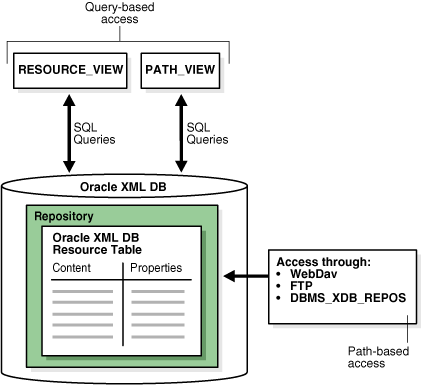
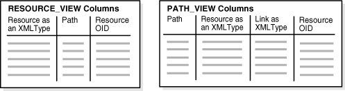
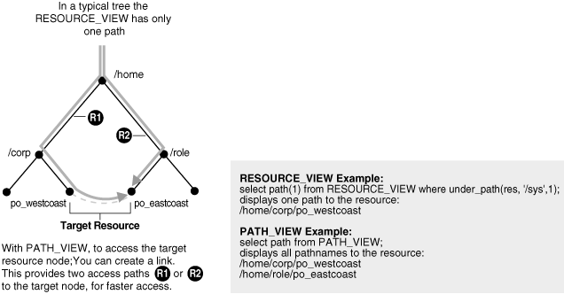
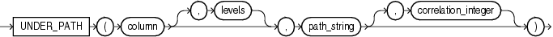
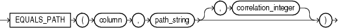
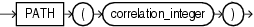

Predefined public views `RESOURCE_VIEW` and `PATH_VIEW` provide access to Oracle XML DB repository data. You can use Oracle SQL functions `under_path` and `equals_path` to query resources based on their path names, and functions `path` and `depth` to return resource path names and depths.

- Overview of Oracle XML DB RESOURCE_VIEW and PATH_VIEW
  Public views `RESOURCE_VIEW` and `PATH_VIEW` provide a mechanism for using SQL to access data stored in Oracle XML DB Repository. You can use these views to access data stored in the repository using Internet protocols such as FTP and WebDAV or using application program interfaces (APIs).
- Oracle SQL Functions That Use RESOURCE_VIEW and PATH_VIEW
  Oracle SQL functions used with public views `RESOURCE_VIEW` and `PATH_VIEW` include `under_path`, `equals_path`, `path`, and `depth`.
- Accessing Repository Data Paths, Resources and Links: Examples
  Examples here illustrate how to access Oracle XML DB Repository paths, resources, and link properties.
- Deleting Repository Resources: Examples
  Examples here illustrate how to delete Oracle XML DB Repository resources and paths.
- Updating Repository Resources: Examples
  Examples here illustrate how to update Oracle XML DB Repository resources and paths.
- Working with Multiple Oracle XML DB Resources
  To perform an operation on multiple Oracle XML DB resources, or to find one or more Oracle XML DB resources that meet a certain set of criteria, use SQL with `RESOURCE_VIEW `and `PATH_VIEW`.
- Performance Guidelines for Oracle XML DB Repository Operations
  Guidelines are presented for improving the performance of repository operations such as resource creation and querying.
- Searching for Resources Using Oracle Text
  Table `XDB$RESOURCE` in database schema `XDB` stores the metadata and content of repository resources. You can search for resources that contain a specific keyword by using Oracle SQL function `contains` with `RESOURCE_VIEW` or `PATH_VIEW`.

**See Also:**

- [Oracle Database Reference](../refrn/PATH_VIEW.md) for more information about view `PATH_VIEW`

- [Oracle Database Reference](../refrn/RESOURCE_VIEW.md) for more information about view `RESOURCE_VIEW`

**Parent topic:** [Oracle XML DB Repository](XML-DB-repository.md)

### 24.1 Overview of Oracle XML DB RESOURCE_VIEW and PATH_VIEW

Public views `RESOURCE_VIEW` and `PATH_VIEW` provide a mechanism for using SQL to access data stored in Oracle XML DB Repository. You can use these views to access data stored in the repository using Internet protocols such as FTP and WebDAV or using application program interfaces (APIs).

Figure 24-1 illustrates this.

`RESOURCE_VIEW` consists of a resource, itself an `XMLType` instance, that contains the name of the resource, its ACLs, and its properties, static or extensible.

- If the content of a resource is XML data stored somewhere in an `XMLType` table or view then the `RESOURCE_VIEW` points to the `XMLType` row that stores the content.

- If the content of a resource is not XML data then the `RESOURCE_VIEW` stores the content as a LOB.

**Note:**

As of Oracle Database Release 11.2.0.1.0, repository content stored in line as a LOB uses SecureFiles LOB storage. Prior to that, it used BasicFiles LOB storage.

Parent-child relationships between folders are maintained and traversed efficiently using the hierarchical repository index. Text indexes are available to search the properties of a resource, and internal B-tree indexes over names and ACLs speed up access to these attributes of the resource `XMLType` data.

`RESOURCE_VIEW` and `PATH_VIEW`, along with PL/SQL package `DBMS_XDB_REPOS`, provide all query-based access to Oracle XML DB and DML functionality that is available through the API.

The base table for `RESOURCE_VIEW` is `XDB.XDB$RESOURCE`. Access this table only using `RESOURCE_VIEW` or PL/SQL package `DBMS_XDB_REPOS`.

Figure 24-1 Accessing Repository Resources Using RESOURCE_VIEW and PATH_VIEW

[Description of "Figure 24-1 Accessing Repository Resources Using RESOURCE_VIEW and PATH_VIEW"](img_text/adxdb034.md)

Figure 24-2 illustrates the structure of `RESOURCE_VIEW` and `PATH_VIEW`.

Figure 24-2 RESOURCE_VIEW and PATH_VIEW Structure

[Description of "Figure 24-2 RESOURCE_VIEW and PATH_VIEW Structure"](img_text/adxdb032.md)

**Note:**

Neither `RESOURCE_VIEW` nor `PATH_VIEW` contains the root folder (`/`) resource. All other repository resources are included.

A path in the `RESOURCE_VIEW` is an arbitrary one of the paths that can be used to access the given resource. Oracle SQL function `under_path` lets applications search for resources that are contained (recursively) within a particular folder, get the resource depth, and so on. Each row in the `PATH_VIEW` and `RESOURCE_VIEW` columns is of data type `XMLType`. DML on repository views can be used to insert, rename, delete, and update resource properties and contents. Programmatic APIs must be used for some operations, such as creating links to existing resources.

Paths in the `ANY_PATH` column of the `RESOURCE_VIEW` and the `PATH` column in the `PATH_VIEW` are absolute paths: they start at the root.

**Note:**

Test resource paths for equality using Oracle SQL function `equals_path`: `equals_path('/my/path') = 1`. Do not test `ANY_PATH` for equality against an absolute path: `ANY_PATH = '/my/path'`.

Paths returned by the `path` function are relative paths under the path name specified by function `under_path`. For example, if there are two resources referenced by path names `/a/b/c `and `/a/d`, respectively, then a `path` expression that retrieves paths under folder `/a` returns relative paths `b/c` and `d`.

When there are multiple hard links to the same resource, only paths under the path name specified by function `under_path` are returned. If `/a/b/c`, `/a/b/d`, and `/a/e` are all links to the same resource, then a query on `PATH_VIEW` that retrieves all of the paths under `/a/b` returns only `/a/b/c` and `/a/b/d`, not `/a/e`.

- RESOURCE_VIEW Definition and Structure
  Public view `RESOURCE_VIEW` contains one row for each resource in Oracle XML DB Repository (except for the root folder resource).
- PATH_VIEW Definition and Structure
  Public view `PATH_VIEW` contains one row for each unique path that accesses a resource in Oracle XML DB Repository (except for the root folder resource). Each resource can have multiple paths, also called **links**.
- The Difference Between RESOURCE_VIEW and PATH_VIEW
  `PATH_VIEW` includes all the path names to a particular resource. `RESOURCE_VIEW` includes one of the possible path names to the resource. `PATH_VIEW` also includes the link properties. For better performance, use `RESOURCE_VIEW`, not `PATH_VIEW`, whenever possible.
- Operations You Can Perform Using UNDER_PATH and EQUALS_PATH
  You can use Oracle SQL functions `under_path` and `equals_path` to get a resource or its OID; create, delete, or update a resource; or list a directory that corresponds to a path name.

**Related Topics**

- [Overview of How To Use Oracle XML DB](how-to-use-XML-DB.md)

**Parent topic:** Repository Access Using RESOURCE_VIEW and PATH_VIEW

#### 24.1.1 RESOURCE_VIEW Definition and Structure

Public view `RESOURCE_VIEW` contains one row for each resource in Oracle XML DB Repository (except for the root folder resource).

Table 24-1 describes the structure of `RESOURCE_VIEW`.

Table 24-1 Structure of RESOURCE_VIEW

| Column     | Data Type  | Description                                                        |
|:-----------|:-----------|:-------------------------------------------------------------------|
| `RES`      | `XMLType`  | A resource in the repository (except for the root folder resource) |
| `ANY_PATH` | `VARCHAR2` | An (absolute) path to the resource                                 |
| `RESID`    | `RAW`      | Resource OID, which is a unique handle to the resource             |

**Parent topic:** Overview of Oracle XML DB RESOURCE_VIEW and PATH_VIEW

#### 24.1.2 PATH_VIEW Definition and Structure

Public view `PATH_VIEW` contains one row for each unique path that accesses a resource in Oracle XML DB Repository (except for the root folder resource). Each resource can have multiple paths, also called **links**.

Table 24-2 describes the structure of `PATH_VIEW`.

Table 24-2 Structure of PATH_VIEW

| Column  | Data Type  | Description                                     |
|:--------|:-----------|:------------------------------------------------|
| `PATH`  | `VARCHAR2` | An (absolute) path to repository resource `RES` |
| `RES`   | `XMLType`  | The resource referred to by column `PATH`       |
| `LINK`  | `XMLType`  | Link property                                   |
| `RESID` | `RAW`      | Resource OID                                    |

**Parent topic:** Overview of Oracle XML DB RESOURCE_VIEW and PATH_VIEW

#### 24.1.3 The Difference Between RESOURCE_VIEW and PATH_VIEW

`PATH_VIEW` includes all the path names to a particular resource. `RESOURCE_VIEW` includes one of the possible path names to the resource. `PATH_VIEW` also includes the link properties. For better performance, use `RESOURCE_VIEW`, not `PATH_VIEW`, whenever possible.

Figure 24-3 illustrates this difference.

Because many Internet applications need only one URL to access a resource, `RESOURCE_VIEW` is widely applicable.

`PATH_VIEW` contains both link properties and resource properties, whereas the `RESOURCE_VIEW` contains only resource properties.

Because it handles the information for multiple paths, `PATH_VIEW` access can be slower. If you use `RESOURCE_VIEW`then the database can take advantage of the fact that only one path is needed; the index can do less work to determine all the possible paths.

**Note:**

When using `RESOURCE_VIEW`, if you specify a path using function `under_path` or `equals_path`, the function finds the resource regardless of whether or not the specified path is the arbitrary one chosen to normally appear with that resource using `RESOURCE_VIEW`.

Figure 24-3 RESOURCE_VIEW and PATH_VIEW Explained

[Description of "Figure 24-3 RESOURCE_VIEW and PATH_VIEW Explained"](img_text/adxdb018.md)

**Parent topic:** Overview of Oracle XML DB RESOURCE_VIEW and PATH_VIEW

#### 24.1.4 Operations You Can Perform Using UNDER_PATH and EQUALS_PATH

You can use Oracle SQL functions `under_path` and `equals_path` to get a resource or its OID; create, delete, or update a resource; or list a directory that corresponds to a path name.

- Given a path name, you can:

  - Get a resource or its OID

  - List the directory given by the path name

  - Create a resource

  - Delete a resource

  - Update a resource

- Given a condition that uses `under_path` or other SQL functions, you can:

  - Update resources

  - Delete resources

  - Get resources or their OID

**Parent topic:** Overview of Oracle XML DB RESOURCE_VIEW and PATH_VIEW

### 24.2 Oracle SQL Functions That Use RESOURCE_VIEW and PATH_VIEW

Oracle SQL functions used with public views `RESOURCE_VIEW` and `PATH_VIEW` include `under_path`, `equals_path`, `path`, and `depth`.

- UNDER_PATH SQL Function
  Oracle SQL function `under_path` uses the hierarchical index of Oracle XML DB Repository to return the paths to all hard links under a particular path. This index is designed to speed access when traversing a path (the most common usage).
- EQUALS_PATH SQL Function
  You use Oracle SQL function `equals_path` to find a resource that has a given path name. It is functionally equivalent to `under_path` with a depth restriction of zero.
- PATH SQL Function
  Oracle SQL function `path` returns the relative path name of the resource under a given `pathname` argument to function `under_path` or `equal_path`.
- DEPTH SQL Function
  Oracle SQL function `depth` returns the folder depth of the resource under the specified starting path.

**Parent topic:** Repository Access Using RESOURCE_VIEW and PATH_VIEW

#### 24.2.1 UNDER_PATH SQL Function

Oracle SQL function `under_path` uses the hierarchical index of Oracle XML DB Repository to return the paths to all hard links under a particular path. This index is designed to speed access when traversing a path (the most common usage).

If the other parts of a query predicate are very selective, however, then a functional implementation of `under_path` can be chosen that walks back up the repository. This can be more efficient, because fewer links must be traversed. Figure 24-4 shows the `under_path` syntax.

Figure 24-4 UNDER_PATH Syntax

[Description of "Figure 24-4 UNDER_PATH Syntax"](img_text/under_path_condition.md)

Table 24-3 details the signature of Oracle SQL function `under_path`.

Table 24-3 UNDER_PATH SQL Function Signature

| Syntax                                                       | Description                                                                                                                                                                                                                                                                                                                                                                                                                                                                                                                                                                                                                                                                                                                                                                |
|:-------------------------------------------------------------|:---------------------------------------------------------------------------------------------------------------------------------------------------------------------------------------------------------------------------------------------------------------------------------------------------------------------------------------------------------------------------------------------------------------------------------------------------------------------------------------------------------------------------------------------------------------------------------------------------------------------------------------------------------------------------------------------------------------------------------------------------------------------------|
| `under_path(resource_column, pathname); `                    | Determines whether a resource is under a specified path. Parameters: • `resource_column` –The column name or column alias of the `RESOURCE` column in the` PATH_VIEW` or `RESOURCE_VIEW.` • `pathname` – The path name to resolve.                                                                                                                                                                                                                                                                                                                                                                                                                                                                                                                                |
| `under_path(resource_column, depth, pathname);`              | Determines whether a resource is under a specified path, with a depth argument to restrict the number of levels to search. Parameters: • `resource_column` – The column name or column alias of the `RESOURCE` column in the` PATH_VIEW` or `RESOURCE_VIEW``.` • `depth` – The maximum depth to search. A nonnegative integer. • `pathname` – The path name to resolve.                                                                                                                                                                                                                                                                                                                                                                                        |
| `under_path(resource_column, pathname, correlation);`        | Determines if a resource is under a specified path, with a correlation argument for related SQL functions. Parameters: • `resource_column` – The column name or column alias of the `RESOURCE` column in the` PATH_VIEW` or `RESOURCE_VIEW``.` • `pathname` – The path name to resolve. • `correlation` – An integer that can be used to correlate `under_path` with related SQL functions (`path` and` depth`).                                                                                                                                                                                                                                                                                                                                               |
| `under_path(resource_column, depth, pathname, correlation);` | Determines if a resource is under a specified path with a depth argument to restrict the number of levels to search, and with a correlation argument for related SQL functions. Parameters: • `resource_column` – The column name or column alias of the `RESOURCE` column in the` PATH_VIEW` or `RESOURCE_VIEW`. • `depth` – The maximum depth to search. A nonnegative integer. • `pathname` – The path name to resolve. • `correlation` – An integer that can be used to correlate `under_path` with related SQL functions (`path` and `depth`). For a resource to be returned, only one of the accessible paths to the resource must be under the `pathname` argument. If no such path is under argument `pathname` then a `NULL` value is returned. |

**Note:**

Function `under_path` does not follow weak links, because such traversal could lead to cycles. A weak-link argument to `under_path` is resolved correctly, but weak links are not followed when traversing resources under that path.

**Parent topic:** Oracle SQL Functions That Use RESOURCE_VIEW and PATH_VIEW

#### 24.2.2 EQUALS_PATH SQL Function

You use Oracle SQL function `equals_path` to find a resource that has a given path name. It is functionally equivalent to `under_path` with a depth restriction of zero.

    equals_path(resource_column, pathname);

where:

- `resource_column` is the column name or column alias of the `RESOURCE` column in `PATH_VIEW` or `RESOURCE_VIEW.`

- `pathname` is the (absolute) path name to resolve. This can contain components that are hard or weak resource links.

Figure 24-5 illustrates the complete `equals_path` syntax.

Figure 24-5 EQUALS_PATH Syntax

[Description of "Figure 24-5 EQUALS_PATH Syntax"](img_text/equals_path_condition.md)

**Note:**

- Test resource paths for equality using Oracle SQL function `equals_path`: `equals_path('/my/path') = 1`. Do not test `ANY_PATH` for equality against an absolute path: `ANY_PATH = '/my/path'`.

- Use bind variables, instead of hard-coded strings, with `equals_path`.

**Parent topic:** Oracle SQL Functions That Use RESOURCE_VIEW and PATH_VIEW

#### 24.2.3 PATH SQL Function

Oracle SQL function `path` returns the relative path name of the resource under a given `pathname` argument to function `under_path` or `equal_path`.

The path column in the `RESOURCE_VIEW` always contains the absolute path of the resource. The syntax of function `path` is:

    path(correlation);

where:

- `correlation` is an integer that can be used to correlate `path` with under_path or `equals_path`.

Figure 24-6 illustrates the syntax for function `path`.

Figure 24-6 PATH Syntax

[Description of "Figure 24-6 PATH Syntax"](img_text/path.md)

**Parent topic:** Oracle SQL Functions That Use RESOURCE_VIEW and PATH_VIEW

#### 24.2.4 DEPTH SQL Function

Oracle SQL function `depth` returns the folder depth of the resource under the specified starting path.

    depth(correlation);

where:

`correlation` is an integer that can be used to correlate `depth` with `path` with under_path or `equals_path`.

**Parent topic:** Oracle SQL Functions That Use RESOURCE_VIEW and PATH_VIEW

### 24.3 Accessing Repository Data Paths, Resources and Links: Examples

Examples here illustrate how to access Oracle XML DB Repository paths, resources, and link properties.

The first few examples use resources specified by the following paths:

    /a/b/c
    /a/b/c/d
    /a/e/c
    /a/e/c/d

Example 24-1 uses Oracle SQL function `path` to retrieve the relative paths under path `/a/b`.

Example 24-2 uses `ANY_PATH` to retrieve the absolute paths under path `/a/b`.

Example 24-3 is the same as Example 24-2, except that the test is not-equals (`!=`) instead of equals (`=`). The query in Example 24-3 finds all paths in the repository that are not under path `/a/b`.

Example 24-4 shows the relative paths that are under repository folders `a/b` and `/a/e`, respectively. The expression `path(``1``)` represents the paths that are under folder `a/b`, since it uses the same correlation number, `1`, as the expression `under_path(RES, '/a/b', ``1``)`, which specifies folder `a/b`. Similarly for `path(2)` and folder `/a/e`. Expression `ANY_PATH` returns the corresponding absolute paths.

Example 24-1 Determining Paths Under a Path: Relative

    SELECT path(1) FROM RESOURCE_VIEW WHERE under_path(RES, '/a/b', 1) = 1;

    PATH(1)
    -------
    c
    c/d

    2 rows selected.

Example 24-2 Determining Paths Under a Path: Absolute

    SELECT ANY_PATH FROM RESOURCE_VIEW WHERE under_path(RES, '/a/b') = 1;

    ANY_PATH
    --------
    /a/b/c
    /a/b/c/d

    2 rows selected.

Example 24-3 Determining Paths Not Under a Path

    SELECT ANY_PATH FROM RESOURCE_VIEW WHERE under_path(RES, '/a/b') != 1

    ANY_PATH
    --------
    /a
    /a/b
    /a/e
    /a/e/c
    /a/e/c/d
    /home
    /home/OE
    /home/OE/PurchaseOrders
    /home/OE/PurchaseOrders/2002
    /home/OE/PurchaseOrders/2002/Apr
    /home/OE/PurchaseOrders/2002/Apr/AMCEWEN-20021009123336171PDT.xml
    /home/OE/PurchaseOrders/2002/Apr/AMCEWEN-20021009123336271PDT.xml
    /home/OE/PurchaseOrders/2002/Apr/EABEL-20021009123336251PDT.xml
    . . .
    /public
    /sys
    /sys/acls
    /sys/acls/all_all_acl.xml
    /sys/acls/all_owner_acl.xml
    /sys/acls/bootstrap_acl.xml
    /sys/acls/ro_all_acl.xml
    /sys/apps
    /sys/apps/plsql
    /sys/apps/plsql/xs
    /sys/apps/plsql/xs/netaclrc.xml
    /sys/apps/plsql/xs/netaclsc.xml
    /sys/databaseSummary.xml
    /sys/log
    /sys/schemas
    /sys/schemas/OE
    /sys/schemas/OE/localhost:8080
    . . .

    326 rows selected.

Example 24-4 Determining Paths Using Multiple Correlations

    SELECT ANY_PATH, path(1), path(2)
      FROM RESOURCE_VIEW
      WHERE under_path(RES, '/a/b', 1) = 1 OR under_path(RES, '/a/e', 2) = 1;

    ANY_PATH   PATH(1)  PATH(2)
    ---------- -------- --------
    /a/b/c     c
    /a/b/c/d   c/d
    /a/e/c              c
    /a/e/c/d            c/d

    4 rows selected.

Example 24-5 Relative Path Names for Three Levels of Resources

    SELECT path(1) FROM RESOURCE_VIEW WHERE under_path(RES, 3, '/sys', 1) = 1;

This produces a result similar to the following.

    PATH(1)
    -------
    acls
    acls/all_all_acl.xml
    acls/all_owner_acl.xml
    acls/bootstrap_acl.xml
    acls/ro_all_acl.xml
    apps
    apps/plsql
    apps/plsql/xs
    databaseSummary.xml
    log
    schemas
    schemas/OE
    schemas/OE/localhost:8080
    schemas/PUBLIC
    schemas/PUBLIC/www.w3.org
    schemas/PUBLIC/xmlns.oracle.com

    93 rows selected.

Example 24-6 Extracting Resource Metadata Using UNDER_PATH

    SELECT ANY_PATH,
           XMLQuery('declare namespace ns = "http://xmlns.oracle.com/xdb/XDBResource.xsd"; (: :)
                     $r/ns:Resource' PASSING RES AS "r" RETURNING CONTENT)
      FROM RESOURCE_VIEW WHERE under_path(RES, '/sys') = 1;

This produces a result similar to the following:

    ANY_PATH
    --------
    XMLQUERY('DECLARENAMESPACENS="HTTP://XMLNS.ORACLE.COM/XDB/XDBRESOURCE.XSD";(::)$
    --------------------------------------------------------------------------------
    /sys/acls
    <Resource xmlns="http://xmlns.oracle.com/xdb/XDBResource.xsd">
      <CreationDate>2008-06-25T13:17:45.164662</CreationDate>
      <ModificationDate>2008-06-25T13:17:47.865163</ModificationDate>
      <DisplayName>acls</DisplayName>
      <Language>en-US</Language>
      <CharacterSet>UTF-8</CharacterSet>
      <ContentType>application/octet-stream</ContentType>
      <RefCount>1</RefCount>
    </Resource>

    /sys/acls/all_all_acl.xml
    <Resource xmlns="http://xmlns.oracle.com/xdb/XDBResource.xsd">
      <CreationDate>2008-06-25T13:17:47.759806</CreationDate>
      <ModificationDate>2008-06-25T13:17:47.759806</ModificationDate>
      <DisplayName>all_all_acl.xml</DisplayName>
      <Language>en-US</Language>
      <CharacterSet>UTF-8</CharacterSet>
      <ContentType>text/xml</ContentType>
      <RefCount>1</RefCount>
    </Resource>
    . . .
    41 rows selected.

Example 24-7 Using Functions PATH and DEPTH with PATH_VIEW

    SELECT path(1) path, depth(1) depth FROM PATH_VIEW
      WHERE under_path(RES, 3, '/sys', 1) = 1;

This produces a result similar to the following:

    PATH                                      DEPTH
    ----                                      -----
    acls                                      1
    acls/all_all_acl.xml                      2
    acls/all_owner_acl.xml                    2
    acls/bootstrap_acl.xml                    2
    acls/ro_all_acl.xml                       2
    apps                                      1
    apps/plsql                                2
    apps/plsql/xs                             3
    databaseSummary.xml                       1
    log                                       1
    schemas                                   1
    schemas/OE                                2
    schemas/OE/localhost:8080                 3
    schemas/PUBLIC                            2
    schemas/PUBLIC/www.w3.org                 3
    schemas/PUBLIC/xmlns.oracle.com           3
    . . .

Example 24-8 Extracting Link and Resource Information from PATH_VIEW

    SELECT PATH,
           XMLCast(XMLQuery(
                     'declare namespace ns =
                               "http://xmlns.oracle.com/xdb/XDBResource.xsd"; (: :)
                      $l/ns:LINK/ns:Name' PASSING LINK AS "l" RETURNING CONTENT)
                   AS VARCHAR2(256)),
           XMLCast(XMLQuery(
                     'declare namespace ns =
                               "http://xmlns.oracle.com/xdb/XDBResource.xsd"; (: :)
                      $l/ns:LINK/ns:ParentName' PASSING LINK AS "l" RETURNING CONTENT)
                   AS VARCHAR2(256)),
           XMLCast(XMLQuery(
                     'declare namespace ns =
                               "http://xmlns.oracle.com/xdb/XDBResource.xsd"; (: :)
                      $l/ns:LINK/ns:ChildName' PASSING LINK AS "l" RETURNING CONTENT)
                   AS VARCHAR2(256)),
           XMLCast(XMLQuery(
                     'declare namespace ns =
                               "http://xmlns.oracle.com/xdb/XDBResource.xsd"; (: :)
                      $r/ns:Resource/ns:DisplayName'
                        PASSING RES AS "r" RETURNING CONTENT)
                   AS VARCHAR2(128))
      FROM PATH_VIEW WHERE PATH LIKE '/sys%';

This produces a result similar to the following:

    /sys/schemas/PUBLIC/www.w3.org/1999/xlink.xsd
    xlink.xsd

    /sys/schemas/PUBLIC/www.w3.org/1999/xlink
    xlink

    /sys/schemas/PUBLIC/www.w3.org/1999/csx.xlink.xsd
    csx.xlink.xsd

    . . .

    118 rows selected.

Example 24-9 All Repository Paths to a Certain Depth Under a Path

    SELECT path(1) FROM PATH_VIEW WHERE under_path(RES, 3, '/sys', 1) > 0;

This produces a result similar to the following:

    PATH(1)
    -------
    acls
    acls/all_all_acl.xml
    acls/all_owner_acl.xml
    acls/bootstrap_acl.xml
    acls/ro_all_acl.xml
    apps
    apps/plsql
    apps/plsql/xs
    databaseSummary.xml
    log
    principals
    principals/groups
    principals/users
    schemas
    schemas/PUBLIC
    schemas/PUBLIC/www.opengis.net
    schemas/PUBLIC/www.w3.org
    schemas/PUBLIC/xmlns.oracle.com
    workspaces
    . . .

    43 rows selected.

Example 24-10 Locating a Repository Path Using EQUALS_PATH

    SELECT ANY_PATH FROM RESOURCE_VIEW WHERE equals_path(RES, '/sys') > 0;

    ANY_PATH
    --------
    /sys

    1 row selected.

Example 24-11 Retrieve RESID of a Given Resource

    SELECT RESID FROM RESOURCE_VIEW
      WHERE XMLCast(XMLQuery(
                      'declare namespace ns =
                         "http://xmlns.oracle.com/xdb/XDBResource.xsd"; (: :)
                       $r/ns:Resource/ns:DisplayName'
                      PASSING RES AS "r" RETURNING CONTENT)
                    AS VARCHAR2(128))
            = 'example';

This produces a result similar to the following:

    RESID
    --------------------------------
    F301A10152470252E030578CB00B432B

    1 row selected.

Example 24-12 Obtaining the Path Name of a Resource from its RESID

    DECLARE
      resid_example RAW(16);
      path          VARCHAR2(4000);
    BEGIN
      SELECT RESID INTO resid_example FROM RESOURCE_VIEW
        WHERE XMLCast(XMLQuery(
                        'declare namespace ns =
                           "http://xmlns.oracle.com/xdb/XDBResource.xsd"; (: :)
                         $r/ns:Resource/ns:DisplayName'
                        PASSING RES AS "r" RETURNING CONTENT)
                      AS VARCHAR2(128))

              = 'example';
      SELECT ANY_PATH INTO path FROM RESOURCE_VIEW WHERE RESID = resid_example;
      DBMS_OUTPUT.put_line('The path is: ' || path);
    END;
    /
    The path is: /public/example

    PL/SQL procedure successfully completed.

Example 24-13 Folders Under a Given Path

    SELECT ANY_PATH FROM RESOURCE_VIEW
      WHERE under_path(RES, 1, '/sys') = 1
        AND XMLExists('declare namespace ns =
                         "http://xmlns.oracle.com/xdb/XDBResource.xsd"; (: :)
                       $r/ns:Resource[@Container = xs:boolean("true")]'
                      PASSING RES AS "r");

This produces a result like the following:

    ANY_PATH
    --------
    /sys/acls
    /sys/apps
    /sys/log
    /sys/schemas

    4 rows selected.

Example 24-14 Joining RESOURCE_VIEW with an XMLType Table

    SELECT ANY_PATH, XMLQuery('$p/PurchaseOrder/LineItems'
                              PASSING po.OBJECT_VALUE AS "p" RETURNING CONTENT)
      FROM purchaseorder po, RESOURCE_VIEW rv
      WHERE ref(po)
            = XMLCast(XMLQuery('declare default element namespace
                                "http://xmlns.oracle.com/xdb/XDBResource.xsd"; (: :)
                                fn:data(/Resource/XMLRef)'
                               PASSING rv.RES RETURNING CONTENT)
                      AS REF XMLType)
        AND ROWNUM < 2;

    ANY_PATH
    --------------------------------------------------------------------------------
    XMLQUERY('$P/PURCHASEORDER/LINEITEMS'PASSINGPO.OBJECT_VALUEAS"P"RETURNINGCONTENT
    --------------------------------------------------------------------------------
    /home/OE/PurchaseOrders/2002/Apr/AMCEWEN-20021009123336171PDT.xml
    <LineItems>
      <LineItem ItemNumber="1">
        <Description>Salesman</Description>
        <Part Id="37429158920" UnitPrice="39.95" Quantity="2"/>
      </LineItem>
      <LineItem ItemNumber="2">
        <Description>Big Deal on Madonna Street</Description>
        <Part Id="37429155424" UnitPrice="29.95" Quantity="1"/>
      </LineItem>
      <LineItem ItemNumber="3">
        <Description>Hearts and Minds</Description>
        <Part Id="37429166321" UnitPrice="39.95" Quantity="1"/>
      </LineItem>

    . . .

      <LineItem ItemNumber="23">
        <Description>Great Expectations</Description>
        <Part Id="37429128022" UnitPrice="39.95" Quantity="4"/>
      </LineItem>
    </LineItems>

    1 row selected.

**Parent topic:** Repository Access Using RESOURCE_VIEW and PATH_VIEW

### 24.4 Deleting Repository Resources: Examples

Examples here illustrate how to delete Oracle XML DB Repository resources and paths.

If you delete only leaf resources, then you can use `DELETE FROM RESOURCE_VIEW`, as in Example 24-15.

For multiple links to the same resource, deleting from `RESOURCE_VIEW` deletes the resource together with all of its links. Deleting from `PATH_VIEW` deletes only the link with the specified path.

Example 24-16 illustrates this.

Example 24-15 Deleting Resources

    DELETE FROM RESOURCE_VIEW WHERE equals_path(RES, '/public/myfile') = 1';

Example 24-16 Deleting Links to Resources

Suppose that `'/home/myfile1'` is a link to `'/public/myfile'`:

    CALL DBMS_XDB_REPOS.link('/public/myfile', '/home', 'myfile1');

The following SQL DML statement deletes everything in Oracle XML DB Repository that is found at path `/home/myfile1` – both the link and the resource:

    DELETE FROM RESOURCE_VIEW WHERE equals_path(RES, '/home/myfile1') = 1;

The following DML statement deletes only the link with path `/home/file1`:

    DELETE FROM PATH_VIEW WHERE equals_path(RES, '/home/file1') = 1;

- Deleting Nonempty Folder Resources
  The `DELETE` DML operator is not allowed on a nonempty folder. If you try to delete a nonempty folder, you must first delete its contents and then delete the resulting empty folder. This rule must be applied recursively to any folders contained in the target folder.

**Parent topic:** Repository Access Using RESOURCE_VIEW and PATH_VIEW

#### 24.4.1 Deleting Nonempty Folder Resources

The `DELETE` DML operator is not allowed on a nonempty folder. If you try to delete a nonempty folder, you must first delete its contents and then delete the resulting empty folder. This rule must be applied recursively to any folders contained in the target folder.

However, the order of the paths returned from a `WHERE` clause is not guaranteed, and the `DELETE` operator does not allow an `ORDER BY` clause in its table-expression subclause. You cannot do the following:

    DELETE FROM (SELECT 1 FROM RESOURCE_VIEW
                   WHERE under_path(RES, '/public', 1) = 1
                   ORDER BY depth(1) DESCENDING);

Example 24-17 illustrates how to delete a nonempty folder: folder `example` is deleted, along with its subfolder `example1`.

**Note:**

As always, take care to avoid deadlocks with concurrent transactions when operating on multiple rows.

Example 24-17 Deleting a Nonempty Folder

    SELECT PATH FROM PATH_VIEW WHERE under_path(RES, '/home/US1') = 1;

    PATH
    --------------------------
    /home/US1/example
    /home/US1/example/example1

    2 rows selected.

    DECLARE
      CURSOR c1 IS
        SELECT ANY_PATH p FROM RESOURCE_VIEW
          WHERE under_path(RES, '/home/US1', 1) = 1
            AND XMLExists('declare namespace ns =
                             "http://xmlns.oracle.com/xdb/XDBResource.xsd"; (: :)
                           $r/ns:Resource[ns:Owner="US1"]' PASSING RES AS "r")
          ORDER BY depth(1) DESC;
      del_stmt VARCHAR2(500) :=
        'DELETE FROM RESOURCE_VIEW WHERE equals_path(RES, :1)=1';
    BEGIN
      FOR r1 IN c1 LOOP
        EXECUTE IMMEDIATE del_stmt USING r1.p;
      END LOOP;
    END;
    /

    PL/SQL procedure successfully completed.

    SELECT PATH FROM PATH_VIEW WHERE under_path(RES, '/home/US1') = 1;

    no rows selected

**Parent topic:** Deleting Repository Resources: Examples

### 24.5 Updating Repository Resources: Examples

Examples here illustrate how to update Oracle XML DB Repository resources and paths.

Example 24-18 changes the resource at path `/test/HR/example/paper`.

**See Also:**

[User-Defined Repository Metadata](user-defined-repository-metadata.md) for additional examples of updating resource metadata

By default, the `DisplayName` element content, `paper`, was the same text as the last location step of the resource path, `/test/HR/example/paper`. This is only the default value, however. The `DisplayName` is independent of the resource path, so updating it does not change the path.

Element `DisplayName` is defined by the WebDAV standard, and it is recognized by WebDAV applications. Applications, such as an FTP client, that are not WebDAV-based do not recognize the `DisplayName` of a resource. An FTP client lists the resource as `paper` (using FTP command `ls`, for example) even after the `UPDATE` operation.

Example 24-19 changes the path for the resource from `/test/HR/example/paper` to `/test/myexample`. It is analogous to using the UNIX or Linux command `mv /test/HR/example/paper /test/myexample`.

**See Also:**

[Table 21-3](accessing-XML-DB-repository-data.md) for additional examples that use SQL functions that apply to `RESOURCE_VIEW` and `PATH_VIEW`

Example 24-18 Updating a Resource

This is the complete resource before the update operation:

    SELECT XMLSerialize(DOCUMENT r.RES AS CLOB)
      FROM RESOURCE_VIEW r WHERE equals_path(r.RES, '/test/HR/example/paper') = 1;

    XMLSERIALIZE(DOCUMENTR.RESASCLOB)
    --------------------------------------------------------------------------------
    <Resource xmlns="http://xmlns.oracle.com/xdb/XDBResource.xsd" Hidden="false" Inv
    alid="false" Container="false" CustomRslv="false" VersionHistory="false" StickyR
    ef="true">
      <CreationDate>2005-04-29T16:30:01.588835</CreationDate>
      <ModificationDate>2005-04-29T16:30:01.588835</ModificationDate>
      <DisplayName>paper</DisplayName>
      <Language>en-US</Language>
      <CharacterSet>UTF-8</CharacterSet>
      <ContentType>application/octet-stream</ContentType>
      <RefCount>1</RefCount>
      <ACL>
        <acl description="Public:All privileges to PUBLIC" xmlns="http://xmlns.oracl
    e.com/xdb/acl.xsd" xmlns:xsi="http://www.w3.org/2001/XMLSchema-instance" xsi:sch
    emaLocation="http://xmlns.oracle.com/xdb/acl.xsd                           http:
    //xmlns.oracle.com/xdb/acl.xsd">
          <ace>
            <principal>PUBLIC</principal>
            <grant>true</grant>
            <privilege>
              <all/>
            </privilege>
          </ace>
        </acl>
      </ACL>
      <Owner>TESTUSER1</Owner>
      <Creator>TESTUSER1</Creator>
      <LastModifier>TESTUSER1</LastModifier>
      <SchemaElement>http://xmlns.oracle.com/xdb/XDBSchema.xsd#binary</SchemaElement
    >
      <Contents>
        <binary>4F7261636C65206F7220554E4958</binary>
      </Contents>
    </Resource>

    1 row selected.

All of the XML elements shown here are resource metadata elements, with the exception of `Contents`, which contains the resource content.

This `UPDATE` statement updates (only) the `DisplayName` metadata element.

    UPDATE RESOURCE_VIEW r
      SET r.RES =
        XMLQuery('copy $i := $p1 modify
                    (for $j in $i/Resource/DisplayName
                     return replace value of node $j with $p2)
                  return $i'
                 PASSING r.RES AS "p1", 'My New Paper' AS "p2"
                 RETURNING CONTENT)
        WHERE equals_path(r.RES, '/test/HR/example/paper') = 1;

    1 row updated.

    SELECT XMLSerialize(DOCUMENT r.RES AS CLOB)
      FROM RESOURCE_VIEW r WHERE equals_path(r.RES, '/test/HR/example/paper') = 1;

    XMLSERIALIZE(DOCUMENTR.RESASCLOB)
    --------------------------------------------------------------------------------
    <Resource xmlns="http://xmlns.oracle.com/xdb/XDBResource.xsd" Hidden="false" Inv
    alid="false" Container="false" CustomRslv="false" VersionHistory="false" StickyR
    ef="true">
      <CreationDate>2005-04-29T16:30:01.588835</CreationDate>
      <ModificationDate>2005-04-29T16:30:01.883838</ModificationDate>
      <DisplayName>My New Paper</DisplayName>
      <Language>en-US</Language>

      . . .

      <Contents>
        <binary>4F7261636C65206F7220554E4958</binary>
      </Contents>
    </Resource>

    1 row selected.

Example 24-19 Updating a Path in the PATH_VIEW

    SELECT ANY_PATH FROM RESOURCE_VIEW WHERE under_path(RES, '/test') = 1;

    ANY_PATH
    --------
    /test/HR
    /test/HR/example
    /test/HR/example/paper

    3 rows selected.

    UPDATE PATH_VIEW
      SET PATH = '/test/myexample' WHERE PATH = '/test/HR/example/paper';

    ANY_PATH
    --------
    /test/HR
    /test/HR/example
    /test/myexample

    3 rows selected.

**Parent topic:** Repository Access Using RESOURCE_VIEW and PATH_VIEW

### 24.6 Working with Multiple Oracle XML DB Resources

To perform an operation on multiple Oracle XML DB resources, or to find one or more Oracle XML DB resources that meet a certain set of criteria, use SQL with `RESOURCE_VIEW `and `PATH_VIEW`.

For example, you can perform the following operations:

- Update resources based on attributes – see Example 24-20

- Finding resources inside a folder – see Example 24-21

- Copy a set of Oracle XML DB resources – see Example 24-22

The SQL DML statement in Example 24-22 copies all of the resources in folder `public` to folder `newlocation`. It is analogous to the UNIX or Linux command `cp /public/* /newlocation`. Target folder `newlocation` must exist before the copy.

Example 24-20 Updating Resources Based on Attributes

    UPDATE RESOURCE_VIEW
      SET RES =
        XMLQuery('copy $i := $p1 modify
                    (for $j in $i/Resource/DisplayName
                     return replace value of node $j with $p2)
                   return $i'
                  PASSING RES AS "p1", 'My New Paper' AS "p2"
                  RETURNING CONTENT)
      WHERE XMLCast(XMLQuery('declare namespace ns =
                              "http://xmlns.oracle.com/xdb/XDBResource.xsd"; (: :)
                              $r/ns:Resource/ns:DisplayName'
                             PASSING RES AS "r" RETURNING CONTENT)
                    AS VARCHAR2(128))
            = 'My Paper';

    1 row updated.

    SELECT ANY_PATH FROM RESOURCE_VIEW
      WHERE XMLCast(XMLQuery('declare namespace ns =
                                "http://xmlns.oracle.com/xdb/XDBResource.xsd"; (: :)
                              $r/ns:Resource/ns:DisplayName'
                             PASSING RES AS "r" RETURNING CONTENT)
                    AS VARCHAR2(128))
              = 'My New Paper';

    ANY_PATH
    ---------------
    /test/myexample

    1 row selected.

Example 24-21 Finding Resources Inside a Folder

    SELECT ANY_PATH FROM RESOURCE_VIEW
      WHERE under_path(resource, '/sys/schemas/PUBLIC/xmlns.oracle.com/xdb') = 1;

    ANY_PATH
    --------------------------------------------------------------
    /sys/schemas/PUBLIC/xmlns.oracle.com/xdb/XDBResource.xsd
    /sys/schemas/PUBLIC/xmlns.oracle.com/xdb/XDBSchema.xsd
    /sys/schemas/PUBLIC/xmlns.oracle.com/xdb/XDBStandard.xsd
    /sys/schemas/PUBLIC/xmlns.oracle.com/xdb/acl.xsd
    /sys/schemas/PUBLIC/xmlns.oracle.com/xdb/dav.xsd
    /sys/schemas/PUBLIC/xmlns.oracle.com/xdb/log
    /sys/schemas/PUBLIC/xmlns.oracle.com/xdb/log/xdblog.xsd
    /sys/schemas/PUBLIC/xmlns.oracle.com/xdb/stats.xsd
    /sys/schemas/PUBLIC/xmlns.oracle.com/xdb/xdbconfig.xsd

    12 rows selected.

Example 24-22 Copying Resources

    SELECT PATH FROM PATH_VIEW WHERE under_path(RES, '/test') = 1;

    PATH
    -----------------
    /test/HR
    /test/HR/example
    /test/myexample

    3 rows selected.

    INSERT INTO PATH_VIEW
      SELECT '/newlocation/' || path(1), RES, LINK, NULL FROM PATH_VIEW
        WHERE under_path(RES, '/test', 1) = 1
        ORDER BY depth(1);

    3 rows created.

    SELECT PATH FROM PATH_VIEW WHERE under_path(RES, '/newlocation') = 1;

    PATH
    ------------------------
    /newlocation/HR
    /newlocation/HR/example
    /newlocation/myexample

    3 rows selected.

**Parent topic:** Repository Access Using RESOURCE_VIEW and PATH_VIEW

### 24.7 Performance Guidelines for Oracle XML DB Repository Operations

Guidelines are presented for improving the performance of repository operations such as resource creation and querying.

Folders that contain a large number of resources can negatively affect concurrency, particularly when many resources are created or deleted. As a rule of thumb, do not have folders that contain more than 10,000 resources. This empirical limit is based on the database block size and the average filename length.

If you create resources in bulk, perform a `COMMIT` operation at least every 1,000 resources. Performance can be negatively impacted if you commit very often or you commit less often than every 1,000 resource creations.

When creating a file resource that is an XML Schema-based document for which the XML schema is known, specify the XML schema URL as a parameter to PL/SQL function `DBMS_XDB_REPOS.createResource`. This saves preparsing the document to determine the XML schema.

Oracle XML DB uses configuration file `xdbconfig.xml` for configuring the system and protocol environment. This file includes an element parameter, `resource-view-cache-size`, that defines the size in dynamic memory of the `RESOURCE_VIEW` cache. The default value is `1048576`.

The performance of some queries on `RESOURCE_VIEW` and `PATH_VIEW` can be improved by tuning `resource-view-cache-size`. In general, the bigger the cache size, the faster the query. The default `resource-view-cache-size` is appropriate for most cases, but you may want to enlarge your `resource-view-cache-size` element when querying a sizable `RESOURCE_VIEW`.

The default limits for the following elements are soft limits. The system automatically adapts when these limits are exceeded.

- `xdbcore-loadableunit-size` – This element indicates the maximum size to which a loadable unit (partition) can grow in Kilobytes. When a partition is read into memory or a partition is built while consuming a new document, the partition is built until it reaches the maximum size. The default value is 16 KB.

- `xdbcore-xobmem-bound` – This element indicates the maximum memory in kilobytes that a document is allowed to occupy. The default value is 1024 KB. Once the document exceeds this number, some loadable units (partitions) are swapped out.

**Related Topics**

- [Administration of Oracle XML DB](administration-of-XML-DB.md)

**See Also:**

[Oracle Database PL/SQL Packages and Types Reference](../arpls/DBMS_XDB_REPOS.md) for information about PL/SQL function `DBMS_XDB_REPOS.createResource`

**Parent topic:** Repository Access Using RESOURCE_VIEW and PATH_VIEW

### 24.8 Searching for Resources Using Oracle Text

Table `XDB$RESOURCE` in database schema `XDB` stores the metadata and content of repository resources. You can search for resources that contain a specific keyword by using Oracle SQL function `contains` with `RESOURCE_VIEW` or `PATH_VIEW`.

To evaluate such queries, you must first create a context index on the `XDB$RESOURCE` table. Depending on the type of documents stored in Oracle XML DB, choose one of the following options for creating your context index:

- If Oracle XML DB contains only XML documents, that is, no binary data, then a regular Context Index can be created on the `XDB$RESOURCE` table. This is the case for Example 24-24.

      CREATE INDEX xdb$resource_ctx_i ON XDB.XDB$RESOURCE(OBJECT_VALUE)
        INDEXTYPE IS CTXSYS.CONTEXT;

- If Oracle XML DB contains binary data such as Microsoft Word documents, then a user filter is required to filter such documents prior to indexing. Use package `DBMS_XDBT` (`dbmsxdbt.sql`) to create and configure the Context Index.

      -- Install the package - connected as SYS
      @dbmsxdbt
      -- Create the preferences
      EXEC DBMS_XDBT.createPreferences;
      -- Create the index
      EXEC DBMS_XDBT.createIndex;

Package `DBMS_XDBT` also includes procedures to synchronize and optimize the index. You can use procedure `configureAutoSync()` to automatically sync the index by using job queues.

**See Also:**

[Oracle Database PL/SQL Packages and Types Reference](../arpls/DBMS_XDBT.md) for information about installing and using `DBMS_XDBT`.

Example 24-23 Find All Resources Containing "Paper"

    SELECT PATH FROM PATH_VIEW WHERE contains(RES, 'Paper') > 0;

    PATH
    -----------------------
    /newlocation/myexample
    /test/myexample

    2 rows selected.

Example 24-24 Find All Resources Containing "Paper" that are Under a Specified Path

    SELECT ANY_PATH FROM RESOURCE_VIEW
       WHERE contains(RES, 'Paper') > 0 AND under_path(RES, '/test') > 0;

    ANY_PATH
    ----------------
    /test/myexample

    1 row selected.

**Related Topics**

- [Query and Update of XML Data](query-and-update-XML.md)
- [PL/SQL APIs for XMLType: References](PLSQL-APIs-for-XMLType.md)

**Parent topic:** Repository Access Using RESOURCE_VIEW and PATH_VIEW
