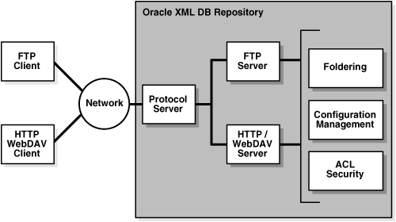
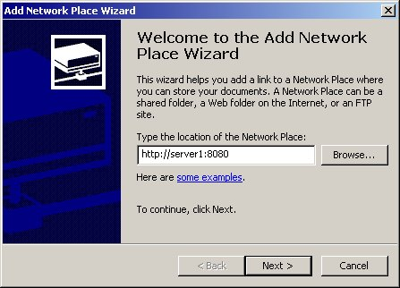
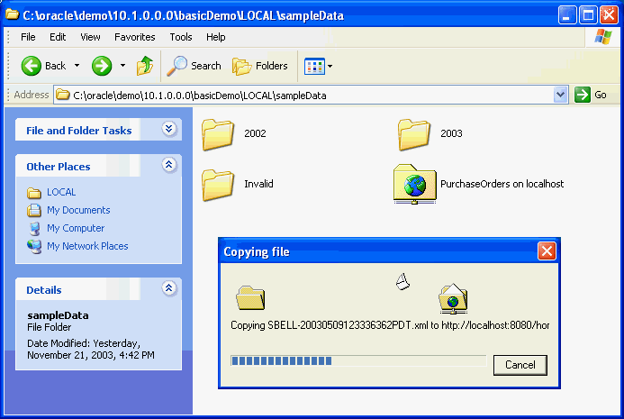

You can access Oracle XML DB Repository data using protocols FTP and HTTP(S)/WebDAV.

- Overview of Oracle XML DB Protocol Server
  Oracle XML DB also provides the Oracle XML DB protocol server. This supports standard Internet protocols, FTP, WebDAV, and HTTP(S), for accessing its hierarchical repository or file system. HTTPS provides secure access to Oracle XML DB Repository.
- Oracle XML DB Protocol Server Configuration Management
  Oracle XML DB protocol server uses configuration parameters stored in file `xdbconfig.xml` to initialize its startup state and manage session level configuration. The session pool size and timeout parameters cannot be changed dynamically, that is, you must restart the database in order for these changes to take effect.
- FTP and the Oracle XML DB Protocol Server
  File Transfer Protocol (FTP), specified in RFC959, is one of the oldest and most popular protocols. It provides access to heterogeneous file systems in a uniform manner. You can use FTP to access and update data stored in Oracle XML DB Repository.
- HTTP(S) and Oracle XML DB Protocol Server
  Oracle XML DB implements HyperText Transfer Protocol (HTTP), HTTP 1.1 as defined in the RFC2616 specification.
- WebDAV and Oracle XML DB
  Web Distributed Authoring and Versioning (WebDAV) is an IETF standard protocol that Oracle XML DB uses to provide users with a file-system interface to Oracle XML Repository over the Internet. The most popular way of accessing a WebDAV server folder is through WebFolders using Microsoft Windows.

**Parent topic:** [Oracle XML DB Repository](XML-DB-repository.md)

### 28.1 Overview of Oracle XML DB Protocol Server

Oracle XML DB also provides the Oracle XML DB protocol server. This supports standard Internet protocols, FTP, WebDAV, and HTTP(S), for accessing its hierarchical repository or file system. HTTPS provides secure access to Oracle XML DB Repository.

These protocols can provide direct access to Oracle XML DB for many users without having to install additional software. The user names and passwords to be used with the protocols are the same as those for SQL\*Plus. Enterprise users are also supported. Database administrators can use these protocols and resource APIs such as `DBMS_XDB_REPOS` to access Oracle Automatic Storage Management (Oracle ASM) files and folders in the repository virtual folder `/sys/asm`.

As described in [Getting Started with Oracle XML DB](getting-started-with-XML-DB.md) and [Access to Oracle XML DB Repository Data](accessing-XML-DB-repository-data.md), Oracle XML DB Repository provides a hierarchical data repository in the database, designed for XML. Oracle XML DB Repository maps path names (or URLs) onto database objects of `XMLType` and provides management facilities for these objects.

**See Also:**

[Access to Oracle XML DB Repository Data](accessing-XML-DB-repository-data.md) for more information about accessing repository information, and restrictions on that access

**Note:**

- When accessing virtual folder `/sys/asm` using Oracle XML DB protocols, you must log in with the privileges of role `DBA` but as a user other than `SYS`.

- Oracle XML DB protocols are not supported on EBCDIC platforms.

<!-- -->

- Session Pooling
  Oracle XML DB protocol server maintains a shared pool of sessions. Each protocol connection is associated with one session from this pool. After a connection is closed the session is put back into the shared pool and can be used to serve later connections.

**Parent topic:** Repository Access Using Protocols

#### 28.1.1 Session Pooling

Oracle XML DB protocol server maintains a shared pool of sessions. Each protocol connection is associated with one session from this pool. After a connection is closed the session is put back into the shared pool and can be used to serve later connections.

Session pooling improves performance of HTTP(S) by avoiding the cost of re-creating session states, especially when using HTTP 1.0, which creates new connections for each request. For example, a couple of small files can be retrieved by an existing HTTP/1.1 connection in the time necessary to create a database session. You can tune the number of sessions in the pool by setting session-pool-size in the Oracle XML DB configuration file, `xdbconfig.xml`, or disable it by setting pool size to zero.

Session pooling can affect users writing Java servlets, because other users can see session state initialized by another request for a different user. Hence, servlet writers should only use session memory, such as Java static variables, to hold data for the entire application rather than for a particular user. State for each user must be stored in the database or in a lookup table, rather than assuming that a session only exists for a single user.

Figure 28-1 illustrates the Oracle XML DB protocol server components and how they are used to access files in Oracle XML DB Repository and other data. Only the relevant components of the repository are shown

Figure 28-1 Oracle XML DB Architecture: Protocol Server

[Description of "Figure 28-1 Oracle XML DB Architecture: Protocol Server "](img_text/adxdb019.md)

**Related Topics**

- [Guidelines for Oracle XML DB Applications in Java](how-to-write-XML-DB-applications-in-Java.md)

**Parent topic:** Overview of Oracle XML DB Protocol Server

### 28.2 Oracle XML DB Protocol Server Configuration Management

Oracle XML DB protocol server uses configuration parameters stored in file `xdbconfig.xml` to initialize its startup state and manage session level configuration. The session pool size and timeout parameters cannot be changed dynamically, that is, you must restart the database in order for these changes to take effect.

- Protocol Server Configuration Parameters
  The Oracle XML DB protocol configuration parameters are described. They include those common to all protocols, those specific to FTP, and those specific to HTTP(S)/WebDAV.
- Configuring Secure HTTP (HTTPS)
  To enable the repository to use secure HTTP connections (HTTPS), a database administrator (DBA) must configure the database accordingly: configure parameters `http2-port` and `http2-protocol`, enable the HTTP Listener to use SSL, and enable launching of the TCPS Dispatcher. The DBA must then stop and restart the database and the listener.
- Using Listener Status to Check Port Configuration
  You can use the TNS Listener command, `lsnrctl status`, to verify that HTTP(S) and FTP support has been enabled. An example illustrates this.
- Configuring Protocol Port Parameters after Database Consolidation
  In a multitenant container database (CDB), protocol server port numbers distinguish the plugged-in pluggable databases (PDBs): each such database must have unique port numbers. A database administrator (DBA) must ensure that each port number used by a PDB is unique.
- Configuration and Management of Authentication Mechanisms for HTTP
  You configure the authentication mechanisms to allow for HTTP access to Oracle XML DB Repository by setting element `authentication`, a child of element `httpconfig`, in configuration file `xdbconfig.xml`.
- Oracle XML DB Repository and File-System Resources
  IETF protocol specifications, RFC 959 (FTP), RFC 2616 (HTTP), and RFC 2518 (WebDAV) implicitly assume an abstract, hierarchical file system on the server side. This is mapped to Oracle XML DB Repository. The repository provides name resolution, ACL-based security, and an ability to store and retrieve any content.
- Protocol Server Handles XML Schema-Based or Non-Schema-Based XML Documents
  Oracle XML DB protocol server always checks whether a document being inserted is based on an XML schema that is registered with Oracle XML DB Repository. If it is, then the `XMLType` storage model to use is determined by that XML schema. If it is not, then the document is stored as a `BLOB`.
- Event-Based Logging
  You can log the requests received and responses sent by a protocol server by setting event number `31098` to level `2`.

**Related Topics**

- [Configuration of Oracle XML DB Using xdbconfig.xml](administration-of-XML-DB.md)

**Parent topic:** Repository Access Using Protocols

#### 28.2.1 Protocol Server Configuration Parameters

The Oracle XML DB protocol configuration parameters are described. They include those common to all protocols, those specific to FTP, and those specific to HTTP(S)/WebDAV.

Table 28-1 shows the parameters common to all protocols. All of their parameter names, except those starting with `/xdbconfig`, are relative to the following XPath in the Oracle XML DB configuration schema:

    /xdbconfig/sysconfig/protocolconfig/common

- FTP-specific parameters – Table 28-2 shows the FTP-specific parameters. These are relative to the following XPath in the Oracle XML DB configuration schema:

      /xdbconfig/sysconfig/protocolconfig/ftpconfig

- HTTP(S)/WebDAV specific parameters, except servlet-related parameters – Table 28-3 shows the HTTP(S)/WebDAV-specific parameters. These parameters are relative to the following XPath in the Oracle XML DB configuration schema:

      /xdbconfig/sysconfig/protocolconfig/httpconfig

For examples of the usage of these parameters, see the configuration file, `xdbconfig.xml`.

Table 28-1 Common Protocol Configuration Parameters

| Parameter                                   | Description                                                                                                                                                                                                                                                                                         |
|:--------------------------------------------|:----------------------------------------------------------------------------------------------------------------------------------------------------------------------------------------------------------------------------------------------------------------------------------------------------|
| `extension-mappings/mime-mappings`          | Specifies the mapping of file extensions to mime types. When a resource is stored in Oracle XML DB Repository, and its mime type is not specified, this list of mappings is used to set its mime type.                                                                                              |
| `extension-mappings/lang-mappings`          | Specifies the mapping of file extensions to languages. When a resource is stored in Oracle XML DB Repository, and its language is not specified, this list of mappings is used to set its language.                                                                                                 |
| `extension-mappings/encoding-mappings`      | Specifies the mapping of file extensions to encodings. When a resource is stored in Oracle XML DB Repository, and its encoding is not specified, this list of mappings is used to set its encoding.                                                                                                 |
| `xml-extensions`                            | Specifies the list of filename extensions that are treated as XML content by Oracle XML DB.                                                                                                                                                                                                         |
| `session-pool-size`                         | Maximum number of sessions that are kept in the protocol server session pool                                                                                                                                                                                                                        |
| `/xdbconfig/sysconfig/call-timeout`         | If a connection is idle for this time (in hundredths of a second), then the shared server serving the connection is freed up to serve other connections.                                                                                                                                            |
| `session-timeout`                           | Time (in hundredths of a second) after which a session (and consequently the corresponding connection) is terminated by the protocol server if the connection has been idle for that time. This parameter is used only if the specific protocol session timeout is not present in the configuration |
| `schemaLocation-mappings`                   | Specifies the default schema location for a given namespace. This is used if the instance XML document does not contain an explicit `xsi:schemaLocation` attribute.                                                                                                                                 |
| `/xdbconfig/sysconfig/default-lock-timeout` | Time period after which a WebDAV lock on a resource becomes invalid. This could be overridden by a timeout specified by the client that locks the resource.                                                                                                                                         |

Table 28-2 Configuration Parameters Specific to FTP

| Parameter             | Description                                                                                                                                                                                                                                                                                                                |
|:----------------------|:---------------------------------------------------------------------------------------------------------------------------------------------------------------------------------------------------------------------------------------------------------------------------------------------------------------------------|
| `buffer-size`         | Size of the buffer, in bytes, used to read data from the network during an FTP `put` operation. Set `buffer-size` to larger values for higher `put` performance. There is a trade-off between `put` performance and memory usage. The value can be from 1024 to 1048496, inclusive. The default value is 8192.             |
| `ftp-port`            | Port on which FTP server listens. By default, this is `0`, which means that FTP is disabled. FTP is disabled by default because the FTP specification requires that passwords be transmitted in clear text, which can present a security hazard. To enable FTP, set this parameter to the FTP port to use, such as `2100`. |
| `ftp-protocol`        | Protocol over which the FTP server runs. By default, this is `tcp`.                                                                                                                                                                                                                                                        |
| `ftp-welcome-message` | A user-defined welcome message that is displayed whenever an FTP client connects to the server. If this parameter is empty or missing, then the following default welcome message is displayed: "Unauthorized use of this FTP server is prohibited and may be subject to civil and criminal prosecution."                  |
| `host-name`           | Name used to access the host system. The value can be an IP address or a name that is mapped to an IP address using host naming (e.g., in file `/etc/hosts` on Linux) — see [Oracle Database Net Services Reference](../netrf/glossary.md). By default, the IP address returned by the operating system is used.           |
| `session-timeout`     | Time (in hundredths of a second) after which an FTP connection is terminated by the protocol server if the connection has been idle for that time.                                                                                                                                                                         |

Table 28-3 Configuration Parameters Specific to HTTP(S)/WebDAV (Except Servlet)

| Parameter                           | Description                                                                                                                                                                                                                                                                                                                                                                                                                                                                                                          |
|:------------------------------------|:---------------------------------------------------------------------------------------------------------------------------------------------------------------------------------------------------------------------------------------------------------------------------------------------------------------------------------------------------------------------------------------------------------------------------------------------------------------------------------------------------------------------|
| `http-port`                         | Port on which the HTTP(S)/WebDAV server listens, using protocol `http-protocol`. By default, this is `0`, which means that HTTP is disabled. If this parameter is empty (`<http-port/>`), then the default value of `0` applies. An empty parameter is not recommended. This parameter must be present, whether or not it is empty. Otherwise, validation of `xdbconfig.xml` against XML schema `xdbconfig.xsd` fails. The value must be different from the value of `http2-port`. Otherwise, an error is raised. |
| `http2-port`                        | Port on which the HTTP(S)/WebDAV server listens, using protocol `http2-protocol`. This parameter is optional, but, if present, then `http2-protocol` must also be present. Otherwise, an error is raised. The value must be different from the value of `http-port`. Otherwise, an error is raised. An empty parameter (`<http2-port/>`) also raises an error.                                                                                                                                                    |
| `http-protocol`                     | Protocol over which the HTTP(S)/WebDAV server runs on port `http-port`. Must be either `TCP` or `TCPS`. This parameter must be present. Otherwise, validation of `xdbconfig.xml` against XML schema `xdbconfig.xsd` fails. An empty parameter (`<http-protocol/>`) also raises an error.                                                                                                                                                                                                                          |
| `http2-protocol`                    | Protocol over which the HTTP(S)/WebDAV server runs on port `http2-port`. Must be either `TCP` or `TCPS`. If this parameter is empty (`<http2-protocol/>`), then the default value of `TCP` applies. (An empty parameter is not recommended.) This parameter is optional, but, if present, then `http2-port` must also be present. Otherwise, an error is raised.                                                                                                                                                  |
| `session-timeout`                   | Time (in hundredths of a second) after which an HTTP(S) session (and consequently the corresponding connection) is terminated by the protocol server if the connection has been idle for that time.                                                                                                                                                                                                                                                                                                                  |
| `max-header-size`                   | Maximum size (in bytes) of an HTTP(S) header                                                                                                                                                                                                                                                                                                                                                                                                                                                                         |
| `max-request-body`                  | Maximum size (in bytes) of an HTTP(S) request body                                                                                                                                                                                                                                                                                                                                                                                                                                                                   |
| `webappconfig/welcome-file-list`    | List of filenames that are considered welcome files. When an HTTP(S) `get` request for a container is received, the server first checks if there is a resource in the container with any of these names. If so, then the contents of that file are sent, instead of a list of resources in the container.                                                                                                                                                                                                            |
| `default-url-charset`               | The character set in which an HTTP(S) protocol server assumes incoming URL is encoded when it is not encoded in UTF-8 or the Content-Type field Charset parameter of the request.                                                                                                                                                                                                                                                                                                                                    |
| `allow-repository-anonymous-access` | Indication of whether or not anonymous HTTP access to Oracle XML DB Repository data is allowed using an unlocked `ANONYMOUS` user account. The default value is `false`, meaning that unauthenticated access to repository data is blocked. See Anonymous Access to Oracle XML DB Repository Using HTTP.                                                                                                                                                                                                             |
| `authentication`                    | The HTTP authentication mechanisms allowed. See Configuration and Management of Authentication Mechanisms for HTTP                                                                                                                                                                                                                                                                                                                                                                                                   |
| `expire`                            | HTTP header that specifies the expiration date and time for a URL. See Control of URL Expiration Time.                                                                                                                                                                                                                                                                                                                                                                                                               |

**Note:**

Oracle recommends that you use the subprograms of PL/SQL package `DBMS_XDB_CONFIG` to set or change FTP or HTTP port numbers. Do not set ports by directly editing configuration file `xdbconfig.xml`

**Related Topics**

- [xdbconfig.xsd: XML Schema for Configuring Oracle XML DB](oracle-supplied-XML-schemas-and-examples.md)

**See Also:**

- [Administration of Oracle XML DB](administration-of-XML-DB.md) for more information about the configuration file `xdbconfig.xml`

- [Configuration of Mappings from Default Namespace to Schema Location](administration-of-XML-DB.md) for more information about the `schemaLocation-mappings` parameter

- [Configuration of XML File Extensions](administration-of-XML-DB.md) for more information about the `xml-extensions` parameter

**Parent topic:** Oracle XML DB Protocol Server Configuration Management

#### 28.2.2 Configuring Secure HTTP (HTTPS)

To enable the repository to use secure HTTP connections (HTTPS), a database administrator (DBA) must configure the database accordingly: configure parameters `http2-port` and `http2-protocol`, enable the HTTP Listener to use SSL, and enable launching of the TCPS Dispatcher. The DBA must then stop and restart the database and the listener.

- Enabling the HTTP Listener to Use SSL
  To configure the HTTP Listener for SSL, a database administrator (DBA) must create a wallet for the server and import a certificate; specify the wallet location to the server; disable client authentication; add an `SSL_DH_anon` cipher suite to `SSL_CIPHER_SUITES`; and create a listening end point that uses TCP/IP with SSL.
- Enabling TCPS Dispatcher
  To enable launching of a TCPS dispatcher during database startup, a database administrator (DBA) must edit the database `pfile`.

**Related Topics**

- [Configuration of Oracle XML DB Using xdbconfig.xml](administration-of-XML-DB.md)

**Parent topic:** Oracle XML DB Protocol Server Configuration Management

##### 28.2.2.1 Enabling the HTTP Listener to Use SSL

To configure the HTTP Listener for SSL, a database administrator (DBA) must create a wallet for the server and import a certificate; specify the wallet location to the server; disable client authentication; add an `SSL_DH_anon` cipher suite to `SSL_CIPHER_SUITES`; and create a listening end point that uses TCP/IP with SSL.

More precisely, a DBA must carry out the following steps to configure the HTTP Listener for SSL.

1.  Create a wallet for the server and import a certificate – Use Oracle Wallet Manager to do the following:

    1.  Create a wallet for the server.

    2.  If a valid certificate with distinguished name (DN) of the server is not available, create a certificate request and submit it to a certificate authority. Obtain a valid certificate from the authority.

    3.  Import a valid certificate with the distinguished name (DN) of the server into the server.

    4.  Save the new wallet in obfuscated form, so that it can be opened without a password.

    **See Also:**

    [Oracle Database Enterprise User Security Administrator's Guide](../dbimi/using-oracle-wallet-manager.md) for information about how to create a wallet

2.  Specify the wallet location to the server – Use Oracle Net Manager to do this. Ensure that the configuration is saved to disk. This step updates files `sqlnet.ora` and `listener.ora`.

3.  Disable client authentication at the server, since most Web clients do not have certificates. Use Oracle Net Manager to do this. This step updates file `sqlnet.ora`.

4.  Add an `SSL_DH_anon` cipher suite to `SSL_CIPHER_SUITES` – Use any of these:

    - `SSL_DH_anon_WITH_3DES_EDE_CBC_SHA`

    - `SSL_DH_anon_WITH_RC4_128_MD5`

    - `SSL_DH_anon_WITH_DES_CBC_SHA`

    This step updates file `sqlnet.ora`.

5.  Create a listening end point that uses TCP/IP with SSL – Use Oracle Net Manager to do this. This step updates file `listener.ora`.

**See Also:**

[Oracle Database Security Guide](../dbseg/configuring-secure-sockets-layer-authentication.md) for detailed information regarding steps 1 through 5

**Parent topic:** Configuring Secure HTTP (HTTPS)

##### 28.2.2.2 Enabling TCPS Dispatcher

To enable launching of a TCPS dispatcher during database startup, a database administrator (DBA) must edit the database `pfile`.

The following line must be added to the `pfile`, where `SID` is the SID of the database:

    dispatchers=(protocol=tcps)(service=SIDxdb)

The database `pfile` location depends on your operating system, as follows:

- MS Windows – `PARENT``/admin/orcl/pfile`, where `PARENT` is the parent folder of folder `ORACLE_HOME`

- UNIX, Linux – `$ORACLE_HOME/admin/$ORACLE_SID/pfile`

**Parent topic:** Configuring Secure HTTP (HTTPS)

#### 28.2.3 Using Listener Status to Check Port Configuration

You can use the TNS Listener command, `lsnrctl status`, to verify that HTTP(S) and FTP support has been enabled. An example illustrates this.

Example 28-1 Listener Status with FTP and HTTP(S) Protocol Support Enabled

    LSNRCTL for 32-bit Windows: Version 11.1.0.5.0 - Production on 20-AUG-2007 16:02:34

    Copyright (c) 1991, 2007, Oracle.  All rights reserved.

    Connecting to (DESCRIPTION=(ADDRESS=(PROTOCOL=IPC)(KEY=EXTPROC1521))) STATUS of the LISTENER
    --------------------------------------------------------------------------------------------
    Alias                          LISTENER
    Version                        TNSLSNR for 32-bit Windows: Version 11.1.0.5.0 - Beta
    Start Date                     20-JUN-2007 15:35:40
    Uptime                         0 days 16 hr. 47 min. 42 sec
    Trace Level                    off
    Security                       ON: Local OS Authentication
    SNMP                           OFF
    Listener Parameter File        C:\oracle\product\11.1.0\db_1\network\admin\listener.ora
    Listener Log File              c:\oracle\diag\tnslsnr\quine-pc\listener\alert\log.xml

    Listening Endpoints Summary...
    (DESCRIPTION=(ADDRESS=(PROTOCOL=ipc)(PIPENAME=\\.\pipe\EXTPROC1521ipc)))
    (DESCRIPTION=(ADDRESS=(PROTOCOL=tcp)(HOST=quine-pc.example.com)(PORT=1521)))
    (DESCRIPTION=(ADDRESS=(PROTOCOL=tcp)(HOST=quine-pc.example.com)
                 (PORT=21))(Presentation=FTP)(Session=RAW))
    (DESCRIPTION=(ADDRESS=(PROTOCOL=tcp)(HOST=quine-pc.example.com)
                 (PORT=443))(Presentation=HTTP)(Session=RAW))
    Services Summary...
    Service "orcl.example.com" has 1 instance(s).
      Instance "orcl", status READY, has 1 handler(s) for this service...
    Service "orclXDB.example.com" has 1 instance(s).
      Instance "orcl", status READY, has 1 handler(s) for this service...
    Service "orcl_XPT.example.com" has 1 instance(s).
      Instance "orcl", status READY, has 1 handler(s) for this service...
    The command completed successfully

**Parent topic:** Oracle XML DB Protocol Server Configuration Management

#### 28.2.4 Configuring Protocol Port Parameters after Database Consolidation

In a multitenant container database (CDB), protocol server port numbers distinguish the plugged-in pluggable databases (PDBs): each such database must have unique port numbers. A database administrator (DBA) must ensure that each port number used by a PDB is unique.

To avoid port conflicts and to resolve any port conflicts that might result from consolidation, a database administrator must proceed as follows:

1.  Use PL/SQL function `DBMS_XDB_CONFIG.usedPort` to obtain the port numbers used by the other PDBs in the same CDB.
2.  Use PL/SQL subprogram `DBMS_XDB_CONFIG.setFTPPort` or `DBMS_XDB_CONFIG.setHTTPPort`, as needed, to change each port number that conflicts so that it is unique.

**Note:**

After a PDB plug-in or clone operation, and until Oracle XML DB has been fully initialized, the port parameter settings in the configuration file, `xdbconfig.xml`, might be undefined. Oracle recommends that you use `DBMS_XDB_CONFIG` subprogram `getFTPPort`, `getHTTPPort`, `getHTTPSPort`, `setFTPPort`, `setHTTPPort`, or `setHTTPSPort` to obtain or modify a port value.

**Parent topic:** Oracle XML DB Protocol Server Configuration Management

#### 28.2.5 Configuration and Management of Authentication Mechanisms for HTTP

You configure the authentication mechanisms to allow for HTTP access to Oracle XML DB Repository by setting element `authentication`, a child of element `httpconfig`, in configuration file `xdbconfig.xml`.

Starting with 12c Release 1 (12.1.0.1), Oracle Database supports not only basic authentication but also digest access authentication.

User credentials are case-sensitive. In particular, to be authenticated, a user name must exactly match the name as it was created (which by default is all uppercase).

Digest access authentication, also known as **digest authentication** provides encryption of user credentials (name, password, etc.) without the overhead of complete data encryption.

**Note:**

By default, when a user is created digest authentication is not enabled for the new user. To enable digest authentication when creating a user, use clause `DIGEST ENABLE` with SQL statement `CREATE USER`, specifying the password for the user.

You can also enable digest authentication for an existing user. To do that, use `DIGEST ENABLE` with SQL statement `ALTER USER`. This initializes the user password for digest authentication, but it does not directly enable digest authentication. Digest authentication is enabled for the user when the user next logs in with the password.

You can configure the authentication mechanism to use by setting element `authentication`, a child of element `httpconfig`, in configuration file `xdbconfig.xml`. Element `authentication` is optional. If absent then only basic authentication is used.

Element `authentication` has two possible child elements:

- Element `allow-mechanism` specifies an allowed mechanism: `basic`, `digest`, or `custom`. Use a separate `allow-mechanism` element to specify each mechanism you want to allow.

- Element `digest-auth` is optional. It specifies information for a digest mechanism. Its child element `nonce-timeout` specifies the number of seconds that a given nonce remains valid. The default value is 300 seconds.

  The default value is used if there is an `allow-mechanism` that specifies `digest` but there is no `digest-auth` element. A `digest-auth` element is ignored if there is no `allow-mechanism` that specifies `digest`.

HTTP requests are accepted for each `allow-mechanism` specified. Authentication challenges are presented in the order of the specified `allow-mechanism` types. For example, if both `digest` and `basic` are present, in that order, then a digest challenge is presented before a basic challenge. Oracle recommends that you always put a stronger authentication before a weaker one. (Digest authentication is stronger than basic authentication.)

- Nonces for Digest Authentication
  With digest authentication, the server generates a nonce whenever it issues an unauthorized response. Clients include the nonce in requests to the server. The server checks nonces received from the client to see if it needs to refuse the client authentication. A client can authenticate the server the same way.

**See Also:**

- [Upgrade or Downgrade of an Existing Oracle XML DB Installation](administration-of-XML-DB.md) for installation, upgrade, and downgrade considerations

- [HTTP Authentication: Basic and Digest Access Authentication, IETF RFC2617](https://www.oracle.com/pls/topic/lookup?ctx=en/database/oracle/oracle-database/19/adxdb&id=ietf_org_rfc2617)

- [Oracle Database SQL Language Referencexxx](../sqlrf/CREATE-USER.md) for information about SQL statement `CREATE USER`

- [Oracle Database SQL Language Referencexxx](../sqlrf/ALTER-USER.md) for information about SQL statement `ALTER USER`

**Parent topic:** Oracle XML DB Protocol Server Configuration Management

##### 28.2.5.1 Nonces for Digest Authentication

With digest authentication, the server generates a nonce whenever it issues an unauthorized response. Clients include the nonce in requests to the server. The server checks nonces received from the client to see if it needs to refuse the client authentication. A client can authenticate the server the same way.

A **nonce** is a unique string that the server generates each time it issues an HTTP 401 (unauthorized) response. Clients include the nonce in subsequent requests that they issue to the server. The server checks the nonce it receives from the client. If incorrect or if the `nonce-timeout` period has expired, the server can immediately refuse to authenticate.

(A client can use the same mechanism to authenticate the server: it can generate its own nonce. Both client and server can use this client nonce to help prevent particular plain-text attacks.)

A new nonce is created each time the server sends a digest challenge to a client. A nonce is based on a **nonce key**. The initial nonce key is generated randomly when you install or upgrade the database.

If you use digest authentication then Oracle also recommends that you create a new nonce key periodically, to ensure the integrity of the key. You use PL/SQL procedure `DBMS_XDB_ADMIN.createNonceKey` to do this.

**Parent topic:** Configuration and Management of Authentication Mechanisms for HTTP

#### 28.2.6 Oracle XML DB Repository and File-System Resources

IETF protocol specifications, RFC 959 (FTP), RFC 2616 (HTTP), and RFC 2518 (WebDAV) implicitly assume an abstract, hierarchical file system on the server side. This is mapped to Oracle XML DB Repository. The repository provides name resolution, ACL-based security, and an ability to store and retrieve any content.

The repository can store binary data input through FTP and XML schema-based documents.

**See Also:**

- [FTP Protocol Specification, IETF RFC959](https://www.oracle.com/pls/topic/lookup?ctx=en/database/oracle/oracle-database/19/adxdb&id=ietf_org_rfc959)

- [HTTP Protocol Specification, IETF RFC2616](https://www.oracle.com/pls/topic/lookup?ctx=en/database/oracle/oracle-database/19/adxdb&id=ietf_org_rfc2616)

- [WebDAV Protocol Specification, RFC2518](https://www.oracle.com/pls/topic/lookup?ctx=en/database/oracle/oracle-database/19/adxdb&id=ietf_org_rfc2518)

**Parent topic:** Oracle XML DB Protocol Server Configuration Management

#### 28.2.7 Protocol Server Handles XML Schema-Based or Non-Schema-Based XML Documents

Oracle XML DB protocol server always checks whether a document being inserted is based on an XML schema that is registered with Oracle XML DB Repository. If it is, then the `XMLType` storage model to use is determined by that XML schema. If it is not, then the document is stored as a `BLOB`.

**Parent topic:** Oracle XML DB Protocol Server Configuration Management

#### 28.2.8 Event-Based Logging

You can log the requests received and responses sent by a protocol server by setting event number `31098` to level `2`.

To set this event, add the following line to your `init.ora` file and restart the database:

    event="31098 trace name context forever, level 2"

**Parent topic:** Oracle XML DB Protocol Server Configuration Management

### 28.3 FTP and the Oracle XML DB Protocol Server

File Transfer Protocol (FTP), specified in RFC959, is one of the oldest and most popular protocols. It provides access to heterogeneous file systems in a uniform manner. You can use FTP to access and update data stored in Oracle XML DB Repository.

- Oracle XML DB Protocol Server: FTP Features
  File Transfer Protocol (FTP) is implemented by dedicated clients at the operating system level, file-system explorer clients, and browsers. FTP is typically session-oriented: a user session is created through an explicit logon, a number of files or directories are downloaded and browsed, and then the connection is closed.

**Parent topic:** Repository Access Using Protocols

#### 28.3.1 Oracle XML DB Protocol Server: FTP Features

File Transfer Protocol (FTP) is implemented by dedicated clients at the operating system level, file-system explorer clients, and browsers. FTP is typically session-oriented: a user session is created through an explicit logon, a number of files or directories are downloaded and browsed, and then the connection is closed.

The transfer of command messages and the return of status happens on a single connection. However, a new connection is opened between the client and the server for data transfer. With HTTP(S), by contrast, commands and data are transferred using a single connection.

**Note:**

For security reasons, FTP is disabled, by default, for Oracle Database. This is because the IETF FTP protocol specification requires that passwords be transmitted in clear text. Disabling is done by configuring the FTP server port as zero (0). To enable FTP, set the `ftp-port` parameter to the FTP port to use, such as 2100.

- FTP Features That Are Not Supported
  FTP features that are not supported by Oracle XML DB include record-oriented files and operations append, allocate, account, and abort.
- Supported FTP Client Methods
  Oracle XML DB supports several FTP client methods for access to Oracle XML DB Repository.
- FTP Quote Methods
  Oracle Database supports several FTP `quote` methods, which provide information directly to Oracle XML DB.
- Uploading Content to Oracle XML DB Repository Using FTP
  An example shows the commands issued and the output generated when a standard command line FTP tool loads documents into Oracle XML DB Repository:
- Using FTP with Oracle ASM Files
  Oracle Automatic Storage Management (Oracle ASM) organizes database files into disk groups for simplified management and added benefits such as database mirroring and I/O balancing. You can use protocols and resource APIs to access Oracle ASM files in repository virtual folder `/sys/asm`. All files in `/sys/asm` are binary.
- Using FTP on the Standard Port Instead of the Oracle XML DB Default Port
  You can use the Oracle XML DB configuration file, `xdbconfig.xml`, to configure FTP to listen on any port. By default, FTP listens on a non-standard, unprotected port.
- Using IPv6 IP Addresses with FTP
  Starting with 11g Release 2 (11.2), Oracle Database supports the use of Internet Protocol Version 6, IPv6 (in addition to Internet Protocol Version 4).
- FTP Server Session Management
  Oracle XML DB protocol server provides session management for FTP. After a short wait for a new command, FTP returns to the protocol layer and the shared server is freed up to serve other connections.
- Handling Error 421. Modifying the Default Timeout Value of an FTP Session
  If you are frequently disconnected from the server and you must reconnect and traverse the entire directory before performing the next operation, then you might need to modify the default timeout value for FTP sessions. If the session is idle for more than this period, it is disconnected.
- FTP Client Failure in Passive Mode
  Do not use FTP in passive mode to connect remotely to a server that has `HOSTNAME` configured in `listener.ora` as `localhost` or `127.0.0.1`.

**Related Topics**

- [Configuration of Oracle XML DB Using xdbconfig.xml](administration-of-XML-DB.md)

**See Also:**

[FTP Protocol Specification, IETF RFC 959](https://www.oracle.com/pls/topic/lookup?ctx=en/database/oracle/oracle-database/19/adxdb&id=ietf_org_rfc959)

**Parent topic:** FTP and the Oracle XML DB Protocol Server

##### 28.3.1.1 FTP Features That Are Not Supported

FTP features that are not supported by Oracle XML DB include record-oriented files and operations append, allocate, account, and abort.

Oracle XML DB implements FTP, as defined by RFC 959, with the exception of the following optional features:

- Record-oriented files, for example, only the `FILE` structure of the `STRU` method is supported. This is the most widely used structure for transfer of files. It is also the default specified by the specification. Structure mount is not supported.

- Append.

- Allocate. This pre-allocates space before file transfer.

- Account. This uses the insecure Telnet protocol.

- Abort.

**Parent topic:** Oracle XML DB Protocol Server: FTP Features

##### 28.3.1.2 Supported FTP Client Methods

Oracle XML DB supports several FTP client methods for access to Oracle XML DB Repository.

- `cdup` – change working directory to parent directory

- `cwd` – change working directory

- `dele` – delete file (not directory)

- `list`, `nlst` – list files in working directory

- `mkd` – create directory

- `noop` – do nothing (but timeout counter on connection is reset)

- `pasv`, `port` – establish a TCP data connection

- `pwd` – get working directory

- `quit` – close connection and quit FTP session

- `retr` – retrieve data using an established connection

- `rmd` – remove directory

- `rnfr`, `rnto` – rename file (two-step process: from file, to file)

- `stor` – store data using an established connection

- `syst` – get system version

- `type` – change data type: `ascii` or `image` binary types only

- `user`, `pass` – user login

**See Also:**

- FTP Quote Methods for supported FTP `quote` methods

- Using FTP with Oracle ASM Files for an example of using FTP method `proxy`

**Parent topic:** Oracle XML DB Protocol Server: FTP Features

##### 28.3.1.3 FTP Quote Methods

Oracle Database supports several FTP `quote` methods, which provide information directly to Oracle XML DB.

- `rm_r` – Remove file or folder `<resource_name>`. If a folder, recursively remove all files and folders contained in `<resource_name>`.

      quote rm_r <resource_name>

- rm_f – Forcibly remove a resource.

      quote rm_f <resource_name>

- `rm_rf` – Combines `rm_r` and `rm_f`: Forcibly and recursively removes files and folders.

      quote rm_rf <resource_name>

- `set_nls_locale` – Specify the character-set encoding (`<charset_name>`) to be used for file and directory names in FTP methods (including names in method responses).

      quote set_nls_locale {<charset_name> | NULL}

  Only IANA character-set names can be specified for `<charset_name>`. If `nls_locale` is set to `NULL` or is not set, then the database character set is used.

- `set_charset` – Specify the character set of the data to be sent to the server.

      quote set_charset  {<charset_name> | NULL}

  The `set_charset` method applies to only text files, not binary files, as determined by the file-extension mapping to MIME types that is defined in configuration file `xdbconfig.xml`.

  If the parameter provided to `set_charset` is `<charset_name>` (not `NULL`), then it specifies the character set of the data.

  If the parameter provided to `set_charset` is `NULL`, or if no `set_charset` command is given, then the MIME type of the data determines the character set for the data.

  - If the MIME type is not `text/xml`), then the data is not assumed to be XML. The database character set is used.

  - If the MIME type is `text/xml`, then the data represents an XML document.

    If a byte order markFoot 1 (BOM) is present in the XML document, then it determines the character set of the data.

    If there is no BOM, then:

    - If there is an encoding declaration in the XML document, then it determines the character set of the data.

    - If there is no encoding declaration, then the UTF-8 character set is used.

**Parent topic:** Oracle XML DB Protocol Server: FTP Features

##### 28.3.1.4 Uploading Content to Oracle XML DB Repository Using FTP

An example shows the commands issued and the output generated when a standard command line FTP tool loads documents into Oracle XML DB Repository:

The key point demonstrated by Figure 28-3 and Example 28-2 is that neither Windows Explorer nor an FTP tool is aware that it is working with Oracle XML DB. Since such tools and Oracle XML DB both support open Internet protocols they work with each other out of the box.

Any tool that understands the WebDAV or FTP protocol can be used to create content managed by Oracle XML DB Repository. No additional software needs to be installed on the client or the mid-tier.

When the contents of folders are viewed using a tool such as Windows Explorer or FTP, the lengths of any XML Schema-based documents contained in the folder are shown as zero (0) bytes. This was designed as such for two reasons:

- It is not clear what the size of a document should be. Is it the size of the `CLOB` instance generated by printing the document, or the number of bytes required to store the objects used to persist the document inside the database?

- Regardless of which definition is chosen, calculating and maintaining this information is costly.

Example 28-2 Uploading Content to the Repository Using FTP

    $ ftp mdrake-sun 2100
    Connected to mdrake-sun.
    220 mdrake-sun FTP Server (Oracle XML DB/Oracle Database 10g Enterprise Edition
    Release 10.1.0.1.0 - Beta) ready.
    Name (mdrake-sun:oracle10): QUINE
    331 Password required for QUINE
    Password: password
    230 QUINE logged in
    ftp> cd /source/schemas
    250 CWD Command successful
    ftp> mkdir PurchaseOrders
    257 MKD Command successful
    ftp> cd PurchaseOrders
    250 CWD Command successful
    ftp> mkdir 2002
    257 MKD Command successful
    ftp> cd 2002
    250 CWD Command successful
    ftp> mkdir "Apr"
    257 MKD Command successful
    ftp> put "Apr/AMCEWEN-20021009123336171PDT.xml"
    "Apr/AMCEWEN-20021009123336171PDT.xml"
    200 PORT Command successful
    150 ASCII Data Connection
    226 ASCII Transfer Complete
    local: Apr/AMCEWEN-20021009123336171PDT.xml remote:
    Apr/AMCEWEN-20021009123336171PDT.xml
    4718 bytes sent in 0.0017 seconds (2683.41 Kbytes/s)
    ftp> put "Apr/AMCEWEN-20021009123336271PDT.xml"
    "Apr/AMCEWEN-20021009123336271PDT.xml"
    200 PORT Command successful
    150 ASCII Data Connection
    226 ASCII Transfer Complete
    local: Apr/AMCEWEN-20021009123336271PDT.xml remote:
    Apr/AMCEWEN-20021009123336271PDT.xml
    4800 bytes sent in 0.0014 seconds (3357.81 Kbytes/s)
    .....
    ftp> cd "Apr"
    250 CWD Command successful
    ftp> ls -l
    200 PORT Command successful
    150 ASCII Data Connection
    -rw-r--r1 QUINE oracle 0 JUN 24 15:41 AMCEWEN-20021009123336171PDT.xml
    -rw-r--r1 QUINE oracle 0 JUN 24 15:41 AMCEWEN-20021009123336271PDT.xml
    -rw-r--r1 QUINE oracle 0 JUN 24 15:41 EABEL-20021009123336251PDT.xml
    -rw-r--r1 QUINE oracle 0 JUN 24 15:41 PTUCKER-20021009123336191PDT.xml
    -rw-r--r1 QUINE oracle 0 JUN 24 15:41 PTUCKER-20021009123336291PDT.xml
    -rw-r--r1 QUINE oracle 0 JUN 24 15:41 SBELL-20021009123336231PDT.xml
    -rw-r--r1 QUINE oracle 0 JUN 24 15:41 SBELL-20021009123336331PDT.xml
    -rw-r--r1 QUINE oracle 0 JUN 24 15:41 SKING-20021009123336321PDT.xml
    -rw-r--r1 QUINE oracle 0 JUN 24 15:41 SMCCAIN-20021009123336151PDT.xml
    -rw-r--r1 QUINE oracle 0 JUN 24 15:41 SMCCAIN-20021009123336341PDT.xml
    -rw-r--r1 QUINE oracle 0 JUN 24 15:41 VJONES-20021009123336301PDT.xml
    226 ASCII Transfer Complete
    remote: -l
    959 bytes received in 0.0027 seconds (349.45 Kbytes/s)
    ftp> cd ".."
    250 CWD Command successful
    ....
    ftp> quit
    221 QUIT Goodbye.
    $

**Parent topic:** Oracle XML DB Protocol Server: FTP Features

##### 28.3.1.5 Using FTP with Oracle ASM Files

Oracle Automatic Storage Management (Oracle ASM) organizes database files into disk groups for simplified management and added benefits such as database mirroring and I/O balancing. You can use protocols and resource APIs to access Oracle ASM files in repository virtual folder `/sys/asm`. All files in `/sys/asm` are binary.

Typical uses are listing, copying, moving, creating, and deleting Oracle ASM files and folders. Example 28-3 is an example of navigating the Oracle ASM virtual folder and listing the files in a subfolder.

The structure of the Oracle ASM virtual folder, `/sys/asm`, is described in [Access to Oracle XML DB Repository Data](accessing-XML-DB-repository-data.md). In Example 28-3, the disk groups are `DATA` and `RECOVERY`; the database name is `MFG`; and the directories created for aliases are `dbs` and `tmp`. This example navigates to a subfolder, lists its files, and copies a file to the local file system.

In Example 28-3, after connecting to and logging onto database `myhost` (first four lines), FTP methods `cd` and `ls` are used to navigate and list folders, respectively. When in folder `/sys/asm/DATA/dbs`, FTP command `get` is used to copy files `t_db1.f` and `t_ax1.f` to the current folder of the local file system. Then, FTP command `put` is used to copy file `my_db2.f` from the local file system to folder `/sys/asm/DATA/dbs`.

Database administrators can copy Oracle Automatic Storage Management (Oracle ASM) files from one database server to another or between the database and a local file system. Example 28-4 shows copying between two databases. For this, the `proxy` FTP client method can be used, if available. The `proxy` method provides a direct connection to two different remote FTP servers.

Example 28-4 copies an Oracle ASM file from one database to another. Terms with the suffix `1` correspond to database `server1`. Terms with the suffix `2` correspond to database `server2`. Depending on your FTP client, the passwords you type might be echoed on your screen. Take the necessary precautions so that others do not see these passwords.

In Example 28-4:

- Line 1 opens an FTP control connection to the Oracle XML DB FTP server, `server1`.

- Lines 2–4 log the database administrator onto `server1` as `USERNAME1`.

- Line 5 navigates to `/sys/asm/DATAFILE/MFG/DATAFILE` on `server1`.

- Line 6 opens an FTP control connection to the second database server, `server2`. At this point, the FTP command `proxy ?` could be issued to see the available FTP commands on the secondary connection. (This is not shown.)

- Lines 7–9 log the database administrator onto `server2` as `USERNAME2`.

- Line 10 navigates to `/sys/asm/DATAFILE/MFG/DATAFILE` on `server2`.

- Line 11 copies Oracle ASM file `dbs2.f` from `server2` to Oracle ASM file `tmp1.f` on `server1`.

- Line 12 copies Oracle ASM file `dbs1.f` from `server1` to Oracle ASM file `tmp2.f` on `server2`.

Example 28-3 Navigating Oracle ASM Folders

    ftp> open myhost 7777
    ftp> user system
    Password required for SYSTEM
    Password: password
    ftp> cd /sys/asm
    ftp> ls
    DATA
    RECOVERY
    ftp> cd DATA
    ftp> ls
    dbs
    MFG
    ftp> cd dbs
    ftp> ls
    t_dbl.f
    t_axl.f
    ftp> binary
    ftp> get t_dbl.f, t_axl.f
    ftp> put my_db2.f

Example 28-4 Transferring Oracle ASM Files Between Databases with FTP proxy Method

     1 ftp> open server1 port1
     2 ftp> user username1
     3 Password required for USERNAME1
     4 Password: password-for-username1
     5 ftp> cd /sys/asm/DATAFILE/MFG/DATAFILE
     6 ftp> proxy open server2 port2
     7 ftp> proxy user username2
     8 Password required for USERNAME2
     9 Password: password-for-username2
    10 ftp> proxy cd /sys/asm/DATAFILE/MFG/DATAFILE
    11 ftp> proxy put dbs2.f tmp1.f
    12 ftp> proxy get dbs1.f tmp2.f

**Parent topic:** Oracle XML DB Protocol Server: FTP Features

##### 28.3.1.6 Using FTP on the Standard Port Instead of the Oracle XML DB Default Port

You can use the Oracle XML DB configuration file, `xdbconfig.xml`, to configure FTP to listen on any port. By default, FTP listens on a non-standard, unprotected port.

To use FTP on the standard port, 21, your database administrator must do the following:

1.  (UNIX only) Use this shell command to ensure that the owner and group of executable file `tnslsnr` are `root`:
        % chown root:root $ORACLE_HOME/bin/tnslsnr
2.  (UNIX only) Add the following entry to the listener file, `listener.ora`, where `hostname` is your host name:
        (DESCRIPTION =
          (ADDRESS = (PROTOCOL = TCP) (HOST = hostname) (PORT = 21))
          (PROTOCOL_STACK = (PRESENTATION = FTP) (SESSION = RAW)))
3.  (UNIX only) Use shell command `id` to determine the `user_id` and `group_id` that were used to install Oracle Database. `oracle_installation_user` is the name of the user who installed the database.
        % id oracle_installation_user
        uid=user_id(oracle_installation_user) gid=group_id(dba)
4.  (UNIX only) Stop, then restart the listener, using the following shell commands, where `user_id` and `group_id` are the UNIX user and group identifiers obtained in step 3.
        % lsnrctl stop
        % tnslsnr LISTENER -user user_id -group group_id &

    Use the ampersand (`&`), to execute the second command in the background. Do not use `lsnrctl start` to start the listener.
5.  Use PL/SQL procedure `DBMS_XDB_CONFIG.setFTPPort` with `SYS as SYSDBA` to set the FTP port number to 21 in the Oracle XML DB configuration file, `xdbconfig.xml`.
        SQL> exec DBMS_XDB_CONFIG.setFTPPort(21);
6.  Force the database to reregister with the listener, using this SQL statement:
        SQL> ALTER SYSTEM REGISTER;
7.  Check that the listener is correctly configured, using this shell command:
        % lsnrctl status

**See Also:**

- [Oracle Database Net Services Reference](../netrf/index.md) for information about listener parameters and file `listener.ora`

- [Oracle Database Net Services Reference](../netrf/index.md), section "Port Number Limitations" for information about running on privileged ports

**Parent topic:** Oracle XML DB Protocol Server: FTP Features

##### 28.3.1.7 Using IPv6 IP Addresses with FTP

Starting with 11g Release 2 (11.2), Oracle Database supports the use of Internet Protocol Version 6, IPv6 (in addition to Internet Protocol Version 4).

Example 28-5 shows how to make an FTP connection with the IPv6 address `2001::0db8:ffff:ffff:ffff`.

**See Also:**

[Oracle Database Net Services Reference](../netag/understanding-communication-layers.md) for information about IPv6

Example 28-5 FTP Connection Using IPv6

    ftp> open 2001::0db8:ffff:ffff:ffff 1521
    Connected to 2001::0db8:ffff:ffff:ffff.
    220- xmlhost.example.com
    Unauthorized use of this FTP server is prohibited and may be subject to civil
    and criminal prosecution.
    220- xmlhost.example.com FTP server (Oracle XML DB/Oracle Database) ready.
    User (2001::0db8:ffff:ffff:ffff:(none)): username
    331 pass required for USERNAME
    Password: password-for-username
    230 USERNAME logged in
    ftp>

**Parent topic:** Oracle XML DB Protocol Server: FTP Features

##### 28.3.1.8 FTP Server Session Management

Oracle XML DB protocol server provides session management for FTP. After a short wait for a new command, FTP returns to the protocol layer and the shared server is freed up to serve other connections.

The duration of this short wait is configurable by changing parameter `call-timeout` in the Oracle XML DB configuration file. For high traffic sites, `call-timeout` should be shorter, so that more connections can be served. When new data arrives on the connection, the FTP server is re-invoked with fresh data. So, the long running nature of FTP does not affect the number of connections which can be made to the protocol server.

**Related Topics**

- [Configuration of Oracle XML DB Using xdbconfig.xml](administration-of-XML-DB.md)

**Parent topic:** Oracle XML DB Protocol Server: FTP Features

##### 28.3.1.9 Handling Error 421. Modifying the Default Timeout Value of an FTP Session

If you are frequently disconnected from the server and you must reconnect and traverse the entire directory before performing the next operation, then you might need to modify the default timeout value for FTP sessions. If the session is idle for more than this period, it is disconnected.

You can increase the timeout value (default = 6000 centiseconds) by modifying the configuration document as follows and then restarting the database:

Example 28-6 Modifying the Default Timeout Value of an FTP Session

    DECLARE
      newconfig XMLType;
    BEGIN
    SELECT XMLQuery('copy $i := $p1 modify
                       (for $j in $i/xdbconfig/sysconfig/protocolconfig/ftpconfig/session-timeout
                        return replace value of node $j with $p2)
                     return $i'
                    PASSING DBMS_XDB_CONFIG.cfg_get() AS "p1", 123456789 AS "p2" RETURNING CONTENT)
      INTO newconfig FROM DUAL;
      DBMS_XDB_CONFIG.cfg_update(newconfig);
    END;/
    COMMIT;

**Parent topic:** Oracle XML DB Protocol Server: FTP Features

##### 28.3.1.10 FTP Client Failure in Passive Mode

Do not use FTP in passive mode to connect remotely to a server that has `HOSTNAME` configured in `listener.ora` as `localhost` or `127.0.0.1`.

If the `HOSTNAME` specified in server file `listener.ora` is `localhost` or `127.0.0.1`, then the server is configured for local use only. If you try to connect remotely to the server using FTP in passive mode, the FTP client fails. This is because the server passes IP address `127.0.0.1` (derived from `HOSTNAME`) to the client, which makes the client try to connect to itself, not to the server.

**Parent topic:** Oracle XML DB Protocol Server: FTP Features

### 28.4 HTTP(S) and Oracle XML DB Protocol Server

Oracle XML DB implements HyperText Transfer Protocol (HTTP), HTTP 1.1 as defined in the RFC2616 specification.

- Oracle XML DB Protocol Server: HTTP(S) Features
  The Oracle XML DB HTTP(S) component of the Oracle XML DB protocol server implements the IETF RFC2616 specification with the exception of a few optional features.

**Parent topic:** Repository Access Using Protocols

#### 28.4.1 Oracle XML DB Protocol Server: HTTP(S) Features

The Oracle XML DB HTTP(S) component of the Oracle XML DB protocol server implements the IETF RFC2616 specification with the exception of a few optional features.

These are the optional HTTP(S) features that are not supported:

- `gzip` and compress transfer encodings

- byte-range headers

- The `TRACE` method (used for proxy error debugging)

- Cache-control directives (these require you to specify expiration dates for content, and are not generally used)

- TE, Trailer, Vary & Warning headers

- Weak entity tags

- Web common log format

- Multi-homed Web server

<!-- -->

- Supported HTTP(S) Client Methods
  Oracle XML DB supports several HTTP(S) client methods for access to Oracle XML DB Repository.
- Using HTTP(S) on a Standard Port Instead of an Oracle XML DB Default Port
  You can use the Oracle XML DB configuration file, `xdbconfig.xml`, to configure HTTP(S) to listen on any port. By default, HTTP(S) listens on a non-standard, unprotected port.
- Use of IPv6 IP Addresses with HTTP(S)
  Starting with 11g Release 2 (11.2), Oracle Database supports the use of Internet Protocol Version 6, IPv6 (in addition to Internet Protocol Version 4). IPv6 addresses in URLs are enclosed in brackets (`[]`).
- HTTPS: Support for Secure HTTP
  If properly configured, you can access Oracle XML DB Repository in a secure fashion, using HTTPS.
- Control of URL Expiration Time
  Optional configuration parameter `expire` specifies an HTTP `Expires` header. This header acts as a directive to the HTTP client, to specify the expiration date and time for a URL.
- Anonymous Access to Oracle XML DB Repository Using HTTP
  Optional configuration parameter `allow-repository-anonymous-access` controls whether or not anonymous HTTP access to Oracle XML DB Repository data is allowed using an unlocked `ANONYMOUS` user account. The default value is `false`, meaning that unauthenticated access to repository data is blocked.
- Use of Java Servlets with HTTP(S)
  Oracle XML DB supports the use of Java servlets. Each must each be registered with a unique name in the Oracle XML DB configuration file, along with parameters to customize its action. It should be compiled and loaded into the database. The servlet name must be associated with a pattern.
- Embedded PL/SQL Gateway
  You can use the embedded PL/SQL gateway to implement a Web application entirely in PL/SQL. It runs in the Oracle XML DB HTTP listener.
- Transmission of Multibyte Data From a Client
  When a client sends multibyte data in a URL, RFC 2718 specifies that the client should use the `%``HH` format, where `HH` is the hexadecimal notation of the byte value in UTF-8 encoding.
- Characters That Are Not ASCII in URLs
  Convert non-ASCII characters that appear in URLs passed to an HTTP server to `UTF-8` and escape them using the `%``HH` format, where `HH` is the hexadecimal notation of the byte value.
- Character Sets for HTTP(S)
  You can control the character sets used for data that is transferred using HTTP(S).

**See Also:**

[HTTP 1.1 Protocol Specification, IETF RFC 2616](https://www.oracle.com/pls/topic/lookup?ctx=en/database/oracle/oracle-database/19/adxdb&id=ietf_org_rfc2616)

**Parent topic:** HTTP(S) and Oracle XML DB Protocol Server

##### 28.4.1.1 Supported HTTP(S) Client Methods

Oracle XML DB supports several HTTP(S) client methods for access to Oracle XML DB Repository.

- `OPTIONS` – get information about available communication options

- `GET` – get document/data (including headers)

- `HEAD` – get headers only, without document body

- `PUT` – store data in resource

- `DELETE` – delete resource

The semantics of these HTTP(S) methods are in accordance with WebDAV. Servlets and Web services may support additional HTTP(S) methods, such as `POST`.

**See Also:**

WebDAV Client Methods Supported by Oracle XML DB for supported HTTP(S) client methods involving WebDAV

**Parent topic:** Oracle XML DB Protocol Server: HTTP(S) Features

##### 28.4.1.2 Using HTTP(S) on a Standard Port Instead of an Oracle XML DB Default Port

You can use the Oracle XML DB configuration file, `xdbconfig.xml`, to configure HTTP(S) to listen on any port. By default, HTTP(S) listens on a non-standard, unprotected port.

To use HTTP or HTTPS on a standard port (80 for HTTP, 443 for HTTPS), your database administrator must do the following:

1.  (UNIX only) Use this shell command to ensure that the owner and group of executable file `tnslsnr` are `root`:
        % chown root:root $ORACLE_HOME/bin/tnslsnr
2.  (UNIX only) Add the following entry to the listener file, `listener.ora`, where `hostname` is your host name, and `port_number` is `80` for HTTP or `443` for HTTPS:
        (DESCRIPTION =
          (ADDRESS = (PROTOCOL = TCP) (HOST = hostname) (PORT = port_number))
          (PROTOCOL_STACK = (PRESENTATION = HTTP) (SESSION = RAW)))
3.  (UNIX only) Use shell command `id` to determine the `user_id` and `group_id` that were used to install Oracle Database. `oracle_installation_user` is the name of the user who installed the database.
        % id oracle_installation_user
        uid=user_id(oracle_installation_user) gid=group_id(dba)
4.  (UNIX only) Stop, then restart the listener, using the following shell commands, where `user_id` and `group_id` are the UNIX user and group identifiers obtained in step 3.
        % lsnrctl stop
        % tnslsnr LISTENER -user user_id -group group_id &

    Use the ampersand (`&`), to execute the second command in the background. Do not use `lsnrctl start` to start the listener.
5.  Use PL/SQL procedure `DBMS_XDB_CONFIG.setHTTPPort` with `SYS as SYSDBA` to set the HTTP(S) port number to `port_number` in the Oracle XML DB configuration file `xdbconfig.xml`, where `port_number` is `80` for HTTP or `443` for HTTPS:
        SQL> exec DBMS_XDB_CONFIG.setHTTPPort(port_number);
6.  Force the database to reregister with the listener, using this SQL statement:
        SQL> ALTER SYSTEM REGISTER;
7.  Check that the listener is correctly configured:
        % lsnrctl status

**See Also:**

- [Oracle Database Net Services Reference](../netrf/index.md) for information about listener parameters and file `listener.ora`

- [Oracle Database Net Services Reference](../netrf/index.md), section "Port Number Limitations" for information about running on privileged ports

**Parent topic:** Oracle XML DB Protocol Server: HTTP(S) Features

##### 28.4.1.3 Use of IPv6 IP Addresses with HTTP(S)

Starting with 11g Release 2 (11.2), Oracle Database supports the use of Internet Protocol Version 6, IPv6 (in addition to Internet Protocol Version 4). IPv6 addresses in URLs are enclosed in brackets (`[]`).

Here is an example:

    http://[2001::0db8:ffff:ffff:ffff]:8080/

**See Also:**

[Oracle Database Net Services Administrator's Guide](../netag/understanding-communication-layers.md) for information about IPv6

**Parent topic:** Oracle XML DB Protocol Server: HTTP(S) Features

##### 28.4.1.4 HTTPS: Support for Secure HTTP

If properly configured, you can access Oracle XML DB Repository in a secure fashion, using HTTPS.

See Configuring Secure HTTP (HTTPS) for configuration information.

**Note:**

Oracle recommends that you use digest authentication for WebDAV access to Oracle XML DB Repository. Digest authentication is supported starting with Oracle Database 12c Release 1 (12.1.0.1). If your database is installed on Microsoft Windows and you cannot use digest authentication then see WebDAV and Microsoft Windows for information about configuring basic authentication.

**Parent topic:** Oracle XML DB Protocol Server: HTTP(S) Features

##### 28.4.1.5 Control of URL Expiration Time

Optional configuration parameter `expire` specifies an HTTP `Expires` header. This header acts as a directive to the HTTP client, to specify the expiration date and time for a URL.

If cached, the document targeted by a URL can be fetched from the client cache rather than from the server, until this expiration time has passed. After that time, the cache copy is out-of-date and a new copy must be obtained from the source (server).

The Oracle XML DB syntax for the `Expires` header, which is used in the `expire` configuration element, is a subset of the so-called alternate syntax defined for the `ExpiresDefault` directive of the Apache module `mod_expires`.

These are the Oracle XML DB restrictions to the `ExpiresDefault` syntax:

- You cannot use `access` as the `<base>`. Only `now` and `modification` are allowed.

- The `<type>` values must appear in order of decreasing time period. For example, `year` must appear before, not after, `month`, since a year is a longer time period than a month.

- You can use at most one occurrence of each of the different `<type>` values. For example, you cannot have multiple `year` entries or multiple `day` entries.

**See Also:**

[Alternate Interval Syntax](https://www.oracle.com/pls/topic/lookup?ctx=en/database/oracle/oracle-database/19/adxdb&id=apache_mod_expires_altsyn) for the alternate syntax for `mod_expires` directive `ExpiresDefault`

**Parent topic:** Oracle XML DB Protocol Server: HTTP(S) Features

##### 28.4.1.6 Anonymous Access to Oracle XML DB Repository Using HTTP

Optional configuration parameter `allow-repository-anonymous-access` controls whether or not anonymous HTTP access to Oracle XML DB Repository data is allowed using an unlocked `ANONYMOUS` user account. The default value is `false`, meaning that unauthenticated access to repository data is blocked.

To allow anonymous HTTP access to the repository, you must set this parameter to `true`, and unlock the `ANONYMOUS` user account.

**Caution:**

There is an inherent security risk associated with allowing anonymous access to the repository.

Parameter `allow-repository-anonymous-access` does not control anonymous access to the repository using servlets. Each servlet has its own `security-role-ref` parameter value to control its access.

**Note:**

If user account `ANONYMOUS` is locked for a multitenant container database (CDB) then locking or unlocking `ANONYMOUS` for a pluggable database (PDB) plugged into that CDB has no effect on access by `ANONYMOUS` to the PDB.

**See Also:**

- Table 28-3 for information about parameter `allow-repository-anonymous-access`

- [Configuration of Oracle XML DB Using xdbconfig.xml](administration-of-XML-DB.md) for information about configuring Oracle XML DB parameters

- [Configuration of Oracle XML DB Servlets](how-to-write-XML-DB-applications-in-Java.md) for information about parameter `security-role-ref`

**Parent topic:** Oracle XML DB Protocol Server: HTTP(S) Features

##### 28.4.1.7 Use of Java Servlets with HTTP(S)

Oracle XML DB supports the use of Java servlets. Each must each be registered with a unique name in the Oracle XML DB configuration file, along with parameters to customize its action. It should be compiled and loaded into the database. The servlet name must be associated with a pattern.

The pattern can be an extension such as `*.jsp` or a path name such as `/a/b/c` or `/sys/*`, as described in Java servlet application program interface (API) version 2.2.

While processing an HTTP(S) request, the path name for the request is matched against the registered patterns. If there is a match then the protocol server invokes the corresponding servlet with the appropriate initialization parameters. The Java Virtual Machine (JVM) is started, and it invokes a Java method to initialize the servlet, create response and request objects, pass these on to the servlet, and run the servlet.

**Related Topics**

- [Guidelines for Oracle XML DB Applications in Java](how-to-write-XML-DB-applications-in-Java.md)

**Parent topic:** Oracle XML DB Protocol Server: HTTP(S) Features

##### 28.4.1.8 Embedded PL/SQL Gateway

You can use the embedded PL/SQL gateway to implement a Web application entirely in PL/SQL. It runs in the Oracle XML DB HTTP listener.

With the embedded PL/SQL gateway, a Web browser sends an HTTP(S) request in the form of a URL that identifies a stored procedure and provides it with parameter values. The gateway translates the URL, calls the stored procedure with the parameter values, and returns output (typically HTML) to the Web-browser client.

Using the embedded PL/SQL gateway simplifies installation, configuration, and administration of PL/SQL based Web applications. The embedded gateway uses the Oracle XML DB protocol server, not Oracle HTTP Server. Its configuration is defined by the Oracle XML DB configuration file, `xdbconfig.xml`. However, the recommended way to configure the embedded gateway is to use the procedures in PL/SQL package `DBMS_EPG`, not to edit file `xdbconfig.xml`.

**Note:**

If you are currently using mod_plsql, which is a plug-in of Oracle HTTP Server that lets you invoke PL/SQL stored procedures using HTTP(S), Oracle recommends that you migrate to using the embedded PL/SQL gateway instead.

**See Also:**

- [Oracle Database Development Guide](../adfns/web-applications.md) for information about configuring and using the embedded PL/SQL gateway

- [Administration of Oracle XML DB](administration-of-XML-DB.md) for information on the configuration definition of the embedded gateway in `xdbconfig.xml`

**Parent topic:** Oracle XML DB Protocol Server: HTTP(S) Features

##### 28.4.1.9 Transmission of Multibyte Data From a Client

When a client sends multibyte data in a URL, RFC 2718 specifies that the client should use the `%``HH` format, where `HH` is the hexadecimal notation of the byte value in UTF-8 encoding.

The following are URL examples that can be sent to Oracle XML DB in an HTTP(S) or WebDAV context:

    http://urltest/xyz%E3%81%82%E3%82%A2
    http://%E3%81%82%E3%82%A2
    http://%E3%81%82%E3%82%A2/abc%E3%81%86%E3%83%8F.xml

Oracle XML DB processes the requested URL, any URLs within an `IF` header, any URLs within the `DESTINATION` header, and any URLs in the `REFERRED` header that contains multibyte data.

The `default-url-charset` configuration parameter can be used to accept requests from some clients that use other, nonconforming, forms of URL, with characters that are not ASCII. If a request with such characters fails, try setting this value to the native character set of the client environment. The character set used in such URL fields must be specified with an IANA charset name.

`default-url-charset` controls the encoding for nonconforming URLs. It is not required to be set unless a nonconforming client that does not send the `Content-Type` charset is used.

**Related Topics**

- [Configuration of Oracle XML DB Using xdbconfig.xml](administration-of-XML-DB.md)

**See Also:**

RFC 2616, HTTP 1.1 Protocol Specification, [HTTP Protocol Specification, IETF RFC2616](https://www.oracle.com/pls/topic/lookup?ctx=en/database/oracle/oracle-database/19/adxdb&id=ietf_org_rfc2616)

**Parent topic:** Oracle XML DB Protocol Server: HTTP(S) Features

##### 28.4.1.10 Characters That Are Not ASCII in URLs

Convert non-ASCII characters that appear in URLs passed to an HTTP server to `UTF-8` and escape them using the `%``HH` format, where `HH` is the hexadecimal notation of the byte value.

For flexibility, the Oracle XML DB protocol server interprets the incoming URLs by testing whether it is encoded in one of the following character sets, in the order presented here:

- UTF-8

- Charset parameter of the `Content-Type` field of the request, if specified

- Character set, if specified, in the `default-url-charset` configuration parameter

- Character set of the database

**Related Topics**

- [Configuration of Oracle XML DB Using xdbconfig.xml](administration-of-XML-DB.md)

**Parent topic:** Oracle XML DB Protocol Server: HTTP(S) Features

##### 28.4.1.11 Character Sets for HTTP(S)

You can control the character sets used for data that is transferred using HTTP(S).

- HTTP(S) Request Character Set
  The character set of an HTTP(S) request body is determined using a straightforward but somewhat complex algorithm.
- HTTP(S) Response Character Set
  The response generated by the Oracle XML DB HTTP server is in a character set specified in the `Accept-Charset` field of the request.

**Parent topic:** Oracle XML DB Protocol Server: HTTP(S) Features

###### 28.4.1.11.1 HTTP(S) Request Character Set

The character set of an HTTP(S) request body is determined using a straightforward but somewhat complex algorithm.

1.  The Content-Type header is evaluated. If the Content-Type header specifies a charset value, the specified charset is used.

2.  The MIME type of the document is evaluated as follows:

    1.  If the MIME type is "`*/xml`" then the character set is determined as follows:

        1.  If neither a BOM nor an encoding declaration is present then `UTF-8` is used.

        2.  If a BOM is present then `UTF-16` is used.

        3.  If an encoding declaration is present then the specified encoding is used.

    2.  If the MIME type is `text` then `ISO8859-1` is used.

    3.  If the MIME type is neither "`*/xml`" nor `text` then the database character set is used.

There is a difference between HTTP(S) and SQL or FTP. For text documents, the default is ISO8859-1, as specified by the IETF.org RFC 2616: HTTP 1.1 Protocol Specification.

**Parent topic:** Character Sets for HTTP(S)

###### 28.4.1.11.2 HTTP(S) Response Character Set

The response generated by the Oracle XML DB HTTP server is in a character set specified in the `Accept-Charset` field of the request.

`Accept-Charset` can specify a list of character sets. Based on the q-value, Oracle XML DB chooses one of them that does not require conversion. This might not necessarily be the character set with the highest q-value. If Oracle XML DB cannot find one that does not require conversion, then the conversion used is based on the highest q-value.

**Parent topic:** Character Sets for HTTP(S)

### 28.5 WebDAV and Oracle XML DB

Web Distributed Authoring and Versioning (WebDAV) is an IETF standard protocol that Oracle XML DB uses to provide users with a file-system interface to Oracle XML Repository over the Internet. The most popular way of accessing a WebDAV server folder is through WebFolders using Microsoft Windows.

WebDAV is an extension to the HTTP 1.1 protocol that lets an HTTP server act as a file server. It lets clients perform remote Web content authoring through a coherent set of methods, headers, request body formats and response body formats. For example, a DAV-enabled editor can interact with an HTTP/WebDAV server as if it were a file system. WebDAV provides operations to store and retrieve resources, create and list contents of resource collections, lock resources for concurrent access in a coordinated manner, and to set and retrieve resource properties.

- Oracle XML DB WebDAV Features
  Oracle XML DB supports the foldering and access-control features of WebDAV. Foldering is specified by RFC2518.
- WebDAV and Microsoft Windows
  For Microsoft Windows (XP with Service Pack 2 SP2 or later Windows system), use digest authentication for WebDAV access to Oracle XML DB Repository, if possible. If not, you must make appropriate modifications to the Windows XP Registry in order to use basic authentication.
- Creating a WebFolder in Microsoft Windows For Use With Oracle XML DB Repository
  Create a WebFolder in Windows 2000 and use it with Oracle XML DB Repository.

**Parent topic:** Repository Access Using Protocols

#### 28.5.1 Oracle XML DB WebDAV Features

Oracle XML DB supports the foldering and access-control features of WebDAV. Foldering is specified by RFC2518.

WebDAV is a set of extensions to the HTTP(S) protocol that allow you to share, edit, and manage your files on remote Web servers.

- WebDAV Features That Are Not Supported by Oracle XML DB
  Oracle XML DB supports specification RFC2518, with the exception of a few features. For methods `COPY`, `MOVE` and `DELETE` it also supports the binding of resources as described in specification RFC5842.
- WebDAV Client Methods Supported by Oracle XML DB
  Oracle XML DB supports several HTTP(S)/WebDAV client methods for access to Oracle XML DB Repository.

**See Also:**

RFC 2518: WebDAV Protocol Specification, [WebDAV Protocol Specification, IETF RFC2518](https://www.oracle.com/pls/topic/lookup?ctx=en/database/oracle/oracle-database/19/adxdb&id=ietf_org_rfc2518)

**Parent topic:** WebDAV and Oracle XML DB

##### 28.5.1.1 WebDAV Features That Are Not Supported by Oracle XML DB

Oracle XML DB supports specification RFC2518, with the exception of a few features. For methods `COPY`, `MOVE` and `DELETE` it also supports the binding of resources as described in specification RFC5842.

These are the WebDAV features from RFC2518 that Oracle XML DB does not support:

- Using the name of a write-locked null resource (a lock-null resource) as a folder name is not supported, because it is represented as a zero-length resource in the file system. This is an optional feature.

- For method `LOCK`, you cannot specify infinity for the depth, to simultaneously lock a resource and all of its descendents. This feature is not optional, but it is not supported by Oracle XML DB.

In addition, for methods `COPY`, `MOVE` and `DELETE` Oracle XML DB supports the binding of resources as described in section 2 of RFC5842, “Binding Extensions to Web Distributed Authoring and Versioning (WebDAV)”. A binding is a mapping of a URI to a resource, for a given folder.

**See Also:**

- [WebDAV Protocol Specification, IETF RFC2518, Section 7.4](https://www.oracle.com/pls/topic/lookup?ctx=en/database/oracle/oracle-database/19/adxdb&id=webdav_org_rfc2518_s7_4) for information about lock-null resources

- [WebDAV Protocol Specification, IETF RFC2518, Section 9.2](https://www.oracle.com/pls/topic/lookup?ctx=en/database/oracle/oracle-database/19/adxdb&id=webdav_org_rfc2518_s9_2) for information about depth-infinity locks

- [Binding Extensions to Web Distributed Authoring and Versioning (WebDAV), IETF RFC5842, Section 2](https://www.oracle.com/pls/topic/lookup?ctx=en/database/oracle/oracle-database/19/adxdb&id=ietf_org_rfc5842_s2) for information about resource bindings

**Parent topic:** Oracle XML DB WebDAV Features

##### 28.5.1.2 WebDAV Client Methods Supported by Oracle XML DB

Oracle XML DB supports several HTTP(S)/WebDAV client methods for access to Oracle XML DB Repository.

- `PROPFIND` (WebDAV-specific) – get properties for a resource

- `PROPPATCH` (WebDAV-specific) – set or remove resource properties

- `LOCK` (WebDAV-specific) – lock a resource (create or refresh a lock)

- `UNLOCK` (WebDAV-specific) – unlock a resource (remove a lock)

- `COPY` (WebDAV-specific) – copy a resource

- `MOVE` (WebDAV-specific) – move a resource

- `MKCOL` (WebDAV-specific) – create a folder resource (collection)

**Related Topics**

- [Privileges](repository-access-control.md)
- [Adding Metadata Using WebDAV PROPPATCH](user-defined-repository-metadata.md)

**See Also:**

Supported HTTP(S) Client Methods for additional supported HTTP(S) client methods

**Parent topic:** Oracle XML DB WebDAV Features

#### 28.5.2 WebDAV and Microsoft Windows

For Microsoft Windows (XP with Service Pack 2 SP2 or later Windows system), use digest authentication for WebDAV access to Oracle XML DB Repository, if possible. If not, you must make appropriate modifications to the Windows XP Registry in order to use basic authentication.

Oracle Database supports digest authentication, starting with Oracle Database 12c Release 1 (12.1.0.1).

If you must use basic authentication then set Windows Registry key `BasicAuthLevel` to the value 1 or 2. Value 1 means use Secure Sockets Layer (SSL), which Oracle recommends. Value 2 means do not use SSL.

,

**Related Topics**

- Configuring Secure HTTP (HTTPS)

**See Also:**

[WebDAV Redirector Registry Settings](https://www.oracle.com/pls/topic/lookup?ctx=en/database/oracle/oracle-database/19/adxdb&id=ms_xp_sp2_xslt)

**Parent topic:** WebDAV and Oracle XML DB

#### 28.5.3 Creating a WebFolder in Microsoft Windows For Use With Oracle XML DB Repository

Create a WebFolder in Windows 2000 and use it with Oracle XML DB Repository.

Create a WebFolder in Windows 2000:

1.  Start \> My Network Places.
2.  Double-click Add Network Place.
3.  Click Next.
4.  Type the location of the folder, for example:
        http://Oracle_server_name:HTTP_port_number

    See Figure 28-2.
5.  Click Next.
6.  Enter any name to identify this WebFolder
7.  Click Finish.

You can access Oracle XML DB Repository the same way you access any Windows folder.

Figure 28-2 Creating a WebFolder in Microsoft Windows

[Description of "Figure 28-2 Creating a WebFolder in Microsoft Windows"](img_text/webfolder.md)

- Use of WebDAV with Windows Explorer to Copy Files into Oracle XML DB Repository
  You can use Windows Explorer to insert a folder from a local hard drive into Oracle Database.

**Parent topic:** WebDAV and Oracle XML DB

##### 28.5.3.1 Use of WebDAV with Windows Explorer to Copy Files into Oracle XML DB Repository

You can use Windows Explorer to insert a folder from a local hard drive into Oracle Database.

Figure 28-3 illustrates this.

Windows Explorer includes support for the WebDAV protocol. WebDAV extends the HTTP standard, adding additional verbs that allow an HTTP server to act as a file server.

When a Windows Explorer copy operation or FTP input command is used to transfer a number of documents into Oracle XML DB Repository, each `put` or `post` command is treated as a separate atomic operation. This ensures that the client does not get confused if one of the file transfers fails. It also means that changes made to a document through a protocol are visible to other users as soon as the request has been processed.

Figure 28-3 Copying Files into Oracle XML DB Repository

[Description of "Figure 28-3 Copying Files into Oracle XML DB Repository"](img_text/copy_sample.md)

**Parent topic:** Creating a WebFolder in Microsoft Windows For Use With Oracle XML DB Repository

------------------------------------------------------------------------

Footnote Legend

Footnote 1:

BOM is a Unicode-standard signature that indicates the order of the stream of bytes that follows it.
