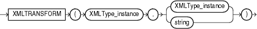
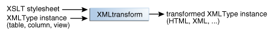
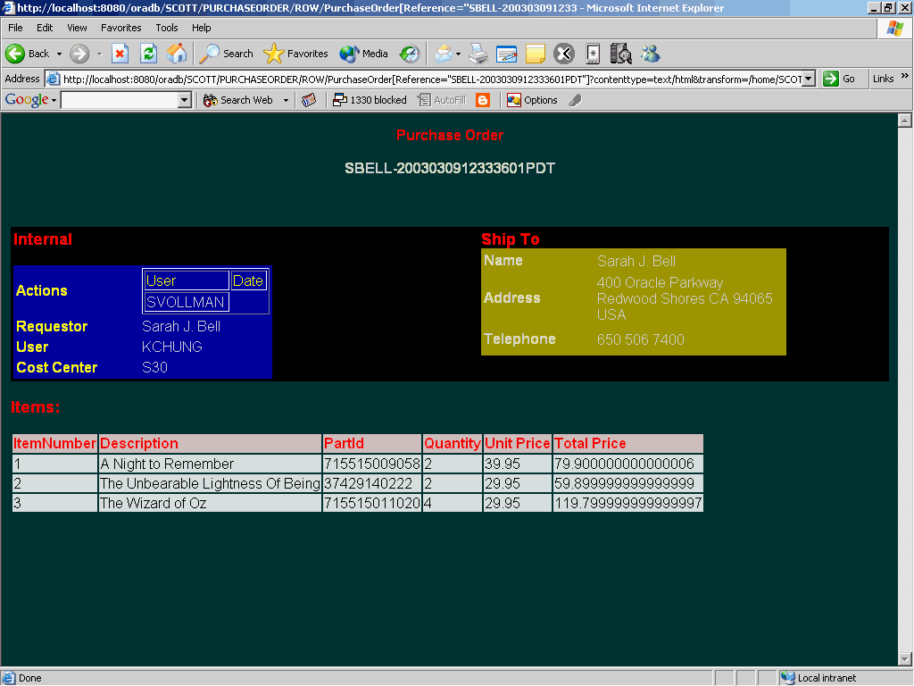
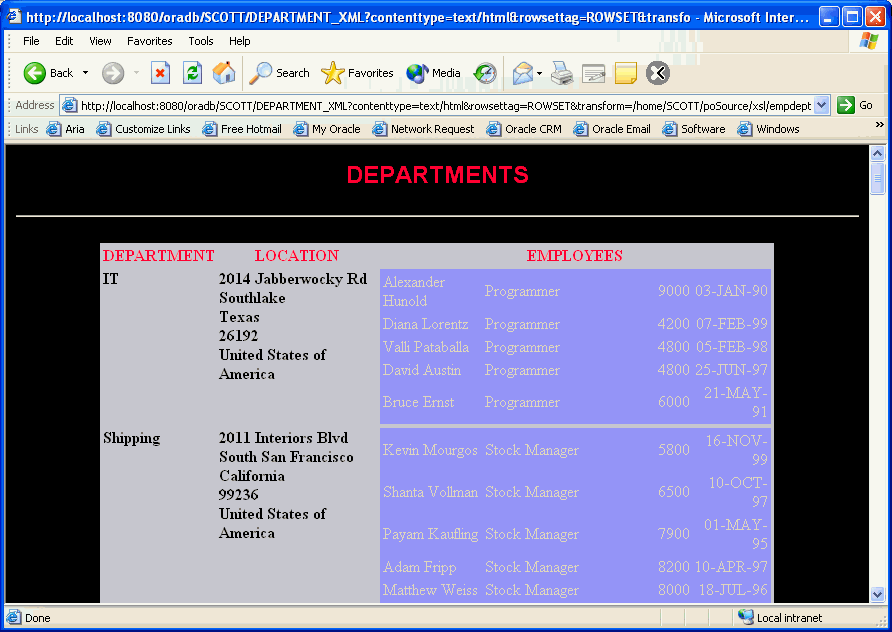

There are several Oracle SQL functions and `XMLType` APIs for transforming `XMLType` data using XSLT stylesheets and for validating `XMLType` instances against an XML schema.

- XSL Transformation and Oracle XML DB
  You can apply XSL transformations to XML Schema-based documents using the built-in Oracle XML DB XSLT processor. In-database XML-specific optimizations can significantly reduce the memory required, eliminate the overhead associated with parsing, and reduce network traffic.
- Validation of XMLType Instances
  Besides needing to know whether a particular XML document is well-formed, you often need to know whether it conforms to a given XML schema, that is, whether it is valid with respect to that XML schema.

**Parent topic:** [Manipulation of XML Data in Oracle XML DB](manipulation-of-XML-in-XML-DB.md)

### 7.1 XSL Transformation and Oracle XML DB

You can apply XSL transformations to XML Schema-based documents using the built-in Oracle XML DB XSLT processor. In-database XML-specific optimizations can significantly reduce the memory required, eliminate the overhead associated with parsing, and reduce network traffic.

The W3C XSLT Recommendation defines an XML language for specifying how to transform XML documents from one form to another. See [`http://www.w3.org/TR/xslt`](https://www.oracle.com/pls/topic/lookup?ctx=en/database/oracle/oracle-database/19/adxdb&id=w3_org_tr_xslt) for information about the XSLT standard.

Transformation can include mapping from one XML schema to another or mapping from XML to some other format such as HTML or WML.

XSL transformation can be costly in terms of the amount of memory and processing required. In typical XSL processors, the entire source document and stylesheet must be parsed and loaded into memory, before processing can begin. Typically, XSL processors use DOM to provide dynamic memory representations of document and stylesheet, to allow random access to their different parts. The XSL processor then applies the stylesheet to the source document, generating a third document.

Parsing and loading the document and stylesheet into memory before beginning transformation requires significant memory and processor resources. It is especially inefficient when only a small part of the document needs to be transformed.

Oracle XML DB includes an XSLT processor that performs XSL transformations inside the database. In this way, it can provide XML-specific optimizations that can significantly reduce the memory required to perform the transformation, eliminate overhead associated with parsing, and reduce network traffic.

These optimizations are available, however, only when the source for the transformation is a schema-based XML document. In that case, there is no need to parse before processing can begin. The Oracle XML DB lazily loaded virtual DOM loads content only on demand, as the nodes are accessed. This also reduces the memory required, because only parts of the document that need to be processed are loaded.

You can transform XML data in the following ways:

- In Oracle Database – Using Oracle SQL function `XMLtransform`, `XMLType` method `transform()`, or PL/SQL package `DBMS_XSLPROCESSOR`

- In the middle tier – Using Oracle XML Developer's Kit transformation options , such as XSLT Processor for Java.

**See Also:**

- [Oracle Database SQL Language Reference](../sqlrf/XMLTRANSFORM.md) for information about SQL function `XMLTransform`

- [PL/SQL XSLT Processor for XMLType (DBMS_XSLPROCESSOR)](PLSQL-APIs-for-XMLType.md) and [Oracle Database PL/SQL Packages and Types Reference](../arpls/DBMS_XSLPROCESSOR.md) for information about PL/SQL package `DBMS_XSLPROCESSOR`

- [Oracle XML Developer's Kit Programmer's Guide](../adxdk/using-XSLT-processor-for-Java.md) for information about XSLT Processor for Java

Each of these XML transformation methods takes as input a source XML document and an XSL stylesheet in the form of `XMLType` instances. For SQL function `XMLtransform` and `XMLType` method `transform()`, the result of the transformation can be an XML document or a non-XML document, such as HTML. However, for PL/SQL package `DBMS_XSLPROCESSOR`, the result of the transformation is expected to be a valid XML document. Any HTML data generated by a transformation using package `DBMS_XSLPROCESSOR` is XHTML data, which is both valid XML data and valid HTML data.

Example 7-1 shows part of an XSLT stylesheet, `PurchaseOrder.xsl`. The complete stylesheet is given in [XSLT Stylesheet Example, PurchaseOrder.xsl](oracle-supplied-XML-schemas-and-examples.md).

These is nothing Oracle XML DB-specific about the stylesheet of Example 7-1. A stylesheet can be stored in an `XMLType` table or column or stored as non-schema-based XML data inside Oracle XML DB Repository.

Example 7-1 XSLT Stylesheet Example: PurchaseOrder.xsl

    <?xml version="1.0" encoding="WINDOWS-1252"?>
    <xsl:stylesheet version="1.0"
      xmlns:xsl="http://www.w3.org/1999/XSL/Transform"
      xmlns:xdb="http://xmlns.oracle.com/xdb"
      xmlns:xsi="http://www.w3.org/2001/XMLSchema-instance">
      <xsl:template match="/">
        <html>
          <head/>
          <body bgcolor="#003333" text="#FFFFCC" link="#FFCC00" vlink="#66CC99" alink="#669999">
            
              <xsl:for-each select="PurchaseOrder"/>
              <xsl:for-each select="PurchaseOrder">
                

                    
                      <B>PurchaseOrder </B>
                    

                

                 
                

                  <xsl:for-each select="Reference">

                      <xsl:apply-templates/>

                  </xsl:for-each>
                

              </xsl:for-each>
              

                <xsl:for-each select="PurchaseOrder">
                   
                </xsl:for-each>
                

                

                  <xsl:for-each select="PurchaseOrder">
                     
                  </xsl:for-each>
                

              

              <xsl:for-each select="PurchaseOrder"/>
              <xsl:for-each select="PurchaseOrder">
                <table border="0" width="100%" BGCOLOR="#000000">
                  <tbody>
                    <tr>
                      <td WIDTH="296">
                        

                          <B>
                            Internal
                          </B>
                        

                        ...

                      </td>
                      <td width="93"/>
                      <td valign="top" WIDTH="340">
                        <B>
                          
                            Ship To
                          
                        </B>
                        <xsl:for-each select="ShippingInstructions">
                          <xsl:if test="position()=1"/>
                        </xsl:for-each>
                        <xsl:for-each select="ShippingInstructions">
                        </xsl:for-each>

                          ...

- SQL Function XMLTRANSFORM and XMLType Method TRANSFORM()
  SQL function `XMLtransform` transforms an XML document by using an XSLT stylesheet. It returns the processed output as XML, HTML, and so on, as specified by the stylesheet.
- XSL Transformation Using DBUri Servlet
  You can apply an XSL transformation to XML content that is generated by the DBUri servlet.

**Parent topic:** Transformation and Validation of XMLType Data

#### 7.1.1 SQL Function XMLTRANSFORM and XMLType Method TRANSFORM()

SQL function `XMLtransform` transforms an XML document by using an XSLT stylesheet. It returns the processed output as XML, HTML, and so on, as specified by the stylesheet.

Figure 7-1 shows the syntax of Oracle SQL function `XMLtransform`. This function takes as arguments an `XMLType` instance and an XSLT stylesheet. The stylesheet can be an `XMLType` instance or a `VARCHAR2` string literal. It applies the stylesheet to the instance and returns an `XMLType` instance.

Figure 7-1 XMLTRANSFORM Syntax

[Description of "Figure 7-1 XMLTRANSFORM Syntax"](img_text/xmltransform.md)

You can alternatively use `XMLType` method `transform()` as an alternative to Oracle SQL function `XMLtransform`. It has the same functionality.

Figure 7-2 shows how `XMLtransform` transforms an XML document by using an XSLT stylesheet. It returns the processed output as XML, HTML, and so on, as specified by the XSLT stylesheet. You typically use `XMLtransform` when retrieving or generating XML documents stored as `XMLType` in the database.

**See Also:**

[Figure 1-3](intro-to-XML-DB.md) in [Introduction to Oracle XML DB](intro-to-XML-DB.md)

Figure 7-2 Using XMLTRANSFORM

[Description of "Figure 7-2 Using XMLTRANSFORM"](img_text/adxdb008.md)

- XMLTRANSFORM and XMLType.transform(): Examples
  Examples illustrate how to use Oracle SQL function `XMLtransform` and `XMLType` method `transform()` to transform XML data stored as `XMLType` to various formats.

**Parent topic:** XSL Transformation and Oracle XML DB

##### 7.1.1.1 XMLTRANSFORM and XMLType.transform(): Examples

Examples illustrate how to use Oracle SQL function `XMLtransform` and `XMLType` method `transform()` to transform XML data stored as `XMLType` to various formats.

Example 7-2 sets up an XML schema and tables that are needed to run other examples in this chapter. The call to `deleteSchema` here ensures that there is no existing XML schema before creating one. If no such schema exists, then `deleteSchema` raises an error.

Example 7-3 stores an XSLT stylesheet, then retrieves it and uses it with Oracle SQL function `XMLTransform` to transform the XML data stored in Example 7-2.

Example 7-4 uses `XMLType` method `transform()` with an XSL stylesheet created on the fly.

Example 7-5 uses `XMLTransform` to apply an XSL stylesheet to produce HTML code. PL/SQL constructor `XDBURIType` reads the XSL stylesheet from Oracle XML DB Repository.

Only part of the HTML result is shown in Example 7-5. Omitted parts are indicated with an ellipsis (`. . .`). Figure 7-3 shows what the transformed result looks like in a Web browser.

Example 7-2 Registering an XML Schema and Inserting XML Data

    BEGIN
      -- Delete the schema, if it already exists.
      DBMS_XMLSCHEMA.deleteSchema('http://www.example.com/schemas/ipo.xsd',4);
    END;
    /
    BEGIN
      -- Register the schema
      DBMS_XMLSCHEMA.registerSchema(
        SCHEMAURL => 'http://www.example.com/schemas/ipo.xsd',
        SCHEMADOC => '<schema targetNamespace="http://www.example.com/IPO"
                              xmlns="http://www.w3.org/2001/XMLSchema"
                              xmlns:ipo="http://www.example.com/IPO">
                        <!-- annotation>
                          <documentation xml:lang="en">
                           International Purchase order schema for Example.com
                           Copyright 2000 Example.com. All rights reserved.
                          </documentation>
                        </annotation -->
                        <element name="purchaseOrder" type="ipo:PurchaseOrderType"/>
                        <element name="comment" type="string"/>
                        <complexType name="PurchaseOrderType">
                          <sequence>
                            <element name="shipTo"     type="ipo:Address"/>
                            <element name="billTo"     type="ipo:Address"/>
                            <element ref="ipo:comment" minOccurs="0"/>
                            <element name="items"      type="ipo:Items"/>
                          </sequence>
                          <attribute name="orderDate" type="date"/>
                        </complexType>
                        <complexType name="Items">
                          <sequence>
                            <element name="item" minOccurs="0" maxOccurs="unbounded">
                              <complexType>
                                <sequence>
                                  <element name="productName" type="string"/>
                                  <element name="quantity">
                                    <simpleType>
                                      <restriction base="positiveInteger">
                                        <maxExclusive value="100"/>
                                      </restriction>
                                    </simpleType>
                                  </element>
                                  <element name="USPrice"    type="decimal"/>
                                  <element ref="ipo:comment" minOccurs="0"/>
                                  <element name="shipDate"   type="date" minOccurs="0"/>
                                </sequence>
                                <attribute name="partNum" type="ipo:SKU" use="required"/>
                              </complexType>
                            </element>
                          </sequence>
                        </complexType>
                        <complexType name="Address">
                          <sequence>
                            <element name="name"    type="string"/>
                            <element name="street"  type="string"/>
                            <element name="city"    type="string"/>
                            <element name="state"   type="string"/>
                            <element name="country" type="string"/>
                            <element name="zip"     type="string"/>
                          </sequence>
                        </complexType>
                        <simpleType name="SKU">
                          <restriction base="string">
                            <pattern value="[0-9]{3}-[A-Z]{2}"/>
                          </restriction>
                        </simpleType>
                      </schema>',
        LOCAL     => TRUE,
        GENTYPES  => TRUE);
    END;
    /

    -- Create table to hold XML purchase-order documents, and insert the documents
    DROP TABLE po_tab;
    CREATE TABLE po_tab (id NUMBER, xmlcol XMLType)
     XMLType COLUMN xmlcol
     XMLSCHEMA "http://www.example.com/schemas/ipo.xsd"
     ELEMENT "purchaseOrder";

    INSERT INTO po_tab
      VALUES(1, XMLType(
                  '<?xml version="1.0"?>
                   <ipo:purchaseOrder
                     xmlns:xsi="http://www.w3.org/2001/XMLSchema-instance"
                     xmlns:ipo="http://www.example.com/IPO"
                     xsi:schemaLocation="http://www.example.com/IPO
                                         http://www.example.com/schemas/ipo.xsd"
                     orderDate="1999-12-01">
                     <shipTo>
                       <name>Helen Zoe</name>
                       <street>121 Broadway</street>
                       <city>Cardiff</city>
                       <state>Wales</state>
                       <country>UK</country>
                       <zip>CF2 1QJ</zip>
                     </shipTo>
                     <billTo>
                       <name>Robert Smith</name>
                       <street>8 Oak Avenue</street>
                       <city>Old Town</city>
                       <state>CA</state>
                       <country>US</country>
                       <zip>95819</zip>
                     </billTo>
                     <items>
                       <item partNum="833-AA">
                         <productName>Lapis necklace</productName>
                         <quantity>1</quantity>
                         <USPrice>99.95</USPrice>
                         <ipo:comment>Want this for the holidays!</ipo:comment>
                         <shipDate>1999-12-05</shipDate>
                       </item>
                     </items>
                   </ipo:purchaseOrder>'));

Example 7-3 Using SQL Function XMLTRANSFORM to Apply an XSL Stylesheet

    DROP TABLE stylesheet_tab;
    CREATE TABLE stylesheet_tab (id NUMBER, stylesheet XMLType);
    INSERT INTO stylesheet_tab
      VALUES (1,
              XMLType(
                '<?xml version="1.0" ?>
                 <xsl:stylesheet version="1.0"
                                 xmlns:xsl="http://www.w3.org/1999/XSL/Transform">
                   <xsl:template match="*">
                     <td>
                       <xsl:choose>
                         <xsl:when test="count(child::*) > 1">
                           <xsl:call-template name="nested"/>
                         </xsl:when>
                         <xsl:otherwise>
                           <xsl:value-of select="name(.)"/>:<xsl:value-of
                                                              select="text()"/>
                         </xsl:otherwise>
                       </xsl:choose>
                     </td>
                   </xsl:template>
                   <xsl:template match="*" name="nested" priority="-1" mode="nested2">
                     <b>
                       <!-- xsl:value-of select="count(child::*)"/ -->
                       <xsl:choose>
                         <xsl:when test="count(child::*) > 1">
                           <xsl:value-of select="name(.)"/>:<xsl:apply-templates
                                                              mode="nested2"/>
                         </xsl:when>
                         <xsl:otherwise>
                           <xsl:value-of select="name(.)"/>:<xsl:value-of
                                                              select="text()"/>
                         </xsl:otherwise>
                       </xsl:choose>
                     </b>
                   </xsl:template>
                 </xsl:stylesheet>'));

    SELECT XMLSerialize(DOCUMENT XMLtransform(x.xmlcol, y.stylesheet)
                        AS VARCHAR2(1000))
      AS result FROM po_tab x, stylesheet_tab y WHERE y.id = 1;

This produces the following output (pretty-printed here for readability):

    RESULT
    ---------------------------------------------------------
    <td>
      <b>ipo:purchaseOrder:
        <b>shipTo:
          <b>name:Helen Zoe</b>
          <b>street:100 Broadway</b>
          <b>city:Cardiff</b>
          <b>state:Wales</b>
          <b>country:UK</b>
          <b>zip:CF2 1QJ</b>
        </b>
        <b>billTo:
          <b>name:Robert Smith</b>
          <b>street:8 Oak Avenue</b>
          <b>city:Old Town</b>
          <b>state:CA</b>
          <b>country:US</b>
          <b>zip:95819</b>
        </b>
        <b>items:</b>
      </b>
    </td>

Example 7-4 Using XMLType Method TRANSFORM() with a Transient XSL Stylesheet

    SELECT XMLSerialize(
             DOCUMENT
             x.xmlcol.transform(
               XMLType('<?xml version="1.0" ?>
                      <xsl:stylesheet
                          version="1.0"
                          xmlns:xsl="http://www.w3.org/1999/XSL/Transform">
                        <xsl:template match="*">
                          <td>
                            <xsl:choose>
                              <xsl:when test="count(child::*) > 1">
                                <xsl:call-template name="nested"/>
                              </xsl:when>
                              <xsl:otherwise>
                                <xsl:value-of
                                   select =
                                     "name(.)"/>:<xsl:value-of select="text()"/>
                              </xsl:otherwise>
                            </xsl:choose>
                          </td>
                        </xsl:template>
                        <xsl:template match="*" name="nested" priority="-1"
                                      mode="nested2">
                          <b>
                            <!-- xsl:value-of select="count(child::*)"/ -->
                            <xsl:choose>
                              <xsl:when test="count(child::*) > 1">
                                <xsl:value-of select="name(.)"/>:
                                <xsl:apply-templates mode="nested2"/>
                              </xsl:when>
                              <xsl:otherwise>
                                <xsl:value-of
                                   select =
                                     "name(.)"/>:<xsl:value-of select="text()"/>
                              </xsl:otherwise>
                            </xsl:choose>
                          </b>
                        </xsl:template>
                      </xsl:stylesheet>'))
             AS varchar2(1000))
      FROM po_tab x;

Example 7-5 Using XMLTRANSFORM to Apply an XSL Stylesheet Retrieved Using XDBURIType

    SELECT
      XMLTransform(
        OBJECT_VALUE,
        XDBURIType('/source/schemas/poSource/xsl/purchaseOrder.xsl').getXML())
      FROM purchaseorder
      WHERE XMLExists('$p/PurchaseOrder[Reference="SBELL-2002100912333601PDT"]'
                      PASSING OBJECT_VALUE AS "p");

    XMLTRANSFORM(OBJECT_VALUE, XDBURITYPE('/SOURCE/SCHEMAS/POSOURCE/XSL/PURCHASEORDER.XSL').GET
    ---------------------------------------------------------------------------------------------
    <html xmlns:xdb="http://xmlns.oracle.com/xdb"
          xmlns:xsi="http://www.w3.org/2001/XMLSchema-instance">
      <head/>
      <body bgcolor="#003333" text="#FFFFCC" link="#FFCC00" vlink="#66CC99" alink="#669999">
        
          

              
                <B>PurchaseOrder </B>
              

          

           
          

            SBELL-2002100912333601PDT
          

          

             
            

            

               
            

          

          <table border="0" width="100%" BGCOLOR="#000000">
            <tbody>
              <tr>
                <td WIDTH="296">
                  

                    <B>
                      Internal
                    </B>
                  

                  <table border="0" width="98%" BGCOLOR="#000099">

                                                         . . .

                  </table>
                </td>
                <td width="93">
                </td>
                <td valign="top" WIDTH="340">
                  <B>
                    
                      Ship To
                    
                  </B>
                  <table border="0" BGCOLOR="#999900">
                    . . .
                  </table>
                </td>
              </tr>
            </tbody>
          </table>
           
          <B>
            Items:
          </B>
           
           
          <table border="0">
            . . .
          </table>
        
      </body>
    </html>

    1 row selected.

**Parent topic:** SQL Function XMLTRANSFORM and XMLType Method TRANSFORM()

#### 7.1.2 XSL Transformation Using DBUri Servlet

You can apply an XSL transformation to XML content that is generated by the DBUri servlet.

Figure 7-3 shows the result of such a transformation. The URL is the following (it is split and truncated here):

    http://localhost:8080/oradb/SCOTT/PURCHASEORDER/ROW/PurchaseOrder[Reference="SBELL-2003030912333601PDT"]
    contenttype=text/html&transform=/home/SCOTT/xsl/purchaseOrder.xsl...

The presence of parameter `transform` causes the DBUri servlet to use SQL function `XMLTransform` to apply the XSL stylesheet at `/home/SCOTT/xsl/purchaseOrder.xsl` to the `PurchaseOrder` document that is identified by the main URL. The result of the transformation, which is HTML code, is returned to the browser for display. The URL also uses parameter `contentType` to specify that the MIME-type of the final document is `text/html`.

Figure 7-3 Database XSL Transformation of a PurchaseOrder Using DBUri Servlet

[Description of "Figure 7-3 Database XSL Transformation of a PurchaseOrder Using DBUri Servlet"](img_text/xslt_po.md)

Figure 7-4 shows table `departments` displayed as an HTML document. You need no code to achieve this. You need only an `XMLType` view based on SQL/XML functions, an industry-standard XSL stylesheet, and `DBUri` servlet.

Figure 7-4 Database XSL Transformation of Departments Table Using DBUri Servlet

[Description of "Figure 7-4 Database XSL Transformation of Departments Table Using DBUri Servlet"](img_text/dburi_emp.md)

**Parent topic:** XSL Transformation and Oracle XML DB

### 7.2 Validation of XMLType Instances

Besides needing to know whether a particular XML document is well-formed, you often need to know whether it conforms to a given XML schema, that is, whether it is valid with respect to that XML schema.

XML schema-based data that is stored as binary XML it is automatically validated fully whenever it is inserted or updated. This validation does not require building a DOM. It is done using streaming, which is efficient and minimizes memory use.

For `XMLType` data that is stored object-relationally, full validation requires building a DOM, which can be costly in terms of memory management. For this reason, Oracle XML DB does not automatically perform full validation when you insert or update data that is stored object-relationally.

However, in the process of decomposing XML data to store it object-relationally, Oracle XML DB does automatically perform partial validation, to ensure that the structure of the XML document conforms to the SQL data type definitions that were derived from the XML schema.

If you require full validation for `XMLType` data stored object-relationally, then consider validating on the client before inserting the data into the database or updating it.

You can use the following to perform full validation and manipulate the recorded validation status of XML documents:

- Oracle SQL function `XMLIsValid` and `XMLType` method `IsSchemaValid()` – Run the validation process unconditionally. Do not record any validation status. Return:

  - `1` if the document is determined to be valid.

  - `0` if the document is determined to be invalid or the validity of the document cannot be determined.

- `XMLType` method `SchemaValidate()` – Runs the validation process if the validation status is `0`, which it is by default. Sets the validation status to `1` if the document is determined to be valid. (Otherwise, the status remains `0`.)

- `XMLType` method `isSchemaValidated()` returns the recorded validation status of an `XMLType` instance.

- `XMLType` method `setSchemaValidated()` sets (records) the validation status of an `XMLType` instance.

The validation status indicates knowledge of validity, as follows:

- `1` means that the document is known to be valid.

- `0` means that validity of the document is unknown. The document might have been shown to be invalid during a validation check, but that invalidity is not recorded. A recorded validation status of `0` indicates only a lack of knowledge about the document's validity.

<!-- -->

- Partial and Full XML Schema Validation
  When you insert XML Schema-based documents into the database they can be validated partially or fully.
- Validating XML Data Stored as XMLType: Examples
  Examples here illustrate how to use Oracle SQL function `XMLIsValid` and `XMLType` methods `isSchemaValid()` and `schemaValidate()` to validate XML data being stored as `XMLType` in Oracle XML DB.

**See Also:**

- [Oracle Database SQL Language Reference](../sqlrf/XMLISVALID.md) for information about Oracle SQL function `XMLIsValid`

- [Oracle Database PL/SQL Packages and Types Reference](../arpls/XMLTYPE.md) for information about `XMLType` methods `IsSchemaValid()`, `IsSchemaValidated()`, `SchemaValidate()`, and `setSchemaValidated()`

**Parent topic:** Transformation and Validation of XMLType Data

#### 7.2.1 Partial and Full XML Schema Validation

When you insert XML Schema-based documents into the database they can be validated partially or fully.

- Partial Validation
  For binary XML storage, Oracle XML DB validates XML Schema-based documents fully when they are inserted into an `XMLType` table or column. For object-relational XML storage, only a partial validation is performed. This is because complete XML schema validation is quite costly for object-relational storage, in terms of performance.
- Full Validation
  Loading XML Schema-based data into binary XML storage fully validates it against the target XML schemas. For object-relational `XMLType` storage, you can force full validation at any time.

**Parent topic:** Validation of XMLType Instances

##### 7.2.1.1 Partial Validation

For binary XML storage, Oracle XML DB validates XML Schema-based documents fully when they are inserted into an `XMLType` table or column. For object-relational XML storage, only a partial validation is performed. This is because complete XML schema validation is quite costly for object-relational storage, in terms of performance.

Partial validation ensures only that all of the mandatory elements and attributes are present, and that there are no unexpected elements or attributes in the document. That is, it ensures only that the structure of the XML document conforms to the SQL data type definitions that were derived from the XML schema. Partial validation does not ensure that the instance document is fully compliant with the XML schema.

Example 7-6 provides an example of failing partial validation while inserting an XML document into table `PurchaseOrder`, which is stored object-relationally.

Example 7-6 Error When Inserting Incorrect XML Document (Partial Validation)

    INSERT INTO purchaseorder
      VALUES(XMLType(bfilename('XMLDIR', 'InvalidElement.xml'),
                     nls_charset_id('AL32UTF8')));
      VALUES(XMLType(bfilename('XMLDIR', 'InvalidElement.xml'),
             *
    ERROR at line 2:
    ORA-30937: No schema definition for 'UserName' (namespace '##local') in parent
    '/PurchaseOrder'

**Parent topic:** Partial and Full XML Schema Validation

##### 7.2.1.2 Full Validation

Loading XML Schema-based data into binary XML storage fully validates it against the target XML schemas. For object-relational `XMLType` storage, you can force full validation at any time.

To force full validation, use either of the following:

- Table level `CHECK` constraint

- PL/SQL `BEFORE INSERT` trigger

Both approaches ensure that only valid XML documents can be stored in the `XMLType` table.

The advantage of a `TABLE CHECK` constraint is that it is easy to code. The disadvantage is that it is based on Oracle SQL function `XMLisValid`, so it can only indicate whether or not the XML document is valid. If an XML document is invalid, a `TABLE CHECK` constraint cannot provide any information about why it is invalid.

A `BEFORE INSERT` trigger requires slightly more code. The trigger validates the XML document by invoking `XMLType` method `schemaValidate()`. The advantage of using `schemaValidate()` is that the exception raised provides additional information about what was wrong with the instance document. Using a `BEFORE INSERT` trigger also makes it possible to attempt corrective action when an invalid document is encountered.

- Full XML Schema Validation Costs Processing Time and Memory Usage
  Unless you are using binary XML storage, full XML schema validation costs processing time and memory. You should thus perform full XML schema validation only when necessary.

**Parent topic:** Partial and Full XML Schema Validation

###### 7.2.1.2.1 Full XML Schema Validation Costs Processing Time and Memory Usage

Unless you are using binary XML storage, full XML schema validation costs processing time and memory. You should thus perform full XML schema validation only when necessary.

If you can rely on your application to validate an XML document then you can obtain higher overall throughput with non-binary XML storage, by avoiding the overhead associated with full validation. If you cannot be sure about the validity of incoming XML documents, you can rely on the database to ensure that an `XMLType` table or column contains only schema-valid XML documents.

Example 7-7 shows how to force a full XML schema validation by adding a `CHECK` constraint to an `XMLType` table. In Example 7-7, the XML document `InvalidReference` is a not valid with respect to the XML schema. The XML schema defines a minimum length of 18 characters for the text node associated with the `Reference` element. In this document, the node contains the value `SBELL-20021009`, which is only 14 characters long. Partial validation would not catch this error. Unless the constraint or trigger is present, attempts to insert this document into the database would succeed.

Example 7-7 Forcing Full XML Schema Validation Using a CHECK Constraint

    ALTER TABLE purchaseorder
      ADD CONSTRAINT validate_purchaseorder
      CHECK (XMLIsValid(OBJECT_VALUE) = 1);

    Table altered.

    INSERT INTO purchaseorder
      VALUES (XMLType(bfilename('XMLDIR', 'InvalidReference.xml'),
                      nls_charset_id('AL32UTF8')));

    INSERT INTO purchaseorder
    *

    ERROR at line 1:
    ORA-02290: check constraint (QUINE.VALIDATE_PURCHASEORDER) violated

Pseudocolumn `OBJECT_VALUE` can be used to access the content of an `XMLType` table from within a trigger. Example 7-8 illustrates this, showing how to use a `BEFORE INSERT` trigger to validate that the data being inserted into the `XMLType` table conforms to the specified XML schema.

Example 7-8 Enforcing Full XML Schema Validation Using a BEFORE INSERT Trigger

    CREATE OR REPLACE TRIGGER validate_purchaseorder
       BEFORE INSERT ON purchaseorder
       FOR EACH ROW
    BEGIN
      IF (:new.OBJECT_VALUE IS NOT NULL) THEN :new.OBJECT_VALUE.schemavalidate();
      END IF;
    END;
    /

    INSERT INTO purchaseorder  VALUES (XMLType(bfilename('XMLDIR', 'InvalidReference.xml'),
                      nls_charset_id('AL32UTF8')));
      VALUES (XMLType( bfilename('XMLDIR', 'InvalidReference.xml'),
              *
    ERROR at line 2:
    ORA-31154: invalid XML document
    ORA-19202: Error occurred in XML processing
    LSX-00221: "SBELL-20021009" is too short (minimum length is 18)
    LSX-00213: only 0 occurrences of particle "sequence", minimum is 1
    ORA-06512: at "SYS.XMLTYPE", line 354
    ORA-06512: at "QUINE.VALIDATE_PURCHASEORDER", line 3
    ORA-04088: error during execution of trigger 'QUINE.VALIDATE_PURCHASEORDER'

**Parent topic:** Full Validation

#### 7.2.2 Validating XML Data Stored as XMLType: Examples

Examples here illustrate how to use Oracle SQL function `XMLIsValid` and `XMLType` methods `isSchemaValid()` and `schemaValidate()` to validate XML data being stored as `XMLType` in Oracle XML DB.

Example 7-9 and Example 7-10 show how to validate an XML instance against an XML schema using PL/SQL method `isSchemaValid`().

`XMLType` method `schemaValidate()` can be used within `INSERT` and `UPDATE` triggers to ensure that all instances stored in the table are validated against the XML schema. Example 7-11 illustrates this.

Example 7-12 uses Oracle SQL function `XMLIsValid` to do the following:

- Verify that the `XMLType` instance conforms to the specified XML schema

- Ensure that the incoming XML documents are valid by using `CHECK` constraints

**Note:**

The validation functions and procedures described in Validation of XMLType Instances facilitate validation checking. Of these, `schemaValidate` is the only one that raises errors that indicate why validation has failed.

Example 7-9 Validating XML Using Method ISSCHEMAVALID() in SQL

    SELECT x.xmlcol.isSchemaValid('http://www.example.com/schemas/ipo.xsd',
                                  'purchaseOrder')
        FROM po_tab x;

Example 7-10 Validating XML Using Method ISSCHEMAVALID() in PL/SQL

    DECLARE
      xml_instance XMLType;
    BEGIN
      SELECT x.xmlcol INTO xml_instance FROM po_tab x WHERE id = 1;
      IF xml_instance.isSchemaValid('http://www.example.com/schemas/ipo.xsd') = 0
        THEN raise_application_error(-20500, 'Invalid Instance');
        ELSE DBMS_OUTPUT.put_line('Instance is valid');
      END IF;
    END;
    /
    Instance is valid

    PL/SQL procedure successfully completed.

Example 7-11 Validating XML Using Method SCHEMAVALIDATE() within Triggers

    DROP TABLE po_tab;
    CREATE TABLE po_tab OF XMLType
      XMLSCHEMA "http://www.example.com/schemas/ipo.xsd" ELEMENT "purchaseOrder";

    CREATE TRIGGER emp_trig BEFORE INSERT OR UPDATE ON po_tab FOR EACH ROW

    DECLARE
      newxml XMLType;
    BEGIn
      newxml := :new.OBJECT_VALUE;
      XMLTYPE.schemavalidate(newxml);
    END;
    /

Example 7-12 Checking XML Validity Using XMLISVALID Within CHECK Constraints

    DROP TABLE po_tab;
    CREATE TABLE po_tab OF XMLType
       (CHECK(XMLIsValid(OBJECT_VALUE) = 1))
       XMLSCHEMA "http://www.example.com/schemas/ipo.xsd" ELEMENT "purchaseOrder";

**Parent topic:** Validation of XMLType Instances
