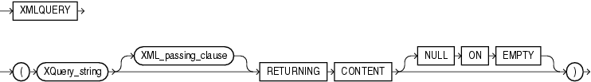
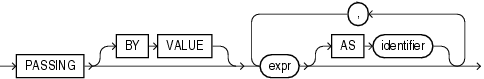
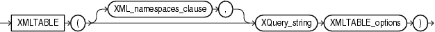
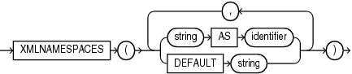
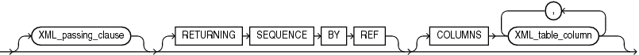
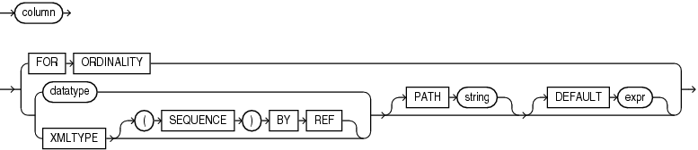
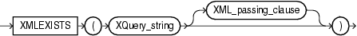
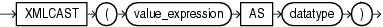

The XQuery language is one of the main ways that you interact with XML data in Oracle XML DB. Support for the language includes SQL\*Plus command`XQUERY` and SQL/XML functions `XMLQuery`, `XMLTable`, `XMLExists`, and `XMLCast`.

- Overview of the XQuery Language
  XQuery is the W3C language designed for querying and updating XML data.
- Overview of XQuery in Oracle XML DB
  Oracle XML DB support for the XQuery language is provided through a native implementation of SQL/XML functions `XMLQuery`, `XMLTable`, `XMLExists`, and `XMLCast`. As a convenience, SQL\*Plus command `XQUERY` is also provided, which lets you enter XQuery expressions directly — in effect, this command turns SQL\*Plus into an XQuery command-line interpreter.
- SQL/XML Functions XMLQUERY, XMLTABLE, XMLExists, and XMLCast
  SQL/XML functions `XMLQuery`, `XMLTable`, `XMLExists`, and `XMLCast` are defined by the SQL/XML standard as a general interface between the SQL and XQuery languages.
- URI Scheme oradb: Querying Table or View Data with XQuery
  You can use XQuery function `fn:collection` to query data that is in database tables and views.
- Oracle XQuery Extension Functions
  Oracle XML DB adds some XQuery functions to those provided in the W3C standard. These additional functions are in the Oracle XML DB namespace, `http://xmlns.oracle.com/xdb`, which uses the predefined prefix `ora`.
- Oracle XQuery Extension-Expression Pragmas
  The W3C XQuery specification lets an implementation provide implementation-defined extension expressions. An XQuery extension expression is an XQuery expression that is enclosed in braces (`{`, `}`) and prefixed by an implementation-defined pragma. The Oracle implementation provides several such pragmas.
- XQuery Static Type-Checking in Oracle XML DB
  When possible, Oracle XML DB performs static (compile time) type-checking of queries.
- Oracle XML DB Support for XQuery
  Oracle XML DB support for the XQuery language includes SQL support and support for XQuery functions and operators.

**Parent topic:** [Manipulation of XML Data in Oracle XML DB](manipulation-of-XML-in-XML-DB.md)

### 4.1 Overview of the XQuery Language

XQuery is the W3C language designed for querying and updating XML data.

Oracle XML DB supports the following W3C XQuery standards:

- XQuery 1.0 Recommendation

- XQuery Update Facility 1.0 Recommendation

- XQuery and XPath Full Text 1.0 Recommendation

This section presents an overview of the XQuery language. For more information, consult a recent book on the language or refer to the standards documents that define it, all of which are available at [`http://www.w3c.org/`](https://www.oracle.com/pls/topic/lookup?ctx=en/database/oracle/oracle-database/19/adxdb&id=w3c_org).

- XPath Expressions Are XQuery Expressions
  The XPath language is a W3C Recommendation for navigating XML documents. It is a subset of the XQuery language: an XPath expression is also an XQuery expression.
- XQuery: A Functional Language Based on Sequences
  XQuery is similar to SQL in many ways, but just as SQL is designed for querying structured, relational data, XQuery is designed especially for querying semi-structured, XML data from a variety of data sources.
- XQuery Expressions
  XQuery expressions are case-sensitive. An XQuery expression is either a simple expression or an updating expression, the latter being an expression that represents data modification. More precisely, these are the possible XQuery expressions:
- FLWOR Expressions
  Just as for XQuery in general, there is a lot to learn about FLWOR expressions in particular. This section provides a brief overview.

**Parent topic:** XQuery and Oracle XML DB

#### 4.1.1 XPath Expressions Are XQuery Expressions

The XPath language is a W3C Recommendation for navigating XML documents. It is a subset of the XQuery language: an XPath expression is also an XQuery expression.

XPath models an XML document as a tree of nodes. It provides a set of operations that walk this tree and apply predicates and node-test functions. Applying an XPath expression to an XML document results in a set of nodes. For example, the expression `/PO/PONO` selects all `PONO` child elements under the `PO` root element of a document.

Table 4-1 lists some common constructs used in XPath.

Table 4-1 Common XPath Constructs

| XPath Construct | Description                                                                                                                                                                                                                                                                                                                                                                                                                                                                                 |
|:----------------|:--------------------------------------------------------------------------------------------------------------------------------------------------------------------------------------------------------------------------------------------------------------------------------------------------------------------------------------------------------------------------------------------------------------------------------------------------------------------------------------------|
| `/`             | Denotes the root of the tree in an XPath expression. For example, `/PO `refers to the child of the root node whose name is `PO`.                                                                                                                                                                                                                                                                                                                                                            |
| `/`             | Used as a path separator to identify the child element nodes of a given element node. For example, `/PurchaseOrder/Reference` identifies `Reference` elements that are children of `PurchaseOrder` elements that are children of the root element.                                                                                                                                                                                                                                          |
| `//`            | Used to identify all descendants of the current node. For example, `PurchaseOrder//ShippingInstructions` matches any `ShippingInstructions` element under the `PurchaseOrder` element.                                                                                                                                                                                                                                                                                                      |
| `*`             | Used as a wildcard to match any child node. For example, `/PO/*/STREET` matches any street element that is a grandchild of the `PO` element.                                                                                                                                                                                                                                                                                                                                                |
| `[ ]`           | Used to denote predicate expressions. XPath supports a rich list of binary operators such as `or`, `and`, and `not`. For example, `/PO[PONO = 20 and PNAME = "PO_2"]/SHIPADDR` selects the shipping address element of all purchase orders whose purchase-order number is `20` and whose purchase-order name is `PO_2`. Brackets are also used to denote a position (index). For example, `/PO/PONO[2]` identifies the second purchase-order number element under the `PO` root element. |
| Functions       | XPath and XQuery support a set of built-in functions such as `substring`, `round`, and `not`. In addition, these languages provide for extension functions through the use of namespaces. Oracle XQuery extension functions use the namespace prefix `ora`, for namespace `http://xmlns.oracle.com/xdb`. See Oracle XQuery Extension Functions.                                                                                                                                             |

An XPath expression must identify a single node or a set of element, text, or attribute nodes. The result of evaluating an XPath expression is never a Boolean expression.

You can select `XMLType` data using PL/SQL, C, or Java. You can also use `XMLType` method `getNumberVal()` to retrieve XML data as a `NUMBER` value.

**Note:**

Oracle SQL functions and `XMLType` methods respect the W3C XPath recommendation, which states that if an XPath expression targets no nodes when applied to XML data, then an empty sequence must be returned. An error must not be raised in this case.

**Parent topic:** Overview of the XQuery Language

#### 4.1.2 XQuery: A Functional Language Based on Sequences

XQuery is similar to SQL in many ways, but just as SQL is designed for querying structured, relational data, XQuery is designed especially for querying semi-structured, XML data from a variety of data sources.

You can use XQuery to query XML data wherever it is found, whether it is stored in database tables, available through Web Services, or otherwise created on the fly. In addition to querying XML data, XQuery can be used to construct XML data. In this regard, XQuery can serve as an alternative or a complement to both XSLT and the other SQL/XML publishing functions, such as `XMLElement`.

XQuery builds on the Post-Schema-Validation Infoset (PSVI) data model, which unites the XML Information Set (Infoset) data model and the XML Schema type system. XQuery defines a new data model, the **XQuery Data Model** (XDM), which is based on sequences. Another name for an XQuery sequence is an **XDM instance**.

- XQuery Is About Sequences
  XQuery is all about manipulating sequences. This makes XQuery similar to a set-manipulation language, except that sequences are ordered and can contain duplicate items. XQuery sequences differ from the sequences in some other languages in that nested XQuery sequences are always flattened in their effect.
- XQuery Is Referentially Transparent
  XQuery is a functional language. As such, it consists of a set of possible expressions that are evaluated and whose evaluation returns values (results).
- XQuery Update Has Side Effects on Your Data
  Referential transparency applies to the evaluation of XQuery expressions. It does not imply that this evaluation never has a side effect on your data. In particular, you use XQuery Update to modify your data. That modification is a side effect of evaluating an XQuery updating expression.
- XQuery Update Snapshots
  An XQuery expression (query) can call for more than one update operation. XQuery Update performs all such operations for the same query as an atomic operation: either they all succeed or none of them do (if an error is raised).
- XQuery Full Text Provides Full-Text Search
  The XQuery and XPath Full Text 1.0 Recommendation (XQuery Full Text) defines XQuery support for full-text searches in queries. It defines full-text selection operators that perform the search and return instances of the AllMatches model, which complements the XQuery Data Model (XDM).

**Parent topic:** Overview of the XQuery Language

##### 4.1.2.1 XQuery Is About Sequences

XQuery is all about manipulating sequences. This makes XQuery similar to a set-manipulation language, except that sequences are ordered and can contain duplicate items. XQuery sequences differ from the sequences in some other languages in that nested XQuery sequences are always flattened in their effect.

In many cases, sequences can be treated as unordered, to maximize optimization – where this is available, it is under your control. This **unordered mode** can be applied to join order in the treatment of nested iterations (`for`), and it can be applied to the treatment of XPath expressions (for example, in `/a/b`, the matching `b` elements can be processed without regard to document order).

An XQuery **sequence** consists of zero or more **items**, which can be either atomic (scalar) values or XML nodes. Items are typed using a rich type system that is based upon the types of XML Schema. This type system is a major change from that of XPath 1.0, which is limited to simple scalar types such as Boolean, number, and string.

**Parent topic:** XQuery: A Functional Language Based on Sequences

##### 4.1.2.2 XQuery Is Referentially Transparent

XQuery is a functional language. As such, it consists of a set of possible expressions that are evaluated and whose evaluation returns values (results).

The result of evaluating an XQuery expression has two parts, at least one of which is empty: (a) a sequence (an XDM instance) and (b) a **pending update list**. Informally, the sequence is sometimes spoken of as the expression value, especially when the pending update list is empty, meaning that no data updates are involved.

As a functional language, XQuery is also **referentially transparent**. This means that the same expression evaluated in the same context returns the same value.

Exceptions to this desirable mathematical property include the following:

- XQuery expressions that derive their value from interaction with the external environment. For example, an expression such as `fn:current-time(...)` or `fn:doc(...)` does not necessarily always return the same value, since it depends on external conditions that can change (the time changes; the content of the target document might change).

  In some cases, like that of `fn:doc`, XQuery is defined to be referentially transparent within the execution of a single query: within a query, each invocation of `fn:doc` with the same argument results in the same document.

- XQuery expressions that are defined to be dependent on the particular XQuery language implementation. The result of evaluating such expressions might vary between implementations. Function `fn:doc` is an example of a function that is essentially implementation-defined.

XQuery Update is not in the list; it does not present an exception to referential transparency. See XQuery Update Has Side Effects on Your Data.

Referential transparency applies also to XQuery variables: the same variable in the same context has the same value. Functional languages are like mathematics formalisms in this respect and unlike procedural, or imperative, programming languages. A variable in a procedural language is really a name for a memory location; it has a current value, or state, as represented by its content at any time. A variable in a declarative language such as XQuery is really a name for a static value.

**Parent topic:** XQuery: A Functional Language Based on Sequences

##### 4.1.2.3 XQuery Update Has Side Effects on Your Data

Referential transparency applies to the evaluation of XQuery expressions. It does not imply that this evaluation never has a side effect on your data. In particular, you use XQuery Update to modify your data. That modification is a side effect of evaluating an XQuery updating expression.

The side effect is one thing; the expression value is another. The value returned from evaluation includes the pending update list that describes the updates to carry out. For a given XQuery expression, this description is the same regardless of the context in which evaluation occurs (with the above-mentioned exceptions).

The XQuery Update standard defines how the XDM instances of your data are updated. How those updates are propagated to persistent data stores (for example `XMLType` tables and columns) is implementation-dependent.

**Parent topic:** XQuery: A Functional Language Based on Sequences

##### 4.1.2.4 XQuery Update Snapshots

An XQuery expression (query) can call for more than one update operation. XQuery Update performs all such operations for the same query as an atomic operation: either they all succeed or none of them do (if an error is raised).

The unit of change is thus an entire XQuery query. To effect this atomic update behavior, before evaluating your query XQuery Update takes a **snapshot** of the data (XDM instances) whose modification is called for by the query. It also adds the update operations called for by the query to the pending update list. The snapshot is an evaluation context for an XDM instance that is the update target.

As the last step of XQuery expression evaluation, the pending update list is processed, applying the indicated update operations in an atomic fashion, and terminating the snapshot.

The atomic nature of snapshot semantics means that a set of update operations used in a given query are not necessarily applied in the order written. In fact, the order of applying update operations is fixed and specified by the XQuery Update Feature standard.

This means that an update operation does not see the result of any other update operation for the same query. There is no notion of an intermediate or interim update state – all updates for a query are applied together, atomically.

**Parent topic:** XQuery: A Functional Language Based on Sequences

##### 4.1.2.5 XQuery Full Text Provides Full-Text Search

The XQuery and XPath Full Text 1.0 Recommendation (XQuery Full Text) defines XQuery support for full-text searches in queries. It defines full-text selection operators that perform the search and return instances of the AllMatches model, which complements the XQuery Data Model (XDM).

An AllMatches instance describes all possible solutions to a full-text query for a given search context item. Each solution is described by a Match instance, which contains the search-context tokens (StringInclude instances) that must be included and those (StringExclude instances) that must be excluded.

In short, XQuery Full Text adds a full-text contains expression to the XQuery language. You use such an expression in your query to search the text of element nodes and their descendent elements (you can also search the text of attribute nodes).

**Parent topic:** XQuery: A Functional Language Based on Sequences

#### 4.1.3 XQuery Expressions

XQuery expressions are case-sensitive. An XQuery expression is either a simple expression or an updating expression, the latter being an expression that represents data modification. More precisely, these are the possible XQuery expressions:

- **Basic updating expression –** an `insert`, `delete`, `replace`, or `rename` expression, or a call to an updating function (see the XQuery Update Facility 1.0 Recommendation).

- **Updating expression –** a basic updating expression or an expression (other than a transform expression) that contains another updating expression (this is a recursive definition).

- **Simple expression –** An XQuery 1.0 expression. It does not call for any updating.

The pending update list that results from evaluating a simple expression is empty. The sequence value that results from evaluating an updating expression is empty.

Simple expressions include the following:

- **Primary expression –** literal, variable, or function application. A variable name starts with a dollar-sign (`$`) – for example, `$foo`. Literals include numerals, strings, and character or entity references.

- **XPath expression –** Any XPath expression. The XPath 2.0 standard is a subset of XQuery.

- **FLWOR expression –** The most important XQuery expression, composed of the following, in order, from which FLWOR takes its name: `for`, `let`, `where`, `order by`, `return`.

- **XQuery sequence** – The comma (`,`) constructor creates sequences. Sequence-manipulating functions such as `union` and `intersect` are also available. All XQuery sequences are effectively **flat**: a nested sequence is treated as its flattened equivalent. Thus, for instance, `(1, 2, (3, 4, (5), 6), 7)` is treated as `(1, 2, 3, 4, 5, 6, 7)`. A singleton sequence, such as `(42)`, acts the same in most XQuery contexts as does its single item, `42`. Remember that the result of any XQuery expression is a sequence.

- **Direct (literal) constructions** – XML element and attribute syntax automatically constructs elements and attributes: what you see is what you get. For example, the XQuery expression `33` constructs the XML element `33`.

- **Computed (dynamic) constructions –** You can construct XML data at run time using computed values. For example, the following XQuery expression constructs this XML data: `<foo toto="5"><bar>tata titi</bar> why? </foo>`.

      <foo>attribute toto {2+3},
           element bar {"tata", "titi"},
           text {" why? "}</foo>

  In this example, element `foo` is a direct construction; the other constructions are computed. In practice, the arguments to computed constructors are not literals (such as `toto` and `"tata"`), but expressions to be evaluated (such as `2+3`). Both the name and the value arguments of an element or attribute constructor can be computed. Braces (`{`, `}`) are used to mark off an XQuery expression to be evaluated.

- **Conditional expression –** As usual, but remember that each part of the expression is itself an arbitrary expression. For instance, in this conditional expression, each of these subexpressions can be any XQuery expression: `something`, `somethingElse`, `expression1`, and `expression2`.

       if (something < somethingElse) then expression1 else expression2

- **Arithmetic, relational expression –** As usual, but remember that each relational expression returns a (BooleanFoot 1) value. Examples:

      2 + 3
      42 < $a + 5
      (1, 4) = (1, 2)
      5 > 3 eq true()

- **Quantifier expression –** Universal (`every`) and existential (`some`) quantifier functions provide shortcuts to using a FLWOR expression in some cases. Examples:

      every $foo in doc("bar.xml")//Whatever satisfies $foo/@bar > 42
      some $toto in (42, 5), $titi in (123, 29, 5) satisfies $toto = $titi

- **Regular expression –** XQuery regular expressions are based on XML Schema 1.0 and Perl. (See Support for XQuery Functions and Operators.)

- **Type expression –** An XQuery expression that represents an XQuery type. Examples: `item()`, `node()`, `attribute()`, `element()`, `document-node()`, `namespace()`, `text()`, `xs:integer`, `xs:string`.Foot 2

  Type expressions can have **occurrence indicators**: `?` (optional: zero or one),` *` (zero or more), `+` (one or more). Examples: `document-node(element())*`, `item()+`, `attribute()?`.

  XQuery also provides operators for working with types. These include `cast as`, `castable as`, `treat as`, `instance of`, `typeswitch`, and `validate`. For example, `"42" cast as xs:integer` is an expression whose value is the integer 42. (It is not, strictly speaking, a type expression, because its value does not represent a type.)

- Full-text contains expression – An XQuery expression that represents a full-text search. This expression is provided by the XQuery and XPath Full Text 1.0 Recommendation. A full-text contains expression (FTContainsExpr) supported by Oracle has these parts: a search context that specifies the items to search, and a full-text selection that filters those items, selecting matches.

  The selection part is itself composed of the following:

  - Tokens and phrases used for matching.

  - Optional match options, such as the use of stemming.

  - Optional Boolean operators for combining full-text selections.

  - Optional constraint operators, such as positional filters (e.g. `ordered window`).

  See Support for XQuery Full Text.

**Parent topic:** Overview of the XQuery Language

#### 4.1.4 FLWOR Expressions

Just as for XQuery in general, there is a lot to learn about FLWOR expressions in particular. This section provides a brief overview.

FLWOR is the most general expression syntax in XQuery. FLWOR (pronounced "flower") stands for `for`, `let`, `where`, `order by`, and `return`. A FLWOR expression has at least one `for` or `let` clause and a `return` clause; single `where` and `order by` clauses are optional. Only the `return` clause can contain an updating expression; the other clauses cannot.

- `for` – Bind one or more variables each to any number of values, in turn. That is, for each variable, iterate, binding the variable to a different value for each iteration.

  At each iteration, the variables are bound in the order they appear, so that the value of a variable `$earlier` that is listed before a variable `$later` in the `for` list, can be used in the binding of variable `$later`. For example, during its second iteration, this expression binds `$i` to `4` and `$j` to `6` (2+4):

       for $i in (3, 4), $j in ($i, 2+$i)

- `let` – Bind one or more variables.

  Just as with `for`, a variable can be bound by `let` to a value computed using another variable that is listed previously in the binding list of the `let` (or an enclosing `for` or `let`). For example, this expression binds `$j` to `5` (3+2):

      let $i := 3, $j := $i + 2

- `where` – Filter the `for` and `let` variable bindings according to some condition. This is similar to a SQL `WHERE` clause.

- `order by` – Sort the result of `where` filtering.

- `return` – Construct a result from the ordered, filtered values. This is the result of the FLWOR expression as a whole. It is a flattened sequence.

  If the `return` clause contains an updating expression then that expression is evaluated for each tuple generated by the other clauses. The pending update lists from these evaluations are then merged as the result of the FLWOR expression.

Expressions `for` and `let` act similarly to a SQL `FROM` clause. Expression `where` acts like a SQL `WHERE` clause Expression `order by` is similar to `ORDER BY` in SQL. Expression `return` is like `SELECT` in SQL. Except for the two keywords whose names are the same in both languages (`where`, `order by`), FLWOR clause order is more or less opposite to the SQL clause order, but the meanings of the corresponding clauses are quite similar.

Using a FLWOR expression (with `order by`) is the only way to construct an XQuery sequence in any order other than document order.

**Parent topic:** Overview of the XQuery Language

### 4.2 Overview of XQuery in Oracle XML DB

Oracle XML DB support for the XQuery language is provided through a native implementation of SQL/XML functions `XMLQuery`, `XMLTable`, `XMLExists`, and `XMLCast`. As a convenience, SQL\*Plus command `XQUERY` is also provided, which lets you enter XQuery expressions directly — in effect, this command turns SQL\*Plus into an XQuery command-line interpreter.

Oracle XML DB compiles XQuery expressions that are passed as arguments to SQL/XML functions `XMLQuery`, `XMLTable`, `XMLExists`, and `XMLCast`. This compilation produces SQL query blocks and operator trees that use SQL/XML functions and XPath functions. A SQL statement that includes `XMLQuery`, `XMLTable`, `XMLExists`, or `XMLCast` is compiled and optimized as a whole, leveraging both relational database and XQuery-specific optimization technologies. Depending on the XML storage and indexing methods used, XPath functions can be further optimized. The resulting optimized operator tree is executed in a streaming fashion.

**Note:**

Oracle XML Developer's Kit (XDK) supports XQuery on the mid-tier. You do not need access to Oracle Database to use XQuery. XDK lets you evaluate XQuery expressions using XQuery API for Java (XQJ).

- When To Use XQuery
  You can use XQuery to do many of the same things that you might do using the SQL/XML generation functions or XSLT; there is a great deal of overlap. The decision to use one or the other tool to accomplish a given task can be based on many considerations, most of which are not specific to Oracle Database. Please consult external documentation on this general question.
- Predefined XQuery Namespaces and Prefixes
  Several namespaces and prefixes are predefined for use with XQuery in Oracle XML DB.

**Related Topics**

- SQL/XML Functions XMLQUERY, XMLTABLE, XMLExists, and XMLCast
- [Using the SQL\*Plus XQUERY Command](query-and-update-XML.md)
- [Query and Update of XML Data](query-and-update-XML.md)

**See Also:**

- Oracle XQuery Extension Functions for Oracle-specific XQuery functions that extend the language

- Oracle XML DB Support for XQuery for details about Oracle XML DB support for XQuery

- [Oracle XML Developer's Kit Programmer's Guide](../adxdk/using-xquery-processor-for-Java.md) for information about using XQJ

**Parent topic:** XQuery and Oracle XML DB

#### 4.2.1 When To Use XQuery

You can use XQuery to do many of the same things that you might do using the SQL/XML generation functions or XSLT; there is a great deal of overlap. The decision to use one or the other tool to accomplish a given task can be based on many considerations, most of which are not specific to Oracle Database. Please consult external documentation on this general question.

A general pattern of use is that XQuery is often used when the focus is the world of XML data, and the SQL/XML generation functions (`XMLElement`, `XMLAgg`, and so on) are often used when the focus is the world of relational data.

Other things being equal, if a query constructs an XML document from fragments extracted from existing XML documents, then it is likely that an XQuery FLOWR expression is simpler (simplifying code maintenance) than extracting scalar values from relational data and constructing appropriate XML data using SQL/XML generation functions. If, instead, a query constructs an XML document from existing relational data, the SQL/XML generation functions can often be more suitable.

With respect to Oracle XML DB, you can expect the same general level of performance using the SQL/XML generation functions as with `XMLQuery` and `XMLTable` — all are subject to rewrite optimizations.

**Parent topic:** Overview of XQuery in Oracle XML DB

#### 4.2.2 Predefined XQuery Namespaces and Prefixes

Several namespaces and prefixes are predefined for use with XQuery in Oracle XML DB.

Table 4-2 Predefined Namespaces and Prefixes

| Prefix  | Namespace                                         | Description                                |
|:--------|:--------------------------------------------------|:-------------------------------------------|
| `ora`   | `http://xmlns.oracle.com/xdb`                     | Oracle XML DB namespace                    |
| `local` | `http://www.w3.org/2003/11/xpath-local-functions` | XPath local function declaration namespace |
| `fn`    | `http://www.w3.org/2003/11/xpath-functions`       | XPath function namespace                   |
| `xml`   | `http://www.w3.org/XML/1998/namespace`            | XML namespace                              |
| `xs`    | `http://www.w3.org/2001/XMLSchema`                | XML Schema namespace                       |
| `xsi`   | `http://www.w3.org/2001/XMLSchema-instance`       | XML Schema instance namespace              |

You can use these prefixes in XQuery expressions without first declaring them in the XQuery-expression prolog. You can redefine any of them except `xml` in the prolog. All of these prefixes except `ora` are predefined in the XQuery standard.

**Parent topic:** Overview of XQuery in Oracle XML DB

### 4.3 SQL/XML Functions XMLQUERY, XMLTABLE, XMLExists, and XMLCast

SQL/XML functions `XMLQuery`, `XMLTable`, `XMLExists`, and `XMLCast` are defined by the SQL/XML standard as a general interface between the SQL and XQuery languages.

They are referred to in this book as SQL/XML query and update functions. As is the case for the other SQL/XML functions, these functions let you take advantage of the power and flexibility of both SQL and XML. Using these functions, you can construct XML data using relational data, query relational data as if it were XML, and construct relational data from XML data.

SQL functions `XMLExists` and `XMLCast` are documented elsewhere in this chapter. This section presents functions `XMLQuery` and `XMLTable`, but many of the examples in this chapter use also `XMLExists` and `XMLCast`. In terms of typical use:

- `XMLQuery` and `XMLCast` are typically used in a `SELECT` list.

- `XMLTable` is typically used in a SQL `FROM` clause.

- `XMLExists` is typically used in a SQL `WHERE` clause.

Both `XMLQuery` and `XMLTable` evaluate an XQuery expression. In the XQuery language, an expression always returns a sequence of items. Function `XMLQuery` aggregates the items in this sequence to return a single XML document or fragment. Function `XMLTable` returns a SQL table whose rows each contain one item from the XQuery sequence.

- XMLQUERY SQL/XML Function in Oracle XML DB
  Use SQL/XML function `XMLQuery` to construct or query XML data.
- XMLTABLE SQL/XML Function in Oracle XML DB
  You use SQL/XML function `XMLTable` to decompose the result of an XQuery-expression evaluation into the relational rows and columns of a new, virtual table. You can insert this data into a pre-existing database table, or you can query it using SQL — in a join expression, for example.
- XMLEXISTS SQL/XML Function in Oracle XML DB
  SQL/XML standard function `XMLExists` checks whether a given XQuery expression returns a non-empty XQuery sequence. If so, the function returns `TRUE`. Otherwise, it returns `FALSE`.
- Using XMLExists to Find a Node
  You can use SQL/XML standard function `XMLExists` to find a given node. You can create function-based indexes using `XMLExists`. You can also create an `XMLIndex` index to help speed up arbitrary XQuery searching.
- XMLCAST SQL/XML Function in Oracle XML DB
  You can use SQL/XML function `XMLCast` to cast an XQuery value to a SQL data type.
- Using XMLCAST to Extract the Scalar Value of an XML Fragment
  You can use standard SQL/XML function `XMLCast` to extract the scalar value of an XML fragment.

**See Also:**

- [Oracle Database SQL Language Reference](../sqlrf/Oracle-Compliance-with-SQLXML2011.md) for information about Oracle support for the SQL/XML standard

- [`http://www.w3.org/TR/xquery-30/`](https://www.oracle.com/pls/topic/lookup?ctx=en/database/oracle/oracle-database/19/adxdb&id=w3_org_xquery_30) for information about the XQuery language

- [Generation of XML Data Using SQL Functions](generation-of-XML-data-from-relational-data.md) for information about using other SQL/XML functions with Oracle XML DB

**Parent topic:** XQuery and Oracle XML DB

#### 4.3.1 XMLQUERY SQL/XML Function in Oracle XML DB

Use SQL/XML function `XMLQuery` to construct or query XML data.

The function takes as arguments an XQuery expression, as a string literal, and an optional XQuery context item, as a SQL expression. The context item establishes the XPath context in which the XQuery expression is evaluated. Additionally, `XMLQuery` accepts as arguments any number of SQL expressions whose values are bound to XQuery variables during the XQuery expression evaluation.

The function returns the result of evaluating the XQuery expression, as an `XMLType` instance.

Figure 4-1 XMLQUERY Syntax

[Description of "Figure 4-1 XMLQUERY Syntax"](img_text/xmlquery.md)

##### XML_passing_clause ::=

[Description of the illustration xml_passing_clause.eps](img_text/xml_passing_clause.md)

- `XQuery_string` is a complete XQuery expression, possibly including a prolog, as a literal string.

- The `XML_passing_clause` is the keyword `PASSING` followed by one or more SQL expressions (`expr`) that each return an `XMLType` instance or an instance of a SQL scalar data type (that is, not an object or collection data type). Each expression (`expr`) can be a table or view column value, a PL/SQL variable, or a bind variable with proper casting. All but possibly one of the expressions must each be followed by the keyword `AS` and an XQuery `identifier`. The result of evaluating each `expr` is bound to the corresponding `identifier` for the evaluation of `XQuery_string`. If there is an `expr` that is not followed by an `AS` clause, then the result of evaluating that `expr` is used as the context item for evaluating `XQuery_string`. Oracle XML DB supports only passing `BY VALUE`, not passing `BY REFERENCE`, so the clause `BY VALUE` is implicit and can be omitted.

- `RETURNING` `CONTENT` indicates that the value returned by an application of `XMLQuery` is an instance of parameterized XML type `XML(CONTENT)`, not parameterized type `XML(SEQUENCE)`. It is a document fragment that conforms to the extended Infoset data model. As such, it is a single document node with any number of children. The children can each be of any XML node type; in particular, they can be text nodes.

  Oracle XML DB supports only the `RETURNING CONTENT` clause of SQL/XML function `XMLQuery`; it does not support the `RETURNING SEQUENCE` clause.

You can pass an `XMLType` column, table, or view as the context-item argument to function `XMLQuery` — see, for example, [Example 5-8](query-and-update-XML.md).

To query a relational table or view as if it were XML data, without having to first create a SQL/XML view on top of it, use XQuery function `fn:collection` within an XQuery expression, passing as argument a URI that uses the URI-scheme name `oradb` together with the database location of the data. See URI Scheme oradb: Querying Table or View Data with XQuery.

**Note:**

Prior to Oracle Database 11g Release 2, some users employed Oracle SQL functions `extract` and `extractValue` to do some of what can be done better using SQL/XML functions `XMLQuery` and `XMLCast`. SQL functions `extract` and `extractValue` are deprecated in Oracle Database 11g Release 2.

**See Also:**

[Oracle Database SQL Language Reference](../sqlrf/XMLQUERY.md) for reference information about SQL/XML function `XMLQuery` in Oracle Database

**Parent topic:** SQL/XML Functions XMLQUERY, XMLTABLE, XMLExists, and XMLCast

#### 4.3.2 XMLTABLE SQL/XML Function in Oracle XML DB

You use SQL/XML function `XMLTable` to decompose the result of an XQuery-expression evaluation into the relational rows and columns of a new, virtual table. You can insert this data into a pre-existing database table, or you can query it using SQL — in a join expression, for example.

See[Example 5-9](query-and-update-XML.md).

You use `XMLTable` in a SQL `FROM` clause.

Figure 4-2 XMLTABLE Syntax

[Description of "Figure 4-2 XMLTABLE Syntax"](img_text/xmltable.md)

##### XML_namespaces_clause ::=

[Description of the illustration xml_namespaces_clause.eps](img_text/xml_namespaces_clause.md)

Note: You can specify at most one DEFAULT string clause.

##### XMLTABLE_options ::=

[Description of the illustration xmltable_options.eps](img_text/xmltable_options.md)

##### XML_passing_clause ::=

[Description of the illustration xml_passing_clause.eps](img_text/xml_passing_clause.md)

##### XML_table_column ::=

[Description of the illustration xml_table_column.eps](img_text/xml_table_column.md)

- `XQuery_string` is sometimes called the **row pattern** of the XMLTable call. It is a complete XQuery expression, possibly including a prolog, as a literal string. The value of the expression serves as input to the `XMLTable` function; it is this XQuery result that is decomposed and stored as relational data.

- The optional `XMLNAMESPACES` clause contains XML namespace declarations that are referenced by `XQuery_string` and by the XPath expression in the `PATH` clause of `XML_table_column`.

- The `XML_passing_clause` is the keyword `PASSING` followed by one or more SQL expressions (`expr`) that each return an `XMLType` instance or an instance of a SQL scalar data type (that is, not an object or collection data type). Each expression (`expr`) can be a table or view column value, a PL/SQL variable, or a bind variables with proper casting. All but possibly one of the expressions must each be followed by the keyword `AS` and an XQuery `identifier`. The result of evaluating each `expr` is bound to the corresponding `identifier` for the evaluation of `XQuery_string`. If there is an `expr` that is not followed by an `AS` clause, then the result of evaluating that `expr` is used as the context item for evaluating `XQuery_string`. Oracle XML DB supports only passing `BY VALUE`, not passing `BY REFERENCE`, so the clause `BY VALUE` is implicit and can be omitted.

- The optional `COLUMNS` clause defines the columns of the virtual table to be created by `XMLTable`.

  - If you omit the `COLUMNS` clause, then `XMLTable` returns a row with a single `XMLType` pseudo-column, named `COLUMN_VALUE`.

  - `FOR ORDINALITY` specifies that `column` is to be a column of generated row numbers (SQL data type `NUMBER`). The row numbers start with 1. There must be at most one `FOR ORDINALITY` clause.

  - For each resulting `column` except the `FOR ORDINALITY` column, you must specify the column data type, which can be `XMLType` or any other SQL data type (called `datatype` in the syntax description).

  - For data type `XMLType`, if you also include the specification `(SEQUENCE) BY REF` then a reference to the source data targeted by the `PATH` expression (`string`) is returned as the `column` content. Otherwise, `column` contains a copy of that targeted data.

    Returning the `XMLType` data by reference lets you specify other columns whose paths target nodes in the source data that are outside those targeted by the `PATH` expression for `column`. See [Example 5-13](query-and-update-XML.md).

  - The optional `PATH` clause specifies that the portion of the XQuery result that is addressed by XQuery expression `string` is to be used as the `column` content. This XQuery expression is sometimes called the column pattern. You can use multiple `PATH` clauses to split the XQuery result into different virtual-table columns.

    If you omit `PATH`, then the XQuery expression `column` is assumed. For example, these two expressions are equivalent:

        XMLTable(... COLUMNS foo)
        XMLTable(... COLUMNS foo PATH 'FOO')

    The XQuery expression `string` must represent a relative path; it is relative to the path `XQuery_string`.

  - The optional `DEFAULT` clause specifies the value to use when the `PATH` expression results in an empty sequence (or `NULL`). Its `expr` is an XQuery expression that is evaluated to produce the default value.

**See Also:**

[Oracle Database SQL Language Reference](../sqlrf/XMLTABLE.md) for reference information about SQL/XML function `XMLTable` in Oracle Database

**Note:**

Prior to Oracle Database 11g Release 2, some users employed Oracle SQL function `XMLSequence` within a SQL `TABLE` collection expression, that is, `TABLE (XMLSequence(...))`, to do some of what can be done better using SQL/XML function `XMLTable`. Function `XMLSequence` is deprecated in Oracle Database 11g Release 2.

See [Oracle Database SQL Language Reference](../sqlrf/SELECT.md) for information about the SQL `TABLE` collection expression.

- Chaining Calls to SQL/XML Function XMLTABLE
  When you need to expose data contained at multiple levels in an `XMLType` table as individual rows in a relational table (or view), you use the same general approach as for breaking up a single level: Use SQL/XML function `XMLTable` to define the columns making up the table and map the XML nodes to those columns.

**Parent topic:** SQL/XML Functions XMLQUERY, XMLTABLE, XMLExists, and XMLCast

##### 4.3.2.1 Chaining Calls to SQL/XML Function XMLTABLE

When you need to expose data contained at multiple levels in an `XMLType` table as individual rows in a relational table (or view), you use the same general approach as for breaking up a single level: Use SQL/XML function `XMLTable` to define the columns making up the table and map the XML nodes to those columns.

But in this case you apply function `XMLTable` to each document level that is to be broken up and stored in relational columns. Use this technique of **chaining** multiple `XMLTable` calls whenever there is a one-to-many (1:N) relationship between documents in the `XMLType` table and the rows in the relational table.

You pass one level of `XMLType` data from one `XMLTable` call to the next, specifying its column type as `XMLType`.

When you chain two `XMLTable` calls, the row pattern of each call should target the deepest node that is a common ancestor to all of the nodes that are referenced in the column patterns of that call.

This is illustrated in Example 4-1.

Each `PurchaseOrder` element in `XMLType` table `po_binaryxml` contains a `LineItems` element, which in turn contains one or more `LineItem` elements. Each `LineItem` element has child elements, such as `Description`, and an `ItemNumber` attribute. To make such lower-level data accessible as a relational value, you use `XMLTable` to project the collection of `LineItem` elements.

When element `PurchaseOrder` is decomposed by the first call to `XMLTable`, its descendant `LineItem` element is mapped to a column of type `XMLType`, which contains an XML fragment. That column is then passed to a second call to `XMLTable` to be broken by it into its various parts as multiple columns of relational values.

The first call to `XMLTable` uses `/PurchaseOrder` as the row pattern, because `PurchaseOrder` is the deepest common ancestor node for the column patterns, `Reference` and `LineItems/LineItem`.

The second call to `XMLTable` uses `/LineItem` as its row pattern, because that node is the deepest common ancestor node for each of its column patterns (`@ItemNumber`, `Description`, `Part/@Id`, and so on).

The column pattern (`LineItems/LineItem`) for the column (`po.lineitem`) that is passed from the first `XMLTable` call t o the second ends with the repeating element (`LineItem`) that the second `XMLTable` call decomposes. That repeating element, written with a leading slash (`/`), is used as the first element of the row pattern for the second `XMLTable` call.

The row pattern in each case is thus expressed as an absolute path; that is, it starts with `/`. It is the starting point for decomposition by `XMLTable`. Column patterns, on the other hand, never start with a slash (`/`); they are always relative to the row pattern of the same `XMLTable` call.

Example 4-1 Chaining XMLTable Calls

      SELECT po.reference, li.*
        FROM po_binaryxml p,
             XMLTable('/PurchaseOrder' PASSING p.OBJECT_VALUE
                      COLUMNS
                        reference VARCHAR2(30) PATH 'Reference',
                        lineitem  XMLType      PATH 'LineItems/LineItem') po,
             XMLTable('/LineItem' PASSING po.lineitem
                      COLUMNS
                        itemno      NUMBER(38)    PATH '@ItemNumber',
                        description VARCHAR2(256) PATH 'Description',
                        partno      VARCHAR2(14)  PATH 'Part/@Id',
                        quantity    NUMBER(12, 2) PATH 'Part/@Quantity',
                        unitprice   NUMBER(8, 4)  PATH 'Part/@UnitPrice') li;

**Parent topic:** XMLTABLE SQL/XML Function in Oracle XML DB

#### 4.3.3 XMLEXISTS SQL/XML Function in Oracle XML DB

SQL/XML standard function `XMLExists` checks whether a given XQuery expression returns a non-empty XQuery sequence. If so, the function returns `TRUE`. Otherwise, it returns `FALSE`.

Figure 4-3 describes the syntax for function `XMLExists`.

Figure 4-3 XMLExists Syntax

[Description of "Figure 4-3 XMLExists Syntax"](img_text/xmlexists.md)

##### XML_passing_clause ::=

[Description of the illustration xml_passing_clause.eps](img_text/xml_passing_clause.md)

- `XQuery_string` is a complete XQuery expression, possibly including a prolog, as a literal string. It can contain XQuery variables that you bind using the XQuery `PASSING` clause (`XML_passing_clause` in the syntax diagram). The predefined namespace prefixes recognized for SQL/XML function `XMLQuery` are also recognized in `XQuery_string` — see Predefined XQuery Namespaces and Prefixes.

- The `XML_passing_clause` is the keyword `PASSING` followed by one or more SQL expressions (`expr`) that each return an `XMLType` instance or an instance of a SQL scalar data type. All but possibly one of the expressions must each be followed by the keyword `AS` and an XQuery `identifier`. The result of evaluating each `expr` is bound to the corresponding `identifier` for the evaluation of `XQuery_string`. If there is an `expr` that is not followed by an `AS` clause, then the result of evaluating that `expr` is used as the context item for evaluating `XQuery_string`. Oracle XML DB supports only passing `BY VALUE`, not passing `BY REFERENCE`, so the clause `BY VALUE` is implicit and can be omitted.

If an XQuery expression such as `/PurchaseOrder/Reference` or `/PurchaseOrder/Reference/text()` targets a single node, then `XMLExists` returns `true` for that expression. If `XMLExists` is called with an XQuery expression that locates no nodes, then `XMLExists` returns `false`.

Function `XMLExists` can be used in queries, and it can be used to create function-based indexes to speed up evaluation of queries.

**Note:**

Oracle XML DB limits the use of `XMLExists` to a SQL `WHERE` clause or `CASE` expression. If you need to use `XMLExists` in a `SELECT` list, then wrap it in a `CASE` expression:

    CASE WHEN XMLExists(...) THEN 'TRUE' ELSE 'FALSE' END

**Note:**

Prior to Oracle Database 11g Release 2, some users employed Oracle SQL function `existsNode` to do some of what can be done better using SQL/XML function `XMLExists`. Function `existsNode` is deprecated in Oracle Database 11g Release 2. The two functions differ in these important ways:

- Function `existsNode` returns `0` or `1`. Function `XMLExists` returns a Boolean value, `TRUE` or `FALSE`.

- You can use `existsNode` in a query `SELECT` list. You cannot use `XMLExists` directly in a `SELECT` list, but you can use `XMLExists` within a `CASE` expression in a `SELECT` list.

**Parent topic:** SQL/XML Functions XMLQUERY, XMLTABLE, XMLExists, and XMLCast

#### 4.3.4 Using XMLExists to Find a Node

You can use SQL/XML standard function `XMLExists` to find a given node. You can create function-based indexes using `XMLExists`. You can also create an `XMLIndex` index to help speed up arbitrary XQuery searching.

Example 4-2 uses `XMLExists` to select rows with `SpecialInstructions` set to `Expedite`.

Example 4-2 Finding a Node Using SQL/XML Function XMLExists

    SELECT OBJECT_VALUE
      FROM purchaseorder
      WHERE XMLExists('/PurchaseOrder[SpecialInstructions="Expedite"]'
                      PASSING OBJECT_VALUE);

    OBJECT_VALUE
    --------------------------------------------------------------------
    <PurchaseOrder xmlns:xsi="http://www.w3.org/2001/XMLSchema-instance"
    <PurchaseOrder xmlns:xsi="http://www.w3.org/2001/XMLSchema-instance"
    <PurchaseOrder xmlns:xsi="http://www.w3.org/2001/XMLSchema-instance"
    <PurchaseOrder xmlns:xsi="http://www.w3.org/2001/XMLSchema-instance"
    <PurchaseOrder xmlns:xsi="http://www.w3.org/2001/XMLSchema-instance"
    <PurchaseOrder xmlns:xsi="http://www.w3.org/2001/XMLSchema-instance"
    <PurchaseOrder xmlns:xsi="http://www.w3.org/2001/XMLSchema-instance"
    <PurchaseOrder xmlns:xsi="http://www.w3.org/2001/XMLSchema-instance"
    <PurchaseOrder xmlns:xsi="http://www.w3.org/2001/XMLSchema-instance"
    <PurchaseOrder xmlns:xsi="http://www.w3.org/2001/XMLSchema-instance"
    <PurchaseOrder xmlns:xsi="http://www.w3.org/2001/XMLSchema-instance"
    <PurchaseOrder xmlns:xsi="http://www.w3.org/2001/XMLSchema-instance"
    <PurchaseOrder xmlns:xsi="http://www.w3.org/2001/XMLSchema-instance"

    13 rows selected.

**Parent topic:** SQL/XML Functions XMLQUERY, XMLTABLE, XMLExists, and XMLCast

#### 4.3.5 XMLCAST SQL/XML Function in Oracle XML DB

You can use SQL/XML function `XMLCast` to cast an XQuery value to a SQL data type.

Figure 4-4 describes the syntax for SQL/XML standard function `XMLCast`.

Figure 4-4 XMLCast Syntax

[Description of "Figure 4-4 XMLCast Syntax"](img_text/xmlcast.md)

SQL/XML standard function `XMLCast` casts its first argument to the scalar SQL data type specified by its second argument. The first argument is a SQL expression that is evaluated. Any of the following SQL data types can be used as the second argument:

- `NUMBER`

- `VARCHAR2`

- `CHAR`

- `CLOB`

- `BLOB`

- `REF XMLTYPE`

- any SQL date or time data type

**Note:**

Unlike the SQL/XML standard, Oracle XML DB limits the use of `XMLCast` to cast XML to a SQL scalar data type. Oracle XML DB does not support casting XML to XML or from a scalar SQL type to XML.

The result of evaluating the first `XMLCast` argument is an XML value. It is converted to the target SQL data type by using the XQuery atomization process and then casting the XQuery atomic values to the target data type. If this conversion fails, then an error is raised. If conversion succeeds, the result returned is an instance of the target data type.

**Note:**

- Prior to Oracle Database 11g Release 2, some users employed Oracle SQL function `extractValue` to do some of what can be done better using SQL/XML functions `XMLQuery` and `XMLCast`. Function `extractValue` is deprecated in Oracle Database 11g Release 2.

- Function `extractValue` raises an error when its XPath expression argument matches multiple text nodes. `XMLCast` applied to an `XMLQuery` result returns the concatenation of the text nodes — it does not raise an error.

**Related Topics**

- [Indexing XMLType Data Stored Object-Relationally](indexes-for-XMLType-data.md)
- [XMLIndex](indexes-for-XMLType-data.md)

**Parent topic:** SQL/XML Functions XMLQUERY, XMLTABLE, XMLExists, and XMLCast

#### 4.3.6 Using XMLCAST to Extract the Scalar Value of an XML Fragment

You can use standard SQL/XML function `XMLCast` to extract the scalar value of an XML fragment.

The query in Example 4-3 extracts the scalar value of node `Reference`.

Example 4-3 Extracting the Scalar Value of an XML Fragment Using XMLCAST

    SELECT XMLCast(XMLQuery('/PurchaseOrder/Reference' PASSING OBJECT_VALUE
                                                       RETURNING CONTENT)
                   AS VARCHAR2(100)) "REFERENCE"
      FROM purchaseorder
      WHERE XMLExists('/PurchaseOrder[SpecialInstructions="Expedite"]'
                      PASSING OBJECT_VALUE);

    REFERENCE
    ----------------------------
    AMCEWEN-20021009123336271PDT
    SKING-20021009123336321PDT
    AWALSH-20021009123337303PDT
    JCHEN-20021009123337123PDT
    AWALSH-20021009123336642PDT
    SKING-20021009123336622PDT
    SKING-20021009123336822PDT
    AWALSH-20021009123336101PDT
    WSMITH-20021009123336412PDT
    AWALSH-20021009123337954PDT
    SKING-20021009123338294PDT
    WSMITH-20021009123338154PDT
    TFOX-20021009123337463PDT

    13 rows selected.

**Parent topic:** SQL/XML Functions XMLQUERY, XMLTABLE, XMLExists, and XMLCast

### 4.4 URI Scheme oradb: Querying Table or View Data with XQuery

You can use XQuery function `fn:collection` to query data that is in database tables and views.

Besides using XQuery functions `fn:doc` and `fn:collection` to query resources in Oracle XML DB Repository (see [Querying XML Data in Oracle XML DB Repository Using XQuery](query-and-update-XML.md)), you can use `fn:collection` to query data in database tables and views.

To do this, you pass function `fn:collection` a URI argument that specifies the table or view to query. The Oracle URI scheme `oradb` identifies this usage: without it, the argument is treated as a repository location.

The table or view that is queried can be relational or of type `XMLType`. If relational, its data is converted on the fly and treated as XML. The result returned by `fn:collection` is always an XQuery sequence.

- For an `XMLType` table, the root element of each XML document returned by `fn:collection` is the same as the root element of an XML document in the table.

- For a relational table, the root element of each XML document returned by `fn:collection` is `ROW`. The children of the `ROW` element are elements with the same names (uppercase) as columns of the table. The content of a child element corresponds to the column data. That content is an XML element if the column is of type `XMLType`; otherwise (the column is a scalar type), the content is of type `xs:string`.

The format of the URI argument passed to `fn:collection` is as follows:

- For an `XMLType` or relational table or view, `TABLE`, in database schema `DB-SCHEMA`:

      oradb:/DB-SCHEMA/TABLE/

  You can use `PUBLIC` for `DB-SCHEMA` if `TABLE` is a public synonym or `TABLE` is a table or view that is accessible to the database user currently logged in.

- For an `XMLType` column in a relational table or view:

      oradb:/DB-SCHEMA/REL-TABLE/ROWPRED/X-COL

  `REL-TABLE` is a relational table or view; `PRED` is an XPath predicate that does not involve any `XMLType` columns; and `X-COL` is an `XMLType` column in `REL-TABLE`. `PRED` is optional; `DB-SCHEMA`, `REL-TABLE`, and `X-COL` are required.

Optional XPath predicate `PRED` must satisfy the following conditions:

- It does not involve any `XMLType` columns.

- It involves only conjunctions (`and`) and disjunctions (`or`) of general equality and inequality comparisons (`=`, `!=`, `>`, `<`, `>=`, and `<=`).

- For each comparison operation: Either both sides name (non-XML) columns in `REL-TABLE` or one side names such a column and the other is a value of the proper type, as specified in Table 4-3. Use of any other type raises an error.

Table 4-3 oradb Expressions: Column Types for Comparisons

| Relational Column Type                                                          | XQuery Value Type                                         |
|:--------------------------------------------------------------------------------|:----------------------------------------------------------|
| `VARCHAR2`, `CHAR`                                                              | `xs:string` or string literal                             |
| `NUMBER`, `FLOAT`, `BINARY_FLOAT`, `BINARY_DOUBLE`                              | `xs:decimal`, `xs:float`, `xs:double`, or numeric literal |
| `DATE`, `TIMESTAMP`, `TIMESTAMP WITH TIMEZONE`, `TIMESTAMP WITH LOCAL TIMEZONE` | `xs:date`, `xs:time`, or `xs:dateTime`                    |
| `INTERVAL YEAR TO MONTH`                                                        | `xs:yearMonthDuration`                                    |
| `INTERVAL DAY TO SECOND`                                                        | `xs:dayTimeDuration`                                      |
| `RAW`                                                                           | `xs:hexBinary`                                            |
| `ROWID`                                                                         | `xs:string` or string literal                             |

For example, this XQuery expression represents all XML documents in `XMLType` column `warehouse_spec` of table `oe.warehouses`, for the rows where column `warehouse_id` has a value less than 6:

    fn:collection('oradb:/OE/WAREHOUSES/ROW[WAREHOUSE_ID < 6]/WAREHOUSE_SPEC')

**Related Topics**

- [Querying Relational Data Using XQuery and URI Scheme oradb](query-and-update-XML.md)

**Parent topic:** XQuery and Oracle XML DB

### 4.5 Oracle XQuery Extension Functions

Oracle XML DB adds some XQuery functions to those provided in the W3C standard. These additional functions are in the Oracle XML DB namespace, `http://xmlns.oracle.com/xdb`, which uses the predefined prefix `ora`.

**Note:**

Oracle XQuery function `ora:contains` is deprecated in Oracle Database 12c Release 2 (12.2.0.1). Use XQuery Full Text instead.

- ora:contains XQuery Function (Deprecated)
  Oracle XQuery and XPath function `ora:contains` is described. This function is deprecated in Oracle Database 12c Release 2 (12.2.0.1). Use XQuery Full Text instead.
- ora:sqrt XQuery Function
  Oracle XQuery function `ora:sqrt` returns the square root of its numeric argument, which can be of XQuery type `xs:decimal`,` xs:float`, or `xs:double`. The returned value is of the same XQuery type as the argument.
- ora:tokenize XQuery Function
  Oracle XQuery function `ora:tokenize` lets you use a regular expression to split the input string `target_string` into a sequence of strings.

**Parent topic:** XQuery and Oracle XML DB

#### 4.5.1 ora:contains XQuery Function (Deprecated)

Oracle XQuery and XPath function `ora:contains` is described. This function is deprecated in Oracle Database 12c Release 2 (12.2.0.1). Use XQuery Full Text instead.

##### ora:contains Syntax

    ora:contains (input_text, text_query [, policy_name] [, policy_owner])

Deprecated Oracle XQuery and XPath function `ora:contains` can be used in an XQuery expression in a call to SQL/XML function `XMLQuery`, `XMLTable`, or `XMLExists`. It is used to restrict a structural search with a full-text predicate. Function `ora:contains` returns a positive integer when the `input_text` matches `text_query` (the higher the number, the more relevant the match), and zero otherwise. When used in an XQuery expression (that is not also an XPath expression), the XQuery return type is `xs:integer()`; when used in an XPath expression outside of an XQuery expression, the XPath return type is `number`.

Argument `input_text` must evaluate to a single text node or an attribute. The syntax and semantics of `text_query` in `ora:contains` are the same as `text_query` in `contains`, with a few restrictions.

**Parent topic:** Oracle XQuery Extension Functions

#### 4.5.2 ora:sqrt XQuery Function

Oracle XQuery function `ora:sqrt` returns the square root of its numeric argument, which can be of XQuery type `xs:decimal`,` xs:float`, or `xs:double`. The returned value is of the same XQuery type as the argument.

##### ora:sqrt Syntax

    ora:sqrt (number)

**Parent topic:** Oracle XQuery Extension Functions

#### 4.5.3 ora:tokenize XQuery Function

Oracle XQuery function `ora:tokenize` lets you use a regular expression to split the input string `target_string` into a sequence of strings.

##### ora:tokenize Syntax

    ora:tokenize (target_string, match_pattern [, match_parameter])

Function `ora:tokenize` treats each substring that matches the regular-expression `match_pattern` as a separator indicating where to split. It returns the sequence of tokens as an XQuery value of type `xs:string*` (a sequence of `xs:string` values). If `target_string` is the empty sequence, it is returned. Optional argument `match_parameter` is a code that qualifies matching: case-sensitivity and so on.

The argument types are as follows:

- `target_string` – `xs:string?`Foot 3

- `match_pattern` – `xs:string`

- `match_parameter` – `xs:string`

**Parent topic:** Oracle XQuery Extension Functions

### 4.6 Oracle XQuery Extension-Expression Pragmas

The W3C XQuery specification lets an implementation provide implementation-defined extension expressions. An XQuery extension expression is an XQuery expression that is enclosed in braces (`{`, `}`) and prefixed by an implementation-defined pragma. The Oracle implementation provides several such pragmas.

No other pragmas are recognized than those listed here. Use of any other pragma, or use of any of these pragmas with incorrect pragma content (for example, `(#ora:view_on_null something_else #)`), raises an error.

In the `ora:view_on_null` examples here, assume that table `null_test` has columns `a` and `b` of type `VARCHAR2(10)`, and that column `b` (but not `a`) is empty.

- `(#ora:child-element-name` `name` `#)` – Specify the name to use for a child element that is inserted. In general, without this pragma the name of the element to be inserted is unknown at compile time. Specifying the name allows for compile-time optimization, to improve runtime performance.

  As an example, the following SQL statement specifies `LineItem` as the name of the element node that is inserted as a child of element `LineItems`. The element data to be inserted is the value of XQuery variable `p2`, which comes from bind variable `:1`.

      UPDATE oe.purchaseorder p SET p.OBJECT_VALUE =
        XMLQuery(
          'copy $i :=
             $p1 modify (for $j in $i/PurchaseOrder/LineItems
                           return (#ora:child-element-name LineItem #)
                                  {insert node $p2 into $j)
                        return $i'
          PASSING p.OBJECT_VALUE AS "p1", :1 AS "p2" RETURNING CONTENT)
        WHERE XMLQuery(
                '/PurchaseOrder/Reference/text()'
                PASSING p.OBJECT_VALUE RETURNING CONTENT).getStringVal() =
                  'EMPTY_LINES';

  This pragma applies to `XMLType` data stored either object-relationally or as binary XML.

- `(#ora:defaultTable #)` – Specify the default table used to store repository data. Use this to improve the performance of repository queries that use Query function `fn:doc` or `fn:collection`. See [Using Oracle XQuery Pragma ora:defaultTable](query-and-update-XML.md).

- `(#ora:invalid_path empty #)` – Treat an invalid XPath expression as if its targeted nodes do not exist. For example:

      SELECT XMLQuery('(#ora:invalid_path empty #)
                       {exists($p/PurchaseOrder//NotInTheSchema)}'
                      PASSING OBJECT_VALUE AS "p" RETURNING CONTENT)
        FROM oe.purchaseorder p;

  The XML schema for table `oe.purchaseorder` does not allow any such node `NotInTheSchema` as a descendant of node `PurchaseOrder`. Without the pragma, the use of this invalid XPath expression would raise an error. But with the pragma, the calling context acts just as if the XPath expression had targeted no nodes. That calling context in this example is XQuery function `exists`, which returns XQuery Boolean value `false` when passed an empty node sequence. (XQuery function `exists` is used in this example only to illustrate the behavior; the pragma is not especially related to function `exists`.)

- `(#ora:view_on_null empty #)` – XQuery function `fn:collection` returns an empty XML element for each `NULL` column. For example, the following query returns `<ROW><A>x</A>``<B></B>``</ROW>`:

      SELECT XMLQuery('(#ora:view_on_null empty #)
                       {for $i in fn:collection("oradb:/PUBLIC/NULL_TEST")/ROW
                        return $i}'
                      RETURNING CONTENT)
        FROM DUAL;

- `(#ora:view_on_null null #)` – XQuery function `fn:collection` returns no element for a `NULL` column. For example, the following query returns `<ROW><A>x</A></ROW>`:

      SELECT XMLQuery('(#ora:view_on_null null #)
                       {for $i in fn:collection("oradb:/PUBLIC/NULL_TEST")/ROW
                        return $i}'
                      RETURNING CONTENT)
        FROM DUAL;

- `(#ora:no_xmlquery_rewrite #)`Foot 4 – Do not optimize XQuery procedure calls in the XQuery expression that follows the pragma; use functional evaluation instead.

  This has the same effect as the SQL hint `/*+ NO_XML_QUERY_REWRITE */`, but the scope of the pragma is only the XQuery expression that follows it (not an entire SQL statement).

  **See Also:**

  [Turning Off Use of XMLIndex](indexes-for-XMLType-data.md) for information about optimizer hint `NO_XML_QUERY_REWRITE`

- `(#ora:xmlquery_rewrite #)`Footref 4 – Try to optimize the XQuery expression that follows the pragma. That is, if possible, do not evaluate it functionally.

  As an example of using both `ora:no_xmlquery_rewrite` and `ora:xmlquery_rewrite`, in the following query the XQuery expression argument to `XMLQuery` will in general be evaluated functionally, but the `fn:collection` subexpressions that are preceded by pragma `ora:xmlquery_rewrite` will be optimized, if possible.

      SELECT XMLQuery('(#ora:no_xmlquery_rewrite#) (: Do not optimize expression :)
                       {for $i in (#ora:xmlquery_rewrite#) (: Optimize subexp. :)
                                  {fn:collection("oradb:/HR/REGIONS")},
                            $j in (#ora:xmlquery_rewrite#) (: Optimize subexpr. :)
                                  {fn:collection("oradb:/HR/COUNTRIES")}
                        where $i/ROW/REGION_ID = $j/ROW/REGION_ID
                          and $i/ROW/REGION_NAME = $regionname
                        return $j}'
               PASSING CAST('&REGION' AS VARCHAR2(40)) AS "regionname"
                 RETURNING CONTENT)
        AS asian_countries FROM DUAL;

- `(#ora:no_schema #)` – Do not raise an error if an XQuery Full Text expression is used with XML Schema-based `XMLType` data. Instead, implicitly cast the data to non XML-Schema-based data. In particular, this means ignore XML Schema data types.

  Oracle supports XQuery Full Text only for `XMLType` data stored as binary XML, so this pragma applies only for the same case.

- `(#ora:use_xmltext_idx #)` – Use an XML search index, if available, to evaluate the query. Do not use an `XMLIndex` index or streaming evaluation.

  An XML search index applies only to `XMLType` data stored as binary XML, so this pragma does also.

- `(#ora:transform_keep_schema #)` – Retain XML Schema information for the documents returned by the XQuery expression that follows the pragma. This is useful for XQuery Update, which uses copy semantics.

  Without the pragma, when XML schema-based data is copied during an XQuery Update operation, the XML schema information is lost. This is the behavior specified by the XQuery Update standard. If you then try to insert the updated data into an XML schema-based column or table then an error is raised: the data to be inserted is untyped, so it does not conform to the XML schema.

  If you use the pragma then the data retains its XML schema information, preventing the insertion error. Here is an example of using the pragma:

      SELECT XMLQuery('declare default element namespace
                       "http://xmlns.oracle.com/xdb/xdbconfig.xsd"; (: :)
                       (#ora:transform_keep_schema#)
                       {copy $NEWXML :=
                         $XML modify (for $CFG in $NEWXML/xdbconfig//httpconfig
                                        return (replace value of node
                                                $CFG/http-port with xs:int($PORTNO)))
                                     return $NEWXML}'
                      PASSING CFG AS "XML", 81 as "PORTNO" RETURNING CONTENT)
        FROM DUAL;

**Parent topic:** XQuery and Oracle XML DB

### 4.7 XQuery Static Type-Checking in Oracle XML DB

When possible, Oracle XML DB performs static (compile time) type-checking of queries.

Oracle XML DB type-checks all XQuery expressions. Doing this at run time can be costly, however. As an optimization technique, whenever there is sufficient static type information available for a given query at compile time, Oracle XML DB performs static (compile time) type-checking of that query. Whenever sufficient static type information is not available for a given query at compile time, Oracle XML DB uses dynamic (run-time) type checking for that query.

Static type-checking can save execution time by raising errors at compile time. Static type-checking errors include both data-type errors and the use of XPath expressions that are invalid with respect to an XML schema.

Typical ways of providing sufficient static type information at query compile time include the following:

- Using XQuery with `fn:doc` or `fn:collection` over relational data.

- Using XQuery to query an `XMLType` table, column, or view whose XML Schema information is available at query compile time.

- Using XQuery Update with a transform expression whose input is from an `XMLType` table or column that is based on an XML schema.

This section presents examples that demonstrate the utility of static type-checking and the use of these two means of communicating type information.

The XML data produced on the fly by `fn:collection` together with URI scheme `oradb` has `ROW` as its top-level element, but the query of Example 4-4 incorrectly lacks that `ROW` wrapper element. This omission raises a query compile-time error. Forgetting that `fn:collection` with `oradb` wraps relational data in this way is an easy mistake to make, and one that could be difficult to diagnose without static type-checking. [Example 5-5](query-and-update-XML.md) shows the correct code.

In Example 4-5, XQuery static type-checking finds a mismatch between an XPath expression and its target XML schema-based data. Element `CostCenter` is misspelled here as `costcenter` (XQuery and XPath are case-sensitive). [Example 5-11](query-and-update-XML.md) shows the correct code.

Example 4-4 Static Type-Checking of XQuery Expressions: oradb URI scheme

    -- This produces a static-type-check error, because "ROW" is missing.
    SELECT XMLQuery('for $i in fn:collection("oradb:/HR/REGIONS"),
                         $j in fn:collection("oradb:/HR/COUNTRIES")
                     where $i/REGION_ID = $j/REGION_ID and $i/REGION_NAME = "Asia"
                     return $j'
                    RETURNING CONTENT) AS asian_countries
      FROM DUAL;
    SELECT XMLQuery('for $i in fn:collection("oradb:/HR/REGIONS"),
    *
    ERROR at line 1:
    ORA-19276: XPST0005 - XPath step specifies an invalid element/attribute name:
    (REGION_ID)

Example 4-5 Static Type-Checking of XQuery Expressions: XML Schema-Based Data

    -- This results in a static-type-check error: CostCenter is not the right case.
    SELECT xtab.poref, xtab.usr, xtab.requestor
      FROM purchaseorder,
           XMLTable('for $i in /PurchaseOrder where $i/costcenter eq "A10" return $i'
                    PASSING OBJECT_VALUE
                    COLUMNS poref     VARCHAR2(20) PATH 'Reference',
                            usr       VARCHAR2(20) PATH 'User' DEFAULT 'Unknown',
                            requestor VARCHAR2(20) PATH 'Requestor') xtab;
      FROM purchaseorder,
           *
    ERROR at line 2:
    ORA-19276: XPST0005 - XPath step specifies an invalid element/attribute name:
    (costcenter)

**Parent topic:** XQuery and Oracle XML DB

### 4.8 Oracle XML DB Support for XQuery

Oracle XML DB support for the XQuery language includes SQL support and support for XQuery functions and operators.

- Support for XQuery and SQL
  Support for the XQuery language in Oracle XML DB is designed to provide the best fit between the worlds of relational storage and querying XML data. Oracle XML DB is a general XQuery implementation, but it is in addition specifically designed to make relational and XQuery queries work well together.
- Support for XQuery Functions and Operators
  Oracle XML DB supports all of the XQuery functions and operators included in the latest XQuery 1.0 and XPath 2.0 Functions and Operators specification, with a few exceptions.
- Support for XQuery Full Text
  Oracle XML DB supports XQuery Full Text for `XMLType` data that is stored as binary XML. Oracle Text technology provides the full-text indexing and search that is the basis of this support.

**Parent topic:** XQuery and Oracle XML DB

#### 4.8.1 Support for XQuery and SQL

Support for the XQuery language in Oracle XML DB is designed to provide the best fit between the worlds of relational storage and querying XML data. Oracle XML DB is a general XQuery implementation, but it is in addition specifically designed to make relational and XQuery queries work well together.

The specific properties of the Oracle XML DB XQuery implementation are described in this section. The XQuery standard explicitly calls out certain aspects of the language processing as implementation-defined or implementation-dependent. There are also some features that are specified by the XQuery standard but are not supported by Oracle XML DB.

- Implementation Choices Specified in the XQuery Standards
  The XQuery standards specify several aspects of language processing that are to be defined by the implementation.
- XQuery Features Not Supported by Oracle XML DB
  The features specified by the XQuery standard that are not supported by Oracle XML DB are specified.
- XQuery Optional Features
  The optional XQuery features that are not supported by Oracle XML DB are specified.

**Related Topics**

- Support for XQuery Full Text

**Parent topic:** Oracle XML DB Support for XQuery

##### 4.8.1.1 Implementation Choices Specified in the XQuery Standards

The XQuery standards specify several aspects of language processing that are to be defined by the implementation.

- Implicit time zone support – In Oracle XML DB, the implicit time zone is always assumed to be `Z`, and instances of `xs:date`, `xs:time`, and `xs:datetime` that are missing time zones are  automatically converted to UTC.

- `copy-namespaces` default value – The default value for a `copy-namespaces` declaration (used in XQuery Update) is `inherit`.

- Revalidation mode – The default mode for XQuery Update transform expression revalidation is `skip`. However, if the result of a transform expression is an update to XML schema-based data in an `XMLType` table or column, then XML schema validation is enforced.

**Parent topic:** Support for XQuery and SQL

##### 4.8.1.2 XQuery Features Not Supported by Oracle XML DB

The features specified by the XQuery standard that are not supported by Oracle XML DB are specified.

- Copy-namespace mode – Oracle XML DB supports only `preserve` and `inherit` for a `copy-namespaces` declaration. If an existing element node is copied by an element constructor or a document constructor, all in-scope namespaces of the original element are retained in the copy. Otherwise, the copied node inherits all in-scope namespaces of the constructed node. An error is raised if you specify `no-preserve` or `no-inherit`.

- Version encoding – Oracle XML DB does not support an optional encoding declaration in a version declaration. That is, you cannot include `(encoding ``an-encoding``)` in a declaration `xquery version ``a-version``;`. In particular, you cannot specify an encoding used in the query. An error is raised if you include an encoding declaration.

- xml:id – Oracle XML DB does not support use of `xml:id`. If you use `xml:id`, then an error is raised.

- XQuery prolog default-collation declaration.

- XQuery prolog boundary-space declaration.

- XQuery data type `xs:duration`. Use either `xs:yearMonthDuration` or `xs:DayTimeDuration` instead.

- XQuery Update function `fn:put`.

**Parent topic:** Support for XQuery and SQL

##### 4.8.1.3 XQuery Optional Features

The optional XQuery features that are not supported by Oracle XML DB are specified.

The XQuery standard specifies that some features are optional for a given implementation. The following optional XQuery features are not supported by Oracle XML DB:

- Schema Validation Feature

- Module Feature

The following optional XQuery features are supported by Oracle XML DB:

- XQuery Static Typing Feature

- XQuery Update Static Typing Feature

**Related Topics**

- XQuery Static Type-Checking in Oracle XML DB

**Parent topic:** Support for XQuery and SQL

#### 4.8.2 Support for XQuery Functions and Operators

Oracle XML DB supports all of the XQuery functions and operators included in the latest XQuery 1.0 and XPath 2.0 Functions and Operators specification, with a few exceptions.

Oracle XML DB does not support the following XQuery functions and operators:

- Function `fn:tokenize`. Use Oracle XQuery function `ora:tokenize` instead.

- Functions `fn:id` and `fn:idref`.

- Function `fn:collection` without arguments.

- Optional collation parameters for XQuery functions.

<!-- -->

- XQuery Functions fn:doc, fn:collection, and fn:doc-available
  Oracle XML DB supports XQuery functions `fn:doc`, `fn:collection`, and `fn:doc-available` for all resources in Oracle XML DB Repository.

**Parent topic:** Oracle XML DB Support for XQuery

##### 4.8.2.1 XQuery Functions fn:doc, fn:collection, and fn:doc-available

Oracle XML DB supports XQuery functions `fn:doc`, `fn:collection`, and `fn:doc-available` for all resources in Oracle XML DB Repository.

Function `fn:doc` returns the repository file resource that is targeted by its URI argument; it must be a file of well-formed XML data. Function `fn:collection` is similar, but works on repository folder resources (each file in the folder must contain well-formed XML data).

When used with Oracle URI scheme `oradb`, `fn:collection` can return XML data derived on the fly from existing relational data that is not in the repository.

XQuery function `fn:collection` raises an error when used with URI scheme `oradb`, if its targeted table or view, or a targeted column, does not exist. Functions `fn:doc` and `fn:collection` do not raise an error if the repository resource passed as argument is not found. Instead, they return an empty sequence.

You can determine whether a given document exists using XQuery function `fn:doc-available`. It returns `true` if its document argument exists, `false` if not.

**See Also:**

[XQuery 3.0 Functions and Operators](https://www.oracle.com/pls/topic/lookup?ctx=en/database/oracle/oracle-database/19/adxdb&id=w3_org_tr_xquery30_fn_op)

**Parent topic:** Support for XQuery Functions and Operators

#### 4.8.3 Support for XQuery Full Text

Oracle XML DB supports XQuery Full Text for `XMLType` data that is stored as binary XML. Oracle Text technology provides the full-text indexing and search that is the basis of this support.

Refer to the XQuery and XPath Full Text 1.0 Recommendation (hereafter XQuery Full Text, or XQFT) for information about any terms that are not detailed here.

Oracle supports XQuery Full Text only for `XMLType` data that is stored as binary XML. You can perform a full-text search of `XMLType` data that is stored object-relationally using an Oracle Text index, but not using XQuery Full Text.

A general rule for understanding Oracle support for XQuery Full Text is that the Oracle implementation of XQFT is based on Oracle Text, which provides full-text indexing and search for Oracle products and for applications developed using them. The XQFT support details provided in this section are a consequence of this Oracle Text based implementation.

- XQuery Full Text, XML Schema-Based Data, and Pragma ora:no_schema
  Use Oracle pragma `ora:no_schema` with XQuery Full Text to query XML Schema-based `XMLType` data that is stored as binary XML. The data is treated as if it were non XML Schema-based.
- Restrictions on Using XQuery Full Text with XMLExists
  Restrictions are specified for using XQuery Full Text with SQL/XML function `XMLExists`.
- Supported XQuery Full Text FTSelection Operators
  Oracle XML DB supports a subset of the XQuery Full Text FTSelection operators.
- Supported XQuery Full Text Match Options
  Oracle XML DB supports a subset of the XQuery Full Text match options.
- Unsupported XQuery Full Text Features
  The XQuery Full Text features that are not supported by Oracle XML DB are specified.
- XQuery Full Text Errors
  Compile-time errors that can be raised when you use XQuery Full Text are described.

**See Also:**

- [Oracle Text Application Developer's Guide](../ccapp/index.md)

- [Oracle Text Reference](../ccref/index.md)

**Parent topic:** Oracle XML DB Support for XQuery

##### 4.8.3.1 XQuery Full Text, XML Schema-Based Data, and Pragma ora:no_schema

Use Oracle pragma `ora:no_schema` with XQuery Full Text to query XML Schema-based `XMLType` data that is stored as binary XML. The data is treated as if it were non XML Schema-based.

You can use XQuery Full Text to query `XMLType` data that is stored as binary XML. However, if you use it with XML Schema-based data then you must also use the XQuery extension-expression pragma `ora:no_schema` in your query, or else an error is raised.

And if you use `ora:no_schema` then, for purposes of XQuery Full Text, the XML data is implicitly cast to non XML Schema-based data. In other words, Oracle support of XQuery Full Text treats all XML data as if it were not based on an XML schema.

In particular, this means that if you include in your query an XQuery Full Text condition that makes use of XML Schema data types, such type considerations are ignored. A comparison of two XML Schema date values, for instance, is handled as a simple string comparison. Oracle support for XQuery Full Text is not XML Schema-aware.

**Related Topics**

- [Pragma ora:no_schema: Using XML Schema-Based Data with XQuery Full Text](indexes-for-XMLType-data.md)

**Parent topic:** Support for XQuery Full Text

##### 4.8.3.2 Restrictions on Using XQuery Full Text with XMLExists

Restrictions are specified for using XQuery Full Text with SQL/XML function `XMLExists`.

You can pass only one `XMLType` instance as a SQL expression in the `PASSING` clause of SQL/XML function `XMLExists`, and each of the other, non-`XMLType` SQL expressions in that clause must be either a compile-time constant of a SQL built-in data type or a bind variable that is bound to an instance of such a data type. If this restriction is not respected then compile-time error ORA-18177 is raised.

**Parent topic:** Support for XQuery Full Text

##### 4.8.3.3 Supported XQuery Full Text FTSelection Operators

Oracle XML DB supports a subset of the XQuery Full Text FTSelection operators.

Oracle XML DB supports only the following XQuery Full Text FTSelection operators. Any applicable restrictions are noted. Use of the terms "must" and "must not" means that an error is raised if the specified restriction is not respected. Use of any operators not listed here raises an error.

- FTAnd (`ftand`)

- FTMildNot (`not in`)

  Each operand for operator FTMildNot must be either a term or a phrase, that is, an instance of FTWords. It must not be an expression. Oracle handles FTMildNot the same way it handles Oracle Text operator `MNOT`.

- FTOr (`ftor`)

- FTOrder (`ordered`)

  Oracle supports the use of FTOrder only when used in the context of a window (FTWindow). Otherwise, it is not supported. For example, you can use `ordered window 5 words`, but you cannot use only `ordered` without also `window`. Oracle handles FTOrder the same way it handles Oracle Text operator `NEAR` with a `TRUE` value for option `ORDER`.

- FTUnaryNot (`ftnot`)

  FTUnaryNot must be used with FTAnd. You cannot use FTUnaryNot by itself. For example, you can use `ftand ftnot`, but you cannot use only `ftnot` without also `ftand`. Oracle handles FTUnaryNot the same way it handles Oracle Text operator `NOT`.

- FTWindow (`window`)

  Oracle handles FTWindow the same way it handles Oracle Text operator `NEAR`. You must specify the window size only in words, not in sentences or paragraphs (for example, `window 2 paragraphs`), and you must specify it as a numeric constant that is less than or equal to 100.

- FTWords

  FTWordsValue must be an XQuery literal string or a SQL bind variable whose value is passed to SQL function `XMLExists` or `XMLQuery` from a SQL expression whose evaluation returns a non-`XMLType` value.

  In addition, FTAnyallOption, if present, must be `any`. That is, FTWords must correspond to a sequence with only one item.

  **Note:**

  Even though FTWords corresponds to a sequence of only one item, you can still search for a phrase of multiple words, by using a single string for the entire phrase. So for example, although Oracle XML DB does not support using `{"found" "necklace"}` for FTWords, you can use `"found necklace"`.

**Parent topic:** Support for XQuery Full Text

##### 4.8.3.4 Supported XQuery Full Text Match Options

Oracle XML DB supports a subset of the XQuery Full Text match options.

Oracle XML DB supports only the following XQuery Full Text match options. Any applicable restrictions are noted. Use of the terms "must" and "must not" means that an error is raised if the specified restriction is not respected. Use of any match options not listed here raises an error.

- FTStemOption (`stemming`, `no stemming`)

The default behavior specified in the XQuery and XPath Full Text 1.0 Recommendation is used for each unsupported match option, with the following exceptions:

- FTLanguage (unsupported) – The language used is the language defined by the default lexer, which means the language that was used when the database was installed.

- FTStopWordOption (unsupported) – The stoplist used is the stoplist defined for that language.

**See Also:**

- [Oracle Text Reference](../ccref/oracle-text-indexing-elements.md) for information about the default lexer

- [Oracle Text Reference](../ccref/oracle-text-supplied-stoplists.md) for information about the stoplist used for each supported language

**Parent topic:** Support for XQuery Full Text

##### 4.8.3.5 Unsupported XQuery Full Text Features

The XQuery Full Text features that are not supported by Oracle XML DB are specified.

In addition to all FTSelection operators not mentioned in Supported XQuery Full Text FTSelection Operators and all match options not mentioned in Supported XQuery Full Text Match Options, Oracle XML DB does not support the following XQuery Full Text features:

- FTIgnoreOption

- FTWeight (weight declarations, used with FTPrimaryWithOptions)

- FTScoreVar (score variables, used with XQuery ForClause and LetClause or with XPath 2.0 SimpleForClause)

**Parent topic:** Support for XQuery Full Text

##### 4.8.3.6 XQuery Full Text Errors

Compile-time errors that can be raised when you use XQuery Full Text are described.

A compile-time error is raised whenever you use an XQuery Full Text (XQFT) feature that Oracle does not support.

In addition, compile-time error ORA-18177 is raised whenever you use a supported XQFT expression in a SQL `WHERE` clause (typically in `XMLExists`), if you did not create a corresponding XML search index or if that index is not picked up.

**Related Topics**

- Unsupported XQuery Full Text Features

**See Also:**

- [Indexing XML Data for Full-Text Queries](indexes-for-XMLType-data.md) for information about creating an XML search index and handling error ORA-18177

- [Performance Tuning for XQuery](query-and-update-XML.md) for information about axes other than forward and descendent

- [Oracle Database SQL Language Reference](../sqlrf/Data-Types.md) for information about SQL built-in data types

**Parent topic:** Support for XQuery Full Text

------------------------------------------------------------------------

Footnote Legend

Footnote 1:

The value returned is a sequence, as always. However, in XQuery, a sequence of one item is equivalent to that item itself. In this case, the single item is a Boolean value.

Footnote 2:

Namespace prefix `xs` is predefined for the XML Schema namespace, `http://www.w3.org/2001/XMLSchema`.

Footnote 3:

The question mark (`?`) here is a zero-or-one occurrence indicator that indicates that the argument can be the empty sequence. See XQuery Expressions.

Footnote 4:

Prior to Oracle Database 12c Release 1 (12.1.0.1), pragmas `ora:no_xmlquery_rewrite` and `ora:xmlquery_rewrite` were named `ora:xq_proc` and `ora:xq_qry`, respectively. They were renamed for readability, with no change in meaning.
