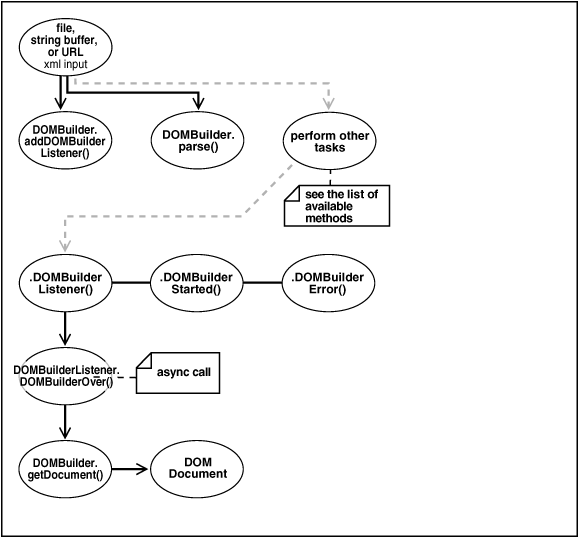
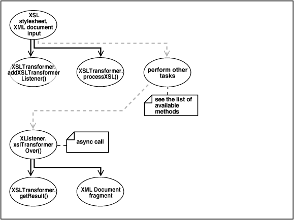
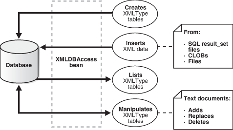
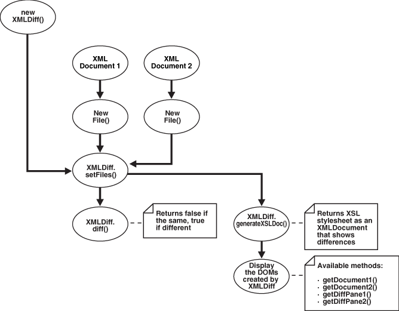

A description is given of Oracle XML Developer's Kit (XDK) JavaBeans, which is deprecated.

**Note:**

The XDK JavaBeans, described in this appendix, and the corresponding XDK Java application programming interface (API) packages and classes are deprecated in Oracle Database 12c Release 1 (12.1). These components are still supported in Oracle Database 12c Release 1 (12.1), but Oracle recommends not using them in new applications. This functionality is deprecated with no replacement.

**See Also:**

[Oracle Database XML Java API Reference](../jaxml/index.md) for more information about the deprecated XDK Java APIs

### D.1 Introduction to XDK JavaBeans

XDK JavaBeans are a set of Extensible Markup Language (XML) components that you can use in Java applications and applets.

#### D.1.1 Prerequisites for Using XDK JavaBeans

Prerequisites for using XDK JavaBeans are described.

This appendix assumes that you are familiar with these technologies:

- [JavaBeans](glossary.md). JavaBeans components, or Beans, are reusable software components that can be manipulated visually in a builder tool.

- [Java Database Connectivity (JDBC)](glossary.md). Database connectivity is included with the XDK JavaBeans. The beans can connect directly to a JDBC-enabled database to retrieve and store XML and Extensible Stylesheet Language (XSL) files.

- [Document Object Model (DOM)](glossary.md). DOM is an in-memory tree representation of the structure of an XML document.

- [Simple API for XML (SAX)](glossary.md). SAX is a standard for event-based XML parsing.

- [XML Schema language](glossary.md). See [Using the XML Schema Processor for Java](using-XML-schema-processor-for-Java.md) for an overview and links to suggested reading.

#### D.1.2 Standards and Specifications for XDK JavaBeans

XDK JavaBeans require version 1.2 or later of XDK, and they can be used with any version of JDK 1.2 or above. The XDK JavaBeans conform with the Sun JavaBeans specification, and include the required `BeanInfo` class that extends `java.beans.SimpleBeanInfo`.

The JavaBeans 1.01 specification describes JavaBeans as present in JDK 1.1.

The additions for the Java 2 platform to the JavaBeans core specification provide developers with standard means to create more sophisticated JavaBeans components.

**Related Topics**

- [Oracle XML Developer's Kit Standards](XDK-standards.md)

**See Also:**

[XDK on OTN](https://www.oracle.com/pls/topic/lookup?ctx=en/database/oracle/oracle-database/19/adxdk&id=otn_java) for the JavaBeans specifications

#### D.1.3 XDK JavaBeans Features

XDK JavaBeans facilitate the addition of graphical user interfaces (GUIs) to XML applications. Bean encapsulation includes documentation and descriptors that you can access directly from Java integrated development environments (IDEs) such as Oracle JDeveloper.

##### D.1.3.1 DOMBuilder

The `oracle.xml.async.DOMBuilder` bean constructs a DOM tree from an XML document. The `DOMBuilder` JavaBean encapsulates the XML parser for class `DOMParser` with a bean interface and supports asynchronous parsing. By registering a listener, Java programs can initiate parsing of large or multiple documents and immediately return control to the caller.

A main benefit of this bean is increased efficiency when parsing multiple files, especially if the files are large. `DOMBuilder` can also provide asynchronous parsing in a background thread in interactive visual applications. Without asynchronous parsing, the GUI is useless until the document to be parsed. With `DOMBuilder`, the application invokes the parse method and then resumes control. The application can display a progress bar, allow the user to cancel the parse, and so forth.

**Related Topics**

- Using the DOMBuilder JavaBean: Basic Process

##### D.1.3.2 XSLTransformer

The `oracle.xml.async.XSLTransformer` JavaBean supports asynchronous transformation. It accepts an XML document, applies an Extensible Stylesheet Language Transformation (XSLT) stylesheet, and creates an output file. It lets you transform an XML document to almost any text-based format, including XML, HTML, and data definition language (DDL).

This bean can also be used as the basis of a server-side application or servlet to render an XML document, such as an XML representation of a query result, into HTML for display in a browser.

The main benefit of the `XSLTransformer` bean is that it can transform multiple files in parallel. Like `DOMBuilder`, you can also use it in visual applications to avoid long periods of time when the GUI is nonresponsive. By implementing the `XSLTransformerListener` interface, the invoking application receives notification when the transformation completes.

**Related Topics**

- Using the XSLTransformer JavaBean: Basic Process

##### D.1.3.3 DBAccess

The `oracle.xml.dbaccess.DBAccess` bean maintains character large object (`CLOB`) tables that contain multiple XML and text documents.

You can use it to store and retrieve XML documents in the database, but not to process them within the database. Java applications that use the `DBAccess` bean connect to the database through JDBC. XML documents stored in `CLOB` tables that are not of type `XMLType` do not have their entities expanded.

The `DBAccess` bean enables you to do perform these tasks:

- Create and delete tables of type `CLOB`.

- Query the contents of `CLOB` tables.

- Perform `INSERT`, `UPDATE`, and `DELETE` operations on XML documents stored in `CLOB` tables.

##### D.1.3.4 XMLDBAccess

The `oracle.xml.xmldbaccess.XMLDBAccess` bean extends the `DBAccess` bean to support XML documents stored in `XMLType` tables. The class provides methods to list, delete, or retrieve `XMLType` instances and their tables. For example, the `getXMLXPathTextData()` method retrieves the value of an XPath expression from an XML document.

`DBAccess` JavaBean maintains `XMLType` tables that can hold multiple XML and text documents. Each XML or text document is stored as a row in the table. The table is created with this structured query language (SQL) statement:

    CREATE TABLE (FILENAME   CHAR( ) UNIQUE,
                  FILEDATA   SYS.XMLType);

The `FILENAME` field holds a unique string used as a key to retrieve, update, or delete the row. Document text is stored in the `FILEDATA` field.

The `XMLDBAccess` bean performs these tasks:

- Creates and deletes `XMLType` tables

- Lists the contents of an `XMLType` column

- Performs `INSERT`, `UPDATE`, and `DELETE` operations on XML documents stored in `XMLType` tables

**Related Topics**

- Using the XMLDBAccess JavaBean: Basic Process

##### D.1.3.5 XMLDiff

When comparing XML documents, it is usually unhelpful to compare them character by character. Most XML comparisons are concerned with differences in structure and significant textual content, not differences in white space.

The `oracle.xml.differ.XMLDiff` bean performs these tasks:

- Constructs and compares the DOM trees for two input XML documents and indicates whether the documents are different.

- Provides a graphical display of the differences between two XML files. Specifically, you can refer to node insert, delete, modify, or move.

- Generates an XSLT stylesheet that can convert one of the input XML documents into the other document.

The `XMLDiff` bean is especially useful in pipeline applications. For example, an application could update an XML document, compare it with a previous version of the document, and store the XSLT stylesheet that shows the differences between them.

**Related Topics**

- [Using the XML Pipeline Processor for Java](using-XML-pipeline-processor-for-Java.md)
- Using the XMLDiff JavaBean: Basic Process

##### D.1.3.6 XMLCompress

The Oracle XML parser includes a compressor that can serialize XML document objects as binary streams.

This is explained in [Compressing and Decompressing XML](XML-parsing-for-Java.md). Although a useful tool, compression with XML parser has these disadvantages:

- When XML data is deserialized, it must be reparsed.

- The encapsulation of XML data in tags greatly increase its size.

The `oracle.xml.xmlcomp.XMLCompress` bean is an encapsulation of the XML compression functionality. It provides these advantages when serializing and deserializing XML:

- It encapsulates the method that serializes the DOM, which produces a stream.

- XML processors can regenerate the DOM from the compressed stream without reparsing the XML.

The bean supports compression and decompression of input XML parsed by `DOMParser` or `SAXParser`. DOM compression supports inputs of type `XMLType`, `CLOB`, and `BLOB`.

To use different parsing options, parse the document before input and then pass the `XMLDocument` object to the compressor bean. The compression factor is a rough value based on the file size of the input XML file and the compressed file. The limitation of the compression factor method is that it can be used only when the compression is performed with `java.io.File` objects as parameters.

##### D.1.3.7 XSDValidator

The `oracle.xml.schemavalidator.XSDValidator` bean encapsulates the `XSDValidator` class and adds capabilities for validating a DOM tree.

A useful feature of this bean concerns validation errors. If the application throws a validation error, method `getStackList()` returns a list of DOM tree paths that lead to the invalid node. Nodes with errors are returned in a vector of stack trees in which the top element of the stack represents the root node. You can get child nodes by pulling them from the stack. To use `getStackList()` you must use instantiate the `java.util.Vector` and `java.util.Stack` classes.

### D.2 Using XDK JavaBeans: Overview

Topics here include basic use of JavaBeans and running the demo programs.

#### D.2.1 Using XDK JavaBeans: Basic Process

The program flow of Java applications that use the more useful beans is described. These include `DOMBuilder`, `XSLTransformer`, `XMLDBAccess`, and `XMLDiff`.

##### D.2.1.1 Using the DOMBuilder JavaBean: Basic Process

Class `DOMBuilder` implements an XML 1.0 parser according to the World Wide Web Consortium (W3C) recommendation. It parses an XML document and builds a DOM tree. The parsing is done in a separate thread. Interface `DOMBuilderListener` must be used for notification when the tree is built.

When developing applications that use this bean, you must import these subpackages:

- `oracle.xml.async`, which provides asynchronous Java beans for DOM building

- `oracle.xml.parser.v2`, which provides APIs for SAX, DOM, and XSLT

Subpackage `oracle.xml.parser.v2` is described in [XML Parsing for Java](XML-parsing-for-Java.md). The most important DOM-related classes and interfaces in the `javax.xml.async` package are described in Table D-1.

Table D-1 javax.xml.async DOM-Related Classes and Interfaces

| Class/Interface                     | Description                                                                                                                                                                                                                        |
|:------------------------------------|:-----------------------------------------------------------------------------------------------------------------------------------------------------------------------------------------------------------------------------------|
| `DOMBuilder` class                  | Encapsulates an XML parser to parse an XML document and build a DOM tree. The parsing is done in a separate thread. The `DOMBuilderListener` interface must be used for notification when the tree is built.                       |
| `DOMBuilderEvent` class             | Instantiates the event object that `DOMBuilder` uses to notify all registered listeners about parse events.                                                                                                                        |
| `DOMBuilderListener` interface      | Must be implemented so that the program can receive notifications about events during the asynchronous parsing. The class implementing this interface must be added to the `DOMBuilder` with the `addDOMBuilderListener()` method. |
| `DOMBuildeErrorEvent` class         | Defines the error event that is sent when parse exception occurs.                                                                                                                                                                  |
| `DOMBuilderErrorListener` interface | Must be implemented so that the program can receive notifications when errors are found during parsing. The class implementing this interface must be added to the `DOMBuilder` with the `addDOMBuilderErrorListener()` method.    |

Figure D-1 depicts the basic process of an application that uses the `DOMBuilder` JavaBean.

Figure D-1 DOMBuilder JavaBean Usage

[Description of "Figure D-1 DOMBuilder JavaBean Usage"](img_text/adxdk080.md)

Figure D-1 shows these stages of XML processing:

1.  Parse the input XML document. The program can receive the XML document as a file, string buffer, or URL.
2.  Add the `DOMBuilder` listener. The program invokes the method `DOMBuilder.addDOMBuilderListener(DOMBuilderListener)`.
3.  Parse the XML document. The program invokes the `DOMBuilder.parse()` method.
4.  Optionally, process the parsed result further.
5.  Invoke the listener when the program receives an asynchronous call. The listener, which must implement the `DOMBuilderListener` interface, is called by invoking the `DOMBuilderOver()` method.
    The available `DOMBuilderListener` methods are:

    - `domBuilderError(DOMBuilderEvent)`, which is called when parse errors occur.

    - `domBuilderOver(DOMBuilderEvent)`, which is called when parsing completes.

    - `domBuilderStarted(DOMBuilderEvent)`, which is called when parsing begins.
6.  Fetch the DOM. Invoke the `DOMBuilder.getDocument()` method to fetch the resulting DOM document and output it.

##### D.2.1.2 Using the XSLTransformer JavaBean: Basic Process

The `XSLTransformer` bean encapsulates the Java XML parser XSLT processing engine with a bean interface and extends its functionality to permit asynchronous transformation. By registering a listener, your Java application can transform large and successive documents by having the control returned immediately to the caller.

When developing applications that use this bean, you must import these subpackages:

- `oracle.xml.async`, which provides asynchronous Java beans for XSL transformations

- `oracle.xml.parser.v2`, which provides APIs for XML parsing SAX, DOM, and XSLT

The `oracle.xml.parser.v2 subpackage` is described in detail in [XML Parsing for Java](XML-parsing-for-Java.md). The most important XSL-related classes and interfaces in the `javax.xml.async` package are described in Table D-2.

Table D-2 javax.xml.async XSL-Related Classes and Interfaces

| Class/Interface                         | Description                                                                                                                                                                                                                                          |
|:----------------------------------------|:-----------------------------------------------------------------------------------------------------------------------------------------------------------------------------------------------------------------------------------------------------|
| `XSLTransformer` class                  | Applies XSL transformation in a background thread.                                                                                                                                                                                                   |
| `XSLTransformerEvent` class             | Represents the event object used by `XSLTransformer` to notify XSL transformation events to all of its registered listeners.                                                                                                                         |
| `XSLTransformerListener` interface      | Must be implemented so that the program can receive notifications about events during asynchronous transformation. The class implementing this interface must be added to the `XSLTransformer` with the `addXSLTransformerListener()` method.        |
| `XSLTransformerErrorEvent` class        | Instantiates the error event object that `XSLTransformer` uses to notify all registered listeners about transformation error events.                                                                                                                 |
| `XSLTransformerErrorListener` interface | Must be implemented so that the program can receive notifications about error events during the asynchronous transformation. The class implementing this interface must be added to the `XSLTransformer` using `addXSLTransformerListener()` method. |

Figure D-2 shows `XSLTransformer` bean usage.

Figure D-2 XSLTransformer JavaBean Usage

[Description of "Figure D-2 XSLTransformer JavaBean Usage"](img_text/adxdk079.md)

Figure D-2 goes through these stages:

1.  Input an XSLT stylesheet and XML instance document.
2.  Add an XSLT listener. The program invokes the `XSLTransfomer.addXSLTransformerListener()method`.
3.  Apply the stylesheets. The `XSLTransfomer.processXSL()` method initiates the XSL transformation in the background.
4.  Optionally, perform further processing with the `XSLTransformer` bean.
5.  Invoke the XSLT listener when the program receives an asynchronous call. The listener, which must implement the `XSLTransformerListener` interface, is called by invoking the `xslTransformerOver()` method.
6.  Fetch the result of the transformation. Invoke the `XSLTransformer.getResult()` method to return the XML document fragment for the resulting document.
7.  Output the XML document fragment.

##### D.2.1.3 Using the XMLDBAccess JavaBean: Basic Process

Basic use of the `XMLDBAccess` bean is described.

When developing applications that use the `XMLDBAccess` bean, you must use these subpackages:

- `oracle.xml.xmldbaccess`, which includes the `XMLDBAccess` bean

- `oracle.xml.parser.v2`, which provides APIs for XML parsing SAX, DOM, and XSLT

The `oracle.xml.parser.v2 subpackage` is described in detail in [XML Parsing for Java](XML-parsing-for-Java.md). Some of the more important methods in the `XMLDBAccess` class are described in Table D-3.

Table D-3 XMLDBAccess Methods

| Class/Interface             | Description                                                                    |
|:----------------------------|:-------------------------------------------------------------------------------|
| `createXMLTypeTable()`      | Creates an `XMLType` table.                                                    |
| `insertXMLTypeData()`       | Inserts a text file as a row in an `XMLType` table.                            |
| `replaceXMLTypeData()`      | Replaces a text file as a row in an `XMLType` table.                           |
| `getXMLTypeTableNames()`    | Retrieves all XML tables with names starting with a specified string.          |
| `getXMLTypeData()`          | Retrieves text file from an `XMLType` table.                                   |
| `getXMLTypeXPathTextData()` | Retrieves the text data based on the XPath expression from an `XMLType` table. |

Figure D-3 shows typical `XMLDBAccess` bean usage. It shows how the `DBAccess` bean maintains and manipulates XML documents stored in `XMLType`s.

Figure D-3 XMLDBAccess JavaBean Usage

[Description of "Figure D-3 XMLDBAccess JavaBean Usage"](img_text/adxdk104.md)

For example, an `XMLDBAaccess` program could process XML documents in these stages:

1.  Create an `XMLType` table. Invoke `createXMLTypeTable()` by passing it database connection information and a table name.
2.  List the `XMLType` tables. Invoke `getXMLTypeTableNames()` by passing it database connection information and an empty string.
3.  Load XML data into the table. Invoke `replaceXMLTypeData()` by passing it database connection information, the table name, the XML file name, and a string containing the XML.
4.  Retrieve the XML data into a `String`. Invoke `getXMLTypeData()` by passing it the connection information, the table name, and the XML file name.
5.  Retrieve XML data based on an XPath expression. Invoke `getXMLXPathTextData()` by passing it the connection information, the table name, the XML file name, and the XPath expression.
6.  Close the connection.

##### D.2.1.4 Using the XMLDiff JavaBean: Basic Process

Basic use of the `XMLDiff` bean is described.

When developing applications that use the `XMLDiff` bean, you typically use these subpackages:

- `oracle.xml.xmldiff`, which includes the `XMLDiff` bean

- `oracle.xml.parser.v2`, which provides APIs for XML parsing SAX, DOM, and XSLT

- `oracle.xml.async`, which provides asynchronous Java beans for DOM building

Subpackage `oracle.xml.parser.v2` is described in detail in [XML Parsing for Java](XML-parsing-for-Java.md). Some important methods in class `XMLDiff` are described in Table D-4.

Table D-4 XMLDiff Methods

| Class/Interface  | Description                                                                                                                                                                                                                                                                                                                                                                                                               |
|:-----------------|:--------------------------------------------------------------------------------------------------------------------------------------------------------------------------------------------------------------------------------------------------------------------------------------------------------------------------------------------------------------------------------------------------------------------------|
| `diff()`         | Determines the differences between two input XML files or two XMLDocument objects.                                                                                                                                                                                                                                                                                                                                        |
| `generateXSL()`  | Generates an XSL file that represents the differences between the input two XML files. The first XML file can be transformed into the second XML file with the generated stylesheet. If the XML files are the same, then the XSL generated can transform the first XML file into the second XML file, where the first and second files are equivalent. Related methods are `generateXSLDoc()` and `generateXSLFile()`. |
| `setFiles()`     | Sets the XML files to be compared.                                                                                                                                                                                                                                                                                                                                                                                        |
| `getDocument1()` | Gets the document root as an `XMLDocument` object of the first XML tree. `getDocument2()` is the equivalent method for the second tree.                                                                                                                                                                                                                                                                                   |
| `getDiffPane1()` | Gets the text panel as `JTextPane` object that visually shows the diffs in the first XML file. `getDiffPane2()` is the equivalent method for the second file.                                                                                                                                                                                                                                                             |

Figure D-4 shows typical `XMLDiff `bean usage. It shows how `XMLDiff` bean compares and displays the differences between input XML documents.

Figure D-4 XMLDiff JavaBean Usage

[Description of "Figure D-4 XMLDiff JavaBean Usage"](img_text/adxdk121.md)

For example, an `XMLDiff` program could process XML documents in these stages:

1.  Create an `XMLDiff` object.
2.  Set the files to be compared. Create `File` objects for the input files and pass references to the objects to `XMLDiff.setFiles()`.
3.  Compare the documents. The `diff()` method returns `false` if the XML files are the same and `true` if they are different.
4.  Respond depending on the whether the input XML documents are the same or different. For example, if they are the same, invoke `JOptionPane.showMessageDialog()` to print a message.
5.  Generate an XSLT stylesheet that shows the differences between the input XML documents. For example, `generateXSLDoc()` generates an XSL stylesheet as an `XMLDocument`.
6.  Display the DOM trees created by `XMLDiff`.

#### D.2.2 Running XDK JavaBean Demo Programs

Demo programs for XDK SJavaBeans are included in directory `$ORACLE_HOME/xdk/demo/java/transviewer`.

The demos show the use of the XDK beans described in XDK JavaBeans Features, and also some visual beans that are now deprecated. The beans used in the demos are:

- `XSLTransformer`

- `DOMBuilder`

- `DBAccess`

- `XMLDBAccess`

- `XMLDiff`

- `XMLCompress`

- `XSDValidator`

- `oracle.xml.srcviewer.XMLSourceView` (deprecated)

- `oracle.xml.treeviewer.XMLTreeView` (deprecated)

- `oracle.xml.transformer.XMLTransformPanel` (deprecated)

- `oracle.xml.dbviewer.DBViewer` (deprecated)

Although the visual beans are deprecated, they remain useful as educational tools. Consequently, the deprecated beans are included in `$ORACLE_HOME/lib/xmldemo.jar`. The nondeprecated beans are included in `$ORACLE_HOME/lib/xml.jar`.

Table D-5 lists the sample programs provided in the demo directory. The first column of the table indicates which sample program use deprecated beans.

Table D-5 JavaBean Sample Java Source Files

| Sample                    | File Name                      | Description                                                                                                                                                                                                                                                                                                                                                                                                                                                                                                                                                                                                                                                                                                                                                       |
|:--------------------------|:-------------------------------|:------------------------------------------------------------------------------------------------------------------------------------------------------------------------------------------------------------------------------------------------------------------------------------------------------------------------------------------------------------------------------------------------------------------------------------------------------------------------------------------------------------------------------------------------------------------------------------------------------------------------------------------------------------------------------------------------------------------------------------------------------------------|
| `sample1` (deprecated) | `XMLTransformPanelSample.java` | A visual application that uses the `XMLTransformPanel`, `DOMBuilder`, and `XSLTransformer` beans. This bean applies XSL transformations to XML documents and shows the result.                                                                                                                                                                                                                                                                                                                                                                                                                                                                                                                                                                                    |
| `sample2` (deprecated) | `ViewSample.java`              | A sample visual application that uses the `XMLSourceView` and `XMLTreeView` beans. It visualizes XML document files.                                                                                                                                                                                                                                                                                                                                                                                                                                                                                                                                                                                                                                              |
| `sample3`                 | `AsyncTransformSample.java`    | A nonvisual application that uses the `XSLTransformer` and `DOMBuilder` beans. It applies the XSLT stylesheet specified in `doc.xsl` on all `.xml` files in the current directory. It writes the results to files with the extension `.log`.                                                                                                                                                                                                                                                                                                                                                                                                                                                                                                                      |
| `sample4` (deprecated) | `DBViewSample.java`            | A visual application that uses the `DBViewer` bean to implement a simple application that handles insurance claims.                                                                                                                                                                                                                                                                                                                                                                                                                                                                                                                                                                                                                                               |
| `sample4` (deprecated) | `DBViewClaims.java`            | This `JFrame` subclass is instantiated in the `DBViewFrame` class, which is in turn instantiated in the `DBViewSample` program.                                                                                                                                                                                                                                                                                                                                                                                                                                                                                                                                                                                                                                   |
| `sample4` (deprecated) | `DBViewFrame.java`             | This `JFrame` subclass is instantiated in the `DBViewSample` program.                                                                                                                                                                                                                                                                                                                                                                                                                                                                                                                                                                                                                                                                                             |
| `sample5`                 | `XMLDBAccessSample.java`       | A nonvisual application for the `XMLDBAccess` bean. This program demonstrates how to use the `XMLDBAccess` bean APIs to store and retrieve XML documents in `XMLType` tables. To use `XMLType`, you need Oracle Database and `xdb.jar`. The program accepts values for `HOSTNAME`, `PORT`, `SID`, `USERID`, and `PASSWORD`. The program creates tables in the database and loads data from file `booklist.xml`. The program writes output to `xmldbaccess.log`.                                                                                                                                                                                                                                                                                                |
| `sample6` (deprecated) | `XMLDiffSample.java`           | A visual application that uses the `XMLDiff` bean to find differences between two XML files and generate an XSLT stylesheet. You can use this stylesheet to transform the first input XML into the second input XML file.                                                                                                                                                                                                                                                                                                                                                                                                                                                                                                                                         |
| `sample6` (deprecated) | `XMLDiffFrame.java`            | A class that implements the `ActionListener` interface. This class is used by the `XMLDiffSample` program.                                                                                                                                                                                                                                                                                                                                                                                                                                                                                                                                                                                                                                                        |
| `sample6` (deprecated) | `XMLDiffSrcView.java`          | A `JPanel` subclass used by the `XMLDiffSample` program.                                                                                                                                                                                                                                                                                                                                                                                                                                                                                                                                                                                                                                                                                                          |
| `sample7` (deprecated) | `compviewer.java`              | A visual application that uses the `XMLCompress` bean to compress XML. The XML input can be an XML file or XML data obtained through a SQL query. The application enables you to decompress the compressed stream and view the resulting DOM tree.                                                                                                                                                                                                                                                                                                                                                                                                                                                                                                                |
| `sample7` (deprecated) | `compstreamdata.java`          | A simple class that pipes information from the GUI to the bean. This class is used in `dbpanel.java`, `filepanel.java`, and `xmlcompressutil.java`.                                                                                                                                                                                                                                                                                                                                                                                                                                                                                                                                                                                                               |
| `sample7` (deprecated) | `dbpanel.java`                 | A `JPanel` subclass used in `xmlcompressutil.java`.                                                                                                                                                                                                                                                                                                                                                                                                                                                                                                                                                                                                                                                                                                               |
| `sample7` (deprecated) | `filepanel.java`               | A `JPanel` subclass used in `xmlcompressutil.java`.                                                                                                                                                                                                                                                                                                                                                                                                                                                                                                                                                                                                                                                                                                               |
| `sample7` (deprecated) | `xmlcompressutil.java`         | A `JPanel` subclass used in `compviewer.java`.                                                                                                                                                                                                                                                                                                                                                                                                                                                                                                                                                                                                                                                                                                                    |
| `sample8` (deprecated) | `XMLSchemaTreeViewer.java`     | A visual application that uses the `Treeviewer`, `sourceviewer`, and `XSDValidator` beans. The application accepts an XML instance document and an XML schema document as inputs. The application parses both the documents and validates the instance document against the schema. If the document is invalid, then the nodes where the errors occurred are highlighted and an error message is shown in a tool tip.                                                                                                                                                                                                                                                                                                                                             |
| `sample8` (deprecated) | `TreeViewerValidate.java`      | A `JPanel` subclass that displays a parsed XML instance document as a tree. This class is used by the `XMLSchemaTreeViewer.java` program.                                                                                                                                                                                                                                                                                                                                                                                                                                                                                                                                                                                                                         |
| `sample9` (deprecated) | `XMLSrcViewer.java`            | A visual application that uses the `sourceviewer` and `XSDValidator` beans. The demo takes an XML file as input. You can select the validation mode: document type definition (DTD), XML schema, or no validation. The program validates the XML data file against the DTD or schema and displays it with syntax highlighting. It also logs validation errors. For schema validation it also highlights the error nodes appropriately. External and internal DTDs can be viewed.                                                                                                                                                                                                                                                                                  |
| `sample9` (deprecated) | `XMLSrcViewPanel.java`         | A class that shows how to use the `XMLSourceView` and `DTDSourceView` objects. This class is used by the `XMLSrcViewer.java` program.Each `XMLSourceView` object is set as a Component of a `JPanel` by invoking `goButton_actionPerformed()`. The XML file to be viewed is parsed and the resulting XML document is set in the `XMLSourceView` object by invoking `makeSrcPane()`. The highlighting and DTD display properties are specified at this time. For performing schema validation, build the schema object by invoking `makeSchemaValPane()`. You can can check for errors and display the source code accordingly with different highlights. You can retrieve a list of schema validation errors from the `XMLSourceView` by invoking `dumpErrors()`. |
| `sample10`                | `XSDValidatorSample.java`      | An application that shows how to use the `XSDValidator` bean. It accepts an XML file and an XML schema file as input. The program displays errors occurring during validation, including line numbers.                                                                                                                                                                                                                                                                                                                                                                                                                                                                                                                                                            |

Table D-6 describes additional files that are used by the demo programs.

Table D-6 JavaBean Sample Files

| File Name           | Description                                                                                                                                                                                                                        |
|:--------------------|:-----------------------------------------------------------------------------------------------------------------------------------------------------------------------------------------------------------------------------------|
| `XMLDiffData1.txt`  | An XML document used by the `XMLDiffSample.java` program. By default the 2 XML files `XMLDiffData1.txt` and `XMLDiffData2.txt` are compared and the output XSLT is stored as `XMLDiffSample.xsl`.                                  |
| `XMLDiffData2.txt`  | An XML document used by the `XMLDiffSample.java` program. By default the 2 XML files `XMLDiffData1.txt` and `XMLDiffData2.txt` are compared and the output XSLT is stored as `XMLDiffSample.xsl`.                                  |
| `booklist.xml`      | An XML document for use by `XMLDBAccessSample.java`.                                                                                                                                                                               |
| `claim.sql`         | An XML document used by `ViewSample.java` and `XMLDBAccessSample.java`.                                                                                                                                                            |
| `doc.xml`           | An XML document for use by `AsyncTransformSample.java`.                                                                                                                                                                            |
| `doc.xsl`           | An XSLT stylesheet for use by `AsyncTransformSample.java`.                                                                                                                                                                         |
| `emptable.xsl`      | An XSLT stylesheet for use by `AsyncTransformSample.java`, `ViewSample.java`, or `XMLTransformPanelSample.java`.                                                                                                                   |
| `note_in_dtd.xml`   | A sample XML document for use in `XMLSrcViewer.java`. You can use this file in DTD validation mode to view an internal DTD with validation errors. An internal DTD can be optionally displayed along with the XML data.            |
| `purchaseorder.xml` | An XML document used by the `XSDValidatorSample.java` program. The instance document `purchaseorder.xml` does not conform to the XML schema defined in `purchaseorder.xsd`, which causes the program to display the errors.        |
| `purchaseorder.xsd` | An XML schema document used by the `XSDValidatorSample.java` program. The instance document `purchaseorder.xml` does not conform to the XML schema defined in `purchaseorder.xsd`, which causes the program to display the errors. |

Documentation for how to compile and run the sample programs is located in the `README` in the same directory. The basic steps are:

1.  Change into the `$ORACLE_HOME/xdk/demo/java/transviewer` directory (UNIX) or `%ORACLE_HOME%\xdk\demo\java\transviewer` directory (Windows).
2.  Make sure that your environment variables are set as described in [Setting Up the XDK for Java Environment](getting-started-with-XDK-for-Java.md). The beans require Java Development Kit (JDK) 1.2 or later. The `DBViewer` and `DBTransformPanel` beans require JDK 1.2.2 when rendering HTML. Prior versions of the JDK may not render HTML in the result buffer properly.
3.  Edit the `Makefile` (UNIX) or `Make.bat` (Windows) for your environment. In particular,:
    - Change the `JDKPATH` in the `Makefile` to point to your JDK path.

    - Change `PATHSEP` to the appropriate path separator for your operating system.

    - Change the `HOSTNAME`, `PORT`, `SID`, `USERID`, and `PASSWORD` parameters so that you can connect to the database through the JDBC thin driver. These parameters are used in `sample4` and `sample5`.
4.  Run `make` (UNIX) or `Make.bat` (Windows) at the system prompt to generate the class files.
5.  Run `gmake` to run the demos:
        gmake sample1
        gmake sample2
        gmake sample3
        gmake sample4
        gmake sample5
        gmake sample6
        gmake sample7
        gmake sample8
        gmake sample9
        gmake sample10

##### D.2.2.1 Running sample1

`Sample1` is the program that uses the `XMLTransViewer` bean.

You can run the program manually:

    java XMLTransformPanelSample

You can use the program to import and export XML files from Oracle Database, store XSL transformation files in the database, and apply stylesheets to XML interactively. To use the database connectivity feature in this program, you must know the network name of the computer where the database runs, the port (usually `1521`), and the name of the Oracle instance (usually `orcl`). You also need an account with `CREATE TABLE` privileges. If you have installed the sample schemas, then you can use the account `hr`. You can the `XMLTransViewer` program to apply stylesheet transformation to XML files and display the result.The program displays a panel with tabs on the top and the bottom. You can use the first two top tabs to switch between the XML buffer and the XSLT buffer. The third tab performs XSL transformation on the XML buffer and displays the result. You can use the first two tabs on the bottom to load and save data from Oracle Database and from the file system. The remaining bottom tabs switch the display of the current content to tree view, XML source, edit mode and, in case of the result view after the transformation, HTML.

##### D.2.2.2 Running sample2

`Sample2` is a GUI-based demo for the `XMLSourceView` and `XMLTreeView` beans, which are deprecated. The `ViewSample` program displays the `booklist.xml` file in separate source and tree views.

You can run the program manually:

    java ViewSample

##### D.2.2.3 Running sample3

`Sample3` is a nonvisual demo for the asynchronous `DOMBuilder` and `XSLTransformer` beans. The `AsyncTransformSample` program applies the `doc.xsl` XSLT stylesheet to all `*.xml `files in the current directory. The program writes output to files with the extension `.log`.

You can run the program manually:

    java AsyncTransformSample

##### D.2.2.4 Running sample4

`Sample4` is a visual demo for the `DBViewer` bean, which is deprecated.

It runs in these stages:

1.  It starts SQL\*Plus, connects to the database with the `USERID` and `PASSWORD` specified in the `Makefile`, and runs the `claim.sql` script. This script creates several tables, views, and types for use by the `DBViewSample` demo program.
2.  It runs the DBViewSample program:
        java -classpath "$(MAKE_CLASSPATH)" DBViewSample

JDBC connection information is hard-coded in the `DBViewClaims.java` source file, which implements a class used by the demo. Specifically, the program assumes the values for `USERID`, `PASSWORD`, and so forth set in the `Makefile`. If your configuration is different, navigate to line 92 in `DBViewClaims.java` and modify `setUsername()`, `setPassword()`, and so forth with values that reflect your Oracle Database configuration.

##### D.2.2.5 Running sample5

`Sample5` is a nonvisual demo for the `XMLDBAccess` bean. It uses the XMLType objects to store XML documents inside the database. The following program connects to the database with the Java thin client, creates `XMLType` tables, and loads the data from `booklist.xml`.

To run the program you must specify these pieces of information as command-line arguments:

- Host name (for example, `myhost`)

- Port number (for example, `1521`)

- SID of the database (for example, `ORCL`)

- Database account in which the tables are created (for example, `hr`)

- Password for the database account (for example, `hr`)

For example, you can run the program:

    java XMLDBAccessSample myhost 1521 ORCL hr hr

The following text shows sample output from `dbaccess.log`:

    Demo for createXMLTypeTables():
    Table +'testxmltype' successfully created.

    Demo for listXMLTypeTables():
    tablenamename=TESTXMLTYPE

    Demo for replaceXMLTypeData() (similar to insert):
    XML Data from +'booklist.xml' successfully replaced in table 'testxmltype'.

    Demo for getXMLTypeData():
    XMLType data fetched:
    <?xml version="1.0"?>
    <booklist>
      <book isbn="1234-123456-1234">
        <title>C Programming Language</title>
        <author>Kernighan and Ritchie</author>
        <publisher>EEE</publisher>
        <price>7.99</price>
      </book>
    ...
      <book isbn="1230-23498-2349879">
        <title>Emperor's New Mind</title>
        <author>Roger Penrose</author>
        <publisher>Oxford Publishing Company</publisher>
        <price>15.99</price>
      </book>
    </booklist>

    Demo for getXMLTypeXPathTextData():
    Data fetched using XPath exp '/booklist/book[3]':
    <book isbn="2137-598354-65978">
      <title>Twelve Red Herrings</title>
      <author>Jeffrey Archer</author>
      <publisher>Harper Collins</publisher>
      <price>12.95</price>
    </book>

##### D.2.2.6 Running sample6

The `sample6` program is a visual demo for the `XMLDiff` bean.

The `XMLDiffSample` class invokes a GUI that enables you to choose the input data files from the File menu by selecting Compare XML Files. The Transform menu enables you to apply the generated XSLT generated to the first input XML. Select Save As in the File menu to save the output XML file, which is the same as the second input file. By default, the program compares `XMLDiffData1.txt` to `XMLDiffData2.txt` and stores the XSLT output as `XMLDiffSample.xsl`.

You can run the program manually:

    java -mx50m XMLDiffSample XMLDiffData1.txt XMLDiffData2.txt

If the input XML files use a DTD that accesses a URL outside a firewall, then modify `XMLDiffSample.java` to include the proxy server settings before the `setFiles()` invocation. For example, modify the program as follows:

    /* Set proxy to access dtd through firewall */
    Properties p = System.getProperties();
    p.put("proxyHost", "www.proxyservername.com");
    p.put("proxyPort", "80");
    p.put("proxySet", "true");
    /* You will also have to import java.util.*; */

##### D.2.2.7 Running sample7

The `sample7` visual demo shows the use of the `XMLCompress` bean. Class `compviewer` invokes a GUI that lets the user compress and uncompress XML files and data obtained from the database. The loading options let the user retrieve the data from a file system or a database.

This application does not support loading and saving compressed data from the database. The compression factor indicates a rough estimate by which the XML data is reduced.

You can run the program manually:

    java compviewer

##### D.2.2.8 Running sample8

The `sample8` demo uses the `XMLTreeViewer` bean. The `XMLSchemaTreeViewer` program lets a user view an `XMLDocument` in a tree format. The user can input an XML-schema document and validate an instance document against the schema. If the document is invalid, invalid nodes are highlighted with an error message.

Also, the program displays a log of all the line information in a separate panel, which enables the user to edit the instance document and revaluated. Test the program with sample files `purchaseorder.xml` and `purchaseorder.xsd`. The instance document `purchaseorder.xml` does not conform to the schema defined in `purchaseorder.xsd`.

You can run the program manually:

    java XMLSchemaTreeViewer

##### D.2.2.9 Running sample9

The `sample9` demo uses the `SourceViewer` bean. The `XMLSrcViewer` program lets you view an XML document or a DTD, with syntax highlighting. You can validate the document against an input XML schema or DTD. The DTD can be internal or external.

If the validation is successful, then you can view the instance document and XML schema or DTD in the Source View pane. If errors were encountered during schema validation, then an error log with line numbers is available in the Error pane. The Source View pane shows the XML document with error nodes highlighted.You can use sample files `purchaseorder.xml` and `purchaseorder.xsd` for testing XML schema validation with errors. You can use `note_in_dtd.xml` with DTD validation mode to view an internal DTD with validation errors. You can run the program manually:

    java XMLSrcViewer

##### D.2.2.10 Running sample10

The `sample10` demo shows the use of the `XSDValidator` bean.

The `XSDValidatorSample` program's two input arguments are an XML document and its associated XML schema. The program displays errors occurring during validation, including line numbers.

The following program uses `purchaseorder.xsd` to validate the contents of `purchaseorder.xml`:

    java XSDValidatorSample purchaseorder.xml purchaseorder.xsd

The XML document fails (intentionally) to validate against the schema. The program displays these errors:

    Sample purchaseorder.xml purchaseorder.xsd
    <Line 2, Column 41>: XML-24523: (Error) Invalid value 'abc' for attribute: 'orderDate'
    #document->purchaseOrder
    <Line 7, Column 27>: XML-24525: (Error) Invalid text 'CA' in element: 'state'
    #document->purchaseOrder->shipTo->state->#text
    <Line 8, Column 25>: XML-24525: (Error) Invalid text 'sd' in element: 'zip'
    #document->purchaseOrder->shipTo->zip->#text
    <Line 14, Column 27>: XML-24525: (Error) Invalid text 'PA' in element: 'state'
    #document->purchaseOrder->billTo->state->#text
    <Line 17, Column 22>: XML-24534: (Error) Element 'coment' not expected.
    #document->purchaseOrder->coment
    <Line 29, Column 31>: XML-24534: (Error) Element 'shipDae' not expected.
    #document->purchaseOrder->items->item->shipDae

### D.3 Processing XML with XDK JavaBeans

Topics here include processing XML documents asynchronously using the `DOMBuilder` and `XSLTransformer` beans, and comparing XML documents using the `XmlDiff` bean.

#### D.3.1 Processing XML Asynchronously with the DOMBuilder and XSLTransformer Beans

You can use XDK JavaBeans to perform asynchronous XML processing.

This is explained in XSLTransformer.

The `AsyncTransformSample.java` program shows how to use the `DOMBuilder` and `XSLTransformer` beans. The program implements these methods:

- `runDOMBuilders()`

- `runXSLTransformer()`

- `saveResult()`

- `makeXSLDocument()`

- `createURL()`

- `init()`

- `exitWithError()`

- `asyncTransform()`

The basic architecture of the program is:

1.  The program declares and initializes the fields used by the class. The input XSLT stylesheet is hard-coded in the program as `doc.xsl`. The class defines these fields:

        String        basedir = new String (".");
        OutputStream  errors = System.err;
        Vector        xmlfiles = new Vector();
        int           numXMLDocs = 1;
        String        xslFile = new String ("doc.xsl");
        URL           xslURL;
        XMLDocument   xsldoc

2.  The `main()` method invokes the `init()` method to perform the initial setup. This method lists the files in the current directory, and if it finds files that end in the extension `.xml`, it adds them to a `Vector` object. The implementation for the `init()` method is:

        boolean init () throws Exception
        {
           File     directory = new File (basedir);
           String[] dirfiles = directory.list();
           for (int j = 0; j < dirfiles.length; j++)
           {
              String dirfile = dirfiles[j];

              if (!dirfile.endsWith(".xml"))
                  continue;

               xmlfiles.addElement(dirfile);
           }

           if (xmlfiles.isEmpty()) {
              System.out.println("No files in directory were selected for processing");
              return false;
           }
           numXMLDocs = xmlfiles.size();

           return true;
        }

3.  The `main()` method instantiates `AsyncTransformSample`:

        AsyncTransformSample inst = new AsyncTransformSample();

4.  The `main()` method invokes the `asyncTransform()` method. The `asyncTransform()` method performs these main tasks:

    1.  Invokes `makeXSLDocument()` to parse the input XSLT stylesheet.

    2.  Invokes `runDOMBuilders()` to initiate parsing of the instance documents, that is, the documents to be transformed, and then transforms them.

    After initiating the XML processing, the program resumes control and waits while the processing occurs in the background. When the last request completes, the method exits.

    The following code shows the implementation of the `asyncTransform()` method:

        void asyncTransform () throws Exception
        {
           System.err.println (numXMLDocs +
                    " XML documents will be transformed" +
                    " using XSLT stylesheet specified in " + xslFile +
                    " with " +  numXMLDocs + " threads");

           makeXSLDocument ();
           runDOMBuilders ();

           // wait for the last request to complete
           while (rm.activeFound())
              Thread.sleep(100);
        }

##### D.3.1.1 Parsing the Input XSLT Stylesheet

Parsing an XSLT stylesheet is described.

Method `makeXSLDocument()` performs a simple DOM parse of a stylesheet. It does not use asynchronous parsing. The technique is the same as that described in [Performing Basic DOM Parsing](XML-parsing-for-Java.md).

The method follows these steps:

1.  Create a new `DOMParser()` object. The following code fragment from `DOMSample.java` shows this technique:
        DOMParser parser = new DOMParser();
2.  Configure the parser. The following code fragment specifies that white space must be preserved:
        parser.setPreserveWhitespace(true);
3.  Create a `URL` object from the input stylesheet. The following code fragment invokes the `createURL()` helper method to accomplish this task:
        xslURL = createURL (xslFile);
4.  Parse the input XSLT stylesheet. The following statement shows this technique:
        parser.parse (xslURL);
5.  Get a handle to the root of the in-memory DOM tree. You can use the `XMLDocument` object to access every part of the parsed XML document. The following statement shows this technique:
        xsldoc = parser.getDocument();

##### D.3.1.2 Processing the XML Documents Asynchronously

Method `runDOMBuilders()` shows how you can use the `DOMBuilder` and `XSLTransformer` beans to perform asynchronous processing. The parsing and transforming of the XML data occurs in the background.

The method follows these steps:

1.  Create a resource manager to manage the input XML documents. The program creates a `for` loop and gets the XML documents. The following code fragment shows this technique:
        rm = new ResourceManager (numXMLDocs);
        for (int i = 0; i < numXMLDocs; i++)
        {
           rm.getResource();
           ...
        }
2.  Instantiate the DOM builder bean for each input XML document. For example:
        DOMBuilder builder = new DOMBuilder(i);
3.  Create a `URL` object from the XML file name. For example:
        DOMBuilder builder = new DOMBuilder(i);
        URL  xmlURL = createURL(basedir + "/" + (String)xmlfiles.elementAt(i));
        if (xmlURL == null)
           exitWithError("File " + (String)xmlfiles.elementAt(i) + " not found");
4.  Configure the DOM builder. The following code fragment specifies the preservation of white space and sets the base URL for the document:
        builder.setPreserveWhitespace(true);
        builder.setBaseURL (createURL(basedir + "/"));
5.  Add the listener for the DOM builder. The program adds the listener by invoking `addDOMBuilderListener()`.
    The class instantiated to create the listener must implement the `DOMBuilderListener` interface. The program provides a do-nothing implementation for `domBuilderStarted()` and `domBuilderError()`, but must provide a substantive implementation for `domBuilderOver()`, which is the method called when the parse of the XML document completes. The method invokes `runXSLTransformer()`, which is the method that transforms the XML. See Transforming the XML with the XSLTransformer Bean for an explanation of this method.

    The following code fragment shows how to add the listener:

        builder.addDOMBuilderListener
        (
           new DOMBuilderListener()
           {
              public void domBuilderStarted(DOMBuilderEvent p0) {}
              public void domBuilderError(DOMBuilderEvent p0) {}
              public synchronized void domBuilderOver(DOMBuilderEvent p0)
              {
                 DOMBuilder bld = (DOMBuilder)p0.getSource();
                 runXSLTransformer (bld.getDocument(), bld.getId());
              }
           }
        );
6.  Add the error listener for the DOM builder. The program adds the listener by invoking `addDOMBuilderErrorListener()`.
    The class instantiated to create the listener must implement the `DOMBuilderErrorListener` interface. The following code fragment show the implementation:

        builder.addDOMBuilderErrorListener
        (
           new DOMBuilderErrorListener()
           {
              public void domBuilderErrorCalled(DOMBuilderErrorEvent p0)
              {
                 int id = ((DOMBuilder)p0.getSource()).getId();
                 exitWithError("Error occurred while parsing " +
                    xmlfiles.elementAt(id) + ": " +
                    p0.getException().getMessage());
              }
           }
        );
7.  Parse the document. The following statement shows this technique:
        builder.parse (xmlURL);
        System.err.println("Parsing file " + xmlfiles.elementAt(i));

###### D.3.1.2.1 Transforming the XML with the XSLTransformer Bean

When a DOM parse completes, the DOM listener receives notification. Method `domBuilderOver()` implements response behavior for this event. The program passes the DOM to method `runXSLTransformer()`, which initiates XSL transformation.

The method follows these steps:

1.  Instantiate the `XSLTransformer` bean. This object performs the XSLT processing. The following statement shows this technique:
        XSLTransformer processor = new XSLTransformer (id);
2.  Create a new stylesheet object. For example:
        XSLStylesheet  xsl       = new XSLStylesheet (xsldoc, xslURL);
3.  Configure the XSLT processor. For example, this statement sets the processor to show warnings and configures the error output stream:
        processor.showWarnings (true);
        processor.setErrorStream (errors);
4.  Add the listener for the XSLT processor. The program adds the listener by invoking `addXSLTransformerListener()`.
    The class instantiated to create the listener must implement the `XSLTransformerListener` interface. The program provides a do-nothing implementation for `xslTransformerStarted()` and `xslTransformerError()`, but must provide a substantive implementation for `xslTransformerOver()`, which is the method called when the parse of the XML document completes. The method invokes `saveResult()`, which prints the transformation result to a file.

    The following code fragment shows how to add the listener:

        processor.addXSLTransformerListener
        (
           new XSLTransformerListener()
           {
              public void xslTransformerStarted (XSLTransformerEvent p0) {}
              public void xslTransformerError(XSLTransformerEvent p0) {}
              public void xslTransformerOver (XSLTransformerEvent p0)
              {
                 XSLTransformer trans = (XSLTransformer)p0.getSource();
                 saveResult (trans.getResult(),  trans.getId());
              }
           }
        );
5.  Add the error listener for the XSLT processor. The program adds the listener by invoking `addXSLTransformerErrorListener()`.
    The class instantiated to create the listener must implement the `XSLTransformerErrorListener` interface. The following code fragment show the implementation:

        processor.addXSLTransformerErrorListener
        (
           new XSLTransformerErrorListener()
           {
              public void xslTransformerErrorCalled(XSLTransformerErrorEvent p0)
              {
                 int i = ((XSLTransformer)p0.getSource()).getId();
                 exitWithError("Error occurred while processing " +
                               xmlfiles.elementAt(i) + ": " +
                               p0.getException().getMessage());
              }
           }
        );
6.  Transform the XML document with the XSLT stylesheet. The following statement shows this technique:
        processor.processXSL (xsl, xml);

#### D.3.2 Comparing XML Documents with the XMLDiff JavaBean

You can use XDK JavaBeans to compare the structure and significant content of XML documents.

This is explained in XMLDiff,

The `XMLDiffSample.java` program shows how to use the `XMLDiff` bean. The program implements these methods:

- `showDiffs()`

- `doXSLTransform()`

- `createURL()`

The basic architecture of the program is:

1.  The program declares and initializes the fields used by the class. One field is of type `XMLDiffFrame`, which is the class implemented in the `XMLDiffFrame.java` demo. The class defines these fields:

        protected XMLDocument doc1;   /* DOM tree for first file */
        protected XMLDocument doc2;   /* DOM tree for second file */
        protected static XMLDiffFrame diffFrame; /* GUI frame */
        protected static XMLDiffSample dfxApp;   /* XMLDiff sample application */
        protected static XMLDiff xmlDiff;        /* XML diff object */
        protected static XMLDocument xslDoc;     /* parsed xsl file */
        protected static String outFile = new String("XMLDiffSample.xsl"); /* output
                                                                      xsl file name */

2.  The `main()` method creates an `XMLDiffSample` object:

        dfxApp = new XMLDiffSample();

3.  The `main()` method adds and initializes a `JFrame` to display the output of the comparison. The following code shows this technique:

        diffFrame = new XMLDiffFrame(dfxApp);
        diffFrame.addTransformMenu();

4.  The `main()` method instantiates the `XMLDiff` bean. The following code shows this technique:

        xmlDiff = new XMLDiff();

5.  The `main()` method invokes the `showDiffs()` method. This method performs these tasks:

    1.  Invokes `XMLDiff.diff()` to compare the input XML documents.

    2.  Generates and displays an XSLT stylsheet that can transform one input document into the other document.

    The following code fragment shows the `showDiffs()` method invocation:

        if (args.length == 3)
          outFile = args[2];
        if(args.length >= 2)
          dfxApp.showDiffs(new File(args[0]), new File(args[1]));
        diffFrame.setVisible(true);

##### D.3.2.1 Comparing the XML Files and Generating a Stylesheet

Method `showDiffs()` shows the use of the `XMLDiff` bean.

The method follows these steps:

1.  Set the files for the `XMLDiff` processor. The following statement shows this technique:

        xmlDiff.setFiles(file1, file2);

2.  Compare the files. The `diff()` method returns a boolean value that indicates whether the input documents have identical structure and content. If they are equivalent, then the method prints a message to the `JFrame` implemented by the `XMLDiffFrame` class. The following code fragment shows this technique:

        if(!xmlDiff.diff())
        {
          JOptionPane.showMessageDialog
          (
            diffFrame,
            "Files are equivalent in XML representation",
            "XMLDiffSample Message",
            JOptionPane.PLAIN_MESSAGE
          );
        }

3.  Generate a DOM for the XSLT stylesheet that shows the differences between the two documents. The following code fragment shows this technique:

        xslDoc = xmlDiff.generateXSLDoc();

4.  Display the documents in the `JFrame` implemented by `XMLDiffFrame`. `XMLDiffFrame` instantiates the `XMLSourceView` bean, which is deprecated. The method follows these steps:

    1.  Create the source pane for the input documents. Pass the DOM handles of the two documents to the `diffFrame` object to make the source pane:

            diffFrame.makeSrcPane(xmlDiff.getDocument1(), xmlDiff.getDocument2());

    2.  Create the pane that shows the differences between the documents. Pass references to the text panes to `diffFrame`:

            diffFrame.makeDiffSrcPane(new XMLDiffSrcView(xmlDiff.getDiffPane1()),
                                      new XMLDiffSrcView(xmlDiff.getDiffPane2()));

    3.  Create the pane for the XSLT stylesheet. Pass the DOM of the stylesheet:

            diffFrame.makeXslPane(xslDoc, "Diff XSL Script");
            diffFrame.makeXslTabbedPane();
