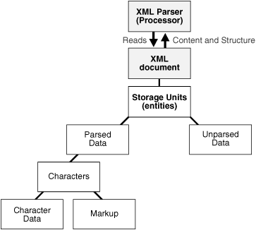
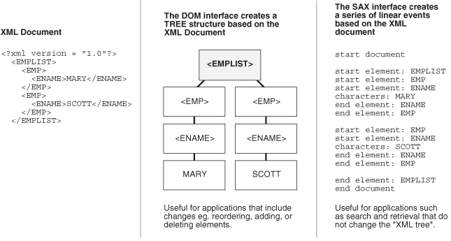
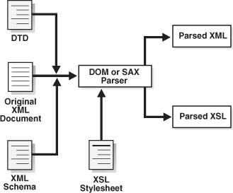
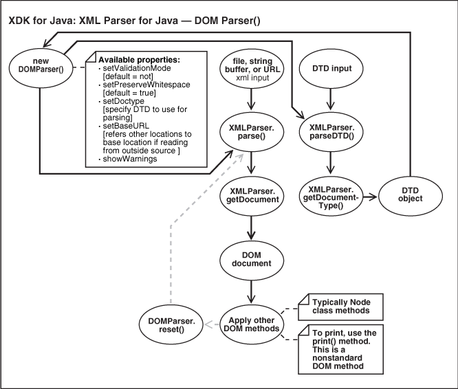
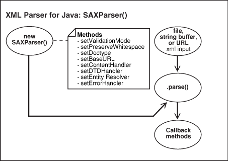
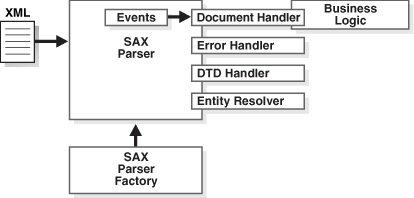
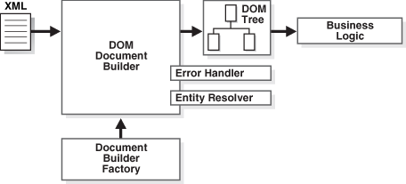

Extensible Markup Language (XML) parsing for Java is described.

### 12.1 Introduction to XML Parsing for Java

XML parsing for Java is described.

#### 12.1.1 Prerequisites for Parsing with Java

An Oracle XML parser reads an XML document and uses either a Document Object Model (DOM) application programming interface (API) or Simple API for XML (SAX) to access to its content and structure. You can parse in either validating or nonvalidating mode.

This chapter assumes that you are familiar with these technologies:

- [Document Object Model (DOM)](glossary.md): An in-memory tree representation of the structure of an XML document.

- [Simple API for XML (SAX)](glossary.md): A standard for event-based XML parsing.

- [Java API for XML Processing (JAXP)](glossary.md): A standard interface for processing XML with Java applications that supports the DOM and SAX standards.

- [document type definition (DTD)](glossary.md): A set of rules that defines the valid structure of an XML document.

- [XML Schema](glossary.md): A World Wide Web Consortium (W3C) recommendation that defines the valid structure of data types in an XML document.

- [XML Namespaces](glossary.md): A mechanism for differentiating element and attribute names within an XML document.

- [binary XML](glossary.md): An XML representation that uses the compact schema-aware format, in which both scalable and nonscalable DOMs can save XML documents.

For more information, see the list of XML resources in the [Related Documents](preface.md).

#### 12.1.2 Standards and Specifications for XML Parsing for Java

The DOM Level 1, Level 2, and Level 3 specifications are W3C Recommendations.

See [Document Object Model (DOM) Technical Reports](https://www.oracle.com/pls/topic/lookup?ctx=en/database/oracle/oracle-database/19/adxdk&id=w3_org_domtr) for the W3C DOM specifications.

SAX is available in version 1.0 (deprecated) and 2.0. SAX is not a W3C specification. See [SAX Project](https://www.oracle.com/pls/topic/lookup?ctx=en/database/oracle/oracle-database/19/adxdk&id=sax_project_org).

XML Namespaces are a W3C Recommendation. See [Namespaces in XML 1.0 (Third Edition)](https://www.oracle.com/pls/topic/lookup?ctx=en/database/oracle/oracle-database/19/adxdk&id=w3_org_rec_xml_names).

JCR 1.0 (also known as JSR 170) defines a standard Java API for applications to interact with content repositories. See [JSR 170: Content Repository for Java technology API](https://www.oracle.com/pls/topic/lookup?ctx=en/database/oracle/oracle-database/19/adxdk&id=jcp_org_jsr_170).

**See Also:**

[Oracle XML DB Developer’s Guide](../adxdb/index.md)

JAXP is a standard API that enables use of DOM, SAX, XML Schema, and Extensible Stylesheet Language Transformation (XSLT), independent of processor implementation.

**See Also:**

[Oracle XML Developer's Kit Standards](XDK-standards.md), for information about standards supported by Oracle XML Developer's Kit (XDK)

#### 12.1.3 Large Node Handling

DOM Stream access to XML nodes is done by Procedural Language/Structured Query Language (PL/SQL) and Java APIs. Nodes in an XML document can now far exceed 64 KB. Thus Joint Photographic Experts Group (JPEG), Word, PDF, rich text format (RTF), and HTML documents can be more readily stored.

**See Also:**

[Oracle XML DB Developer’s Guide](../adxdb/Java-DOM-API-for-XMLType.md) for complete details on the Java large node capabilities

#### 12.1.4 XML Parsing in Java: Overview

`XMLParser` is the abstract base class for the XML parser for Java. An instantiated parser invokes the `parse()` method to read an XML document. `XMLDOMImplementation` factory methods provide another way to parse binary XML to create scalable DOM.

Figure 12-1 shows the basic parsing process, using `XMLParser`. The figure does not apply to `XMLDOMImplementation()`.

Figure 12-1 XML Parser Process

[Description of "Figure 12-1 XML Parser Process"](img_text/adxdk040.md)

These APIs provide a Java application with access to a parsed XML document:

- DOM API

  DOM API parses XML documents and builds a tree representation of the documents in memory. To parse with DOM API, use either a `DOMParser` object or the `XMLDOMImplementation` interface factory methods to create a pluggable, scalable DOM (SDOM).

- SAX API

  SAX API processes an XML document as a stream of events, which means that a program cannot access random locations in a document. To parse with SAX API, use a `SAXParser` object.

- JAXP

  JAXP is a Java-specific API that supports DOM, SAX, and Extensible Stylesheet Language (XSL). To parse with JAXP, use a `DocumentBuilder` or `SAXParser` object.

Subsequent topics use the sample XML document in Example 12-1 to show the differences among DOM, SAX, and JAXP.

Example 12-1 Sample XML Document

    <?xml version="1.0"?>
      <EMPLIST>
        <EMP>
         <ENAME>MARY</ENAME>
        </EMP>
        <EMP>
         <ENAME>SCOTT</ENAME>
        </EMP>
      </EMPLIST>

#### 12.1.5 DOM in XML Parsing

DOM API builds an in-memory tree representation of the XML document. DOM API provides classes and methods to navigate and process the tree.

For example, given the document described in Example 12-1, the DOM API creates the in-memory tree shown in Figure 12-2.

The important aspects of DOM API are:

- DOM API provides a familiar tree structure of objects, making it easier to use than the SAX API.

- The tree can be manipulated. For example, elements can be reordered and renamed, and both elements and attributes can be added and deleted.

- Interactive applications can store the tree in memory, where users can access and manipulate it.

- XKD includes DOM API extensions that support XPath. (Although the DOM standard does not support XPath, most XPath implementations use DOM.)

- XDK supports SDOM. For details, see SDOM.

##### 12.1.5.1 DOM Creation

In XDK for Java, there are three ways to create a DOM: parse a document using `DOMParser`, use an `XMLDOMImplementation` factory method (creates a scalable DOM), or use an `XMLDocument` constructor (uncommon).

#### 12.1.6 SDOM

XDK supports pluggable, scalable DOM (SDOM). This support relieves problems of memory inefficiency, limited scalability, and lack of control over the DOM configuration. SDOM creation and configuration are mainly supported using the `XMLDOMImplementation` class.

Important aspects of SDOM are:

- SDOM can use plug-in external XML in its existing forms.

  Plug-in XML data can be in different forms—binary XML, `XMLType`, third-party DOM, and so on. SDOM need not replicate external XML in an internal representation. SDOM is created on top of plug-in XML data through the `Reader` and `InfosetWriter` abstract interfaces.

- SDOM has transient nodes.

  Nodes are created only if they are accessed and are freed if they are not used.

- SDOM can use binary XML as both input and output.

  SDOM can interact with data in two ways:

  - Through the abstract `InfosetReader` and `InfosetWriter` interfaces.

    To read and write `BinXML` data, users can use the `BinXML` implementation of `InfosetReader` and `InfosetWriter`. To read and write in other forms of XML infoset, users can use their own implementations.

  - Through an implementation of the `InfosetReader` and `InfosetWriter` adaptor for `BinXMLStream`.

**Related Topics**

- [Using Binary XML with Java](using-binary-XML-with-Java.md)

##### 12.1.6.1 Pluggable DOM Support

Pluggable DOM lets you split the DOM API from the data layer. The DOM API is separated from the data by the `InfosetReader` and `InfosetWriter` interfaces. Using pluggable DOM, you can easily move XML data from one processor to another.

The DOM API includes unified standard APIs on top of the data to support node access, navigation, update processes, and searching capability.

**Related Topics**

- Using SDOM

##### 12.1.6.2 Lazy Materialization

Using lazy materialization, XDK creates only nodes that are accessed and frees unused nodes from memory. Applications can process very large XML documents with improved scalability.

**Related Topics**

- Using Lazy Materialization

##### 12.1.6.3 Configurable DOM Settings

DOM configurations can be made to suit different applications. You can configure the DOM with different access patterns such as read-only, streaming, transient update, and shadow copy, achieving maximum memory use and performance in your applications.

**Related Topics**

- Using Configurable DOM Settings

##### 12.1.6.4 DOM Support for Fast Infoset

Fast Infoset, developed by Oracle, is a compact binary XML format that represents the XML Infoset. This format has become the international standard ITU-T SG 17 and ISO/IEC JTC1 SC6. The Fast Infoset representation of XML Infoset is popular within the Java XML and Web Service communities.

Fast Infoset provides these benefits in comparison with other formats:

- It is more compact, parses faster, and serializes better than XML text.

- It encodes and decodes faster than parsing of XML text, and Fast Infoset documents are generally 20 to 60 percent smaller than the corresponding XML text.

- It leads other binary XML formats in performance and compression ratio, and handles small to large documents in a more balanced manner.

SDOM is the XDK DOM configuration that supports scalability. It is built on top of serialized binary data to provide a DOM API to applications like XPath and XSLT. SDOM has an open plug-in architecture that reads binary data through an abstract API InfosetReader. The InfosetReader API allows SDOM to decode the binary data going forward, remember the start location of the nodes, and search a location to decode from there. This support enables SDOM to free nodes that are not in use and re-create those nodes from binary data when they are needed. When binary data is stored externally, such as in a file or a BLOB, SDOM is highly scalable.

**Related Topics**

- Using Fast Infoset with SDOM

#### 12.1.7 SAX in the XML Parser

Unlike DOM, SAX is event-based, so SAX API does not build in-memory tree representations of input documents. SAX API processes the input document element by element and can report events and significant data to callback methods in the application.

For example, given the document described in Example 12-1, the SAX API parses it as the series of linear events shown in Figure 12-2.

The important aspects of SAX API are:

- It is useful for search operations and other programs that need not manipulate an XML tree.

- It does not consume significant memory resources.

- It is faster than DOM when retrieving XML documents from a database.

Figure 12-2 Comparing DOM (Tree-Based) and SAX (Event-Based) APIs

[Description of "Figure 12-2 Comparing DOM (Tree-Based) and SAX (Event-Based) APIs"](img_text/adxdk041.md)

#### 12.1.8 JAXP in the XML Parser

JAXP lets you plug in an implementation of the SAX or DOM parser. The SAX and DOM APIs provided by XDK are examples of vendor-specific implementations supported by JAXP. The main advantage of JAXP is that it lets you write interoperable applications.

An application that uses features available through JAXP can very easily switch the implementation.

The main disadvantage of JAXP is that it runs more slowly than vendor-specific APIs. Also, JAXP lacks several features that Oracle-specific APIs provide. Some Oracle-specific features are available through the JAXP extension mechanism, but an application that uses these extensions loses the flexibility of switching implementation.

#### 12.1.9 Namespace Support in the XML Parser

Namespaces can help you avoid name collisions between elements or attributes in XML documents.

Example 12-2 is an XML document that uses the `<address>` tag for both a company address and an employee address. An XML processor cannot distinguish between a company address and an employee address.

Example 12-3 is an XML document that uses these namespaces to distinguish between company and employee `<address>` tags:

    http://www.oracle.com/employee
    http://www.oracle.com/company

Example 12-3 associates the `com` prefix with the first namespace and the `emp` prefix with the second namespace.

When parsing documents that use namespaces, it is helpful to remember these terms:

- Namespace URI is the URI assigned to `xmlns`. In Example 12-3, `http://www.oracle.com/employee` and `http://www.oracle.com/company` are namespace URIs.

- Namespace prefix is a namespace identifier declared with `xmlns`. In Example 12-3, `emp` and `com` are namespace prefixes.

- Local name is the name of an element or attribute without the namespace prefix. In Example 12-3, `employee` and `company` are local names.

- Qualified name is the local name plus the prefix. In Example 12-3, `emp:employee` and `com:company` are qualified names.

- Expanded name is the result of substituting the namespace URI for the namespace prefix. In Example 12-3, `http://www.oracle.com/employee:employee` and `http://www.oracle.com/company:company` are expanded element names.

Example 12-2 Sample XML Document Without Namespaces

    <?xml version='1.0'?>
    <addresslist>
      <company>
        <address>500 Oracle Parkway,
                 Redwood Shores, CA 94065
        </address>
      </company>
      <!-- ... -->
      <employee>
        <lastname>King</lastname>
        <address>3290 W Big Beaver
                 Troy, MI 48084
        </address>
      </employee>
      <!-- ... -->
    </addresslist>

Example 12-3 Sample XML Document with Namespaces

    <?xml version='1.0'?>
    <addresslist>
    <!-- ... -->
      <com:company
        xmlns:com="http://www.oracle.com/company">
        <com:address>500 Oracle Parkway,
                 Redwood Shores, CA 94065
        </com:address>
      </com:company>
      <!-- ... -->
      <emp:employee
        xmlns:emp="http://www.oracle.com/employee">
        <emp:lastname>King</emp:lastname>
        <emp:address>3290 W Big Beaver
                 Troy, MI 48084
        </emp:address>
    </emp:employee>

#### 12.1.10 Validation in the XML Parser

To parse an XML document, invoke the `parse()` method. Typically, you invoke initialization and termination methods in association with the `parse()` method.

The parser mode can be either validating or nonvalidating. In validating mode, the parser determines whether the document conforms to the specified DTD or XML schema. In nonvalidating mode, the parser checks only for well-formedness. To set the parser mode, invoke the `setValidationMode()` method defined in `oracle.xml.parser.v2.XMLParser`.

Table 12-1 shows the `setValidationMode()` flags that you can use in the XDK parser.

Table 12-1 XML Parser for Java Validation Modes

| Name                    | Value                      | The XML Parser . . .                                                                                                                                                                                                      |
|:------------------------|:---------------------------|:--------------------------------------------------------------------------------------------------------------------------------------------------------------------------------------------------------------------------|
| Nonvalidating mode      | `NONVALIDATING`            | Verifies that the XML is well-formed and parses the data.                                                                                                                                                                 |
| DTD validating mode     | `DTD_VALIDATION`           | Verifies that the XML is well-formed and validates the XML data against the DTD. The DTD defined in the `<!DOCTYPE>` declaration must be relative to the location of the input XML document.                              |
| Schema validation mode  | `SCHEMA_VALIDATION`        | Validates the XML Document according to the XML schema specified for the document.                                                                                                                                        |
| LAX validation mode     | `SCHEMA_LAX_VALIDATION`    | Tries to validate part or all of the instance document if it can find the schema definition. It does not raise an error if it cannot find the definition. See the sample program `XSDLax.java` in the `schema` directory. |
| Strict validation mode  | `SCHEMA_STRICT_VALIDATION` | Tries to validate the whole instance document, raising errors if it cannot find the schema definition or if the instance does not conform to the definition.                                                              |
| Partial validation mode | `PARTIAL_VALIDATION`       | Validates all or part of the input XML document according to the DTD, if present. If the DTD is not present, then the parser is set to nonvalidating mode.                                                                |
| Auto validation mode    | `AUTO_VALIDATION`          | Validates all or part of the input XML document according to the DTD or XML schema, if present. If neither is present, then the parser is set to nonvalidating mode.                                                      |

In addition to setting the validation mode with `setValidationMode()`, you can use the `oracle.xml.parser.schema.XSDBuilder` class to build an XML schema and then configure the parser to use it by invoking the `XMLParser.setXMLSchema()` method. In this case, the XML parser automatically sets the validation mode to `SCHEMA_STRICT_VALIDATION` and ignores the `schemaLocation` and `noNamespaceSchemaLocation` attributes. You can also change the validation mode to `SCHEMA_LAX_VALIDATION`. The `XMLParser.setDoctype()` method is a parallel method for DTDs, but unlike `setXMLSchema()` it does not alter the validation mode.

**See Also:**

- [Using the XML Schema Processor for Java](using-XML-schema-processor-for-Java.md) to learn about validation

- [Oracle Database XML Java API Reference](../jaxml/index.md) to learn about the `XMLParser` and `XSDBuilder` classes

#### 12.1.11 Compression in the XML Parser

You can use the XML compressor, which is implemented in the XML parser, to compress and decompress XML documents. The compression algorithm is based on tokenizing the XML tags.

The assumption is that any XML document repeats some tags, so tokenizing these tags gives considerable compression. The degree of compression depends on the type of document: the larger the tags and the lesser the text content, the better the compression.

The Oracle XML parser generates a binary compressed output from either an in-memory DOM tree or SAX events generated from an XML document. Table 12-2 describes the two types of compression.

Table 12-2 XML Compression with DOM and SAX

| Type      | Description                                                                                                                                                                                                                                                                                                                      | Compression APIs                                                                                                                                                                                                                                                                                                                                                                                                             |
|:----------|:---------------------------------------------------------------------------------------------------------------------------------------------------------------------------------------------------------------------------------------------------------------------------------------------------------------------------------|:-----------------------------------------------------------------------------------------------------------------------------------------------------------------------------------------------------------------------------------------------------------------------------------------------------------------------------------------------------------------------------------------------------------------------------|
| DOM-based | The goal is to reduce the size of the XML document without losing the structural and hierarchical information of the DOM tree. The parser serializes an in-memory DOM tree, corresponding to a parsed XML document, and generates a compressed XML output stream. The serialized stream regenerates the DOM tree when read back. | Use the `writeExternal()` method to generate compressed XML and the `readExternal()` method to reconstruct it. The methods are in the `oracle.xml.parser.v2.XMLDocument` class.                                                                                                                                                                                                                                              |
| SAX-based | The SAX parser generates a compressed stream when it parses an XML file. SAX events generated by the SAX parser are handled by the SAX compression utility, which generates a compressed binary stream. When the binary stream is read back, the SAX events are generated.                                                       | To generate compressed XML, instantiate `oracle.xml.comp.CXMLHandlerBase` by passing an output stream to the constructor. Pass the object to `SAXParser.setContentHandler()` and then execute the `parse()` method. Use the `oracle.xml.comp.CXMLParser` class to decompress the XML. Note: `CXMLHandlerBase` implements both SAX 1.0 and 2.0, but because 1.0 is deprecated, Oracle recommends that you use the 2.0 API. |

The compressed streams generated from DOM and SAX are compatible; that is, you can use the compressed stream generated from SAX to generate the DOM tree and the reverse. As with XML documents in general, you can store the compressed XML data output in the database as a `BLOB` data item.

When a program parses a large XML document and creates a DOM tree in memory, it can affect performance. You can compress an XML document into a binary stream by serializing the DOM tree. You can regenerate the DOM tree without validating the XML data in the compressed stream. You can treat the compressed stream as a serialized stream, but the data in the stream is more controlled and managed than the compression implemented by Java default serialization.

**Note:**

Oracle Text cannot search a compressed XML document. Decompression reduces performance. If you are transferring files between client and server, then Hypertext Transfer Protocol (HTTP) compression can be easier.

### 12.2 Using XML Parsing for Java: Overview

The fundamental component of any XML development is XML parsing. XML parsing for Java is a standalone XML component that parses an XML document (and possibly also a standalone DTD or XML schema) so that your program can process it.

**Note:**

You can use the parser with any supported Java Virtual Machine (JVM). With Oracle 9i or later, you can load the parser into the database and use the internal Oracle JVM. For other database versions, run the parser in an external JVM and connect to a database through JDBC.

#### 12.2.1 Using the XML Parser for Java: Basic Process

Thd basic process of using the XML Parser for Java is described.

Figure 12-3 shows how to use the XML parser in a typical XML processing application.

Figure 12-3 XML Parser for Java

[Description of "Figure 12-3 XML Parser for Java"](img_text/adxdk002.md)

The basic process of the application shown in Figure 12-3 is:

1.  The DOM or SAX parser parses input XML documents. For example, the program can parse XML data documents, DTDs, XML schemas, and XSL stylesheets.

2.  If you implement a validating parser, then the processor attempts to validate the XML data document against any supplied DTDs or XML schemas.

**Related Topics**

- [Using the XSLT Processor for Java](using-XSLT-processor-for-Java.md)
- [Using the XML Schema Processor for Java](using-XML-schema-processor-for-Java.md)

**See Also:**

[Oracle Database XML Java API Reference](../jaxml/index.md) for XML parser classes and methods

#### 12.2.2 Running the XML Parser for Java Demo Programs

Demo programs for the XML parser for Java are included in `$ORACLE_HOME/xdk/demo/java/parser`.

The demo programs are distributed among the subdirectories described in Table 12-3.

Table 12-3 Java Parser Demos

| Directory | Contents                                                                                                                                                                                                                                                                                 | These programs ...                                                                                                                                                                                                                                                                                                                                                                                                                                                                                                                                                                                                          |
|:----------|:-----------------------------------------------------------------------------------------------------------------------------------------------------------------------------------------------------------------------------------------------------------------------------------------|:----------------------------------------------------------------------------------------------------------------------------------------------------------------------------------------------------------------------------------------------------------------------------------------------------------------------------------------------------------------------------------------------------------------------------------------------------------------------------------------------------------------------------------------------------------------------------------------------------------------------------|
| `common`  | `class.xml` `DemoUtil.java` `empl.xml` `family.dtd` `family.xml` `iden.xsl` `NSExample.xml` `traversal.xml`                                                                                                                                                         | Provide XML files and Java programs for general use with the XML parser. For example, you can use the XSLT stylesheet `iden.xsl` to achieve an identity transformation of the XML files. `DemoUtil.java` implements a helper method to create a URL from a file name, and is used by many other demo programs.                                                                                                                                                                                                                                                                                                              |
| `comp`    | `DOMCompression.java` `DOMDeCompression.java` `SAXCompression.java` `SAXDeCompression.java` `SampleSAXHandler.java` `sample.xml` `xml.ser`                                                                                                                             | Show DOM and SAX compression: • `DOMCompression.java` compresses a DOM tree. • `DOMDeCompression.java` reads back a DOM from a compressed stream. • `SAXCompression.java` compresses the output from a SAX parser. • `SAXDeCompression.java` regenerates SAX events from the compressed stream. • `SampleSAXHandler.java` shows use of a handler to handle the events thrown by the SAX `DeCompressor`.                                                                                                                                                                                                      |
| `dom`     | `AutoDetectEncoding.java` `DOM2Namespace.java` `DOMNamespace.java` `DOMRangeSample.java` `DOMSample.java` `EventSample.java` `I18nSafeXMLFileWritingSample.java` `NodeIteratorSample.java` `ParseXMLFromString.java` `TreeWalkerSample.java`                  | Show uses of the DOM API: • `DOM2Namespace.java` shows how to use DOM Level 2.0 APIs. • `DOMNamespace.java` shows how to use Namespace extensions to DOM APIs. • `DOMRangeSample.java` shows how to use DOM Range APIs. • `DOMSample.java` shows basic use of the DOM APIs. • `EventSample.java` shows how to use DOM Event APIs. • `NodeIteratorSample.java` shows how to use DOM Iterator APIs. • `TreeWalkerSample.java` shows how to use DOM `TreeWalker` APIs.                                                                                                                                    |
| `jaxp`    | `JAXPExamples.java` `age.xsl` `general.xml` `jaxpone.xml` `jaxpone.xsl` `jaxpthree.xsl` `jaxptwo.xsl` `oraContentHandler.java`                                                                                                                                      | Show various uses of the JAXP: • `JAXPExamples.java` provides a few examples of how to use the JAXP 1.1 API to run the Oracle engine. • `oraContentHandler.java` implements a SAX content handler. The program invokes methods such as `startDocument()`, `endDocument()`, `startElement()`, and `endElement()` when it recognizes an XML tag.                                                                                                                                                                                                                                                                        |
| `sax`     | `SAX2Namespace.java` `SAXNamespace.java` `SAXSample.java` `Tokenizer.java`                                                                                                                                                                                                      | Show various uses of the SAX APIs: • `SAX2Namespace.java` shows how to use SAX 2.0. • `SAXNamespace.java` shows how to use namespace extensions to SAX APIs. • `SAXSample.java` shows basic use of the SAX APIs. • `Tokenizer.java` shows how to use the `XMLToken` interface APIs. The program implements the `XMLToken` interface, which must be registered with the `setTokenHandler()` method. A request for XML tokens is registered with the `setToken()` method. During tokenizing, the parser does not validate the document and does not include or read internal/external utilities.                  |
| `xslt`    | `XSLSample.java` `XSLSample2.java` `match.xml` `match.xsl` `math.xml` `math.xsl` `number.xml` `number.xsl` `position.xml` `position.xsl` `reverse.xml` `reverse.xsl` `string.xml` `string.xsl` `style.txt` `variable.xml` `variable.xsl` | Show the transformation of documents with XSLT: • `XSLSample.java` shows how to use the XSL processing capabilities of the Oracle XML parser. It transforms an input XML document with a given input stylesheet. This demo builds the result of XSL transformations as a `DocumentFragment` and so does not support `xsl:output` features. • `XSLSample2.java` transforms an input XML document with a given input stylesheet. The demo streams the result of the XSL transformation and so supports `xsl:output` features. See Also: [Running the XSLT Processor Demo Programs](using-XSLT-processor-for-Java.md) |

Documentation for how to compile and run the sample programs is located in the `README` file. The basic procedure is:

1.  Change into the `$ORACLE_HOME/xdk/demo/java/parser` directory (UNIX) or `%ORACLE_HOME%\xdk\demo\java\parser` directory (Windows).
2.  Set up your environment as described in [Setting Up the XDK for Java Environment](getting-started-with-XDK-for-Java.md).
3.  Change into each of these subdirectories and run `make` (UNIX) or `Make.bat` (Windows) at the command line. For example:
        cd comp;make;cd ..
        cd jaxp;make;cd ..
        cd sax;make;cd ..
        cd dom;make;cd ..
        cd xslt;make;cd ..

    The make file compiles the source code in each directory, runs the programs, and writes the output for each program to a file with an `*.out` extension.
4.  You can view the `*.out` files to view the output for the programs.

#### 12.2.3 Using the Java XML Parser Command-Line Utility (oraxml)

The `oraxml` utility, which is located in `$ORACLE_HOME/bin` (UNIX) or `%ORACLE_HOME%\bin` (Windows), is a command-line interface that parses XML documents. It checks for both well-formedness and validity.

To use `oraxml`, ensure that:

- Your `CLASSPATH` is set up as described in [Setting Up the XDK for Java Environment](getting-started-with-XDK-for-Java.md), and your `CLASSPATH` environment variable references the `xmlparserv2.jar` file.

- Your `PATH` environment variable can find the Java interpreter that comes with your version of the Java Development Kit (JDK).

Table 12-4 lists the `oraxml` command-line options.

Table 12-4 oraxml Command-Line Options

| Option                    | Purpose                                         |
|:--------------------------|:------------------------------------------------|
| \-`help`                  | Prints the help message                         |
| \-`version`               | Prints the release version                      |
| \-`novalidate` `fileName` | Checks whether the input file is well-formed    |
| \-`dtd` `fileName`        | Validates the input file with DTD Validation    |
| \-`schema` `fileName`     | Validates the input file with Schema Validation |
| \-`log` `logfile`         | Writes the errors to the output log file        |
| \-`comp` `fileName`       | Compresses the input XML file                   |
| \-`decomp` `fileName`     | Decompresses the input compressed file          |
| \-`enc` `fileName`        | Prints the encoding of the input file           |
| \-`warning`               | Shows warnings                                  |

For example, change into the `$ORACLE_HOME/xdk/demo/java/parser/common` directory. You can validate the document `family.xml` against `family.dtd` by executing this command on the command line:

    oraxml -dtd -enc family.xml

The output is:

    The encoding of the input file: UTF-8

    The input XML file is parsed without errors using DTD validation mode.

### 12.3 Parsing XML with DOM

The W3C standard library `org.w3c.dom` defines the `Document` class and classes for the components of a DOM. The Oracle XML parser includes the standard DOM APIs and complies with the W3C DOM recommendation.

Along with `org.w3c.dom`, Oracle XML parsing includes classes that implement the DOM APIs and extends them to provide features such as printing document fragments and retrieving namespace information.

#### 12.3.1 Using the DOM API for Java

Java classes that you can use to implement DOM-based components in your XML application are described.

Use these classes:

- `oracle.xml.parser.v2.DOMParser`

  This class implements an XML 1.0 parser according to the W3C recommendation. Because `DOMParser` extends `XMLParser`, all methods of `XMLParser` are available to `DOMParser`.

- `oracle.xml.parser.v2.XMLDOMImplementation`

  This class contains factory methods used to create SDOM.

You can also use the `DOMNamespace` and `DOM2Namespace` classes, which are sample programs included in `$ORACLE_HOME/xdk/demo/java/parser/dom`.

**Related Topics**

- DOM Parser Architecture
- Creating SDOM

#### 12.3.2 DOM Parser Architecture

The architecture of the DOM Parser is described.

Figure 12-4 Basic Architecture of the DOM Parser

[Description of "Figure 12-4 Basic Architecture of the DOM Parser"](img_text/adxdk055.md)

#### 12.3.3 Performing Basic DOM Parsing

`DOMSample.java` shows the basic steps for parsing an input XML document and accessing it through a DOM. `DOMSample.java` receives an XML file as input, parses it, and prints the elements and attributes in the DOM tree.

The steps, which provide possible methods and interfaces that you can use, are:

1.  Create a `DOMParser` object (a parser) by invoking the `DOMParser()` constructor.
    The code in `DOMSample.java` is:

        DOMParser parser = new DOMParser();
2.  Configure the parser properties, using the methods in Table 12-5.
    This code fragment from `DOMSample.java` specifies the error output stream, sets the validation mode to DTD validation, and enables warning messages:

        parser.setErrorStream(System.err);
        parser.setValidationMode(DOMParser.DTD_VALIDATION);
        parser.showWarnings(true);
3.  Parse the input XML document by invoking the `parse()` method, which builds a tree of `Node` objects in memory.
    This code fragment from `DOMSample.java` parses an instance of the `java.net.URL` class:

        parser.parse(url);

    The XML input can be a file, a string buffer, or a URL. As the following code fragment shows, `DOMSample.java` accepts a file name as a parameter and invokes the `createURL` helper method to construct a URL object that can be passed to the parser:

        public class DOMSample
        {
           static public void main(String[] argv)
           {
              try
              {
                 if (argv.length != 1)
                 {
                    // Must pass in the name of the XML file.
                    System.err.println("Usage: java DOMSample filename");
                    System.exit(1);
                 }
                 ...
                 // Generate a URL from the filename.
                 URL url = DemoUtil.createURL(argv[0]);
                 ...
4.  Invoke `getDocument()` to get a handle to the root of the in-memory DOM tree, which is an `XMLDocument` object.
    You can use this handle to access every part of the parsed XML document. The `XMLDocument` class implements the interfaces in Table 12-6.

    The code fragment from `DOMSample.java` is:

        XMLDocument doc = parser.getDocument();
5.  Get and manipulate DOM nodes of the retrieved document by invoking `XMLDocument` methods in Table 12-7.
    This code fragment from `DOMSample.java` uses the `DOMParser.print()` method to print the elements and attributes of the DOM tree:

        System.out.print("The elements are: ");
        printElements(doc);

        System.out.println("The attributes of each element are: ");
        printElementAttributes(doc);

    The following code fragment from `DOMSample.java` implements the `printElements()` method, which invokes `getElementsByTagName()` to get a list of all the elements in the DOM tree. Then the code loops through the list, invoking `getNodeName()` to print the name of each element:

        static void printElements(Document doc)
        {
           NodeList nl = doc.getElementsByTagName("*");
           Node n;

           for (int i=0; i<nl.getLength(); i++)
           {
              n = nl.item(i);
              System.out.print(n.getNodeName() + " ");
           }

           System.out.println();
        }

    The following code fragment from `DOMSample.java` implements the `printElementAttributes()` method, which invokes `Document.getElementsByTagName()` to get a list of all the elements in the DOM tree. Then the code loops through the list, invoking `Element.getAttributes()` to get the list of attributes for the element and invoking `Node.getNodeName()` to get the attribute name and `Node.getNodeValue()` to get the attribute value:

        static void printElementAttributes(Document doc)
        {
           NodeList nl = doc.getElementsByTagName("*");
           Element e;
           Node n;
           NamedNodeMap nnm;

           String attrname;
           String attrval;
           int i, len;

           len = nl.getLength();

           for (int j=0; j < len; j++)
           {
              e = (Element)nl.item(j);
              System.out.println(e.getTagName() + ":");
              nnm = e.getAttributes();

              if (nnm != null)
              {
                 for (i=0; i<nnm.getLength(); i++)
                 {
                    n = nnm.item(i);
                    attrname = n.getNodeName();
                    attrval = n.getNodeValue();
                    System.out.print(" " + attrname + " = " + attrval);
                 }
              }
              System.out.println();
           }
        }
6.  Reset the parser state by invoking the `reset()` method. The parser is now ready to parse a new document.

Table 12-5 summarizes the `DOMParser` configuration methods.

Table 12-5 DOMParser Configuration Methods

| Method                    | Purpose                                                                                                               |
|:--------------------------|:----------------------------------------------------------------------------------------------------------------------|
| `setBaseURL()`            | Sets the base URL for loading external entities and DTDs. Invoke this method if the XML document is an `InputStream`. |
| `setDoctype()`            | Specifies the DTD to use when parsing.                                                                                |
| `setErrorStream()`        | Creates an output stream for the output of errors and warnings.                                                       |
| `setPreserveWhitespace()` | Instructs the parser to preserve the white space in the input XML document.                                           |
| `setValidationMode()`     | Sets the validation mode of the parser. Table 12-1 describes the flags that you can use with this method.             |
| `showWarnings()`          | Specifies whether the parser prints warnings.                                                                         |

Table 12-6 summarizes the interfaces that the `XMLDocument` class implements.

Table 12-6 Some Interfaces Implemented by XMLDocument

| Interface              | What Interface Defines                                                         |
|:-----------------------|:-------------------------------------------------------------------------------|
| `org.w3c.dom.Node`     | A single node in the document tree and methods to access and process the node. |
| `org.w3c.dom.Document` | A `Node` that represents the entire XML document.                              |
| `org.w3c.dom.Element`  | A `Node` that represents an XML element.                                       |

Table 12-7 summarizes the methods for getting and manipulating DOM tree nodes.

Table 12-7 Methods for Getting and Manipulating DOM Tree Nodes

| Method                   | Purpose                                                                                                                                                                                                                                                                              |
|:-------------------------|:-------------------------------------------------------------------------------------------------------------------------------------------------------------------------------------------------------------------------------------------------------------------------------------|
| `getAttributes()`        | Generates a `NamedNodeMap` containing the attributes of this node (if it is an element) or `null` otherwise.                                                                                                                                                                         |
| `getElementsbyTagName()` | Retrieves recursively all elements that match a given tag name under a certain level. This method supports the `*` tag, which matches any tag. Invoke `getElementsByTagName("*")` through the handle to the root of the document to generate a list of all elements in the document. |
| `getExpandedName()`      | Gets the expanded name of the element. This method is specified in the `NSName` interface.                                                                                                                                                                                           |
| `getLocalName()`         | Gets the local name for this element. If an element name is `<E1:locn xmlns:E1="http://www.oracle.com/"/>`, then `locn` is the local name.                                                                                                                                           |
| `getNamespaceURI()`      | Gets the namespace URI of this node, or `null` if it is unspecified. If an element name is `<E1:locn xmlns:E1="http://www.oracle.com/"/>`, then `http://www.oracle.com` is the namespace URI.                                                                                        |
| `getNodeName()`          | Gets the name of a node in the DOM tree.                                                                                                                                                                                                                                             |
| `getNodeValue()`         | Gets the value of this node, depending on its type. This node is in the `Node` interface.                                                                                                                                                                                            |
| `getPrefix()`            | Gets the namespace prefix for an element.                                                                                                                                                                                                                                            |
| `getQualifiedName()`     | Gets the qualified name for an element. If an element name is `<E1:locn xmlns:E1="http://www.oracle.com/"/>`, then `E1:locn` is the qualified name..                                                                                                                                 |
| `getTagName()`           | Gets the name of an element in the DOM tree.                                                                                                                                                                                                                                         |

#### 12.3.4 Creating SDOM

How to create and use a pluggable, scalable DOM (SDOM) is explained.

##### 12.3.4.1 Using SDOM

How to use SDOM is described.

SDOM has the DOM API split from the data. The underlying data can be either internal data or plug-in data, and both can be in binary XML.

Internal data is XML text that has not been parsed. To be plugged in, internal data must be saved as binary XML and then parsed by the `DOMParser`. The parsed binary XML can be then be plugged into the `InfoSetReader` of the DOM API layer. The `InfosetReader` argument is the interface to the underlying XML data.

Plug-in data is XML text that has been parsed, and can therefore be transferred from one processor to another.

To create an SDOM, you plug in XML data through the `InfosetReader` API on an `XMLDOMImplementation` object. For example:

    public Document createDocument(InfosetReader reader) throws DOMException

The `InfosetReader` API is implemented on top of `BinXMLStream`. Optional adaptors for other forms of XML data (such as dom4j, JDOM, or Java Database Connectivity (JDBC)) may also be supported. You can also plug in your own implementations.

`InfosetReader` serves as the interface between the scalable DOM API layer and the underlying data. It is a generic, stream-based pull API that accesses XML data. The `InfosetReader` retrieves sequential events from the XML stream and queries the state and data from these events. The following code scans the XML data and retrieves the `QName`s and attributes of all elements:

    InfosetReader reader;
    While (reader.hasNext())
    {
       reader.next();
       if (reader.getEventType() == START_ELEMENT)
       {
            QName name = reader.getQName();
            TypedAttributeList attrList = reader.getAttributeList();
         }
    }

###### 12.3.4.1.1 InfosetReader Options

Options supported by the `InfosetReader` API are presented.

These are the supported operations:

- Copying (Optional, but `InfosetReader` from `BinXMLStream` always supports it)

  To support shadow copying of DOM across documents, you can create a new copy of `InfosetReader` to ensure thread safety, using the `Clone` method. For more information, see Using Shadow Copy.

- Moving Focus (Optional)

  To support lazy materialization, the `InfosetReader` may have the ability to move focus to any location specified by `offset`:

      If (reader.hasSeekSupport())
         reader.seek(offset);

  For more information, see Using Lazy Materialization

###### 12.3.4.1.2 InfosetWriter

`InfosetWriter` is an extension of the `InfosetReader` API that supports data writing. XDK implements `InfosetWriter` on top of binary XML. You cannot modify this implementation.

###### 12.3.4.1.3 Saving XML Text as Binary XML

To create a scalable DOM from XML text, you must save the XML text as either binary XML or references to binary XML before you can run `DOMParser` on it. To save the XML text as binary XML, set the `doc.save` argument to `false`.

    XMLDocument doc;
    InfosetWriter writer;
    doc.save(writer, false);
    writer.close();

If you know that the data source is available for deserialization, then you can save the section reference of binary XML instead of the actual data by setting the `doc.save` argument to `true`.

**Related Topics**

- [Using Binary XML with Java](using-binary-XML-with-Java.md)

##### 12.3.4.2 Using Lazy Materialization

Using lazy materialization, you can plug in an empty DOM, which can pull in data when needed and free (dereference) nodes when they are no longer needed. SDOM supports either manual or automatic node dereferencing.

###### 12.3.4.2.1 Pulling Data on Demand

The plug-in DOM architecture creates an empty DOM, which contains a single `Document` node as the root of the tree. The rest of the DOM tree can be expanded later if it is accessed.

A node can have unexpanded child and sibling nodes, but its parent and ancestors are always expanded. Each node maintains the `InfoSetReader.Offset` property of the next node so that the DOM can pull additional data to create the next node.

Depending on access method type, DOM nodes can expand more than the set of nodes returned:

| Access Method            | Description                                                                                                                                                                                                                                                                        |
|:-------------------------|:-----------------------------------------------------------------------------------------------------------------------------------------------------------------------------------------------------------------------------------------------------------------------------------|
| DOM Navigation           | Allows access to neighboring nodes such as first child, last child, parent, previous sibling, or next sibling. If node creation is needed, it is done in document order.                                                                                                           |
| Identifier (ID) Indexing | A DTD or XML schema can specify nodes with the type ID. If the DOM supports ID indexing, those nodes can be directly retrieved using the index. In scalable DOM, retrieval by index does not cause the expansion of all previous nodes, but their ancestor nodes are materialized. |
| XPath Expressions        | XPath evaluation can cause materialization of all intermediate nodes in memory. For example, the descendent axis '//' expands the whole subtree, although some nodes might be released after evaluation.                                                                           |

###### 12.3.4.2.2 Using Automatic Node Dereferencing

DOM navigation support requires additional links between nodes. In automatic dereferencing mode, weak links can be automatically dereferenced during garbage collection. To use automatic node dereferencing, set the `PARTIAL_DOM` attribute to `Boolean.TRUE`.

Node release depends on link importance. Links to parent nodes cannot be dropped, because ancestors provide context for in-scope namespaces and it is difficult to retrieve dropped parent nodes using streaming APIs such as `InfosetReader`.

In an SDOM tree, links to parent and previous sibling nodes are strong and links to child and following sibling nodes are weak. When the JVM frees the nodes, references to them are still available in the underlying data so they can be re-created if needed.

###### 12.3.4.2.3 Using Manual Node Dereferencing

Manual node dereferencing is described.

In manual dereferencing mode, there are no weak references. The application must explicitly dereference document fragments from the DOM tree. If an application processes the data in a deterministic order, then Oracle recommends avoiding the extra overhead of repeatedly releasing and re-creating nodes.

To use manual node dereferencing, set the attribute `PARTIAL_DOM` to `Boolean.FALSE` and create the SDOM with plug-in XML data.

To manually dereference a node from all other nodes, invoke `freeNode()`. For example:

    Element root = doc.getDocumentElement();
     Node item = root.getFirstChild();
    While (item != null)
    {
         processItem(item);
         Node tmp = item;
         item = item.getNextSibling();
         ((XMLNode)tmp).freeNode();
    }

Dereferencing a node does not remove it from the SDOM tree. The node can still be accessed and re-created from its parent, previous, and following siblings. However, after a node is dereferenced, a variable that holds the node throws an error when accessing the node.

**Note:**

The `freeNode` invocation has no effect on a nonscalable DOM.

###### 12.3.4.2.4 Using Shadow Copy

Shadow copy avoids data replication by letting DOM nodes share their data.

Cloning, a common operation in XML processing, can be done lazily with SDOM. That is, the `copy` method creates only the root node of the fragment being copied, and the subtree is expanded only on demand.

DOM nodes themselves are not shared; their underlying data is shared. The DOM specification requires that the clone and its original have different node identities and different parent nodes.

###### 12.3.4.2.5 Incorporating DOM Updates

The DOM API supports update operations such as adding and deleting nodes and setting, deleting, changing, and inserting values.

When a DOM is created by plugging in XML data, the underlying data is considered external to the DOM. DOM updates are visible from the DOM APIs but the data source remains the same. Normal update operations are available and do not interfere with each other.

To make a modified DOM persistent, you must explicitly save the DOM. Saving merges the changes with the original data and serializes the data in persistent storage. If you do not save a modified DOM explicitly, the changes are lost when the transaction ends.

###### 12.3.4.2.6 Using the PageManager Interface to Support Internal Data

How to use the `PageManager` interface to let the SDOM use back-end storage for binary data.

When XML text is parsed with `DOMParser` and configured to create an SDOM, internal data is cached in the form of binary XML, and the DOM API layer is built on top of the internal data. This provides increased scalability, because the binary XML is more compact than DOM nodes.

For additional scalability, the SDOM can use back-end storage for binary data through the `PageManager` interface. Then, binary data can be swapped out of memory when not in use.

This code shows how to use the `PageManager` interface:

    DOMParser parser = new DOMParser();
    parser.setAttribute(PARTIAL_DOM, Boolean.TRUE); //enable SDOM
    parser.setAttribute(PAGE_MANAGER, new FilePageManager("pageFile"));
    ...
    // DOMParser other configuration
    parser.parse(fileURL);
    XMLDocument doc = parser.getDocument();

If you do not use the `PageManager` interface, then the parser caches the whole document as binary XML.

##### 12.3.4.3 Using Configurable DOM Settings

When you create a DOM using class `XMLDOMImplementation`, you can configure the DOM for different applications and achieve maximum efficiency by using method `setAttribute`.

    public void setAttribute(String name, Object value) throws IllegalArgumentException

For SDOM, invoke `setAttribute` for the `PARTIAL_DOM` and `ACCESS_MODE` attributes.

**Note:**

New attribute values always affect the next DOM, not the current one. Therefore, you can use instances of `XMLDOMImplementation` to create DOMs with different configurations.

###### 12.3.4.3.1 PARTIAL_DOM Attribute

Attribute `PARTIAL_DOM` determines whether the created DOM is partial, that is, scalable. When it has the value `TRUE`, the DOM is scalable (that is, nodes that are not in use are freed and re-created when needed). When it has the value `FALSE`, the created DOM is not scalable.

###### 12.3.4.3.2 ACCESS_MODE Attribute

Attribute `ACCESS_MODE` (which applies to both SDOM and nonscalable DOM) controls access to the created DOM.

The attribute values, from least to most restrictive, are shown in Table 12-8.

Table 12-8 ACCESS_MODE Attribute Values

| Value          | DOM Access                                                                                                                                                                                                                                                                                                                                                                                                                                                                                                                                                                                                                                                                                                     | Performance Advantage                                                                              |
|:---------------|:---------------------------------------------------------------------------------------------------------------------------------------------------------------------------------------------------------------------------------------------------------------------------------------------------------------------------------------------------------------------------------------------------------------------------------------------------------------------------------------------------------------------------------------------------------------------------------------------------------------------------------------------------------------------------------------------------------------|:---------------------------------------------------------------------------------------------------|
| `UPDATEABLE`   | All update operations allowed. This is the default value, for backward compatibility with the XDK DOM implementation.                                                                                                                                                                                                                                                                                                                                                                                                                                                                                                                                                                                          |                                                                                                    |
| `READ_ONLY`    | No DOM update operations allowed. Node creation (for example, cloning) is allowed only if the new nodes are not added to the DOM tree.                                                                                                                                                                                                                                                                                                                                                                                                                                                                                                                                                                         | Write buffer is not created.                                                                       |
| `FORWARD_READ` | Forward navigation (for example, `getFirstChild().getNextSibling()` and `getLastChild()`) and access to parent and ancestor nodes is allowed; backward navigation (for example, `getPreviousSibling()`) is not allowed.                                                                                                                                                                                                                                                                                                                                                                                                                                                                                        | Previous-sibling links are not created.                                                            |
| `STREAM_READ`  | Limited to the stream of nodes in document order, similar to SAX event access. The current node is the last node that was accessed in document order. Applications can hold nodes in variables and revisit them, but using the DOM method to access any node before the current node (except a parent or ancestor) causes an error. For example: • This is allowed, although the parent is before the current node: `Node parent = currentNode.getParentNode();` • This causes an error unless the current node is the first child of the parent: `Node child = parent.getFirstChild();` • Accessing element attributes is always allowed: `Attribute attr = parent.getFirstAttribute();` | DOM maintains only parent links, not node locations; therefore, it need not re-create freed nodes. |

##### 12.3.4.4 Using Fast Infoset with SDOM

The Fast Infoset to XDK/J model lets you use Fast Infoset techniques while working with XML content in Java.

**Note:**

Use Fast Infoset only for input. For output, use CSX or XTI.

This example uses a serializer to encode XML data into a FastInfoset `BinaryStream`:

    public com.sun.xml.fastinfoset.sax.SAXDocumentSerializer getSAXDocumentSerializer();
    public com.sun.xml.fastinfoset.stax.StAXDocumentSerializer getStAXDocumentSerializer();

The class `oracle.xml.scalable.BinaryStream` is the data management component that provides buffer management and an abstract paged I/O view to support decoding for different types of data storage.

The `InfosetReader` from `BinaryStream` is the implementation of `oracle.xml.scalable.InfosetReader` for the DOM to read data from binary. The implementation extends the basic decoder `sun.com.xml.fasterinfoset.Decoder` and adds support for seek and skip operations.

You can use Fast Infoset with Streaming API for XML (StAX) and SAX to create a DOM. To create an SDOM, you can use the routines from the preceding example and those in this example:

    String xmlFile, fiFile;
    FileInputStream xin = new FileInputStream(new File(xmlFile));
    XML_SAX_FI figen = new XML_SAX_FI();
    FileOutputStream outfi = new FileOutputStream(new File(fiFile));
    figen.parse(xin, outfi);
    outfi.close();

    import oracle.xml.scalable.BinaryStream;

    BinaryStream stream = BinaryStream.newInstance(SUN_FI);
    stream.setFile(new File(fiFile));
    InfosetReader reader = stream.getInfosetReader();
    XMLDOMImplementation dimp = new  XMLDOMImplementation();
    dimp.setAttribute(XMLDocument.SCALABLE_DOM, Boolean.TRUE);
    XMLDocument doc = (XMLDocument) dimp.createDocument(reader);

##### 12.3.4.5 SDOM Applications

Applications that create and use an SDOM are presented.

This application creates and uses an SDOM:

    XMLDOMImplementation domimpl = new XMLDOMImplementation();
    domimpl.setAttribute(XMLDocument.SCALABLE_DOM, Boolean.TRUE);
    domimpl.setAttribute(XMLDocument.ACCESS_MODE,XMLDocument.UPDATEABLE);
    XMLDocument scalableDoc = (XMLDocument) domimpl.createDocument(reader);

The following application creates and uses an SDOM based on binary XML, which is described in [Using Binary XML with Java](using-binary-XML-with-Java.md):

    BinXMLProcessor proc = BinXMLProcessorFactory.createProcessor();
    BinXMLStream bstr = proc.createBinXMLStream();
    BinXMLEncoder enc = bstr.getEncoder();
    enc.setProperty(BinXMLEncoder.ENC_SCHEMA_AWARE, false);

    SAXParser parser = new SAXParser();
    parser.setContentHandler(enc.getContentHandler());
    parser.setErrorHandler(enc.getErrorHandler());
    parser.parse(BinXMLUtil.createURL(xmlfile));

    BinXMLDecoder dec = bstr.getDecoder();
    InfosetReader reader = dec.getReader();
    XMLDOMImplementation domimpl = new XMLDOMImplementation();
    domimpl.setAttribute(XMLDocument.SCALABLE_DOM, Boolean.TRUE);
    XMLDocument currentDoc = (XMLDocument) domimpl.createDocument(reader);

##### 12.3.4.6 XDK Java DOM Improvements

XDK supports the DOM Level 3 Core specification, a recommendation of the W3C.

**See Also:**

[Document Object Model (DOM) Level 3 Core Specification](https://www.oracle.com/pls/topic/lookup?ctx=en/database/oracle/oracle-database/19/adxdk&id=w3_org_tr_dom_level_3) for more information about DOM Level 3

#### 12.3.5 Performing DOM Operations with Namespaces

`DOM2Namespace.java` shows a simple use of the parser and namespace extensions to the DOM APIs. The program receives an XML document, parses it, and prints the elements and attributes in the document.

This section includes some code from the `DOM2Namespace.java` program. For more detail, see the program itself.

The first four steps of Performing Basic DOM Parsing, from parser creation to the `getDocument()` invocation, are basically the same for `DOM2Namespace.java`. The principal difference is in printing the DOM tree (Step 5). The `DOM2Namespace.java` program does this instead:

    // Print document elements
    printElements(doc);

    // Print document element attributes
    System.out.println("The attributes of each element are: ");
    printElementAttributes(doc);

The `printElements()` method implemented by `DOM2Namespace.java` invokes `getElementsByTagName()` to get a list of all the elements in the DOM tree. It then loops through each item in the list and casts each `Element` to an `nsElement`. For each `nsElement` it invokes `nsElement.getPrefix()` to get the namespace prefix, `nsElement.getLocalName()` to get the local name, and `nsElement.getNamespaceURI()` to get the namespace URI:

    static void printElements(Document doc)
    {
       NodeList nl = doc.getElementsByTagName("*");
       Element nsElement;
       String prefix;
       String localName;
       String nsName;

       System.out.println("The elements are: ");
       for (int i=0; i < nl.getLength(); i++)
       {
          nsElement = (Element)nl.item(i);

          prefix = nsElement.getPrefix();
          System.out.println("  ELEMENT Prefix Name :" + prefix);

          localName = nsElement.getLocalName();
          System.out.println("  ELEMENT Local Name    :" + localName);

          nsName = nsElement.getNamespaceURI();
          System.out.println("  ELEMENT Namespace     :" + nsName);
       }
       System.out.println();
    }

The `printElementAttributes()` method invokes `Document.getElementsByTagName()` to get a `NodeList` of the elements in the DOM tree. It then loops through each element and invokes `Element.getAttributes()` to get the list of attributes for the element as special list called a `NamedNodeMap`. For each item in the attribute list it invokes `nsAttr.getPrefix()` to get the namespace prefix, `nsAttr.getLocalName()` to get the local name, and `nsAttr.getValue()` to get the value:

    static void printElementAttributes(Document doc)
    {
       NodeList nl = doc.getElementsByTagName("*");
       Element e;
       Attr nsAttr;
       String attrpfx;
       String attrname;
       String attrval;
       NamedNodeMap nnm;
       int i, len;

       len = nl.getLength();

       for (int j=0; j < len; j++)
       {
          e = (Element) nl.item(j);
          System.out.println(e.getTagName() + ":");

          nnm = e.getAttributes();

          if (nnm != null)
          {
             for (i=0; i < nnm.getLength(); i++)
             {
                nsAttr = (Attr) nnm.item(i);

                attrpfx = nsAttr.getPrefix();
                attrname = nsAttr.getLocalName();
                attrval = nsAttr.getNodeValue();

                System.out.println(" " + attrpfx + ":" + attrname + " = "
                                   + attrval);
             }
          }
          System.out.println();
       }
    }

#### 12.3.6 Performing DOM Operations with Events

`EventSample.java` shows how to register events with an event listener. For example, adding a node to a specified DOM element triggers an event, which causes the listener to print information about the event.

This section includes some code from the `EventSample.java` program. For more detail, see the program itself.

The `EventSample.java` program follows these steps:

1.  Instantiate an event listener.
    When a registered change triggers an event, the event is passed to the event listener, which handles it. This code fragment from `EventSample.java` shows the implementation of the listener:

        eventlistener evtlist = new eventlistener();
        ...
        class eventlistener implements EventListener
        {
           public eventlistener(){}
           public void handleEvent(Event e)
           {
              String s = " Event "+e.getType()+" received " + "\n";
              s += " Event is cancelable :"+e.getCancelable()+"\n";
              s += " Event is bubbling event :"+e.getBubbles()+"\n";
              s += " The Target is " + ((Node)(e.getTarget())).getNodeName() + "\n\n";
              System.out.println(s);
           }
        }
2.  Instantiate a new `XMLDocument` and then invoke `getImplementation()` to retrieve a `DOMImplementation` object.
    Invoke the `hasFeature()` method to determine which features this implementation supports, as this code fragment from `EventSample.java` does:

        XMLDocument doc1 = new XMLDocument();
        DOMImplementation impl = doc1.getImplementation();

        System.out.println("The impl supports Events "+
                           impl.hasFeature("Events", "2.0"));
        System.out.println("The impl supports Mutation Events "+
                           impl.hasFeature("MutationEvents", "2.0"));
3.  Register desired events with the listener. This code fragment from `EventSample.java` registers three events on the document node:
        doc1.addEventListener("DOMNodeRemoved", evtlist, false);
        doc1.addEventListener("DOMNodeInserted", evtlist, false);
        doc1.addEventListener("DOMCharacterDataModified", evtlist, false);

    This code fragment from `EventSample.java` creates a node of type `XMLElement` and then registers three events on the node:

        XMLElement el = (XMLElement)doc1.createElement("element");
        ...
        el.addEventListener("DOMNodeRemoved", evtlist, false);
        el.addEventListener("DOMNodeRemovedFromDocument", evtlist, false);
        el.addEventListener("DOMCharacterDataModified", evtlist, false);
        ...
4.  Perform actions that trigger events, which are then passed to the listener for handling, as this code fragment from `EventSample.java` does:
        att.setNodeValue("abc");
        el.appendChild(el1);
        el.appendChild(text);
        text.setNodeValue("xyz");
        doc1.removeChild(el);

#### 12.3.7 Performing DOM Operations with Ranges

According to the W3C DOM specification, a range identifies a range of content in a `Document`, `DocumentFragment`, or `Attr`. The range selects the content between a pair of boundary points that correspond to the start and end of the range.

Table 12-9 describes range methods accessible through `XMLDocument`.

Table 12-9 Range Class Methods

| Method                 | Description                                         |
|:-----------------------|:----------------------------------------------------|
| `cloneContents()`      | Duplicates the contents of a range                  |
| `deleteContents()`     | Deletes the contents of a range                     |
| `getCollapsed()`       | Returns `TRUE` is the range is collapsed            |
| `getEndContainer()`    | Gets the node within which the range ends           |
| `getStartContainer()`  | Gets the node within which the range starts         |
| `selectNode()`         | Selects a node and its contents                     |
| `selectNodeContents()` | Selects the contents of a node                      |
| `setEnd()`             | Sets the attributes describing the end of a range   |
| `setStart()`           | Sets the attributes describing the start of a range |

The `DOMRangeSample.java` program shows some operations that you can perform with ranges. This section includes some code from the `DOMRangeSample.java` program. For more detail, see the program itself.

The first four steps of the Performing Basic DOM Parsing, from parser creation to the `getDocument()` invocation, are the same for `DOMRangeSample.java`. Then, the `DOMRangeSample.java` program follows these steps:

1.  After invoking `getDocument()` to create the `XMLDocument`, create a range object with `createRange()` and invoke `setStart()` and `setEnd()` to set its boundaries, as this code fragment from `DOMRangeSample.java` does:
        XMLDocument doc = parser.getDocument();
        ...
        Range r = (Range) doc.createRange();
        XMLNode c = (XMLNode) doc.getDocumentElement();

        // set the boundaries
        r.setStart(c,0);
        r.setEnd(c,1);
2.  Invoke `XMLDocument` methods to get information about the range and manipulate its contents.
    This code fragment from `DOMRangeSample.java` selects and prints the contents of the current node:

        r.selectNodeContents(c);
        System.out.println(r.toString());

    This code fragment clones and prints the contents of a range:

        XMLDocumentFragment df =(XMLDocumentFragment) r.cloneContents();
        df.print(System.out);

    This code fragment gets and prints the start and end containers for the range:

        c = (XMLNode) r.getStartContainer();
        System.out.println(c.getText());
        c = (XMLNode) r.getEndContainer();
        System.out.println(c.getText());

#### 12.3.8 Performing DOM Operations with TreeWalker

XDK implements the `NodeFilter` and `TreeWalker` interfaces, which are defined by the W3C DOM Level 2 Traversal and Range specification.

A node filter is an object that can filter out certain types of `Node` objects. For example, it can filter out entity reference nodes but accept element and attribute nodes. You create a node filter by implementing the `NodeFilter` interface and then passing a `Node` object to the `acceptNode()` method. Typically, the `acceptNode()` method implementation invokes `getNodeType()` to get the type of the node and compares it to static variables such as `ELEMENT_TYPE`, `ATTRIBUTE_TYPE`, and so forth, and then returns one of the static fields listed in Table 12-10, based on what it finds.

Table 12-10 Static Fields in the NodeFilter Interface

| Field           | Description                                                                                                                                                                                                                                   |
|:----------------|:----------------------------------------------------------------------------------------------------------------------------------------------------------------------------------------------------------------------------------------------|
| `FILTER_ACCEPT` | Accepts the node. Navigation methods defined for `NodeIterator` or `TreeWalker` return this node.                                                                                                                                             |
| `FILTER_REJECT` | Rejects the node. Navigation methods defined for `NodeIterator` or `TreeWalker` do not return this node. For `TreeWalker`, the children of this node are also rejected. `NodeIterator` treats `FILTER_REJECT` as a synonym for `FILTER_SKIP`. |
| `FILTER_SKIP`   | Skips this single node. Navigation methods defined for `NodeIterator` or `TreeWalker` do not return this node. For both `NodeIterator` and `TreeWalker`, children of this node are considered.                                                |

You can use a `TreeWalker` object to traverse a document tree or subtree, using the view of the document defined by the `whatToShow` flag and filters of the `TreeWalker` object.

To create a `TreeWalker` object, use the `XMLDocument.createTreeWalker()` method, specifying:

- A root node for the tree or subtree

- A flag that governs the type of nodes to include in the logical view

- A node filter (optional)

- A flag that determines whether to include entity references and their descendents

Table 12-11 describes methods in the `org.w3c.dom.traversal.TreeWalker` interface.

Table 12-11 TreeWalker Interface Methods

| Method         | Description                                                                                                                                                                                              |
|:---------------|:---------------------------------------------------------------------------------------------------------------------------------------------------------------------------------------------------------|
| `firstChild()` | Moves the tree walker to the first visible child of the current node and returns the new node. If the current node has no visible children, then the method returns `null` and retains the current node. |
| `getRoot()`    | Gets the root node of the tree walker (specified when the `TreeWalker` object was created).                                                                                                              |
| `lastChild()`  | Moves the tree walker to the last visible child of the current node and returns the new node. If the current node has no visible children, then the method returns `null` and retains the current node.  |
| `nextNode()`   | Moves the tree walker to the next visible node in document order relative to the current node and returns the new node.                                                                                  |

The `TreeWalkerSample.java` program shows some operations that you can perform with node filters and tree walkers. This section includes some code from the `TreeWalkerSample.java` program. For more detail, see the program itself.

The first four steps of the Performing Basic DOM Parsing, from parser creation to the `getDocument()` invocation, are the same for `TreeWalkerSample.java`. The, the `TreeWalkerSample.java` program follows these steps:

1.  Create a node filter object.
    The `acceptNode()` method in the `nf` class, which implements the `NodeFilter` interface, invokes `getNodeType()` to get the type of node, as this code fragment from `TreeWalkerSample.java` does:

        NodeFilter n2 = new nf();
        ...
        class nf implements NodeFilter
        {
          public short acceptNode(Node node)
          {
            short type = node.getNodeType();

            if ((type == Node.ELEMENT_NODE) || (type == Node.ATTRIBUTE_NODE))
               return FILTER_ACCEPT;
            if ((type == Node.ENTITY_REFERENCE_NODE))
               return FILTER_REJECT;
            return FILTER_SKIP;
          }
        }
2.  Invoke the `XMLDocument.createTreeWalker()` method to create a tree walker.
    This code fragment from `TreeWalkerSample.java` uses the root node of the `XMLDocument` as the root node of the tree walker and includes all nodes in the tree:

        XMLDocument doc = parser.getDocument();
        ...
        TreeWalker tw = doc.createTreeWalker(doc.getDocumentElement(),NodeFilter.SHOW_ALL,n2,true);
3.  Get the root element of the `TreeWalker` object, as this code fragment from `TreeWalkerSample.java` does:
        XMLNode nn = (XMLNode)tw.getRoot();
4.  Traverse the tree.
    This code fragment from `TreeWalkerSample.java` walks the tree in document order by invoking the `TreeWalker.nextNode()` method:

        while (nn != null)
        {
          System.out.println(nn.getNodeName() + " " + nn.getNodeValue());
          nn = (XMLNode)tw.nextNode();
        }

    This code fragment from `TreeWalkerSample.java` walks the left depth of the tree by invoking the `firstChild()` method:

         while (nn != null)
         {
           System.out.println(nn.getNodeName() + " " + nn.getNodeValue());
           nn = (XMLNode)tw.firstChild();
         }

    You can walk the right depth of the tree by invoking the `lastChild()` method.

### 12.4 Parsing XML with SAX

Simple API for XML (SAX) is a standard interface for event-based XML parsing.

#### 12.4.1 Using the SAX API for Java

The interfaces and classes of the SAX API, which is released in a Level 1 and Level 2 version, are described.

These are the interfaces and classes:

- Interfaces implemented by the Oracle XML parser

- Interfaces that your application must implement (see Table 12-12)

- Standard SAX classes

- SAX 2.0 helper classes in the `org.xml.sax.helper` package (see Table 12-13)

- Demonstration classes in the `nul` package

Table 12-12 lists and describes the SAX 2.0 interfaces that your application must implement.

Table 12-12 SAX 2.0 Handler Interfaces

| Interface        | Description                                                                                                                                                                                                                                                                                                                                                                                                          |
|:-----------------|:---------------------------------------------------------------------------------------------------------------------------------------------------------------------------------------------------------------------------------------------------------------------------------------------------------------------------------------------------------------------------------------------------------------------|
| `ContentHandler` | Receives notifications from the XML parser. Implements the major event-handling methods `startDocument()`, `endDocument()`, `startElement()`, and `endElement()`, which are invoked when the XML parser identifies an XML tag. Implements the methods `characters()` and `processingInstruction()`, which are invoked when the XML parser encounters the text in an XML element or an inline processing instruction. |
| `DeclHandler`    | Receives notifications about DTD declarations in the XML document.                                                                                                                                                                                                                                                                                                                                                   |
| `DTDHandler`     | Processes notations and unparsed (binary) entities.                                                                                                                                                                                                                                                                                                                                                                  |
| `EntityResolver` | Supports redirection of URIs in documents. Implements the method `resolveEntity()`, which is invoked when the XML parser must identify data identified by a URI.                                                                                                                                                                                                                                                     |
| `ErrorHandler`   | Handles parser errors. Implements the methods `error()`, `fatalError()`, and `warning()`, which the program invokes in response to various parsing errors.                                                                                                                                                                                                                                                           |
| `LexicalHandler` | Receives notifications about lexical information, such as comments and character data (CDATA) section boundaries.                                                                                                                                                                                                                                                                                                    |

Table 12-13 lists and describes the SAX 2.0 helper classes.

Table 12-13 SAX 2.0 Helper Classes

| Class              | Description                                                                               |
|:-------------------|:------------------------------------------------------------------------------------------|
| `AttributeImpl`    | Makes a persistent copy of an `AttributeList`.                                            |
| `DefaultHandler`   | Base class with default implementations of the interfaces in Table 12-12.                 |
| `LocatorImpl`      | Makes a persistent snapshot of the values of a Locator at a specified point in the parse. |
| `NamespaceSupport` | Supports XML namespaces.                                                                  |
| `XMLFilterImpl`    | Base class used by applications that modify the stream of events.                         |
| `XMLReaderFactory` | Supports loading SAX parsers dynamically.                                                 |

Figure 12-5 shows how to create a SAX parser and use it to parse an input document.

Figure 12-5 Using the SAXParser Class

[Description of "Figure 12-5 Using the SAXParser Class"](img_text/adxdk052.md)

The basic steps for parsing an input XML document with SAX are:

1.  Create a `SAXParser` object and configure its properties.

    For example, set the validation mode. For configuration methods, see Table 12-5.

2.  Instantiate an event handler.

    Your application must implement the handler interfaces in Table 12-12.

3.  Register your event handlers with the XML parser.

    This step enables the parser to invoke the correct methods when a given event occurs. For information about `SAXParser` methods for registering event handlers, see Table 12-14.

4.  Parse the input document with the `SAXParser.parse()` method.

    All SAX interfaces are assumed to be synchronous: the parse method must not return until parsing is complete. Readers must wait for an event-handler callback to return before reporting the next event.

    When the `SAXParser.parse()` method is invoked, the program invokes one of several callback methods implemented in the application. The methods are defined by the `ContentHandler`, `ErrorHandler`, `DTDHandler`, and `EntityResolver` interfaces implemented in the event handler. For example, the application can invoke the `startElement()` method when a start element is encountered.

Table 12-14 lists and describes the `SAXParser` methods for registering event handlers and explains when to use them. An application can register a new or different handler in the middle of a parse; the SAX parser must begin using the newly registered handler immediately.

Table 12-14 SAXParser Methods for Registering Event Handlers

| Method                | Description                                                                                                                                                                                                                                                                                                                            |
|:----------------------|:---------------------------------------------------------------------------------------------------------------------------------------------------------------------------------------------------------------------------------------------------------------------------------------------------------------------------------------|
| `setContentHandler()` | Registers a content event handler with an application. The `org.xml.sax.DefaultHandler` class implements the `org.xml.sax.ContentHandler` interface.                                                                                                                                                                                |
| `setDTDHandler()`     | Registers a DTD event handler with an application. If the application does not register a DTD handler, DTD events reported by the SAX parser are silently ignored.                                                                                                                                                                  |
| `setErrorHandler()`   | Registers an error event handler with an application. If the application does not register an error handler, all error events reported by the SAX parser are silently ignored; however, normal processing may not continue. Oracle highly recommends that all SAX applications implement an error handler to avoid unexpected bugs. |
| `setEntityResolver()` | Registers an entity resolver with an application. If the application does not register an entity resolver, the `XMLReader` performs its own default resolution.                                                                                                                                                                     |

#### 12.4.2 Performing Basic SAX Parsing

`SAXSample.java` shows the basic steps of SAX parsing. The `SAXSample` class extends `HandlerBase`. The program receives an XML file as input, parses it, and prints information about the contents of the file.

The `SAXSample.java` program follows these steps (which are illustrated with code fragments from the program):

1.  Store the `Locator`:
        Locator locator;

    The `Locator` associates a SAX event with a document location. The SAX parser provides location information to the application by passing a `Locator` instance to the `setDocumentLocator()` method in the content handler. The application can use the object to get the location of any other content handler event in the XML source document.
2.  Instantiate a new event handler.:
        SAXSample sample = new SAXSample();
3.  Instantiate the SAX parser and configure it:
        Parser parser = new SAXParser();
        ((SAXParser)parser).setValidationMode(SAXParser.DTD_VALIDATION);

    The preceding code sets the mode to DTD validation.
4.  Register event handlers with the SAX parser:
        parser.setDocumentHandler(sample);
        parser.setEntityResolver(sample);
        parser.setDTDHandler(sample);
        parser.setErrorHandler(sample);

    You can use the registration methods in the `SAXParser` class, but you must implement the event handler interfaces yourself.

    Here is part of the `DocumentHandler` interface implementation:

        public void setDocumentLocator (Locator locator)
        {
          System.out.println("SetDocumentLocator:");
          this.locator = locator;
        }
        public void startDocument()
        {
          System.out.println("StartDocument");
        }
        public void endDocument() throws SAXException
        {
          System.out.println("EndDocument");
        }
        public void startElement(String name, AttributeList atts)
                                                       throws SAXException
        {
          System.out.println("StartElement:"+name);
          for (int i=0;i<atts.getLength();i++)
          {
            String aname = atts.getName(i);
            String type = atts.getType(i);
            String value = atts.getValue(i);
            System.out.println("   "+aname+"("+type+")"+"="+value);
          }
        }
        ...

    The following code implements the `EntityResolver` interface:

        public InputSource resolveEntity (String publicId, String systemId)
                              throws SAXException
        {
          System.out.println("ResolveEntity:"+publicId+" "+systemId);
          System.out.println("Locator:"+locator.getPublicId()+" locator.getSystemId()+
                            " "+locator.getLineNumber()+" "+locator.getColumnNumber());
          return null;
        }

    The following code implements the `DTDHandler` interface:

        public void notationDecl (String name, String publicId, String systemId)
        {
          System.out.println("NotationDecl:"+name+" "+publicId+" "+systemId);
        }
        public void unparsedEntityDecl (String name, String publicId,
                                        String systemId, String notationName)
        {
          System.out.println("UnparsedEntityDecl:"+name + " "+publicId+" "+
                              systemId+" "+notationName);
        }

    The following code implements the `ErrorHandler` interface:

        public void warning (SAXParseException e)
                   throws SAXException
        {
          System.out.println("Warning:"+e.getMessage());
        }
        public void error (SAXParseException e)
                   throws SAXException
        {
          throw new SAXException(e.getMessage());
        }
        public void fatalError (SAXParseException e)
                  throws SAXException
        {
          System.out.println("Fatal error");
          throw new SAXException(e.getMessage());
        }
5.  Parse the input XML document:
        parser.parse(DemoUtil.createURL(argv[0]).toString());

    The preceding code converts the document to a URL and then parses it.

#### 12.4.3 Performing Basic SAX Parsing with Namespaces

`SAX2Namespace.java` implements an event handler named `XMLDefaultHandler` as a subclass of the `org.xml.sax.helpers.DefaultHandler` class.

The easiest way to implement the `ContentHandler` interface is to extend the `org.xml.sax.helpers.DefaultHandler` class. The `DefaultHandler` class provides some default behavior for handling events, although the typical behavior is to do nothing.

`SAX2Namespace.java` overrides methods only for relevant events. Specifically, the `XMLDefaultHandler` class implements only two methods: `startElement()` and `endElement()`. Whenever `SAXParser` encounters a new element in the XML document, it triggers the `startElement` event, and the `startElement()` method prints the namespace information for the element.

The `SAX2Namespace.java` sample program follows these steps (which are illustrated with code fragments from the program):

1.  Instantiate a new event handler of type `DefaultHandler`:
        DefaultHandler defHandler = new XMLDefaultHandler();
2.  Create a SAX parser and set its validation mode:
        Parser parser = new SAXParser();
        ((SAXParser)parser).setValidationMode(SAXParser.DTD_VALIDATION);

    The preceding code sets the mode to DTD validation.
3.  Register event handlers with the SAX parser:
        parser.setContentHandler(defHandler);
        parser.setEntityResolver(defHandler);
        parser.setDTDHandler(defHandler);
        parser.setErrorHandler(defHandler);

    The preceding code registers handlers for the input document, the DTD, entities, and errors.

    The following code shows the `XMLDefaultHandler` implementation. The `startElement()` and `endElement()` methods print the qualified name, local name, and namespace URI for each element (for an explanation of these terms, see Table 12-7).

        class XMLDefaultHandler extends DefaultHandler
        {
           public void XMLDefaultHandler(){}
           public void startElement(String uri, String localName,
                                    String qName, Attributes atts)
           throws SAXException
           {
              System.out.println("ELEMENT Qualified Name:" + qName);
              System.out.println("ELEMENT Local Name    :" + localName);
              System.out.println("ELEMENT Namespace     :" + uri);

              for (int i=0; i<atts.getLength(); i++)
              {
                 qName = atts.getQName(i);
                 localName = atts.getLocalName(i);
                 uri = atts.getURI(i);

                 System.out.println(" ATTRIBUTE Qualified Name   :" + qName);
                 System.out.println(" ATTRIBUTE Local Name       :" + localName);
                 System.out.println(" ATTRIBUTE Namespace        :" + uri);

                 // You can get the type and value of the attributes either
                 // by index or by the Qualified Name.

                 String type = atts.getType(qName);
                 String value = atts.getValue(qName);

                 System.out.println(" ATTRIBUTE Type             :" + type);
                 System.out.println(" ATTRIBUTE Value            :" + value);

                 System.out.println();

              }
           }
           public void endElement(String uri, String localName,
                                  String qName) throws SAXException
           {
              System.out.println("ELEMENT Qualified Name:" + qName);
              System.out.println("ELEMENT Local Name    :" + localName);
              System.out.println("ELEMENT Namespace     :" + uri);
           }
        }
4.  Parse the input XML document:
        parser.parse(DemoUtil.createURL(argv[0]).toString());

    The preceding code converts the document to a URL and then parses it.

#### 12.4.4 Performing SAX Parsing with XMLTokenizer

You can create a simple SAX parser as a instance of the `XMLTokenizer` class and use the parser to tokenize the input XML.

Table 12-15 lists useful methods in the class.

Table 12-15 XMLTokenizer Methods

| Method             | Description                              |
|:-------------------|:-----------------------------------------|
| `setToken()`       | Registers a new token for XML tokenizer. |
| `setErrorStream()` | Registers a output stream for errors     |
| `tokenize()`       | Tokenizes the input XML                  |

SAX parsers with `Tokenizer` features must implement the `XMLToken` interface. The callback method for `XMLToken` is `token()`, which receives an XML token and its corresponding value and performs an action. For example, you can implement `token()` so that it prints the token name followed by the value of the token.

The `Tokenizer.java` sample program accepts an XML document as input, parses it, and prints a list of the XML tokens. The program implements a `doParse()` method that follows these steps (which are illustrated with code fragments from the program):

1.  Create a URL from the input XML stream:
        URL url = DemoUtil.createURL(arg);
2.  Create an `XMLTokenizer` parser:
        parser  = new XMLTokenizer ((XMLToken)new Tokenizer());
3.  Register an output error stream:
        parser.setErrorStream  (System.out);
4.  Register tokens with the parser:
        parser.setToken (STagName, true);
        parser.setToken (EmptyElemTag, true);
        parser.setToken (STag, true);
        parser.setToken (ETag, true);
        parser.setToken (ETagName, true);
        ...
5.  Tokenize the XML document:
        parser.tokenize (url);

    The `token()` callback method determines the action to take upon encountering a particular token. The following code is part of the implementation of this method:

        public void token (int token, String value)
        {
           switch (token)
           {
           case XMLToken.STag:
              System.out.println ("STag: " + value);
              break;
           case XMLToken.ETag:
              System.out.println ("ETag: " + value);
              break;
           case XMLToken.EmptyElemTag:
              System.out.println ("EmptyElemTag: " + value);
              break;
           case XMLToken.AttValue:
              System.out.println ("AttValue: " + value);
              break;
           ...
           default:
              break;
           }
        }

### 12.5 Parsing XML with JAXP

JAXP lets your Java program use the SAX and DOM parsers and the XSLT processor.

#### 12.5.1 JAXP Structure

JAXP consists of abstract classes that provide a thin layer for parser pluggability. Oracle implemented JAXP based on the Sun reference implementation.

Table 12-16 lists and describes the packages that comprise JAXP.

Table 12-16 JAXP Packages

| Package                      | Description                                                                                                                                                                                                  |
|:-----------------------------|:-------------------------------------------------------------------------------------------------------------------------------------------------------------------------------------------------------------|
| `javax.xml.parsers`          | Provides standard APIs for DOM 2.0 and SAX 1.0 parsers. Contains vendor-neutral factory classes, including `SAXParser` and a `DocumentBuilder`. `DocumentBuilder` creates a DOM-compliant `Document` object. |
| `javax.xml.transform`        | Defines the generic APIs for processing XML transformation and performing a transformation from a source to a result.                                                                                        |
| `javax.xml.transform.dom`    | Provides DOM-specific transformation APIs.                                                                                                                                                                   |
| `javax.xml.transform.sax`    | Provides SAX2-specific transformation APIs.                                                                                                                                                                  |
| `javax.xml.transform.stream` | Provides stream- and URI-specific transformation APIs.                                                                                                                                                       |

#### 12.5.2 Using the SAX API Through JAXP

You can rely on the factory design pattern to create new SAX parser engines with JAXP.

Figure 12-6 shows the basic process.

Figure 12-6 SAX Parsing with JAXP

[Description of "Figure 12-6 SAX Parsing with JAXP"](img_text/adxdk114.md)

The basic steps for parsing with SAX through JAXP are:

1.  Create a new SAX parser factory with the `SAXParserFactory` class.
2.  Configure the factory.
3.  Create a new SAX parser (`SAXParser`) object from the factory.
4.  Set the event handlers for the SAX parser.
5.  Parse the input XML documents.

#### 12.5.3 Using the DOM API Through JAXP

You can rely on the factory design pattern to create new DOM document builder engines with JAXP.

Figure 12-7 shows the basic process.

Figure 12-7 DOM Parsing with JAXP

[Description of "Figure 12-7 DOM Parsing with JAXP"](img_text/adxdk115.md)

The basic steps for parsing with DOM through JAXP are:

1.  Create a new DOM parser factory with the `DocumentBuilderFactory` class.
2.  Configure the factory.
3.  Create a new DOM builder (`DocumentBuilder`) object from the factory.
4.  Set the error handler and entity resolver for the DOM builder.
5.  Parse the input XML documents.

#### 12.5.4 Transforming XML Through JAXP

The basic steps for transforming XML through JAXP are described.

The steps are:

1.  Create a new transformer factory with the `TransformerFactory` class.
2.  Configure the factory.
3.  Create a new transformer from the factory and specify an XSLT stylesheet.
4.  Configure the transformer.
5.  Transform the document.

#### 12.5.5 Parsing with JAXP

The `JAXPExamples.java` program shows the basic steps of parsing with JAXP.

The program implements these methods and uses them to parse and perform additional processing on XML files in the `/jaxp` directory:

- `basic()`

- `identity()`

- `namespaceURI()`

- `templatesHandler()`

- `contentHandler2contentHandler()`

- `contentHandler2DOM()`

- `reader()`

- `xmlFilter()`

- `xmlFilterChain()`

The program creates URLs for the sample XML files `jaxpone.xml` and `jaxpone.xsl` and then invokes the preceding methods in sequence. The basic design of the demo is as follows (to save space, only the `basic()` method is shown):

    public class JAXPExamples
    {
            public static void main(String argv[])
            throws TransformerException, TransformerConfigurationException,
                   IOException, SAXException, ParserConfigurationException,
                   FileNotFoundException
            {
            try {
             URL xmlURL = createURL("jaxpone.xml");
             String xmlID = xmlURL.toString();
             URL xslURL = createURL("jaxpone.xsl");
             String xslID = xslURL.toString();
             //
             System.out.println("--- basic ---");
             basic(xmlID, xslID);
             System.out.println();
             ...
          } catch(Exception err) {
            err.printStackTrace();
          }
       }
       //
       public static void basic(String xmlID, String xslID)
          throws TransformerException, TransformerConfigurationException
       {
          TransformerFactory tfactory = TransformerFactory.newInstance();
          Transformer transformer = tfactory.newTransformer(new StreamSource(xslID));
          StreamSource source = new StreamSource(xmlID);
          transformer.transform(source, new StreamResult(System.out));
       }
    ...
    }

The `reader()` method in the program `JAXPExamples.java` shows a simple technique for parsing an XML document with SAX, using these steps (which are illustrated with code fragments from the program):

1.  Create a new instance of a `TransformerFactory` and cast it to a `SAXTransformerFactory`:
        TransformerFactory tfactory = TransformerFactory.newInstance();
        SAXTransformerFactory stfactory = (SAXTransformerFactory)tfactory;
2.  Create an XML reader by creating a `StreamSource` object from a stylesheet and passing it to the factory method `newXMLFilter()`:
        URL xslURL = createURL("jaxpone.xsl");
        String xslID = xslURL.toString();
        ...
        StreamSource streamSource = new StreamSource(xslID);
        XMLReader reader = stfactory.newXMLFilter(streamSource);

    `newXMLFilter()` returns an `XMLFilter` object that uses the specified `Source` as the transformation instructions.
3.  Create a content handler and register it with the XML reader:
        ContentHandler contentHandler = new oraContentHandler();
        reader.setContentHandler(contentHandler);

    The preceding code creates an instance of the class `oraContentHandler` by compiling the `oraContentHandler.java` program in the demo directory.

    The following code shows part of the implementation of the `oraContentHandler` class:

        public class oraContentHandler implements ContentHandler
        {
           private static final String TRADE_MARK = "Oracle 9i ";

           public void setDocumentLocator(Locator locator)
           {
              System.out.println(TRADE_MARK + "- setDocumentLocator");
           }

           public void startDocument()
              throws SAXException
           {
              System.out.println(TRADE_MARK + "- startDocument");
           }

           public void endDocument()
              throws SAXException
           {
              System.out.println(TRADE_MARK + "- endDocument");
           }
           ...
4.  Parse the input XML document by passing the `InputSource` to the `XMLReader.parse()` method:
        InputSource is = new InputSource(xmlID);
        reader.parse(is);

#### 12.5.6 Performing Basic Transformations with JAXP

You can use JAXP to perform basic transformations.

JAXP can transform these types of input:

- XML documents

- XSL stylesheets

- `ContentHandler` class defined in `oraContentHandler.java`

Here are some examples of using JAXP to perform basic transformations:

- You can use the `identity()` method to perform a transformation in which the output XML document and the input XML document are the same.

- You can use the `xmlFilterChain()` method to apply three stylesheets in a chain.

- You can transform any class of the interface `Source` into a class of the interface `Result` (`DOMSource` to `DOMResult`, `StreamSource` to `StreamResult`, `SAXSource` to `SAXResult`, and so on).

The `basic()` method in the program `JAXPExamples.java` shows how to perform a basic XSLT transformation, using these steps (which are illustrated with code fragments from the program):

1.  Create a new instance of a `TransformerFactory`:
        TransformerFactory tfactory = TransformerFactory.newInstance();
2.  Create a new XSL transformer from the factory and specify the stylesheet to use for the transformation:
        URL xslURL = createURL("jaxpone.xsl");
        String xslID = xslURL.toString();
        ...
        Transformer transformer = tfactory.newTransformer(new StreamSource(xslID));

    In the preceding code, the stylesheet is `jaxpone.xsl`.
3.  Set the stream source to the input XML document:
        URL xmlURL = createURL("jaxpone.xml");
        String xmlID = xmlURL.toString();
        ...
        StreamSource source = new StreamSource(xmlID);

    In the preceding code, the stream source is `jaxpone.xml`.
4.  Transform the document from a `StreamSource` to a `StreamResult`:
        transformer.transform(source, new StreamResult(System.out));

### 12.6 Compressing and Decompressing XML

XDK lets you use SAX or DOM to parse XML and then write the parsed data to a compressed binary stream. XDK also lets you reverse the process, decompressing the binary stream to reconstruct the XML data.

#### 12.6.1 Compressing a DOM Object

`DOMCompression.java` shows the basic steps of DOM compression. The most important DOM compression method is `XMLDocument.writeExternal()`, which saves the state of the object by creating a binary compressed stream with information about the object.

The `DOMCompression.java` program uses these steps (which are illustrated with code fragments from the program):

1.  Create a DOM parser, parse an input XML document, and get the DOM representation:
        public class DOMCompression
        {
           static OutputStream out = System.out;
           public static void main(String[] args)
           {
              XMLDocument doc = new XMLDocument();
              DOMParser parser = new DOMParser();
              try
              {
                parser.setValidationMode(XMLParser.SCHEMA_VALIDATION);
                parser.setPreserveWhitespace(false);
                parser.retainCDATASection(true);
                parser.parse(createURL(args[0]));
                doc = parser.getDocument();
                ...

    For a description of this technique, see Performing Basic DOM Parsing.
2.  Create a `FileOutputStream` and wrap it in an `ObjectOutputStream` for serialization:
        OutputStream os = new FileOutputStream("xml.ser");
        ObjectOutputStream oos = new ObjectOutputStream(os);
3.  Serialize the object to the file by invoking `XMLDocument.writeExternal()`:
        doc.writeExternal(oos);

    This method saves the state of the object by creating a binary compressed stream with information about this object.

#### 12.6.2 Decompressing a DOM Object

`DOMDeCompression.java` shows the basic steps of DOM decompression. The most important DOM decompression method is `XMLDocument.readExternal()`, which reads the information that the `writeExternal()` method wrote (the compressed stream) and restores the object.

The `DOMDeCompression.java` program uses these steps (which are illustrated with code fragments from the program):

1.  Create a file input stream for the compressed file and wrap it in an `ObjectInputStream`:
        InputStream is;
        ObjectInputStream ois;
        ...
        is = new FileInputStream("xml.ser");
        ois = new ObjectInputStream(is);

    The preceding code creates a `FileInputStream` from the compressed file created in Compressing a DOM Object.
2.  Create a new XML document object to contain the decompressed data:
        XMLDocument serializedDoc = null;
        serializedDoc = new XMLDocument();
3.  Read the compressed file by invoking `XMLDocument.readExternal()`:
        serializedDoc.readExternal(ois);
        serializedDoc.print(System.out);

    The preceding code data and prints it to `System.out`.

#### 12.6.3 Compressing a SAX Object

`SAXCompression.java` shows the basic steps of parsing a file with SAX and writing the compressed stream to a file. The important class is `CXMLHandlerBase`, which is a SAX `Handler` that compresses XML data based on SAX events.

To use SAX compression, implement this interface and register it with the SAX parser by invoking `Parser.setDocumentHandler()`.

The `SAXCompression.java` program uses these steps (which are illustrated with code fragments from the program):

1.  Create a `FileOutputStream` and wrap it in an `ObjectOutputStream`:
        String compFile = "xml.ser";
        FileOutputStream outStream = new FileOutputStream(compFile);
        ObjectOutputStream out = new ObjectOutputStream(outStream);
2.  Create the SAX event handler:
        CXMLHandlerBase cxml = new CXMLHandlerBase(out);

    The `CXMLHandlerBase` class implements the `ContentHandler`, `DTDHandler`, `EntityResolver`, and `ErrorHandler` interfaces.
3.  Create the SAX parser:
        SAXParser parser = new SAXParser();
4.  Configure the SAX parser:
        parser.setContentHandler(cxml);
        parser.setEntityResolver(cxml);
        parser.setValidationMode(XMLConstants.NONVALIDATING);

    The preceding code sets the content handler, entity resolver, and validation mode.

    **Note:**

    Although `oracle.xml.comp.CXMLHandlerBase` implements both `DocumentHandler` and `ContentHandler` interfaces, Oracle recommends using the SAX 2.0 `ContentHandler` interface.
5.  Parse the XML:
        parser.parse(url);

    The `SAXCompression.java` program writes the serialized data to the `ObjectOutputStream`.

#### 12.6.4 Decompressing a SAX Object

`SAXDeCompression.java` shows the basic steps of reading the serialized data from the file that `SAXCompression.java` wrote. The important class is `CXMLParser`, which is an XML parser that regenerates SAX events from a compressed stream.

The `SAXDeCompression.java` program follows these steps (which are illustrated with code fragments from the program):

1.  Create a SAX event handler:
        SampleSAXHandler xmlHandler = new SampleSAXHandler();
2.  Create the SAX parser by instantiating the `CXMLParser` class:
        CXMLParser parser = new CXMLParser();

    The `CXMLParser` class implements the regeneration of XML documents from a compressed stream by generating SAX events from them.
3.  Set the event handler for the SAX parser:
        parser.setContentHandler(xmlHandler);
4.  Parse the compressed stream and generate the SAX events:
        parser.parse(args[0]);

    The preceding code receives a file name from the command line and parses the XML.

### 12.7 Tips and Techniques for Parsing XML

A few parsing tips and techniques are listed.

#### 12.7.1 Extracting Node Values from a DOM Tree

You can use the `selectNodes()` method in the `XMLNode` class to extract content from a DOM tree or subtree based on the select patterns allowed by XSL.

You can use the optional second parameter of `selectNodes()` to resolve namespace prefixes; that is, to return the expanded namespace URL when given a prefix. The `XMLElement` class implements `NSResolver`, so a reference to an `XMLElement` object can be sent as the second parameter. `XMLElement` resolves the prefixes based on the input document. You can use the `NSResolver` interface to override the namespace definitions.

The sample code in Example 12-4 shows how to use `selectNodes()`.

To test the program, create a file with the code in Example 12-4, and then compile it in the `$ORACLE_HOME/xdk/demo/java/parser/``common` directory. Pass the file name `family.xml` to the program as a parameter to traverse the `<family>` tree. The output is similar to this:

    % java selectNodesTest family.xml
    Sarah
    Bob
    Joanne
    Jim

Now run the following code to determine the values of the `memberid` attributes of all `<member>` elements in the document:

    % java selectNodesTest family.xml //member/@memberid
    m1
    m2
    m3
    m4

Example 12-4 Extracting Contents of a DOM Tree with selectNodes()

    //
    // selectNodesTest.java
    //
    import java.io.*;
    import oracle.xml.parser.v2.*;
    import org.w3c.dom.Node;
    import org.w3c.dom.Element;
    import org.w3c.dom.Document;
    import org.w3c.dom.NodeList;

    public class selectNodesTest
    {
      public static void main(String[] args)
        throws Exception
      {
        // supply an xpath expression
        String pattern = "/family/member/text()";
        // accept a filename on the command line
        // run the program with $ORACLE_HOME/xdk/demo/java/parser/common/family.xml
        String file    = args[0];

        if (args.length == 2)
          pattern = args[1];

        DOMParser dp = new DOMParser();

        dp.parse(DemoUtil.createURL(file));  // include createURL from DemoUtil
        XMLDocument xd = dp.getDocument();
        XMLElement element = (XMLElement) xd.getDocumentElement();
        NodeList nl = element.selectNodes(pattern, element);
        for (int i = 0; i < nl.getLength(); i++)
        {
          System.out.println(nl.item(i).getNodeValue());
        } // end for
      } // end main
    } // end selectNodesTest

#### 12.7.2 Merging Documents with appendChild()

How to merge XML documents using `XMLElement.appendChild()` is described.

To write a program that lets a user complete a client-side Java form and get an XML document, your Java program can contain these variables:

    String firstname = "Gianfranco";
    String lastname = "Pietraforte";

To insert this information into an XML document, you can use either of these techniques:

- Create an XML document in a string and then parse it. For example:

      String xml = "<person><first>"+firstname+"</first>"+
           "<last>"+lastname+"</last></person>";
      DOMParser d = new DOMParser();
      d.parse(new StringReader(xml));
      Document xmldoc = d.getDocument();

- Use DOM APIs to construct an XML document, creating elements and then appending them to one another. For example:

      Document xmldoc = new XMLDocument();
      Element e1 = xmldoc.createElement("person");
      xmldoc.appendChild(e1);
      Element e2 = xmldoc.createElement("firstname");
      e1.appendChild(e2);
      Text t = xmldoc.createText("Larry");
      e2.appendChild(t);

You can use the second technique only on a single DOM tree.

Example 12-5 uses two trees—the owner document of `e1` is `xmldoc1` and the owner document of `e2` is `xmldoc2`. The `appendChild()` method works only within a single tree. Therefore, invoking `XMLElement.appendChild()` raises a DOM exception of `WRONG_DOCUMENT_ERR`.

To copy and paste a DOM document fragment or a DOM node across different XML documents, use the `XMLDocument.importNode()` method (introduced in DOM 2) and the `XMLDocument.adoptNode()` method (introduced in DOM 3). The comments in Example 12-6 show this technique.

Example 12-5 Incorrect Use of appendChild()

    XMLDocument xmldoc1 = new XMLDocument();
    XMLElement e1 = xmldoc1.createElement("person");
    XMLDocument xmldoc2 = new XMLDocument();
    XMLElement e2 = xmldoc2.createElement("firstname");
    e1.appendChild(e2);

Example 12-6 Merging Documents with appendChild

    XMLDocument doc1 = new XMLDocument();
    XMLElement element1 = doc1.createElement("person");
    XMLDocument doc2 = new XMLDocument();
    XMLElement element2 = doc2.createElement("firstname");
    // element2 = doc1.importNode(element2);
    // element2 = doc1.adoptNode(element2);
    element1.appendChild(element2);

#### 12.7.3 Parsing DTDs

You can use load and parse a DTD.

##### 12.7.3.1 Loading External DTDs

The procedure for loading and parsing a DTD is presented.

If you invoke the `DOMParser.parse()` method to parse the XML document as an `InputStream`, then use the `DOMParser.setBaseURL()` method to recognize external DTDs within your Java program. `DOMParser.setBaseURL()` points to a location where the DTDs are exposed.

The procedure for loading and parsing a DTD is:

1.  Load the DTD as an `InputStream`.
    For example, this code validates documents against the `/mydir/my.dtd` external DTD:

        InputStream is = MyClass.class.getResourceAsStream("/mydir/my.dtd");

    The preceding code opens `./mydir/my.dtd` in the first relative location in the `CLASSPATH` where it can be found, including the JAR file if it is in the `CLASSPATH`.
2.  Create a DOM parser and set the validation mode.
    For example:

        DOMParser d = new DOMParser();
        d.setValidationMode(DTD_VALIDATION);
3.  Parse the DTD.
    For example, this code passes the `InputStream` object to the `DOMParser.parseDTD()` method:

        d.parseDTD(is, "rootelementname");
4.  Get the document type and then set it.
    For example, in this code, the `getDoctype()` method gets the DTD object and the `setDoctype()` method sets the DTD to use for parsing:

        d.setDoctype(d.getDoctype());

    Alternatively, you can invoke the `parseDTD()` method to parse a DTD file separately and get a DTD object:

        d.parseDTD(new FileReader("/mydir/my.dtd"));
        DTD dtd = d.getDoctype();
        parser.setDoctype(dtd);
5.  Parse the input XML document:
        d.parse("mydoc.xml");

##### 12.7.3.2 Caching DTDs with setDoctype

The XML parser for Java provides for DTD caching in validation and nonvalidation modes through the `DOMParser.setDoctype()` method. After you set the DTD with this method, the parser caches it for further parsing.

**Note:**

DTD caching is optional, and is not enabled automatically.

Suppose that your program must parse several XML documents with the same DTD. After you parse the first XML document, you can get the DTD from the parser and set it. For example:

    DOMParser parser = new DOMParser();
    DTD dtd = parser.getDoctype();
    parser.setDoctype(dtd);

Example 12-7 invokes `DOMParser.setDoctype()` to cache the DTD.

If the cached DTD object is used only for validation, then set the `DOMParser.USE_DTD_ONLY_FOR_VALIDATION` attribute:

    parser.setAttribute(DOMParser.USE_DTD_ONLY_FOR_VALIDATION,Boolean.TRUE);

Otherwise, the XML parser copies the DTD object and adds it to the resulting DOM tree.

Example 12-7 DTDSample.java

    /**
     * DESCRIPTION
     * This program illustrates DTD caching.
     */

    import java.net.URL;
    import java.io.*;
    import org.xml.sax.InputSource;
    import oracle.xml.parser.v2.*;

    public class DTDSample
    {
       static public void main(String[] args)
       {
          try
          {
             if (args.length != 3)
             {
                System.err.println("Usage: java DTDSample dtd rootelement xmldoc");
                System.exit(1);
             }

             // Create a DOM parser
             DOMParser parser = new DOMParser();

             // Configure the parser
             parser.setErrorStream(System.out);
             parser.showWarnings(true);

            // Create a FileReader for the DTD file specified on the command
            // line and wrap it in an InputSource
            FileReader r = new FileReader(args[0]);
            InputSource inSource = new InputSource(r);

            // Create a URL from the command-line argument and use it to set the
            // system identifier
            inSource.setSystemId(DemoUtil.createURL(args[0]).toString());

            // Parse the external DTD from the input source. The second argument is
            // the name of the root element.
            parser.parseDTD(inSource, args[1]);
            DTD dtd = parser.getDoctype();

            // Create a FileReader object from the XML document specified on the
            // command line
            r = new FileReader(args[2]);

            // Wrap the FileReader in an InputSource,
            // create a URL from the filename,
            // and set the system identifier
            inSource = new InputSource(r);
            inSource.setSystemId(DemoUtil.createURL(args[2]).toString());

            // ********************
            parser.setDoctype(dtd);
            // ********************

            parser.setValidationMode(DOMParser.DTD_VALIDATION);
           // parser.setAttribute
           //   (DOMParser.USE_DTD_ONLY_FOR_VALIDATION,Boolean.TRUE);
            parser.parse(inSource);

            // Get the DOM tree and print
            XMLDocument doc = parser.getDocument();
            doc.print(new PrintWriter(System.out));

          }
          catch (Exception e)
          {
             System.out.println(e.toString());
          }
       }
    }

#### 12.7.4 Handling Character Sets with the XML Parser

Topics for handling character sets with the parser are introduced.

##### 12.7.4.1 Detecting the Encoding of an XML File on the Operating System

Use the XML parser to detect the character encoding of an XML file stored on your file system.

When reading an XML file stored on the operating system, do not use the `FileReader` class. Instead, use the XML parser to detect the character encoding of the document automatically. Given a binary `FileInputStream` with no external encoding information, the parser automatically determines the character encoding based on the byte-order mark and encoding declaration of the XML document. You can parse any well-formed document in any supported encoding with the sample code in the `AutoDetectEncoding.java` demo, which is located in `$ORACLE_HOME/xdk/demo/java/parser/dom`.

**Note:**

Include the proper encoding declaration in your document, according to the specification. `setEncoding()` cannot set the encoding for your input document. `setEncoding()` is used with `oracle.xml.parser.v2.XMLDocument` to set the correct encoding for printing.

##### 12.7.4.2 Preventing Distortion of XML Stored in an NCLOB Column

To avoid distortion of XML data that is stored in an `NCLOB` column, use methods `getUnicodeStream()` and `getBinaryStream()`, or print the data to ensure that its characters are not distorted before they are sent to the parser.

Suppose that you load XML into a national character large object (`NCLOB`) column of a database using 8-bit encoding of Unicode (UTF-8), and the XML contains two UTF-8 multibyte characters:

    G(0xc2,0x82)otingen, Br(0xc3,0xbc)ck_W

You write a Java stored function that does this:

1.  Uses the default connection object to connect to the database.
2.  Runs a `SELECT` query.
3.  Gets the `oracle.jdbc.OracleResultSet` object.
4.  Invokes the `OracleResultSet.getCLOB()` method.
5.  Invokes the `getAsciiStream()` method on the `CLOB` object.
6.  Executes this code to get the XML into a DOM object:
        DOMParser parser = new DOMParser();
        parser.setPreserveWhitespace(true);
        parser.parse(istr);
        // istr getAsciiStream XMLDocument xmldoc = parser.getDocument();

The program throws an exception stating that the XML contains an invalid UTF-8 encoding even though the character (`0xc2`, `0x82`) is valid UTF-8. The problem is that the character can be distorted when the program invokes the `OracleResultSet.getAsciiStream()` method. To solve this problem, invoke the `getUnicodeStream()` and `getBinaryStream()` methods instead of `getAsciiStream()`. If this technique does not work, then try to print the characters to ensure that they are not distorted before they are sent to the parser when you invoke `DOMParser.parse(istr)`.

##### 12.7.4.3 Writing an XML File in a Nondefault Encoding

A technique is introduced to avoid problems that can be introduced when writing XML files that contain characters that are not available in the default character encoding.

UTF-8 encoding is popular for XML documents, but UTF-8 is not usually the default file encoding of Java. Using a Java class in your program that assumes the default file encoding can cause problems.

For example, the Java class `FileWriter` depends on the default character encoding of the runtime environment. If you use the `FileWriter` class when writing XML files that contain characters that are not available in the default character encoding, then the output file can suffer parsing errors or data loss.

To avoid such problems, use the technique shown in the `I18nSafeXMLFileWritingSample.java` program in `$ORACLE_HOME/xdk/demo/java/parser/dom`.

You cannot use `System.out.println()` to output special characters. You must use a binary output stream that is encoding-aware, such as `OutputStreamWriter`. Construct an `OutputStreamWriter` and use the `write(char[]`, `int`, `int)` method to print, as in this example:

    /* Java encoding string for ISO8859-1*/
    OutputStreamWriter out = new OutputStreamWriter(System.out, "8859_1");
    OutputStreamWriter.write(...);

##### 12.7.4.4 Parsing XML Stored in Strings

To parse an XML document contained in a `String`, you must first convert the string to an `InputStream` or `InputSource` object.

Example 12-8 converts a string of XML (referenced by `xmlDoc`) to a byte array, converts the byte array to a `ByteArrwayInputStream`, and then parses it.

You can convert the `XMLDocument` object created in the previous code back to a string by wrapping a `StringWriter` in a `PrintWriter`. This example shows this technique:

To convert the `XMLDocument` object created in Example 12-8 back to a string, you can wrap a `StringWriter` in a `PrintWriter`:

    StringWriter sw = new StringWriter();
    PrintWriter  pw = new PrintWriter(sw);
    doc.print(pw);
    String YourDocInString = sw.toString();

`ParseXMLFromString.java`, which is located in `$ORACLE_HOME/xdk/demo/java/parser/dom`, is a complete program that creates an XML document as a string and parses it.

Example 12-8 Converting XML in a String

    // create parser
    DOMParser parser=new DOMParser();
    // create XML document in a string
    String xmlDoc =
           "<?xml version='1.0'?>"+
           "<hello>"+
           "  <world/>"+
           "</hello>";
    // convert string to bytes to stream
    byte aByteArr [] = xmlDoc.getBytes();
    ByteArrayInputStream bais = new ByteArrayInputStream(aByteArr,0,aByteArr.length);
    //  parse and get DOM tree
    DOMParser.parse(bais);
    XMLDocument doc = parser.getDocument();

##### 12.7.4.5 Parsing XML Documents with Accented Characters

Tips for parsing XML documents that contain accented characters are presented.

Example 12-9 shows one way to parse an XML document with accented characters (such as `é`).

When you try to parse the XML file, the parser might throw an "Invalid UTF-8 encoding" exception. The encoding is a scheme used to write the Unicode character number representation to disk. If you explicitly set the encoding to UTF-8 or do not specify the encoding, then the parser interprets an accented character—which has an ASCII value greater than 127—as the first byte of a UTF-8 multibyte sequence. If the subsequent bytes do not form a valid UTF-8 sequence, then you get an error.

The error means that your XML editor did not save the file with UTF-8 encoding. The editor might have saved the file with ISO-8859-1 (Western European ASCII) encoding. Adding the following element to the top of an XML document does not cause your editor to write the bytes representing the file to disk with UTF-8 encoding:

    <?xml version="1.0" encoding="UTF-8"?>

One solution is to read accented characters in their hexadecimal or decimal format within the XML document; for example, `&#xd9;`. If you prefer not to use this technique, then you can set the encoding based on the character set that you were using when you created the XML file (for example, ISO-8859-1).

Example 12-9 Parsing a Document with Accented Characters

    DOMParser parser=new DOMParser();
    parser.setPreserveWhitespace(true);
    parser.setErrorStream(System.err);
    parser.setValidationMode(false);
    parser.showWarnings(true);
    parser.parse (new FileInputStream(new File("file_with_accents.xml")));

##### 12.7.4.6 Handling Special Characters in Tag Names

Tips for handling special characters in XML element names are presented.

If a tag (element) name contains special characters (`&`, `$`, and `#`, and so on), then the parser issues an error about invalid characters.

If you are creating a new XML document, choose tag names that have no invalid `NameChar` characters. For example, if you want to name the tags after companies, and one company has the name A&B, then instead of the invalid tag `<A&B>`, choose `<A_B>`, `<AB>`, or `<A_AND_B>`.

If you are generating XML from external data sources such as database tables, then:

- XML 1.0 does not address this problem.

- In XML 1.1, the data type `XMLType` addresses this problem by providing the `setConvertSpecialChars` and `convert` functions in the `DBMS_XMLGEN` package.

  You can use these functions to control the use of special characters in structured query language (SQL) names and XML names. The SQL-to-XML name-mapping functions escape invalid XML `NameChar` characters in the format of `_XHHHH_`, where `HHHH` is the Unicode value of the invalid character. For example, table name `V$SESSION` is mapped to XML name `V_X0024_SESSION`.

  Escaping invalid characters provides a way to serialize names so that they can be reloaded somewhere else.
